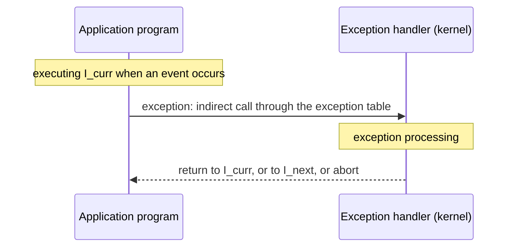
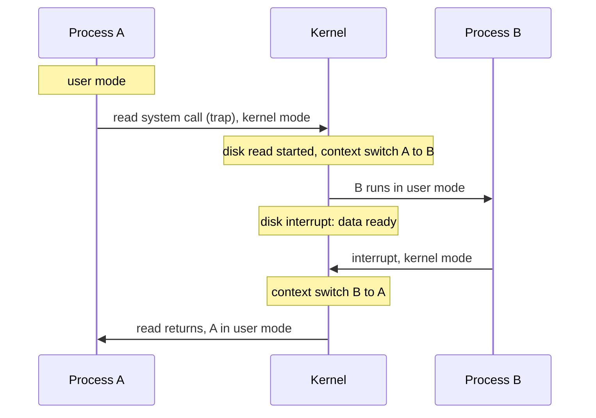

# Exceptions and the kernel

From the moment a processor is powered on until it is shut off, the program counter assumes a sequence of values $a_0, a_1, \dots, a_{n-1}$, each the address of an instruction $I_k$. Each transition from $a_k$ to $a_{k+1}$ is a **control transfer**, and the sequence is the processor's **control flow**. The simplest flow is "smooth": each instruction is adjacent in memory to the previous one. Jumps, calls and returns cause abrupt changes, but those react only to changes in *program state*.

Systems must also react to changes in *system state* that are not captured by program variables and not necessarily related to the running program: a hardware timer goes off, a packet arrives at the network adapter, a program requests data from disk and sleeps until it arrives, a child process terminates and its parent must be notified. Modern systems react by making abrupt changes in control flow called **exceptional control flow (ECF)**. ECF occurs at every level:

- **Hardware/OS level**: *exceptions*, events detected by hardware that transfer control to the kernel.
- **OS level**: *context switches*, transferring control between processes.
- **Application level**: *signals* (one process or the kernel interrupts another) and *nonlocal jumps* (`setjmp`/`longjmp`).

Why understand ECF? It is the basic mechanism operating systems use to implement I/O, processes and virtual memory. Applications request OS services through a form of ECF called a **trap** or **system call**. Writing a shell or a web server requires creating processes, waiting for them and handling signals. ECF is how concurrency is implemented. And language-level exceptions (`try`/`catch`/`throw` in C++ and Java) are built on nonlocal jumps.

## 1. Exceptions

An **exception** is an abrupt change in the control flow in response to some change in the processor's state, implemented partly by hardware and partly by the operating system.



The change in state is called an **event**. It may be directly related to the current instruction (a page fault, arithmetic overflow, divide by zero) or unrelated (a timer going off, an I/O request completing). When the processor detects an event, it makes an indirect procedure call through a jump table called the **exception table**, to an OS subroutine, the **exception handler**, designed to process that kind of event. When the handler finishes, one of three things happens, depending on the event:

1. The handler returns control to the **current instruction** $I_{curr}$, the one executing when the event occurred.
2. The handler returns control to the **next instruction** $I_{next}$, the one that would have executed next.
3. The handler **aborts** the interrupted program.

### Exception handling

Each type of exception is assigned a unique nonnegative **exception number**. Some are assigned by the processor's designers (divide by zero, page faults, memory access violations, breakpoints, arithmetic overflows), others by the OS kernel's designers (system calls, signals from external I/O devices).

At boot time, the OS allocates and initializes the exception table so that entry $k$ contains the address of the handler for exception $k$. The table's address is held in a special CPU register, the **exception table base register**. At run time, the processor detects an event, determines the exception number $k$, and triggers the exception by an indirect call through entry $k$.

An exception is like a procedure call, with important differences:

- The return address pushed is either the current or the next instruction, depending on the class.
- The processor also pushes additional state needed to restart the interrupted program, such as the `EFLAGS` register with the condition codes.
- If control passes from a user program to the kernel, these items are pushed onto the **kernel's stack**, not the user's.
- Handlers run in **kernel mode**, with complete access to all system resources.

After the handler has processed the event, it optionally returns to the interrupted program with a special "return from interrupt" instruction, which pops the state back into the processor's registers and restores **user mode** if the interrupted program was a user program.

## 2. Classes of exceptions

| Class | Cause | Async/sync | Return behavior |
|---|---|---|---|
| **Interrupt** | Signal from an I/O device | Asynchronous | Always returns to the next instruction |
| **Trap** | Intentional exception | Synchronous | Always returns to the next instruction |
| **Fault** | Potentially recoverable error | Synchronous | Might return to the current instruction |
| **Abort** | Nonrecoverable error | Synchronous | Never returns |

*Asynchronous* means caused by events in I/O devices external to the processor; *synchronous* means caused by executing an instruction (the "faulting instruction").

### Interrupts

I/O devices such as network adapters, disk controllers and timer chips trigger interrupts by signaling a pin on the processor chip and placing on the system bus the exception number identifying the device. **After the current instruction finishes**, the processor notices that the interrupt pin has gone high, reads the exception number, and calls the appropriate **interrupt handler**. When the handler returns, control goes to the next instruction: the program continues as though the interrupt had never happened.

### Traps and system calls

Traps are *intentional* exceptions that occur as a result of executing an instruction. Their most important use is to provide a procedure-like interface between user programs and the kernel: the **system call**. User programs often need services from the kernel, such as reading a file (`read`), creating a process (`fork`), loading a program (`execve`) or terminating (`exit`). Processors provide a special `syscall n` instruction for this. Executing it causes a trap to a handler that decodes the argument and calls the appropriate kernel routine.

From the programmer's perspective a system call looks like a function call, but the implementations differ fundamentally: regular functions run in **user mode**, which restricts the instructions they can execute, and they use the same stack as the caller; a system call runs in **kernel mode**, which allows privileged instructions, and accesses a stack defined in the kernel.

### Faults

Faults result from error conditions that a handler might be able to correct. When a fault occurs, the processor transfers control to the fault handler. If the handler can correct the condition, it returns control to the **faulting instruction**, re-executing it. Otherwise it returns to an `abort` routine in the kernel that terminates the application.

The classic example is the **page fault**: an instruction references a virtual address whose page is not in memory and must be retrieved from disk. The page fault handler loads the page from disk and returns control to the instruction that caused the fault. When it executes again, the page is in memory and the instruction runs to completion (Module 9).

### Aborts

Aborts result from unrecoverable fatal errors, typically hardware errors such as parity errors when DRAM or SRAM bits are corrupted. Abort handlers never return control to the application.

## 3. Exceptions in Linux/x86-64 systems

There are up to 256 exception types. Numbers 0–31 are defined by the Intel architects (identical on any x86-64 system); 32–255 correspond to interrupts and traps defined by the OS.

| Number | Description | Class |
|---|---|---|
| 0 | Divide error | Fault |
| 13 | General protection fault | Fault |
| 14 | Page fault | Fault |
| 18 | Machine check | Abort |
| 32–255 | OS-defined exceptions | Interrupt or trap |

- **Divide error (0)**: dividing by zero, or a quotient too big for the destination. Unix does not attempt to recover; it aborts the program. The shell reports "Floating exception" (even for integer division!).
- **General protection fault (13)**: many causes, usually a reference to an undefined area of virtual memory or a write to a read-only text segment. Linux does not recover; the shell reports **"Segmentation fault"**.
- **Page fault (14)**: the faulting instruction is restarted after the handler maps the page.
- **Machine check (18)**: a fatal hardware error detected during the faulting instruction; never returns.

### Linux/x86-64 system calls

Linux provides hundreds of system calls. Each has a unique integer number corresponding to an offset in a jump table in the kernel (not the exception table).

| Number | Name | Description | Number | Name | Description |
|---|---|---|---|---|---|
| 0 | `read` | Read file | 33 | `pause` | Suspend until signal arrives |
| 1 | `write` | Write file | 37 | `alarm` | Schedule delivery of alarm signal |
| 2 | `open` | Open file | 39 | `getpid` | Get process ID |
| 3 | `close` | Close file | 57 | `fork` | Create process |
| 4 | `stat` | Get info about file | 59 | `execve` | Execute a program |
| 9 | `mmap` | Map memory page to file | 60 | `_exit` | Terminate process |
| 12 | `brk` | Reset the top of the heap | 61 | `wait4` | Wait for a process to terminate |
| 32 | `dup2` | Copy file descriptor | 62 | `kill` | Send signal to a process |

C programs usually invoke them through wrapper functions in the standard library ("system-level functions"). On x86-64, a system call is made with the `syscall` instruction. All arguments are passed in registers, not on the stack: **`%rax` holds the syscall number**, and up to six arguments go in **`%rdi`, `%rsi`, `%rdx`, `%r10`, `%r8`, `%r9`** (note `%r10` where the function ABI uses `%rcx`). On return, `%rcx` and `%r11` are destroyed and `%rax` contains the return value. A negative return value between −4,095 and −1 indicates an error corresponding to negative `errno`.

Hello world written directly with system calls:

```c
int main() {
    write(1, "hello, world\n", 13);
    _exit(0);
}
```

```
main:
    movq $1, %rax          # write is system call 1
    movq $1, %rdi          # arg1: stdout has descriptor 1
    movq $string, %rsi     # arg2: hello world string
    movq $len, %rdx        # arg3: string length
    syscall                # make the system call
    movq $60, %rax         # _exit is system call 60
    movq $0, %rdi          # arg1: exit status is 0
    syscall
```

```python-run
# Python's os module wraps the same system calls.
import os, sys
n = os.write(1, b"hello, world\n")      # write(1, buf, 13)
print("write returned", n, "| pid", os.getpid())
```

> [!NOTE]
> Terminology varies. The book uses *exception* as the general term and *interrupt*, *trap*, *fault*, *abort* for the classes; "asynchronous exception" = interrupt. Many texts and Intel's manuals use "interrupt" and "exception" somewhat differently. Do not confuse these hardware/kernel exceptions with the software exceptions of C++/Java/Python.

## 4. Processes

Exceptions are the basic building blocks that allow the OS kernel to provide the notion of a **process**: *an instance of a program in execution*. Each program runs in the **context** of some process: the state it needs to run correctly, including the program's code and data in memory, its stack, the contents of its general-purpose registers, its program counter, environment variables, and the set of open file descriptors.

A process provides two key abstractions:

- An independent **logical control flow**: the illusion that our program has exclusive use of the processor.
- A **private address space**: the illusion that our program has exclusive use of the memory system.

### Logical control flow

If we single-stepped a program in a debugger, we would see a series of PC values belonging exclusively to our program's executable or shared objects. This sequence is a **logical control flow** (logical flow). On a single core running three processes, the one physical control flow is partitioned into three logical flows; each process runs for a while and is then **preempted** (temporarily suspended) while others take their turns. To the program it looks like exclusive use of the CPU, except that instructions occasionally appear to stall.

### Concurrent flows

A logical flow whose execution **overlaps in time** with another flow is a **concurrent flow**, and the two are said to run concurrently. Precisely: flows X and Y are concurrent iff X begins after Y begins and before Y finishes, or Y begins after X begins and before X finishes. The general phenomenon is **concurrency**. Each period during which a process executes a portion of its flow is a **time slice**; taking turns is **time slicing** or **multitasking**.

Concurrency is independent of the number of cores. If two flows overlap in time they are concurrent, even on a single processor. Flows running concurrently *on different cores or computers* are **parallel flows**: a proper subset of concurrent flows.

**Example.** Suppose flow A starts at time 0 and finishes at time 5 (being preempted from 2 to 4), flow B runs from 2 to 4, and flow C from 6 to 8. Then A and B are concurrent (B starts and ends within A's lifetime); A and C are not; B and C are not.

```python-run
def concurrent(x, y):                 # x, y = (start, end) of logical flows
    return x[0] < y[1] and y[0] < x[1]
flows = {"A": (0, 5), "B": (2, 4), "C": (6, 8)}
for p, q in (("A", "B"), ("A", "C"), ("B", "C")):
    print(p, q, "concurrent?", concurrent(flows[p], flows[q]))
```

### Private address space

On a machine with $n$-bit addresses, each process gets its own space of $2^n$ addresses: bytes of memory associated with a particular address in one process cannot in general be read or written by any other process. Each private address space has the same general organization (code segment starting at `0x400000`, data, heap, shared libraries, stack at the top of the user region, kernel above).

### User and kernel modes

To provide an airtight process abstraction, the processor must restrict the instructions an application can execute and the portions of the address space it can access. Processors provide this with a **mode bit** in some control register.

- When the mode bit is set, the process runs in **kernel mode** (supervisor mode): it can execute any instruction and access any memory location.
- Otherwise it runs in **user mode**: it may not execute **privileged instructions** (halt the processor, change the mode bit, initiate an I/O operation) nor directly reference code or data in the kernel area of the address space. Any attempt results in a fatal protection fault. User programs must access kernel code and data *indirectly* through the system call interface.

A process running application code starts in user mode. **The only way to change from user mode to kernel mode is via an exception**: an interrupt, a fault, or a trapping system call. The handler runs in kernel mode; when it returns to application code, the processor switches back to user mode.

Linux provides the **`/proc` filesystem**, which lets user-mode processes access the contents of kernel data structures as a hierarchy of text files: `/proc/cpuinfo`, or `/proc/<pid>/maps` for the memory segments of a process.

### Context switches

The kernel implements multitasking with a higher-level form of ECF, the **context switch**, built on top of the exception mechanism. The kernel maintains a **context** for each process: the state needed to restart a preempted process. It consists of the values of the general-purpose registers, floating-point registers, program counter, user's stack, status registers, kernel's stack, and various kernel data structures such as the **page table** (address space), the **process table** (information about the current process) and the **file table** (open files).

At certain points the kernel can decide to preempt the current process and restart a previously preempted one. This decision is **scheduling**, handled by kernel code called the **scheduler**. A context switch (1) saves the context of the current process, (2) restores the saved context of some previously preempted process, and (3) passes control to this newly restored process.

Context switches happen:

- while the kernel is executing a **system call** on behalf of the user: if the call blocks (e.g., `read` waiting for disk, or `sleep`), the kernel puts the process to sleep and switches to another;
- as a result of an **interrupt**: all systems have a periodic **timer interrupt**, typically every 1 ms or 10 ms; each time it fires the kernel can decide that the current process has run long enough.



> [!INTERVIEW]
> **"What happens during a system call?"** The user wrapper puts the syscall number in `%rax` and arguments in registers, then executes `syscall`: a trap. The CPU switches to kernel mode, saves the user PC/flags, switches to the kernel stack and jumps to the kernel's entry point, which dispatches through the syscall table. On return the CPU restores user state and mode. Cost: on the order of 100 ns to 1 µs (mode switch, cache/TLB pollution), far more than a function call, which is why buffered I/O batches many logical writes into few syscalls.

> [!INTERVIEW]
> **"Interrupt vs. trap vs. fault?"** Interrupt: asynchronous, from a device, resumes at the next instruction. Trap: synchronous and intentional (syscall, breakpoint), resumes at the next instruction. Fault: synchronous, possibly recoverable error (page fault), re-executes the faulting instruction if fixed. Abort: unrecoverable.

> [!INTERVIEW]
> **"What does a context switch cost, and why?"** Direct cost: saving/restoring registers and kernel bookkeeping, a few microseconds. Indirect cost, usually larger: the new process finds cold caches and (when the address space changes) a flushed or mismatched TLB. Thread switches within one process keep the address space, so they are cheaper.

## 5. System call error handling

When Unix system-level functions encounter an error, they typically return −1 and set the global integer variable `errno` to indicate what went wrong. Programmers should **always check for errors**, but many skip it because it bloats the code:

```c
if ((pid = fork()) < 0) {
    fprintf(stderr, "fork error: %s\n", strerror(errno));
    exit(0);
}
```

The book adopts **error-handling wrappers** (pioneered by W. Richard Stevens): for each base function `foo`, a wrapper `Foo` with identical arguments calls the base function, checks for errors, and terminates on any problem:

```c
pid_t Fork(void) {
    pid_t pid;
    if ((pid = fork()) < 0)
        unix_error("Fork error");
    return pid;
}
```

So a call shrinks to `pid = Fork();`. Remember when you read the rest of this module: capitalized names are these wrappers.

## 6. Summary

- ECF lets systems react to events outside the normal flow: exceptions (hardware/kernel), context switches (kernel), signals and nonlocal jumps (application).
- Exceptions dispatch through the exception table to kernel handlers running in kernel mode. Four classes: interrupts (async), traps, faults, aborts (sync).
- System calls are traps: number in `%rax`, arguments in `%rdi, %rsi, %rdx, %r10, %r8, %r9`.
- A process = logical control flow + private address space. Flows overlapping in time are concurrent; on different cores, parallel.
- User mode is restricted; only exceptions switch to kernel mode. Context switches save and restore process contexts, triggered by blocking system calls and timer interrupts.

## Check yourself

```quiz
[
  {"q": "Which class of exception is asynchronous?", "options": ["Trap", "Fault", "Interrupt", "Abort"], "answer": 2,
   "explain": "Interrupts come from I/O devices, unrelated to the instruction being executed."},
  {"q": "After a page fault is handled successfully, where does control return?", "options": ["To the next instruction", "To the faulting instruction, which is re-executed", "To the kernel's abort routine", "To main"], "answer": 1,
   "explain": "Faults return to the current (faulting) instruction so it can run again now that the page is present."},
  {"q": "In which register is the system call number passed on Linux/x86-64?", "options": ["%rdi", "%rax", "%rcx", "%r10"], "answer": 1,
   "explain": "%rax holds the number; arguments go in %rdi, %rsi, %rdx, %r10, %r8, %r9."},
  {"q": "What exception does a write to a read-only code page typically raise, and what does the shell print?", "options": ["Machine check; Abort", "General protection fault; Segmentation fault", "Divide error; Floating exception", "Page fault; Bus error"], "answer": 1,
   "explain": "Exception 13 is reported by Linux shells as a segmentation fault."},
  {"q": "Flow A runs during [0,5], flow B during [2,4], on a single core. Are they concurrent? Parallel?", "options": ["Concurrent and parallel", "Concurrent but not parallel", "Neither", "Parallel but not concurrent"], "answer": 1,
   "explain": "They overlap in time (concurrent) but a single core cannot run them simultaneously (not parallel)."},
  {"q": "How can a process switch from user mode to kernel mode?", "options": ["By setting the mode bit directly", "Only via an exception: interrupt, fault or trap", "By calling any library function", "By jumping to kernel addresses"], "answer": 1,
   "explain": "Changing the mode bit is privileged; exceptions are the controlled entry points into the kernel."},
  {"q": "Which of these is NOT part of a process's context saved on a context switch?", "options": ["General-purpose registers", "Program counter", "The contents of the L1 cache", "Kernel stack and page table"], "answer": 2,
   "explain": "Caches are not saved; in fact the switched-in process typically finds them cold, an indirect cost of context switching."},
  {"q": "Why does an interrupt handler return to the *next* instruction?", "options": ["The current instruction completes before the interrupt is taken", "The current instruction is skipped", "Interrupts are faults", "It restarts the program"], "answer": 0,
   "explain": "The processor checks the interrupt pin after finishing the current instruction, so execution resumes with the following one."}
]
```

> **Source:** CS:APP 3e, §8.1–8.3 (Exceptions: handling, classes, Linux/x86-64 exceptions and system calls; Processes: logical control flow, concurrent flows, private address space, user and kernel modes, context switches; System call error handling).
