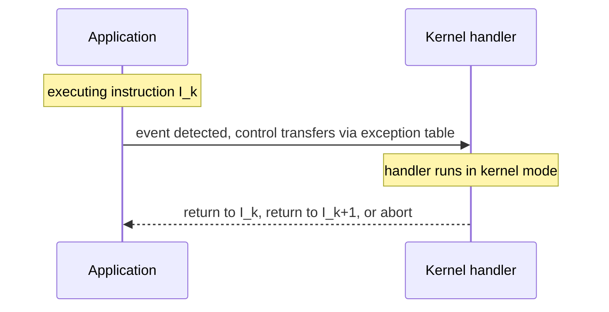
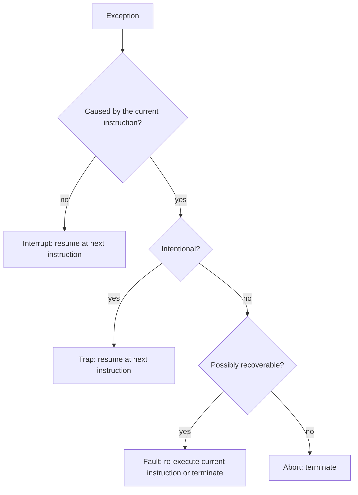
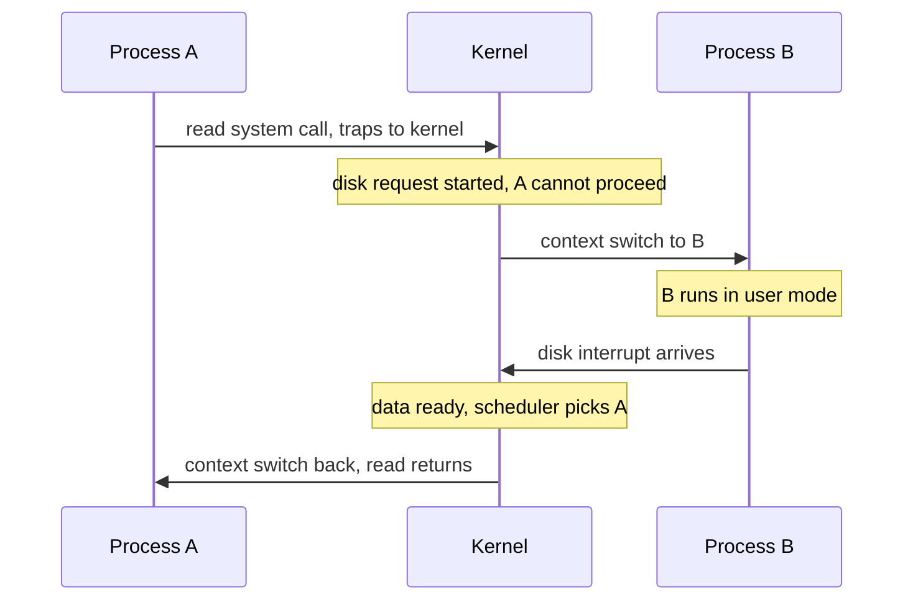

# Exceptions and the kernel

> **Before this lesson:** You need the idea of the operating system, the kernel and a process from [Caches, the OS, and the big themes](#/lesson/csapp/tour-os), and registers and the stack from [Procedures and the run-time stack](#/lesson/csapp/asm-procedures).

## In plain words

Normally a processor runs one instruction after another, in order. An **exception** is a sudden, forced detour: something happens, the processor stops what it was doing, runs a piece of operating-system code that deals with the event, and then usually returns to where it was. Picture reading a book when the doorbell rings. You place a bookmark, answer the door, come back and continue from the bookmark. Events of this kind include a key being pressed, a timer running out, a program asking the operating system for a service, and a program attempting something illegal such as dividing by zero. The core of the operating system that handles them is called the **kernel**.

Why this matters at work: every file read, network message and new program involves this mechanism, and so does every "segmentation fault" crash. Understanding it explains how one processor appears to run a hundred programs at once, and what a system call costs. It is the base for the following lessons on processes and signals and a frequent interview subject.

## Why look closer

A processor, left alone, does one thing: it fetches the instruction at the program counter, executes it, and moves on to the next. Jumps, calls and returns let a program steer that sequence, but only in response to its own internal state. Real systems need more. A key is pressed. A network packet lands. A timer says another program is due its turn. An instruction divides by zero or touches memory that is not there. A program wants to read a file, which only the operating system is allowed to do. Every one of these requires an abrupt change in what the processor is executing, triggered by something other than the program's ordinary logic. The mechanisms for that are grouped under the name **exceptional control flow**, and they exist at every layer: in hardware, in the kernel, and in applications. This lesson covers the lowest layer, exceptions, and then the two great abstractions the kernel builds from them: the process and the system call.

Why should an application programmer care? Because exceptions are how your program asks the OS for anything at all, how the OS shares one CPU among hundreds of programs, how a segmentation fault is produced, and the foundation for signals, concurrency and I/O in the lessons that follow.

## 1. What an exception is

Number the instructions a processor executes $I_0, I_1, I_2, \dots$ and call each step from one to the next a *control transfer*. The whole sequence is the processor's **control flow**. An **exception** is an abrupt transfer of control to the operating system in response to a change in the processor's state. The change is called an **event**. It may be related to the instruction currently executing (an arithmetic overflow, a page that is not in memory, a deliberate request for a system service) or have nothing to do with it (a timer expiring, an I/O device finishing).

When the processor detects an event, it makes an indirect call, through a table, to a piece of kernel code written to deal with exactly that kind of event: an **exception handler**. When the handler is done, one of three things happens, depending on the event:

1. control returns to the instruction that was executing when the event happened, so it runs again;
2. control returns to the instruction *after* it;
3. the interrupted program is aborted.



### How the handler is found

Every type of exception has a unique small non-negative integer, its **exception number**. Some numbers are fixed by the processor's designers (divide error, page fault, breakpoint, machine check); the rest are assigned by the kernel's designers (system calls, signals from particular devices).

When the system boots, the kernel builds a jump table called the **exception table**, where entry *k* holds the address of the handler for exception *k*. The table's starting address is kept in a special CPU register, the exception table base register. At run time, when event *k* is detected, the processor uses *k* as an index into the table and jumps to the address it finds.

```python-run
# The dispatch mechanism in miniature: number -> handler, looked up in a table built at "boot".
def divide_error(ctx):   return "abort: deliver SIGFPE"
def page_fault(ctx):     return "load the page, then RE-RUN the faulting instruction"
def timer_tick(ctx):     return "maybe switch to another process, resume at the NEXT instruction"
def system_call(ctx):    return f"perform service #{ctx['rax']}, resume at the NEXT instruction"

exception_table = {0: divide_error, 14: page_fault, 32: timer_tick, 128: system_call}

for number, ctx in ((14, {}), (128, {"rax": 1}), (0, {}), (32, {})):
    handler = exception_table[number]
    print(f"exception {number:3} -> {handler.__name__:13} -> {handler(ctx)}")
```

<!-- walkthrough:python-run -->
**Reading this Python line by line**

- The four `def` lines define four small functions, one per kind of event. Each takes one input, `ctx`, and returns text describing what the kernel would do.
- `exception_table = {0: divide_error, 14: page_fault, ...}` is a dictionary from an exception number to the function that handles it. The functions themselves are stored, not called.
- `for number, ctx in (...)` goes through four sample events, each a number with a small dictionary of register values.
- `handler = exception_table[number]` looks up the function for that number, and `handler(ctx)` calls it.
- Output: one line per event with the number, the handler's name and the action. A table lookup followed by an indirect call is the same mechanism the processor uses.

### How it differs from a function call

An exception resembles a procedure call, with some important differences:

- The return address pushed is either the current instruction or the next one, depending on the type of exception. A call always pushes the next.
- The processor also saves extra state that will be needed to resume the interrupted program, such as the flags register.
- If control is moving from a user program into the kernel, everything is pushed on the **kernel's stack**, not the user's. The kernel cannot trust a user stack pointer.
- Handlers run in **kernel mode**, with access to every instruction and all of memory.

After the handler finishes, it executes a special "return from interrupt" instruction that pops the saved state, restores user mode if that is where control came from, and resumes the interrupted program.

## 2. The four classes

Exceptions divide into four classes, and the classification is worth memorising because each has a different cause and a different return behaviour.

| Class | Cause | Sync or async | Returns to |
|---|---|---|---|
| **Interrupt** | signal from an I/O device | asynchronous | the next instruction |
| **Trap** | intentional, requested by an instruction | synchronous | the next instruction |
| **Fault** | an error that may be correctable | synchronous | the current instruction, or never |
| **Abort** | an unrecoverable error | synchronous | never |

*Asynchronous* means the event was caused by something outside the processor and unrelated to whatever instruction happened to be executing. *Synchronous* means it is the direct result of executing a particular instruction.

### Interrupts

Devices such as network adapters, disk controllers and timer chips signal the processor by raising a voltage on its interrupt pin and placing a number on the bus that identifies which device is calling. After finishing the current instruction, the processor notices the pin, reads the number, and calls the corresponding handler. When the handler returns, the next instruction of the interrupted program runs, and that program behaves as if nothing had happened. It is merely a little later than it would otherwise have been.

### Traps and system calls

A trap is an exception a program asks for on purpose. Its most important use is the **system call**: the doorway between a user program and the kernel. User code is not permitted to read a disk, create a process or open a network connection by itself. It places a request number in a register and executes a special instruction (`syscall` on x86-64). That traps into the kernel, which decodes the request, runs the matching kernel routine, and returns to the instruction after the trap.

From the programmer's seat a system call looks like a function call, and C libraries wrap each one in an ordinary function. The implementation is very different, though: an ordinary function runs in user mode with the caller's privileges and on the caller's stack, whereas a system call runs in kernel mode, on a kernel stack, with access to privileged instructions.

### Faults

A fault is an error condition that a handler *might* be able to repair. If the handler fixes the problem, it returns to the faulting instruction, which is executed again. If it cannot, it returns to a kernel routine that terminates the program.

The canonical example is the **page fault**. An instruction refers to a virtual address whose page is not currently in memory. The handler fetches the page from disk and returns; the instruction re-executes and now succeeds. The program never knows.

### Aborts

Aborts come from fatal hardware errors, such as a memory parity error detected by the machine. The handler never returns control to the program.



### What this looks like on Linux/x86-64

The architecture defines up to 256 exception types. Numbers 0 to 31 are fixed by the hardware specification; 32 to 255 are available to the operating system for interrupts and traps. A few that every programmer eventually meets:

| Number | Name | Class | What Linux does |
|---|---|---|---|
| 0 | divide error | fault | no recovery attempted; the shell prints "Floating exception" |
| 13 | general protection fault | fault | usually a reference to an undefined area or a write to read-only memory; "Segmentation fault" |
| 14 | page fault | fault | loads the page and restarts the instruction |
| 18 | machine check | abort | fatal hardware error; no return |
| 32–255 | OS-defined | interrupt or trap | device handlers, timers |

Note the oddity: an *integer* division by zero is reported with a floating-point-sounding message, for historical reasons.

## 3. System calls up close

Linux offers hundreds of system calls, each identified by a number that indexes a table inside the kernel. A handful that appear throughout these lessons:

| Number | Name | Purpose |
|---|---|---|
| 0 | `read` | read from a file |
| 1 | `write` | write to a file |
| 2 | `open` | open a file |
| 3 | `close` | close a file |
| 9 | `mmap` | map memory |
| 39 | `getpid` | process ID |
| 57 | `fork` | create a process |
| 59 | `execve` | run a program |
| 60 | `_exit` | terminate |
| 62 | `kill` | send a signal |

The x86-64 Linux convention for the `syscall` instruction: the call number goes in `%rax`; up to six arguments go in `%rdi`, `%rsi`, `%rdx`, `%r10`, `%r8`, `%r9`; the result comes back in `%rax`. A negative result between -4095 and -1 indicates an error, with the magnitude being the error code. The instruction itself overwrites `%rcx` and `%r11`.

A complete program that prints a line without any C library:

```asm
        .section .rodata
msg:    .ascii "exceptional\n"
        .text
        .globl _start
_start:
        movq $1, %rax          # write is system call 1
        movq $1, %rdi          # first argument: descriptor 1 (standard output)
        leaq msg(%rip), %rsi   # second argument: address of the bytes
        movq $12, %rdx         # third argument: byte count
        syscall
        movq $60, %rax         # _exit is system call 60
        movq $0, %rdi          # exit status 0
        syscall
```

<!-- walkthrough:asm -->
**Reading this assembly line by line**

- `.section .rodata` and `.text` are instructions to the assembler: the lines after them go in the read-only data area and the code area respectively.
- `msg: .ascii "exceptional\n"` stores the twelve bytes of the message and names their address `msg`.
- `.globl _start` and `_start:` mark the place where the program begins.
- `movq $1, %rax` puts 1 in `%rax`: the number of the `write` system call. `movq $1, %rdi` is its first argument, descriptor 1, the screen.
- `leaq msg(%rip), %rsi` puts the address of the message in `%rsi`, and `movq $12, %rdx` puts its length in `%rdx`.
- `syscall` hands control to the kernel, which writes the bytes. The last three lines request system call 60, `_exit`, with status 0, which ends the program.

Python's `os` module provides thin wrappers over the same calls, so we can exercise the mechanism directly.

```python-run
import os, errno

n = os.write(1, b"exceptional\n")            # the write system call on descriptor 1
print("write returned", n, "| my process ID is", os.getpid())

# How the kernel reports failure: the raw result is a small negative number; the library
# stores its magnitude in errno and returns -1 (Python turns that into an exception).
try:
    os.close(987)                             # a descriptor that is not open
except OSError as e:
    print(f"close(987) failed: errno {e.errno} = {errno.errorcode[e.errno]} ({os.strerror(e.errno)})")
```

### Checking for errors

When a Unix system-level function fails, it typically returns -1 and stores a code in the global variable `errno` describing why. Ignoring those return values is the single most common source of baffling behaviour in systems code: the failure happens here, and the symptom appears somewhere else much later. The discipline is tedious but simple: check **every** call.

```c
pid_t pid = fork();
if (pid < 0) {
    fprintf(stderr, "fork failed: %s\n", strerror(errno));
    exit(1);
}
```

<!-- walkthrough:c -->
**Reading this C line by line**

- `pid_t pid = fork();` calls the system function `fork` and stores what it returns in a variable named `pid`. `pid_t` is the type used for process numbers.
- `if (pid < 0) { ... }` checks for failure: system functions conventionally return a negative value when they could not do what was asked.
- `fprintf(stderr, "fork failed: %s\n", strerror(errno));` prints a message on the error output. `errno` holds a number saying why the call failed, `strerror` converts it to readable text, and `%s` marks where that text is inserted.
- `exit(1);` ends the program, reporting status 1 to signal that something went wrong.

Because that pattern bloats code, many projects define a thin wrapper per call that performs the check and terminates with a message on failure, so the main logic stays readable. For teaching code that is ideal; for production code you usually want to handle specific errors rather than exit.

## 4. Processes: the kernel's first great illusion

Exceptions are the building blocks for the most successful abstraction in computing. A **process** is an instance of a program in execution. Every program runs in the **context** of some process: its code and data in memory, its stack, the contents of the registers, its program counter, its environment variables and its set of open file descriptors.

A process hands the program two illusions:

- **An independent logical control flow**: the program appears to have the processor entirely to itself.
- **A private address space**: the program appears to have all of memory entirely to itself.

### Logical control flow

If you single-stepped a machine running several programs, you would see a series of program counter values. The subsequence belonging to one process is its **logical flow**. The processor's single physical flow is carved into slices, with each process running for a while and then being **preempted** (temporarily suspended) while others take their turn. Because the kernel saves and restores everything faithfully, each program behaves as though it ran without interruption; the only observable difference is elapsed time.

Two flows are **concurrent** if their lifetimes overlap, that is, if one begins after the other begins and before the other finishes. This has nothing to do with how many cores exist: two flows that take turns on one core are concurrent. If they actually execute at the same instant on different cores, they are additionally **parallel**. The practice of processes taking turns is **multitasking**, and each turn is a **time slice**.

```python-run
# Lifetimes of four flows as (start, finish). Concurrent means the intervals overlap.
flows = {"A": (0, 7), "B": (2, 4), "C": (5, 9), "D": (10, 12)}
names = sorted(flows)
for i, x in enumerate(names):
    for y in names[i + 1:]:
        (s1, f1), (s2, f2) = flows[x], flows[y]
        print(f"{x} and {y}:", "concurrent" if s1 < f2 and s2 < f1 else "not concurrent")
```

### Private address space

Each process gets its own address space, organised the same way for every program: code and data at the bottom, then the heap, shared libraries in the middle, the user stack near the top, and above all of that a region reserved for the kernel. A byte of memory in one process's space cannot, in general, be read or written by another process.

### User mode and kernel mode

For the kernel to maintain those illusions, the processor must be able to restrict what application code can do. It does so with a **mode bit** in a control register.

- With the bit set, the processor is in **kernel mode** (supervisor mode). Code may execute any instruction and access any memory location.
- With the bit clear, it is in **user mode**. Code may not execute **privileged instructions**: halting the CPU, changing the mode bit, starting an I/O operation. It may not touch the kernel's region of the address space. Trying either produces a protection fault.

Application code always starts in user mode, and **the only way to get from user mode to kernel mode is through an exception**: an interrupt, a fault, or a trapping system call. The handler runs in kernel mode, and the mode is switched back when it returns. That single controlled gateway is what makes protection possible.

Linux lets user programs peek at kernel data safely through the `/proc` filesystem, which presents kernel structures as readable text files, for example `/proc/cpuinfo` or `/proc/<pid>/maps`.

### Context switches

Multitasking is implemented with a higher-level form of exceptional control flow, the **context switch**, built from the lower-level exception mechanism. The kernel maintains a context for each process: the general-purpose and floating-point registers, program counter, user stack pointer, status registers, kernel stack, and kernel structures such as the page table, a process table, and a file table.

At certain moments the kernel decides to preempt the running process and resume another. That decision is **scheduling**, and the code that makes it is the **scheduler**. A context switch then:

1. saves the context of the current process,
2. restores the saved context of the chosen process,
3. passes control to it.

When do context switches happen?

- **During a system call that blocks.** A `read` from disk will take milliseconds. Rather than wait, the kernel runs someone else, and switches back after the disk interrupts to say the data is ready. `sleep` is an explicit request to be switched out.
- **On a timer interrupt.** Every system has a periodic timer, typically firing every 1 to 10 milliseconds. The handler lets the kernel decide that the current process has had long enough.



Switches are not free. Beyond the direct cost of saving and restoring registers, the new process finds the caches and the TLB filled with someone else's data, so it runs slowly until they warm up.

```python-run
# A round-robin scheduler with a 3 ms time slice: the timer interrupt preempts whoever is running.
from collections import deque
ready = deque([["editor", 5], ["compiler", 9], ["backup", 4]])     # name, CPU ms still needed
clock, switches, timeline = 0, 0, []
while ready:
    name, need = ready.popleft()
    run = min(3, need)
    timeline.append(f"{name}:{clock}-{clock + run}")
    clock += run
    if need > run:
        ready.append([name, need - run])          # timer interrupt: preempted, back of the queue
    if ready:
        switches += 1
print("  ".join(timeline))
print("context switches:", switches, "| total CPU time:", clock, "ms")
```

> [!INTERVIEW]
> **"What happens during a system call?"** The wrapper puts the call number and arguments in registers and executes a trap instruction. The CPU switches to kernel mode, saves the return address and flags, switches to the process's kernel stack, and jumps to the kernel's entry point. The kernel validates the arguments, performs the service, puts the result in the return register, and executes a return instruction that restores user mode. If the call must wait, the kernel context-switches to another process in the meantime.

> [!INTERVIEW]
> **"Interrupt, trap, fault, abort: what is the difference?"** Interrupts are asynchronous, from devices, and resume at the next instruction. Traps are deliberate (system calls, breakpoints) and resume at the next instruction. Faults are possibly recoverable errors and re-execute the same instruction if fixed (page fault) or kill the process if not (protection violation). Aborts are unrecoverable hardware errors. A crisp four-line answer signals real understanding.

## 5. Pitfalls

- **Mixing up mode switch and context switch.** Entering the kernel for a system call or interrupt changes the *mode* but stays within the same process. A context switch changes *which process* is running. Many system calls never cause a context switch.
- **Assuming a fault means a bug.** Page faults are routine and invisible; only unrecoverable faults become signals.
- **Believing "concurrent" requires multiple cores.** Overlapping lifetimes suffice.
- **Ignoring return values of system calls.** The error will resurface far away.
- **Reading `errno` when no error occurred,** or after another library call has overwritten it. Check the return value first, then read `errno` immediately.
- **Treating the kernel as a separate process.** It is not. Kernel code runs within the context of whatever process was current, on that process's kernel stack.
- **Confusing hardware exceptions with language exceptions.** A C++ or Python `try`/`catch` is an application-level control mechanism and involves the kernel not at all.

## Summary

- Exceptional control flow is any change in execution order not produced by ordinary jumps, calls and returns. At the hardware level the mechanism is the exception: an event causes an indirect jump through the exception table to a kernel handler.
- Interrupts are asynchronous and come from devices; traps are intentional and implement system calls; faults may be corrected, in which case the instruction is re-executed; aborts are fatal.
- A system call places a number in `%rax` and arguments in registers, executes `syscall`, and receives the result in `%rax`. Always check the result.
- A process is a running program with its own logical control flow and private address space.
- The mode bit separates unrestricted kernel mode from restricted user mode; exceptions are the only route from user to kernel.
- The kernel multitasks by context switching: saving one process's context and restoring another's, triggered by blocking system calls and timer interrupts.

## Glossary

- **Control flow**: the sequence of instructions the processor executes.
- **Exception**: an abrupt transfer of control to the operating system in response to an event.
- **Exception handler**: the kernel code that runs to deal with one kind of exception.
- **Exception table**: a list, set up at start-up, giving the handler's address for each exception number.
- **Interrupt**: an exception caused by a device, unrelated to the instruction being run.
- **Trap**: an exception a program causes on purpose, most often to make a system call.
- **Fault**: an exception caused by an error that the handler may be able to repair, such as a page fault.
- **Abort**: an exception caused by an unrecoverable error.
- **System call**: a request from a program for a service that only the kernel may perform.
- **`errno`**: a variable in which C library functions report the reason for a failure.
- **Kernel mode / user mode**: the unrestricted state in which the kernel runs / the restricted state in which programs run.
- **Process**: a running program together with its own memory and state.
- **Context switch**: saving one process's state and restoring another's so the processor changes task.
- **Scheduler**: the kernel code that decides which process runs next.

```quiz
[
  {"q": "Which class of exception is asynchronous?",
   "options": ["Trap", "Fault", "Interrupt", "Abort"],
   "answer": 2, "explain": "Interrupts are caused by external devices and are unrelated to the instruction being executed. The other three result from executing a specific instruction."},
  {"q": "After the kernel successfully handles a page fault, where does execution resume?",
   "options": ["At the instruction after the one that faulted", "At the same instruction that faulted, which is executed again", "At the start of main", "In the signal handler for SIGSEGV"],
   "answer": 1, "explain": "A corrected fault returns to the faulting instruction so that it can run again, this time with the page present."},
  {"q": "How does a user program transfer from user mode to kernel mode?",
   "options": ["By calling any library function", "By setting the mode bit directly", "Only via an exception: an interrupt, fault or trap", "By jumping to a kernel address"],
   "answer": 2, "explain": "Changing the mode bit is privileged and kernel memory is inaccessible from user mode. Exceptions provide the sole controlled entry point."},
  {"q": "On x86-64 Linux, which register holds the system call number when the syscall instruction executes?",
   "options": ["%rdi", "%rax", "%rsp", "%rcx"],
   "answer": 1, "explain": "The number goes in %rax, arguments in %rdi, %rsi, %rdx, %r10, %r8 and %r9, and the result returns in %rax."},
  {"q": "Flow X runs from time 1 to 6 and flow Y from time 4 to 9 on a single-core machine. Which statement is true?",
   "options": ["They are concurrent and parallel", "They are concurrent but not parallel", "They are neither", "They are parallel but not concurrent"],
   "answer": 1, "explain": "Their lifetimes overlap, so they are concurrent. With only one core they cannot execute at the same instant, so they are not parallel."},
  {"q": "Which event does NOT by itself force a context switch?",
   "options": ["A process calling sleep", "A read system call that must wait for the disk", "A getpid system call", "A timer interrupt at the end of a time slice"],
   "answer": 2, "explain": "getpid enters the kernel, copies a number and returns to the same process. It changes mode briefly but there is no need to run another process."},
  {"q": "What does the exception table contain?",
   "options": ["The saved registers of each process", "For each exception number, the address of its handler", "The list of open files", "Return addresses of user functions"],
   "answer": 1, "explain": "It is a jump table built at boot. The processor indexes it with the exception number to locate the handler."},
  {"q": "When an exception occurs while user code is running, where is the processor state saved?",
   "options": ["On the user stack", "On the kernel stack", "In the exception table", "On disk"],
   "answer": 1, "explain": "The kernel cannot rely on the user stack pointer being valid or safe, so state is pushed on the per-process kernel stack."}
]
```

> **Source:** CS:APP 3e, §8.1–8.3
