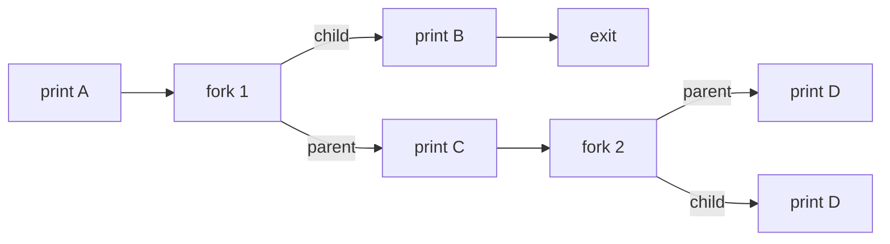
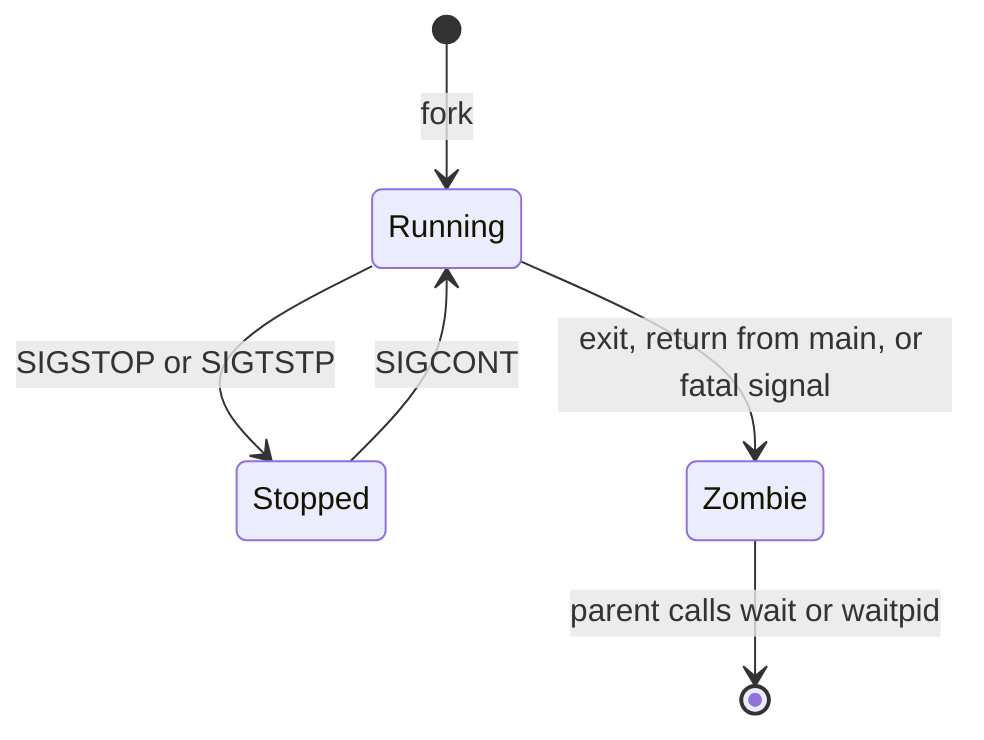
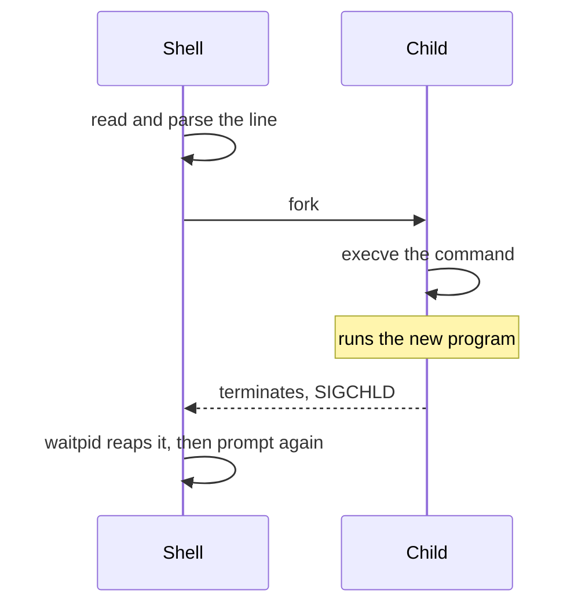

# Processes: fork, exec, wait

> **Before this lesson:** You need exceptions, system calls, user and kernel mode, and the definition of a process from [Exceptions and the kernel](#/lesson/csapp/exceptions). The examples are short C programs; you should be able to follow an `if` statement and a function call.

## In plain words

A **process** is a program that is currently running, together with its own private memory. On Unix-like systems such as Linux and macOS, a new process is created in a way that surprises newcomers. A running program asks the operating system to make an exact copy of itself. That request is called `fork`. The copy, known as the **child**, can then replace its own contents with a different program, which is called `exec`. The original, known as the **parent**, can pause until the child is done, which is called `wait`. Think of a manager who needs a job done: the manager photocopies their own notebook and hands it to an assistant (fork), the assistant swaps the notebook for the instruction sheet of the new job (exec), and the manager waits at the door for the result (wait).

Why this matters at work: every command typed in a terminal runs this way, and so do web servers, build tools and test runners. Mistakes here produce well-known problems such as "zombie" processes that fill up system tables. Predicting what a program with several `fork` calls prints is a standard interview exercise.

## Why look closer

Type `ls` in a terminal and something remarkable happens in a few milliseconds. Your shell, itself an ordinary program, creates a second process that is a near-perfect clone of itself. The clone then throws away its own code and replaces it with the `ls` program. The shell goes to sleep until the clone finishes, collects its exit status, and prints a new prompt. That choreography uses exactly four system calls: `fork`, `execve`, `waitpid` and `exit`. They are the whole of Unix process control, and they turn up everywhere: in shells, web servers, build tools, container runtimes and test harnesses. This lesson teaches each call, the mental tool for predicting what a forking program prints, the meaning of zombies and orphans, and finally assembles the pieces into a working shell skeleton.

## 1. Identity and the three states

Every process has a unique positive integer **process ID** (PID). Two calls report identity:

```c
#include <unistd.h>
pid_t getpid(void);     /* my PID */
pid_t getppid(void);    /* PID of the process that created me */
```

From the programmer's standpoint a process is always in one of three states:

- **Running.** It is either executing on a CPU or waiting in line for the scheduler to give it one.
- **Stopped.** Execution is suspended and it will not be scheduled. A process stops when it receives `SIGSTOP`, `SIGTSTP`, `SIGTTIN` or `SIGTTOU`, and stays stopped until it gets `SIGCONT`.
- **Terminated.** It is finished for good. That happens in three ways: receiving a signal whose default action is to terminate, returning from `main`, or calling `exit`.

```c
#include <stdlib.h>
void exit(int status);   /* never returns */
```

Returning *n* from `main` is equivalent to calling `exit(n)`. By convention a status of zero means success and anything else means failure.

## 2. fork: creating a process

```c
#include <unistd.h>
pid_t fork(void);
```

`fork` creates a new **child** process that is almost identical to the calling **parent**. The child receives:

- its own separate copy of the parent's user-level virtual address space: code, data, heap, shared libraries and stack;
- copies of all the parent's open file descriptors, so it can read and write whatever files the parent had open at that moment.

The most significant difference is the PID.

What makes `fork` feel strange is that it is **called once and returns twice**: once in the parent and once in the brand-new child. The return value tells each which one it is.

- In the **parent**, it returns the child's PID, which is always positive.
- In the **child**, it returns 0.
- If no process could be created, it returns -1 in the parent.

```c
int main(void) {
    int counter = 10;
    pid_t pid = fork();
    if (pid == 0) {                       /* child */
        counter += 5;
        printf("child : counter=%d\n", counter);
        exit(0);
    }
    counter -= 5;                         /* parent */
    printf("parent: counter=%d\n", counter);
    return 0;
}
```

That small program illustrates four properties you should know cold.

1. **Call once, return twice.**
2. **Concurrent execution.** Parent and child are independent processes. The kernel may interleave them in any way, so the two lines can appear in either order. Never assume one runs first.
3. **Duplicate but separate address spaces.** At the instant `fork` returns, `counter` is 10 in both. After that, each has a private copy: the child prints 15 and the parent prints 5. Neither change is visible to the other.
4. **Shared files.** Both inherited the same open standard output, so both lines land on the same terminal.

```python-run
# What the two processes see, modelled without actually forking.
import copy
parent_memory = {"counter": 10}
child_memory = copy.deepcopy(parent_memory)     # fork: the child gets a private copy
child_memory["counter"] += 5
parent_memory["counter"] -= 5
print("child  sees counter =", child_memory["counter"])
print("parent sees counter =", parent_memory["counter"])
print("possible terminal outputs: child line then parent line, OR parent line then child line")
```

### Process graphs

To reason about programs with several forks, draw a **process graph**. Each vertex is the execution of a statement. A directed edge *a → b* means *a* happens before *b*. Each `fork` vertex has two outgoing edges, one continuing the parent and one starting the child. Any **topological ordering** of the graph, that is, any listing of the vertices in which every edge points forward, is a feasible order of execution; anything else is impossible.

Consider:

```c
int main(void) {
    printf("A\n");
    if (fork() == 0) {
        printf("B\n");
        exit(0);
    }
    printf("C\n");
    fork();
    printf("D\n");
    return 0;
}
```



`A` always comes first. `B` can appear anywhere after it. `C` must precede both `D`s. So `A B C D D`, `A C B D D` and `A C D D B` are all possible, while `A D C B D` is not, because a `D` appears ahead of `C`.

The demo enumerates every feasible output from the graph.

```python-run
from itertools import permutations
events = ["A", "B", "C", "D1", "D2"]
before = [("A", "B"), ("A", "C"), ("C", "D1"), ("C", "D2")]    # edges of the process graph

outputs = set()
for order in permutations(events):
    pos = {e: i for i, e in enumerate(order)}
    if all(pos[a] < pos[b] for a, b in before):
        outputs.add(" ".join(e[0] for e in order))
print(len(outputs), "distinct feasible outputs:")
for line in sorted(outputs):
    print("  ", line)
print("is 'A D C B D' feasible?", "A D C B D" in outputs)
```

### Counting processes

A standard exercise: how many lines does this print?

```c
fork();
fork();
fork();
printf("hi\n");
```

Every process that reaches a `fork` becomes two. Three unconditional forks in a row give $2^3 = 8$ processes, so eight lines. Be careful when forks are conditional. In

```c
if (fork() == 0)
    fork();
printf("hi\n");
```

only the first child executes the second fork, so there are three processes and three lines.

```python-run
def count(program):
    """program: list of steps; 'fork' doubles, 'child_only_fork' forks only in processes that are fresh children."""
    procs = [{"fresh_child": False}]
    for step in program:
        nxt = []
        for p in procs:
            if step == "fork" or (step == "child_only_fork" and p["fresh_child"]):
                nxt += [{"fresh_child": False}, {"fresh_child": True}]
            else:
                nxt.append({"fresh_child": False} if step == "child_only_fork" else p)
        procs = nxt
    return len(procs)

print("fork; fork; fork          ->", count(["fork", "fork", "fork"]), "processes")
print("if (fork()==0) fork();    ->", count(["fork", "child_only_fork"]), "processes")
print("n forks in a loop, n=10   ->", 2 ** 10, "processes")
```

## 3. Zombies, orphans and reaping

When a process terminates, the kernel does not erase it at once. It lingers in a terminated state until its parent **reaps** it by collecting its exit status. Only then does the kernel discard it. A process that has terminated but has not been reaped is a **zombie**. A zombie runs no code, but it still occupies a slot in the kernel's process table and a PID.

What if the parent dies first? The kernel arranges for the **`init` process**, PID 1, which is created at boot and never exits, to become the adoptive parent of any orphaned children; it reaps them when they finish. So zombies are harmless in short-lived programs: when the parent exits, `init` cleans up. In long-running programs such as shells and servers they are a genuine leak. A server that forks a child per request and never reaps will eventually be unable to create processes at all.



### waitpid

```c
#include <sys/wait.h>
pid_t waitpid(pid_t pid, int *statusp, int options);
pid_t wait(int *statusp);        /* same as waitpid(-1, statusp, 0) */
```

By default (`options` equal to 0), `waitpid` suspends the caller until a child in its **wait set** terminates. If one has already terminated, it returns immediately. Either way it returns the PID of that child, and the child has now been reaped.

**Which children?** The first argument picks the wait set: a positive `pid` means that one child; `-1` means all of the caller's children.

**Changing the behaviour.** `options` can combine:

| Option | Effect |
|---|---|
| `WNOHANG` | return 0 at once if no child in the set has finished yet; useful for polling while doing other work |
| `WUNTRACED` | also return for children that have been *stopped*, not only terminated |
| `WCONTINUED` | also return when a stopped child is resumed by `SIGCONT` |

**How did it end?** If `statusp` is not null, an encoded status is stored there, to be picked apart with macros:

| Macro | Meaning |
|---|---|
| `WIFEXITED(s)` | true if the child ended normally through `exit` or a return |
| `WEXITSTATUS(s)` | the exit status, valid when the above is true |
| `WIFSIGNALED(s)` | true if the child was killed by an uncaught signal |
| `WTERMSIG(s)` | which signal, valid when the above is true |
| `WIFSTOPPED(s)` / `WSTOPSIG(s)` | the child is currently stopped, and by which signal |

**Errors.** If the caller has no children, `waitpid` returns -1 with `errno` set to `ECHILD`. If the call was interrupted by a signal, it returns -1 with `EINTR`.

A typical pattern creates several children and reaps them all:

```c
#define N 3
pid_t pid[N];
for (int i = 0; i < N; i++)
    if ((pid[i] = fork()) == 0)
        exit(40 + i);                         /* each child reports a distinct status */

int status;
pid_t done;
while ((done = waitpid(-1, &status, 0)) > 0)  /* any child, in whatever order they finish */
    if (WIFEXITED(status))
        printf("child %d exited with %d\n", (int)done, WEXITSTATUS(status));
if (errno != ECHILD)
    perror("waitpid");
```

With `-1` the children are reaped in the order they happen to finish, which is not deterministic. To reap in creation order, wait for each specific `pid[i]` in turn.

The real thing in Python, with a fallback where `fork` does not exist (Windows, or the browser sandbox):

```python-run
import os

def real_demo():
    pids = []
    for i in range(3):
        pid = os.fork()
        if pid == 0:
            os._exit(40 + i)                   # child: exit immediately with a distinct status
        pids.append(pid)
    for pid in pids:                           # reap in creation order
        _, status = os.waitpid(pid, 0)
        print("child exited normally:", os.WIFEXITED(status), "| status:", os.WEXITSTATUS(status))

if hasattr(os, "fork"):
    try:
        real_demo()
    except OSError as exc:
        print("fork failed in this environment:", exc)
else:
    print("os.fork is not available on this platform; expected output on Linux:")
    for i in range(3):
        print("child exited normally: True | status:", 40 + i)
```

### Putting a process to sleep

`sleep(secs)` suspends the caller for the given time. It returns 0 if the full time elapsed, or the number of seconds remaining if a signal handler cut it short. `pause()` sleeps until any signal is caught.

## 4. execve: becoming a different program

```c
#include <unistd.h>
int execve(const char *filename, char *const argv[], char *const envp[]);
```

`execve` loads and runs the executable `filename` *within the current process*, passing it an argument list and an environment list. It discards the existing program's code, data, heap and stack and starts the new program from its entry point.

- **Called once, never returns** on success. There is nothing to return to. It returns only on failure, for instance if the file cannot be found, in which case the return value is -1.
- **It does not create a process.** The PID stays the same. So do the open file descriptors, which is what makes redirection possible.

Both lists are null-terminated arrays of string pointers. By convention `argv[0]` is the program's name. Each environment string has the form `NAME=value`. When the new program's `main` begins, it receives them as its parameters:

```c
int main(int argc, char *argv[], char *envp[]);
```

The start-up stack is laid out, from the top downward, as: the environment and argument strings themselves; then the null-terminated array of environment pointers; then the null-terminated array of argument pointers; and then the frame for the start-up routine that calls `main`. The environment can be queried and changed with `getenv`, `setenv` and `unsetenv`.

> [!NOTE]
> **Program versus process.** A program is a passive bundle of code and data, stored as a file or as a segment in memory. A process is one particular running instance of a program. `fork` runs the *same program* in a *new process*. `execve` runs a *new program* in the *same process*. Keeping the two words apart is the key to understanding both calls.

Why are creation and loading separate calls? Because the gap between them is extremely useful. Between `fork` and `execve` the child is still running the parent's code, and can rearrange its own descriptors, environment, working directory, signal handling and process group before the new program starts, entirely unknown to that program.

## 5. A shell in thirty lines

A **shell** is an interactive program that runs other programs on a user's behalf. Its heart is a read–evaluate loop:

1. print a prompt and read a command line;
2. split it into an argument vector;
3. if the first word is a **built-in** command (such as `cd`, `jobs` or `quit`), carry it out directly inside the shell;
4. otherwise `fork` a child, have the child `execve` the named program, and, if the job is in the foreground, wait for it. A trailing `&` requests a **background** job, for which the shell does not wait.

```c
void evaluate(char *line) {
    char *argv[MAXARGS];
    int background = split(line, argv);        /* returns 1 if the line ended with & */
    if (argv[0] == NULL) return;               /* empty line */
    if (is_builtin(argv)) return;              /* handled in the shell itself */

    pid_t pid = fork();
    if (pid == 0) {                            /* child becomes the command */
        execve(argv[0], argv, environ);
        fprintf(stderr, "%s: command not found\n", argv[0]);
        exit(127);                             /* only reached if execve failed */
    }
    if (!background) {
        int status;
        waitpid(pid, &status, 0);              /* foreground: wait and reap */
    } else {
        printf("[%d] %s", (int)pid, line);     /* background: carry on */
    }
}
```



Some points worth noticing:

- **Why must `cd` be a built-in?** A child that changed its own working directory would have no effect on the shell. The shell has to change its own.
- **Why the `exit` after `execve`?** If the program cannot be found, `execve` returns, and without the `exit` the child would carry on as a second copy of the shell, reading commands in competition with the original.
- **The flaw in this skeleton:** background jobs are never reaped, so they become zombies. Fixing that properly needs a `SIGCHLD` handler, which is the subject of the next lesson.

```python-run
# The shell's evaluation logic with the system calls replaced by prints.
BUILTINS = {"cd", "quit", "jobs"}
def evaluate(line):
    words = line.split()
    if not words:
        return "empty line: nothing to do"
    background = words[-1] == "&"
    if background:
        words.pop()
    if words[0] in BUILTINS:
        return f"built-in {words[0]!r}: run inside the shell process"
    plan = f"fork; child calls execve({words[0]!r}, argv={words})"
    return plan + ("; shell does NOT wait" if background else "; shell calls waitpid")

for line in ("ls -l /tmp", "sleep 30 &", "cd projects", ""):
    print(f"{line!r:16} -> {evaluate(line)}")
```

> [!INTERVIEW]
> **"What is a zombie process and how do you get rid of one?"** A zombie is a child that has terminated but whose parent has not yet called `wait`. The kernel keeps its exit status and process-table entry until then. You cannot kill a zombie because it is already dead; you make the parent reap it, or, if the parent itself exits, `init` adopts and reaps it. Long-running parents avoid zombies by handling `SIGCHLD` and calling `waitpid` in a loop.

> [!INTERVIEW]
> **"Why does Unix split process creation into `fork` and `exec`?"** The window between them lets the child configure itself with ordinary code: redirect descriptors with `dup2`, change directory, adjust the environment, drop privileges, alter signal dispositions. A single combined "spawn" call would need a parameter for every such option. Copy-on-write keeps the `fork` cheap even though most of the copied address space is thrown away immediately.

## 6. Pitfalls

- **Assuming an order between parent and child.** Any interleaving consistent with the process graph can happen.
- **Forgetting to end the child.** A child that falls out of its `if` block continues into the parent's code, often creating more children inside a loop: an accidental fork bomb.
- **Expecting shared variables.** After `fork`, memory is private to each process. To communicate, use pipes, files, sockets or shared mappings.
- **Not reaping children** in a long-lived parent.
- **Reading the status without the macros.** The integer is an encoding, not the exit code itself.
- **Expecting `execve` to return.** Code after it runs only if it failed.
- **Passing an argument array without the terminating null pointer.**
- **Unflushed output before `fork`.** Text sitting in a `printf` buffer is copied into the child and printed twice.

## Summary

- A process is running, stopped, or terminated. It terminates through a fatal signal, a return from `main`, or `exit`.
- `fork` clones the caller. It returns the child's PID to the parent and 0 to the child. The two run concurrently with separate copies of memory and shared open files.
- Process graphs capture the ordering constraints; the feasible outputs are the topological orderings.
- Terminated children remain zombies until reaped with `wait` or `waitpid`, which also reports how the child ended. Orphans are adopted and reaped by `init`.
- `execve` replaces the program running in the current process, keeping its PID and open descriptors, and returns only on error.
- A shell is a loop of read, parse, `fork`, `execve`, and `waitpid` for foreground jobs.

## Glossary

- **Process**: a running instance of a program with its own memory.
- **PID (process ID)**: the unique number the system gives each process.
- **Parent / child**: the process that calls `fork` / the new process that results.
- **`fork`**: the system call that creates a child as a near-exact copy of the caller.
- **`execve`**: the system call that replaces the program running in the current process with another.
- **`exit`**: the call by which a process ends itself and reports a status number.
- **Exit status**: a small number left by a finished process; zero conventionally means success.
- **`waitpid`**: the system call by which a parent waits for a child to finish and collects its status.
- **Reaping**: a parent collecting a finished child's status so the system can discard its record.
- **Zombie**: a process that has finished but has not yet been reaped.
- **Orphan**: a child whose parent has already ended; the `init` process adopts it.
- **Process graph**: a diagram of which events in a forking program must come before which others.
- **Shell**: a program that reads commands and runs other programs for the user.
- **Environment variable**: a named text value, such as `PATH`, passed to a program when it starts.

```quiz
[
  {"q": "What does fork return in the child process?",
   "options": ["The parent's PID", "The child's own PID", "0", "-1"],
   "answer": 2, "explain": "The child receives 0 and the parent receives the child's PID. A child can find its own PID with getpid and its parent's with getppid."},
  {"q": "How many times is the message printed by: fork(); fork(); printf(\"x\\n\");",
   "options": ["2", "3", "4", "8"],
   "answer": 2, "explain": "Each fork doubles the number of processes: 1, 2, 4. All four execute the printf."},
  {"q": "A parent sets x = 3 and forks. The child executes x = x + 4. What value of x does the parent see afterwards?",
   "options": ["3", "7", "4", "It is undefined"],
   "answer": 0, "explain": "The child has its own copy of the address space, so its assignment does not affect the parent's variable."},
  {"q": "A program prints P, then forks; the child prints Q and exits; the parent prints R. Which output is impossible?",
   "options": ["P Q R", "P R Q", "Q P R", "All are possible"],
   "answer": 2, "explain": "P is printed before the fork, so it precedes both Q and R in every feasible ordering. Q and R may appear in either order."},
  {"q": "What is a zombie?",
   "options": ["A process whose parent has terminated", "A terminated process that has not yet been reaped by its parent", "A stopped process waiting for SIGCONT", "A process blocked on I/O"],
   "answer": 1, "explain": "The kernel keeps a terminated child's status until the parent waits for it. In that interval it is a zombie."},
  {"q": "Which statement about execve is correct?",
   "options": ["It creates a new process with a new PID", "It replaces the current program in the same process and does not return on success", "It returns twice", "It closes all open file descriptors"],
   "answer": 1, "explain": "execve overlays the address space with the new program. PID and open descriptors are preserved, and control never returns unless the call fails."},
  {"q": "A parent calls waitpid(-1, &status, WNOHANG) while all of its children are still running. What is returned?",
   "options": ["-1 with errno ECHILD", "0 immediately", "It blocks until a child ends", "The PID of the oldest child"],
   "answer": 1, "explain": "WNOHANG makes the call non-blocking: it returns 0 when children exist but none has terminated yet."},
  {"q": "Why must a shell implement cd as a built-in command?",
   "options": ["Because cd is too slow as a program", "Because a child process changing its own working directory would not affect the shell", "Because execve cannot run cd", "Because cd needs kernel mode"],
   "answer": 1, "explain": "The working directory is per-process state. Only the shell itself can change the shell's directory."}
]
```

> **Source:** CS:APP 3e, §8.4
