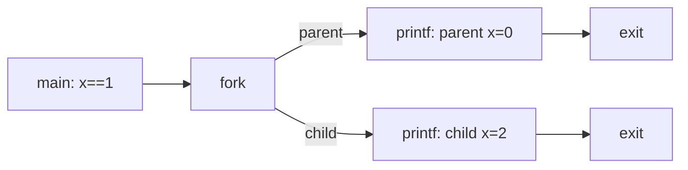
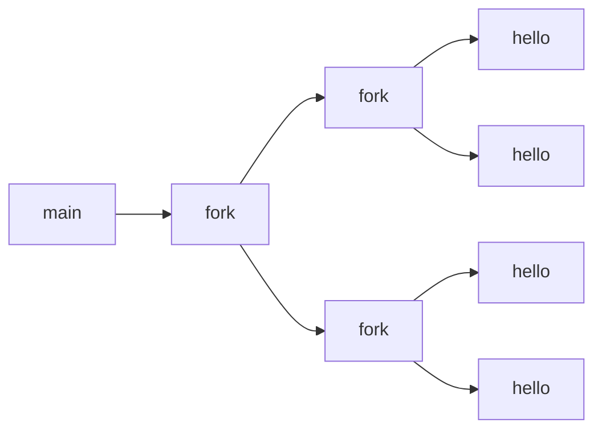
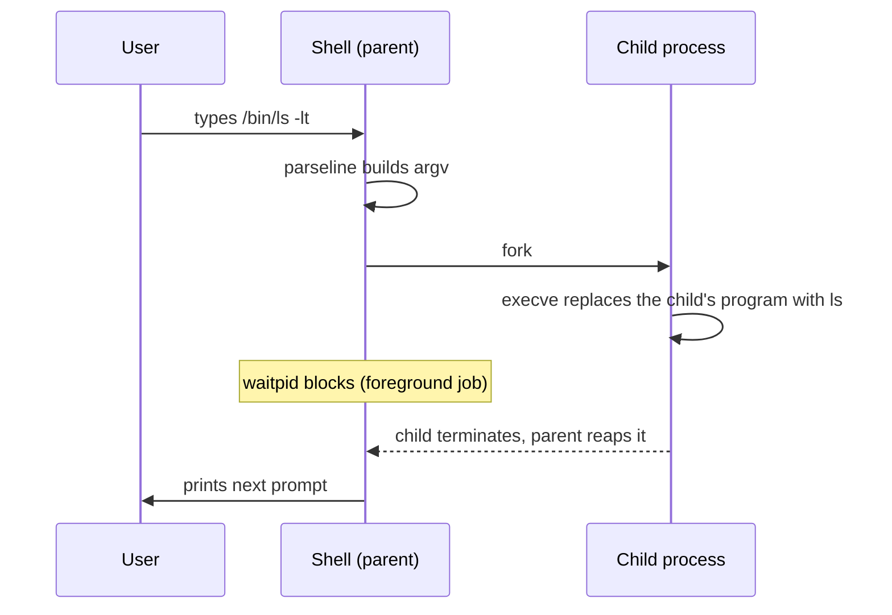

# Processes: fork, exec, wait

Unix provides a small number of system calls for manipulating processes from C programs. With just `fork`, `execve`, `waitpid` and `exit` you can build a shell, and with it the whole tradition of composing small programs. This lesson covers those calls in detail, with the "process graph" technique for reasoning about what a forking program can print: a staple of systems exams and interviews.

## 1. Process IDs and states

Each process has a unique positive **process ID (PID)**.

```c
pid_t getpid(void);     /* PID of the calling process */
pid_t getppid(void);    /* PID of its parent (the process that created it) */
```

From a programmer's perspective, a process is in one of three states:

- **Running**: executing on the CPU, or waiting to be executed and eventually to be scheduled by the kernel.
- **Stopped**: suspended, and will not be scheduled. A process stops on receiving a `SIGSTOP`, `SIGTSTP`, `SIGTTIN` or `SIGTTOU` signal, and remains stopped until it receives `SIGCONT`.
- **Terminated**: stopped permanently. A process terminates for one of three reasons: (1) receiving a signal whose default action is to terminate, (2) returning from `main`, or (3) calling `exit`.

```c
void exit(int status);   /* terminates with exit status; never returns */
```

## 2. Creating processes: fork

```c
pid_t fork(void);   /* returns 0 to the child, the child's PID to the parent, -1 on error */
```

A **parent process** creates a new running **child process** by calling `fork`. The child is almost, but not quite, identical to the parent: it gets an identical but **separate copy** of the parent's user-level virtual address space (code, data, heap, shared libraries, user stack) and identical copies of the parent's open **file descriptors**, so the child can read and write any file that was open in the parent. The most significant difference: they have different PIDs.

`fork` is interesting, and often confusing, because it is **called once but returns twice**: once in the parent (returning the child's PID) and once in the newly created child (returning 0). Since the child's PID is always nonzero, the return value unambiguously tells the program which process it is in.

```c
int main() {
    pid_t pid;
    int x = 1;

    pid = Fork();
    if (pid == 0) {            /* Child */
        printf("child : x=%d\n", ++x);
        exit(0);
    }
    /* Parent */
    printf("parent: x=%d\n", --x);
    exit(0);
}
```

Output on one run:

```
parent: x=0
child : x=2
```

Subtleties illustrated:

- **Call once, return twice.**
- **Concurrent execution.** Parent and child are separate processes that run concurrently; the kernel can interleave their instructions arbitrarily. Here the parent printed first, but on another system the reverse could occur. **You can never make assumptions about the interleaving of instructions in different processes.**
- **Duplicate but separate address spaces.** At the moment `fork` returns, `x` is 1 in both. But the copies are private: the parent's decrement and the child's increment do not affect each other, so the outputs are 0 and 2.
- **Shared files.** Both write to the same screen, because the child inherits the parent's open files, including `stdout`.

### Process graphs

A **process graph** is a simple precedence graph capturing the partial ordering of program statements: each vertex is the execution of a statement; a directed edge $a \to b$ means $a$ happens before $b$. Each `fork` vertex has two outgoing edges (parent continues, child starts). Any **topological sort** of the graph is a feasible total ordering of the statements.

For the example above:



The two `printf`s are unordered relative to each other: both outputs are possible.

**Two forks:**

```c
int main() {
    Fork();
    Fork();
    printf("hello\n");
    exit(0);
}
```



Each `fork` doubles the number of processes executing the code after it: four processes, four lines of `hello`. In general $n$ consecutive forks produce $2^n$ processes.

**A trickier pattern:**

```c
int main() {
    int i;
    for (i = 0; i < 2; i++)
        Fork();
    printf("hello\n");
}
```

Four lines again. But change the body:

```c
void doit() {
    if (Fork() == 0) {
        Fork();
        printf("hello\n");
        exit(0);
    }
    return;
}
int main() {
    doit();
    printf("hello\n");
    exit(0);
}
```

The original parent skips the `if` body and prints once. Its child forks again; child and grandchild each print once and exit. Total: three lines. The coding problem `csapp-fork-count` automates this kind of reasoning.

```python-run
# Counting model: track how many live processes exist and how many of them are "children of the latest fork".
def run(ops):
    parents, children, lines, created = 1, 0, 0, 1
    for op in ops:
        total = parents + children
        if op == "fork":
            parents, children = total, total      # every process splits into parent + child
            created += total
        elif op == "print":
            lines += total
        elif op == "exit_if_child":
            children = 0
    return lines, created
print(run(["fork", "fork", "print"]))                       # (4, 4)
print(run(["fork", "exit_if_child", "fork", "print"]))      # only the original forks again: (2, 3)
print(run(["print", "fork", "print", "fork", "print"]))     # 1 + 2 + 4 = 7 lines
```

> [!WARNING]
> **Buffered output and fork.** `printf("hello")` *without* a newline leaves the text in the process's stdio buffer. A subsequent `fork` copies the buffer, so both processes eventually flush it: "hello" appears twice. Flush (or use `\n` on a terminal) before forking.

## 3. Reaping child processes

When a process terminates, the kernel does not remove it from the system immediately. It is kept in a terminated state until it is **reaped** by its parent. When the parent reaps the child, the kernel passes the child's **exit status** to the parent and then discards the terminated process. A terminated process that has not yet been reaped is a **zombie**.

If a parent terminates without reaping its zombie children, the kernel arranges for the **`init` process** (PID 1, created during system start-up, never terminates, the ancestor of every process) to become the adopted parent of any orphaned children and to reap them. Long-running programs such as shells and servers, however, must always reap their own zombies: even though zombies are not running, **they still consume system memory resources**.

```c
pid_t waitpid(pid_t pid, int *statusp, int options);
/* Returns: PID of child if OK, 0 (if WNOHANG), or -1 on error */
```

By default (`options = 0`), `waitpid` suspends the calling process until a child in its **wait set** terminates; if one has already terminated, it returns immediately. It returns the PID of the terminated child, which at that point has been reaped.

**The wait set** (`pid` argument):

- `pid > 0`: the single child whose PID equals `pid`.
- `pid = -1`: **all** of the parent's children.

**Modifying the default behavior** (`options`, combinable with `|`):

- `WNOHANG`: return immediately (with value 0) if no child in the wait set has terminated yet. Lets you do useful work while waiting.
- `WUNTRACED`: also return for children that are **stopped**.
- `WCONTINUED`: also return when a stopped child is resumed by `SIGCONT`.

**Checking the exit status.** If `statusp` is non-NULL, `waitpid` encodes status information, interpreted with macros from `<sys/wait.h>`:

| Macro | Meaning |
|---|---|
| `WIFEXITED(status)` | True if the child terminated normally, via `exit` or a return |
| `WEXITSTATUS(status)` | The exit status of a normally terminated child |
| `WIFSIGNALED(status)` | True if the child terminated because of an uncaught signal |
| `WTERMSIG(status)` | The number of the signal that caused termination |
| `WIFSTOPPED(status)` | True if the child is currently stopped |
| `WSTOPSIG(status)` | The signal that caused the child to stop |
| `WIFCONTINUED(status)` | True if the child was restarted by `SIGCONT` |

**Error conditions.** If the calling process has no children, `waitpid` returns −1 and sets `errno` to `ECHILD`. If it was interrupted by a signal, it returns −1 with `errno` `EINTR`.

`wait(&status)` is the simple version: equivalent to `waitpid(-1, &status, 0)`.

### Example: reaping N children

```c
#define N 2
int main() {
    int status, i;
    pid_t pid;

    for (i = 0; i < N; i++)                    /* Parent creates N children */
        if ((pid = Fork()) == 0)
            exit(100 + i);                     /* Child exits with a unique status */

    while ((pid = waitpid(-1, &status, 0)) > 0) {   /* Parent reaps in no particular order */
        if (WIFEXITED(status))
            printf("child %d terminated normally with exit status=%d\n", pid, WEXITSTATUS(status));
        else
            printf("child %d terminated abnormally\n", pid);
    }
    if (errno != ECHILD)                       /* The only normal termination is no more children */
        unix_error("waitpid error");
    exit(0);
}
```

The children are reaped in **no particular order**: the order is a property of the specific system and run. This is **nondeterministic** behavior, which makes reasoning about concurrency hard. To reap in creation order, store the PIDs in an array and call `waitpid(pid[i], &status, 0)` in sequence.

```python-run
# The same structure with Python's os module (works on Unix; in the browser sandbox fork is unavailable).
import os
if hasattr(os, "fork"):
    try:
        pids = []
        for i in range(2):
            pid = os.fork()
            if pid == 0:
                os._exit(100 + i)
            pids.append(pid)
        for _ in pids:
            pid, status = os.waitpid(-1, 0)
            print("child", pid in pids, "exit status", os.WEXITSTATUS(status))
    except OSError as e:
        print("fork not supported here:", e)
else:
    print("os.fork is not available on this platform; expected output: two children with statuses 100 and 101, in either order")
```

## 4. Putting processes to sleep

```c
unsigned int sleep(unsigned int secs);  /* returns seconds left to sleep */
int pause(void);                        /* always returns -1 */
```

`sleep` suspends a process for a period; it returns 0 if the time has elapsed, or the remaining seconds if it returned early because it was interrupted by a signal. `pause` puts the caller to sleep until a signal is received.

## 5. Loading and running programs: execve

```c
int execve(const char *filename, const char *argv[], const char *envp[]);
/* Does not return if OK; returns -1 on error */
```

`execve` loads and runs the executable object file `filename` with the argument list `argv` and the environment variable list `envp`. It returns to the caller only on error (e.g., file not found). So unlike `fork`, which is called once and returns twice, **`execve` is called once and never returns**.

`argv` is a null-terminated array of pointers to argument strings; by convention `argv[0]` is the name of the executable. `envp` is a null-terminated array of pointers to strings of the form `name=value`.

After `execve` loads `filename`, it calls the start-up code, which sets up the stack and passes control to the new program's `main`, with the prototype

```c
int main(int argc, char *argv[], char *envp[]);
```

The user stack when the new program starts, from the bottom (highest address) up: the null-terminated environment variable strings and command-line argument strings; then the null-terminated array of pointers `envp[]` (pointed to by the global `environ`), then the null-terminated array `argv[]`; at the top, the stack frame for the system start-up function `libc_start_main`. Arguments to `main` follow the x86-64 convention: `argc` in `%rdi`, `argv` in `%rsi`, `envp` in `%rdx`.

Environment helpers: `getenv(name)`, `setenv(name, newvalue, overwrite)`, `unsetenv(name)`.

> [!NOTE]
> **Programs vs. processes.** A *program* is a collection of code and data; it can exist as an object file on disk or as segments in an address space. A *process* is a specific instance of a program in execution; a program always runs in the context of some process. `fork` runs the *same program* in a *new child process* that duplicates the parent. `execve` loads and runs a *new program* in the context of the *current process*: it overwrites the address space but does **not** create a new process. The new program has the same PID and inherits all file descriptors that were open at the time of the call.

## 6. Using fork and execve to run programs: a shell

Programs such as Unix shells and web servers make heavy use of `fork` and `execve`. A **shell** is an interactive application-level program that runs other programs on behalf of the user. It performs a sequence of **read/evaluate** steps and then terminates:

```c
while (1) {                                  /* main loop */
    print_prompt(); read_line(cmdline);
    if (end_of_input) exit(0);
    eval(cmdline);
}

void eval(char *cmdline) {
    bg = parseline(cmdline, argv);           /* build argv; bg = 1 if the line ends in & */
    if (argv[0] == NULL || builtin_command(argv))
        return;                              /* empty line, or handled by the shell itself */
    if ((pid = Fork()) == 0) {               /* child: run the job */
        execve(argv[0], argv, environ);
        printf("%s: Command not found.
", argv[0]);   /* only reached if execve failed */
        exit(0);
    }
    if (!bg)
        waitpid(pid, &status, 0);            /* parent waits for a foreground job */
    else
        printf("%d %s", pid, cmdline);       /* background: report and move on */
}
```



If the first word is a built-in command (`quit`, or in real shells `cd`, `jobs`, `fg`, `bg`), the shell handles it itself. Otherwise it forks a child that `execve`s the requested program. For a foreground job the shell waits; for a background job (trailing `&`) it returns to the prompt at once.

This simple shell is **flawed**: it never reaps its background children. Fixing that requires signals, the subject of the next lesson.

> [!INTERVIEW]
> **"Why are fork and exec separate calls?"** The gap between them is where the child can rearrange its own environment using ordinary system calls before the new program starts: redirect file descriptors with `dup2` (that is how `ls > out.txt` and pipes work), change directory, drop privileges, set resource limits, reset signal handlers. A single combined "spawn" call would need a parameter for every such tweak.

> [!INTERVIEW]
> **"Zombie vs. orphan?"** A *zombie* has terminated but its parent has not yet reaped it; it holds a process-table entry and exit status. An *orphan* is still running but its parent has died; it is adopted by `init` (PID 1), which reaps it when it finishes. A server that forks per request and never calls `waitpid` leaks zombies until the process table fills.

> [!INTERVIEW]
> **"How many processes does `for (i = 0; i < n; i++) fork();` create?"** $2^n$ in total including the original, hence $2^n - 1$ new ones. A favourite follow-up puts a `printf` before or inside the loop and asks for the number of lines (remember buffered output is duplicated by `fork`).

## 7. Summary

- `fork` creates a child with a copy of the parent's address space and shared open files; it returns twice (0 in the child, the child's PID in the parent). Parent and child run concurrently in an unpredictable order.
- Draw a process graph; any topological order is a possible execution.
- Terminated children are zombies until reaped with `wait`/`waitpid`; orphans are adopted by `init`.
- `waitpid(pid, &status, options)`: wait set by `pid`, behavior by `WNOHANG`/`WUNTRACED`, status decoded with `WIFEXITED` etc.
- `execve` replaces the current process's program and never returns on success; same PID, same open descriptors.
- A shell is a loop of read, parse, fork, execve, and wait (or not, for background jobs).

## Check yourself

```quiz
[
  {"q": "What does fork return in the child process?", "options": ["The parent's PID", "The child's PID", "0", "-1"], "answer": 2,
   "explain": "fork returns 0 in the child and the child's PID in the parent."},
  {"q": "A program does: x = 1; if (fork() == 0) printf(\"%d\", ++x); else printf(\"%d\", --x); What can be printed?", "options": ["Only 20", "Only 02", "20 or 02", "11"], "answer": 2,
   "explain": "Parent and child have separate copies of x (2 and 0) and run concurrently, so either order is possible."},
  {"q": "How many times does 'hello' print? fork(); fork(); fork(); printf(\"hello\\n\");", "options": ["3", "4", "6", "8"], "answer": 3,
   "explain": "Each fork doubles the number of processes: 2^3 = 8 processes each print once."},
  {"q": "What is a zombie process?", "options": ["A process whose parent has died", "A terminated process that has not yet been reaped by its parent", "A stopped process", "A process in an infinite loop"], "answer": 1,
   "explain": "The kernel keeps a terminated child's entry until the parent collects its status with wait/waitpid."},
  {"q": "What does waitpid(-1, &status, WNOHANG) do if no child has terminated yet?", "options": ["Blocks until one does", "Returns 0 immediately", "Returns -1 with ECHILD", "Kills the children"], "answer": 1,
   "explain": "WNOHANG makes waitpid non-blocking; 0 means children exist but none has terminated."},
  {"q": "Which statement about execve is true?", "options": ["It creates a new process", "It returns twice", "On success it never returns and the PID stays the same", "It closes all file descriptors"], "answer": 2,
   "explain": "execve replaces the program in the current process; open descriptors are inherited."},
  {"q": "Who reaps an orphaned child process?", "options": ["Nobody", "The shell", "The init process (PID 1)", "The kernel scheduler"], "answer": 2,
   "explain": "Orphans are adopted by init, which reaps them."},
  {"q": "In the simple shell, why does a background job become a zombie?", "options": ["The shell kills it", "The shell does not call waitpid for background children", "execve failed", "Background jobs cannot terminate"], "answer": 1,
   "explain": "The shell only waits for foreground jobs; background children must be reaped via a SIGCHLD handler."}
]
```

> **Source:** CS:APP 3e, §8.4 (Process control: obtaining process IDs, creating and terminating processes, reaping child processes, putting processes to sleep, loading and running programs, using fork and execve to run programs).
