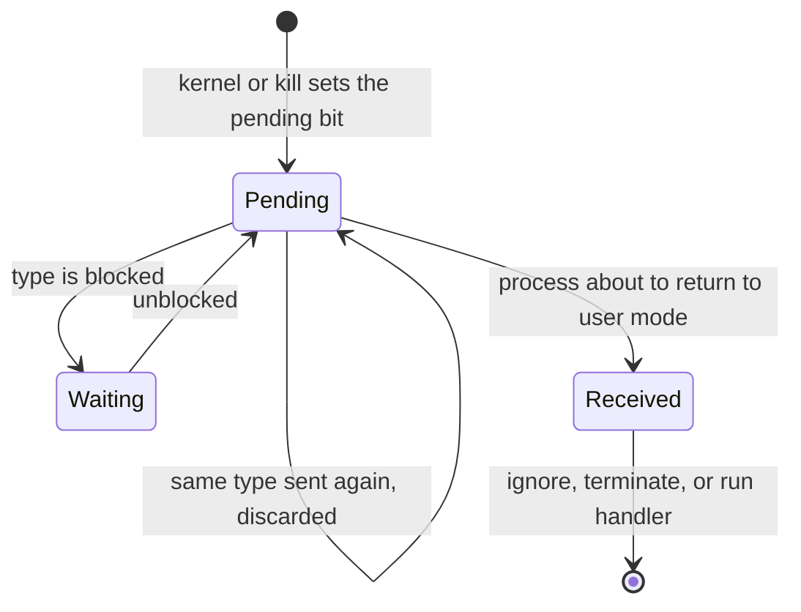
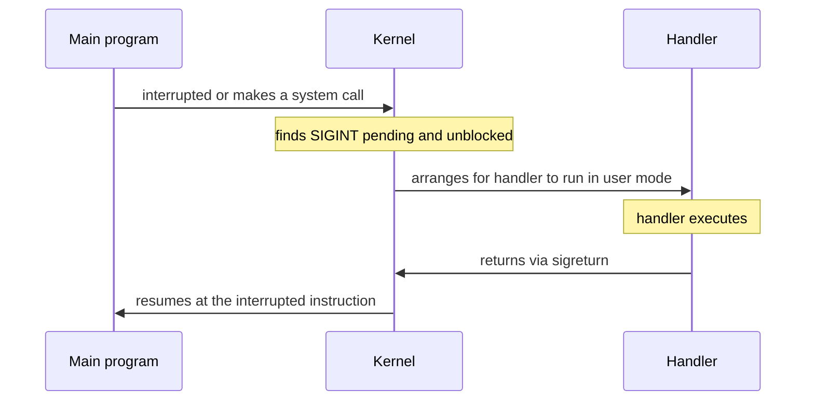
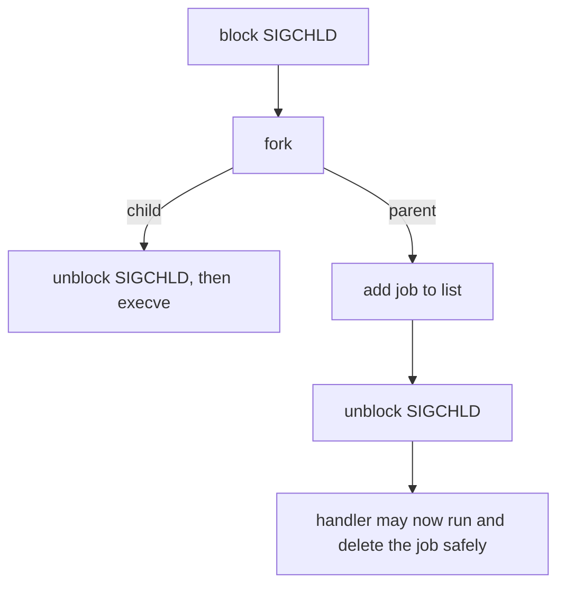

# Signals and nonlocal jumps

> **Before this lesson:** You need processes, `fork`, `waitpid` and zombies from [Processes: fork, exec, wait](#/lesson/csapp/processes), and exceptions and kernel mode from [Exceptions and the kernel](#/lesson/csapp/exceptions).

## In plain words

A **signal** is a short notification that the operating system delivers to a running program to say that something has happened. It carries almost no information beyond its type: "the user pressed Ctrl+C", "a helper program you started has finished", "you tried to use memory that is not yours". Think of a tap on the shoulder while you are busy. You may ignore it, stop working altogether, or pause, deal with it, and carry on. A program chooses its reaction to each type of signal in advance. If it chooses "deal with it", it names a small function, called a **signal handler**, that will run whenever that signal arrives.

Why this matters at work: signals are how programs shut down cleanly when a server is stopped, how a terminal interrupts a stuck command, and how a parent program learns that its helpers have finished. Handlers can run at any moment, in the middle of anything, so they are a classic source of rare, hard-to-find bugs. Knowing the safe patterns is essential for writing dependable services.

## Why look closer

Press Ctrl+C and a runaway program stops. A background job finishes and your shell somehow knows to clean it up. A program dereferences a null pointer and is killed with a tidy message instead of taking the machine down. Behind all three is one mechanism: the **signal**, a small message the kernel delivers to a process to say that some event has occurred. Signals are the operating system's way of exposing exceptional control flow to ordinary programs. Hardware exceptions are handled inside the kernel and are normally invisible to user code; signals let the kernel, or another process, tap a program on the shoulder and make it run a function of its choosing.

They are also one of the most error-prone parts of systems programming. A signal handler is a tiny concurrent program that can run between *any* two instructions of your main code, and the rules for writing one safely are subtle. This lesson explains the lifecycle of a signal, the system calls for sending, catching and blocking them, the classic bugs and how to avoid them, and closes with `setjmp`/`longjmp`, C's facility for jumping out of deeply nested calls.

## 1. What a signal is

Linux defines around thirty standard signal types, each with a number, a name and a default behaviour. The ones you will meet constantly:

| Number | Name | Default action | Typical cause |
|---|---|---|---|
| 2 | `SIGINT` | terminate | Ctrl+C at the terminal |
| 9 | `SIGKILL` | terminate | forced kill; cannot be caught or ignored |
| 11 | `SIGSEGV` | terminate, dump core | invalid memory reference |
| 13 | `SIGPIPE` | terminate | writing to a pipe or socket with no reader |
| 14 | `SIGALRM` | terminate | timer set by `alarm` expired |
| 15 | `SIGTERM` | terminate | polite request to exit; the default of the `kill` command |
| 17 | `SIGCHLD` | ignore | a child stopped or terminated |
| 18 | `SIGCONT` | continue | resume a stopped process |
| 19 | `SIGSTOP` | stop | pause; cannot be caught or ignored |
| 20 | `SIGTSTP` | stop | Ctrl+Z at the terminal |
| 8 | `SIGFPE` | terminate, dump core | arithmetic error such as integer divide by zero |

Many signals are the user-visible face of a low-level exception. A divide error in the CPU becomes `SIGFPE`; an illegal memory reference becomes `SIGSEGV`. Others originate in software: the terminal driver produces `SIGINT`, the kernel produces `SIGCHLD` when a child ends, and any process can send signals to another with `kill`.

## 2. The lifecycle: sent, pending, received

Getting a signal to its destination is a two-step affair.

**Sending.** The kernel sends (delivers) a signal to a destination process by updating a bit of state in that process's context. This happens either because the kernel detected a system event, or because some process asked it to with the `kill` function. A process may signal itself.

**Receiving.** The destination receives the signal when the kernel forces it to react in some way. The process can **ignore** the signal, **terminate**, or **catch** it by running a user-level function called a **signal handler**.

A signal that has been sent but not yet received is **pending**. Here is the first surprising fact, and the root of several bugs:

> At any moment there can be **at most one pending signal of a given type**. The pending state is a single bit per type, not a counter. If a signal of type *k* is already pending, further type-*k* signals sent to the process are discarded.

A process can also **block** selected signal types. A blocked signal can still be sent and will sit pending, but it will not be received until the process unblocks it.

So the kernel keeps two bit vectors per process: `pending`, the set of signals waiting, and `blocked`, the **signal mask**. The kernel sets bit *k* in `pending` when a type-*k* signal is sent and clears it when that signal is received.



```python-run
# One bit per signal type: watch three SIGCHLDs collapse into fewer deliveries.
pending = set()
handled = 0
blocked = False

def send(sig):
    global pending
    print(f"  send {sig}:", "already pending -> dropped" if sig in pending else "pending bit set")
    pending.add(sig)

def maybe_deliver():
    global handled, blocked
    if "SIGCHLD" in pending and not blocked:
        pending.discard("SIGCHLD")
        handled += 1
        blocked = True                      # the handler's own type is blocked while it runs
        print("  handler starts (run", handled, ")")

send("SIGCHLD"); maybe_deliver()            # first child dies: handler begins
send("SIGCHLD")                             # second child dies during the handler: pends
send("SIGCHLD")                             # third child dies during the handler: lost
blocked = False; maybe_deliver()            # handler returns, the pending one is delivered
blocked = False; maybe_deliver()
print("3 signals sent, handler ran", handled, "times")
```

## 3. Sending signals

### Process groups

Signal delivery to multiple processes is organised around **process groups**. Every process belongs to exactly one group, identified by a positive integer group ID. A child inherits its parent's group by default; `setpgid(pid, pgid)` changes it, and `setpgid(0, 0)` puts the caller into a new group whose ID equals its own PID. `getpgrp()` reports the current group.

Shells use groups to implement **jobs**. Each command line (which may be a pipeline of several processes) becomes one job in its own process group. At most one job is in the **foreground**; any number may be in the background.

### Four ways to send

- **From the keyboard.** Ctrl+C causes the kernel to send `SIGINT` to every process in the foreground process group; Ctrl+Z sends `SIGTSTP`, whose default action is to suspend them.
- **With the `kill` program.** `kill -9 4242` sends signal 9 to process 4242. A negative PID addresses a whole group: `kill -9 -4242` signals every process in group 4242.
- **With the `kill` function:**

```c
#include <signal.h>
int kill(pid_t pid, int sig);
```

If `pid` is positive, the signal goes to that process; if zero, to every process in the caller's group; if negative, to every process in group `|pid|`.

- **With `alarm`:** `alarm(secs)` arranges for the kernel to send `SIGALRM` to the calling process after that many seconds. A new call cancels any earlier pending alarm and returns the number of seconds that had been left on it.

## 4. Receiving signals

When does reception actually happen? At a specific moment: whenever the kernel is about to switch a process from kernel mode back to user mode, for instance when returning from a system call or completing a context switch, it examines the set of signals that are pending and not blocked, `pending & ~blocked`.

- If the set is empty, control passes to the next instruction of the program as usual.
- If not, the kernel picks one signal from the set (typically the lowest numbered) and forces the process to receive it. When that action is complete, the next is considered, and so on.

Each signal type has a predefined **default action**, one of: terminate; terminate and dump core; stop until restarted by `SIGCONT`; or ignore.

### Installing a handler

A process can replace the default action for any signal except `SIGKILL` and `SIGSTOP`:

```c
#include <signal.h>
typedef void (*sighandler_t)(int);
sighandler_t signal(int signum, sighandler_t handler);
```

The second argument may be `SIG_IGN` to ignore the signal, `SIG_DFL` to restore the default, or the address of a function to be called when the signal arrives. Supplying the function is called **installing** the handler; its invocation is **catching** the signal; running it is **handling** the signal. The handler receives the signal number as its argument, so one function can serve several types. When it returns, control normally goes back to the instruction where the program was interrupted.

Handlers can themselves be interrupted by handlers for *other* signal types, so they nest.



Python exposes the same mechanism through its `signal` module. Here a process signals itself.

```python-run
import os, signal

def demo():
    caught = []
    def on_usr(signum, frame):
        caught.append(signal.Signals(signum).name)
    previous = signal.signal(signal.SIGINT, on_usr)       # install
    try:
        signal.raise_signal(signal.SIGINT)                # send to ourselves
    finally:
        signal.signal(signal.SIGINT, previous)            # restore
    return caught

try:
    print("handler ran for:", demo())
except Exception as exc:                                   # sandboxes without real signals
    print("signals are not available here:", type(exc).__name__)
    print("on a normal system the handler runs once and records SIGINT")
```

## 5. Blocking and unblocking

There are two blocking mechanisms.

- **Implicit.** While a handler for type *k* is running, the kernel blocks further type-*k* signals by default. A second arrival stays pending until the handler returns.
- **Explicit.** A program manipulates its own mask with `sigprocmask` and a few helper functions that build signal sets:

```c
int sigprocmask(int how, const sigset_t *set, sigset_t *oldset);
int sigemptyset(sigset_t *set);
int sigfillset(sigset_t *set);
int sigaddset(sigset_t *set, int signum);
int sigdelset(sigset_t *set, int signum);
int sigismember(const sigset_t *set, int signum);
```

`how` is `SIG_BLOCK` (add the given signals to the mask), `SIG_UNBLOCK` (remove them), or `SIG_SETMASK` (replace the mask outright). If `oldset` is non-null, the previous mask is stored there so that it can be restored later.

The standard idiom for protecting a short region:

```c
sigset_t mask, prev;
sigemptyset(&mask);
sigaddset(&mask, SIGINT);
sigprocmask(SIG_BLOCK, &mask, &prev);    /* SIGINT now waits */
/* ... code that must not be interrupted by SIGINT ... */
sigprocmask(SIG_SETMASK, &prev, NULL);   /* restore; a pending SIGINT is delivered here */
```

## 6. Writing handlers that are actually correct

Handlers are hard for three reasons: they run concurrently with the main program and share its global variables; the rules for when signals are received are unintuitive; and different systems have had different semantics. A handful of conservative guidelines covers most of the danger.

**Keep handlers minimal.** The best handler sets a global flag and returns, leaving the real work to the main program, which checks the flag periodically.

**Call only async-signal-safe functions.** A function is async-signal-safe if it can be called from a handler without risk, either because it is reentrant (uses only local variables) or because it cannot itself be interrupted by a handler. POSIX publishes the list. It includes `write`, `_exit`, `waitpid`, `kill`, `sigprocmask` and other raw system calls. It conspicuously excludes `printf`, `sprintf`, `malloc`, `free` and `exit`. The reason is concrete: if the main program is in the middle of `malloc`, holding the allocator's internal lock or with its lists half-updated, and a handler calls `malloc` again, the result is deadlock or a corrupted heap. To print from a handler, use `write` on a fixed message.

**Save and restore `errno`.** Many safe functions set `errno` on failure. A handler that changes it can confuse the interrupted code, which may have been about to examine it. Copy `errno` to a local on entry and put it back before returning.

**Block signals while touching shared data.** If the main program and a handler both update a global structure, the main program should block the relevant signals around its accesses, and the handler should block all signals around its own. Otherwise an interruption in the middle of an update exposes a half-modified structure.

**Declare shared globals `volatile`.** Without it, an optimising compiler may decide that a variable the main loop reads is never changed by that loop and keep its value in a register, never noticing the handler's update.

**Use `sig_atomic_t` for flags.** Reads and writes of this integer type are guaranteed to be uninterruptible, so a flag declared `volatile sig_atomic_t` can be set by a handler and tested by the main program without blocking signals. The guarantee covers a single read or a single write only, not compound operations such as `flag++`.

### Signals are not queued: the reaping bug

A parent creates several children and installs a `SIGCHLD` handler that calls `wait` once to reap one child. This looks right and is wrong. Suppose two children end while the handler is still dealing with the first. The first of those two sets the pending bit; the second finds it already set and is discarded. When the handler returns, it is invoked once more, reaps one child, and the last child remains a zombie forever.

The lesson: **the arrival of a signal tells you that at least one event of that type occurred, not how many.** The handler must reap as many children as possible each time it runs:

```c
void on_child(int sig) {
    int saved = errno;
    while (waitpid(-1, NULL, WNOHANG) > 0)
        ;                                  /* reap every child that is ready */
    errno = saved;
}
```

### Portability: use sigaction

The `signal` function has behaved differently across Unix versions. On some old systems a handler was reset to the default after each delivery; on some, slow system calls such as `read` fail with `EINTR` when interrupted by a handler rather than restarting automatically. The portable solution is `sigaction`, which lets you state the semantics you want explicitly. Most codebases wrap it in a helper with the same shape as `signal` that requests: block only the type being handled, restart interrupted system calls where possible, and keep the handler installed until changed.

## 7. Concurrency bugs with signals

### A race between parent and child

Consider a shell-like program that keeps a list of running jobs. The main loop forks a child and then adds it to the list; the `SIGCHLD` handler reaps finished children and removes them from the list.

The hidden flaw: nothing forces the parent to run before the child. This interleaving is possible:

1. the parent calls `fork`, and the kernel schedules the child first;
2. the child runs to completion and terminates;
3. the parent, on resuming, immediately receives `SIGCHLD`; the handler tries to remove a job that is not yet on the list, which does nothing;
4. the parent now adds the job. It will never be removed, because the child is already gone.

This is a **race**: correctness depends on the relative timing of two flows. Such bugs are miserable to find because the bad ordering may occur once in a million runs. The fix is to make the bad ordering impossible. Block `SIGCHLD` *before* calling `fork` and unblock it only *after* the job is recorded. The handler then cannot run in the window. One detail: children inherit the blocked set, so the child must unblock `SIGCHLD` before it calls `execve`.



```python-run
# Enumerate the two orderings of "parent adds job" and "handler deletes job".
def run(order, block_sigchld):
    jobs = set()
    events = list(order)
    if block_sigchld and events[0] == "delete":      # the signal stays pending until add is done
        events = ["add", "delete"]
    for e in events:
        if e == "add": jobs.add(42)
        else:          jobs.discard(42)
    return jobs

for order in (("add", "delete"), ("delete", "add")):
    print(f"schedule {order}: without blocking -> leftover {run(order, False) or '{}'},"
          f" with blocking -> leftover {run(order, True) or '{}'}")
```

### Waiting for a signal without wasting CPU or losing it

Sometimes the main program must pause until a handler has run, for example a shell waiting for its foreground job. The handler sets a global flag `done`. How should the main program wait?

- `while (!done) ;` works but burns an entire CPU.
- `while (!done) pause();` sleeps until any signal arrives, but hides a race: if the signal arrives after the test of `done` and before the call to `pause`, the program sleeps for a signal that has already come and may never wake.
- `while (!done) sleep(1);` is correct but sluggish.

The right tool is `sigsuspend(&mask)`. It temporarily replaces the signal mask with `mask`, suspends the process until a signal is handled, and restores the original mask on return, with the first two steps performed **atomically**. The pattern: block `SIGCHLD`; then loop `while (!done) sigsuspend(&prev);` where `prev` is the earlier mask in which `SIGCHLD` is unblocked. Because the signal is blocked whenever the flag is being tested, it can only be delivered inside `sigsuspend`, and no wake-up can be lost.

> [!INTERVIEW]
> **"Why can't you call `printf` in a signal handler?"** `printf` is not async-signal-safe: it uses a shared buffer and takes a lock, and may call `malloc`. If the signal interrupts the main program while it is inside `printf` or `malloc`, the handler's call re-enters code whose data structures are in an inconsistent state or whose lock is already held by the same thread, causing corruption or deadlock. Handlers should restrict themselves to functions on the safe list, such as `write`, or set a `volatile sig_atomic_t` flag.

> [!INTERVIEW]
> **"What is the difference between `SIGTERM` and `SIGKILL`?"** Both terminate by default. `SIGTERM` can be caught, so a well-behaved service uses it to flush data, close connections and exit cleanly. `SIGKILL` cannot be caught, blocked or ignored; the kernel removes the process without running any of its code. The polite sequence is `SIGTERM`, wait, then `SIGKILL` only if needed.

## 8. Nonlocal jumps

C offers a user-level form of exceptional control flow that transfers control from one function directly to another that is currently active further up the call chain, skipping the usual return sequence.

```c
#include <setjmp.h>
int  setjmp(jmp_buf env);
void longjmp(jmp_buf env, int retval);
```

`setjmp` saves the current calling environment (program counter, stack pointer and general-purpose registers) in `env` and returns 0. Later, `longjmp` restores that environment, which makes the *original `setjmp` call return a second time*, now with the non-zero value `retval`. People summarise the pair as: `setjmp` is called once and returns many times; `longjmp` is called once and never returns.

Two uses stand out.

**Escaping from deep nesting on error.** Suppose an error is detected six calls deep. Instead of having every level test and propagate a status code, the top level calls `setjmp` and the detecting function calls `longjmp`, landing straight back at the top.

```c
jmp_buf recover;
void parse_field(void) { if (bad_input) longjmp(recover, 2); }
int main(void) {
    switch (setjmp(recover)) {
    case 0:  parse_document(); break;        /* normal path; calls parse_field deep inside */
    case 2:  report("malformed field"); break;
    }
}
```

**Leaving a signal handler for a chosen location.** The variants `sigsetjmp` and `siglongjmp` also save and restore the signal mask, so a handler can jump back to, say, the top of a command loop instead of resuming the interrupted instruction. This is how an interactive program can make Ctrl+C mean "abandon this command and prompt again".

The danger is that everything in between is skipped. Intermediate functions do not get to free memory they allocated or release locks they hold, so `longjmp` is a ready source of leaks. Also, the function that called `setjmp` must still be active when `longjmp` runs; jumping into a frame that has already returned is undefined behaviour.

The exception mechanisms of higher-level languages are structured, safer versions of the same idea: a `catch` clause plays the part of `setjmp`, and `throw` plays the part of `longjmp`, with the added guarantee that cleanup code runs on the way out.

```python-run
# The same control shape using exceptions: jump from three calls deep straight to the top.
class Jump(Exception):
    def __init__(self, code): self.code = code

trace = []
def level3(x):
    trace.append("level3 entered")
    if x < 0:
        raise Jump(2)                       # the longjmp
    trace.append("level3 finished")
def level2(x): level3(x); trace.append("level2 finished")
def level1(x): level2(x); trace.append("level1 finished")

for value in (5, -1):
    trace.clear()
    try:                                    # the setjmp point
        level1(value)
        outcome = "normal return"
    except Jump as j:
        outcome = f"landed at top with code {j.code}; intermediate cleanup was skipped"
    print(value, "->", trace, "|", outcome)
```

## 9. Pitfalls

- **Counting events by counting handler invocations.** Signals do not queue.
- **Calling unsafe library functions in a handler.**
- **Forgetting that the child inherits the signal mask and handlers** (handlers are reset on `execve`, the mask is not).
- **Assuming the parent runs before the child after `fork`.**
- **Using `pause` after testing a flag.** Use `sigsuspend`.
- **Trying to catch `SIGKILL` or `SIGSTOP`.** It is not possible.
- **Not handling `EINTR`** from slow system calls on systems that do not restart them.
- **Leaving `SIGPIPE` at its default in a server.** One disconnected client kills the process; ignore the signal and check `write` for `EPIPE`.
- **Using `longjmp` across code that owns resources.**

## Summary

- A signal is a small kernel-delivered message announcing an event. It is sent by setting a pending bit and received when the kernel, on returning to user mode, makes the process ignore it, terminate, or run a handler.
- Only one signal of each type can be pending; extras are dropped. Blocked signals wait in the pending set.
- Send with the keyboard, `kill` or `alarm`; install handlers with `signal` or, portably, `sigaction`; control the mask with `sigprocmask`.
- Safe handlers are short, call only async-signal-safe functions, preserve `errno`, protect shared data by blocking signals, and communicate through `volatile sig_atomic_t` flags.
- A `SIGCHLD` handler must reap in a loop. Block signals around `fork` to remove parent/child races, and wait with `sigsuspend`.
- `setjmp` and `longjmp` provide nonlocal jumps for error recovery and for redirecting control out of handlers, at the price of skipped cleanup.

## Glossary

- **Signal**: a small message from the kernel telling a process that an event occurred.
- **Signal handler**: a function a program registers to be run when a particular signal arrives.
- **Default action**: what happens when a signal arrives and the program has not chosen a reaction, often termination.
- **Pending signal**: a signal that has been sent but not yet acted on.
- **Blocked signal**: a signal type the process has asked to hold back for now; it stays pending.
- **Signal mask**: the set of signal types a process currently blocks.
- **Process group**: a set of related processes that can be signalled together, such as one command pipeline.
- **`SIGINT` / `SIGTERM` / `SIGKILL`**: interrupt from the keyboard / polite request to stop / forced stop that cannot be refused.
- **`SIGCHLD`**: the signal a parent receives when one of its children stops or finishes.
- **Async-signal-safe**: describes a function that may be called safely from inside a signal handler.
- **Race**: a bug in which the result depends on the unpredictable timing of two activities.
- **`sigsuspend`**: a call that waits for a signal without the risk of missing one that arrives at the wrong moment.
- **Nonlocal jump (`setjmp`/`longjmp`)**: a way in C to jump from a deeply nested function straight back to an earlier point.

```quiz
[
  {"q": "A process has SIGUSR1 blocked. Five SIGUSR1 signals are sent to it, and then it unblocks the signal. How many times does its handler run?",
   "options": ["Five", "Once", "Zero", "It depends on the scheduler"],
   "answer": 1, "explain": "The pending state is one bit per signal type. The first arrival sets it and the other four are discarded, so a single delivery occurs after unblocking."},
  {"q": "Which signal can a process neither catch nor ignore?",
   "options": ["SIGINT", "SIGTERM", "SIGKILL", "SIGCHLD"],
   "answer": 2, "explain": "SIGKILL and SIGSTOP always perform their default action. This guarantees that the system can always terminate or stop a process."},
  {"q": "At what moment does the kernel check for pending, unblocked signals for a process?",
   "options": ["Continuously, after every instruction", "When it is about to return the process from kernel mode to user mode", "Only when the process calls pause", "Once per second"],
   "answer": 1, "explain": "Reception happens at the kernel-to-user transition, such as the return from a system call or after a context switch."},
  {"q": "Why should a SIGCHLD handler call waitpid in a loop with WNOHANG?",
   "options": ["Because waitpid is slow", "Because one delivery may represent several terminated children, since signals of one type are not queued", "Because WNOHANG blocks other signals", "To avoid using errno"],
   "answer": 1, "explain": "If several children end while the signal is pending or being handled, only one further delivery happens. Looping reaps all that are ready."},
  {"q": "Which function is safe to call from a signal handler?",
   "options": ["printf", "malloc", "write", "exit"],
   "answer": 2, "explain": "write is on the async-signal-safe list. printf and malloc use shared state and locks, and exit runs cleanup code that is not safe."},
  {"q": "A parent adds each child to a job list after fork, and its SIGCHLD handler removes finished children. How is the race between these avoided?",
   "options": ["Call sleep after fork", "Block SIGCHLD before fork and unblock it after the job has been added", "Use a larger job list", "Install the handler after fork"],
   "answer": 1, "explain": "With the signal blocked across fork and the insertion, the handler cannot run before the job is recorded. The child should unblock it before exec."},
  {"q": "What is wrong with the loop while (!done) pause(); for waiting on a handler that sets done?",
   "options": ["pause is not a real function", "The signal may arrive after the test but before pause, so the process can sleep indefinitely", "It uses too much CPU", "It blocks all signals"],
   "answer": 1, "explain": "The test and the sleep are not atomic. sigsuspend closes the window by atomically unblocking and suspending."},
  {"q": "How many times does a call to setjmp return if a later longjmp targets its buffer once?",
   "options": ["Once", "Twice: first with 0, then with the value passed to longjmp", "Never", "Three times"],
   "answer": 1, "explain": "The direct call returns 0. The longjmp restores the saved environment so that setjmp appears to return again with a non-zero value."}
]
```

> **Source:** CS:APP 3e, §8.5–8.6
