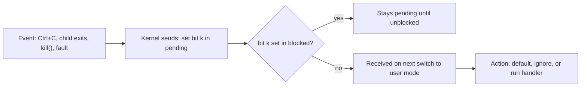

# Signals and nonlocal jumps

Exceptions let the hardware and kernel interrupt a program; context switches let the kernel multiplex processes. **Linux signals** are a higher-level form of exceptional control flow that allows processes and the kernel to interrupt *other processes*. A signal is a small message notifying a process that an event of some type has occurred in the system. Signals are how Ctrl+C kills a program, how a shell learns that a background job finished, and how a segmentation fault becomes a termination. They are also among the trickiest parts of systems programming, because signal handlers run **concurrently** with the main program. This lesson covers the mechanics, the rules for writing correct handlers, and nonlocal jumps.

## 1. Signal terminology

Linux supports about 30 signal types. Each corresponds to some kind of system event. A selection:

| Number | Name | Default action | Corresponding event |
|---|---|---|---|
| 2 | `SIGINT` | Terminate | Interrupt from keyboard (Ctrl+C) |
| 3 | `SIGQUIT` | Terminate and dump core | Quit from keyboard |
| 4 | `SIGILL` | Terminate | Illegal instruction |
| 6 | `SIGABRT` | Terminate and dump core | Abort signal from `abort` |
| 8 | `SIGFPE` | Terminate and dump core | Floating-point exception (divide by zero) |
| 9 | `SIGKILL` | Terminate (cannot be caught or ignored) | Kill program |
| 11 | `SIGSEGV` | Terminate and dump core | Invalid memory reference (seg fault) |
| 13 | `SIGPIPE` | Terminate | Wrote to a pipe with no reader |
| 14 | `SIGALRM` | Terminate | Timer signal from `alarm` |
| 15 | `SIGTERM` | Terminate | Software termination signal |
| 17 | `SIGCHLD` | Ignore | A child process has stopped or terminated |
| 18 | `SIGCONT` | Ignore | Continue process if stopped |
| 19 | `SIGSTOP` | Stop until next SIGCONT (cannot be caught or ignored) | Stop signal not from terminal |
| 20 | `SIGTSTP` | Stop until next SIGCONT | Stop signal from terminal (Ctrl+Z) |

Low-level hardware exceptions are processed by the kernel's exception handlers and are normally invisible to user processes; signals provide a mechanism for exposing them. A divide by zero makes the kernel send `SIGFPE`; an illegal memory reference, `SIGSEGV`.

The transfer of a signal to a destination process occurs in two distinct steps:

- **Sending a signal.** The kernel *sends* (delivers) a signal to a destination process by updating some state in the context of the destination process. It is sent either because the kernel detected a system event, or because a process invoked the `kill` function. A process can send a signal to itself.
- **Receiving a signal.** A destination process *receives* a signal when it is forced by the kernel to react in some way to the delivery. The process can ignore the signal, terminate, or **catch** it by executing a user-level function called a **signal handler**.

A signal that has been sent but not yet received is a **pending signal**. At any point in time, there can be **at most one pending signal of a particular type**: if a process has a pending signal of type $k$, subsequent signals of type $k$ sent to it are *not queued*; they are simply **discarded**. A process can selectively **block** the receipt of certain signals; a blocked signal can be delivered but will not be received until the process unblocks it.

For each process, the kernel maintains the set of pending signals in the **`pending` bit vector** and the set of blocked signals in the **`blocked` bit vector** (the *signal mask*). The kernel sets bit $k$ in `pending` whenever a signal of type $k$ is delivered and clears it whenever it is received.



## 2. Sending signals

All mechanisms for sending signals rely on **process groups**. Every process belongs to exactly one process group, identified by a positive **process group ID**; by default a child belongs to the same group as its parent. `getpgrp()` returns it; `setpgid(pid, pgid)` changes it (`setpgid(0, 0)` creates a new group whose ID is the caller's PID).

- **`/bin/kill` program**: `linux> /bin/kill -9 15213` sends signal 9 (`SIGKILL`) to process 15213. A negative PID sends the signal to every process in that process group: `/bin/kill -9 -15213`.
- **From the keyboard.** Shells use the abstraction of a **job** for the processes created by evaluating one command line. At any time there is at most one **foreground job** and zero or more **background jobs**; `ls | sort` creates a foreground job of two processes connected by a pipe. The shell creates a separate process group for each job. Typing **Ctrl+C** causes the kernel to send `SIGINT` to every process in the foreground process group (default: terminate); **Ctrl+Z** sends `SIGTSTP` (default: stop).
- **`kill` function**: `int kill(pid_t pid, int sig);`. If `pid > 0`, sends `sig` to process `pid`; if `pid == 0`, to every process in the caller's process group; if `pid < 0`, to every process in group `|pid|`.
- **`alarm` function**: `unsigned int alarm(unsigned int secs);` arranges for the kernel to send `SIGALRM` to the calling process in `secs` seconds, cancelling any pending alarm.

## 3. Receiving signals

When the kernel switches a process $p$ from kernel mode to user mode (returning from a system call or completing a context switch), it checks the set of unblocked pending signals: **`pending & ~blocked`**. If it is empty (the usual case), control passes to the next instruction in $p$'s logical flow. Otherwise, the kernel chooses some signal $k$ in the set (typically the smallest $k$) and forces $p$ to **receive** it. Receipt triggers some **action**; once the action completes, control passes back to the next instruction $I_{next}$.

Each signal type has a predefined **default action**, one of:

- The process terminates.
- The process terminates and dumps core.
- The process stops (suspends) until restarted by a `SIGCONT`.
- The process ignores the signal.

A process can modify the default action with the `signal` function, **except for `SIGSTOP` and `SIGKILL`**, whose default actions cannot be changed:

```c
typedef void (*sighandler_t)(int);
sighandler_t signal(int signum, sighandler_t handler);
/* Returns: pointer to previous handler if OK, SIG_ERR on error */
```

- `handler == SIG_IGN`: signals of type `signum` are ignored.
- `handler == SIG_DFL`: the default action is restored.
- Otherwise `handler` is the address of a user-defined **signal handler**, called whenever the process receives a signal of type `signum`. Changing the default action by passing a handler address is **installing the handler**; invoking it is **catching the signal**; executing it is **handling the signal**.

When the handler executes its `return`, control (usually) passes back to the instruction where the process was interrupted. Handlers can be interrupted by *other* handlers.

```c
void sigint_handler(int sig) {             /* SIGINT handler */
    printf("Caught SIGINT!\n");
    exit(0);
}
int main() {
    if (signal(SIGINT, sigint_handler) == SIG_ERR)
        unix_error("signal error");
    pause();                               /* wait for the receipt of a signal */
    return 0;
}
```

```python-run
# Python exposes the same mechanism. Here a process sends SIGINT to itself.
import signal
caught = []
def handler(signum, frame):
    caught.append(signum)
try:
    old = signal.signal(signal.SIGINT, handler)   # install the handler (returns the previous one)
    signal.raise_signal(signal.SIGINT)            # send the signal to this process
    signal.signal(signal.SIGINT, old)             # restore the previous action
    print("caught:", caught, "| SIGINT is number", int(signal.SIGINT))
except Exception as e:
    print("signals are not available in this sandbox:", e)
```

## 4. Blocking and unblocking signals

- **Implicit blocking.** By default, the kernel blocks any pending signals of the type **currently being processed by a handler**. If a handler for signal $s$ is running and another $s$ arrives, it becomes pending but is not received until the handler returns.
- **Explicit blocking** with `sigprocmask` and helpers:

```c
int sigprocmask(int how, const sigset_t *set, sigset_t *oldset);
int sigemptyset(sigset_t *set);              /* set = {} */
int sigfillset(sigset_t *set);               /* set = all signals */
int sigaddset(sigset_t *set, int signum);
int sigdelset(sigset_t *set, int signum);
int sigismember(const sigset_t *set, int signum);
```

`how` is `SIG_BLOCK` (`blocked = blocked | set`), `SIG_UNBLOCK` (`blocked = blocked & ~set`) or `SIG_SETMASK` (`blocked = set`). If `oldset` is non-NULL, the previous mask is saved there.

```c
sigset_t mask, prev_mask;
Sigemptyset(&mask);
Sigaddset(&mask, SIGINT);
Sigprocmask(SIG_BLOCK, &mask, &prev_mask);    /* block SIGINT, save previous mask */
/* ... code region that will not be interrupted by SIGINT ... */
Sigprocmask(SIG_SETMASK, &prev_mask, NULL);   /* restore previous mask */
```

## 5. Writing signal handlers

Signal handling is one of the thornier aspects of Linux system-level programming: (1) handlers run concurrently with the main program and share its global variables, so they can interfere with it and with other handlers; (2) the rules for how and when signals are received are often counterintuitive; (3) different systems can have different signal-handling semantics.

### Safe signal handling

Conservative guidelines from the book:

- **G0. Keep handlers as simple as possible.** For example, set a global flag and return; the main program periodically checks (and resets) the flag.
- **G1. Call only async-signal-safe functions in your handlers.** A function is *async-signal-safe* if it is reentrant (accesses only local variables) or cannot be interrupted by signal handlers. The list includes `_exit`, `write`, `wait`, `waitpid`, `sleep`, `kill`, `read`, `signal`, `sigprocmask`... but **not** `printf`, `sprintf`, `malloc` or `exit`. The only safe way to generate output from a handler is `write`. (The book's example `printf` handlers are for illustration; its `Sio` package provides safe output: `sio_puts`, `sio_putl`, `sio_error`.)
- **G2. Save and restore `errno`.** Many async-signal-safe functions set `errno` on error; calling them in a handler might interfere with other parts of the program that rely on `errno`. Save it to a local on entry and restore it before returning (unnecessary if the handler terminates the process with `_exit`).
- **G3. Protect accesses to shared global data structures by blocking all signals.** If a handler shares a data structure with the main program or another handler, both should temporarily block all signals while accessing it, so that the sequence of instructions needed is not interrupted halfway.
- **G4. Declare global variables with `volatile`.** It tells the compiler never to cache the variable in a register, so the main program actually re-reads a flag a handler may have changed.
- **G5. Declare flags with `sig_atomic_t`.** Reads and writes of this integer type are guaranteed atomic (uninterruptible), so a flag of type `volatile sig_atomic_t` can be read or written without blocking signals. (The guarantee applies only to individual reads and writes, not to `flag++` or `flag = flag + 10`.)

### Correct signal handling: signals are not queued

The `pending` bit vector has exactly one bit per signal type. The crucial lesson: **the existence of a pending signal merely indicates that *at least one* signal has arrived.** You cannot use signals to count events.

Consider a parent that installs a `SIGCHLD` handler to reap children, then forks three children that terminate at almost the same time. A first attempt at the handler:

```c
void handler1(int sig) {
    int olderrno = errno;
    if ((waitpid(-1, NULL, 0)) < 0)          /* reap ONE child: WRONG */
        sio_error("waitpid error");
    Sio_puts("Handler reaped child\n");
    Sleep(1);
    errno = olderrno;
}
```

The first `SIGCHLD` is received and the handler runs (with `SIGCHLD` blocked). The second arrives and is marked pending. The third arrives while the second is still pending and is **discarded**. After the first handler returns, the kernel delivers the one pending signal; the handler reaps the second child. No more signals are pending: the third child is never reaped and remains a zombie.

The fix: since one `SIGCHLD` may stand for several terminated children, **reap as many as possible each time** the handler is called:

```c
void handler2(int sig) {
    int olderrno = errno;
    while (waitpid(-1, NULL, 0) > 0)          /* reap ALL available zombies */
        Sio_puts("Handler reaped child\n");
    if (errno != ECHILD)
        Sio_error("waitpid error");
    Sleep(1);
    errno = olderrno;
}
```

(In a real shell, use `waitpid(-1, &status, WNOHANG | WUNTRACED)` in the loop so the handler does not block while other children are still running.)

```python-run
# Model of the pending bit: three signals of the same type arrive while the first is being handled.
def deliver(arrivals, handler_reaps_all):
    zombies, pending, in_handler, reaped = 0, False, False, 0
    for ev in arrivals + ["handler_done", "handler_done", "handler_done"]:
        if ev == "child_exit":
            zombies += 1
            if in_handler: pending = True          # at most one pending signal: extra ones are lost
            else: in_handler = True                # received immediately: handler starts
        elif ev == "handler_done" and in_handler:
            n = zombies if handler_reaps_all else min(1, zombies)
            zombies -= n; reaped += n
            in_handler, pending = pending, False   # run again only if one was pending
    return reaped, zombies
print("reap one per signal :", deliver(["child_exit"] * 3, False), "(reaped, zombies left)")
print("reap all in a loop  :", deliver(["child_exit"] * 3, True))
```

### Portable signal handling

Unix signal semantics vary across systems: some older systems restore the default action after a signal is caught (so the handler must reinstall itself), and on some, slow system calls such as `read`, `write` and `accept` that are interrupted by a handler do not resume but return an error with `errno == EINTR`. POSIX defines **`sigaction`**, which lets programs specify the semantics they want. The book wraps it in a `Signal` function that installs handlers such that: only signals of the type currently being handled are blocked; signals are not queued (as always); interrupted system calls are **automatically restarted** whenever possible (`SA_RESTART`); and once installed, a handler stays installed.

## 6. Synchronizing flows to avoid nasty concurrency bugs

Consider a shell that tracks its children in a job list. The parent calls `addjob(pid)` after `fork`; the `SIGCHLD` handler calls `deletejob(pid)` when it reaps a child.

```c
while (1) {
    if ((pid = Fork()) == 0)
        Execve("/bin/date", argv, NULL);        /* child */
    Sigprocmask(SIG_BLOCK, &mask_all, &prev_all);
    addjob(pid);                                 /* parent adds the child to the job list */
    Sigprocmask(SIG_SETMASK, &prev_all, NULL);
}
```

There is a **race**: (1) the parent forks and the kernel schedules the child first; (2) the child terminates before the parent runs again, so the kernel delivers `SIGCHLD`; (3) when the parent becomes runnable, before executing a single instruction it receives the signal and the handler calls `deletejob` — which does nothing, because the job is not on the list yet; (4) the handler returns and the parent calls `addjob`, adding a nonexistent job that will never be removed. `deletejob` ran **before** `addjob`.

The fix: **block `SIGCHLD` before calling `fork`** and unblock it only after `addjob`. Because children inherit the blocked set, the child must unblock `SIGCHLD` before calling `execve`.

```c
Sigprocmask(SIG_BLOCK, &mask_one, &prev_one);      /* block SIGCHLD */
if ((pid = Fork()) == 0) {
    Sigprocmask(SIG_SETMASK, &prev_one, NULL);     /* child: unblock SIGCHLD */
    Execve("/bin/date", argv, NULL);
}
Sigprocmask(SIG_BLOCK, &mask_all, NULL);
addjob(pid);                                        /* guaranteed to precede deletejob */
Sigprocmask(SIG_SETMASK, &prev_one, NULL);         /* unblock SIGCHLD */
```

Races like this are hard to find because they depend on kernel scheduling decisions; the bug may show up once in a million runs.

### Explicitly waiting for signals

Sometimes the main program must wait for a handler to run, e.g. a shell waiting for the foreground job to terminate, with the handler setting a global `pid`. Options:

- `while (!pid) ;` — correct but a wasteful spin loop.
- `while (!pid) pause();` — a **race**: if `SIGCHLD` arrives after the `while` test but before `pause`, `pause` sleeps forever.
- `while (!pid) sleep(1);` — correct but too slow; finer intervals just trade waste against latency.
- **`sigsuspend(&mask)`**: temporarily replaces the blocked set with `mask` and suspends until a signal is received, **atomically**, equivalent to an uninterruptible `sigprocmask(SIG_SETMASK, &mask, &prev); pause(); sigprocmask(SIG_SETMASK, &prev, NULL);`. Block `SIGCHLD`, then loop `while (!pid) sigsuspend(&prev);`.

## 7. Nonlocal jumps

C provides a user-level form of ECF, the **nonlocal jump**, which transfers control directly from one function to another currently executing function without going through the normal call-and-return sequence.

```c
#include <setjmp.h>
int  setjmp(jmp_buf env);                     /* returns 0 from the direct call, nonzero from longjmp */
void longjmp(jmp_buf env, int retval);        /* never returns */
int  sigsetjmp(sigjmp_buf env, int savesigs); /* versions usable from signal handlers */
void siglongjmp(sigjmp_buf env, int retval);
```

`setjmp` saves the current **calling environment** (program counter, stack pointer, general-purpose registers) in `env` and returns 0. `longjmp` restores the environment from `env` and triggers a return *from the most recent `setjmp` call that initialized `env`*, which this time returns the nonzero `retval`. So **`setjmp` is called once but returns multiple times**, and **`longjmp` is called once and never returns**.

Uses:

- **Immediate return from a deeply nested function call**, usually on detecting an error, without unwinding the call stack by hand. Caveat: skipping intermediate calls can leak memory that those functions intended to free.
- **Branching out of a signal handler** to a specific code location rather than returning to the interrupted instruction, with `sigsetjmp`/`siglongjmp`, e.g. a program that restarts itself when the user types Ctrl+C.

Exception mechanisms in C++ and Java are higher-level, more structured versions: a `catch` clause is like a `setjmp`, a `throw` like a `longjmp`.

## 8. Tools for manipulating processes

`strace` (prints each system call made by a program and its children), `ps` (lists processes, including zombies), `top` (resource usage), `pmap` (memory map of a process), and the `/proc` virtual filesystem.

> [!INTERVIEW]
> **"What happens when you press Ctrl+C?"** The terminal driver turns the keystroke into `SIGINT` sent by the kernel to every process in the terminal's foreground process group. Each process, on its next return to user mode, receives it: by default it terminates; a program may install a handler (to clean up) or ignore it. `SIGKILL` (9) and `SIGSTOP` can be neither caught, blocked nor ignored, which is why `kill -9` always works, and why it should be the last resort: the target gets no chance to clean up. Prefer `SIGTERM` (15) first.

> [!INTERVIEW]
> **"What can you safely do in a signal handler?"** Very little: call only async-signal-safe functions (`write`, `_exit`, `waitpid`…, not `printf`/`malloc`), save/restore `errno`, and ideally just set a `volatile sig_atomic_t` flag. The reason is reentrancy: the handler may interrupt the main program in the middle of `malloc` or `printf` while it holds a lock or has a data structure half-updated.

## 9. Summary

- Signals are sent (bit set in `pending`) and later received (action taken) when the process returns to user mode with `pending & ~blocked` nonzero.
- Pending signals are **not queued**: handlers must loop to handle all outstanding events.
- Default actions: terminate, dump core, stop, or ignore. `signal`/`sigaction` install handlers; `SIGKILL` and `SIGSTOP` cannot be overridden.
- Handlers run concurrently with the main flow: keep them simple, use async-signal-safe functions, protect shared data by blocking signals, use `volatile sig_atomic_t` flags.
- Avoid races by blocking signals around critical sequences (block `SIGCHLD` before `fork`); wait with `sigsuspend`.
- `setjmp`/`longjmp` provide nonlocal jumps, the basis of language-level exceptions.

## Check yourself

```quiz
[
  {"q": "Which two signals can be neither caught nor ignored?", "options": ["SIGINT and SIGTERM", "SIGKILL and SIGSTOP", "SIGSEGV and SIGFPE", "SIGCHLD and SIGCONT"], "answer": 1,
   "explain": "The default actions of SIGKILL and SIGSTOP cannot be changed."},
  {"q": "Three SIGCHLD signals arrive while a SIGCHLD handler is already running. How many more times will the handler be invoked?", "options": ["3", "2", "1", "0"], "answer": 2,
   "explain": "Only one signal of a given type can be pending; the others are discarded. The handler runs once more."},
  {"q": "What is the default action for SIGCHLD?", "options": ["Terminate", "Stop", "Ignore", "Dump core"], "answer": 2,
   "explain": "By default SIGCHLD is ignored; shells install a handler to reap children."},
  {"q": "When does the kernel check for signals to deliver to a process?", "options": ["Continuously", "When it switches the process from kernel mode to user mode", "Only at process creation", "Only when the process calls pause"], "answer": 1,
   "explain": "On each return to user mode the kernel computes pending & ~blocked and forces receipt of a signal if nonzero."},
  {"q": "Why is printf unsafe inside a signal handler?", "options": ["It is too slow", "It is not async-signal-safe: the handler may have interrupted printf or malloc mid-update, corrupting state or deadlocking", "It cannot write to stdout", "Handlers cannot call functions"], "answer": 1,
   "explain": "printf uses shared buffers and locks; reentering it from a handler is undefined."},
  {"q": "In the shell job-list example, how is the addjob/deletejob race eliminated?", "options": ["By sleeping after fork", "By blocking SIGCHLD before fork and unblocking it after addjob", "By using printf in the handler", "By ignoring SIGCHLD"], "answer": 1,
   "explain": "With SIGCHLD blocked, the handler cannot run until the job has been added."},
  {"q": "Why is 'while (!pid) pause();' incorrect for waiting for a handler to set pid?", "options": ["pause never returns", "If the signal arrives between the test and pause, the process sleeps forever", "pid is not volatile", "pause blocks signals"], "answer": 1,
   "explain": "The check and the sleep are not atomic; sigsuspend makes unblock-and-wait atomic."},
  {"q": "setjmp returns 0 the first time. What does it return after a longjmp(env, 3)?", "options": ["0", "1", "3", "It does not return"], "answer": 2,
   "explain": "longjmp makes the earlier setjmp call return again, with the nonzero retval."}
]
```

> **Source:** CS:APP 3e, §8.5–8.7 (Signals: terminology, sending, receiving, blocking, writing handlers, synchronizing flows, explicitly waiting for signals; Nonlocal jumps; Tools for manipulating processes).
