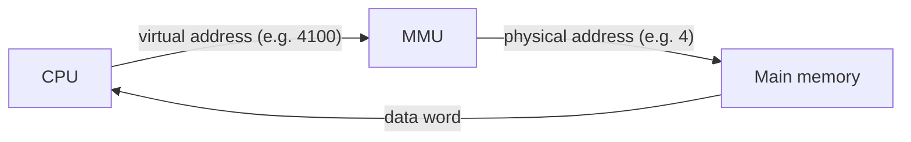
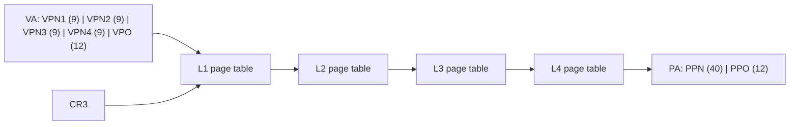

# VM concepts and address translation

Processes in a system share the CPU and main memory with other processes. Sharing memory poses special challenges: as demand grows, processes slow down or cannot run at all, and memory is vulnerable to corruption: if one process inadvertently writes to memory used by another, that process may fail in bewildering ways. To manage memory more efficiently and with fewer errors, modern systems provide an abstraction of main memory known as **virtual memory (VM)**: an elegant interaction of hardware exceptions, hardware address translation, main memory, disk files and kernel software that provides each process with a large, uniform and private address space.

With one clean mechanism, virtual memory provides three capabilities:

1. It uses main memory efficiently by treating it as a **cache** for an address space stored on disk, keeping only the active areas in main memory and transferring data back and forth as needed.
2. It simplifies **memory management** by providing each process with a uniform address space.
3. It **protects** the address space of each process from corruption by other processes.

Virtual memory works silently and automatically, so why should a programmer understand it? Because it is *central* (it pervades all levels of systems), *powerful* (it lets applications create and destroy chunks of memory, map them to disk files, and share memory with other processes) and *dangerous* (misused pointers produce segmentation faults, protection faults, or silent corruption that appears hours later).

## 1. Physical and virtual addressing

Main memory is an array of $M$ contiguous byte-size cells, each with a unique **physical address (PA)**. The simplest scheme, **physical addressing**, has the CPU place physical addresses directly on the memory bus. Early PCs did this, and digital signal processors, embedded microcontrollers and Cray supercomputers still do.

Modern processors use **virtual addressing**: the CPU accesses main memory by generating a **virtual address (VA)**, which is converted to the appropriate physical address before being sent to main memory. This conversion is **address translation**. Dedicated hardware on the CPU chip, the **memory management unit (MMU)**, translates virtual addresses on the fly, using a lookup table stored in main memory whose contents are managed by the operating system.



## 2. Address spaces

An **address space** is an ordered set of nonnegative integer addresses $\{0, 1, 2, \dots\}$; if the integers are consecutive it is a **linear** address space. A CPU with virtual memory generates virtual addresses from a **virtual address space** of $N = 2^n$ addresses, called an $n$-bit address space (modern systems: 32 or 64 bits). The system also has a **physical address space** of $M$ bytes ($M = 2^m$ for simplicity).

The key distinction: *data objects* (bytes) versus their *attributes* (addresses). Each byte of main memory has a virtual address chosen from the virtual address space and a physical address chosen from the physical address space; a data object can have multiple independent addresses.

| Symbol | Meaning |
|---|---|
| $N = 2^n$ | Number of addresses in the virtual address space |
| $M = 2^m$ | Number of addresses in the physical address space |
| $P = 2^p$ | Page size (bytes) |
| VPO, VPN | Virtual page offset (bytes); virtual page number |
| TLBI, TLBT | TLB index; TLB tag |
| PPO, PPN | Physical page offset; physical page number |
| CO, CI, CT | Byte offset within cache block; cache index; cache tag |

## 3. VM as a tool for caching

Conceptually, a virtual memory is an array of $N$ contiguous bytes **stored on disk**. The contents of this array are cached in main memory. As with any cache, the data on disk (the lower level) is partitioned into fixed-size **blocks**, here called **virtual pages (VPs)**, each of $P = 2^p$ bytes. Physical memory is likewise partitioned into **physical pages (PPs)**, also $P$ bytes (also called **page frames**).

At any time, the set of virtual pages is partitioned into three disjoint subsets:

- **Unallocated**: pages not yet allocated (or created) by the VM system. No data, no space on disk.
- **Cached**: allocated pages currently cached in physical memory.
- **Uncached**: allocated pages not cached in physical memory.

### DRAM cache organization

Call the L1/L2/L3 caches "SRAM caches" and the VM system's cache of virtual pages in main memory the "DRAM cache". Their position in the hierarchy shapes the design: DRAM is at least 10× slower than SRAM, and **disk is about 100,000× slower than DRAM**. Misses in DRAM caches are therefore *enormously* expensive, and the cost of reading the first byte from a disk sector is about 100,000 times higher than reading successive bytes. Consequences:

- **Large pages**: typically 4 KB to 2 MB.
- **Fully associative**: any virtual page can be placed in any physical page.
- **Sophisticated replacement algorithms** in the OS, far beyond what hardware does for SRAM caches, because replacing the wrong page is so costly.
- **Write-back** rather than write-through, because of the large access time of disk.

### Page tables

The VM system needs a way to determine whether a virtual page is cached in DRAM, which physical page caches it, and, on a miss, where the page lives on disk and which victim to evict. This is provided by a combination of OS software, the MMU, and a data structure in physical memory called the **page table**, which maps virtual pages to physical pages. The address translation hardware reads the page table each time it converts a virtual address; the OS maintains its contents and transfers pages between disk and DRAM.

A page table is an array of **page table entries (PTEs)**. Each page in the virtual address space has a PTE at a fixed offset in the table. Assume each PTE has a **valid bit** and an $n$-bit address field:

- valid = 1: the address field is the start of the physical page where the virtual page is cached.
- valid = 0 with a null address: the virtual page is unallocated.
- valid = 0 with an address: the page is allocated but uncached; the address points to its location on disk.

### Page hits and page faults

**Page hit.** The CPU reads a word in a cached page. The translation hardware uses the virtual address to locate the PTE, sees the valid bit set, and uses the PTE's physical address to construct the physical address of the word.

**Page fault.** A DRAM cache miss is a **page fault**. The CPU references a word in an uncached page; the hardware finds the valid bit clear and triggers a page fault exception. The kernel's page fault handler selects a **victim page**; if the victim has been modified, the kernel copies it back to disk (**paging out**/**swapping out**); in either case it updates the victim's PTE to reflect that it is no longer cached. Then the kernel copies the needed page from disk to memory (**paging in**), updates its PTE, and returns. When the handler returns, it **restarts the faulting instruction**, which resends the faulting virtual address to the translation hardware. Now it is a page hit.

The strategy of waiting until the last moment to swap in a page, when a miss occurs, is **demand paging**. All modern systems use it.

**Allocating pages.** When the OS allocates a new page of virtual memory (for example, as a result of `malloc`), it creates room on disk and updates a PTE to point to the newly created page on disk.

### Locality to the rescue again

Given the huge miss penalty, one might fear paging destroys performance. In practice VM works well because of **locality**. Although the total number of distinct pages a program references over its run might exceed physical memory, at any time it tends to work on a smaller set of active pages, the **working set** (resident set). After an initial overhead where the working set is paged in, subsequent references hit.

If the working set size exceeds the size of physical memory, the program can produce an unfortunate situation known as **thrashing**, where pages are swapped in and out continuously. A program that runs at a crawl may be thrashing.

## 4. VM as a tool for memory management

Operating systems provide a **separate page table, and thus a separate virtual address space, for each process**. Multiple virtual pages (in different processes) can be mapped to the same shared physical page. Combining demand paging with separate address spaces simplifies:

- **Linking.** Each process can use the same basic format for its memory image, regardless of where code and data actually reside in physical memory (code always at `0x400000`). Linkers produce fully linked executables independent of the ultimate physical location.
- **Loading.** To load `.text` and `.data` of an object file into a new process, the loader allocates virtual pages for them, marks them invalid (not cached), and points their PTEs to the appropriate locations in the object file. **The loader never actually copies any data from disk into memory**; pages are paged in on demand the first time each is referenced. Mapping a set of contiguous virtual pages to an arbitrary location in a file is **memory mapping** (`mmap`, next lesson).
- **Sharing.** Normally each process has private code, data, heap and stack. But the OS can arrange for several processes to share a single copy of kernel code or of the C library's `printf` by mapping the appropriate virtual pages in different processes to the same physical pages.
- **Memory allocation.** When a process requests additional heap space (`malloc`), the OS allocates $k$ contiguous *virtual* pages and maps them to $k$ arbitrary physical pages located anywhere in physical memory. They need not be contiguous.

## 5. VM as a tool for memory protection

A user process should not be allowed to modify its read-only code section, read or modify kernel code and data, read or write the private memory of other processes, or modify virtual pages shared with other processes unless all parties allow it. Because the translation hardware reads a PTE on **every** address the CPU generates, access control is easy: add **permission bits** to the PTE.

| Bit | Meaning |
|---|---|
| `SUP` | Whether the process must be running in kernel (supervisor) mode to access the page |
| `READ` | Read access allowed |
| `WRITE` | Write access allowed |

If an instruction violates these permissions, the CPU triggers a general protection fault that transfers control to an exception handler in the kernel, which sends `SIGSEGV` to the offending process. Linux shells report this as a **"segmentation fault"**.

## 6. Address translation

Formally, address translation is a mapping $\text{MAP}: \text{VAS} \to \text{PAS} \cup \{\varnothing\}$: MAP(A) = A' if the data at virtual address A is present at physical address A', and $\varnothing$ otherwise.

A control register in the CPU, the **page table base register (PTBR)**, points to the current page table. The $n$-bit virtual address has two components: a $p$-bit **virtual page offset (VPO)** and an $(n-p)$-bit **virtual page number (VPN)**. The MMU uses the VPN to select the PTE. The physical address is the **physical page number (PPN)** from the PTE concatenated with the VPO. Since physical and virtual pages are both $P$ bytes, **the physical page offset (PPO) is identical to the VPO**.

```
   n-1                p p-1            0
  +--------------------+----------------+
  |        VPN         |      VPO       |   virtual address
  +--------------------+----------------+
            |  page table lookup     | (unchanged)
            v                        v
  +--------------------+----------------+
  |        PPN         |      PPO       |   physical address
  +--------------------+----------------+
   m-1                p p-1            0
```

**Steps on a page hit** (handled entirely by hardware):

1. The processor generates a virtual address and sends it to the MMU.
2. The MMU generates the PTE address (PTEA) and requests it from the cache/main memory.
3. The cache/main memory returns the PTE to the MMU.
4. The MMU constructs the physical address and sends it to the cache/main memory.
5. The cache/main memory returns the requested data word to the processor.

**Steps on a page fault** (hardware and kernel cooperate): steps 1–3 as above; (4) the valid bit in the PTE is zero, so the MMU triggers an exception, transferring control to the page fault handler; (5) the handler identifies a victim page in physical memory and, if modified, pages it out to disk; (6) the handler pages in the new page and updates the PTE in memory; (7) the handler returns to the original process, causing the faulting instruction to be **restarted**. The CPU resends the offending virtual address to the MMU; this time the page is cached, so it is a hit.

```python-run
def translate(va, page_table, p):
    vpn, vpo = va >> p, va & ((1 << p) - 1)
    pte = page_table.get(vpn)                      # None/-1 = not valid
    if pte is None:
        return f"VA {va:#06x}: VPN {vpn:#x} -> PAGE FAULT"
    return f"VA {va:#06x}: VPN {vpn:#x}, VPO {vpo:#x} -> PPN {pte:#x} -> PA {(pte << p) | vpo:#06x}"
# 64-byte pages (p = 6), part of the book's example page table
pt = {0x00: 0x28, 0x02: 0x33, 0x03: 0x02, 0x05: 0x16, 0x08: 0x13, 0x09: 0x17, 0x0A: 0x09, 0x0D: 0x2D, 0x0E: 0x11, 0x0F: 0x0D}
for va in (0x03d4, 0x0b8f, 0x0020, 0x02c1):
    print(translate(va, pt, 6))
```

### Integrating caches and VM

In a system with both VM and SRAM caches, should the caches be accessed with virtual or physical addresses? Most systems opt for **physical addressing**: it makes it straightforward for multiple processes to have blocks in the cache at the same time and to share blocks from the same virtual pages, and the cache need not deal with protection, since access rights are checked during translation. Address translation occurs *before* the cache lookup, and **page table entries themselves can be cached**, like any other data words.

### Speeding up translation with a TLB

Every time the CPU generates a virtual address, the MMU must refer to a PTE: in the worst case an additional fetch from memory costing tens to hundreds of cycles; if the PTE is in L1, a handful of cycles. Many systems eliminate even this cost with a small cache of PTEs inside the MMU called a **translation lookaside buffer (TLB)**.

A TLB is a small, virtually addressed cache in which each line holds a block consisting of **a single PTE**. It usually has a high degree of associativity. With $T = 2^t$ sets, the **TLB index (TLBI)** is the $t$ least significant bits of the VPN, and the **TLB tag (TLBT)** is the remaining VPN bits.

```
  +--------------------+---------+----------------+
  |        TLBT        |  TLBI   |      VPO       |
  +--------------------+---------+----------------+
  |<-------------- VPN --------->|
```

**TLB hit:** (1) the CPU generates a virtual address; (2) the MMU sends the VPN to the TLB; (3) the TLB returns the PTE; (4) the MMU translates to a physical address and sends it to the cache/main memory; (5) the data word is returned. All translation steps happen inside the on-chip MMU: fast.

**TLB miss:** the MMU must fetch the PTE from the L1 cache/memory; the newly fetched PTE is stored in the TLB, possibly overwriting an existing entry.

### Multi-level page tables

A single page table can be huge. With a 32-bit address space, 4 KB pages and 4-byte PTEs, we would need a **4 MB** page table resident in memory at all times, per process, even if the application referenced only a small chunk of the address space. For 64-bit systems the problem is far worse: a 48-bit space with 4 KB pages has $2^{36}$ pages, and at 8 bytes per PTE a flat table would occupy 512 GB.

The solution is a **hierarchy of page tables**. Consider a 32-bit virtual address space partitioned into 4 KB pages, with 4-byte PTEs, and a two-level hierarchy:

- Each PTE in the **level 1 table** (1,024 entries, one 4 KB page) is responsible for mapping a **4 MB chunk** of the virtual address space, consisting of 1,024 contiguous pages. If every page in chunk $i$ is unallocated, level-1 PTE $i$ is null.
- Otherwise level-1 PTE $i$ points to the base of a **level 2 page table**, each of whose 1,024 PTEs maps one 4 KB page.

This reduces memory requirements in two ways. First, **if a PTE in the level 1 table is null, the corresponding level 2 page table does not have to exist at all**: a large saving, since most of the 4 GB virtual address space of a typical program is unallocated. Second, only the level 1 table needs to be in main memory at all times; level 2 tables can be created and paged in and out by the VM system as needed, so only the most heavily used are cached in main memory.

With a $k$-level hierarchy, the virtual address is partitioned into $k$ VPNs and a VPO. VPN $i$ ($1 \le i \le k$) is an index into a page table at level $i$. Each PTE in a level $j$ table ($j < k$) points to the base of some page table at level $j+1$; each PTE in a level $k$ table contains either the PPN of a physical page or the address of a disk block. To construct the physical address, the MMU must access $k$ PTEs. This sounds expensive, but **the TLB comes to the rescue** by caching the PTEs from the page tables at the different levels; in practice, translation with multi-level page tables is not significantly slower than with single-level tables.

```python-run
# Size of the page-table structures for a sparse 32-bit process: 4 KB pages, 4-byte PTEs.
PAGE, PTE = 4096, 4
flat = (2**32 // PAGE) * PTE
print("flat table:", flat // 1024, "KB")
# Two-level: suppose the process uses 2 MB of code/data at the bottom and 64 KB of stack at the top.
used_pages = set(range(0, 2 * 2**20 // PAGE)) | set(range(2**20 - 16, 2**20))
l2_tables = {vpn >> 10 for vpn in used_pages}        # each L2 table covers 1024 pages (4 MB)
print("two-level :", (1 + len(l2_tables)) * PAGE // 1024, "KB  (1 level-1 table +", len(l2_tables), "level-2 tables)")
```

## 7. Worked example: end-to-end address translation

The book's small system: virtual addresses are 14 bits wide ($n = 14$), physical addresses 12 bits ($m = 12$), page size 64 bytes ($p = 6$). So VPN is 8 bits and VPO 6 bits; PPN is 6 bits and PPO 6 bits. The TLB is 4-way set associative with 16 entries (4 sets): TLBI is the low 2 bits of the VPN, TLBT the high 6. The L1 d-cache is physically addressed and direct-mapped with a 4-byte block size and 16 sets: CO = 2 bits, CI = 4 bits, CT = 6 bits.

**CPU reads the byte at virtual address `0x03d4`.**

1. `0x03d4` = `00 0011 1101 0100`. VPN = `00001111` = `0x0F`; VPO = `010100` = `0x14`.
2. TLBI = low 2 bits of VPN = `11` = 3; TLBT = `000011` = `0x03`.
3. The TLB's set 3 has a valid entry with tag `0x03`: **TLB hit**, returning PPN `0x0D`.
4. PA = PPN `0x0D` (`001101`) concatenated with PPO `0x14` (`010100`) = `0011 0101 0100` = `0x354`.
5. Cache: CO = `00` = 0; CI = `0101` = `0x5`; CT = `001101` = `0x0D`. Set 5 holds tag `0x0D` and is valid: **cache hit**. Byte at offset 0 is `0x36`, returned to the CPU.

Other paths are possible: if the TLB misses, the MMU fetches the PPN from the page table's PTE; if that PTE is invalid, there is a page fault and the kernel must page in the appropriate page and rerun the load instruction; if the PTE is valid but the cache misses, the block is fetched from memory.

## 8. Case study: Intel Core i7 / Linux

The Core i7 supports a **48-bit (256 TB) virtual address space** and a **52-bit (4 PB) physical address space**, with a compatibility mode for 32-bit spaces. The TLBs are virtually addressed and 4-way set associative: L1 d-TLB 64 entries, L1 i-TLB 128 entries, L2 unified TLB 512 entries. The caches are physically addressed with 64-byte blocks. Page size can be 4 KB or 4 MB; Linux uses 4 KB.

The Core i7 uses a **four-level page table hierarchy**. The 36-bit VPN is partitioned into four 9-bit chunks, each an offset into a page table (512 8-byte entries = one 4 KB page). The **CR3** control register contains the physical address of the level 1 page table; its value is part of each process context and is restored during each context switch.



A level-1 PTE maps a 512 GB region, level 2 a 1 GB region, level 3 a 2 MB region, and level 4 a 4 KB page. PTE fields include: **P** (present), **R/W** (read-only or read-write), **U/S** (user or supervisor mode access), **A** (reference bit, set by the MMU on reads and writes, cleared by software), **D** (dirty bit, set on writes), and **XD** (execute disable, bit 63, new in 64-bit systems, which reduces the risk of buffer overflow attacks by restricting execution to the read-only code segment). The kernel uses A to implement its page replacement algorithm and D to decide whether a victim page must be written back before being replaced.

A neat trick makes L1 cache access fast: with 4 KB pages, the 12-bit VPO is identical to the PPO. The L1 d-cache has 64 sets and 64-byte blocks, so its CI + CO need exactly 12 bits. When the CPU needs a virtual address translated, it sends the VPN to the MMU and the VPO to the L1 cache **simultaneously**: while the MMU requests the PTE from the TLB, the cache is already using the VPO bits to find the set and read out the tags. When the MMU gets the PPN back, the cache is ready to match it against the tags.

> [!INTERVIEW]
> **"What happens on a memory access, end to end?"** The CPU issues a VA. The TLB is consulted with the VPN; on a hit the PPN is immediate. On a miss, a page walk reads the multi-level page table (4 levels on x86-64, starting at CR3). If the PTE is not present: page fault → kernel finds the page (file, swap, or zero-fill), possibly evicts a victim, updates the PTE, and the instruction restarts. With the PA, the L1/L2/L3 caches are checked, then DRAM. Permission bits are checked along the way; a violation raises SIGSEGV.

> [!INTERVIEW]
> **"Why multi-level page tables?"** A flat table for a 48-bit space would need $2^{36}$ 8-byte entries = 512 GB per process. A tree only materializes tables for regions actually in use, so a small process needs a handful of 4 KB tables. Cost: a TLB miss requires up to 4 memory reads (mitigated by the TLB, page-walk caches, and huge pages which cut the walk short and extend TLB reach).

> [!INTERVIEW]
> **"Why is a context switch between processes costlier than between threads?"** Switching processes changes CR3, i.e. the address space, so TLB entries are invalid (unless tagged with address-space IDs) and must be refilled by page walks; threads share the page tables.

## 9. Summary

- VM gives each process a private, uniform virtual address space; the MMU translates VAs to PAs using page tables maintained by the OS.
- A VA splits into VPN + VPO; the PTE supplies the PPN; PPO = VPO.
- Main memory is a fully associative, demand-paged, write-back cache of virtual pages; misses are page faults handled by the kernel; locality (the working set) makes it efficient; thrashing occurs when the working set exceeds memory.
- Per-process page tables simplify linking, loading, sharing and allocation; PTE permission bits provide protection.
- TLBs cache PTEs (TLBI/TLBT from the VPN); multi-level tables make page tables compact. Core i7: 48-bit VAs, 4 levels × 9 bits, CR3 as the root.

## Check yourself

```quiz
[
  {"q": "With 4 KB pages and 32-bit virtual addresses, how many bits are the VPO and VPN?", "options": ["VPO 10, VPN 22", "VPO 12, VPN 20", "VPO 16, VPN 16", "VPO 20, VPN 12"], "answer": 1,
   "explain": "4 KB = 2^12, so the offset is 12 bits and the remaining 20 are the virtual page number."},
  {"q": "In the 14-bit VA / 64-byte page example, what are the VPN and VPO of 0x03d4?", "options": ["VPN 0x0F, VPO 0x14", "VPN 0x03, VPO 0xd4", "VPN 0x3D, VPO 0x4", "VPN 0x1E, VPO 0x14"], "answer": 0,
   "explain": "0x03d4 = 00001111 010100: the low 6 bits (0x14) are the VPO, the upper 8 (0x0F) the VPN."},
  {"q": "Why is the DRAM cache of virtual pages fully associative with large pages?", "options": ["Hardware simplicity", "The miss penalty (disk access) is enormous, so minimizing misses matters more than lookup cost", "Because SRAM caches are", "To support the TLB"], "answer": 1,
   "explain": "Disk is ~100,000x slower than DRAM, so the design optimizes for the lowest possible miss rate."},
  {"q": "What does a TLB cache?", "options": ["Data blocks", "Page table entries, keyed by virtual page number", "Instructions", "Disk sectors"], "answer": 1,
   "explain": "Each TLB line holds a single PTE; the VPN is split into TLB index and tag."},
  {"q": "After a page fault is handled, what does the CPU do?", "options": ["Skips the faulting instruction", "Restarts the faulting instruction, which now hits", "Terminates the process", "Flushes all caches"], "answer": 1,
   "explain": "Faults return to the faulting instruction; the page is now cached so translation succeeds."},
  {"q": "What is the main advantage of a multi-level page table?", "options": ["Faster translation on a TLB miss", "Page tables for unallocated regions need not exist, saving memory", "It eliminates page faults", "It removes the need for a TLB"], "answer": 1,
   "explain": "A null entry in an upper-level table means the whole lower-level subtree is absent."},
  {"q": "On the Core i7, which register holds the physical address of the top-level page table?", "options": ["%rsp", "CR3", "PTBR0", "%rip"], "answer": 1,
   "explain": "CR3 points to the level-1 table and is switched on every process context switch."},
  {"q": "A program's working set is larger than physical memory. What happens?", "options": ["Nothing", "Thrashing: pages are continuously swapped in and out", "The TLB overflows", "It is killed immediately"], "answer": 1,
   "explain": "Constant paging dominates run time; the program crawls."}
]
```

> **Source:** CS:APP 3e, §9.1–9.7 (Physical and virtual addressing; Address spaces; VM as a tool for caching, memory management and memory protection; Address translation; Case study: the Intel Core i7/Linux memory system).
