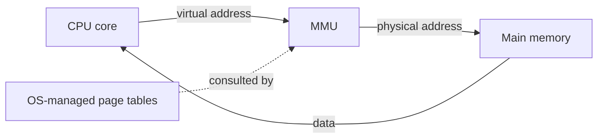
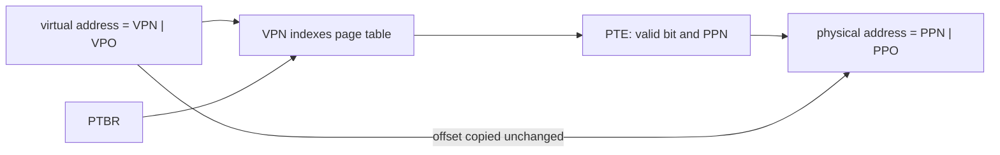
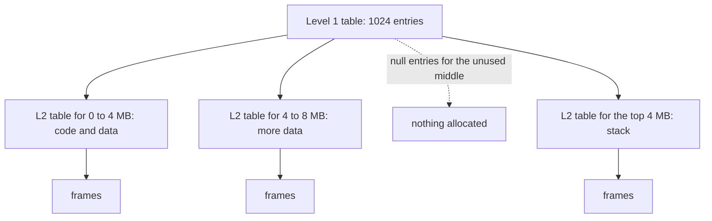

# VM concepts and address translation

> **Before this lesson:** You need hexadecimal and splitting a number into bit fields from [Bits, bytes, words and bit-level operations](#/lesson/csapp/bits-bytes), cache organisation (sets, tags, hits and misses) from [Cache memories](#/lesson/csapp/caches), and exceptions and faults from [Exceptions and the kernel](#/lesson/csapp/exceptions).

## In plain words

Every running program believes it has a huge stretch of memory to itself, with locations numbered from zero upward. That is an illusion, and a useful one. The location numbers a program uses are called **virtual addresses**. The real locations in the memory chips have **physical addresses**. On every memory access, the processor converts the first kind into the second using a lookup table kept by the operating system. Think of a hotel. Guests know their room as "the Garden Suite" and never need to know that it is room 417 this week; the reception desk keeps the list and can move a guest without the guest noticing. Memory is handed out in fixed-size chunks called **pages**, and the lookup table is the **page table**.

Why this matters at work: virtual memory is the reason one faulty program cannot damage another, the reason a program can ask for more memory than the machine has, and the cause of slowdowns when memory runs short. Converting an address by hand is a staple exam and interview task, and the ideas reappear in databases, virtual machines and containers.

## Why look closer

Run the same program twice at once and print the address of one of its global variables. Both copies print the *same* number, yet each has its own independent value stored there. Allocate a 30 GB array on a laptop with 16 GB of RAM: the call succeeds. Write through a null pointer: instead of silently damaging something, the program is stopped on the spot. None of these would be possible if the addresses in your program were real locations in the memory chips. They are **virtual addresses**, and a cooperation between the CPU and the operating system translates every one of them, on every access, into a physical location. This lesson explains that machinery from the ground up: what a page table is, exactly how the translation arithmetic works, why a small cache called the TLB makes it fast, and why page tables are built as trees. Expect to do translations by hand; it is a staple of exams and systems interviews.

## 1. Two kinds of address

Main memory is an array of bytes, each with a **physical address** (PA). The simplest machines, including many microcontrollers, let the CPU use those addresses directly.

General-purpose systems instead have the CPU generate **virtual addresses** (VA). A hardware unit on the CPU chip, the **memory management unit** (MMU), converts each VA into a PA before the memory is accessed, using lookup tables that the operating system maintains in memory. The conversion is called **address translation**.



An **address space** is an ordered set of addresses. With *n*-bit virtual addresses the virtual address space has $N = 2^n$ addresses; with *m* physical address bits, the physical space has $M = 2^m$. The two sizes are independent. The crucial conceptual step is separating a *data object* (some bytes) from its *attributes* (an address). Once those are separate, one object can have several addresses: the same physical byte may appear in many virtual address spaces, at different virtual addresses.

Virtual memory does three jobs at once, and it is easiest to learn it one job at a time.

## 2. Job one: making RAM a cache for disk

Think of a process's virtual memory as a big array of bytes stored on disk, with main memory acting as a cache for the portions in active use. As with any cache, the data is managed in fixed-size blocks. Here they are called **pages**: virtual memory is cut into **virtual pages** of $P = 2^p$ bytes, and physical memory into **physical pages**, also called **page frames**, of the same size. On x86-64 Linux the default is 4 KB.

At any moment each virtual page is in one of three states:

- **Unallocated**: not yet created; it occupies no space anywhere.
- **Cached**: allocated and currently held in a physical frame.
- **Uncached**: allocated but living only on disk.

### Why this cache is designed so differently

A miss in a hardware cache costs tens of nanoseconds. A miss here means going to disk, which is on the order of 100,000 times slower than RAM. That enormous penalty drives every design decision:

- pages are large (4 KB up to 2 MB or more), to amortise the cost of a fetch;
- placement is **fully associative**: any virtual page may go in any frame, so no page is ever evicted merely because of where it must sit;
- replacement policies are far more elaborate than hardware could afford, and are implemented in OS software;
- writes are deferred (write-back): a modified page goes to disk only when it has to.

### The page table

With full associativity, there is no index arithmetic that says where a page is; the system needs a directory. That directory is the **page table**: an array of **page table entries** (PTEs), one for every virtual page, stored in main memory and maintained by the kernel. In the basic picture, a PTE has a **valid bit** and an address field:

| Valid bit | Address field | Meaning |
|---|---|---|
| 1 | a physical page number | the page is cached in that frame |
| 0 | null | the page is unallocated |
| 0 | a disk location | the page is allocated but not in memory |

### Hits and faults

When the CPU touches a virtual address, the MMU uses the address to select a PTE.

**Page hit.** The valid bit is set. The MMU builds the physical address from the PTE and the access proceeds. The OS is not involved.

**Page fault.** The valid bit is clear. The MMU raises an exception, which transfers control to the kernel's **page fault handler**. The handler:

1. chooses a **victim** frame;
2. if the victim page has been modified, writes it out to disk; either way, marks the victim's PTE invalid;
3. reads the needed page from disk into the frame and updates its PTE;
4. returns, which **restarts the faulting instruction**. This time the translation hits.

Moving pages between disk and memory is called **paging** or **swapping**. Waiting until a page is actually touched before bringing it in is **demand paging**, and essentially all modern systems use it. Allocating new memory, for example when `malloc` grows the heap, creates room on disk and points PTEs at it; no frame is involved until the first touch.

### Why this is not hopelessly slow

Disk-backed memory sounds like a recipe for disaster, and it would be without **locality**. Programs tend to work, over any short interval, on a fairly small set of active pages called the **working set** or resident set. Once the working set has been paged in, further references hit. Trouble arrives only when the working set is larger than physical memory: then pages are shuttled in and out continuously, a state called **thrashing**, and the program slows by orders of magnitude. If a machine suddenly crawls while its disk light stays on, suspect thrashing.

```python-run
from collections import OrderedDict
import random

def faults(trace, frames):
    resident, count = OrderedDict(), 0            # least recently used page is evicted
    for page in trace:
        if page in resident:
            resident.move_to_end(page)
        else:
            count += 1
            if len(resident) == frames:
                resident.popitem(last=False)
            resident[page] = True
    return count

random.seed(11)
focused   = [random.choice(range(6))  for _ in range(5000)]   # working set of 6 pages
scattered = [random.choice(range(60)) for _ in range(5000)]   # working set of 60 pages
for name, trace in (("working set 6 ", focused), ("working set 60", scattered)):
    print(name, "-> faults with 8 frames:", faults(trace, 8), "of", len(trace))
```

<!-- walkthrough:python-run -->
**Reading this Python line by line**

- `from collections import OrderedDict` loads a dictionary that remembers the order of its entries; `import random` loads the random-number tools.
- `def faults(trace, frames):` counts page faults. `trace` is the list of page numbers a program touches, and `frames` is how many pages fit in memory.
- `resident` holds the pages currently in memory, oldest use first; `count` is the number of faults.
- For each page: if it is already present, `move_to_end` marks it as most recently used. Otherwise a fault is counted; if memory is full, `popitem(last=False)` removes the least recently used page; then the new page is added.
- `random.seed(11)` makes the random choices repeatable. Two traces of 5,000 accesses are built, one choosing among 6 pages and one among 60.
- With 8 frames the first trace faults 6 times and the second several thousand times.

With eight frames, the first workload faults six times in total; the second faults on most references. Same machine, same code, very different locality.

## 3. Job two: simplifying memory management

The operating system gives **every process its own page table**, and therefore its own virtual address space. Different processes' virtual pages can map to different frames, or to the same one. This one decision cleans up several otherwise messy problems:

- **Linking.** Every program can be laid out the same way: code at one standard address, data after it, stack at the top. The linker never needs to know where things will physically land.
- **Loading.** To start a program, the loader allocates virtual pages for the code and data sections, marks them not-yet-cached, and points their PTEs at the right places in the executable file. Nothing is copied; pages arrive on demand.
- **Sharing.** Processes normally have private code, data, heap and stack. Where sharing is wanted, such as for kernel code or the C library, the OS maps virtual pages in different processes to the same physical frames, so one copy serves all of them.
- **Allocation.** When a process asks for more heap, the OS needs to find *k* frames, but they need not be contiguous. Any scattered *k* frames will do, because the page table makes them appear contiguous in the virtual space.

## 4. Job three: protecting memory

Because every access goes through a PTE, the PTE is the natural place to enforce access rules. Adding a few permission bits is enough:

| Bit | Meaning |
|---|---|
| SUP | the page may be accessed only when the CPU is in kernel (supervisor) mode |
| READ | reads are permitted |
| WRITE | writes are permitted |

Real processors add more, such as a bit that forbids executing data pages. If an instruction violates the permissions, say a user program stores into a read-only code page or touches a kernel page, the CPU raises a protection fault, and Linux delivers `SIGSEGV` to the process. The shell reports this as a "segmentation fault".

This is how the system guarantees that a process cannot modify its own code, cannot read or write the kernel, cannot touch another process's private memory, and cannot write a shared page unless everyone involved has agreed.

## 5. The translation arithmetic

Here is the notation used for the rest of the lesson:

| Symbol | Meaning |
|---|---|
| $n$, $m$ | bits in a virtual, physical address |
| $p$ | bits in the page offset; page size $P = 2^p$ |
| VPN, VPO | virtual page number, virtual page offset |
| PPN, PPO | physical page number, physical page offset |
| PTBR | page table base register: where the current page table lives |

A virtual address splits into two fields: the low $p$ bits are the VPO and the remaining $n - p$ bits are the VPN. Translation works like this:

1. The MMU uses the VPN as an index into the page table, whose location comes from the PTBR, and reads the PTE.
2. If the PTE is valid, it supplies the PPN.
3. The physical address is the PPN followed by the offset.

**The offset is never translated.** Since virtual and physical pages have the same size, the position of a byte within its page is the same in both: PPO = VPO. Only the page number changes.



On a **hit** the hardware does everything: the CPU sends the VA to the MMU, the MMU fetches the PTE from memory (via the cache), forms the PA, and memory returns the data. On a **fault** the hardware and the kernel cooperate: the MMU sees an invalid PTE, raises the exception, the handler evicts a victim, pages in the new page, updates the table, and the instruction is re-executed.

### A complete example by hand

Take a deliberately small machine:

- 16-bit virtual addresses, 13-bit physical addresses;
- 256-byte pages, so $p = 8$.

Then the VPN is the top 8 bits of a virtual address (256 virtual pages) and the PPN is 5 bits (32 frames). Suppose part of the page table reads:

| VPN | Valid | PPN |
|---|---|---|
| `0x2A` | 1 | `0x05` |
| `0x2B` | 1 | `0x11` |
| `0x2C` | 0 | – |
| `0x7F` | 1 | `0x1E` |

Translate **VA `0x2B7C`**:

- VPN = `0x2B`, VPO = `0x7C`.
- The PTE for `0x2B` is valid with PPN `0x11`.
- PA = `0x11` followed by `0x7C` = **`0x117C`**. In bits: `1 0001 0111 1100`, thirteen bits as expected.

Translate **VA `0x2C04`**: VPN = `0x2C`, whose PTE is invalid. **Page fault.** There is no physical address until the kernel has dealt with it.

```python-run
P_BITS = 8
page_table = {0x2A: 0x05, 0x2B: 0x11, 0x7F: 0x1E}        # only valid entries are listed

def translate(va):
    vpn, vpo = va >> P_BITS, va & ((1 << P_BITS) - 1)
    if vpn not in page_table:
        return f"VA {va:#06x}: VPN {vpn:#04x} VPO {vpo:#04x} -> PAGE FAULT"
    pa = (page_table[vpn] << P_BITS) | vpo
    return f"VA {va:#06x}: VPN {vpn:#04x} VPO {vpo:#04x} -> PPN {page_table[vpn]:#04x} -> PA {pa:#06x}"

for va in (0x2B7C, 0x2A00, 0x7FFF, 0x2C04):
    print(translate(va))
```

## 6. Making translation fast

### Page tables and the hardware caches

PTEs live in ordinary memory, so fetching one may hit or miss in the L1 cache like any other read. Most systems place address translation *before* the cache lookup and index the caches with physical addresses. That keeps things simple when several processes share a frame, and the cache need not know anything about protection, because permissions have already been checked during translation.

### The TLB

Even an L1 hit for the PTE adds a cycle or two to every single memory reference. To avoid that, the MMU contains a small dedicated cache of recent translations: the **translation lookaside buffer** (TLB). Each TLB entry holds one PTE.

The TLB is a set-associative cache keyed by the virtual page number. If it has $T = 2^t$ sets, then the low $t$ bits of the VPN form the **TLB index** (TLBI), selecting a set, and the remaining VPN bits form the **TLB tag** (TLBT), compared against the entries in that set.

- **TLB hit**: the PPN comes straight out of the TLB. No memory access is needed for the translation, and everything happens inside the MMU.
- **TLB miss**: the MMU fetches the PTE from the page table in memory, installs it in the TLB (possibly evicting another entry), and then proceeds.

Because of locality, hits vastly outnumber misses. A TLB with 64 entries and 4 KB pages covers only 256 KB of address space at once, which is one reason large applications benefit from larger "huge" pages.

Extend the hand example with a TLB that has 8 entries, 2-way set associative, so 4 sets and $t = 2$. For VA `0x2B7C`, the VPN is `0x2B` = `0010 1011`:

- TLBI = low two bits = `11` = 3,
- TLBT = remaining six bits = `001010` = `0x0A`.

The MMU looks in set 3 for a valid entry with tag `0x0A`. If it is there, the PPN `0x11` is returned at once; otherwise the page table is consulted and the entry is loaded.

```python-run
P_BITS, T_BITS, WAYS = 8, 2, 2
page_table = {0x2A: 0x05, 0x2B: 0x11, 0x7F: 0x1E, 0x2F: 0x09, 0x33: 0x02}
tlb = [[] for _ in range(1 << T_BITS)]            # each set: list of (tag, ppn), most recent last

def access(va):
    vpn, vpo = va >> P_BITS, va & 0xFF
    idx, tag = vpn & ((1 << T_BITS) - 1), vpn >> T_BITS
    for entry in tlb[idx]:
        if entry[0] == tag:
            tlb[idx].remove(entry); tlb[idx].append(entry)
            return f"{va:#06x}: TLBI {idx} TLBT {tag:#04x}  TLB hit            PA {(entry[1] << P_BITS) | vpo:#06x}"
    if vpn not in page_table:
        return f"{va:#06x}: TLBI {idx} TLBT {tag:#04x}  TLB miss, PAGE FAULT"
    if len(tlb[idx]) == WAYS:
        tlb[idx].pop(0)                           # evict least recently used entry of the set
    tlb[idx].append((tag, page_table[vpn]))
    return f"{va:#06x}: TLBI {idx} TLBT {tag:#04x}  TLB miss, table walk PA {(page_table[vpn] << P_BITS) | vpo:#06x}"

for va in (0x2B7C, 0x2B10, 0x2F00, 0x3344, 0x2B7C, 0x2C04):
    print(access(va))
```

Notice the fifth access. VPNs `0x2B`, `0x2F` and `0x33` all end in binary `11`, so they compete for the two entries of set 3, and the translation for `0x2B` has been pushed out by the time it is needed again.

> [!INTERVIEW]
> **"What is a TLB and why does a context switch affect it?"** The TLB is a small associative cache inside the MMU that maps virtual page numbers to page table entries, so most translations avoid reading the page table. Its entries are only valid for one address space. Switching to a different process changes the page table base register, so cached translations must be flushed or tagged with an address-space identifier. The refill misses afterwards are a hidden part of the cost of a context switch.

## 7. Multi-level page tables

A flat table needs one PTE for *every* virtual page, used or not. For a 32-bit address space with 4 KB pages and 4-byte entries that is $2^{20}$ entries, or 4 MB, per process, resident in memory at all times. For a 48-bit space with 8-byte entries it would be $2^{36} \times 8$ bytes = 512 GB per process, which is absurd.

The fix is a **hierarchy**. With two levels on the 32-bit machine:

- The **level 1 table** has 1,024 entries. Each one covers a 4 MB slice of the address space (1,024 pages).
- If nothing in a slice is allocated, its level 1 entry is null, and no further table exists for it.
- Otherwise the entry points to a **level 2 table** of 1,024 ordinary PTEs, one per page of the slice.

This saves memory in two ways. First, a null level 1 entry eliminates an entire level 2 table, and since a typical address space is almost entirely unallocated, almost all of them are eliminated. Second, only the level 1 table has to stay in main memory at all times; level 2 tables can be created, paged in, or paged out as needed.



```python-run
PAGE, PTE = 4096, 4
flat = (2**32 // PAGE) * PTE
print(f"flat table      : {flat / 2**20:.0f} MB per process, always resident")

# A sparse process: 6 MB of code+data at the bottom, 128 KB of stack at the very top.
slice_bytes = 1024 * PAGE                               # one L2 table maps 4 MB
l2_tables = -(-6 * 2**20 // slice_bytes) + 1            # ceil(6 MB / 4 MB) for the bottom, 1 for the stack
two_level = 1024 * PTE + l2_tables * 1024 * PTE
print(f"two-level tables: 1 level-1 + {l2_tables} level-2 = {two_level // 1024} KB")
print(f"saving factor   : {flat // two_level}x")

print(f"x86-64 flat table for 48-bit addresses: {2**36 * 8 / 2**30:.0f} GB per process")
```

In general, with *k* levels the VPN is cut into *k* fields. Field 1 indexes the level 1 table to find the level 2 table, field 2 indexes that to find the level 3 table, and so on until the last level yields the PPN. That sounds like *k* memory reads per translation, but the TLB caches the final result, and the upper-level entries are few and heavily reused, so they are nearly always in cache. In practice a multi-level walk costs little more than a flat lookup.

### What real x86-64 looks like

Current Intel and AMD processors in their common mode use:

- 48-bit virtual addresses and up to 52-bit physical addresses;
- 4 KB pages, so a 12-bit offset;
- a 36-bit VPN divided into **four 9-bit fields**, one per level;
- 8-byte PTEs, so each table holds 512 entries and fits exactly in one 4 KB page;
- the CR3 register as the page table base, holding the physical address of the level 1 table.

Each PTE carries, alongside the 40-bit frame number, a present bit, read/write and user/supervisor permission bits, an execute-disable bit, and two bits the hardware sets for the kernel's benefit: an **accessed** (reference) bit, set on any use, which page-replacement algorithms consult, and a **dirty** bit, set on a write, which tells the kernel whether a victim must be written back before its frame is reused.

There is one more clever arrangement. Because the 12 offset bits are available before translation finishes, and an L1 data cache with 64 sets of 64-byte blocks needs exactly 6 index bits plus 6 block-offset bits, the CPU can begin selecting the L1 cache set using the VPO *while* the TLB is translating the VPN. When the PPN arrives, the cache tags are ready to be compared with it. Translation and cache lookup overlap in time.

```python-run
def split48(va):
    off = va & 0xFFF
    idx = [(va >> shift) & 0x1FF for shift in (39, 30, 21, 12)]
    return idx, off

for va in (0x00007F31A4C02A38, 0x0000000000401136):
    idx, off = split48(va)
    print(f"{va:#018x} -> level indexes {idx}, offset {off:#05x}")
print("entries per table:", 4096 // 8, "| address space covered by one level-1 entry:", 2**39 // 2**30, "GB")
```

> [!INTERVIEW]
> **"Why are page tables hierarchical?"** A flat table needs an entry for every virtual page whether used or not, which is megabytes per process on 32-bit systems and hundreds of gigabytes on 64-bit ones. A tree allocates lower-level tables only for regions that are actually mapped, so its size tracks the memory in use, not the size of the address space. The extra lookups are hidden by the TLB and by caching of upper-level entries.

## 8. Pitfalls

- **Translating the offset.** Only the page number is mapped. The offset bits pass through untouched.
- **Mixing up TLB fields.** The TLBI is the *low* bits of the VPN and the TLBT the high bits. Neither includes any offset bits.
- **Using the wrong number of bits.** The physical address has $m$ bits. If your answer has more, a field was mis-split.
- **Confusing TLB miss with page fault.** A TLB miss means the translation was not cached and costs a table walk. A page fault means the page is not in memory and costs a disk access. A page can be in memory while its translation is absent from the TLB.
- **Believing a page fault is an error.** Legal faults happen constantly and invisibly. Only references to unmapped addresses or forbidden accesses become signals.
- **Equating virtual size with RAM used.** Allocated-but-untouched pages consume no frames.
- **Forgetting that the table is per process.** The same virtual address in two processes generally refers to different physical bytes.

## Summary

- The CPU issues virtual addresses; the MMU translates each to a physical address using OS-maintained page tables.
- Virtual memory is managed in pages. A page table entry records whether a page is in memory and where; an invalid entry causes a page fault that the kernel resolves by paging the data in and restarting the instruction.
- The design reflects the huge miss penalty: big pages, full associativity, smart replacement. Locality keeps the working set resident; exceeding memory causes thrashing.
- Per-process page tables simplify linking, loading, sharing and allocation; permission bits in PTEs provide protection.
- Translation splits the address into VPN and VPO, maps VPN to PPN, and keeps the offset unchanged.
- The TLB caches translations, indexed by the low bits of the VPN and tagged by the rest.
- Multi-level tables keep page table memory proportional to the address space actually used. x86-64 uses four levels of 9 bits with 4 KB pages.

## Glossary

- **Virtual address**: an address as seen by a program.
- **Physical address**: an actual location in the memory hardware.
- **Address translation**: converting a virtual address into a physical one.
- **MMU (memory management unit)**: the hardware in the processor that performs address translation.
- **Page**: a fixed-size chunk of memory, usually 4 kilobytes.
- **Page table**: the per-process table recording where each virtual page currently resides.
- **PTE (page table entry)**: one row of a page table, describing one virtual page.
- **VPN / VPO**: virtual page number / virtual page offset: the two parts of a virtual address.
- **PPN / PPO**: physical page number / physical page offset: the two parts of a physical address.
- **Page fault**: the event raised when a program touches a page that is not in memory.
- **Demand paging**: bringing a page into memory only when it is first used.
- **Thrashing**: severe slowdown when the pages in active use do not fit in memory.
- **TLB (translation lookaside buffer)**: a small cache of recent address translations.
- **Multi-level page table**: a page table built as a tree so that unused regions take no space.

```quiz
[
  {"q": "A system has 16-bit virtual addresses and 256-byte pages. What are the VPN and VPO of virtual address 0x7F3C?",
   "options": ["VPN 0x7, VPO 0xF3C", "VPN 0x7F, VPO 0x3C", "VPN 0x7F3, VPO 0xC", "VPN 0x3C, VPO 0x7F"],
   "answer": 1, "explain": "256-byte pages need 8 offset bits, so the low byte 0x3C is the VPO and the high byte 0x7F is the VPN."},
  {"q": "With the same system, the PTE for VPN 0x7F is valid with PPN 0x1E. What physical address does 0x7F3C translate to?",
   "options": ["0x1E7F", "0x3C1E", "0x1E3C", "0x7F1E"],
   "answer": 2, "explain": "The physical address is the PPN followed by the unchanged offset: 0x1E then 0x3C."},
  {"q": "A TLB has 4 sets. For VPN 0x2B (binary 0010 1011), what are the TLB index and tag?",
   "options": ["Index 3, tag 0x0A", "Index 2, tag 0x0B", "Index 0x0A, tag 3", "Index 1, tag 0x15"],
   "answer": 0, "explain": "Four sets need two index bits, the low bits of the VPN: 11 = 3. The remaining six bits 001010 = 0x0A form the tag."},
  {"q": "Why is virtual memory organised as a fully associative cache with large pages?",
   "options": ["Because RAM is slow", "Because a miss requires disk access and is enormously expensive, so reducing the miss rate matters far more than lookup simplicity", "Because page tables must fit in registers", "Because hardware cannot implement set-associative lookup"],
   "answer": 1, "explain": "The miss penalty is roughly five orders of magnitude larger than a hit, which justifies any design choice that lowers the miss rate."},
  {"q": "Which statement about a TLB miss is correct?",
   "options": ["It always causes a page fault", "It means the PTE must be fetched from the page table, but the page itself may well be in memory", "It means the process is killed", "It flushes the L1 cache"],
   "answer": 1, "explain": "The TLB only caches translations. On a miss the MMU reads the PTE; a page fault occurs only if that PTE is invalid."},
  {"q": "What is the main benefit of a multi-level page table over a flat one?",
   "options": ["Translations need fewer memory accesses", "Lower-level tables exist only for allocated regions, so table memory scales with what is in use", "The TLB is no longer needed", "Pages can be of any size"],
   "answer": 1, "explain": "Null entries in upper levels remove entire lower-level tables for unused regions. The flat alternative needs an entry for every virtual page."},
  {"q": "On x86-64 with 48-bit virtual addresses and 4 KB pages, how is the virtual address divided?",
   "options": ["Two 18-bit indexes and a 12-bit offset", "Four 9-bit indexes and a 12-bit offset", "Three 12-bit indexes and a 12-bit offset", "One 36-bit index and a 12-bit offset used with a flat table"],
   "answer": 1, "explain": "Each table holds 512 eight-byte entries, so each level consumes 9 bits; four levels use 36 bits, plus the 12-bit offset."},
  {"q": "A user program tries to write to a page whose PTE has WRITE cleared. What happens?",
   "options": ["The write is silently ignored", "The CPU raises a protection fault and the kernel typically sends SIGSEGV", "The page is swapped out", "The TLB entry is updated to allow it"],
   "answer": 1, "explain": "Permission bits are checked on every translation. A violation traps to the kernel, which normally terminates the process with a segmentation fault (unless the page is copy-on-write)."}
]
```

> **Source:** CS:APP 3e, §9.1–9.6
