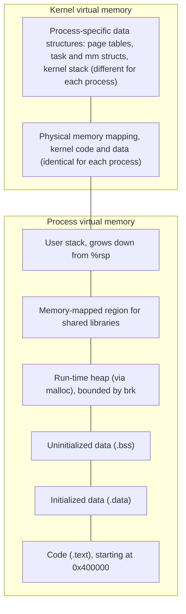
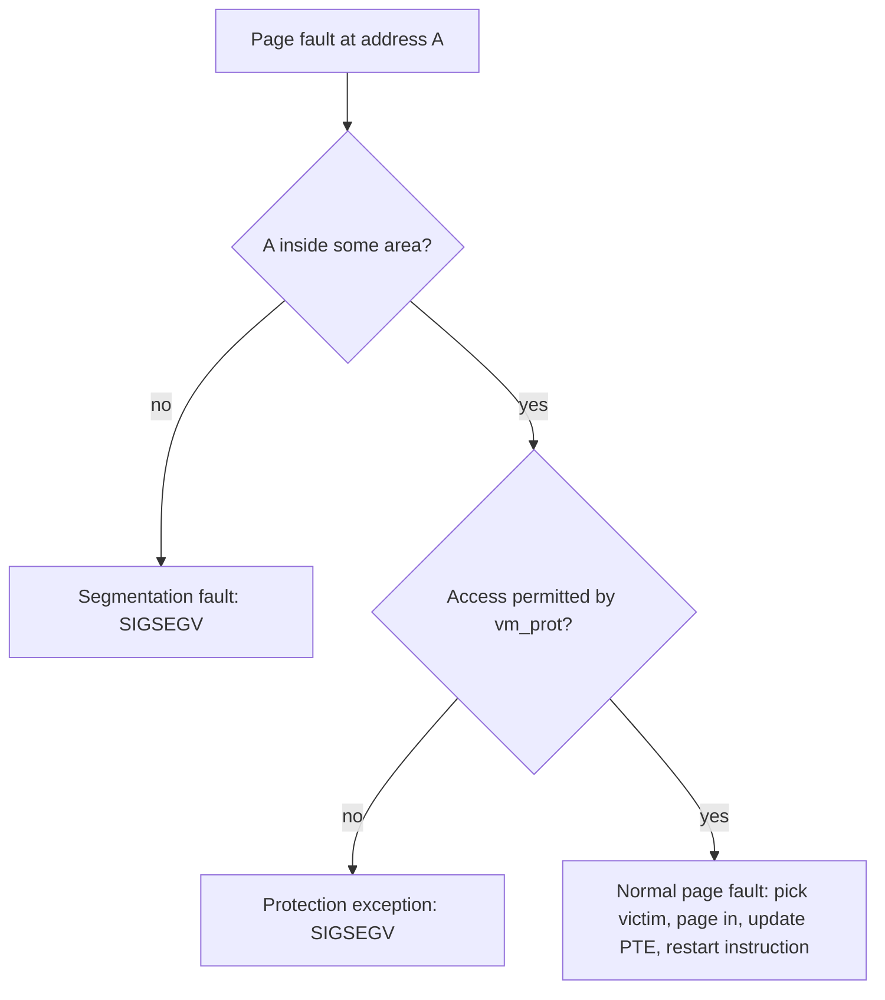

# Linux VM and memory mapping

The previous lesson described the hardware side of virtual memory: page tables, TLBs, translation. This lesson covers the software side: how the Linux kernel organizes a process's virtual address space, how it handles page faults, and the powerful idea of **memory mapping**, which ties virtual memory to files. Memory mapping explains how programs are loaded, how shared libraries are shared, why `fork` is fast (copy-on-write), and gives you the `mmap` system call, a tool worth knowing well.

## 1. The Linux virtual memory system

Linux maintains a separate virtual address space for each process:



The **kernel virtual memory** lies above the user stack. Some regions of it are mapped to physical pages shared by all processes (kernel code and global data structures). Interestingly, Linux also maps a set of contiguous virtual pages (equal in size to the total DRAM) to the corresponding contiguous physical pages, giving the kernel a convenient way to access any specific location in physical memory, for example page tables or memory-mapped device I/O. Other regions contain data that differ per process: page tables, the kernel stack used while executing in the process's context, and the data structures tracking the organization of the address space.

### Linux virtual memory areas

Linux organizes the virtual memory as a collection of **areas** (also called **segments**). An area is a contiguous chunk of existing (allocated) virtual memory whose pages are related in some way: the code segment, data segment, heap, shared library segment and user stack are all distinct areas. Each existing virtual page is contained in some area, and **any virtual page not part of some area does not exist and cannot be referenced by the process**. Areas matter because they allow the virtual address space to have gaps: the kernel does not keep track of virtual pages that do not exist, and such pages consume no memory, disk, or kernel resources.

The kernel data structures:

- A distinct **task structure** (`task_struct`) for each process, containing or pointing to everything the kernel needs to run it (PID, pointer to the user stack, name of the executable, program counter…).
- One of its entries points to an **`mm_struct`** characterizing the current state of the virtual memory. Two fields matter here: **`pgd`**, which points to the base of the level 1 page table (the page global directory; when the kernel runs this process, it stores `pgd` in **CR3**), and **`mmap`**, which points to a list of **`vm_area_struct`s** (area structs), each describing one area:

| Field | Meaning |
|---|---|
| `vm_start` | Beginning of the area |
| `vm_end` | End of the area |
| `vm_prot` | Read/write permissions for all pages in the area |
| `vm_flags` | Whether the pages are shared with other processes or private to this process (among other things) |
| `vm_next` | Next area struct in the list |

On Linux you can see a process's areas with `cat /proc/<pid>/maps` or `pmap <pid>`.

### Linux page fault exception handling

Suppose the MMU triggers a page fault while trying to translate some virtual address A. The kernel's page fault handler performs these steps:

1. **Is virtual address A legal?** Does A lie within an area defined by some area struct? The handler searches the list of area structs, comparing A with `vm_start` and `vm_end` in each. If A is not legal, the handler triggers a **segmentation fault**, which terminates the process. (Because a process can create an arbitrary number of areas with `mmap`, Linux superimposes a tree on the list to make the search fast.)
2. **Is the attempted memory access legal?** Does the process have permission to read, write or execute the pages in this area? If the fault results from, say, a store instruction writing to a read-only page in the code segment, or from user-mode code trying to read kernel memory, the handler triggers a **protection exception**, terminating the process.
3. Otherwise the fault resulted from a **legal operation on a legal virtual address**. The kernel handles it normally: select a victim page, swap out the victim if it is dirty, swap in the new page, and update the page table. When the handler returns, the CPU restarts the faulting instruction, which resends A to the MMU; this time the translation succeeds.



## 2. Memory mapping

Linux initializes the contents of a virtual memory area by associating it with an **object** on disk, a process known as **memory mapping**. Areas can be mapped to one of two types of objects:

1. **Regular file in the Linux file system.** An area can be mapped to a contiguous section of a regular disk file, such as an executable object file. The file section is divided into page-size pieces, each containing the initial contents of a virtual page. Because of demand paging, **none of these virtual pages is actually swapped into physical memory until the CPU first touches the page**. If the area is larger than the file section, it is padded with zeros.
2. **Anonymous file.** An area can also be mapped to an anonymous file, created by the kernel, that contains all binary zeros. The first time the CPU touches a virtual page in such an area, the kernel finds an appropriate victim page in physical memory, swaps it out if dirty, overwrites it with binary zeros, and updates the page table. **No data are actually transferred between disk and memory.** For this reason, pages in areas mapped to anonymous files are sometimes called **demand-zero pages**.

In either case, once a virtual page is initialized, it is swapped back and forth between memory and a special **swap file** (swap space, swap area) maintained by the kernel. At any point in time, the swap space bounds the total amount of virtual pages that can be allocated by the currently running processes.

### Shared objects revisited

Many processes have identical read-only code areas (every process running the `bash` shell has the same code area) and many programs access identical copies of read-only run-time library code (`printf` in the C library). It would be extremely wasteful for each process to keep duplicate copies in physical memory. Memory mapping provides a clean mechanism for controlling how objects are shared.

An object can be mapped into an area of virtual memory as either a **shared object** or a **private object**.

- If a process maps a **shared object** into an area of its virtual address space, then any writes the process makes to that area are **visible to any other processes** that have also mapped the shared object, and the changes are also **reflected in the original object on disk**. Such an area is a *shared area*. Because each object has a unique filename, the kernel can quickly determine that process 1 has already mapped an object and can point the page table entries in process 2 to the same physical pages. **Only a single copy of the shared object needs to be stored in physical memory**, even though it is mapped into multiple shared areas (at possibly different virtual addresses in each process).
- Changes made to an area mapped to a **private object** are **not visible to other processes**, and any writes are **not reflected back to the object on disk**. Such an area is a *private area*.

### Copy-on-write

Private objects are mapped using a clever technique called **copy-on-write (COW)**. A private object begins life exactly as a shared object does, with only one copy stored in physical memory. For each process that maps the private object, the page table entries for the corresponding private area are flagged as **read-only**, and the area struct is flagged as **private copy-on-write**. So long as neither process attempts to write to its private area, they continue to share a single copy of the object in physical memory.

As soon as a process attempts to write to some page in the private area, the write triggers a **protection fault**. When the fault handler notices that the exception was caused by a write to a page in a private copy-on-write area, it **creates a new copy of the page** in physical memory, updates the page table entry to point to the new copy, and restores write permission to the page. When the handler returns, the CPU re-executes the write, which now proceeds normally on the newly created page.

By deferring the copying of pages in private objects until the last possible moment, copy-on-write makes the most efficient use of scarce physical memory.

```python-run
# A toy copy-on-write model: frames are shared until someone writes.
class Frame:
    def __init__(self, data): self.data, self.refs = list(data), 1
class Proc:
    def __init__(self, table): self.table = table           # vpn -> Frame
    def fork(self):
        for f in self.table.values(): f.refs += 1           # share every frame, conceptually read-only
        return Proc(dict(self.table))
    def write(self, vpn, i, val):
        f = self.table[vpn]
        if f.refs > 1:                                      # protection fault -> copy the page
            f.refs -= 1
            f = self.table[vpn] = Frame(f.data)
            self.copies = getattr(self, "copies", 0) + 1
        f.data[i] = val
    def read(self, vpn, i): return self.table[vpn].data[i]

parent = Proc({0: Frame([1, 2, 3]), 1: Frame([4, 5, 6]), 2: Frame([7, 8, 9])})
child = parent.fork()
child.write(1, 0, 99)
print("parent sees", parent.read(1, 0), "| child sees", child.read(1, 0))
print("pages copied:", child.copies, "of 3; page 0 still shared:", parent.table[0] is child.table[0])
```

### The fork function revisited

When `fork` is called by the current process, the kernel creates various data structures for the new process and assigns it a unique PID. To create the virtual memory for the new process, it creates **exact copies of the current process's `mm_struct`, area structs and page tables**. It flags each page in both processes as **read-only**, and flags each area struct in both processes as **private copy-on-write**.

When `fork` returns in the new process, the new process has an exact copy of the virtual memory as it existed when `fork` was called. When either process performs any subsequent writes, the copy-on-write mechanism creates new pages, thus preserving the abstraction of a private address space for each process. This is why `fork` is cheap even for a process with gigabytes of memory, and why the `fork` + `execve` idiom (which immediately discards the copy) is not wasteful.

### The execve function revisited

Suppose the program running in the current process calls `execve("a.out", NULL, NULL)`. Loading and running `a.out` requires:

1. **Delete existing user areas.** Delete the existing area structs in the user portion of the current process's virtual address.
2. **Map private areas.** Create new area structs for the code, data, bss and stack areas of the new program. All of these are private copy-on-write. The code and data areas are mapped to the `.text` and `.data` sections of the `a.out` file. The bss area is demand-zero, mapped to an anonymous file whose size is contained in `a.out`. The stack and heap are also demand-zero, initially of zero length.
3. **Map shared areas.** If `a.out` was linked with shared objects such as the standard C library `libc.so`, these are dynamically linked into the program and then mapped into the shared region of the user's virtual address space.
4. **Set the program counter (PC).** Set the PC in the current process's context to point to the entry point in the code area.

The next time this process is scheduled, it begins execution from the entry point. Linux swaps in code and data pages as needed.

## 3. User-level memory mapping with mmap

Linux processes can use the `mmap` function to create new areas of virtual memory and to map objects into these areas.

```c
#include <unistd.h>
#include <sys/mman.h>

void *mmap(void *start, size_t length, int prot, int flags, int fd, off_t offset);
/* Returns: pointer to mapped area if OK, MAP_FAILED (-1) on error */

int munmap(void *start, size_t length);
```

`mmap` asks the kernel to create a new virtual memory area, preferably one starting at address `start` (merely a hint, usually NULL), and to map a contiguous chunk of the object specified by file descriptor `fd` to the new area. The chunk has a size of `length` bytes and starts at an offset of `offset` bytes from the beginning of the file.

`prot` contains bits describing the access permissions of the new area (the `vm_prot` bits):

| Value | Pages may be |
|---|---|
| `PROT_EXEC` | Executed by the CPU |
| `PROT_READ` | Read |
| `PROT_WRITE` | Written |
| `PROT_NONE` | Not accessed at all |

`flags` describes the type of the mapped object: **`MAP_ANON`** means the backing store is an anonymous object and the pages are demand-zero; **`MAP_PRIVATE`** indicates a private copy-on-write object; **`MAP_SHARED`** a shared object.

```c
/* Ask the kernel for a new read-only, private, demand-zero area of size bytes */
bufp = Mmap(NULL, size, PROT_READ, MAP_PRIVATE|MAP_ANON, 0, 0);
```

`munmap` deletes the area starting at `start` of `length` bytes; subsequent references to the deleted region result in segmentation faults.

**Example: copying a file to stdout without `read`.** Open the file, find its size with `fstat`, map it, and `write` the mapped bytes to descriptor 1:

```c
void mmapcopy(int fd, int size) {
    char *bufp = Mmap(NULL, size, PROT_READ, MAP_PRIVATE, fd, 0);
    Write(1, bufp, size);
}
```

The file's bytes appear as an ordinary array; pages are faulted in from the page cache on demand, with no user-space buffer to copy into.

```python-run
import mmap, os, tempfile
try:
    path = os.path.join(tempfile.gettempdir(), "csapp_mmap_demo.txt")
    with open(path, "wb") as f:
        f.write(b"hello, memory-mapped world\n" * 3)
    with open(path, "r+b") as f:
        m = mmap.mmap(f.fileno(), 0)            # shared mapping of the whole file
        print(m[:5], len(m), "bytes mapped")
        m[0:5] = b"HELLO"                       # a store into memory...
        m.flush(); m.close()
    print(open(path, "rb").read(27))            # ...shows up in the file
    os.remove(path)
except Exception as e:
    print("mmap is not available in this sandbox:", e)
```

> [!INTERVIEW]
> **"How does `fork` avoid copying the whole address space?"** It copies only the page tables and area structs, marks every page read-only in both processes and the areas copy-on-write. The first write to a page takes a protection fault; the kernel copies just that page and restores write permission. Unmodified pages stay shared forever.

> [!INTERVIEW]
> **"`mmap` vs. `read` for file I/O?"** `read` copies data from the kernel's page cache into your buffer (a syscall per call, one extra copy). `mmap` maps the page-cache pages directly into your address space: no copy, random access by pointer, lazy loading, and sharing between processes; costs are page-fault overhead on first touch, TLB pressure, awkward error handling (I/O errors arrive as `SIGBUS`), and files that change size. Databases and loaders (the dynamic linker maps `.so` files this way) rely on it. `MAP_ANON` mappings are also how `malloc` obtains large blocks.

> [!INTERVIEW]
> **"What exactly is a segmentation fault?"** A page fault whose address is not inside any area of the process (e.g. a null or wild pointer), or whose access violates the area's permissions (writing to code or a read-only mapping, executing a no-execute page). The kernel delivers `SIGSEGV`. A *legal* page fault, by contrast, is silently serviced.

## 4. Summary

- A Linux address space is a list of **areas** (`vm_area_struct`), each with a range, permissions and flags; addresses outside every area do not exist.
- The page fault handler checks: address in an area? access permitted? If both, it services the fault and restarts the instruction; otherwise `SIGSEGV`.
- **Memory mapping** associates an area with a file-backed object or an anonymous (demand-zero) object. Pages are loaded lazily.
- Shared objects: one physical copy, writes visible to all and written back. Private objects: **copy-on-write**.
- `fork` = copy page tables + mark COW. `execve` = delete old areas, map new private (code, data, bss, stack) and shared (libraries) areas, set the PC.
- `mmap(start, length, prot, flags, fd, offset)` creates areas from user code; `munmap` removes them.

## Check yourself

```quiz
[
  {"q": "A page fault occurs at an address that is not inside any vm_area_struct of the process. What happens?", "options": ["The kernel allocates a new page", "Segmentation fault", "The page is read from swap", "The instruction is skipped"], "answer": 1,
   "explain": "Addresses outside every area do not exist; the handler raises a segmentation fault."},
  {"q": "What are demand-zero pages?", "options": ["Pages read from the executable on demand", "Pages in areas mapped to an anonymous file, filled with zeros on first touch without any disk transfer", "Pages that are never used", "Kernel pages"], "answer": 1,
   "explain": "Anonymous mappings (bss, heap, stack) start as zero-filled pages created at first reference."},
  {"q": "Two processes map the same file with MAP_SHARED and one writes to it. Which is true?", "options": ["The write is private to the writer", "The other process sees the change and it is reflected in the file on disk", "A copy of the page is made", "The write faults"], "answer": 1,
   "explain": "Shared objects have a single physical copy; writes are visible to all mappers and written back."},
  {"q": "What triggers the actual copying of a page in a private copy-on-write area?", "options": ["The first read of the page", "The fork call itself", "A write to the page, which causes a protection fault", "A timer interrupt"], "answer": 2,
   "explain": "Pages are marked read-only; the first write faults and the handler copies just that page."},
  {"q": "What does fork copy when creating the child's address space?", "options": ["All physical pages", "The mm_struct, area structs and page tables (pages are shared copy-on-write)", "Only the stack", "Nothing"], "answer": 1,
   "explain": "Only the kernel's bookkeeping structures are duplicated; data pages are shared until written."},
  {"q": "During execve, how is the new program's .bss area set up?", "options": ["Copied from the executable file", "Mapped private and demand-zero to an anonymous file", "Mapped shared", "Allocated with malloc"], "answer": 1,
   "explain": "bss has no bytes in the file; it is an anonymous demand-zero mapping whose size comes from the executable."},
  {"q": "Which mmap flags create a private, zero-filled region not backed by a file?", "options": ["MAP_SHARED", "MAP_PRIVATE | MAP_ANON", "PROT_NONE", "MAP_FIXED"], "answer": 1,
   "explain": "MAP_ANON selects an anonymous object (demand-zero), MAP_PRIVATE makes it copy-on-write/private."},
  {"q": "Which field of mm_struct is loaded into CR3 when the process is scheduled?", "options": ["mmap", "pgd", "vm_start", "vm_prot"], "answer": 1,
   "explain": "pgd points to the level-1 page table (page global directory)."}
]
```

> **Source:** CS:APP 3e, §9.7.2 (Linux virtual memory system) and §9.8 (Memory mapping: shared objects revisited, the fork and execve functions revisited, user-level memory mapping with mmap).
