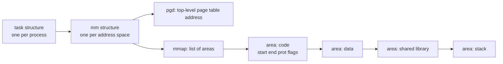
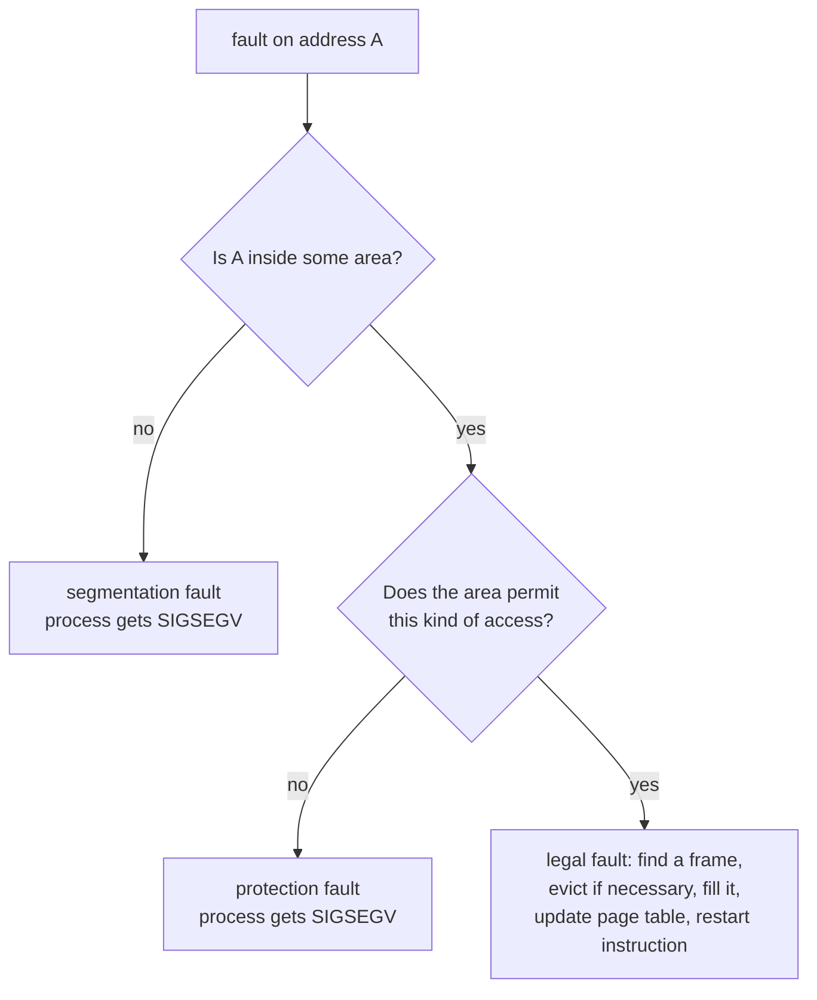
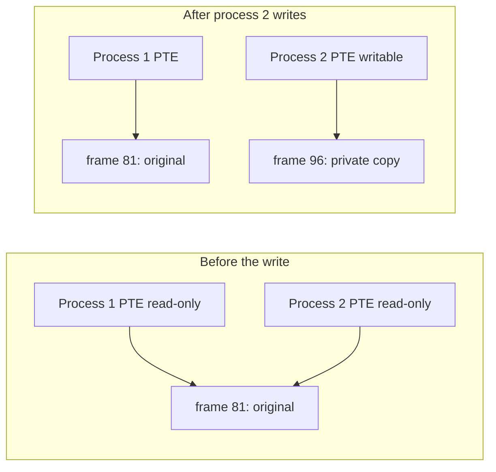

# Linux VM and memory mapping

> **Before this lesson:** This lesson builds directly on [VM concepts and address translation](#/lesson/csapp/vm-translation): pages, page tables and page faults are used throughout. It also revisits `fork` and `execve` from [Processes: fork, exec, wait](#/lesson/csapp/processes).

## In plain words

The previous lesson explained how a program's addresses are converted into real memory locations. This one explains how the operating system decides what a region of a program's memory should contain in the first place. The technique is **memory mapping**: connecting a range of addresses to a source of data, usually a file on disk. Imagine a shared document online. Several people open the same document without each receiving a full copy. Only when one person begins to edit a page does the system quietly make that person a private copy of that one page. Operating systems treat memory the same way, a trick called **copy-on-write**, and it is why starting programs and duplicating processes are fast.

Why this matters at work: this explains what a "segmentation fault" really is, why a tool can report that a program uses far more memory than it truly occupies, and how databases and other fast software read files through memory. It also answers the interview favourite "how can `fork` copy a huge process almost instantly?".

## Why look closer

The previous lesson treated virtual memory as a translation machine: page tables, TLBs, faults. This one looks at the same system from the operating system's side of the desk. How does Linux remember which parts of a process's enormous address space are actually in use? What does the kernel do in the first microsecond of a page fault to decide whether to fix it or kill the process? How can a hundred processes run the same C library while only one copy sits in RAM? Why is `fork` fast even for a process with gigabytes of data? And how does `execve` "load" a program without, at first, reading any of it? The single idea behind all the answers is **memory mapping**: tying a range of virtual addresses to an object that supplies its contents.

## 1. How Linux lays out a process

Each process sees its own private address space. From low addresses upward, the user portion holds the program's code, its initialised data, its zero-initialised data, the heap, a large region where shared libraries and other mappings live, and finally the user stack, which grows downward. Above the user portion sits kernel memory, which user code cannot touch.

Part of the kernel's region maps the same physical pages in every process: the kernel's own code and global data. Another part is different for each process: its page tables, the kernel stack used while the process executes inside the kernel, and the structures that describe its address space.

### Areas

The address space is mostly holes. Linux organises the pieces that *do* exist into **areas** (the kernel source calls them VMAs; some texts say segments). An area is a contiguous range of allocated virtual memory whose pages are related in some way: the code area, the data area, the heap, one area per shared library, the stack.

This is the important consequence: **every virtual page that exists belongs to some area. An address that falls in no area does not exist and cannot be referenced.** The kernel therefore never needs to track the gaps, and they cost nothing in memory, on disk, or in the kernel.

The bookkeeping forms a short chain of structures:



- The kernel keeps a **task structure** for each process holding or pointing to everything it needs to run it: process ID, saved registers, pointer to the user stack, the name of the executable.
- One of its fields points to a memory descriptor that summarises the address space. Two fields matter here. `pgd` holds the base of the top-level page table; when the process is scheduled, the kernel loads that value into the CPU's page-table base register (CR3 on x86-64). `mmap` points to the collection of area descriptors.
- Each **area descriptor** records where the area begins and ends, the access permissions shared by all its pages (`vm_prot`: readable, writable, executable), a few flags including whether the area is shared with other processes or private to this one (`vm_flags`), and a link to the next area.

On a real Linux machine you can inspect a process's areas by reading the file `/proc/<pid>/maps`. Each line shows a range, its permissions, and the file it is mapped from, if any.

```python-run
import bisect
# A toy area list for one process: (start, end, perms, what backs it)
areas = [
    (0x00400000, 0x0045a000, "r-x", "app text"),
    (0x0065a000, 0x0065d000, "rw-", "app data"),
    (0x01c20000, 0x01c63000, "rw-", "heap, anonymous"),
    (0x7f31a4000000, 0x7f31a41c2000, "r-x", "libc.so text"),
    (0x7ffd5e1f0000, 0x7ffd5e211000, "rw-", "stack, anonymous"),
]
starts = [a[0] for a in areas]
def find_area(addr):
    i = bisect.bisect_right(starts, addr) - 1
    if i >= 0 and areas[i][0] <= addr < areas[i][1]:
        return areas[i]
    return None

for addr in (0x00401230, 0x01c20010, 0x0000dead0000, 0x7ffd5e200ff8):
    a = find_area(addr)
    print(f"{addr:#016x} ->", f"{a[3]} [{a[2]}]" if a else "in no area")
used = sum(e - s for s, e, *_ in areas)
print(f"mapped: {used / 2**20:.1f} MiB out of a {2**47 / 2**40:.0f} TiB user address space")
```

## 2. What the kernel does on a page fault

Suppose the MMU, while translating virtual address *A*, finds no valid mapping and raises a fault. Control jumps to the kernel's page-fault handler, which asks three questions in order.



1. **Is the address legal at all?** The handler searches the area descriptors for one whose range contains *A*. If none does, the program used an address that does not exist, and the kernel delivers a segmentation fault. Because a process may have many areas (and can create arbitrarily many with `mmap`), Linux does not really walk a list; it keeps the descriptors in a balanced search tree as well.
2. **Is the access permitted?** Does the process have the right to read, write or execute pages in this area? A store into the read-only code area, or a user-mode touch of kernel memory, fails here and also ends in a signal.
3. **Otherwise it is an ordinary fault** on a legitimate page that merely is not in memory at the moment. The kernel picks a victim frame, writes the victim back to disk if it has been modified, brings in or creates the needed page, fixes the page table, and returns. The CPU then re-executes the faulting instruction, which now succeeds.

Only the third outcome is "paging". The first two are how the kernel turns pointer bugs into clean crashes.

> [!INTERVIEW]
> **"What actually causes a segmentation fault?"** A reference to a virtual address that is either not inside any mapped area of the process, or inside one whose permissions forbid the attempted access (writing read-only memory, executing non-executable memory). The MMU raises a fault, the kernel's handler finds no valid area or a permission mismatch, and it sends `SIGSEGV`. A page fault on a legal address is not an error and is resolved invisibly.

## 3. Memory mapping

Linux gives a virtual memory area its initial contents by associating it with an **object**. Two kinds exist.

- **A regular file.** A section of a disk file is divided into page-sized pieces, each supplying the initial bytes of one virtual page. Nothing is read when the mapping is created. Pages arrive by **demand paging**: the first touch of each page faults and the kernel reads that page. If the area is larger than the file section, the tail is filled with zeros.
- **An anonymous file.** There is no file at all; the kernel fabricates pages full of binary zeros. On the first touch, the kernel finds a frame, clears it, and maps it. No disk transfer happens, which is why such pages are called **demand-zero** pages.

Once a page has been brought in either way, it can later be pushed out to, and brought back from, the system's **swap** space. The amount of swap bounds the total virtual memory that running processes can commit.

### Shared and private objects

An object is mapped into an area in one of two modes.

| | Shared mapping | Private mapping |
|---|---|---|
| Are my writes visible to other processes mapping the object? | Yes | No |
| Do my writes reach the underlying file? | Yes | No |
| Typical use | inter-process shared memory, file I/O through memory | program code and data, libraries, heap, stack |

**Shared objects** are straightforward. If two processes map the same object as shared, both sets of page table entries point at the *same* physical frames. The kernel can tell that the second process is mapping something it has already loaded because each object has a unique identity, such as its file. Only one copy needs to exist in RAM regardless of how many processes use it, and the virtual addresses at which they map it need not match.

**Private objects** use a wonderfully economical technique called **copy-on-write** (COW). A private object starts out exactly like a shared one: a single physical copy, pointed to by everyone. The difference is in the bookkeeping. The page table entries for the area are marked *read-only*, and the area descriptor is flagged *private copy-on-write*. As long as nobody writes, sharing continues. The moment a process tries to write to one of these pages:

1. the write triggers a protection fault,
2. the handler sees that the area is a private copy-on-write area, so the fault is not an error,
3. it allocates a new frame, copies the old page's contents into it, points the writer's page table entry at the new frame, and restores write permission,
4. it returns, the CPU re-runs the store, and the write lands in the private copy.

Copying is postponed until the last possible moment and happens one page at a time, so memory is spent only on pages that actually diverge.



```python-run
class Frame:
    count = 0
    def __init__(self, data):
        self.data, self.refs = data, 1
        Frame.count += 1

class AddressSpace:
    def __init__(self, pages):                 # pages: page number -> [frame, writable]
        self.pt = pages
    def fork(self):
        child = {}
        for vpn, entry in self.pt.items():
            entry[1] = False                   # parent loses write permission too
            entry[0].refs += 1
            child[vpn] = [entry[0], False]
        return AddressSpace(child)
    def write(self, vpn, value):
        frame, writable = self.pt[vpn]
        if not writable:                       # protection fault -> COW handler
            if frame.refs > 1:
                frame.refs -= 1
                frame = Frame(frame.data)      # private copy of this one page
            self.pt[vpn] = [frame, True]
        frame.data = value
    def read(self, vpn):
        return self.pt[vpn][0].data

parent = AddressSpace({n: [Frame(f"page{n}"), True] for n in range(1000)})
print("frames before fork:", Frame.count)
child = parent.fork()
print("frames right after fork:", Frame.count, "(nothing copied)")
child.write(7, "child's version")
child.write(7, "child's second edit")
print("frames after the child wrote to one page twice:", Frame.count)
print("parent sees:", parent.read(7), "| child sees:", child.read(7))
```

## 4. fork, revisited

With areas and copy-on-write in hand, `fork` becomes easy to explain. To create the child, the kernel:

1. assigns a new process ID and builds fresh kernel structures,
2. makes **exact copies** of the parent's memory descriptor, area descriptors and page tables,
3. marks every page in both processes read-only and flags every area in both as private copy-on-write.

When `fork` returns in the child, its memory looks identical to the parent's at the instant of the call, yet almost no physical memory was copied; only the page tables were. From then on, whichever process writes to a page first receives its own copy of that page. This is how each process keeps the illusion of a private address space. It is also why the very common fork-then-exec sequence is cheap: the child typically touches a handful of stack pages before discarding the whole address space.

## 5. execve, revisited

Suppose the running program calls `execve("render", ...)`. Replacing the current program takes four steps, and notably none of them reads the executable's code or data from disk.

1. **Delete the existing user areas.** Everything in the user part of the address space is thrown away.
2. **Map private areas.** New area descriptors are created for the new program, all private copy-on-write:
   - code and initialised data are mapped to the corresponding sections of the executable file,
   - uninitialised data (bss) is mapped to an anonymous file, so it is demand-zero, with its size taken from the executable,
   - the stack and the heap are also demand-zero and start with zero length.
3. **Map shared areas.** If the program was linked against shared libraries such as `libc.so`, they are dynamically linked and mapped into the shared-library region.
4. **Set the program counter.** The saved PC in the process's context is pointed at the entry point of the new code.

The next time the process is scheduled it starts executing at the entry point, immediately faults on its first code page, and the kernel pages it in. The program is loaded lazily, piece by piece, as it runs. A 200 MB executable of which a run uses 3 MB costs 3 MB.

| Area | Backed by | Mode |
|---|---|---|
| `.text` | executable file | private, read and execute |
| `.data` | executable file | private, read and write, COW |
| `.bss` | anonymous | private, demand-zero |
| heap | anonymous | private, demand-zero |
| shared libraries | library files | text shared between processes; data private COW |
| stack | anonymous | private, demand-zero |

> [!INTERVIEW]
> **"How can `fork` be fast for a process with 8 GB of memory?"** The kernel copies the page tables and area descriptors, not the pages. Both processes map the same frames read-only, flagged copy-on-write, and a page is duplicated only when one side writes to it. Follow up with the practical consequence: a fork-then-exec child copies almost nothing, and a snapshotting process such as a database saving to disk pays only for pages modified during the snapshot.

## 6. Mapping from user code: mmap

Programs can create areas themselves.

```c
#include <sys/mman.h>
void *mmap(void *addr, size_t length, int prot, int flags, int fd, off_t offset);
int   munmap(void *addr, size_t length);
```

The call asks the kernel for a new area of `length` bytes, preferably starting at `addr` (pass `NULL` to let the kernel choose, which is nearly always right), backed by `length` bytes of the object open on descriptor `fd` beginning at `offset`. On failure it returns `MAP_FAILED`, which is not the same value as `NULL`.

`prot` sets the page permissions as a bitwise OR of:

- `PROT_READ`, `PROT_WRITE`, `PROT_EXEC` for readable, writable, executable pages,
- or `PROT_NONE` for pages that cannot be accessed at all (useful as guard regions).

`flags` selects the object type and sharing mode:

- `MAP_PRIVATE`: a private copy-on-write mapping,
- `MAP_SHARED`: a shared mapping,
- `MAP_ANON`: an anonymous, demand-zero object (the descriptor is ignored).

Two idioms cover most uses. To view a file as an array of bytes, with no `read` calls and no user-space copy:

```c
int fd = open(path, O_RDONLY);
struct stat st;
fstat(fd, &st);
char *p = mmap(NULL, st.st_size, PROT_READ, MAP_PRIVATE, fd, 0);
write(STDOUT_FILENO, p, st.st_size);     /* the whole file, straight from the page cache */
munmap(p, st.st_size);
```

To obtain a large block of zeroed memory (this is how `malloc` implementations get big chunks):

```c
void *block = mmap(NULL, 64 << 20, PROT_READ | PROT_WRITE, MAP_PRIVATE | MAP_ANON, -1, 0);
```

`munmap` removes the area; later references to the range fault.

Python exposes the same call. The demo maps a small file, edits it through memory, and shows that the edit reached the file because the mapping is shared.

```python-run
import mmap, os, tempfile

def demo():
    with tempfile.TemporaryDirectory() as d:
        path = os.path.join(d, "greeting.txt")
        with open(path, "wb") as f:
            f.write(b"hello, mapped world\n")
        with open(path, "r+b") as f:
            with mmap.mmap(f.fileno(), 0) as m:          # length 0 = whole file, shared by default
                print("first five bytes, read like an array:", m[:5])
                m[0:5] = b"HELLO"                        # a plain memory store
                m.flush()
        with open(path, "rb") as f:
            print("file contents afterwards:", f.read())
        anon = mmap.mmap(-1, 4096)                       # anonymous, demand-zero
        print("anonymous page starts as:", anon[:8])
        anon.close()

try:
    demo()
except Exception as exc:
    print("mmap is not available in this sandbox:", type(exc).__name__)
    print("expected: b'hello', then the file reads b'HELLO, mapped world', then eight zero bytes")
```

## 7. Pitfalls

- **Thinking a mapping loads the file.** It creates an area descriptor. Bytes move only when pages are touched, which means I/O errors can surface later as signals, not as return codes.
- **Using `MAP_PRIVATE` and expecting the file to change.** Private writes go to copy-on-write pages and are discarded at unmap. Use `MAP_SHARED` to modify the file.
- **Comparing the result of `mmap` to `NULL`.** Failure is `MAP_FAILED`.
- **Offsets that are not page-aligned.** The file offset must be a multiple of the page size.
- **Touching beyond the end of a mapped file.** Bytes up to the end of the last page read as zero, but touching whole pages past the end of the file raises `SIGBUS`.
- **Equating virtual size with memory use.** A process may show gigabytes of virtual size while its resident set is tiny, because untouched and shared pages cost little or nothing.
- **Forgetting that fork shares until a write.** After a fork, a parent that modifies most of its heap forces most of it to be copied; memory use can briefly double.
- **Holding a dangling pointer after `munmap`.** It faults at best, and silently hits a newer mapping at worst.

## Summary

- Linux describes an address space as a set of areas, each a contiguous range with one set of permissions and flags. Addresses outside every area do not exist.
- The fault handler checks whether the address lies in an area and whether the access is permitted. If either check fails the process is signalled; otherwise the page is brought in and the instruction is restarted.
- Memory mapping initialises an area from an object: a regular file (demand paged) or an anonymous file (demand-zero).
- Shared mappings make writes visible to everyone and to the file. Private mappings use copy-on-write, deferring duplication to the first write and doing it page by page.
- `fork` copies descriptors and page tables and marks everything copy-on-write; `execve` discards the old areas and maps new ones without reading the program up front.
- `mmap` and `munmap` let user programs create and delete areas for file access, shared memory and large allocations.

## Glossary

- **Area (VMA)**: a continuous range of a process's virtual memory that is in use, such as its code or its stack.
- **Segmentation fault**: the error raised when a program touches an address outside every area or in a forbidden way.
- **Memory mapping**: linking a range of virtual addresses to an object that supplies its contents.
- **Demand paging**: loading a page from disk only when it is first touched.
- **Anonymous mapping**: a mapping not backed by a file, whose pages begin filled with zeros.
- **Demand-zero page**: a page that is created full of zeros the first time it is used.
- **Swap space**: disk space used to hold pages pushed out of memory.
- **Shared mapping**: a mapping in which changes are seen by every process using it and reach the file.
- **Private mapping**: a mapping in which a process's changes stay with that process.
- **Copy-on-write**: sharing pages until someone writes, then copying only the page written.
- **`mmap` / `munmap`**: the system calls that create / remove a mapping.
- **Resident set**: the part of a process's memory that is currently held in physical memory.

```quiz
[
  {"q": "A program dereferences a pointer whose value lies between the heap and the shared-library region, in no mapped area. What does the kernel do?",
   "options": ["Allocates a demand-zero page there", "Delivers a segmentation fault because the address belongs to no area", "Swaps in the page from disk", "Extends the heap to cover it"],
   "answer": 1, "explain": "The fault handler first checks that the address falls inside some area. If it does not, the address does not exist and the process receives SIGSEGV."},
  {"q": "Immediately after fork, how much of the parent's 2 GB heap has been physically copied?",
   "options": ["All of it", "Half of it", "Essentially none; only page tables and descriptors are duplicated", "Only the pages modified in the last second"],
   "answer": 2, "explain": "Both processes map the same frames, marked read-only and copy-on-write. A page is copied only when one of them writes to it."},
  {"q": "A process writes to a page in a private copy-on-write area that it still shares with another process. Which sequence occurs?",
   "options": ["The write goes to the shared frame and both see it", "A protection fault, then the kernel copies the page, remaps the writer to the copy as writable, and restarts the instruction", "The process is killed with SIGSEGV", "The page is written to the backing file"],
   "answer": 1, "explain": "The read-only marking forces a fault. The handler recognises the area as copy-on-write, makes a private copy and lets the store proceed on it."},
  {"q": "Which area of a newly exec'd program is backed by an anonymous file rather than the executable?",
   "options": [".text", ".data", ".bss", "The shared library text"],
   "answer": 2, "explain": "Uninitialised data occupies no space in the executable and is supplied as demand-zero pages. Code and initialised data are mapped from the file."},
  {"q": "What does execve read from the executable's code and data at the time of the call?",
   "options": ["The whole file", "Only the code", "Nothing beyond headers; pages are faulted in as they are touched", "Only the data"],
   "answer": 2, "explain": "execve builds area descriptors that point at the file. The first execution of each page triggers a fault that brings it in."},
  {"q": "A process maps a file with MAP_PRIVATE and PROT_WRITE and changes some bytes. What happens to the file on disk?",
   "options": ["It is updated when the page is evicted", "It is updated at munmap", "Nothing; the changes live in private copy-on-write pages", "The mmap call fails"],
   "answer": 2, "explain": "Private mappings never write through to the object. Use MAP_SHARED when the file should receive the changes."},
  {"q": "Two processes map the same shared library. How many copies of its code pages are in physical memory?",
   "options": ["One, referenced by both page tables", "Two, one per process", "One per thread", "None until a write occurs"],
   "answer": 0, "explain": "The kernel identifies the object by its file and maps the same frames into each process. Code is read-only so no private copies are ever needed."},
  {"q": "What does mmap return on failure?",
   "options": ["NULL", "MAP_FAILED", "0 with errno set", "-1 cast to int"],
   "answer": 1, "explain": "The failure value is the special pointer MAP_FAILED, which is distinct from NULL, so tests against NULL are wrong."}
]
```

> **Source:** CS:APP 3e, §9.7–9.8
