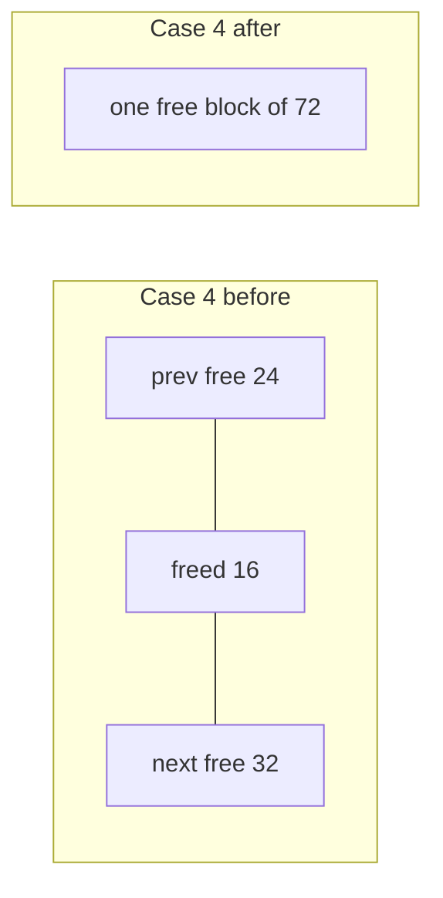
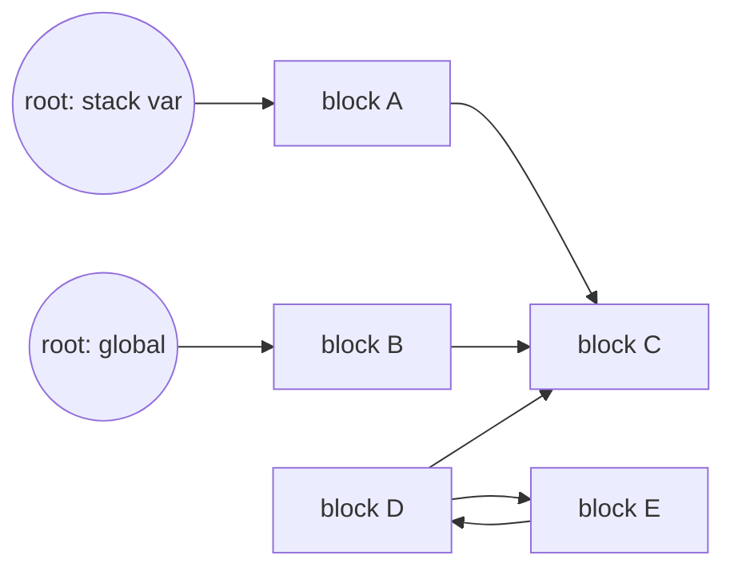

# Dynamic memory allocation and garbage collection

> **Before this lesson:** You should be able to read C code that uses pointers, and know the layout of a process's memory (code, data, heap, stack) from [Caches, the OS, and the big themes](#/lesson/csapp/tour-os). Virtual memory from [Linux VM and memory mapping](#/lesson/csapp/vm-mapping) explains where the heap comes from.

## In plain words

Programs often cannot know in advance how much memory they will need: it depends on the file opened or the number of users connected. Such memory is requested while the program runs, from a region called the **heap**, and handed back when it is no longer needed. The code that manages the heap is the **allocator**; in C it is reached through the functions `malloc` (give me some memory) and `free` (I am finished with it). Picture a car park with no painted bays, where vehicles of every length arrive and leave in any order. After a while the empty space is scattered in small gaps, and a long bus cannot park although the total free space would be enough. Keeping the gaps usable, and finding one quickly, is the allocator's whole job.

Why this matters at work: mistakes with heap memory cause some of the most damaging faults in software, including crashes, slow leaks that bring down long-running services, and security holes. Understanding the allocator explains those failures and the performance of memory-heavy programs. "How would you implement `malloc`?" is a classic interview question.

## Why look closer

A program rarely knows in advance how much memory it will need. A text editor cannot guess the size of the file you will open; a web server cannot guess how many requests will be in flight. Sizes that are only known at run time are served from the **heap**, through an **allocator**. In C that means `malloc` and `free`, and most people use them for years as black boxes. Opening the box is worthwhile. It explains why a single stray write can make a program crash an hour later in unrelated code, why a long-running service's memory footprint creeps upward even though it "frees everything", and what design decisions separate a fast allocator from a slow one. It is also a compact case study in the classic engineering tension between speed and space. The lesson ends with garbage collection and a field guide to the memory bugs that C makes possible.

## 1. The heap and its interface

The heap is an area of demand-zero virtual memory that starts immediately above the program's uninitialised data and grows toward higher addresses. The kernel tracks its upper boundary in a per-process variable called the **program break** (`brk`).

An allocator carves the heap into **blocks**, each a contiguous chunk of virtual memory that is either *allocated* (handed out to the program) or *free* (available). Allocators come in two families that differ in who is responsible for giving memory back:

- **Explicit allocators** make the program release blocks. C's `malloc`/`free` and C++'s `new`/`delete` are of this kind.
- **Implicit allocators**, better known as **garbage collectors**, detect blocks the program can no longer use and reclaim them automatically. Java, Go, Python and JavaScript work this way.

The C interface is small:

```c
#include <stdlib.h>
void *malloc(size_t size);               /* uninitialised block of at least size bytes, or NULL */
void *calloc(size_t n, size_t size);     /* n*size bytes, zero-filled */
void *realloc(void *p, size_t size);     /* resize, possibly moving the contents */
void  free(void *p);                     /* p must come from the calls above, exactly once */

#include <unistd.h>
void *sbrk(intptr_t incr);               /* move the program break; returns the old break */
```

`malloc` returns memory aligned for any data type: on 64-bit Linux that means a multiple of 16 bytes. It does not clear the block. `free` returns nothing and has no way of reporting a bad argument, so passing it a pointer it did not hand out, or the same pointer twice, is undefined behaviour. Allocators obtain raw heap space from the kernel with `sbrk` or with `mmap`.

Why not declare big arrays? Because a fixed bound is either wasteful or, eventually, too small. Code that hard-wires a maximum input size becomes a maintenance burden and, worse, an invitation to buffer overflows.

## 2. What makes allocation hard

An explicit allocator works under strict rules:

1. **Any sequence of requests may arrive.** It cannot assume that frees mirror allocations in some convenient order.
2. **It must answer immediately.** No buffering requests to reorder them.
3. **It may use only the heap** for its own bookkeeping.
4. **Blocks must be aligned.**
5. **Allocated blocks may never be touched.** Once handed out, a block cannot be moved or altered, so techniques like compaction are off the table: the allocator has no idea where the program keeps its pointers.

Inside those rules it tries to maximise two things that pull against each other:

- **Throughput**: requests completed per second.
- **Memory utilisation**: how much of the heap holds actual payload. The usual measure is *peak utilisation*: the largest total payload the program ever had outstanding, divided by the heap size at the end.

A trivially fast allocator never reuses anything and wastes enormous space; a perfectly compact one would search exhaustively on every call. Real designs sit in between.

### Fragmentation

Poor utilisation is mostly caused by **fragmentation**, of which there are two kinds.

- **Internal fragmentation** is waste *inside* allocated blocks: the difference between the block's size and the payload the caller asked for. It comes from alignment padding, per-block bookkeeping, and minimum block sizes. It is easy to quantify because it depends only on past requests.
- **External fragmentation** is waste *between* blocks: the free space adds up to enough for a request, but no single free block is big enough. It is hard to quantify because it depends on *future* requests. Thirty free bytes in three scattered pieces are fine if the next request wants 8 and useless if it wants 24.

Because the future is unknown, allocators use a heuristic: try to keep free memory in a few large pieces rather than many small ones.

```python-run
# External fragmentation in ten lines: plenty of free bytes, no usable block.
heap = [("A", 16), ("free", 16), ("B", 16), ("free", 16), ("C", 16), ("free", 16)]
free_total = sum(size for tag, size in heap if tag == "free")
largest = max(size for tag, size in heap if tag == "free")
print("layout:", " | ".join(f"{t}:{s}" for t, s in heap))
print(f"free bytes in total: {free_total}, largest single free block: {largest}")
for request in (16, 32, 48):
    print(f"request for {request:2} bytes ->", "fits" if request <= largest else "FAILS despite enough total space")
```

Every practical allocator has to settle five questions: how to keep track of free blocks, which free block to choose, what to do with the leftover part of a chosen block, when to merge neighbouring free blocks, and how to get more memory when nothing fits. The rest of the design discussion walks through them.

## 3. Implicit free lists

The simplest organisation stores a one-word **header** at the front of every block, allocated or free. The header holds the block's total size. Since alignment forces every size to be a multiple of 8 or 16, the low-order bits of the size are always zero, and the allocator borrows the lowest one as an **allocated flag**.

```
 header word            payload                 padding
+--------------------+---------------------+----------+
| size (upper bits)|a|  what the caller    | optional |
+--------------------+---------------------+----------+
                      ^ pointer returned by malloc
```

With a size in every header, the blocks form a chain that can be walked from the start of the heap by repeatedly adding each block's size to its address. Free blocks are found by skipping over the allocated ones. Nothing links the free blocks to each other directly, hence the name *implicit* list. A special zero-size allocated header marks the end.

```python-run
def pack(size, allocated):            # size is a multiple of 8, so bit 0 is spare
    return size | allocated
def unpack(word):
    return word & ~0x7, word & 0x1

for size, alloc in ((16, 1), (40, 0), (24, 1)):
    w = pack(size, alloc)
    print(f"size {size:2} alloc {alloc} -> header {w:#06x} -> decoded {unpack(w)}")

# Rounding a request up: add the header, respect an 8-byte alignment and a 16-byte minimum.
def block_size(payload, header=4, align=8, minimum=16):
    return max(minimum, (payload + header + align - 1) // align * align)
for n in (1, 5, 12, 13, 21):
    b = block_size(n)
    print(f"malloc({n:2}) -> block of {b:2} bytes, internal fragmentation {b - n} bytes")
```

### Placement: choosing a free block

When a request for *k* bytes arrives, the allocator searches for a free block of at least *k*. The **placement policy** decides which:

| Policy | Rule | Character |
|---|---|---|
| **First fit** | scan from the beginning, take the first that fits | fast when it succeeds early; tends to litter the front of the heap with small leftovers |
| **Next fit** | resume scanning where the last search stopped | usually faster than first fit; studies show worse utilisation |
| **Best fit** | examine every free block, take the smallest that fits | best utilisation; needs a full scan with a simple list |

### Splitting

If the chosen block is larger than needed, the allocator may **split** it: the front part becomes the allocated block and the remainder becomes a new, smaller free block. Without splitting, a good fit wastes little, but a poor fit turns into internal fragmentation. Splitting is skipped when the remainder would be smaller than the minimum block size.

### Getting more memory

If no block fits even after merging free neighbours, the allocator asks the kernel to extend the heap with `sbrk`, turns the new space into one large free block, and tries again.

### Coalescing

When a block is freed, there may be free blocks on either side of it. Left alone, they produce **false fragmentation**: lots of free memory chopped into pieces too small to use, even though the pieces are adjacent. The fix is **coalescing**, merging adjacent free blocks. An allocator may coalesce **immediately** on every `free`, or **defer** it until, say, a request fails. Immediate coalescing is simple and constant-time, though a pattern of alternating allocate and free of the same size can make it merge and split repeatedly.

Merging with the *next* block is easy: its header is right after the end of the current block. Merging with the *previous* block is the problem. With headers alone, the only way to find where the previous block starts is to walk the heap from the beginning.

### Boundary tags

The classic solution, due to Knuth, is to put a copy of the header at the *end* of each block as well: a **footer**, or boundary tag. The previous block's footer sits in the word immediately before the current block's header, so its size and status can be read in constant time.

With both neighbours inspectable, freeing a block falls into exactly four cases:

| Previous | Next | Action | Resulting free block size |
|---|---|---|---|
| allocated | allocated | mark the block free | size |
| allocated | free | merge with next | size + next |
| free | allocated | merge with previous | prev + size |
| free | free | merge all three | prev + size + next |



Footers cost a word per block, which hurts when blocks are small. A standard optimisation notes that the footer is only ever consulted when the block is *free*. If each header also stores a "previous block is allocated" bit in another spare low bit, allocated blocks can drop their footers and use the space for payload.

A practical trick in implementations is to bracket the heap with a small permanently allocated **prologue** block at the start and a zero-size allocated **epilogue** header at the end. Those sentinels mean the coalescing code never has to test for the edges of the heap.

The simulator below implements an implicit list with first fit, splitting and four-case coalescing. Sizes are in words to keep it readable.

```python-run
class Heap:
    def __init__(self, words):
        self.blocks = [[words, False]]            # [size, allocated], in address order
    def malloc(self, need):
        for i, (size, used) in enumerate(self.blocks):
            if not used and size >= need:         # first fit
                if size - need >= 2:              # split if the remainder is a viable block
                    self.blocks[i:i + 1] = [[need, True], [size - need, False]]
                else:
                    self.blocks[i][1] = True
                return i
        return None
    def free(self, i):
        self.blocks[i][1] = False
        if i + 1 < len(self.blocks) and not self.blocks[i + 1][1]:   # merge with next
            self.blocks[i][0] += self.blocks.pop(i + 1)[0]
        if i > 0 and not self.blocks[i - 1][1]:                      # merge with previous
            self.blocks[i - 1][0] += self.blocks.pop(i)[0]
    def show(self, note):
        print(f"{note:26}", " ".join(f"[{s}{'a' if u else 'f'}]" for s, u in self.blocks))

h = Heap(32)
h.malloc(4); h.malloc(6); h.malloc(4); h.malloc(8)
h.show("after four mallocs")
h.free(1);  h.show("free the 6-word block")
h.free(2);  h.show("free the 4 next to it")       # index shifted: cases merge with previous
print("malloc(9) lands at index", h.malloc(9)); h.show("reuse the merged space")
```

The weakness of an implicit list is speed: every allocation scans blocks that are already in use, so its cost grows with the *total* number of blocks.

## 4. Explicit free lists

Free blocks are, by definition, not holding program data. So their payload area can hold the allocator's own pointers. An **explicit free list** stores a predecessor and a successor pointer in the body of each free block, linking the free blocks into a doubly linked list. Allocation now scans only free blocks, so its cost grows with the number of *free* blocks.

Two ordering disciplines are common:

- **Last-in, first-out**: push a freed block on the front of the list. Freeing is constant time (with boundary tags, coalescing is too), and recently freed, cache-warm memory is reused first.
- **Address order**: keep the list sorted by address. Freeing needs a search to find the insertion point, but first fit on an address-ordered list achieves utilisation close to best fit.

The cost is a larger minimum block: it must hold a header, two pointers and possibly a footer, which raises internal fragmentation for tiny requests.

## 5. Segregated free lists

A single list still means a linear search. The standard remedy is to keep **many lists**, each holding blocks of similar size. The set of all block sizes is partitioned into **size classes**; a popular choice is powers of two, with separate classes for each of the smallest sizes: 1, 2, 3–4, 5–8, and so on up to 1025–2048, 2049–4096 and beyond. A request goes to the list for its class and moves up to larger classes if that one is empty.

Three notable variants:

**Simple segregated storage.** Each class holds blocks of exactly one size, never split and never coalesced. Allocation pops the head of the list and freeing pushes onto it, both constant time. Because every block in a chunk has the same size, the size of a block can be inferred from its address and no per-block header is needed. The price is fragmentation of both kinds.

**Segregated fits.** Each class holds blocks of varying sizes within its range. To allocate, search the appropriate list first-fit; if a block is found, optionally split it and file the remainder in the right class; if not, try the next larger class; if all fail, grow the heap. Freeing coalesces and files the result. This is the approach used by production allocators such as the GNU C library's. It is fast because each search covers only a slice of the heap, and space-efficient because first fit within a size class approximates best fit over the entire heap.

**Buddy systems.** Every block size is a power of two. To satisfy a request, round it up to a power of two, find a block of that size or split a larger one in half repeatedly; the two halves are *buddies*. On free, merge with the buddy if it is free too, and repeat upward. The neat part is that a block's buddy address is computed by flipping a single bit of its own address, so searching and coalescing are fast. The drawback is internal fragmentation of up to nearly 50%, which makes buddies best suited to workloads whose sizes are already powers of two.

```python-run
def size_class(n):
    """Index of the power-of-two class holding n: 1, 2, 3-4, 5-8, 9-16, ..."""
    return (n - 1).bit_length()

for n in (1, 2, 3, 4, 5, 8, 9, 100, 1024, 1025):
    c = size_class(n)
    lo, hi = (1 << (c - 1)) + 1 if c else 1, 1 << c
    print(f"request {n:5} -> class {c:2} covering {lo}..{hi}")

# Buddy arithmetic: flip the bit corresponding to the block size.
def buddy(offset, size):
    return offset ^ size
print("buddy of the 32-byte block at offset 96 :", buddy(96, 32))
print("buddy of the 64-byte block at offset 64 :", buddy(64, 64))
print("a 33-byte request in a buddy system wastes", 64 - 33, "of 64 bytes")
```

> [!INTERVIEW]
> **"How would you implement `malloc`?"** Structure the answer around the design questions. *Free-block organisation*: segregated lists by size class. *Placement*: first fit within the class, which approximates best fit. *Splitting*: split when the remainder exceeds the minimum block. *Coalescing*: immediately, in constant time, using boundary tags, with the footer omitted in allocated blocks. *Growth*: `sbrk` for small blocks, `mmap` for very large ones. Then name the trade-off, throughput against utilisation, and mention that real allocators add per-thread caches to avoid lock contention.

## 6. Garbage collection

A garbage collector frees the programmer from calling `free`. It periodically finds blocks the program can no longer reach and returns them to the free list.

The collector models memory as a **directed graph**. **Heap nodes** are allocated blocks. **Root nodes** are locations outside the heap that hold pointers into it: registers, stack slots, global variables. An edge from *p* to *q* means block *p* contains a pointer to somewhere in block *q*. A heap node is **reachable** if some path leads to it from a root. Anything unreachable is **garbage**: the program has no way of ever using it again.



In that picture A, B and C are live. D and E point at each other but nothing reachable points at them, so both are garbage. That cycle is exactly the case a naive reference-counting scheme cannot reclaim.

### Mark and sweep

The classic algorithm, introduced by McCarthy for Lisp around 1960, has two phases.

- **Mark.** Starting from every root, follow pointers depth-first and set a mark bit in the header of every block reached. A block that is already marked is not visited again, which handles cycles.
- **Sweep.** Walk the whole heap linearly. An allocated block that is unmarked is garbage and is freed. A marked block has its mark cleared, ready for the next collection.

```python-run
blocks = {                          # block -> blocks it holds pointers to
    "A": ["C"], "B": ["C"], "C": [],
    "D": ["E", "C"], "E": ["D"], "F": [],
}
roots = ["A", "B"]

def mark(start, marked):
    stack = [start]
    while stack:
        b = stack.pop()
        if b not in marked:
            marked.add(b)
            stack.extend(blocks[b])

marked = set()
for r in roots:
    mark(r, marked)
garbage = sorted(set(blocks) - marked)
print("marked (reachable):", sorted(marked))
print("swept  (garbage)  :", garbage, "<- note the D/E cycle is collected")
```

### Collecting C conservatively

Languages such as Java keep precise type information, so the collector knows exactly which words are pointers. C does not. An `int` holding 4,198,400 and a pointer holding the address `0x401000` are bit-for-bit the same. A collector for C therefore has to be **conservative**: any word whose value happens to fall inside an allocated block is *treated as* a pointer to that block. To make that test efficient, the collector maintains a search structure over the allocated blocks (for instance a balanced tree keyed by address) so it can tell whether an arbitrary value lands inside one and find that block's header.

The consequence is that some garbage may be wrongly retained because an integer resembles an address. That is safe (nothing live is ever freed) but imprecise. It also means a conservative collector cannot move blocks, since it cannot be sure which words to update.

## 7. A field guide to memory bugs

Memory errors in C are notorious because the symptom usually appears far from the cause, in both time and code. Knowing the standard varieties makes them much easier to recognise.

- **Dereferencing a bad pointer.** The textbook case is `scanf("%d", n)` with the `&` forgotten: the *value* of `n` is used as an address. If you are lucky it faults immediately; if not, it overwrites something valid.
- **Reading uninitialised memory.** `malloc` does not zero its blocks. Code that assumes a fresh array starts at zero works until the allocator recycles a dirty block. Use `calloc` or initialise explicitly.
- **Stack buffer overflow.** Copying input into a fixed-size local array without a length limit. Use bounded functions such as `fgets`.
- **Assuming pointers and the objects they point to are the same size.** `malloc(n * sizeof(int))` for an array that is meant to hold `n` pointers allocates half the needed space on a 64-bit machine. The damage shows up when the allocator later reads a corrupted header or footer.
- **Off-by-one errors.** Allocating `n` elements and then writing index `n`.
- **Referencing a pointer instead of what it points to.** `*count--` decrements the pointer, not the count, because of operator precedence; write `(*count)--`.
- **Misunderstanding pointer arithmetic.** `p + 1` advances by the size of the pointed-to type, not by one byte. Adding `sizeof(int)` to an `int *` skips four elements.
- **Returning the address of a local variable.** The stack frame is reused by the next call, and the pointer now aliases someone else's data.
- **Using freed memory.** The block may already have been handed to another part of the program.
- **Freeing twice,** which corrupts the free list.
- **Leaking.** Losing the last pointer to a block without freeing it. In a short program this is harmless; in a daemon that runs for months it slowly consumes the address space.

```python-run
ptr, integer = 8, 4            # sizes on x86-64 Linux
n = 10
print(f"on x86-64: sizeof(int) = {integer}, sizeof(void *) = {ptr}")
print(f"array of {n} pointers needs {n * ptr} bytes; malloc(n * sizeof(int)) gives {n * integer}")
print(f"-> writes run {n * ptr - n * integer} bytes past the block, into the next block's header")

# Pointer arithmetic scales by element size.
base = 0x1000
print(f"int *p = {base:#x};  p + 3 = {base + 3 * integer:#x};  p + sizeof(int) = {base + integer * integer:#x}")
```

> [!INTERVIEW]
> **"What is the difference between a memory leak and a dangling pointer?"** A leak is memory that is still allocated but no longer reachable, so it can never be freed; the program's footprint grows. A dangling pointer is the reverse: a pointer that is still held to memory that has already been freed or has gone out of scope; using it reads or corrupts whatever now occupies that space. Tools such as AddressSanitizer and Valgrind detect both, and ownership disciplines such as RAII in C++ or the borrow checker in Rust prevent them by construction.

## 8. Pitfalls in allocator thinking

- **Expecting `free` to shrink the process.** Freed blocks usually return to the allocator's lists, not to the operating system.
- **Assuming equal total free space means success.** External fragmentation can defeat a request even when plenty of bytes are free.
- **Forgetting overhead.** A million 1-byte allocations may consume 16 to 32 MB once headers, alignment and minimum sizes are counted.
- **Using the old pointer after `realloc`.** The block may have moved.
- **Believing garbage collection ends leaks.** A collector frees only *unreachable* objects. A forgotten reference in a long-lived cache or listener list keeps its whole subgraph alive.

## Summary

- The heap is managed as a set of allocated and free blocks. Explicit allocators rely on the program to free; garbage collectors find unreachable blocks themselves.
- Allocators balance throughput against utilisation and fight internal fragmentation (waste within blocks) and external fragmentation (free space split too finely).
- An implicit list stores size and an allocated bit in each block's header and scans all blocks. Placement may be first, next or best fit; chosen blocks are split; freed blocks are coalesced, in constant time when boundary tags are used.
- Explicit lists thread pointers through free blocks so that only free blocks are searched. Segregated lists keep one list per size class, giving fast allocation with near best-fit utilisation; buddy systems are a power-of-two special case.
- Mark-and-sweep collection marks everything reachable from the roots and frees the rest. Collectors for C must be conservative because integers and pointers are indistinguishable.
- Most C memory bugs are one of a dozen recurring patterns: bad or uninitialised pointers, overruns, wrong sizes, dangling references, double frees and leaks.

## Glossary

- **Heap**: the region of a process's memory from which storage is requested while the program runs.
- **Allocator**: the code that hands out and takes back pieces of the heap.
- **Block**: one continuous piece of the heap, either in use or free.
- **Payload**: the part of a block the program actually asked for.
- **Throughput**: the number of allocation requests completed per second.
- **Utilisation**: how much of the heap holds useful data as opposed to overhead and gaps.
- **Internal fragmentation**: space wasted inside allocated blocks, for example by padding.
- **External fragmentation**: free space split into pieces too small to satisfy a request.
- **Header / footer**: small records at the start / end of a block holding its size and whether it is in use.
- **Free list**: the allocator's record of which blocks are available.
- **First fit / best fit**: choosing the first free block that is big enough / the smallest one that is big enough.
- **Splitting / coalescing**: dividing a free block that is larger than needed / merging neighbouring free blocks.
- **Garbage collector**: a system that finds and frees memory the program can no longer reach.
- **Memory leak**: memory that is never freed although the program no longer uses it.
- **Dangling pointer**: a pointer that still refers to memory that has already been freed.

```quiz
[
  {"q": "A heap has free blocks of 8, 8 and 8 bytes separated by allocated blocks. A request for 16 bytes fails. What is this called?",
   "options": ["Internal fragmentation", "External fragmentation", "A memory leak", "Thrashing"],
   "answer": 1, "explain": "The total free space is sufficient, but it is broken into pieces none of which is large enough. That is external fragmentation."},
  {"q": "Why can an allocator store an allocated flag in the low bit of the size field of a block header?",
   "options": ["Sizes are always odd", "Alignment makes every block size a multiple of 8 or 16, so the low bits are always zero", "The size is stored in the footer instead", "Headers are 128 bits wide"],
   "answer": 1, "explain": "Because of alignment the low-order bits of any valid size carry no information, so they can hold status flags and be masked off when reading the size."},
  {"q": "What problem do boundary tags (footers) solve?",
   "options": ["Finding the next block", "Finding the size and status of the previous block in constant time so it can be coalesced", "Detecting double frees", "Aligning payloads"],
   "answer": 1, "explain": "The footer of the previous block lies immediately before the current header. Without it, locating the previous block would require scanning from the start of the heap."},
  {"q": "A block is freed while both its neighbours are free. With immediate coalescing, how many free blocks result from these three?",
   "options": ["Three", "Two", "One", "Zero"],
   "answer": 2, "explain": "This is the fourth coalescing case: the previous, current and next blocks merge into a single free block whose size is the sum of the three."},
  {"q": "Compared with an implicit free list, what does an explicit free list improve?",
   "options": ["Allocation time depends on the number of free blocks instead of all blocks", "It eliminates internal fragmentation", "It removes the need for headers", "It makes blocks movable"],
   "answer": 0, "explain": "Linking only the free blocks means a search never visits allocated ones. The cost is a larger minimum block to hold the two pointers."},
  {"q": "Why does a segregated-fits allocator achieve utilisation close to best fit?",
   "options": ["It compacts the heap", "A first-fit search limited to the right size class finds a block close in size to the request", "It never splits blocks", "It uses a garbage collector"],
   "answer": 1, "explain": "Each list contains only blocks in a narrow size range, so the first block found there is already a near-best fit across the heap."},
  {"q": "In mark and sweep, which blocks are freed during the sweep phase?",
   "options": ["Marked blocks", "Allocated blocks that are not marked", "All blocks older than the last collection", "Blocks referenced only by registers"],
   "answer": 1, "explain": "Marking sets a bit on everything reachable from the roots. The sweep frees allocated blocks without the bit and clears the bit on the rest."},
  {"q": "Why must a garbage collector for C be conservative?",
   "options": ["C programs do not use the heap", "It cannot distinguish an integer from a pointer, so any value that looks like a heap address must be treated as a reference", "C forbids recursion in collectors", "The heap is too small"],
   "answer": 1, "explain": "Without type information, a word that happens to point into a block might be a pointer. Treating it as one is safe but may retain some garbage."}
]
```

> **Source:** CS:APP 3e, §9.9–9.11
