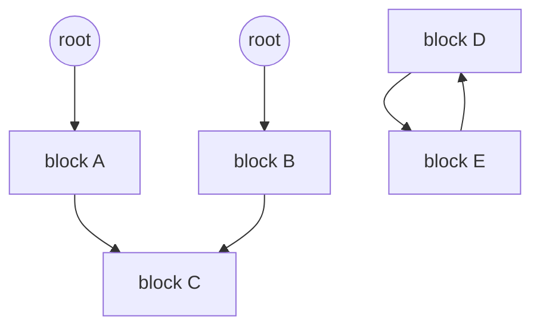

# Dynamic memory allocation and garbage collection

`mmap` and `munmap` can create and delete areas of virtual memory, but C programmers usually find it more convenient and portable to use a **dynamic memory allocator** when they need additional virtual memory at run time. The most important reason programs use dynamic allocation is that they often do not know the sizes of certain data structures until the program actually runs. This lesson explains how allocators like `malloc` work inside: block headers, free lists, placement, splitting, coalescing with boundary tags, and segregated lists. Then it covers garbage collection and the catalogue of memory bugs that every C programmer must be able to recognize.

## 1. The heap and the allocator interface

A dynamic memory allocator maintains an area of a process's virtual memory known as the **heap**: an area of demand-zero memory that begins immediately after the uninitialized data area and grows upward (toward higher addresses). For each process, the kernel maintains a variable **`brk`** ("break") that points to the top of the heap.

An allocator maintains the heap as a collection of various-size **blocks**. Each block is a contiguous chunk of virtual memory that is either **allocated** or **free**. An allocated block has been explicitly reserved for use by the application and remains allocated until it is freed, either explicitly by the application or implicitly by the allocator itself.

- **Explicit allocators** require the application to explicitly free any allocated blocks: C's `malloc`/`free`, C++'s `new`/`delete`.
- **Implicit allocators** require the allocator to detect when an allocated block is no longer being used and then free it: **garbage collectors** (Lisp, ML, Java, Python).

```c
#include <stdlib.h>
void *malloc(size_t size);                 /* pointer to a block of at least size bytes, or NULL */
void *calloc(size_t nmemb, size_t size);   /* allocate and zero-initialize */
void *realloc(void *ptr, size_t size);     /* change the size of a previously allocated block */
void  free(void *ptr);                     /* ptr must come from malloc/calloc/realloc */

#include <unistd.h>
void *sbrk(intptr_t incr);                 /* grow/shrink the heap by adding incr to brk; returns old brk */
```

`malloc` returns a pointer to a block of memory of at least `size` bytes that is suitably aligned for any kind of data object that might be contained in the block. In 32-bit mode the address is always a multiple of 8; **in 64-bit mode, a multiple of 16**. `malloc` does **not** initialize the memory it returns. If it encounters a problem (the request exceeds available virtual memory), it returns NULL and sets `errno`. Allocators obtain memory from the kernel with `sbrk` or with `mmap`.

`free(ptr)` must be given a pointer to the beginning of an allocated block obtained from the allocator; otherwise its behavior is **undefined**, and since it returns nothing, it gives no indication that something is wrong.

## 2. Allocator requirements and goals

Explicit allocators must operate within stringent constraints:

- **Handling arbitrary request sequences.** The allocator cannot make assumptions about the ordering of allocate and free requests.
- **Making immediate responses to requests.** It may not reorder or buffer requests to improve performance.
- **Using only the heap.** Any nonscalar data structures the allocator uses must themselves be stored in the heap.
- **Aligning blocks** so that they can hold any type of data object.
- **Not modifying allocated blocks.** Allocators can only manipulate free blocks; in particular they are **not allowed to move allocated blocks** (compaction is impossible, because the application holds raw pointers).

Within these, the author of an allocator pursues two often conflicting goals:

**Goal 1: maximize throughput**, the number of requests completed per unit time. Minimizing the average time of allocate and free requests. A reasonable target: worst-case allocate time linear in the number of free blocks, constant-time free.

**Goal 2: maximize memory utilization.** Virtual memory is a finite resource (bounded by swap space). The most useful metric is **peak utilization**. Given a sequence of $n$ requests $R_0, \dots, R_{n-1}$: the **aggregate payload** $P_k$ is the sum of the payloads of the currently allocated blocks after request $R_k$; $H_k$ is the current (monotonically nondecreasing) size of the heap. The peak utilization over the first $k+1$ requests is

$$U_k = \frac{\max_{i \le k} P_i}{H_k}$$

It is easy to write a fast allocator that wastes memory, or a thrifty one that is slow; the art is the balance.

## 3. Fragmentation

The primary cause of poor heap utilization is **fragmentation**: otherwise unused memory is not available to satisfy allocate requests.

- **Internal fragmentation** occurs when an allocated block is larger than the payload: because of a minimum block size, alignment padding, or header overhead. It is simple to quantify: the sum of (block size − payload) over allocated blocks. It depends only on the pattern of *previous* requests and the allocator implementation.
- **External fragmentation** occurs when there *is* enough aggregate free memory to satisfy an allocate request, but **no single free block is large enough**. It is much harder to quantify because it also depends on the pattern of *future* requests. So allocators use heuristics that try to maintain small numbers of larger free blocks rather than large numbers of smaller ones.

## 4. Implementation issues

A practical allocator must decide:

- **Free block organization**: how do we keep track of free blocks?
- **Placement**: how do we choose an appropriate free block for a newly allocated block?
- **Splitting**: after placing a block in some free block, what do we do with the remainder?
- **Coalescing**: what do we do with a block that has just been freed?

## 5. Implicit free lists

Any practical allocator needs a data structure that lets it distinguish block boundaries and tell allocated from free blocks. Most embed this information **in the blocks themselves**.

A simple format: a one-word **header**, the **payload**, and possibly some **padding**. The header encodes the block size (including header and padding) and whether the block is allocated or free. With a double-word (8-byte) alignment constraint, the block size is always a multiple of 8, so its 3 low-order bits are always zero. We store only the 29 high-order bits of the size and use the low bits for other information: the **least significant bit is the allocated bit**.

```
 31                                3 2 1 0
+-----------------------------------+-----+
|            block size             |0 0 a|   header: a = 1 allocated, a = 0 free
+-----------------------------------+-----+
|                                         |
|   payload (allocated blocks only)       |   <- malloc returns a pointer to here
|                                         |
+-----------------------------------------+
|   padding (optional)                    |
+-----------------------------------------+
```

A header of `0x00000019` describes an allocated block of 24 (`0x18`) bytes; `0x00000028` a free block of 40 bytes.

The heap is then a sequence of contiguous allocated and free blocks. This organization is an **implicit free list** because the free blocks are linked implicitly by the size fields in the headers: the allocator traverses the entire set of free blocks by traversing **all** of the blocks in the heap. A special **end block** (a terminating header with the allocated bit set and size zero) marks the end.

The alignment requirement plus the block format impose a **minimum block size**: with double-word alignment, even a 1-byte request becomes a two-word block (one for the header, one to maintain alignment).

### Placing allocated blocks

When an application requests a block of $k$ bytes, the allocator searches the free list for a free block large enough. The **placement policy** determines the search:

- **First fit** searches the free list from the beginning and chooses the first free block that fits. Advantage: tends to retain large free blocks at the end of the list. Disadvantage: tends to leave "splinters" of small free blocks toward the beginning, increasing the search time for larger blocks.
- **Next fit** (proposed by Donald Knuth) starts each search where the previous search left off. It can run significantly faster than first fit, especially if the front of the list becomes littered with small splinters; but some studies suggest it suffers from worse memory utilization.
- **Best fit** examines every free block and chooses the free block with the smallest size that fits. It generally enjoys better memory utilization than either first fit or next fit, but with simple free list organizations it requires an exhaustive search of the heap.

### Splitting free blocks

Once the allocator has located a free block that fits, it must decide how much of it to allocate. Using the entire free block is simple and fast but introduces internal fragmentation. If the fit is not good, the allocator usually **splits** the free block into two parts: the first becomes the allocated block and the remainder becomes a new free block.

### Getting additional heap memory

If the allocator is unable to find a fit, it tries to create larger free blocks by coalescing; if that does not yield a sufficiently large block, or the free blocks are already maximally coalesced, it asks the kernel for additional heap memory by calling `sbrk`, transforms the additional memory into one large free block, inserts it into the free list, and places the requested block there.

### Coalescing free blocks

When the allocator frees an allocated block, there might be other free blocks adjacent to it. Such adjacent free blocks cause **false fragmentation**: lots of available free memory chopped up into small, unusable free blocks. Freeing two adjacent 16-byte blocks without merging them leaves a request for 24 bytes unsatisfiable even though 32 contiguous bytes are free.

Any practical allocator must merge adjacent free blocks: **coalescing**. With **immediate coalescing**, adjacent blocks are merged each time a block is freed. With **deferred coalescing**, the allocator waits until some later time, e.g. until some allocation request fails, and then scans the entire heap. Immediate coalescing is straightforward and can be performed in constant time, but with some request patterns it can cause a form of thrashing where a block is repeatedly coalesced and then split soon thereafter. Fast allocators often opt for some form of deferred coalescing.

### Coalescing with boundary tags

Coalescing with the **next** block is easy: the header of the current block points to the header of the next block, which can be checked to see whether the next block is free. But how do we coalesce with the **previous** block? With an implicit list of headers only, we would have to search the entire list up to the current block: `free` would be linear in the heap size.

Knuth's elegant solution is **boundary tags**: add a **footer** at the end of each block, a replica of the header. The allocator can then determine the starting location and status of the previous block by inspecting its footer, which is always one word away from the start of the current block.

There are four cases when freeing the current block:

| Case | Previous | Next | Action |
|---|---|---|---|
| 1 | Allocated | Allocated | No coalescing; just mark the current block free |
| 2 | Allocated | Free | Merge with next: header of current and footer of next updated with the combined size |
| 3 | Free | Allocated | Merge with previous: header of previous and footer of current updated |
| 4 | Free | Free | Merge all three: header of previous and footer of next updated |

In each case the coalescing is performed in **constant time**.

One drawback: requiring every block to contain both a header and a footer can introduce significant memory overhead when an application manipulates many small blocks. A clever optimization: the footer of the previous block is needed only if the previous block is **free**. If we store the allocated/free bit of the *previous* block in one of the excess low-order bits of the *current* block's header, then **allocated blocks do not need footers**, and that space can be used for payload. Free blocks still need them.

### Putting it together: a simple allocator

The book implements a complete allocator (`mm_init`, `mm_malloc`, `mm_free`) based on an implicit free list with immediate boundary-tag coalescing. Its design: 4-byte words and 8-byte double words (`WSIZE`, `DSIZE`); headers and footers of one word; **minimum block size 16 bytes**; the heap starts with a padding word, an 8-byte allocated **prologue block** (header + footer only) and ends with a zero-size allocated **epilogue header**: tricks that eliminate edge conditions during coalescing. The heap is extended in chunks of `CHUNKSIZE` = 4,096 bytes.

The size adjustment for a request of `size` bytes is the important line:

```c
if (size <= DSIZE)
    asize = 2 * DSIZE;                                         /* minimum 16 bytes */
else
    asize = DSIZE * ((size + (DSIZE) + (DSIZE - 1)) / DSIZE);  /* add overhead, round up to a multiple of 8 */
```

That is: add 8 bytes of overhead (header + footer) and round up to the nearest multiple of 8. Then `find_fit(asize)`; if found, `place` it (splitting if the remainder would be at least the minimum block size of 16 bytes); otherwise extend the heap and place there.

```python-run
class Heap:
    """Implicit-list allocator model: blocks are [start, size, allocated]; first fit, split, immediate coalescing."""
    def __init__(self, size): self.blocks = [[0, size, False]]
    @staticmethod
    def adjust(size): return 16 if size <= 8 else 8 * ((size + 8 + 7) // 8)
    def malloc(self, size):
        if size <= 0: return None
        asize = self.adjust(size)
        for i, (start, bsize, alloc) in enumerate(self.blocks):       # first fit
            if not alloc and bsize >= asize:
                if bsize - asize >= 16:                               # split
                    self.blocks[i] = [start, asize, True]
                    self.blocks.insert(i + 1, [start + asize, bsize - asize, False])
                else:
                    self.blocks[i][2] = True
                return start
        return None
    def free(self, start):
        i = next(k for k, b in enumerate(self.blocks) if b[0] == start)
        self.blocks[i][2] = False
        if i + 1 < len(self.blocks) and not self.blocks[i + 1][2]:    # coalesce with next
            self.blocks[i][1] += self.blocks.pop(i + 1)[1]
        if i > 0 and not self.blocks[i - 1][2]:                       # coalesce with previous
            self.blocks[i - 1][1] += self.blocks.pop(i)[1]
    def show(self): return " ".join(f"[{s}:{n}{'a' if a else 'f'}]" for s, n, a in self.blocks)

h = Heap(96)
p1, p2, p3 = h.malloc(8), h.malloc(20), h.malloc(8)
print(h.show())
h.free(p1); h.free(p3); print(h.show(), "<- p3 coalesced with the tail; p1 isolated")
free_bytes = sum(n for s, n, a in h.blocks if not a)
print("malloc(56) needs a 64-byte block ->", h.malloc(56), "although", free_bytes, "bytes are free: external fragmentation")
h.free(p2); print(h.show(), "<- everything coalesced")
```

## 6. Explicit free lists

The implicit free list is simple but block allocation time is linear in the *total* number of heap blocks, which is not suitable for a general-purpose allocator. A better approach organizes the free blocks into an explicit data structure. Since by definition the body of a free block is not needed by the program, **the pointers that implement the data structure can be stored within the bodies of the free blocks**. For example, a doubly linked free list with a `pred` (predecessor) and `succ` (successor) pointer in each free block.

This reduces first-fit allocation time from linear in the total number of blocks to **linear in the number of free blocks**. The time to free a block depends on the ordering policy:

- **LIFO order**: insert newly freed blocks at the beginning of the list. With LIFO ordering and first fit, the allocator inspects the most recently used blocks first. Freeing takes **constant time**; with boundary tags, coalescing is also constant time.
- **Address order**: each block's address is less than its successor's. Freeing requires a linear-time search for the appropriate predecessor; the trade-off is that address-ordered first fit enjoys better memory utilization than LIFO-ordered first fit, approaching that of best fit.

A disadvantage of explicit lists: free blocks must be large enough to contain all of the necessary pointers as well as the header and possibly a footer. This results in a **larger minimum block size** and increases the potential for internal fragmentation.

## 7. Segregated free lists

An allocator with a single linked list of free blocks requires time linear in the number of free blocks to allocate a block. A popular approach for reducing allocation time, **segregated storage**, maintains **multiple free lists**, where each list holds blocks that are roughly the same size. The set of all possible block sizes is partitioned into equivalence classes called **size classes**: for example by powers of two, $\{1\}, \{2\}, \{3,4\}, \{5\text{–}8\}, \dots, \{1025\text{–}2048\}, \{2049\text{–}4096\}, \{4097\text{–}\infty\}$, or with each small size in its own class and large blocks partitioned by powers of two. The allocator maintains an array of free lists, one per size class, ordered by increasing size.

**Simple segregated storage.** The free list for each size class contains same-size blocks, each the size of the largest element of the class. To allocate, check the appropriate free list; if non-empty, allocate the first block in its entirety (free blocks are never split). If the list is empty, request a fixed-size chunk from the OS, divide it into equal-size blocks and link them. To free, insert the block at the front of the appropriate list. Allocating and freeing are constant-time, and blocks need no headers or footers (same size per chunk, no splitting, no coalescing), but the scheme is susceptible to internal and external fragmentation.

**Segregated fits.** Each free list is associated with a size class and organized as some type of explicit or implicit list; each list contains potentially different-size blocks whose sizes are members of the size class. To allocate: determine the size class of the request and do a first-fit search of the appropriate free list. If a fit is found, (optionally) split it and insert the fragment in the appropriate list. If not, search the free list for the next larger size class; repeat until a fit is found; if none, request additional heap memory from the OS. To free: coalesce and place the result on the appropriate free list. This approach is a popular choice with production-quality allocators such as the **GNU `malloc`** package, because it is both fast and memory efficient: searches are limited to particular parts of the heap, and a simple first-fit search of a segregated free list **approximates a best-fit search of the entire heap**.

**Buddy systems.** A special case of segregated fits where each size class is a power of 2. Given a heap of $2^m$ words, to allocate a block of size $2^k$, find the first available block of size $2^j$ with $k \le j \le m$; if $j = k$, done; otherwise recursively split the block in half until $j = k$, placing each remaining half (the **buddy**) on the appropriate free list. To free, coalesce with the free buddy repeatedly. A key fact: **given the address and size of a block, it is easy to compute the address of its buddy** (they differ in exactly one bit position). The major advantage is fast searching and coalescing; the major disadvantage is that the power-of-2 requirement on the block size can cause significant internal fragmentation. Buddy systems suit workloads where block sizes are known in advance to be powers of 2 (the Linux kernel's page allocator is one).

## 8. Garbage collection

With an explicit allocator, it is the application's responsibility to free any allocated blocks it no longer needs. Failing to do so is a common error:

```c
void garbage() {
    int *p = (int *) Malloc(15213);
    return;                 /* array p is garbage at this point */
}
```

A **garbage collector** is a dynamic storage allocator that automatically frees allocated blocks no longer needed by the program (**garbage**). The process of automatically reclaiming heap storage is **garbage collection**. Garbage collection dates back to Lisp systems developed by John McCarthy at MIT in the early 1960s.

### Basics

A garbage collector views memory as a directed **reachability graph**. The nodes are partitioned into a set of **root nodes** and a set of **heap nodes**. Each heap node corresponds to an allocated block in the heap. A directed edge $p \to q$ means that some location in block $p$ points to some location in block $q$. Root nodes correspond to locations **not in the heap** that contain pointers into the heap: registers, variables on the stack, or global variables in the read/write data area.

A node $p$ is **reachable** if there exists a directed path from any root node to $p$. At any point in time, the **unreachable nodes correspond to garbage** that can never be used again by the application. The role of a garbage collector is to maintain some representation of the reachability graph and periodically reclaim the unreachable nodes by freeing them and returning them to the free list.



Here A, B and C are reachable. D and E point to each other but no root reaches them: **garbage** (this cycle is exactly what defeats naive reference counting).

Collectors for languages like ML and Java, which exert tight control over how applications create and use pointers, can maintain an exact representation of the reachability graph and thus reclaim all garbage. Collectors for C and C++ cannot in general maintain exact representations; they are known as **conservative garbage collectors**: each reachable block is correctly identified as reachable, while some unreachable nodes might be incorrectly identified as reachable.

### Mark&Sweep

A Mark&Sweep garbage collector consists of a **mark phase**, which marks all reachable and allocated descendants of the root nodes, followed by a **sweep phase**, which frees each unmarked allocated block. Typically one of the spare low-order bits in the block header indicates whether a block is marked.

```
void mark(ptr p) {
    if ((b = isPtr(p)) == NULL) return;     /* not a pointer into an allocated block */
    if (blockMarked(b)) return;
    markBlock(b);
    len = length(b);
    for (i = 0; i < len; i++)               /* treat every word of the block as a potential pointer */
        mark(b[i]);
}

void sweep(ptr b, ptr end) {
    while (b < end) {
        if (blockMarked(b)) unmarkBlock(b);
        else if (blockAllocated(b)) free(b);
        b = nextBlock(b);
    }
}
```

The mark phase calls `mark` once for each root node; the sweep phase is a single pass over the heap.

### Conservative Mark&Sweep for C programs

C poses interesting challenges for `isPtr`. First, C does not tag memory locations with type information, so there is no obvious way to determine whether an input parameter `p` is a pointer or not. Second, even if we knew `p` was a pointer, there is no obvious way to determine whether it points to some location in the payload of an allocated block. One solution to the latter is to maintain the set of allocated blocks as a **balanced binary tree** ordered by address, with left and right pointers in each block's header. The collector must be **conservative** because scalars like `int`s can masquerade as pointers: if an `int` on the stack happens to hold a value that corresponds to an address in the payload of some allocated block, the collector must (incorrectly) mark that block reachable. Correct, but possibly leaky.

```python-run
def mark_sweep(heap_edges, roots):
    marked = set()
    def mark(b):
        if b in marked or b not in heap_edges: return
        marked.add(b)
        for q in heap_edges[b]: mark(q)
    for r in roots: mark(r)
    return sorted(marked), sorted(set(heap_edges) - marked)
edges = {"A": ["C"], "B": ["C"], "C": [], "D": ["E"], "E": ["D"]}
print("reachable, garbage =", mark_sweep(edges, roots=["A", "B"]))
```

## 9. Common memory-related bugs in C programs

Managing and using virtual memory is difficult and error-prone. Memory-related bugs are among the most frightening because they often manifest themselves at a distance, in both time and space, from the source of the bug. The book's catalogue:

| Bug | Example | Why it is wrong |
|---|---|---|
| **Dereferencing bad pointers** | `scanf("%d", val);` | Passes the *value* of `val` as an address; should be `&val`. Best case a fault; worst case it overwrites valid memory |
| **Reading uninitialized memory** | `y = Malloc(n * sizeof(int)); y[i] += ...` | Heap memory is not zeroed (`.bss` is, `malloc` is not). Use `calloc` or initialize |
| **Allowing stack buffer overflows** | `char buf[64]; gets(buf);` | No bound on input length; use `fgets` |
| **Assuming pointers and the objects they point to are the same size** | `int **A = Malloc(n * sizeof(int));` | Should be `sizeof(int *)`; works on 32-bit, corrupts the heap on 64-bit |
| **Making off-by-one errors** | `for (i = 0; i <= n; i++) A[i] = ...` | Writes one element past the end |
| **Referencing a pointer instead of the object it points to** | `*size--;` | Precedence: decrements the pointer, not the value; write `(*size)--` |
| **Misunderstanding pointer arithmetic** | `p += sizeof(int);` for `int *p` | Arithmetic is already in units of the pointed-to type; this skips 4 ints. Use `p++` |
| **Referencing nonexistent variables** | `int val; return &val;` | The local's stack frame is gone after return |
| **Referencing data in free heap blocks** | `free(x); ... y[i] = x[i]++;` | Use after free: the block may have been reallocated |
| **Introducing memory leaks** | `int *x = Malloc(n); return;` | Garbage accumulates; fatal for daemons and servers that never terminate |

Tools such as **Valgrind** and AddressSanitizer catch most of these at run time.

> [!INTERVIEW]
> **"How does `malloc` work?"** It manages a heap obtained from the kernel (`brk`/`sbrk` for small requests, `mmap` for large ones). Each block has a header recording size and allocated bit; free blocks are tracked in segregated free lists by size class. `malloc` rounds the request up for alignment and overhead, finds a fit (first-fit within a size class approximates best fit), splits off any large remainder, and returns the payload pointer. `free` reads the header just before the pointer (which is why `free` needs no size argument), marks the block free and coalesces with free neighbours using boundary tags. Real allocators add per-thread caches (tcmalloc, jemalloc) to avoid lock contention.

> [!INTERVIEW]
> **"Internal vs. external fragmentation?"** Internal: wasted space *inside* allocated blocks (headers, padding, rounding to size classes). External: enough free memory in total but scattered in pieces too small for the request. Coalescing and good placement policies fight external fragmentation; compaction is impossible in C because allocated blocks cannot move.

> [!INTERVIEW]
> **"Mark-and-sweep vs. reference counting?"** Mark-and-sweep traces from the roots, reclaims cycles, but has pause times proportional to the live heap (mark) and total heap (sweep). Reference counting frees objects immediately when the count hits zero and has predictable latency, but costs an update on every pointer write and cannot reclaim cycles without an auxiliary cycle collector (CPython has both). Generational and copying collectors exploit the fact that most objects die young.

## 10. Summary

- The heap is a demand-zero area grown with `brk`/`sbrk`; explicit allocators (`malloc`/`free`) vs. implicit ones (garbage collectors).
- Goals: high throughput and high peak utilization $U_k = \max_{i\le k} P_i / H_k$; the enemy is fragmentation (internal and external).
- Implicit free lists: headers with size + allocated bit; first/next/best fit; splitting; coalescing in O(1) with boundary-tag footers (four cases).
- Explicit free lists store `pred`/`succ` pointers inside free blocks; segregated lists (size classes) give near-best-fit behavior quickly; buddy systems use powers of two.
- Garbage collectors reclaim blocks unreachable from the roots; Mark&Sweep; conservative collection for C.
- Know the classic C memory bugs: bad pointers, uninitialized reads, overflows, wrong `sizeof`, off-by-one, use-after-free, leaks.

## Check yourself

```quiz
[
  {"q": "In the implicit-list block format, why can the low 3 bits of the header's size field be used for flags?", "options": ["Sizes are stored in words", "Block sizes are multiples of 8, so those bits are always zero", "Headers are 64 bits", "They are unused by the CPU"], "answer": 1,
   "explain": "Double-word alignment makes every block size a multiple of 8; the low bit stores the allocated flag."},
  {"q": "Using the book's allocator (8 bytes overhead, 8-byte alignment, minimum block 16), what block size does malloc(13) need?", "options": ["16", "21", "24", "32"], "answer": 2,
   "explain": "13 + 8 = 21, rounded up to a multiple of 8 gives 24."},
  {"q": "There are 32 free bytes in total but malloc(24) fails because they are in two non-adjacent 16-byte blocks. This is:", "options": ["Internal fragmentation", "External fragmentation", "A memory leak", "Thrashing"], "answer": 1,
   "explain": "Enough aggregate free memory exists, but no single free block is large enough."},
  {"q": "What problem do boundary tags (footers) solve?", "options": ["Finding the next block", "Coalescing with the previous block in constant time", "Aligning payloads", "Detecting leaks"], "answer": 1,
   "explain": "The footer of the previous block sits just before the current header, giving its size and status immediately."},
  {"q": "With an explicit free list in LIFO order, how long does free take (with boundary tags)?", "options": ["O(1)", "O(number of free blocks)", "O(heap size)", "O(log n)"], "answer": 0,
   "explain": "The block is coalesced in constant time and inserted at the head of the list."},
  {"q": "Why does a segregated-fits allocator approximate best fit?", "options": ["It sorts all blocks", "A first-fit search within the right size class only sees blocks close to the requested size", "It never splits", "It uses a tree"], "answer": 1,
   "explain": "Size classes restrict the search to blocks of roughly the right size."},
  {"q": "In the reachability graph, which nodes does a garbage collector reclaim?", "options": ["Nodes with no outgoing edges", "Heap nodes not reachable from any root", "Root nodes", "Nodes with a reference count of one"], "answer": 1,
   "explain": "Garbage = heap blocks with no path from a root (registers, stack, globals)."},
  {"q": "What is wrong with 'int **A = malloc(n * sizeof(int));' on a 64-bit machine?", "options": ["Nothing", "It allocates n*4 bytes but A needs n pointers of 8 bytes each: writes overflow the block", "malloc cannot allocate pointers", "It leaks memory"], "answer": 1,
   "explain": "sizeof(int) is 4 but sizeof(int *) is 8; half the needed space is allocated."}
]
```

> **Source:** CS:APP 3e, §9.9–9.11 (Dynamic memory allocation: malloc and free, requirements and goals, fragmentation, implicit free lists, boundary tags, explicit and segregated free lists; Garbage collection; Common memory-related bugs in C programs).
