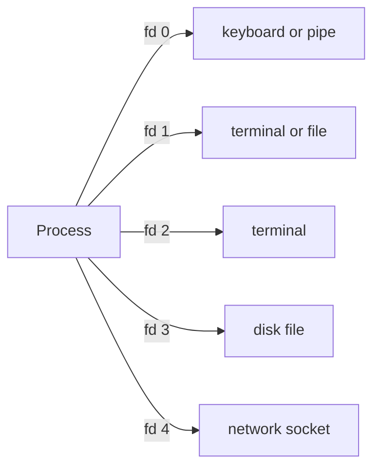
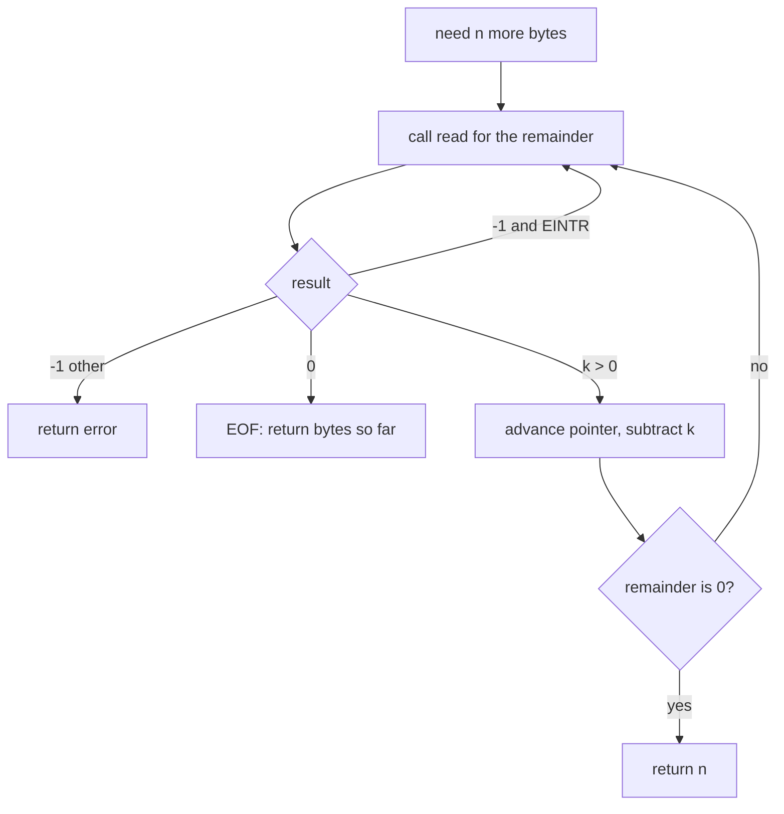

# Unix I/O and robust reading

> **Before this lesson:** You need system calls and the `errno` convention from [Exceptions and the kernel](#/lesson/csapp/exceptions), and bytes and hexadecimal from [Bits, bytes, words and bit-level operations](#/lesson/csapp/bits-bytes). The examples are short C functions.

## In plain words

**Input/output**, shortened to I/O, means moving data between a program and the outside world: files on disk, the keyboard, the screen, other computers. Unix-like systems such as Linux and macOS treat all of these in one uniform way, as a **file**, meaning a plain sequence of bytes that can be read from or written to. A program first asks the operating system to open a file and receives a small number, the **file descriptor**, to use in later requests, much like the numbered ticket handed over at a cloakroom. One surprise catches almost everyone: when you ask to read 100 bytes you may be given fewer, like turning on a tap that delivers water in spurts. Correct programs ask again until they have everything.

Why this matters at work: all network programming is done with these calls, and the partial-read surprise is the most common bug in a first network program. Problems such as "too many open files" and data missing from the end of a transfer make sense only at this level. The helper routines built in this lesson are the kind found in production code.

## Why look closer

Most programmers meet input and output through a comfortable library: `printf`, `std::cout`, Python's `open`. Underneath every one of those is the same tiny kernel interface of about half a dozen calls. It is worth learning that layer directly, for three reasons. First, the libraries leak: buffering surprises, mysterious partial reads on sockets, and "too many open files" errors only make sense once you know what is below. Second, some things cannot be done from the library at all, such as redirecting a child's output or reading a file's metadata. Third, network programming is done almost entirely at this level, and the single most common beginner bug there, assuming that a read returns everything you asked for, is a Unix I/O bug. This lesson covers the interface, then builds the small set of helper routines that make it safe to use.

## 1. One abstraction for everything

Unix made a bold simplification: a **file is a sequence of bytes**, and every I/O device is presented as a file. Disks, terminals, pipes, network connections, even kernel data structures exposed under `/proc`: all are read and written with the same calls. The consequence is that a program such as `grep` works unchanged whether its input is a file, a keyboard, or the output of another program arriving over a pipe.

The lifecycle of any file use has the same five moves:

1. **Open.** The program asks the kernel for access. The kernel replies with a **descriptor**, a small non-negative integer that names the open file in all later calls. The kernel keeps the real bookkeeping; the program keeps only the number.
2. **Position.** For each open file the kernel remembers a **current offset** *k*, initially 0, measured in bytes from the start. A program can move it explicitly with `lseek`.
3. **Read.** Copy up to *n* bytes from the file, starting at offset *k*, into memory, and advance *k* by the number copied. If *k* is already at or past the end, the read reports **end-of-file**. Note that there is no "EOF character" stored in the file; EOF is a condition the kernel detects.
4. **Write.** Copy up to *n* bytes from memory to the file at offset *k* and advance *k*.
5. **Close.** Tell the kernel you are done. It frees its bookkeeping and returns the descriptor number to the pool. When a process ends for any reason, the kernel closes everything it left open.

Every process created by a shell starts with three descriptors already open: 0 is standard input, 1 is standard output, 2 is standard error. The header `<unistd.h>` names them `STDIN_FILENO`, `STDOUT_FILENO` and `STDERR_FILENO`.



## 2. Kinds of files

Each file has a **type** that says what role it plays:

- A **regular file** holds arbitrary data. Applications may distinguish *text* files (only printable characters, organised in lines) from *binary* files, but the kernel does not: to it, both are bytes. A text line on Linux ends with the single newline character, value `0x0a`.
- A **directory** is a file whose content is a list of **links**, each mapping a name to a file. Every directory has at least two: `.` refers to the directory itself and `..` to its parent.
- A **socket** is a file used to talk to another process across a network.

Other types exist, including named pipes, symbolic links, and character and block devices, but these three cover most application work.

All files are arranged in one tree rooted at `/`. A **pathname** locates a file in the tree. An *absolute* path begins with a slash and is followed from the root; a *relative* path is followed from the process's **current working directory**, which is part of each process's context and is changed with `cd` in a shell.

## 3. Opening and closing

```c
#include <fcntl.h>
#include <unistd.h>
int open(const char *path, int flags, mode_t mode);   /* descriptor, or -1 */
int close(int fd);                                    /* 0, or -1 */
```

<!-- walkthrough:c -->
**Reading this C line by line**

- `#include <fcntl.h>` and `#include <unistd.h>` name the files in which these functions are declared.
- `int open(const char *path, int flags, mode_t mode);` is the signature of `open`. `const char *path` is text giving the file's name, `flags` says how the file will be used, and `mode` gives the permissions for a newly created file. The returned `int` is the file descriptor, or −1 if the call failed.
- `int close(int fd);` takes a descriptor and releases it. It returns 0 on success and −1 on failure.
- The comments between `/*` and `*/` summarise those return values.

The `flags` argument says how you intend to use the file. Exactly one of these access modes is required:

| Flag | Access |
|---|---|
| `O_RDONLY` | read only |
| `O_WRONLY` | write only |
| `O_RDWR` | both |

and it may be OR-ed with modifiers:

| Flag | Effect |
|---|---|
| `O_CREAT` | create the file if it does not exist |
| `O_TRUNC` | if it exists, cut it to length zero |
| `O_APPEND` | before every write, move the offset to the end |

A log writer, for instance, would use `O_WRONLY | O_CREAT | O_APPEND`.

**The descriptor you get is always the lowest-numbered one not currently open.** That rule is not a curiosity. Shell redirection depends on it, and it makes descriptor leaks easy to spot: if a freshly started program's first `open` returns 7, something inherited four extra descriptors.

When a file is created, the `mode` argument proposes permission bits (constants such as `S_IRUSR` for owner-read, `S_IWGRP` for group-write, or the octal shorthand `0644`). The process's **umask** then removes bits: the file is created with `mode & ~umask`. With the common umask of `022`, a request for `0666` yields `0644`: owner may read and write, everyone else may only read.

Closing an already-closed descriptor is an error. In threaded programs it is a dangerous one, because another thread may have only now been given that same number for a different file.

```python-run
import os, tempfile

def demo():
    with tempfile.TemporaryDirectory() as d:
        path = os.path.join(d, "journal.log")
        a = os.open(path, os.O_WRONLY | os.O_CREAT | os.O_APPEND, 0o644)
        b = os.open(path, os.O_RDONLY)
        print("two opens returned descriptors", a, "and", b, "(consecutive free slots)")
        os.close(a)
        c = os.open(path, os.O_RDONLY)
        print("after closing", a, "the next open returned", c, "-> lowest free number is reused")
        os.close(b); os.close(c)
        requested, umask = 0o666, 0o022
        print(f"mode {requested:o} with umask {umask:03o} creates a file with {requested & ~umask:o}")

try:
    demo()
except Exception as exc:
    print("raw descriptors unavailable in this sandbox:", type(exc).__name__)
```

<!-- walkthrough:python-run -->
**Reading this Python line by line**

- `import os, tempfile` loads the module that wraps the operating system's calls and one for making temporary files.
- `def demo():` puts the experiment in a function so that any failure can be caught at the end.
- `with tempfile.TemporaryDirectory() as d:` creates a scratch folder that is deleted automatically when the indented block finishes.
- `a = os.open(path, os.O_WRONLY | os.O_CREAT | os.O_APPEND, 0o644)` opens a file for writing, creating it if needed. The `|` combines the option flags, and `0o644` is the permission setting written in base 8. The result is a descriptor number.
- `b = os.open(path, os.O_RDONLY)` opens the same file again for reading and receives the next free number.
- After `os.close(a)`, a third `open` receives the number that was released. The last lines compute permissions after the umask is applied.
- `try: ... except Exception` at the bottom runs the demo and prints a short notice instead of failing where raw descriptors are not available.

## 4. Reading and writing

```c
#include <unistd.h>
ssize_t read(int fd, void *buf, size_t n);          /* bytes read, 0 at EOF, -1 on error */
ssize_t write(int fd, const void *buf, size_t n);   /* bytes written, -1 on error */
```

Two details of the signatures repay attention. The request size is a `size_t`, an unsigned type, while the result is an `ssize_t`, a *signed* type of the same width, because the functions must be able to return -1. The largest possible successful result is therefore half the largest possible request.

The return value of `read` has three distinct meanings, and correct code distinguishes all of them:

- **positive**: that many bytes were delivered, possibly fewer than requested;
- **zero**: end-of-file;
- **-1**: an error, with the reason in `errno`.

Here is the simplest possible copy program, moving bytes from standard input to standard output one at a time. It is correct, and dreadfully slow, since every byte costs two trips into the kernel:

```c
char c;
while (read(STDIN_FILENO, &c, 1) > 0)
    write(STDOUT_FILENO, &c, 1);
```

### Short counts

When `read` or `write` transfers fewer bytes than you asked for, that is a **short count**. It is not an error. It happens in several ordinary situations:

- **Hitting end-of-file.** Ask for 4,096 bytes when only 1,200 remain and you receive 1,200; the *next* call returns 0.
- **Reading from a terminal.** Each `read` returns one line of typed text, however large your buffer.
- **Reading or writing a socket or pipe.** Network delays and kernel buffer limits split data unpredictably. A sender's single 8,000-byte write may arrive as several pieces.
- **Being interrupted by a signal** after some bytes have already moved.

For a plain disk file you will essentially only meet the first case (and writes to disk files are normally complete). That is why programs tested only on files appear to work and then fail the first time they are pointed at a socket.

```python-run
import os

def demo():
    r, w = os.pipe()
    os.write(w, b"alpha ")                 # the data shows up in two instalments
    first = os.read(r, 4096)               # asked for 4096...
    print(f"asked for 4096 bytes, got {len(first)}: {first!r}   <- a short count, not an error")
    os.write(w, b"beta")
    os.close(w)                            # writer is finished
    print("next read:", os.read(r, 4096))
    print("read after writer closed:", os.read(r, 4096), "<- zero bytes means end-of-file")
    os.close(r)

try:
    demo()
except Exception as exc:
    print("pipes unavailable in this sandbox:", type(exc).__name__)
    print("expected: a 6-byte short read, then b'beta', then b'' for EOF")
```

## 5. Robust I/O: looping until the job is done

Since short counts are normal, any program that needs "exactly *n* bytes" must call in a loop. Writing that loop correctly every time is tedious and error-prone, so the usual practice is to put it in a pair of helpers. Call them `read_full` and `write_full`.

```c
ssize_t read_full(int fd, void *buf, size_t n) {
    size_t left = n;
    char *p = buf;
    while (left > 0) {
        ssize_t got = read(fd, p, left);
        if (got < 0) {
            if (errno == EINTR) continue;   /* a signal interrupted us: retry */
            return -1;                      /* genuine error */
        }
        if (got == 0) break;                /* EOF */
        left -= got;
        p += got;
    }
    return n - left;                        /* short only if EOF came first */
}
```

Its contract: return fewer than `n` bytes **only** at end-of-file. The writing twin has the same loop without the EOF branch and never returns a short count at all. Three things are handled that naive code forgets: partial transfers, the `EINTR` error that a signal handler's return can cause on older systems or with certain handler settings, and advancing the buffer pointer so that later pieces do not overwrite earlier ones.



```python-run
import random
random.seed(4)

class FlakySource:
    """Hands out data in unpredictable small pieces, like a network connection."""
    def __init__(self, data): self.data, self.calls = data, 0
    def read(self, n):
        self.calls += 1
        k = min(len(self.data), n, random.randint(1, 7))
        piece, self.data = self.data[:k], self.data[k:]
        return piece

def read_full(src, n):
    chunks, left = [], n
    while left > 0:
        piece = src.read(left)
        if not piece:            # EOF
            break
        chunks.append(piece)
        left -= len(piece)
    return b"".join(chunks)

src = FlakySource(b"The quick brown fox jumps over the lazy dog")
naive = src.read(20)
print("naive single read of 20 :", naive, f"({len(naive)} bytes!)")
src = FlakySource(b"The quick brown fox jumps over the lazy dog")
print("read_full(20)           :", read_full(src, 20), f"using {src.calls} underlying reads")
print("read_full(100) at EOF   :", len(read_full(src, 100)), "bytes (short only because the data ran out)")
```

## 6. Buffered reading for lines

Text protocols such as HTTP are organised in lines, so a server needs a "read one line" operation. Doing it by reading one byte per system call until a newline shows up is correct but costs a kernel trap per character. Reading a big block and searching it for the newline is fast, but then you have probably consumed bytes *beyond* the newline, and they must be kept for the next request.

The answer is an application-level **read buffer**: a small structure holding the descriptor, a block of a few kilobytes, a pointer to the next unconsumed byte, and a count of unconsumed bytes.

```c
typedef struct {
    int   fd;
    int   unread;          /* bytes still in the buffer */
    char *next;            /* first unread byte */
    char  buf[8192];
} reader_t;
```

At its heart is one internal routine with the same signature as `read`. If the buffer is empty it refills it with a single large `read` (retrying on `EINTR`); then it copies out `min(n, unread)` bytes and updates the two bookkeeping fields. Two public operations are built on top:

- **read a line**: pull bytes through the internal routine one at a time until a newline or a length limit is reached, then terminate the string. Each byte now costs a memory copy, not a system call.
- **read *n* bytes**: the buffered version of `read_full`, for binary payloads that follow text headers.

Some properties to remember:

- The buffered calls for one reader may be freely mixed with each other, because they share the buffer.
- **Never mix buffered and unbuffered reads on the same descriptor.** The unbuffered call goes straight to the kernel and skips whatever is sitting in the buffer, so data appears to go missing or arrive out of order.
- Keep the state in a caller-supplied structure, one per descriptor, not in a hidden static variable. That makes the functions safe to use from several threads on different connections.
- Always pass a maximum length to the line reader, and decide what happens to lines that exceed it. Unbounded line reads are how buffer overflows happen.

```python-run
class Reader:
    def __init__(self, src, bufsize=16):
        self.src, self.bufsize, self.buf, self.syscalls = src, bufsize, b"", 0
    def _fill(self):
        self.syscalls += 1
        self.buf = self.src.read(self.bufsize)
        return bool(self.buf)
    def readline(self, maxlen=1024):
        out = bytearray()
        while len(out) < maxlen:
            if not self.buf and not self._fill():
                break                          # EOF
            ch, self.buf = self.buf[:1], self.buf[1:]
            out += ch
            if ch == b"\n":
                break
        return bytes(out)

import io
text = b"GET /index.html HTTP/1.1\r\nHost: example.org\r\n\r\n"
r = Reader(io.BytesIO(text))
while (line := r.readline()):
    print(repr(line))
print(f"{len(text)} bytes delivered with {r.syscalls} refills, versus {len(text)} one-byte reads")
```

> [!INTERVIEW]
> **"`read(fd, buf, 4096)` returned 1,460. Is that a bug?"** No. A short count is normal on sockets, pipes and terminals, and at the end of a file. The only values with special meaning are 0 (end-of-file) and -1 (error; check `errno`, and retry if it is `EINTR`). Correct code loops until it has the amount it needs or frames its messages so it knows how much to expect. Interviewers ask this to see whether you have written real network code.

> [!INTERVIEW]
> **"What does 'everything is a file' buy you?"** Uniformity and composition. One small set of calls works on disks, terminals, pipes and sockets, so tools can be combined without knowing what is on the other end, and features such as redirection, `select`-style multiplexing and permission checks are implemented once for every kind of object.

## 7. Pitfalls

- **Ignoring the return value.** `read` tells you how many bytes are valid; treating the whole buffer as filled processes garbage.
- **Treating the buffer as a C string.** `read` does not append a terminating zero. Add one yourself, in a buffer one byte larger than the read size, before calling string functions.
- **Confusing 0 and -1.** A loop written as `while (read(...))` spins forever on an error, because -1 is "true".
- **Forgetting the pointer advance** in a retry loop, so each piece overwrites the previous one.
- **Leaking descriptors.** Each process has a limit, often 1,024 by default. A server that forgets to close one descriptor per request fails after a predictable number of requests with "too many open files".
- **Omitting the mode with `O_CREAT`.** The permission bits are then taken from whatever happens to be on the stack.
- **Assuming `O_APPEND` behaviour without the flag.** Two processes writing to one log without it overwrite each other.
- **Mixing buffered and raw reads** on one descriptor.

## Summary

- Unix models every I/O object as a file, a byte sequence accessed through a descriptor with `open`, `read`, `write`, `lseek` and `close`.
- Descriptors 0, 1 and 2 are open at start-up; `open` always returns the lowest free number.
- New files get permissions `mode & ~umask`.
- `read` returns a positive count, 0 for end-of-file, or -1 for error. A count smaller than requested is a normal **short count**, common on terminals, pipes and sockets.
- Robust helpers loop until all requested bytes are transferred, restart after `EINTR`, and return short only at EOF.
- A per-descriptor application buffer makes line-oriented reading efficient; never mix it with unbuffered reads on the same descriptor.

## Glossary

- **I/O (input/output)**: moving data between a program and files, devices or other computers.
- **File**: in Unix, any sequence of bytes that can be read or written, including devices and network connections.
- **File descriptor**: the small number a program uses to refer to a file it has opened.
- **Standard input / output / error**: the three descriptors (0, 1, 2) every program starts with.
- **File position (offset)**: the place in a file where the next read or write will happen.
- **EOF (end-of-file)**: the condition of having no more data to read, reported by a read that returns zero.
- **Pathname**: the text naming a file's location, such as `/home/ana/notes.txt`.
- **Permission bits**: settings that control who may read, write or run a file.
- **`umask`**: a per-process setting that removes permissions from newly created files.
- **Short count**: a read or write that transfers fewer bytes than requested, without being an error.
- **`EINTR`**: the error code meaning a system call was interrupted and may be tried again.
- **Buffer**: a block of memory used to hold data temporarily, here to reduce the number of system calls.

```quiz
[
  {"q": "A freshly started process (with only descriptors 0, 1 and 2 open) opens two files, closes the first, then opens a third. What descriptor does the third open return?",
   "options": ["3", "4", "5", "It is unpredictable"],
   "answer": 0, "explain": "The opens return 3 and 4. After closing 3, the lowest unused descriptor is 3 again, and open always returns the lowest free number."},
  {"q": "read(fd, buf, 512) returns 0. What should the program conclude?",
   "options": ["An error occurred", "End-of-file was reached", "It should retry immediately", "The buffer was too small"],
   "answer": 1, "explain": "A return of 0 signals end-of-file. Errors are reported as -1, and a short but positive count means data was delivered."},
  {"q": "Which situation will NOT normally produce a short count?",
   "options": ["Reading a line typed at a terminal", "Reading from a network socket", "Reading the middle of a large disk file with plenty of data remaining", "Reading the last few bytes before the end of a file"],
   "answer": 2, "explain": "Reads from regular disk files return the full amount unless end-of-file intervenes. Terminals, sockets and pipes routinely return less."},
  {"q": "A process with umask 027 calls open with O_CREAT and mode 0666. What permissions does the new file have?",
   "options": ["0666", "0640", "0027", "0644"],
   "answer": 1, "explain": "The result is mode AND NOT umask: 0666 with the bits of 027 cleared leaves 0640."},
  {"q": "Why does a robust read loop check for errno == EINTR?",
   "options": ["EINTR means end-of-file", "A signal handler may have interrupted the call, and the right response is to retry rather than fail", "EINTR means the descriptor is invalid", "To detect short counts"],
   "answer": 1, "explain": "An interrupted system call can return -1 with EINTR without any real I/O failure. The loop restarts the call."},
  {"q": "What is the main purpose of an application-level read buffer when reading text lines?",
   "options": ["To make reads atomic", "To replace many one-byte system calls with a few large ones while keeping leftover bytes for later", "To convert line endings", "To avoid needing a descriptor"],
   "answer": 1, "explain": "One large read fills the buffer; subsequent bytes are served from memory. Bytes past the current line stay in the buffer for the next call."},
  {"q": "What goes wrong if buffered line reads and raw read calls are mixed on the same descriptor?",
   "options": ["Nothing", "The raw read bypasses bytes already pulled into the buffer, so data seems lost or reordered", "The descriptor is closed", "The kernel returns EINTR"],
   "answer": 1, "explain": "The buffer may already hold bytes beyond what the application has consumed. A raw read fetches later bytes from the kernel and skips those."},
  {"q": "Why is the return type of read ssize_t rather than size_t?",
   "options": ["To save memory", "Because it must be able to return -1 to signal an error", "Because files cannot exceed 2 GB", "For compatibility with printf"],
   "answer": 1, "explain": "size_t is unsigned and cannot represent -1. The signed ssize_t allows an error indication alongside byte counts."}
]
```

> **Source:** CS:APP 3e, §10.1–10.5
