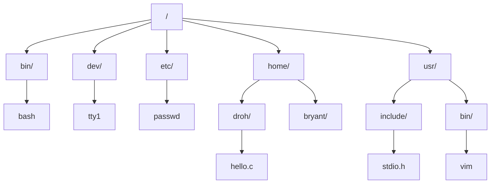

# Unix I/O and robust reading

**Input/output (I/O)** is the process of copying data between main memory and external devices such as disk drives, terminals and networks. An input operation copies data from an I/O device to main memory; an output operation copies data from memory to a device. All language run-time systems provide higher-level facilities (ANSI C's standard I/O library with `printf` and `scanf`, C++'s `<<` and `>>`), and on Linux these are implemented using the **system-level Unix I/O functions** provided by the kernel.

Most of the time the higher-level functions work well. So why learn Unix I/O?

- **Understanding Unix I/O helps you understand other systems concepts.** I/O is integral to the operation of a system; we often encounter circular dependencies between I/O and other ideas. Process creation involves I/O (descriptors are inherited), and I/O involves processes.
- **Sometimes you have no choice but to use Unix I/O.** The standard I/O library provides no way to access file **metadata** such as file size or creation time, and it has problems that make it risky for **network programming**.

## 1. Everything is a file

A Linux **file** is a sequence of $m$ bytes: $B_0, B_1, \dots, B_{m-1}$. **All I/O devices (networks, disks, terminals) are modeled as files**, and all input and output is performed by reading and writing the appropriate files. This elegant mapping lets the kernel export a simple, low-level application interface, **Unix I/O**, that enables all input and output to be performed in a uniform and consistent way:

- **Opening files.** An application announces its intention to access an I/O device by asking the kernel to *open* the corresponding file. The kernel returns a small nonnegative integer, a **descriptor**, that identifies the file in all subsequent operations. The kernel keeps track of all information about the open file; the application only keeps the descriptor. Each process created by a Linux shell begins life with three open files: **standard input** (descriptor 0), **standard output** (descriptor 1) and **standard error** (descriptor 2); `<unistd.h>` defines `STDIN_FILENO`, `STDOUT_FILENO`, `STDERR_FILENO`.
- **Changing the current file position.** The kernel maintains a **file position** $k$, initially 0, for each open file: a byte offset from the beginning of the file. An application can set it explicitly with a `seek` operation.
- **Reading and writing files.** A *read* operation copies $n > 0$ bytes from a file to memory, starting at the current file position $k$ and then incrementing $k$ by $n$. Given a file of size $m$ bytes, a read when $k \ge m$ triggers a condition known as **end-of-file (EOF)**, which the application can detect. *There is no explicit "EOF character" at the end of a file.* A *write* copies $n > 0$ bytes from memory to the file, starting at $k$, then updating $k$.
- **Closing files.** When an application has finished accessing a file, it informs the kernel by asking it to *close* the file. The kernel frees the data structures it created when the file was opened and restores the descriptor to a pool of available descriptors. When a process terminates for any reason, the kernel closes all open files and frees their memory resources.

## 2. Files

Each Linux file has a **type** that indicates its role in the system:

- A **regular file** contains arbitrary data. Applications often distinguish **text files** (only ASCII or Unicode characters) and **binary files** (everything else), but to the kernel there is no difference. A Linux text file consists of a sequence of **text lines**, each terminated by a *newline* character `\n` (ASCII line feed, numeric value `0x0a`).
- A **directory** is a file consisting of an array of **links**, where each link maps a **filename** to a file, which may be another directory. Each directory contains at least two entries: `.` (dot), a link to the directory itself, and `..` (dot-dot), a link to the **parent directory** in the directory hierarchy. `mkdir` creates a directory, `ls` views its contents, `rmdir` deletes it.
- A **socket** is a file that is used to communicate with another process across a network (Module 11).

Other file types include **named pipes**, **symbolic links**, and **character and block devices**.

The Linux kernel organizes all files in a single **directory hierarchy** anchored by the **root directory** named `/`. Each file is a direct or indirect descendant of the root. As part of its context, each process has a **current working directory** that identifies its current location in the hierarchy (changed with `cd`). Locations are specified by **pathnames**: an **absolute pathname** starts with a slash and denotes a path from the root (`/home/droh/hello.c`); a **relative pathname** starts with a filename and denotes a path from the current working directory (`./hello.c` or `../home/droh/hello.c`).



## 3. Opening and closing files

```c
#include <sys/types.h>
#include <sys/stat.h>
#include <fcntl.h>

int open(char *filename, int flags, mode_t mode);   /* new file descriptor, or -1 on error */
int close(int fd);                                  /* 0 if OK, -1 on error */
```

`open` converts a filename to a file descriptor and returns the descriptor number. **The descriptor returned is always the smallest descriptor that is not currently open in the process.** The `flags` argument indicates how the process intends to access the file:

- `O_RDONLY` (reading only), `O_WRONLY` (writing only), `O_RDWR` (reading and writing),

optionally ORed with one or more bit masks giving additional instructions for writing:

- `O_CREAT`: if the file does not exist, create a *truncated* (empty) version of it.
- `O_TRUNC`: if the file already exists, truncate it.
- `O_APPEND`: before each write operation, set the file position to the end of the file.

```c
fd = Open("foo.txt", O_RDONLY, 0);                       /* open existing file for reading */
fd = Open("foo.txt", O_WRONLY|O_APPEND, 0);              /* open to append some data */
```

The `mode` argument specifies the access permission bits of *new* files. Symbolic names: `S_IRUSR`, `S_IWUSR`, `S_IXUSR` (user/owner can read, write, execute), `S_IRGRP`, `S_IWGRP`, `S_IXGRP` (group), `S_IROTH`, `S_IWOTH`, `S_IXOTH` (others). As part of its context, each process has a **umask** set by the `umask` function. When a process creates a new file with some `mode`, the access permission bits of the file are set to **`mode & ~umask`**.

```c
#define DEF_MODE  S_IRUSR|S_IWUSR|S_IRGRP|S_IWGRP|S_IROTH|S_IWOTH   /* rw-rw-rw- */
#define DEF_UMASK S_IWGRP|S_IWOTH                                    /* ----w--w- */

umask(DEF_UMASK);
fd = Open("foo.txt", O_CREAT|O_TRUNC|O_WRONLY, DEF_MODE);   /* owner rw, everyone else r */
```

Closing an already closed descriptor is an error.

**Quick check.** What does this program print?

```c
int fd1 = Open("foo.txt", O_RDONLY, 0);
Close(fd1);
int fd2 = Open("baz.txt", O_RDONLY, 0);
printf("fd2 = %d\n", fd2);
```

Unix processes begin with descriptors 0, 1, 2 open. The first `open` returns 3; after it is closed, descriptor 3 is free again, so the second `open` also returns 3: `fd2 = 3`.

## 4. Reading and writing files

```c
#include <unistd.h>
ssize_t read(int fd, void *buf, size_t n);         /* bytes read, 0 on EOF, -1 on error */
ssize_t write(int fd, const void *buf, size_t n);  /* bytes written, -1 on error */
```

`read` copies at most `n` bytes from the current file position of descriptor `fd` to memory location `buf`. A return value of −1 indicates an error, 0 indicates EOF; otherwise the return value is the number of bytes actually transferred. `write` copies at most `n` bytes from `buf` to the current file position of `fd`.

Copying standard input to standard output one byte at a time:

```c
int main(void) {
    char c;
    while (Read(STDIN_FILENO, &c, 1) != 0)
        Write(STDOUT_FILENO, &c, 1);
    exit(0);
}
```

> [!NOTE]
> **`ssize_t` vs. `size_t`.** `read` takes a `size_t` (unsigned long) input but returns `ssize_t` (signed long), because it must be able to return −1 on error. Interestingly, the possibility of returning a single −1 halves the maximum size of a read.

### Short counts

In some situations, `read` and `write` transfer **fewer bytes than the application requests**. Such **short counts** do *not* indicate an error. They occur for several reasons:

- **Encountering EOF on reads.** If a file contains only 20 more bytes from the current position and we read in 50-byte chunks, the next `read` returns a short count of 20, and the `read` after that signals EOF by returning 0.
- **Reading text lines from a terminal.** If the open file is associated with a terminal (keyboard and display), each `read` transfers **one text line at a time**, returning a short count equal to the size of the line.
- **Reading and writing network sockets.** If the open file corresponds to a network socket, internal buffering constraints and long network delays can cause `read` and `write` to return short counts. Short counts can also occur with a Linux **pipe**.

In practice, you will never encounter short counts when you read from disk files except on EOF, and never when you write to disk files. But **if you want to build robust (reliable) network applications such as web servers, you must deal with short counts by repeatedly calling `read` and `write` until all requested bytes have been transferred.**

## 5. Robust reading and writing with the Rio package

The book's **Rio (Robust I/O)** package handles short counts automatically. It provides two kinds of functions:

- **Unbuffered input and output functions** transfer data directly between memory and a file, with no application-level buffering. Especially useful for reading and writing binary data to and from networks.
- **Buffered input functions** efficiently read text lines and binary data from a file whose contents are cached in an application-level buffer, similar to the one provided for standard I/O functions such as `printf`. Unlike the standard I/O buffered routines, the Rio buffered input functions are **thread-safe** and can be interleaved arbitrarily on the same descriptor.

### Unbuffered: rio_readn and rio_writen

```c
ssize_t rio_readn(int fd, void *usrbuf, size_t n);    /* bytes transferred, 0 on EOF, -1 on error */
ssize_t rio_writen(int fd, void *usrbuf, size_t n);   /* bytes transferred, -1 on error */
```

`rio_readn` transfers up to `n` bytes from the current file position of `fd` to `usrbuf`; it can return a short count **only if it encounters EOF**. `rio_writen` **never returns a short count**. The core is a loop:

```c
/* Sketch of the idea: keep calling read until n bytes have arrived or EOF is hit */
remaining = n;
while (remaining > 0) {
    got = read(fd, p, remaining);
    if (got < 0 && errno == EINTR)  continue;     /* interrupted by a signal handler: just retry */
    if (got < 0)                    return -1;    /* a real error */
    if (got == 0)                   break;        /* EOF */
    remaining -= got;
    p += got;
}
return n - remaining;                             /* bytes actually transferred */
```

Note that each function **manually restarts** `read` or `write` if it is interrupted by the return from an application signal handler (`EINTR`), to be as portable as possible.

```python-run
# A Python analogue: loop until n bytes have arrived, tolerating short reads.
import io
class TrickleStream:
    """A stream that returns at most 3 bytes per read, like a slow socket."""
    def __init__(self, data): self.buf = io.BytesIO(data); self.calls = 0
    def read(self, n): self.calls += 1; return self.buf.read(min(n, 3))

def readn(stream, n):
    chunks, left = [], n
    while left > 0:
        chunk = stream.read(left)
        if not chunk:                  # EOF
            break
        chunks.append(chunk); left -= len(chunk)
    return b"".join(chunks)

s = TrickleStream(b"GET /index.html HTTP/1.1\r\n")
print(s.read(10), "<- a single read gives a short count")
print(readn(s, 10), "<- readn loops;", s.calls, "calls so far")
print(readn(s, 100), "<- short only because of EOF")
```

### Buffered: rio_readlineb and rio_readnb

Suppose we want to count the number of lines in a text file. Calling `read` to transfer 1 byte at a time and checking each for the newline character requires a **trap to the kernel for each byte**: inefficient. A better approach is a wrapper function, `rio_readlineb`, that copies the text line from an internal **read buffer**, automatically making a `read` call to refill the buffer whenever it becomes empty. For files containing both text lines and binary data (such as the HTTP responses of Module 11), a buffered version of `rio_readn`, called `rio_readnb`, transfers raw bytes from the same read buffer.

```c
void    rio_readinitb(rio_t *rp, int fd);                         /* associate fd with a read buffer */
ssize_t rio_readlineb(rio_t *rp, void *usrbuf, size_t maxlen);    /* read a text line (incl. newline) */
ssize_t rio_readnb(rio_t *rp, void *usrbuf, size_t n);            /* read up to n bytes */
```

`rio_readinitb` is called once per open descriptor. `rio_readlineb` reads the next text line from `rp` (including the terminating newline), copies it to `usrbuf`, and terminates it with the NULL (zero) character; it reads at most `maxlen - 1` bytes, leaving room for the terminator. Lines longer than that are truncated and terminated with NULL.

The buffer is described by a structure of type `rio_t`:

```c
#define RIO_BUFSIZE 8192
typedef struct {
    int rio_fd;                  /* descriptor for this internal buf */
    int rio_cnt;                 /* unread bytes in internal buf */
    char *rio_bufptr;            /* next unread byte in internal buf */
    char rio_buf[RIO_BUFSIZE];   /* internal buffer */
} rio_t;
```

The heart of the buffered routines is `rio_read`, a buffered version of Linux `read` with the same semantics: when it is called with a request to read `n` bytes, there are `rp->rio_cnt` unread bytes in the read buffer. If the buffer is empty, it is replenished with a call to `read` (a short count from that `read` is not an error; it simply partially fills the buffer). Once the buffer is nonempty, `rio_read` copies the minimum of `n` and `rp->rio_cnt` bytes from the read buffer to the user buffer and returns the number of bytes copied.

> [!WARNING]
> Calls to the buffered functions (`rio_readlineb`, `rio_readnb`) can be interleaved with each other on the same descriptor, but **should not be interleaved with calls to the unbuffered `rio_readn`**: the unbuffered call would bypass bytes sitting in the buffer.

```python-run
# Why buffer? Count 'system calls' needed to read lines one byte at a time vs. through an 8 KB buffer.
data = (b"line of text\n" * 1000)
class CountingFile:
    def __init__(self, data): self.data, self.pos, self.syscalls = data, 0, 0
    def read(self, n):
        self.syscalls += 1
        chunk = self.data[self.pos:self.pos + n]; self.pos += len(chunk); return chunk

f = CountingFile(data)                       # unbuffered: 1 byte per read
lines = 0
while (c := f.read(1)):
    lines += c == b"\n"
print("unbuffered:", lines, "lines,", f.syscalls, "read calls")

f = CountingFile(data); buf = b""; lines = 0  # buffered: refill 8192 bytes at a time
while True:
    if not buf:
        buf = f.read(8192)
        if not buf: break
    i = buf.find(b"\n")
    if i < 0: buf = b""; continue
    lines += 1; buf = buf[i + 1:]
print("buffered  :", lines, "lines,", f.syscalls, "read calls")
```

(The simple buffered loop above would mishandle a line that straddles two buffer refills; `rio_readlineb` copies byte by byte from the buffer precisely to avoid that. The call counts make the point.)

## 6. Reading file metadata

An application can retrieve information about a file (its **metadata**) with `stat` and `fstat`:

```c
#include <unistd.h>
#include <sys/stat.h>
int stat(const char *filename, struct stat *buf);
int fstat(int fd, struct stat *buf);
```

`stat` takes a filename, `fstat` a file descriptor; both fill in a `stat` structure whose members include the device, inode, protection and file type (`st_mode`), number of hard links, owner user and group IDs, total size in bytes (`st_size`), block size and count, and times of last access, modification and change.

The two members used most: **`st_size`** contains the file size in bytes; **`st_mode`** encodes both the file permission bits and the file type. Macros in `<sys/stat.h>` determine the type: `S_ISREG(m)` (regular file?), `S_ISDIR(m)` (directory?), `S_ISSOCK(m)` (network socket?).

```c
Stat(argv[1], &stat);
if (S_ISREG(stat.st_mode))       type = "regular";
else if (S_ISDIR(stat.st_mode))  type = "directory";
else                             type = "other";
readok = (stat.st_mode & S_IRUSR) ? "yes" : "no";    /* check read access */
```

## 7. Reading directory contents

```c
#include <sys/types.h>
#include <dirent.h>
DIR *opendir(const char *name);          /* returns a directory stream, or NULL */
struct dirent *readdir(DIR *dirp);       /* next directory entry, or NULL if no more / error */
int closedir(DIR *dirp);
```

A **directory stream** is an abstraction for an ordered sequence of items, here a list of directory entries. Each call to `readdir` returns a pointer to the next entry, a structure containing an inode number `d_ino` and the filename `d_name`. If there are no more entries, `readdir` returns NULL; if an error occurs, it returns NULL and sets `errno`: the only way to distinguish the two is to check whether `errno` has been modified since the call.

```python-run
import os, stat, tempfile
d = tempfile.mkdtemp()
with open(os.path.join(d, "foo.txt"), "w") as f: f.write("foobar")
os.mkdir(os.path.join(d, "sub"))
for name in sorted(os.listdir(d)):                       # opendir / readdir / closedir
    st = os.stat(os.path.join(d, name))                  # stat
    kind = "directory" if stat.S_ISDIR(st.st_mode) else "regular" if stat.S_ISREG(st.st_mode) else "other"
    print(f"{name:8} type={kind:9} size={st.st_size:5} owner-read={'yes' if st.st_mode & stat.S_IRUSR else 'no'}")
```

> [!INTERVIEW]
> **"What is a file descriptor?"** A small nonnegative integer, an index into the process's descriptor table, through which the process refers to an open file (or pipe, socket, device…). 0/1/2 are stdin/stdout/stderr; `open` returns the lowest unused number. The kernel keeps the real state (position, flags, the underlying inode) on its side.

> [!INTERVIEW]
> **"Why might `read(fd, buf, n)` return fewer than `n` bytes, and how do you handle it?"** EOF, a terminal delivering one line, a socket or pipe with fewer bytes currently available, or interruption by a signal. Robust code loops until it has what it needs (or EOF), restarts on `EINTR`, and treats 0 as EOF. Forgetting this is a classic network-programming bug that only shows up under load or on slow links.

> [!INTERVIEW]
> **"Why is buffered I/O faster?"** Every `read`/`write` is a system call costing a user/kernel mode switch. Reading byte by byte makes one call per byte; a user-level buffer amortizes one call over thousands of bytes.

## 8. Summary

- Unix models every device as a file: a byte sequence accessed through descriptors with open, read, write, seek and close.
- File types: regular, directory, socket (plus pipes, symlinks, devices). One directory hierarchy rooted at `/`.
- `open` returns the lowest free descriptor; flags select access mode and creation/truncation/append behavior; new-file permissions are `mode & ~umask`.
- `read`/`write` may return short counts (EOF, terminals, sockets, pipes); 0 from `read` means EOF.
- Rio: `rio_readn`/`rio_writen` loop until done (restarting on `EINTR`); `rio_readlineb`/`rio_readnb` add a per-descriptor buffer for efficient, thread-safe line and byte reads.
- `stat`/`fstat` give metadata (`st_size`, `st_mode`); `opendir`/`readdir`/`closedir` enumerate directories.

## Check yourself

```quiz
[
  {"q": "A process opens foo.txt (getting fd 3), closes it, then opens baz.txt. What descriptor does the second open return?", "options": ["3", "4", "0", "5"], "answer": 0,
   "explain": "open returns the smallest descriptor not currently open; 3 was freed by close."},
  {"q": "What does read return at end of file?", "options": ["-1", "0", "EOF character", "The number of bytes requested"], "answer": 1,
   "explain": "A return value of 0 signals EOF; there is no EOF character stored in the file."},
  {"q": "Which situation does NOT normally produce a short count?", "options": ["Reading from a network socket", "Reading a line from a terminal", "Reading 50 bytes from a disk file with 1000 bytes remaining", "Reading the last 20 bytes of a file with a 50-byte request"], "answer": 2,
   "explain": "Disk file reads return short counts only at EOF."},
  {"q": "A file is created with mode rw-rw-rw- (0666) while umask is ----w--w- (0022). What are its permissions?", "options": ["rw-rw-rw-", "rw-r--r--", "rwxr-xr-x", "r--r--r--"], "answer": 1,
   "explain": "Permissions are mode & ~umask: the group and other write bits are removed."},
  {"q": "When can rio_readn return fewer bytes than requested?", "options": ["Whenever read returns a short count", "Only when it hits EOF", "Never", "When interrupted by a signal"], "answer": 1,
   "explain": "It loops over short counts and restarts on EINTR; only EOF produces a short return."},
  {"q": "Why is rio_readlineb much faster than reading one byte per read call?", "options": ["It uses mmap", "It fills an internal buffer with one system call and then serves many bytes from user space", "It skips newlines", "It uses threads"], "answer": 1,
   "explain": "Buffering amortizes the cost of the kernel trap over thousands of bytes."},
  {"q": "Which function tells you the size of a file given its open descriptor?", "options": ["read", "lseek only", "fstat (st_size)", "opendir"], "answer": 2,
   "explain": "fstat fills a stat structure whose st_size member is the file size in bytes."},
  {"q": "Why does read return ssize_t rather than size_t?", "options": ["To allow sizes above 4 GB", "Because it must be able to return -1 on error", "For alignment", "Historical accident with no purpose"], "answer": 1,
   "explain": "The signed type accommodates the -1 error return."}
]
```

> **Source:** CS:APP 3e, §10.1–10.7 (Unix I/O; Files; Opening and closing files; Reading and writing files; Robust reading and writing with the Rio package; Reading file metadata; Reading directory contents).
