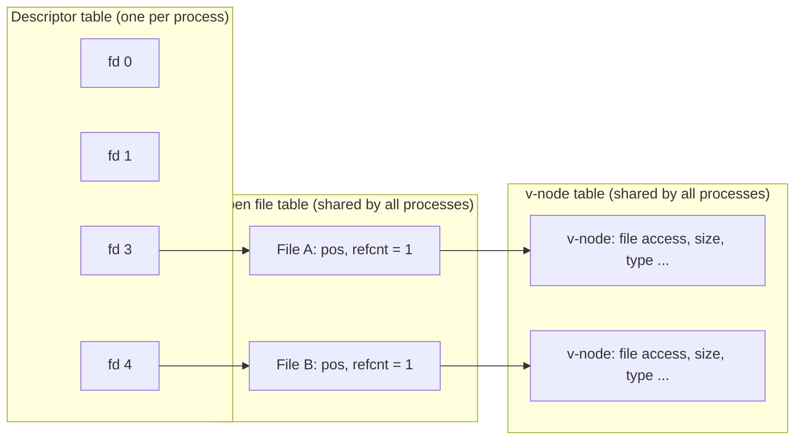
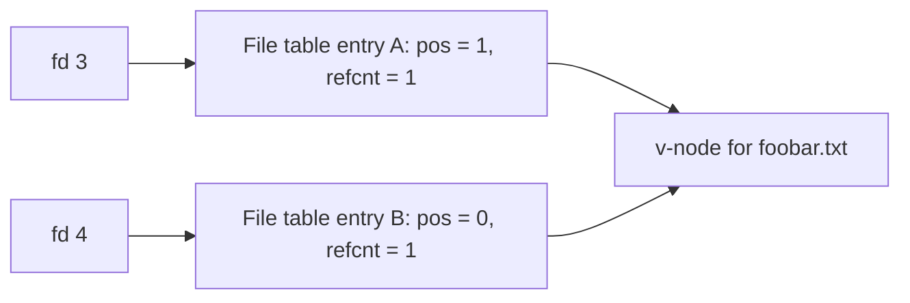
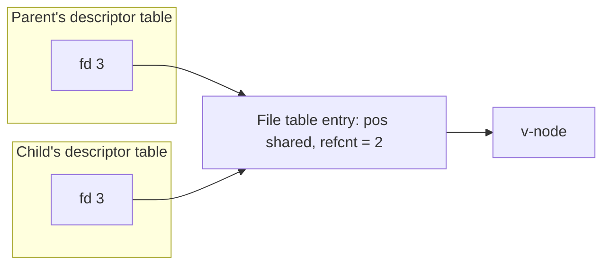
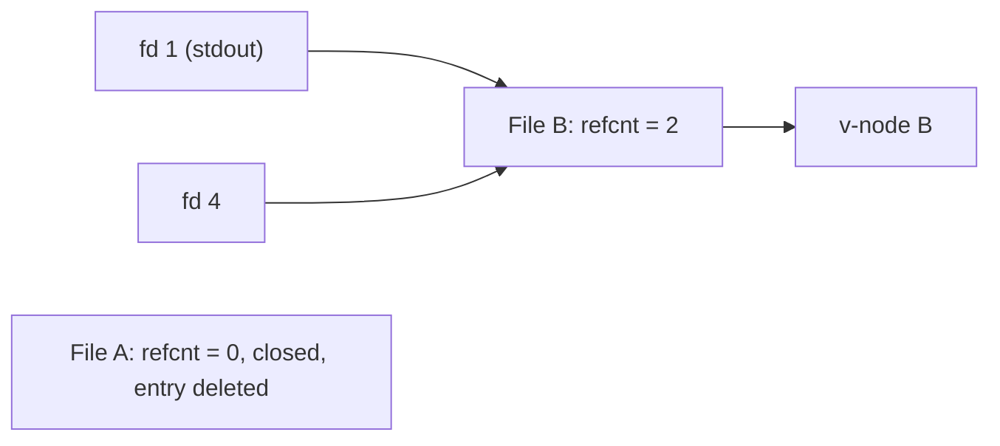
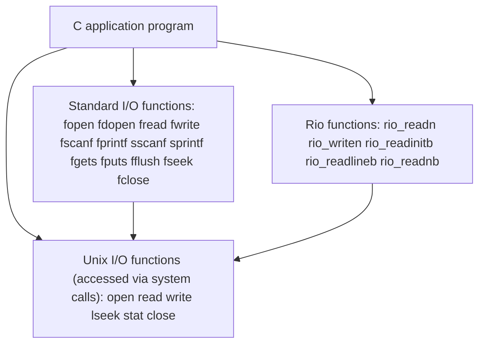
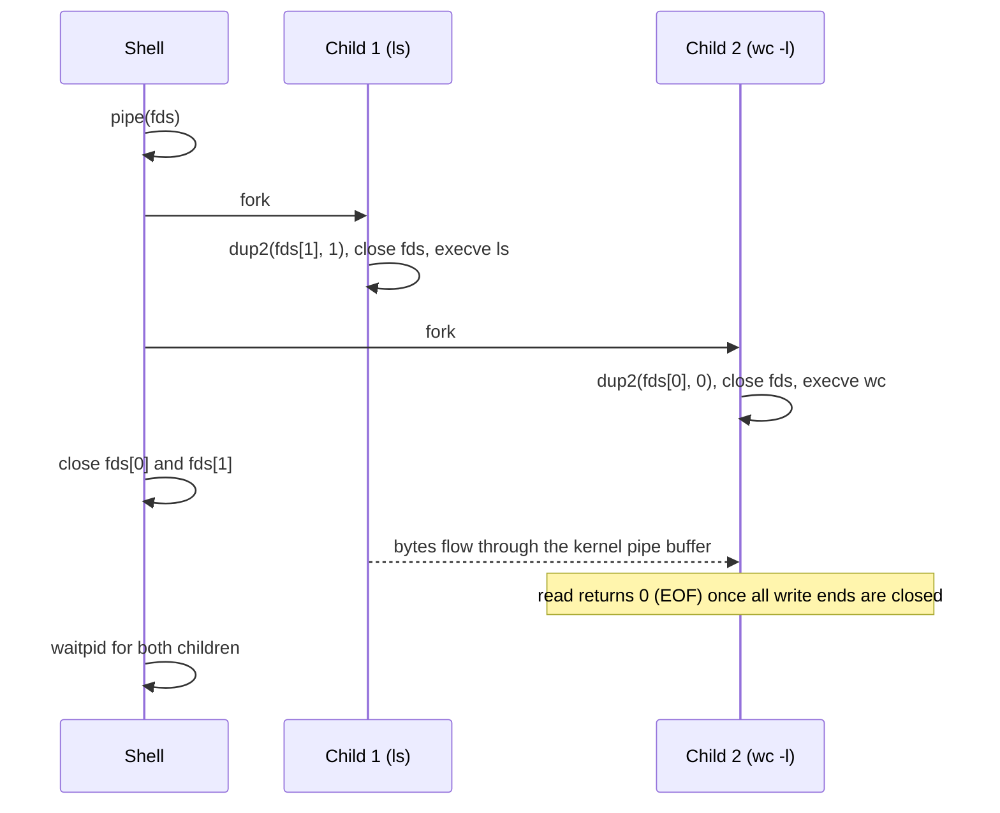

# File sharing, redirection and standard I/O

The previous lesson treated a descriptor as an opaque handle. To understand what really happens when two descriptors refer to the same file, when a process forks, or when a shell runs `ls > foo.txt`, we need to open the hood and look at the three kernel data structures that represent open files. This short piece of kernel anatomy explains a surprising amount of everyday Unix behavior, and it is a favorite source of exam and interview puzzles. We then cover I/O redirection with `dup2`, the C standard I/O library, and the practical question of which I/O functions to use when.

## 1. How the kernel represents open files

The kernel uses three related data structures:

- **Descriptor table.** Each process has its **own separate** descriptor table, whose entries are indexed by the process's open file descriptors. Each open descriptor entry points to an entry in the file table.
- **File table** (open file table). The set of open files is represented by a file table that is **shared by all processes**. Each file table entry consists of (for our purposes) the current **file position**, a **reference count** of the number of descriptor entries that currently point to it, and a pointer to an entry in the v-node table. Closing a descriptor decrements the reference count in the associated file table entry. The kernel will not delete the file table entry until its reference count is zero.
- **v-node table.** Like the file table, the v-node table is **shared by all processes**. Each entry contains most of the information in the `stat` structure, including the `st_mode` and `st_size` members.



The typical situation is shown above: descriptors 3 and 4 reference two different files through distinct open file table entries. No sharing. But three other configurations arise, and each behaves differently.

### Case 1: the same file opened twice

Multiple descriptors can reference the same file through **different file table entries**. This happens if you call `open` twice with the same filename. The key idea is that **each descriptor has its own distinct file position**, so different reads on different descriptors can fetch data from different locations in the file.



**Puzzle.** The disk file `foobar.txt` consists of the six ASCII characters `foobar`. What does this print?

```c
int fd1 = Open("foobar.txt", O_RDONLY, 0);
int fd2 = Open("foobar.txt", O_RDONLY, 0);
char c;
Read(fd1, &c, 1);
Read(fd2, &c, 1);
printf("c = %c\n", c);
```

Answer: `c = f`. The descriptors `fd1` and `fd2` each have their own open file table entry, so each has its own file position. The read from `fd2` reads the first byte of the file.

### Case 2: parent and child after fork

Suppose a parent process has the typical configuration (descriptors 3 and 4 open on files A and B) and then calls `fork`. **The child gets its own duplicate copy of the parent's descriptor table. Parent and child share the same set of open file table entries and thus share the same file position.** The reference counts of the entries become 2. An important consequence is that the parent and child must *both* close their descriptors before the kernel will delete the corresponding file table entry.



**Puzzle.** With `foobar.txt` as before:

```c
int fd = Open("foobar.txt", O_RDONLY, 0);
char c;
if (Fork() == 0) {
    Read(fd, &c, 1);
    exit(0);
}
Wait(NULL);
Read(fd, &c, 1);
printf("c = %c\n", c);
```

Answer: `c = o`. The child inherits the parent's descriptor table, and all processes share the same open file table entry. The child's read advances the shared position by one byte; when the parent reads after waiting for the child, it gets the *second* byte.

This sharing is what makes shell constructs like `(cmd1; cmd2) > out.txt` work: both commands inherit the same open file entry, so the second continues writing where the first stopped instead of overwriting it.

### Case 3: dup2

The third way to share is to have two descriptors **in the same process** point to the same file table entry, created with `dup` or `dup2`. That is the basis of I/O redirection.

## 2. I/O redirection

Linux shells provide **I/O redirection** operators that let users associate standard input and output with disk files. Typing

```
linux> ls > foo.txt
```

causes the shell to load and execute the `ls` program with standard output redirected to disk file `foo.txt`. A web server performs a similar kind of redirection when it runs a CGI program on behalf of the client (Module 11).

How does it work? One way is the `dup2` function:

```c
#include <unistd.h>
int dup2(int oldfd, int newfd);    /* returns nonnegative descriptor if OK, -1 on error */
```

`dup2` **copies descriptor table entry `oldfd` to descriptor table entry `newfd`, overwriting the previous contents** of descriptor table entry `newfd`. If `newfd` was already open, `dup2` closes `newfd` before it copies `oldfd`.

Suppose that before calling `dup2(4, 1)` we have the typical situation: descriptor 1 (stdout) corresponds to file A (say, a terminal) and descriptor 4 corresponds to file B (say, a disk file); the reference counts for A and B are both 1. After `dup2(4, 1)`:



Both descriptors now point to file B; file A has been closed and its file table and v-node table entries deleted; the reference count for file B has been incremented. **From this point on, any data written to standard output are redirected to file B.**

So a shell implements `ls > foo.txt` like this: after `fork`, in the child, `open("foo.txt", O_WRONLY|O_CREAT|O_TRUNC, mode)` (returning, say, 3), then `dup2(3, 1)`, `close(3)`, and finally `execve("/bin/ls", ...)`. The `ls` program simply writes to descriptor 1, unaware that it is no longer the terminal. This is the payoff of separating `fork` from `execve`.

> [!NOTE]
> **Left and right hoinkies.** To avoid confusion with other bracket-type operators such as `]` and `[`, the book's authors have always referred to the shell's `>` operator as a "right hoinky" and the `<` operator as a "left hoinky".

**Puzzle.** With `foobar.txt` containing `foobar`:

```c
int fd1 = Open("foobar.txt", O_RDONLY, 0);
int fd2 = Open("foobar.txt", O_RDONLY, 0);
char c;
Read(fd2, &c, 1);
Dup2(fd2, fd1);
Read(fd1, &c, 1);
printf("c = %c\n", c);
```

Answer: `c = o`. Because we redirect `fd1` to `fd2`, the read through `fd1` uses `fd2`'s file table entry, whose position is already 1.

**Puzzle: how would you use `dup2` to redirect standard input to descriptor 5?** `dup2(5, 0);` (or `dup2(5, STDIN_FILENO)`): copy entry 5 over entry 0.

```python-run
# A model of the three tables that reproduces all three puzzles.
class Kernel:
    def __init__(self, files): self.files = files
    def open(self, proc, name):
        fd = next(i for i in range(3, 100) if i not in proc)
        proc[fd] = {"name": name, "pos": 0, "refcnt": 1}        # new open-file-table entry
        return fd
    def read(self, proc, fd, n=1):
        e = proc[fd]; data = self.files[e["name"]][e["pos"]:e["pos"] + n]; e["pos"] += len(data); return data
    def dup2(self, proc, old, new):
        if new in proc: proc[new]["refcnt"] -= 1
        proc[new] = proc[old]; proc[old]["refcnt"] += 1          # share the SAME entry
    def fork(self, proc):
        for e in proc.values(): e["refcnt"] += 1
        return dict(proc)                                        # copy of the descriptor table only

k = Kernel({"foobar.txt": "foobar"})
p = {}; a = k.open(p, "foobar.txt"); b = k.open(p, "foobar.txt")
k.read(p, a); print("two opens      : c =", k.read(p, b))

p = {}; fd = k.open(p, "foobar.txt"); child = k.fork(p)
k.read(child, fd); print("fork then read : c =", k.read(p, fd))

p = {}; a = k.open(p, "foobar.txt"); b = k.open(p, "foobar.txt")
k.read(p, b); k.dup2(p, b, a); print("dup2(fd2, fd1) : c =", k.read(p, a))
```

The coding problem `csapp-fd-sharing` asks you to build this model yourself.

## 3. Standard I/O

The C language defines a set of higher-level input and output functions, the **standard I/O library**, that provides programmers with a higher-level alternative to Unix I/O. The library (`libc`) provides functions for opening and closing files (`fopen` and `fclose`), reading and writing bytes (`fread` and `fwrite`), reading and writing strings (`fgets` and `fputs`), and sophisticated formatted I/O (`scanf` and `printf`).

The standard I/O library models an open file as a **stream**. To the programmer, a stream is a pointer to a structure of type `FILE`. Every ANSI C program begins with three open streams, `stdin`, `stdout` and `stderr`, which correspond to standard input, standard output and standard error:

```c
#include <stdio.h>
extern FILE *stdin;    /* standard input  (descriptor 0) */
extern FILE *stdout;   /* standard output (descriptor 1) */
extern FILE *stderr;   /* standard error  (descriptor 2) */
```

A stream of type `FILE` is an abstraction for a **file descriptor and a stream buffer**. The purpose of the stream buffer is the same as the Rio read buffer: to **minimize the number of expensive Linux I/O system calls**. For example, suppose a program makes repeated calls to `getc`, each returning the next character from a file. When `getc` is called the first time, the library fills the stream buffer with a single call to `read` and then returns the first byte in the buffer to the application. As long as there are unread bytes in the buffer, subsequent calls to `getc` can be served directly from the stream buffer.

Output is buffered too: `printf` appends to the buffer, and the buffer is **flushed** to the descriptor with `write` when it fills, when `fflush` is called, when the stream is closed or the program exits normally, or (for a stream attached to a terminal, which is *line buffered*) when a newline is written.

```python-run
import io
class CountingRaw(io.RawIOBase):
    def __init__(self): self.writes = 0; self.data = b""
    def writable(self): return True
    def write(self, b): self.writes += 1; self.data += bytes(b); return len(b)

raw = CountingRaw()
for _ in range(1000): raw.write(b"x")                         # unbuffered: one 'system call' per byte
print("unbuffered writes:", raw.writes)

raw = CountingRaw(); buffered = io.BufferedWriter(raw, buffer_size=4096)
for _ in range(1000): buffered.write(b"x")
print("before flush     :", raw.writes, "writes,", len(raw.data), "bytes delivered")
buffered.flush()
print("after flush      :", raw.writes, "write,", len(raw.data), "bytes delivered")
```

> [!WARNING]
> **Buffers and `fork`.** The stream buffer lives in user memory, so `fork` duplicates it. `printf("hello"); fork();` prints `hello` twice when stdout is not line buffered (or there is no newline), because both processes eventually flush their copy. Similarly, output can be *lost* if a process is killed or calls `_exit` before flushing. Use `fflush(stdout)` before `fork`.

## 4. Putting it together: which I/O functions should I use?



Unix I/O is implemented in the operating system kernel. The higher-level Rio and standard I/O functions are implemented "on top of" (using) the Unix I/O functions. The book's basic guidelines:

- **G1: Use the standard I/O functions whenever possible.** They are the method of choice for I/O on disk and terminal devices. Most C programmers use standard I/O exclusively throughout their careers, never bothering with the lower-level Unix I/O functions (except possibly `stat`, which has no counterpart in the standard I/O library).
- **G2: Don't use `scanf` or `rio_readlineb` to read binary files.** Functions like these are designed specifically for reading text files. Binary files might be littered with many `0xa` bytes that have nothing to do with terminating text lines.
- **G3: Use the Rio functions for I/O on network sockets.** Standard I/O poses nasty problems when used for input and output on networks.

Why the trouble with sockets? Standard I/O streams are **full duplex** in the sense that programs can perform input and output on the same stream. However, there are poorly documented restrictions on streams that interact badly with restrictions on sockets:

- **Restriction 1: input functions following output functions.** An input function cannot follow an output function without an intervening call to `fflush`, `fseek`, `fsetpos` or `rewind`. The `fflush` function empties the buffer associated with a stream; the latter three use the Unix I/O `lseek` function to reset the current file position.
- **Restriction 2: output functions following input functions.** An output function cannot follow an input function without an intervening call to `fseek`, `fsetpos` or `rewind`, unless the input function encounters an end-of-file.

These restrictions pose a problem for network applications because it is **illegal to use `lseek` on a socket**. The first restriction can be worked around by flushing the buffer before every input operation. The only way to work around the second is to open two streams on the same open socket descriptor, one for reading and one for writing:

```c
FILE *fpin, *fpout;
fpin  = fdopen(sockfd, "r");
fpout = fdopen(sockfd, "w");
```

But this approach has problems as well, because it requires the application to call `fclose` on both streams in order to free the memory resources associated with each stream and avoid a memory leak. Each of these operations attempts to close the same underlying socket descriptor, so the second `close` operation will fail. In a sequential program that is harmless, but closing an already closed descriptor in a **threaded** program is a recipe for disaster (the descriptor number may already have been reused by another thread). Hence the recommendation: do not use the standard I/O functions for input and output on network sockets; use the robust Rio functions instead. If you need formatted output, use `sprintf` to format a string in memory and then send it to the socket using `rio_writen`. If you need formatted input, use `rio_readlineb` to read an entire text line and then use `sscanf` to extract the different fields from it.

## 5. Worked example: tracing a shell pipeline

How does `ls | wc -l` use these mechanisms? A **pipe** is a kernel buffer with two descriptors: bytes written to the write end can be read from the read end.

1. The shell calls `pipe(fds)`, obtaining `fds[0]` (read end) and `fds[1]` (write end).
2. It forks child 1. In child 1: `dup2(fds[1], 1)` (stdout → pipe), close both `fds`, `execve("ls")`.
3. It forks child 2. In child 2: `dup2(fds[0], 0)` (stdin ← pipe), close both `fds`, `execve("wc")`.
4. The parent closes both `fds` and waits for both children.

Every step relies on facts from this lesson: descriptor tables are copied by `fork`; open file table entries are shared and reference counted; `dup2` rewires a descriptor; `execve` preserves open descriptors. Step 4 matters more than it looks: `wc` only sees EOF on its standard input when **every** descriptor referring to the pipe's write end has been closed. If the parent (or `wc` itself) forgets to close `fds[1]`, the reference count never reaches zero and `wc` hangs forever, a classic bug in student shells.



> [!INTERVIEW]
> **"How does a shell implement `cmd > file` and `a | b`?"** `fork`; in the child `open` the file and `dup2(fd, 1)` (for pipes, `dup2` the pipe ends onto 0 or 1), close the extra descriptors, then `execve`. The program being run is unaware. Follow-up: `2>&1` is `dup2(1, 2)`, and order matters: `cmd > f 2>&1` sends both to `f`, while `cmd 2>&1 > f` points stderr at the *old* stdout first.

> [!INTERVIEW]
> **"After `fork`, do parent and child share the file offset?"** Yes: `fork` copies the descriptor table, but the entries point to the same open-file-table entries, which hold the offset. Two independent `open` calls on the same path do not share an offset. And `dup`/`dup2` share it within one process. This three-level structure (descriptor → open file description → inode) is the single most useful fact about Unix files.

> [!INTERVIEW]
> **"Why does my output disappear / appear twice?"** User-space buffering. Data in a stdio buffer is not yet in the kernel: it is lost on a crash or `_exit`, and duplicated by `fork`. `stderr` is unbuffered, which is why error messages appear immediately and out of order relative to `stdout` when output is redirected to a file.

## 6. Summary

- Three tables: per-process **descriptor table** → shared **open file table** (file position, reference count) → shared **v-node table** (metadata).
- Two `open`s of one file: separate entries, independent positions. `fork`: the child's descriptors point to the *same* entries, so positions are shared. `dup2(old, new)`: `new` becomes an alias of `old`'s entry.
- Redirection = `open` + `dup2` between `fork` and `execve`. Pipes combine the same pieces.
- Standard I/O wraps a descriptor with a user-level buffer (a stream) to cut system calls; beware buffers across `fork` and at abnormal exit.
- Guidelines: standard I/O for disks and terminals; Rio (or careful raw I/O) for sockets; never line-oriented functions on binary data.

## Check yourself

```quiz
[
  {"q": "Where is the current file position stored?", "options": ["In the descriptor table entry", "In the open file table entry", "In the v-node", "In the FILE stream only"], "answer": 1,
   "explain": "Each open file table entry holds the position and a reference count; descriptors merely point to it."},
  {"q": "foobar.txt contains 'foobar'. A process opens it twice (fd1, fd2), reads 1 byte from fd1, then 1 byte from fd2. What did the second read return?", "options": ["f", "o", "b", "EOF"], "answer": 0,
   "explain": "Separate opens create separate file table entries with independent positions."},
  {"q": "A parent opens foobar.txt, forks; the child reads 1 byte and exits; the parent waits and then reads 1 byte. What does the parent read?", "options": ["f", "o", "Nothing", "It depends on scheduling"], "answer": 1,
   "explain": "Parent and child share the open file table entry, so the child's read advanced the shared position."},
  {"q": "What does dup2(4, 1) do?", "options": ["Copies descriptor 1 onto 4", "Makes descriptor 1 refer to the same open file as descriptor 4, closing whatever 1 referred to", "Swaps the two descriptors", "Duplicates the file on disk"], "answer": 1,
   "explain": "dup2(oldfd, newfd) overwrites entry newfd with a copy of entry oldfd."},
  {"q": "When does the kernel delete an open file table entry?", "options": ["On the first close", "When its reference count drops to zero", "When the process forks", "Never"], "answer": 1,
   "explain": "Each descriptor pointing at the entry (across processes too) holds a reference; all must be closed."},
  {"q": "Why should standard I/O not be used directly on a socket?", "options": ["It is too slow", "Its rules about alternating input and output require lseek-style repositioning, which sockets do not support", "Sockets are not files", "printf cannot write bytes"], "answer": 1,
   "explain": "Stream restrictions interact badly with sockets; the workarounds are fragile, so the book recommends Rio."},
  {"q": "A program calls printf(\"hi\") with stdout redirected to a file and then fork(). How many times does 'hi' appear in the file after both processes exit normally?", "options": ["0", "1", "2", "Undefined"], "answer": 2,
   "explain": "The unflushed stdio buffer is duplicated by fork and flushed by both processes."},
  {"q": "In 'ls | wc -l', why must the shell (parent) close the pipe's write end?", "options": ["To save memory", "Otherwise wc never sees EOF, because a write end is still open", "ls cannot run otherwise", "It need not"], "answer": 1,
   "explain": "read on a pipe returns 0 only after all descriptors for the write end are closed."}
]
```

> **Source:** CS:APP 3e, §10.8–10.12 (Sharing files; I/O redirection; Standard I/O; Putting it together: which I/O functions should I use?).
