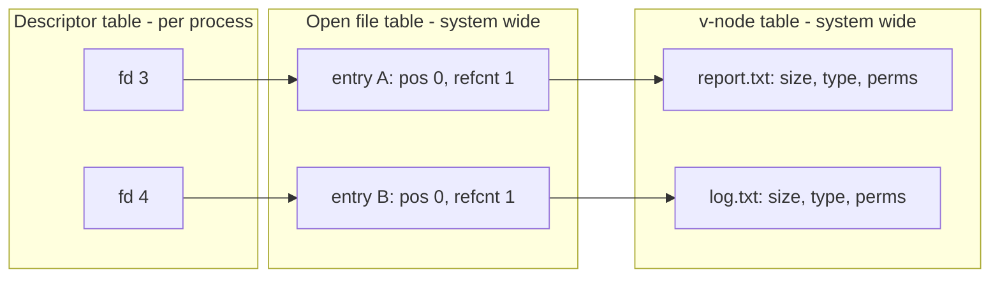
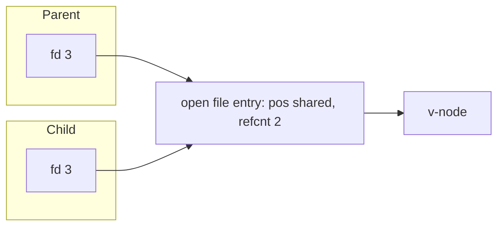
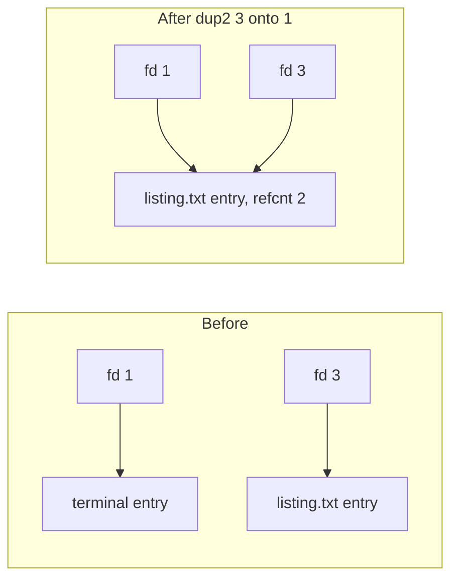
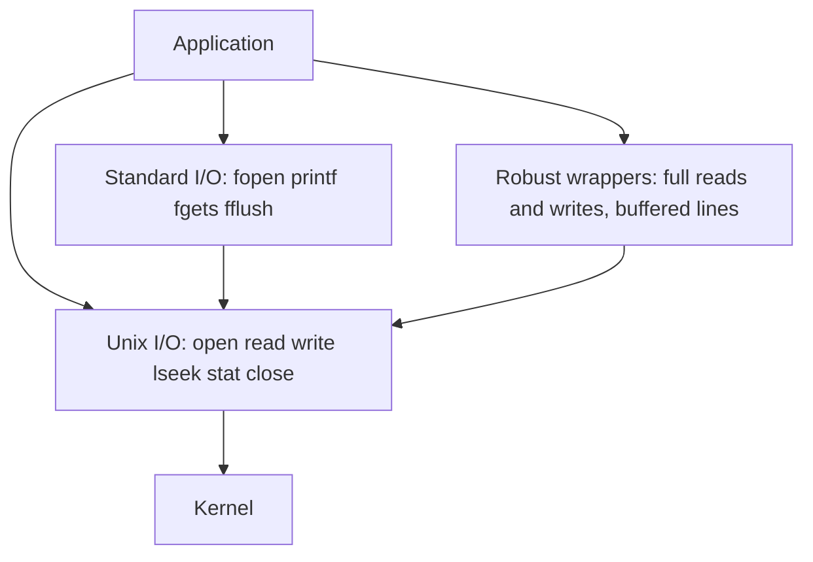

# File sharing, redirection and standard I/O

> **Before this lesson:** This lesson continues from [Unix I/O and robust reading](#/lesson/csapp/unix-io): file descriptors, `open`, `read` and `write` are assumed. It also uses `fork` and `execve` from [Processes: fork, exec, wait](#/lesson/csapp/processes).

## In plain words

When a program opens a file, the operating system keeps notes about that opening, the most important being a bookmark that marks how far the program has read. Two questions follow. What happens when two programs, or two parts of one program, use the same file: do they share a bookmark or does each have its own? And how can output that normally appears on the screen be sent into a file without the program knowing? Imagine a library book with a bookmark in it. If two readers share one physical copy, one reader moving the bookmark affects the other. If each has a separate copy, they read independently. This lesson explains which arrangement applies when, and how the command shell uses that knowledge for **redirection**, meaning sending a program's output or input somewhere other than the screen or keyboard.

Why this matters at work: redirection and pipes are used in every script and automated build. The buffering behaviour covered at the end explains two confusing sights: messages that vanish when a program crashes, and messages that appear twice. Questions on what two processes read from a shared file are common in systems interviews.

## Why look closer

Three small puzzles to start. A program opens the same file twice and reads one byte from each descriptor: does the second read see the first byte or the second? A parent opens a file, forks, and both processes read one byte: same question. And when you type `ls > listing.txt`, how does `ls`, which was compiled long before you thought of that file name, end up writing into it? All three have crisp answers once you know the three data structures the kernel keeps for open files. This lesson covers those structures, the `dup2` call that powers shell redirection, how to ask the kernel about a file without opening it, how to walk a directory, and finally how the C standard I/O library sits on top of everything and when you should or should not use it.

## 1. Asking about a file: metadata

Every file has a record of facts *about* it, separate from its contents: its size, its type, who may access it, when it was last changed. The `stat` family of calls copies that record into a structure you supply:

```c
#include <sys/stat.h>
int stat(const char *path, struct stat *buf);     /* by name */
int fstat(int fd, struct stat *buf);              /* by open descriptor */
```

<!-- walkthrough:c -->
**Reading this C line by line**

- `#include <sys/stat.h>` names the file that declares these functions and the `struct stat` type.
- `int stat(const char *path, struct stat *buf);` asks about the file whose name is the text `path`. The second input is the address of a structure you provide; the function fills it in with the file's details. The returned `int` is 0 on success and −1 on failure.
- `int fstat(int fd, struct stat *buf);` does the same for a file that is already open, identified by its descriptor.
- Handing a function the address of a structure for it to fill in is a common C idiom, since a C function can return only one value.

The structure has more than a dozen fields. The ones application code most often needs:

| Field | Meaning |
|---|---|
| `st_size` | length in bytes |
| `st_mode` | file type and the nine permission bits |
| `st_nlink` | number of directory entries (hard links) naming this file |
| `st_uid`, `st_gid` | owner and group |
| `st_mtime` | time of last modification |
| `st_ino` | the inode number, unique within one filesystem |

The type lives in the upper bits of `st_mode`, and macros test it: `S_ISREG` for an ordinary file, `S_ISDIR` for a directory, `S_ISSOCK` for a socket, and so on. The low bits are the familiar read, write and execute permissions for user, group and others. A web server, for example, calls `stat` before serving a path to check that it is a regular file and that it is readable, and uses `st_size` for the `Content-Length` header.

```python-run
import os, stat, tempfile, time

with tempfile.TemporaryDirectory() as d:
    path = os.path.join(d, "notes.txt")
    with open(path, "w") as f:
        f.write("twelve bytes")
    for p in (path, d):
        info = os.stat(p)
        kind = "directory" if stat.S_ISDIR(info.st_mode) else "regular file" if stat.S_ISREG(info.st_mode) else "other"
        print(f"{os.path.basename(p) or p:12} type={kind:12} size={info.st_size:5} "
              f"perms={stat.filemode(info.st_mode)} readable={os.access(p, os.R_OK)}")
    print("modified", round(time.time() - os.stat(path).st_mtime, 2), "seconds ago")
```

<!-- walkthrough:python-run -->
**Reading this Python line by line**

- `import os, stat, tempfile, time` loads four standard modules.
- `with tempfile.TemporaryDirectory() as d:` creates a scratch folder that is removed automatically afterwards.
- `with open(path, "w") as f: f.write("twelve bytes")` creates a file and writes 12 characters into it; the file is closed when the block ends.
- `for p in (path, d):` examines first the file and then the folder. `info = os.stat(p)` fetches the metadata.
- `stat.S_ISDIR(info.st_mode)` and `stat.S_ISREG(...)` test the type; the chained `if ... else` picks the right word. `stat.filemode` turns the permission bits into the familiar text form such as `-rw-r--r--`.
- Output: one line for the file (regular file, size 12) and one for the folder (directory), then how long ago the file was changed.

## 2. Reading a directory

A directory is itself a file, but its contents are a list of *(name, inode number)* entries that only the kernel may edit. Programs read it through a small stream interface:

```c
#include <dirent.h>
DIR *opendir(const char *path);
struct dirent *readdir(DIR *dirp);      /* NULL at the end, or on error */
int closedir(DIR *dirp);
```

Each call to `readdir` returns the next entry. The portable fields are `d_name` (the file name) and `d_ino`. Because `NULL` signals both "no more entries" and "something went wrong", careful code clears `errno` before the call and inspects it afterwards. Every directory contains the entries `.` and `..`, which recursive walkers must skip or they will loop forever.

```python-run
import os, tempfile
with tempfile.TemporaryDirectory() as d:
    for name in ("b.txt", "a.txt"):
        open(os.path.join(d, name), "w").close()
    os.mkdir(os.path.join(d, "sub"))
    with os.scandir(d) as entries:                 # opendir / readdir / closedir underneath
        for e in sorted(entries, key=lambda e: e.name):
            print(f"{e.name:6} inode={'yes' if e.inode() else 'n/a'} directory={e.is_dir()}")
```

## 3. Three tables behind every descriptor

Here is the model that answers the opening puzzles. The kernel represents open files with three linked structures.

1. **Descriptor table.** One per process. It is an array indexed by descriptor number; each slot that is in use points to an entry in the next table.
2. **Open file table.** One for the whole system, shared by all processes. Each entry represents one *opening* of a file. It holds the **current position** (the byte offset where the next read or write will happen), the access mode, a **reference count** of how many descriptor slots point at it, and a pointer into the third table. The kernel discards an entry only when its reference count falls to zero.
3. **v-node table.** Also system-wide. One entry per file, holding essentially the `stat` information.



That picture is the ordinary case: two descriptors, two openings, two different files. Three more arrangements are possible, and each one corresponds to a puzzle.

### Case 1: the same file opened twice

Calling `open` twice on one path creates **two** open-file entries that point at the **same** v-node. Each entry has its own position. So the descriptors advance independently: reading through one does not move the other.

*Puzzle one:* both reads return the first byte of the file.

### Case 2: after `fork`

`fork` gives the child a copy of the parent's descriptor table. The copies point at the **same** open-file entries, whose reference counts go up by one. Parent and child therefore **share one position**. A read by either advances the offset seen by both.

*Puzzle two:* whichever process reads first gets byte one; the other gets byte two. This sharing is exactly what lets a parent and child append to the same log without overwriting each other, and it is why both must `close` before the kernel releases the entry.



### Case 3: after `dup2`

The third arrangement puts two descriptors *in the same process* onto one open-file entry. That is the job of `dup2`, covered next.

The demo below builds the model directly, so you can check all three puzzles and then try your own variations.

```python-run
class OpenFile:                       # one entry of the system-wide open file table
    def __init__(self, vnode):
        self.vnode, self.pos, self.refcnt = vnode, 0, 1

class Process:
    def __init__(self, table=None):
        self.fds = dict(table or {})  # descriptor table: number -> OpenFile
    def open(self, vnode):
        fd = next(n for n in range(3, 99) if n not in self.fds)   # lowest free slot
        self.fds[fd] = OpenFile(vnode)
        return fd
    def read1(self, fd):
        of = self.fds[fd]
        ch = of.vnode["data"][of.pos]
        of.pos += 1
        return ch
    def fork(self):
        for of in self.fds.values():
            of.refcnt += 1
        return Process(self.fds)      # copied table, same OpenFile objects
    def dup2(self, old, new):
        if new in self.fds:
            self.fds[new].refcnt -= 1 # implicit close of whatever new referred to
        self.fds[new] = self.fds[old]
        self.fds[old].refcnt += 1

vnode = {"data": "QUARTZ"}

p = Process(); a = p.open(vnode); b = p.open(vnode)
print("opened twice :", p.read1(a), p.read1(b), " (independent positions)")

p = Process(); fd = p.open(vnode); child = p.fork()
print("after fork   :", child.read1(fd), p.read1(fd), " (one shared position, refcnt", p.fds[fd].refcnt, ")")

p = Process(); a = p.open(vnode); b = p.open(vnode); p.read1(b); p.dup2(b, a)
print("after dup2   :", p.read1(a), " (fd", a, "now follows fd", b, "'s position)")
```

## 4. Redirection with dup2

```c
#include <unistd.h>
int dup2(int oldfd, int newfd);
```

`dup2` copies descriptor-table slot `oldfd` over slot `newfd`. If `newfd` was already open, it is closed first. Afterwards both numbers refer to the same open-file entry and thus share a position. Read the argument order as "make `newfd` mean what `oldfd` means"; getting it backwards is the most common mistake.

Now the third opening puzzle unravels. Programs do not write to "the terminal". They write to descriptor 1, whatever that happens to be. When you type `ls > listing.txt`, the shell:

1. forks a child,
2. in the child, opens `listing.txt` for writing and gets some descriptor, say 3,
3. calls `dup2(3, 1)`, so descriptor 1 now refers to the file, then closes 3,
4. calls `execve` to run `ls`.

Descriptor tables survive `execve`, so `ls` starts life with its standard output already pointing at the file and never knows the difference. Input redirection with `<` is the same trick on descriptor 0, and a pipeline `a | b` connects descriptor 1 of one child and descriptor 0 of the next to the two ends of a pipe. The same move let the web server in the sockets lesson run a CGI program whose `printf` output went straight to a network connection.



```python-run
import os, sys, tempfile

def redirect_demo():
    with tempfile.TemporaryDirectory() as d:
        path = os.path.join(d, "listing.txt")
        sys.stdout.flush()
        keep = os.dup(1)                                  # remember the real stdout
        fd = os.open(path, os.O_WRONLY | os.O_CREAT | os.O_TRUNC, 0o644)
        os.dup2(fd, 1)                                    # fd 1 now means the file
        os.close(fd)
        os.write(1, b"this line was written to descriptor 1\n")
        os.dup2(keep, 1)                                  # put stdout back
        os.close(keep)
        with open(path) as f:
            return f.read().strip()

try:
    print("the file captured:", repr(redirect_demo()))
except Exception as exc:                                  # some sandboxes cannot dup descriptors
    print("descriptor duplication unavailable here:", type(exc).__name__)
    print("on a normal system the file captures the line written to descriptor 1")
```

> [!INTERVIEW]
> **"Parent opens a file and forks; the child reads 5 bytes. Where does the parent's next read start?"** At byte 5. `fork` duplicates the descriptor table but not the open-file entry, so the offset is shared. Contrast with two independent `open` calls on the same path, which get separate offsets. If the interviewer follows up with "how does the shell implement `>`", answer with fork, open, `dup2(fd, 1)`, exec.

## 5. Standard I/O: the buffered layer

Raw `read` and `write` are system calls, and a system call costs hundreds of nanoseconds or more for the trip into the kernel and back. A program that calls `read` once per character is painfully slow. The C library's **standard I/O** package (`fopen`, `fgets`, `fscanf`, `printf`, `fread`, `fwrite`, `fflush`, `fclose`) fixes that.

It models an open file as a **stream**: a `FILE` structure that wraps a descriptor together with a block of memory called the **stream buffer**. Three streams are open when `main` begins: `stdin`, `stdout` and `stderr`, wrapping descriptors 0, 1 and 2.

The buffer's whole purpose is to cut down the number of system calls:

- On input, the first `getc` triggers one `read` that fills the buffer with a few kilobytes. The next several thousand `getc` calls are satisfied from memory.
- On output, `printf` appends to the buffer. The bytes reach the kernel through a single `write` only when the buffer fills, when the program calls `fflush`, when the stream is closed, or when the program exits normally.

Streams connected to a terminal are usually **line buffered** (flushed at each newline), other output streams are **fully buffered**, and `stderr` is unbuffered so that error messages appear immediately.

```python-run
# Count the kernel crossings needed to consume a 100,000-byte file one character at a time.
size, bufsize = 100_000, 8192

unbuffered_calls = size + 1                    # one read per byte, plus the one that returns 0
buffered_calls = -(-size // bufsize) + 1       # one read per buffer refill, plus the final 0
print("read() calls, byte at a time :", unbuffered_calls)
print("read() calls, 8 KB buffer    :", buffered_calls)
print("reduction factor             :", round(unbuffered_calls / buffered_calls))
```

### Buffering surprises

The buffer lives in user memory, and that has consequences worth memorising.

- **Lost output on a crash.** If a program prints a progress message without a newline to a pipe or file and is then killed by a signal, the message was still in the buffer and vanishes. Debugging prints should go to `stderr` or be followed by `fflush`.
- **Duplicated output across `fork`.** The child receives a copy of the parent's memory, *including unflushed buffer contents*. If both later flush, the text appears twice. Flush before forking.
- **Ordering confusion.** Mixing `printf` and direct `write` on descriptor 1 can make output appear out of order, because one path is delayed and the other is not.

```python-run
# A model of the fork-duplicates-the-buffer effect.
import copy
class Stream:
    def __init__(self): self.buffer, self.kernel = [], None
    def printf(self, text): self.buffer.append(text)
    def flush(self, sink): sink.extend(self.buffer); self.buffer.clear()

terminal = []
parent = Stream()
parent.printf("starting... ")            # no newline, sits in the buffer
child = copy.deepcopy(parent)            # fork copies user memory, buffer included
parent.printf("parent done\n"); parent.flush(terminal)
child.printf("child done\n");   child.flush(terminal)
print("".join(terminal))
print("'starting...' appears", "".join(terminal).count("starting"), "times; flush before fork to avoid it")
```

## 6. Choosing an I/O interface

There are three layers you might call: raw Unix I/O; a thin robust wrapper around it that handles short counts and offers safe buffered line reading (the previous lesson built one); and standard I/O. All of the higher layers are implemented with `read` and `write` in the end.



A workable rule set:

1. **Use standard I/O whenever you can.** For disk files and terminals it is convenient, portable and fast.
2. **Avoid the formatted input functions on binary data.** `scanf` and `fgets` are designed for text lines. Bytes that happen to equal a newline or a zero will confuse them, and they give no protection against overlong input unless you are careful with field widths.
3. **Avoid standard I/O on network sockets.** A stream that is used for both input and output has awkward rules: you may not follow an output call with an input call without an intervening `fflush` or reposition, and you may not follow input with output without a reposition such as `fseek`, unless the input hit end-of-file. Sockets cannot be repositioned at all. You can work around it by opening two streams on one socket, but then closing both closes the underlying descriptor twice, which is a latent bug in threaded programs because the number may already have been reused. For sockets, use robust unbuffered writes and a dedicated buffered reader.
4. **Use raw Unix I/O in signal handlers and when you need exact control.** `write` is async-signal-safe; `printf` is not. Raw calls are also the only way to reach metadata and descriptor-level operations.

> [!INTERVIEW]
> **"Why might `printf` output be missing when my program crashes?"** Because `printf` writes into a user-space buffer, not to the file. If the process dies abnormally before the buffer is flushed, the kernel never saw the bytes. `stderr` is unbuffered, a newline flushes a terminal stream, and `fflush(stdout)` forces the issue. A good follow-up remark is that the same buffer gets copied by `fork`.

## 7. Pitfalls

- **Swapping the `dup2` arguments.** `dup2(1, fd)` redirects your file descriptor to the terminal, the opposite of what you wanted.
- **Forgetting to close the original after `dup2`.** The spare descriptor keeps the file open and leaks into the exec'd program.
- **Assuming independent offsets after `fork`.** They are shared; coordinate or reopen.
- **Assuming shared offsets after two `open`s.** They are independent; two writers will overwrite each other unless both use append mode.
- **Recursing into `.` and `..`** when walking directories.
- **Using `stat` results as a security check.** The file can change between the check and the later `open`. Open first, then `fstat` the descriptor.
- **Leaving streams unflushed before `fork` or before a risky operation.**
- **Leaking descriptors.** Every `open`, `dup`, `accept` and `pipe` needs a matching `close`, or a long-running server eventually hits its limit.

## Summary

- `stat` and `fstat` return a file's metadata: size, type, permissions, timestamps. Directories are read with `opendir`/`readdir`/`closedir`.
- The kernel tracks open files with a per-process descriptor table, a shared open file table (position and reference count), and a shared v-node table (metadata).
- Two `open` calls give independent positions; `fork` and `dup2` create additional references to one entry and therefore share a position.
- `dup2(oldfd, newfd)` makes `newfd` refer to what `oldfd` refers to. Shells implement `<`, `>` and pipes with it between `fork` and `exec`.
- Standard I/O wraps descriptors in buffered streams to reduce system calls. The buffer explains lost output on crashes and doubled output after `fork`.
- Prefer standard I/O for files and terminals, robust descriptor-level I/O for sockets, and raw calls inside signal handlers.

## Glossary

- **Metadata**: information about a file, such as its size, type and permissions, as opposed to its contents.
- **`stat`**: the system call that returns a file's metadata.
- **Directory**: a file whose contents are a list of names and the files they refer to.
- **Descriptor table**: each process's own list linking descriptor numbers to open files.
- **Open file table**: the system-wide list with one entry per opening of a file, holding its position.
- **v-node table**: the system-wide list with one entry per file, holding its metadata.
- **Reference count**: a tally of how many descriptors point to an open file entry; the entry is removed at zero.
- **`dup2`**: the system call that makes one descriptor refer to the same open file as another.
- **Redirection**: making a program's input or output go to a file or another program.
- **Pipe**: a channel that carries one program's output to another program's input.
- **Stream**: the C library's wrapper around a descriptor that adds a buffer.
- **Buffering**: collecting data in memory so that it reaches the kernel in fewer, larger operations.
- **Flush**: to push buffered output through to the kernel at once.

```quiz
[
  {"q": "A program opens data.txt twice, obtaining fd1 and fd2, then reads one byte from each. The file begins with the letters XYZ. What does the read on fd2 return?",
   "options": ["X", "Y", "Z", "End of file"],
   "answer": 0, "explain": "Each open creates its own open-file entry with its own position starting at 0, so both descriptors read the first byte."},
  {"q": "A parent opens a file beginning XYZ, then forks. The child reads one byte and exits; the parent waits and then reads one byte. What does the parent get?",
   "options": ["X", "Y", "Z", "An error"],
   "answer": 1, "explain": "The child's descriptor refers to the same open-file entry as the parent's, so they share one position. The child consumed X; the parent reads Y."},
  {"q": "Which call makes standard output refer to the file open on descriptor 5?",
   "options": ["dup2(1, 5)", "dup2(5, 1)", "dup(5)", "fstat(5, 1)"],
   "answer": 1, "explain": "dup2(oldfd, newfd) copies the old slot onto the new one. To redirect descriptor 1 to the file, the file's descriptor is the first argument."},
  {"q": "Where is the current file position stored?",
   "options": ["In the per-process descriptor table", "In the open file table entry", "In the v-node", "In the FILE stream only"],
   "answer": 1, "explain": "The position belongs to the open file table entry, which is why descriptors that share an entry share an offset."},
  {"q": "When does the kernel delete an open file table entry?",
   "options": ["When any process closes a descriptor referring to it", "When its reference count drops to zero", "When the process that opened it exits, regardless of others", "Never; entries persist until reboot"],
   "answer": 1, "explain": "Each descriptor pointing at the entry holds a reference. The entry is released only after the last one is closed."},
  {"q": "A program prints a message without a newline using printf to a pipe, then forks, and both processes exit normally. How many times does the message appear?",
   "options": ["Zero", "Once", "Twice", "It is undefined"],
   "answer": 2, "explain": "The unflushed text sits in the user-space stream buffer, which fork copies. Each process flushes its own copy at exit."},
  {"q": "Why is standard I/O a poor fit for network sockets?",
   "options": ["Sockets do not have descriptors", "Its rules for mixing input and output on one stream require flushing or repositioning, and sockets cannot be repositioned", "It is too slow", "It cannot handle text"],
   "answer": 1, "explain": "Switching from input to output on a stream requires a positioning call, which is impossible on a socket; the usual workarounds risk double closes."},
  {"q": "Which function reports whether a path names a regular file or a directory without opening it?",
   "options": ["readdir", "lseek", "stat", "dup2"],
   "answer": 2, "explain": "stat fills a structure whose st_mode field encodes the file type, tested with macros such as S_ISREG and S_ISDIR."}
]
```

> **Source:** CS:APP 3e, §10.6–10.12
