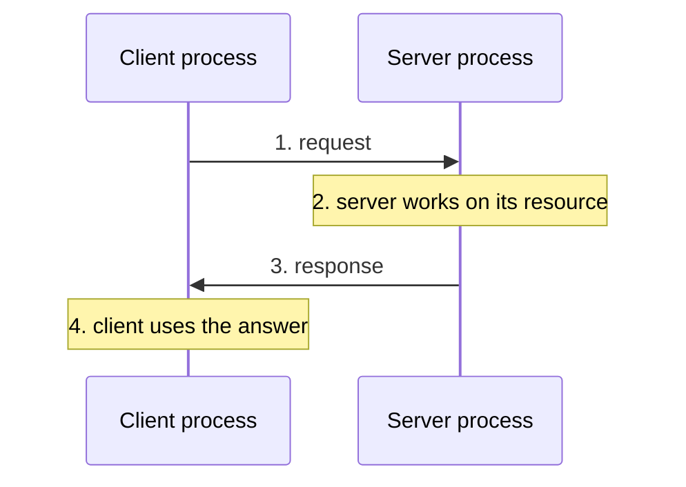
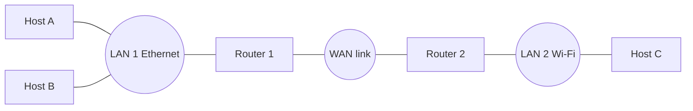
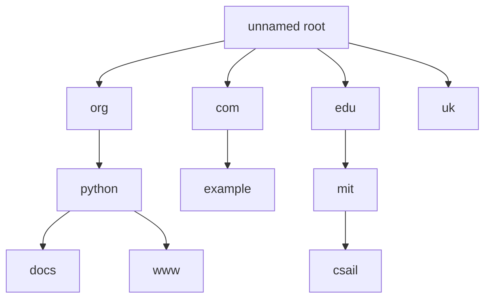
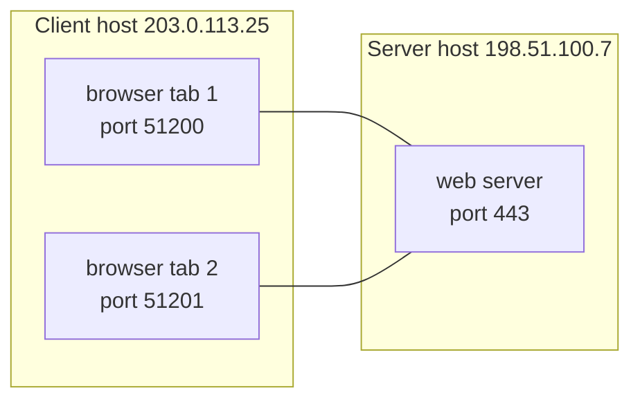

# Networks, IP addresses and DNS

> **Before this lesson:** You need byte order (big-endian and little-endian) and hexadecimal from [Bits, bytes, words and bit-level operations](#/lesson/csapp/bits-bytes), and file descriptors with `read` and `write` from [Unix I/O and robust reading](#/lesson/csapp/unix-io).

## In plain words

A **network** is a set of computers connected so that they can send data to one another. The Internet is a very large network made by joining many smaller ones. The postal system is a helpful comparison. Every building has an address, so a letter can be delivered; a computer's equivalent is its **IP address**, a number. A large building has many flats, so the envelope also needs a flat number; on a computer that is the **port**, which selects one program among those running. Nobody memorises long numbers, so there is a directory that turns names such as `example.org` into addresses; that directory is the **Domain Name System**, or DNS. And a letter passes through several sorting offices on its way; on a network those are **routers**.

Why this matters at work: nearly all modern software talks over a network. When something fails, you need to tell a name-lookup problem from an unreachable machine from a program that is not listening on the expected port. The vocabulary in this lesson is used daily by anyone building or operating services, and "what happens when you type a web address?" is among the most common interview questions.

## Why look closer

Almost nothing you build today lives on one machine. A phone app calls a backend, the backend calls a database, the database replicates to another region. Yet from the point of view of a C program, talking to a machine on another continent looks surprisingly like writing to a file: you obtain a small integer descriptor, you call `read` and `write` on it, and you close it when you are finished. This lesson fills in everything that sits underneath that descriptor: what a network physically is, how separate networks are stitched into an internet, what an IP address and a port actually are, why byte order suddenly matters, and how names such as `example.org` get turned into numbers. The next lesson builds real clients and servers on top of this vocabulary.

## 1. The shape of every network application

Nearly every networked program follows one pattern. A **server** is a process that owns something worth asking for: files on a disk, rows in a database, the ability to send mail. A **client** is a process that wants some of it. They interact in a four-beat exchange that people call a **transaction** (nothing to do with database transactions; there is no atomicity here):



Two details in that picture are easy to get wrong:

- Client and server are **processes**, not computers. One laptop can run a web server, a database server and six clients all at once. Conversely, one "service" may be thousands of server processes on thousands of machines. When someone says "the server is down", ask which process they mean.
- The roles are per conversation. A web application is a server to your browser and, in the same breath, a client of its database.

## 2. What a network is, from the host's side

To the operating system, a network is one more I/O device. A **network adapter** (NIC) plugs into the I/O bus exactly as a disk controller does. Bytes arriving off the wire are copied by the adapter into main memory, usually with DMA and an interrupt to tell the kernel they have landed; outgoing bytes travel the opposite way. That is the whole reason the file-like `read`/`write` interface works: the kernel already knows how to present devices as byte sources and sinks.

### Local area networks

The smallest useful network covers a room, a floor, or a building. The dominant technology is **Ethernet**. Its essentials:

- Every adapter is manufactured with a globally unique 48-bit hardware address (the MAC address), stored in non-volatile memory on the card.
- Hosts transmit data in chunks called **frames**. A frame carries a small header naming the source adapter, the destination adapter and the length, followed by the payload.
- In the oldest arrangement, hosts connect to a **hub**, a dumb repeater that copies every incoming bit to every other port. Every host therefore sees every frame and must discard the ones not addressed to it.
- Modern installations use **switches** (the older term is bridges). A switch watches the source addresses of frames passing through, learns which adapter lives behind which port, and from then on forwards a frame only out of the port where the destination lives. Less wasted traffic, more privacy, and separate conversations can run in parallel.

From now on we can draw an entire switched LAN as a single line with hosts hanging off it; the wiring inside does not matter to the layers above.

### Joining LANs: routers

A LAN technology only understands its own frames and its own addresses. A Wi-Fi network cannot hand a frame to a fiber-optic long-haul link; the formats, sizes and addressing differ. The device that bridges incompatible networks is a **router**: a specialised computer with one adapter on each network it touches. A collection of networks joined by routers is an **internet** with a lowercase i (short for internetwork). Long-distance links between routers form **wide area networks**.



## 3. Protocols and encapsulation

How can Host A send data to Host C when the two sit on networks with different frame formats? The trick is a layer of **protocol software** running on every host and every router that hides the differences. That protocol has to supply two things:

1. **A uniform naming scheme.** Each host gets at least one *internet address* whose format is the same everywhere, regardless of what kind of LAN it is plugged into.
2. **A uniform delivery mechanism.** Data is cut into **packets**, each consisting of a header (source and destination internet addresses, size, bookkeeping) and a payload. Every host and router knows how to read that header.

The key manoeuvre is **encapsulation**: a packet from one layer becomes the payload of the layer below. Follow 300 bytes of application data from A to C:

1. The application on A hands 300 bytes to the kernel through a system call.
2. A's protocol software prepends an internet header addressed to C, producing a packet. It then wraps that packet in a LAN 1 frame whose hardware destination is **Router 1**, not C, because C is not reachable on LAN 1.
3. A's adapter puts the frame on the wire.
4. Router 1's LAN 1 adapter receives the frame, strips the frame header, and passes the packet up to its protocol software.
5. The router reads the destination internet address, consults its **routing table**, and decides the packet should leave on the WAN interface. It wraps the *unchanged* packet in a new frame suitable for that link.
6. The same happens at Router 2, which finally builds a LAN 2 frame addressed to C's adapter.
7. C's protocol software strips the frame header, then the internet header, and delivers 300 bytes to the waiting application.

The lesson to hold on to: **the frame header is rewritten at every hop; the internet packet rides through untouched** (apart from small fields such as a hop counter).

```python-run
# Encapsulation as nested wrappers. Each hop replaces only the outer (frame) layer.
def packet(src_ip, dst_ip, data):
    return {"ip_src": src_ip, "ip_dst": dst_ip, "payload": data}

def frame(src_mac, dst_mac, pkt):
    return {"mac_src": src_mac, "mac_dst": dst_mac, "payload": pkt}

pkt = packet("10.1.0.7", "172.20.5.9", b"x" * 300)
hops = [("aa:01", "r1:01", "LAN 1"), ("r1:02", "r2:01", "WAN"), ("r2:02", "cc:09", "LAN 2")]
for src, dst, net in hops:
    f = frame(src, dst, pkt)
    inner = f["payload"]
    print(f"{net:6}: frame {f['mac_src']} -> {f['mac_dst']} | packet {inner['ip_src']} -> {inner['ip_dst']} "
          f"| {len(inner['payload'])} data bytes")
print("The inner packet never changed:", f["payload"] is pkt)
```

Real internets add many complications this sketch ignores: networks disagree about the largest frame they can carry (so packets may need to be fragmented), routers must somehow learn their tables, and topology changes while packets are in flight. Encapsulation is nevertheless the idea that makes the whole thing possible.

## 4. The global IP Internet

The Internet with a capital I is the most successful internet ever built. Every host on it runs the **TCP/IP** family of protocols, and applications reach those protocols through the **sockets interface** together with ordinary Unix I/O calls. The pieces are layered:

| Protocol | Delivers between | Guarantees |
|---|---|---|
| **IP** | hosts | None. A datagram may be lost, duplicated, or arrive out of order. "Best effort." |
| **UDP** | processes | Adds port numbers to IP so a datagram reaches a specific process. Still unreliable. |
| **TCP** | processes | A reliable, ordered, two-way stream of bytes over a **connection**. |

IP supplies the naming scheme and host-to-host delivery from Section 3. TCP is built on top of IP and does the hard work of retransmitting lost segments, putting them back in order, and throttling senders. Throughout these lessons we treat TCP/IP as one bundle and use only TCP.

From the programmer's chair the Internet is a set of hosts with three properties:

1. Each host is named by a 32-bit **IP address**.
2. IP addresses are given human-friendly aliases called **domain names**.
3. A process on one host talks to a process on another over a **connection**.

The following sections take these one at a time.

> [!NOTE]
> The 32-bit scheme is IPv4. Its successor IPv6 uses 128-bit addresses and now carries a large share of traffic. The concepts are identical; only the address width and the textual notation differ. Modern code should be written so that it works with both, which the `getaddrinfo` function in the next lesson makes easy.

## 5. IP addresses and the byte-order trap

An IPv4 address is an unsigned 32-bit number. For historical reasons the sockets API wraps it in a one-member struct:

```c
struct in_addr {
    uint32_t s_addr;   /* always stored big-endian */
};
```

Here is the catch. Hosts on the Internet disagree about byte order: x86 and most ARM configurations are little-endian, some other architectures are big-endian. If each machine put multi-byte integers on the wire in its native order, a little-endian sender and a big-endian receiver would read different numbers from the same four bytes. TCP/IP settles the matter by decree: any integer carried in a packet header travels in **network byte order**, which is **big-endian**, most significant byte first. The address inside `struct in_addr` and the 16-bit port number in a socket address are both kept in network order *even while they sit in your program's memory*.

Four tiny conversion functions bridge the gap. Read the names as "host to network long/short" and the reverse:

```c
#include <arpa/inet.h>
uint32_t htonl(uint32_t hostlong);     uint16_t htons(uint16_t hostshort);
uint32_t ntohl(uint32_t netlong);      uint16_t ntohs(uint16_t netshort);
```

On a big-endian machine they return their argument unchanged. On a little-endian machine they reverse the bytes. Calling them unconditionally makes your code portable. There is no 64-bit variant in the classic API.

```python-run
import struct, sys
port = 8080                      # 0x1F90
addr = 0xC0A80164                # 192.168.1.100

print("this machine is", sys.byteorder, "endian")
print("port, native order :", struct.pack("=H", port).hex(" "))
print("port, network order:", struct.pack("!H", port).hex(" "))
print("addr, native order :", struct.pack("=I", addr).hex(" "))
print("addr, network order:", struct.pack("!I", addr).hex(" "))

# What a little-endian server sees if the programmer forgets htons(8080):
wrong = struct.unpack("!H", struct.pack("<H", port))[0]
print("forgetting htons(8080) binds to port", wrong)
```

That last line is a real and common bug: the server starts without complaint, but on port 36895 instead of 8080, and every client gets "connection refused".

### Dotted-decimal notation

People do not read 32-bit hex comfortably, so each byte is written in decimal with dots in between. `0xC0A80164` becomes `192.168.1.100`: `0xC0` = 192, `0xA8` = 168, `0x01` = 1, `0x64` = 100. Converting by hand is a favourite quiz item, so practise both directions:

- `10.0.0.255` → `0x0A0000FF`
- `0xAC10FE01` → `172.16.254.1`

In C, `inet_pton` ("presentation to network") parses a dotted string into a binary address already in network order, and `inet_ntop` goes back the other way:

```c
int inet_pton(int af, const char *src, void *dst);                         /* 1 ok, 0 bad string, -1 error */
const char *inet_ntop(int af, const void *src, char *dst, socklen_t size); /* NULL on error */
```

The `af` argument is `AF_INET` for IPv4 or `AF_INET6` for IPv6. The older `inet_aton`/`inet_ntoa` pair handles IPv4 only, and `inet_ntoa` returns a pointer to a static buffer, which makes it unsafe with threads.

```python-run
import ipaddress
for text in ("192.168.1.100", "10.0.0.255", "127.0.0.1", "172.16.254.1"):
    ip = ipaddress.IPv4Address(text)
    print(f"{text:15} = {int(ip):#010x}  wire bytes = {ip.packed.hex(' ')}")

print(ipaddress.IPv4Address(0xAC10FE01), "<- from 0xAC10FE01")
net = ipaddress.ip_network("192.168.1.0/24")
print(net, "holds", net.num_addresses, "addresses;",
      ipaddress.ip_address("192.168.1.100") in net, "that .100 is inside it")
print("IPv6 loopback, full form:", ipaddress.IPv6Address("::1").exploded)
```

> [!INTERVIEW]
> **"Why do we need `htons` on the port but not on the bytes of the message body?"** Byte order only matters for multi-byte *integers that both ends interpret numerically*. Header fields such as addresses and ports are interpreted by the kernel and by routers, so the standard fixes their order. Your payload is an opaque byte stream to TCP; if you put binary integers into it, choosing and documenting their byte order is your protocol's job. Text protocols such as HTTP sidestep the question altogether.

## 6. Domain names and DNS

Numbers are fine for routers and terrible for people, and they change when a service moves to a different host. So the Internet maintains a second namespace of **domain names**: dot-separated labels such as `docs.python.org`. The names form a tree read from right to left:



Directly beneath the root are the **top-level domains** (`com`, `org`, `edu`, country codes, and many newer ones). Below them are second-level domains that organisations register on a first-come basis, and beneath those the owner can create whatever subdomains it likes.

The mapping between names and addresses is stored in a planet-wide distributed database, the **Domain Name System**. Before DNS existed (it arrived in the mid-1980s) the whole mapping lived in one text file, `HOSTS.TXT`, that sites periodically downloaded. That approach collapsed under growth. DNS instead delegates: each zone of the tree is served by its owner's name servers, and resolvers cache the answers.

The mapping is not one-to-one, and the exceptions matter in practice:

| Situation | Example | Why it exists |
|---|---|---|
| One name, one address | a small personal site | the simple case |
| Many names, one address | `example.com` and `www.example.com` | aliases; virtual hosting of many sites on one machine |
| One name, many addresses | any large website | load spreading and redundancy; the answer can differ per query and per region |
| A name with no address | a bare organisational domain | valid name used only for mail or delegation |

Every host also knows the name `localhost`, which resolves to the **loopback address** `127.0.0.1`. Traffic sent there never leaves the machine, which makes it ideal for running a client and a server side by side while debugging.

On the command line, `nslookup`, `dig` or `host` will query DNS for you. From a program, use `getaddrinfo`, covered in the next lesson. The demo below tries a real lookup and falls back gracefully when the sandbox has no network.

```python-run
import socket
def lookup(name):
    try:
        infos = socket.getaddrinfo(name, 80, type=socket.SOCK_STREAM)
        return sorted({info[4][0] for info in infos})
    except Exception as exc:          # no network, or no resolver in this sandbox
        return f"unavailable here ({type(exc).__name__})"

for name in ("localhost", "example.org"):
    print(f"{name:12} ->", lookup(name))

# A toy resolver showing the right-to-left walk through the hierarchy.
zones = {".": {"org": "org-servers"}, "org-servers": {"example": "example-servers"},
         "example-servers": {"www": "93.184.215.14"}}
def resolve(name):
    server = "."
    for label in reversed(name.split(".")):
        print(f"  ask {server!r:18} about {label!r}")
        server = zones[server][label]
    return server
print("www.example.org ->", resolve("www.example.org"))
```

## 7. Connections, sockets and ports

An IP address gets a packet to the right host. But a host runs many processes, so one more number is needed to pick the process. That number is the 16-bit **port**.

- A **socket** is one endpoint of a connection. Its **socket address** is the pair *IP address : port*.
- A **connection** is point-to-point (exactly two endpoints), full-duplex (bytes flow both ways simultaneously), and reliable (bytes come out in the order they went in, or the connection reports failure).
- A connection is identified by the addresses of *both* endpoints, the **socket pair**: `(client IP : client port, server IP : server port)`.

Where do the port numbers come from?

- The **server's port** is chosen in advance so clients can find it. Services have conventional **well-known ports**: 22 for SSH, 25 for SMTP mail, 53 for DNS, 80 for HTTP, 443 for HTTPS. On Unix-like systems, the file `/etc/services` lists the registered name-to-port mapping, and ports below 1024 traditionally require elevated privileges to bind.
- The **client's port** is picked by the client's kernel at the moment it connects. It is called an **ephemeral port** because it lives only as long as the connection.



Because the pair as a whole is the identity, a single server port can carry any number of simultaneous connections: every one differs in at least the client half. The kernel demultiplexes each arriving TCP segment by looking up all four values.

```python-run
# The kernel's demultiplexing table, in miniature: 4-tuple -> which socket gets the bytes.
table = {}
def accept(client_ip, client_port, server_ip="198.51.100.7", server_port=443):
    key = (client_ip, client_port, server_ip, server_port)
    table[key] = f"conn#{len(table) + 1}"
    return key

accept("203.0.113.25", 51200)
accept("203.0.113.25", 51201)          # same client host, different ephemeral port
accept("192.0.2.44",   51200)          # same client port number, different host
for key, sock in table.items():
    print(sock, key)
print("distinct connections on one server port:", len(table))
```

> [!INTERVIEW]
> **"How many TCP connections can a server accept on port 443?"** Not 65,535. The port space limits how many connections one *client address* can open to one server address and port, because the client's port is the only part that varies. Across all client addresses the theoretical count is vast; the practical limits are file descriptors, memory per connection and kernel tuning. Mentioning the 4-tuple is what the interviewer is listening for.

## 8. Putting the pieces together

Type `https://docs.python.org/` into a browser and all of this happens before any page content moves:

1. The browser (a client process) asks the resolver to turn `docs.python.org` into one or more IP addresses. The answer may come from a local cache or from a walk down the DNS tree.
2. The browser asks its kernel for a socket and requests a connection to *that address : 443*. The kernel picks an ephemeral port for the local end.
3. TCP segments are wrapped in IP packets, which are wrapped in frames for the local network and sent to the default router.
4. Each router along the path unwraps the frame, reads the destination IP address, chooses an outgoing interface, and re-wraps.
5. The server's kernel matches the arriving segments to a listening socket on port 443 and creates a connection identified by the full socket pair.
6. From here on both processes read and write bytes on descriptors.

## 9. Pitfalls

- **Forgetting byte-order conversion.** Assigning a port or address to a socket address field without `htons`/`htonl` works on big-endian test machines and fails silently elsewhere.
- **Converting twice.** Functions like `inet_pton` already produce network order. Passing their result through `htonl` flips it back.
- **Assuming a host has one address, or a name has one address.** Laptops have Wi-Fi, Ethernet, loopback and VPN interfaces; big sites return different addresses on every lookup. Code should iterate over all results.
- **Treating an IP address as an identity.** Address translation at home routers and carrier gateways means thousands of machines can share one public address, and one machine's address can change mid-session.
- **Confusing the two kinds of address.** Hardware addresses matter only within a single LAN and change at every hop; IP addresses are end-to-end.
- **Believing TCP preserves message boundaries.** It is a byte stream. One `write` of 300 bytes may surface as three `read`s of 100. The next lesson deals with this.
- **Hard-coding IPv4.** Using `AF_INET`-only structures and `inet_ntoa` locks out IPv6 users. Prefer protocol-independent calls.

## Summary

- Network software is organised as clients requesting and servers responding; both are processes.
- A host sees the network as an I/O device. LANs deliver frames between adapters; routers join LANs into internets.
- Encapsulation lets a uniform internet packet cross dissimilar networks: the frame wrapper changes hop by hop while the packet inside stays the same.
- IP provides best-effort host-to-host datagrams; UDP adds ports; TCP adds reliable, ordered, bidirectional byte streams.
- IPv4 addresses are 32-bit numbers kept in big-endian network byte order. Use `htonl`, `htons`, `ntohl`, `ntohs` for integers and `inet_pton`/`inet_ntop` for text.
- DNS is a distributed, hierarchical database mapping names to addresses, with many-to-one and one-to-many mappings both common.
- A socket is an address:port endpoint; a connection is named by the pair of its two sockets, which lets one server port serve many clients.

## Glossary

- **Network**: computers connected so they can exchange data.
- **Client / server**: the program that asks for something / the program that provides it.
- **LAN (local area network)**: a network covering a small area such as an office or home.
- **Frame**: a chunk of data in the form used on one particular local network.
- **Router**: a device that passes data from one network to another.
- **Protocol**: an agreed set of rules for how data is formatted and exchanged.
- **Packet**: a chunk of data with a header saying where it comes from and where it is going.
- **Encapsulation**: wrapping one layer's packet inside another layer's packet or frame.
- **IP (Internet Protocol)**: the protocol that delivers packets between computers, without guarantees.
- **TCP (Transmission Control Protocol)**: the protocol that provides a reliable, ordered stream of bytes between two programs.
- **IP address**: the number identifying a computer on the Internet.
- **Network byte order**: big-endian order, which the Internet uses for numbers in packet headers.
- **Domain name**: a readable name such as `example.org`.
- **DNS (Domain Name System)**: the worldwide directory that converts domain names to IP addresses.
- **Port**: a 16-bit number identifying one program's endpoint on a computer.
- **Socket**: one end of a network connection, identified by an IP address and a port.

```quiz
[
  {"q": "A router forwards a packet from an Ethernet LAN onto a long-haul link. Which statement is accurate?",
   "options": ["It rewrites the destination IP address to the next router's address", "It discards the old frame header and wraps the same IP packet in a new frame for the next link", "It forwards the original frame unchanged", "It splits the TCP stream into two connections"],
   "answer": 1, "explain": "Frames are local to one network. The router strips the incoming frame, keeps the IP packet essentially intact, and encapsulates it in a frame suited to the outgoing network."},
  {"q": "What is the dotted-decimal form of the address 0x0A0000FF?",
   "options": ["255.0.0.10", "10.0.0.255", "100.0.0.255", "10.0.0.15"],
   "answer": 1, "explain": "Read the bytes from most significant to least: 0x0A = 10, 0x00, 0x00, 0xFF = 255."},
  {"q": "On a little-endian host, a programmer stores port 8080 (0x1F90) into a socket address without calling htons. Which port does the kernel use?",
   "options": ["8080", "36895 (0x901F)", "0", "The call fails with an error"],
   "answer": 1, "explain": "The kernel interprets the two bytes in network (big-endian) order. The native little-endian layout is 90 1F, which reads as 0x901F = 36895. No error is reported."},
  {"q": "Which protocol provides reliable, ordered delivery of a byte stream between two processes?",
   "options": ["IP", "UDP", "TCP", "Ethernet"],
   "answer": 2, "explain": "IP and UDP are best-effort datagram services. TCP layers retransmission, ordering and flow control on top of IP."},
  {"q": "Two tabs of the same browser both connect to 198.51.100.7:443. How does the server's kernel tell the two connections apart?",
   "options": ["By the hardware address in the frame", "By the client's ephemeral port, which differs in the two socket pairs", "It cannot; the second connection is refused", "By the domain name the client looked up"],
   "answer": 1, "explain": "A connection is identified by the full pair of socket addresses. The client kernel assigns each connection its own ephemeral port, so the pairs differ."},
  {"q": "Which statement about domain names and IP addresses is FALSE?",
   "options": ["Several domain names may map to the same IP address", "One domain name may map to several IP addresses", "Every valid domain name maps to exactly one IP address", "localhost maps to the loopback address 127.0.0.1"],
   "answer": 2, "explain": "The mapping is many-to-many, and some valid names have no address record at all."},
  {"q": "Why does inet_pton not need to be followed by htonl?",
   "options": ["Because addresses are stored in host order", "Because it already writes the address in network byte order", "Because htonl only works on ports", "Because IPv4 addresses are only one byte"],
   "answer": 1, "explain": "The function converts the textual presentation form directly into the binary network-order form. Converting again would reverse the bytes on a little-endian host."},
  {"q": "What does a switch do that a hub does not?",
   "options": ["It converts frames into IP packets", "It learns which hardware address is reachable on which port and forwards frames selectively", "It assigns IP addresses to hosts", "It encrypts frames"],
   "answer": 1, "explain": "A hub repeats every bit on every port. A switch learns adapter locations from traffic and sends each frame only where it needs to go."}
]
```

> **Source:** CS:APP 3e, §11.1–11.3
