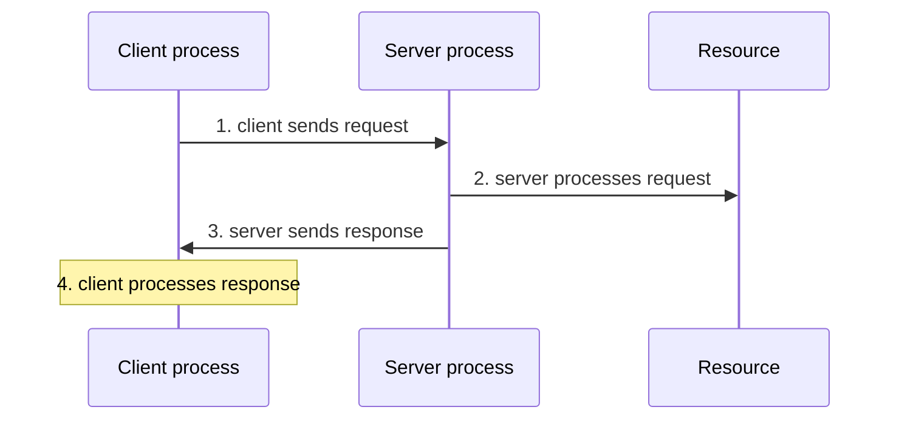
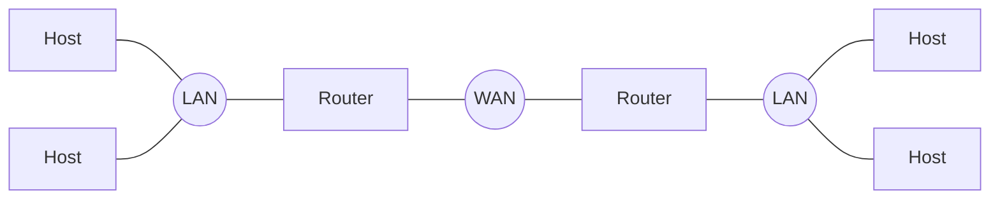
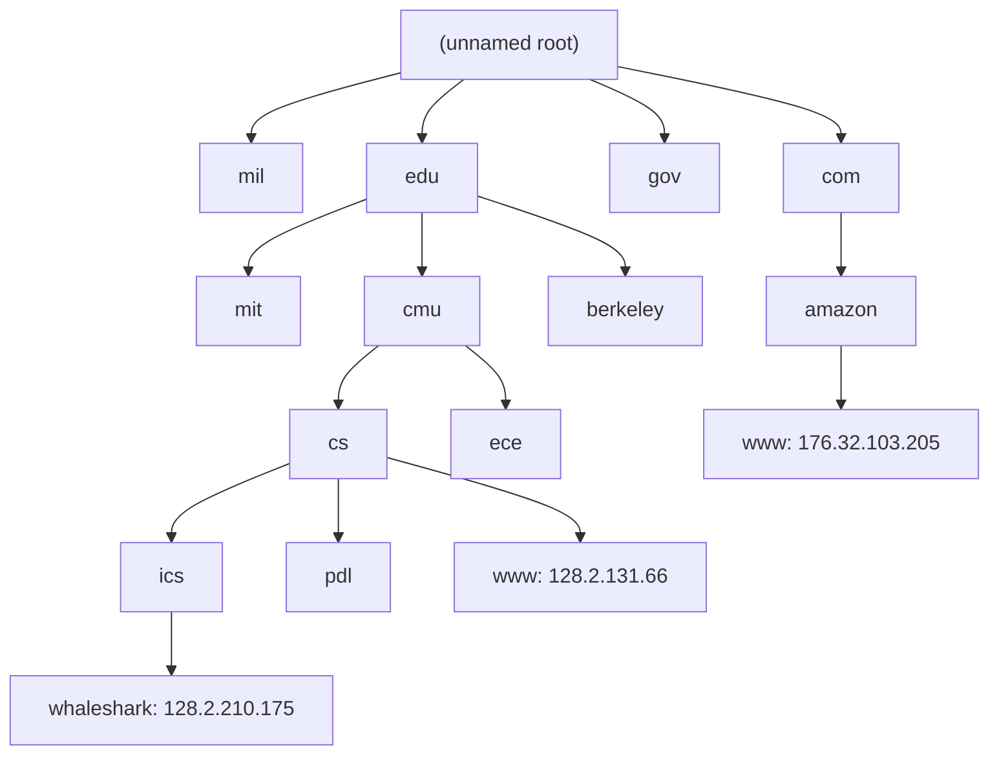

# Networks, IP addresses and DNS

Network applications are everywhere: every time you browse the web, send an email or play an online game, you are using one. Interestingly, all network applications are based on the same basic programming model, have similar overall logical structures, and rely on the same programming interface. And they draw on almost everything from the earlier modules: processes, signals, byte ordering, memory mapping and dynamic storage allocation all play important roles. This lesson lays the groundwork: the client-server model, how networks and internets are structured, IP addresses and byte order, domain names and DNS, and what an Internet connection is. The next lesson builds on it with the sockets interface and a working web server.

## 1. The client-server programming model

Every network application is based on the **client-server model**. An application consists of a **server process** and one or more **client processes**. A server manages some **resource**, and it provides some **service** for its clients by manipulating that resource. A web server manages a set of disk files that it retrieves and executes on behalf of clients; an FTP server manages disk files that it stores and retrieves for clients; an email server manages a spool file that it reads and updates for clients.

The fundamental operation in the client-server model is the **transaction**, which consists of four steps:

1. When a client needs service, it initiates a transaction by **sending a request** to the server. (When a web browser needs a file, it sends a request to a web server.)
2. The server receives the request, interprets it, and **manipulates its resources** in the appropriate way. (The web server reads a disk file.)
3. The server **sends a response** to the client and then waits for the next request. (The web server sends the file back.)
4. The client receives the response and **manipulates it**. (The browser displays the page.)



> [!NOTE]
> **Clients and servers are processes, not machines** (or "hosts", as machines are often called in this context). A single host can run many different clients and servers concurrently, and a client and server transaction can be on the same or different hosts. The model is the same regardless of the mapping to hosts. (These client-server transactions are also *not* database transactions: they have no atomicity or other such properties; a transaction here is simply a sequence of steps.)

## 2. Networks

Clients and servers often run on separate hosts and communicate using the hardware and software resources of a **computer network**. To a host, a network is just another I/O device that serves as a source and sink for data. An adapter plugged into an expansion slot on the I/O bus provides the physical interface to the network. Data received from the network are copied from the adapter across the I/O and memory buses into memory, typically by a DMA transfer; similarly, data can be copied from memory to the network.

Physically, a network is a hierarchical system organized by geographical proximity.

**Ethernet segments.** At the lowest level is a **LAN (local area network)** that spans a building or a campus. The most popular LAN technology by far is **Ethernet**. An **Ethernet segment** consists of some wires (usually twisted pairs) and a small box called a **hub**. Each wire has the same maximum bit bandwidth, typically 100 Mb/s or 1 Gb/s. One end is attached to an adapter on a host, the other to a port on the hub. A hub slavishly copies every bit that it receives on each port to every other port: **every host sees every bit**.

Each Ethernet adapter has a globally unique **48-bit address** stored in nonvolatile memory on the adapter (the MAC address). A host can send a chunk of bits called a **frame** to any other host on the segment. Each frame includes some fixed number of **header** bits that identify the source and destination of the frame and the frame length, followed by a **payload** of data bits. Every host adapter sees the frame, but only the destination host actually reads it.

**Bridged Ethernets.** Multiple Ethernet segments can be connected into larger LANs, called **bridged Ethernets**, using wires and small boxes called **bridges**. Bridges make better use of the available wire bandwidth than hubs: using a clever distributed algorithm, they automatically learn over time which hosts are reachable from which ports and then **selectively copy frames** from one port to another only when necessary.

**Routers and internets.** At a higher level in the hierarchy, multiple incompatible LANs can be connected by specialized computers called **routers** to form an **internet (interconnected network)**. Each router has an adapter (port) for each network that it is connected to. Routers can also connect high-speed point-to-point phone connections, which are examples of networks known as **WANs (wide area networks)**, so called because they span larger geographical areas than LANs.

> [!NOTE]
> **Internet vs. internet.** Lowercase *internet* describes the general concept; uppercase *Internet* describes a specific implementation, the global IP Internet.



### Protocols and encapsulation

The crucial property of an internet is that it can consist of **different LANs and WANs with radically different and incompatible technologies**. How is it possible for some source host to send data bits to another destination host across all of these incompatible networks? The solution is a layer of **protocol software** running on each host and router that smooths out the differences between the networks. This software implements a *protocol* that governs how hosts and routers cooperate in order to transfer data. The protocol must provide two basic capabilities:

- **Naming scheme.** Different LAN technologies have different and incompatible ways of assigning addresses to hosts. The internet protocol smooths these differences by defining a uniform format for host addresses. Each host is then assigned at least one of these **internet addresses** that uniquely identifies it.
- **Delivery mechanism.** Different networking technologies have different and incompatible ways of encoding bits on wires and of packaging these bits into frames. The internet protocol smooths these differences by defining a uniform way to bundle up data bits into discrete chunks called **packets**. A packet consists of a **header**, which contains the packet size and addresses of the source and destination hosts, and a **payload**, which contains data bits sent from the source host.

**How data travels from host A on LAN1 to host B on LAN2** (eight steps in the book):

1. The client on host A invokes a system call that copies the data from the client's virtual address space into a kernel buffer.
2. The protocol software on host A creates a LAN1 frame by appending an **internet header** and a **LAN1 frame header** to the data. The internet header is addressed to internet host B; the LAN1 frame header is addressed to the **router**. It then passes the frame to the adapter. The payload of the LAN1 frame is an internet packet, whose payload is the actual user data. This kind of **encapsulation** is one of the fundamental insights of internetworking.
3. The LAN1 adapter copies the frame to the network.
4. When the frame reaches the router, the router's LAN1 adapter reads it from the wire and passes it to the protocol software.
5. The router fetches the destination internet address from the internet packet header and uses this as an index into a **routing table** to determine where to forward the packet, which in this case is LAN2. The router then strips off the old LAN1 frame header, prepends a new LAN2 frame header addressed to host B, and passes the resulting frame to the adapter.
6. The router's LAN2 adapter copies the frame to the network.
7. When the frame reaches host B, its adapter reads the frame from the wire and passes it to the protocol software.
8. Finally, the protocol software on host B strips off the packet header and frame header. The protocol software will eventually copy the resulting data into the server's virtual address space when the server invokes a system call that reads the data.

```python-run
# Encapsulation as nested envelopes.
def frame(lan_header, payload):  return {"frame_hdr": lan_header, "payload": payload}
def packet(src, dst, data):      return {"ip_hdr": {"src": src, "dst": dst}, "payload": data}

pkt = packet("host A", "host B", "GET /index.html")
f1 = frame({"lan": "LAN1", "to": "router"}, pkt)             # addressed to the router at the LAN level
print("on LAN1:", f1)
# The router keeps the internet packet, swaps the frame header.
f2 = frame({"lan": "LAN2", "to": "host B"}, f1["payload"])
print("on LAN2:", f2)
print("delivered to the server:", f2["payload"]["payload"])
```

This glosses over many difficult issues. What if different networks have different maximum frame sizes? How do routers know where to forward frames? How are routers informed when the network topology changes? What if a packet gets lost? Nonetheless, the example captures the essence of the internet idea, and **encapsulation is the key**.

## 3. The global IP Internet

Each Internet host runs software implementing the **TCP/IP protocol** (Transmission Control Protocol/Internet Protocol), which is supported by almost every modern computer system. Internet clients and servers communicate using a mix of **sockets interface** functions and Unix I/O functions. The sockets functions are typically implemented as system calls that trap into the kernel and call various kernel-mode functions in TCP/IP.

TCP/IP is actually a family of protocols, each contributing different capabilities:

- **IP** provides the basic naming scheme and a delivery mechanism that can send packets, known as **datagrams**, from one Internet host to any other host. The IP mechanism is **unreliable** in the sense that it makes no effort to recover if datagrams are lost or duplicated in the network.
- **UDP (Unreliable Datagram Protocol)** extends IP slightly, so that datagrams can be transferred from **process to process**, rather than host to host.
- **TCP** is a complex protocol that builds on IP to provide **reliable full duplex (bidirectional) connections between processes**.

To simplify, the book treats TCP/IP as a single monolithic protocol and discusses only some of the basic capabilities that TCP and IP provide to application programs. From a programmer's perspective, we can think of the Internet as a worldwide collection of hosts with the following properties:

- The set of hosts is mapped to a set of 32-bit **IP addresses**.
- The set of IP addresses is mapped to a set of identifiers called **Internet domain names**.
- A process on one Internet host can communicate with a process on any other Internet host over a **connection**.

> [!NOTE]
> **IPv4 and IPv6.** The original Internet protocol with its 32-bit addresses is IPv4. In 1996 the IETF proposed IPv6 with 128-bit addresses as its successor. Adoption has been slow; the book (like most introductory treatments) concentrates on IPv4 but writes its code to be protocol independent, which is the modern practice.

### IP addresses

An IP address is an unsigned 32-bit integer. Network programs store IP addresses in the **IP address structure**:

```c
/* IP address structure */
struct in_addr {
    uint32_t s_addr;    /* address in network byte order (big-endian) */
};
```

(Storing a scalar address in a structure is an unfortunate artifact from the early implementations of the sockets interface; it is too late to change now.)

Because Internet hosts can have different host byte orders, TCP/IP defines a uniform **network byte order (big-endian byte order)** for any integer data item, such as an IP address, that is carried across the network in a packet header. Addresses in IP address structures are always stored in (big-endian) network byte order, even if the host byte order is little-endian. Unix provides functions for converting between network and host byte order:

```c
#include <arpa/inet.h>
uint32_t htonl(uint32_t hostlong);     /* host to network, 32 bits */
uint16_t htons(uint16_t hostshort);    /* host to network, 16 bits */
uint32_t ntohl(uint32_t netlong);      /* network to host, 32 bits */
uint16_t ntohs(uint16_t netshort);     /* network to host, 16 bits */
```

There are no equivalent functions for 64-bit values.

IP addresses are typically presented to humans in a form known as **dotted-decimal notation**, where each byte is represented by its decimal value and separated from the other bytes by a period. For example, `128.2.194.242` is the dotted-decimal representation of the address `0x8002c2f2`. On Linux, `hostname -i` shows the dotted-decimal address of your own host.

Application programs can convert back and forth between IP addresses and dotted-decimal strings using `inet_pton` ("presentation to network") and `inet_ntop` ("network to presentation"):

```c
int inet_pton(AF_INET, const char *src, void *dst);                       /* 1 if OK, 0 if src invalid, -1 on error */
const char *inet_ntop(AF_INET, const void *src, char *dst, socklen_t size);
```

| Hex address | Dotted-decimal address |
|---|---|
| `0x0` | `0.0.0.0` |
| `0xffffffff` | `255.255.255.255` |
| `0x7f000001` | `127.0.0.1` |
| `0xcdbca079` | `205.188.160.121` |
| `0x400c950d` | `64.12.149.13` |
| `0xcdbc9217` | `205.188.146.23` |

```python-run
import socket, struct
def hex2dd(h): return socket.inet_ntoa(struct.pack(">I", int(h, 16)))        # network order = big endian
def dd2hex(d): return hex(struct.unpack(">I", socket.inet_aton(d))[0])
for h in ("0x0", "0xffffffff", "0x7f000001", "0x8002c2f2"):
    print(f"{h:>10} -> {hex2dd(h)}")
for d in ("205.188.160.121", "64.12.149.13", "205.188.146.23"):
    print(f"{d:>16} -> {dd2hex(d)}")
# htonl on a little-endian host swaps the bytes; on a big-endian host it does nothing.
x = 0x8002c2f2
print("host-order bytes  :", struct.pack("<I", x).hex(" "))
print("network-order bytes:", struct.pack(">I", x).hex(" "), "= what htonl guarantees is sent")
```

The problem `csapp-dotted-decimal` has you write these conversions by hand with shifts and masks.

### Internet domain names

Internet clients and servers use IP addresses when they communicate with each other. However, large integers are difficult for people to remember, so the Internet also defines a separate set of more human-friendly **domain names**, as well as a mechanism that maps the set of domain names to the set of IP addresses. A domain name is a sequence of words (letters, numbers and dashes) separated by periods, such as `whaleshark.ics.cs.cmu.edu`.

The set of domain names forms a hierarchy, and each domain name encodes its position in the hierarchy:



The nodes of the tree represent domain names that are formed by the path back to the root; subtrees are **subdomains**. The first level in the hierarchy is an unnamed root node. The next level is a collection of **first-level domain names** defined by a nonprofit organization called **ICANN**: `com`, `edu`, `gov`, `org`, `net`... At the next level are **second-level domain names** such as `cmu.edu`, which are assigned on a first-come first-serve basis by various authorized agents of ICANN. Once an organization has received a second-level domain name, it is free to create any other new domain name within its subdomain, such as `cs.cmu.edu`.

The Internet defines a mapping between the set of domain names and the set of IP addresses. Until 1988 this mapping was maintained manually in a single text file called `HOSTS.TXT`. Since then, the mapping has been maintained in a distributed worldwide database known as **DNS (Domain Name System)**. Conceptually, the DNS database consists of millions of **host entries**, each of which defines the mapping between a set of domain names and a set of IP addresses. You can explore DNS mappings with the `nslookup` program.

Properties of the mapping worth knowing:

- Each Internet host has the locally defined domain name **`localhost`**, which always maps to the **loopback address `127.0.0.1`**. It provides a convenient and portable way to reference clients and servers that are running on the same machine, which is especially useful for debugging.
- In the simplest case there is a **one-to-one mapping** between a domain name and an IP address (`whaleshark.ics.cs.cmu.edu` → `128.2.210.175`).
- In some cases **multiple domain names are mapped to the same IP address** (`cs.mit.edu` and `eecs.mit.edu` → `18.62.1.6`).
- In the most general case, **multiple domain names are mapped to the same set of multiple IP addresses** (`www.twitter.com` and `twitter.com` → several addresses): the basis of DNS load balancing.
- Some **valid domain names are not mapped to any IP address** (`edu`, `ics.cs.cmu.edu`).

```python-run
import socket
try:
    print("localhost ->", socket.gethostbyname("localhost"))
    for fam, typ, proto, canon, addr in socket.getaddrinfo("localhost", 80, type=socket.SOCK_STREAM):
        print("getaddrinfo:", fam.name, addr)
except Exception as e:
    print("name lookup is not available in this sandbox:", e, "(localhost normally maps to 127.0.0.1)")
```

### Internet connections

Internet clients and servers communicate by sending and receiving streams of bytes over **connections**. A connection is **point-to-point** in the sense that it connects a pair of processes. It is **full duplex** in the sense that data can flow in both directions at the same time. And it is **reliable** in the sense that, barring some catastrophic failure such as a cable cut by the proverbial careless backhoe operator, the stream of bytes sent by the source process is eventually received by the destination process **in the same order it was sent**.

A **socket** is an end point of a connection. Each socket has a corresponding **socket address** that consists of an Internet address and a 16-bit integer **port**, denoted by the notation `address:port`.

- The port in the **client's** socket address is assigned automatically by the kernel when the client makes a connection request, and is known as an **ephemeral port**.
- The port in the **server's** socket address is typically some **well-known port** that is permanently associated with the service. Web servers typically use port **80**, email servers port **25**. Associated with each service with a well-known port is a corresponding well-known **service name**: `http` for the web service, `smtp` for email. The mapping between well-known names and well-known ports is contained in a file called `/etc/services`.

A connection is **uniquely identified by the socket addresses of its two end points**. This pair of socket addresses is known as a **socket pair** and is denoted by the tuple

```
(cliaddr:cliport, servaddr:servport)
```

For example, a web client on host `128.2.194.242` with ephemeral port 51213 connected to a web server on host `208.216.181.15` at port 80 forms the connection `(128.2.194.242:51213, 208.216.181.15:80)`.

Because the whole tuple identifies the connection, a server can hold thousands of connections on its single port 80: they differ in the client address or the client port. Two tabs in your browser talking to the same server simply use two different ephemeral ports.

> [!NOTE]
> **Origins of the Internet.** The Internet grew out of the ARPANET, begun in 1969 with four nodes. TCP/IP was adopted as its standard on January 1, 1983. A key design decision was *end-to-end* reliability: the network core (IP) stays simple and unreliable, and the hosts (TCP) do the work of making it reliable, which let the network grow across any link technology.

> [!INTERVIEW]
> **"What happens when you type a URL into a browser?"** (1) Parse the URL; (2) resolve the host name via DNS (browser/OS cache, then a recursive resolver walking root → TLD → authoritative servers); (3) open a TCP connection to the IP on port 80/443 (three-way handshake; TLS handshake for HTTPS); (4) send an HTTP request; (5) the server processes it and returns a response; (6) the browser parses HTML, fetches sub-resources, renders. Each layer encapsulates the one above: HTTP in TCP segments in IP datagrams in Ethernet/Wi-Fi frames.

> [!INTERVIEW]
> **"TCP vs. UDP?"** TCP: connection-oriented, reliable, ordered byte stream with flow and congestion control; costs a handshake and head-of-line blocking. UDP: connectionless datagrams, no delivery or ordering guarantees, minimal overhead; used for DNS queries, real-time media and games, and as the substrate for QUIC. **"Why network byte order?"** Hosts differ in endianness, so multi-byte header fields (addresses, ports, lengths) are standardized as big-endian; forgetting `htons(port)` on an x86 machine makes port 80 (`0x0050`) become 20480 (`0x5000`).

> [!WARNING]
> A classic bug: storing a port with `addr.sin_port = 80;` instead of `htons(80)`. It compiles, runs, and listens on the wrong port.

## 4. Summary

- Network applications follow the **client-server model**: clients send requests, servers manipulate resources and respond. Clients and servers are processes.
- Networks are hierarchical: Ethernet segments (hubs), bridged Ethernets, and internets joined by routers. Protocol software provides a uniform **naming scheme** and **delivery mechanism**; data is **encapsulated** in packets inside frames.
- TCP/IP: IP (unreliable host-to-host datagrams), UDP (process-to-process datagrams), TCP (reliable full-duplex connections).
- IP addresses are 32-bit integers stored in **network (big-endian) byte order**; `htonl`/`ntohl`/`htons`/`ntohs` convert; dotted decimal is the human form.
- DNS maps hierarchical domain names to IP addresses; `localhost` is `127.0.0.1`.
- A connection is identified by its **socket pair** `(cliaddr:cliport, servaddr:servport)`; clients use ephemeral ports, servers well-known ports.

## Check yourself

```quiz
[
  {"q": "What is the dotted-decimal form of 0x7f000001?", "options": ["1.0.0.127", "127.0.0.1", "127.1.0.0", "7.15.0.1"], "answer": 1,
   "explain": "Bytes 0x7f, 0x00, 0x00, 0x01 in order: the loopback address."},
  {"q": "In what byte order are IP addresses and ports carried in packet headers?", "options": ["Little endian", "Big endian (network byte order)", "Host byte order", "It depends on the router"], "answer": 1,
   "explain": "TCP/IP defines network byte order as big endian for all header integers."},
  {"q": "Which protocol provides reliable, ordered, full-duplex byte streams between processes?", "options": ["IP", "UDP", "TCP", "Ethernet"], "answer": 2,
   "explain": "TCP builds reliable connections on top of unreliable IP datagrams."},
  {"q": "When a router forwards an internet packet from LAN1 to LAN2, what does it change?", "options": ["The user data", "The internet (IP) header's destination", "The frame header: it strips the LAN1 header and adds a LAN2 header", "Nothing"], "answer": 2,
   "explain": "The packet is re-encapsulated in a frame appropriate for the next network."},
  {"q": "What uniquely identifies a TCP connection?", "options": ["The server's port", "The client's IP address", "The socket pair (cliaddr:cliport, servaddr:servport)", "The domain name"], "answer": 2,
   "explain": "Both end points' socket addresses together identify the connection, so many clients can use the same server port."},
  {"q": "Who chooses the client's port number in a typical connection?", "options": ["The programmer, always 80", "The kernel, which assigns an ephemeral port", "The server", "DNS"], "answer": 1,
   "explain": "Clients get an automatically assigned ephemeral port; servers use well-known ports."},
  {"q": "On a little-endian x86-64 host, what does htons(0x1234) return?", "options": ["0x1234", "0x3412", "0x4321", "0x2143"], "answer": 1,
   "explain": "The two bytes are swapped so that the big-endian (network) representation is produced."},
  {"q": "Which statement about DNS is FALSE?", "options": ["Several domain names can map to one IP address", "One domain name can map to several IP addresses", "Every valid domain name maps to an IP address", "localhost maps to 127.0.0.1"], "answer": 2,
   "explain": "Some valid names, such as edu, have no address mapping."}
]
```

> **Source:** CS:APP 3e, §11.1–11.3 (The client-server programming model; Networks; The global IP Internet: IP addresses, Internet domain names, Internet connections).
