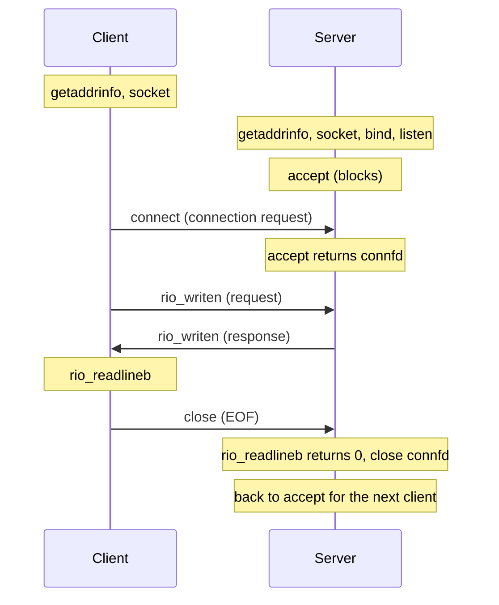
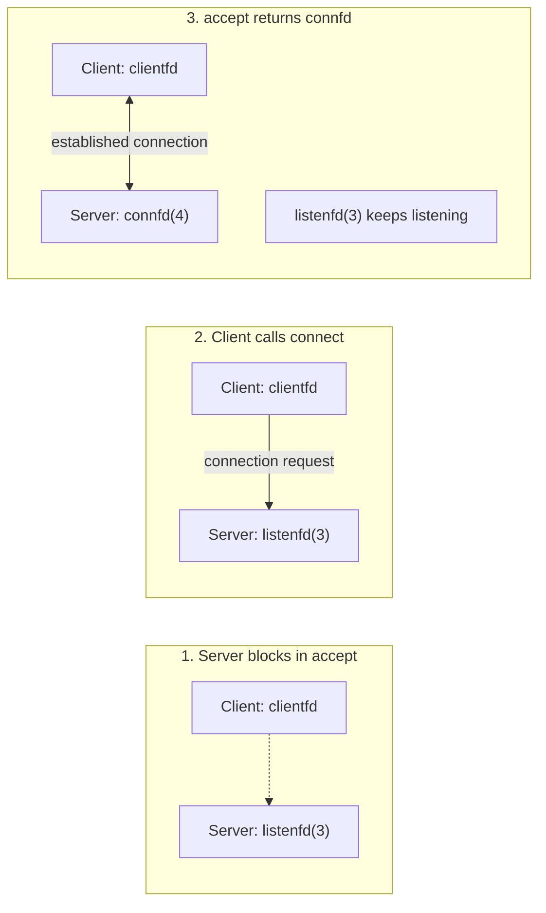
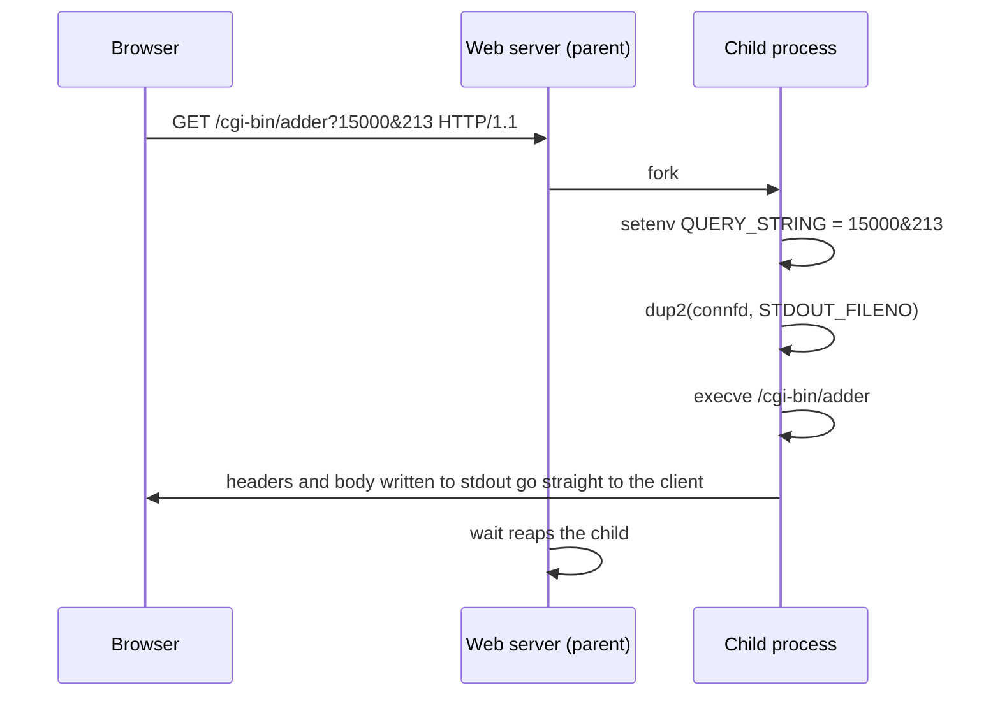

# Sockets, clients, servers and HTTP

The previous lesson described what an Internet connection *is*. This one shows how programs create and use connections: the **sockets interface**, a set of functions used together with the Unix I/O functions to build network applications. We build an echo client and server, then study HTTP, the protocol of the web, and walk through the design of **Tiny**, the book's small but functional web server that serves both static and dynamic content. Along the way you will see nearly every idea from the previous modules at work: file descriptors, `fork`, `execve`, `dup2`, `mmap`, signals and robust I/O.

## 1. The sockets interface

From the perspective of the Linux kernel, a socket is an end point for communication. From the perspective of a Linux program, **a socket is an open file with a corresponding descriptor**. The overall choreography of a typical client-server transaction:



### Socket address structures

Internet socket addresses are stored in 16-byte structures of type `sockaddr_in`:

```c
/* IP socket address structure */
struct sockaddr_in {
    uint16_t        sin_family;    /* protocol family (always AF_INET) */
    uint16_t        sin_port;      /* port number in network byte order */
    struct in_addr  sin_addr;      /* IP address in network byte order */
    unsigned char   sin_zero[8];   /* pad to sizeof(struct sockaddr) */
};

/* Generic socket address structure (for connect, bind, and accept) */
struct sockaddr {
    uint16_t  sa_family;           /* protocol family */
    char      sa_data[14];         /* address data */
};
```

The `connect`, `bind` and `accept` functions require a pointer to a protocol-specific socket address structure. The problem faced by the designers of the sockets interface was how to define these functions to accept *any* kind of socket address structure. Today we would use the generic `void *` pointer, which did not exist in C at that time. Their solution was to define sockets functions to expect a pointer to a generic `sockaddr` structure and then require applications to **cast** any pointers to protocol-specific structures to this generic structure. (The book abbreviates the cast with `typedef struct sockaddr SA;`.)

### The five core functions

```c
int socket(int domain, int type, int protocol);                      /* clients and servers */
int connect(int clientfd, const struct sockaddr *addr, socklen_t addrlen);   /* clients */
int bind(int sockfd, const struct sockaddr *addr, socklen_t addrlen);        /* servers */
int listen(int sockfd, int backlog);                                         /* servers */
int accept(int listenfd, struct sockaddr *addr, int *addrlen);               /* servers */
```

- **`socket`** creates a **socket descriptor**. `clientfd = Socket(AF_INET, SOCK_STREAM, 0);` makes the socket an end point for a connection (`AF_INET` = 32-bit IP addresses, `SOCK_STREAM` = connection). The descriptor returned is only **partially opened** and cannot yet be used for reading and writing.
- **`connect`** (client) attempts to establish an Internet connection with the server at socket address `addr`. It **blocks** until either the connection is successfully established or an error occurs. If successful, the `clientfd` descriptor is ready for reading and writing, and the resulting connection is characterized by the socket pair `(x:y, addr.sin_addr:addr.sin_port)`, where `x` is the client's IP address and `y` is the ephemeral port that uniquely identifies the client process on the client host.
- **`bind`** (server) asks the kernel to associate the server's socket address in `addr` with the socket descriptor `sockfd`.
- **`listen`** (server). Clients are **active** entities that initiate connection requests; servers are **passive** entities that wait for them. By default, the kernel assumes that a descriptor created by `socket` corresponds to an **active socket** that will live on the client end of a connection. A server calls `listen` to tell the kernel that the descriptor will be used by a server instead: it converts `sockfd` from an active socket to a **listening socket** that can accept connection requests from clients. The `backlog` argument is a hint about the number of outstanding connection requests that the kernel should queue up before it starts to refuse requests (typically set to a large value such as 1,024).
- **`accept`** (server) waits for a connection request from a client to arrive on the listening descriptor `listenfd`, then fills in the client's socket address in `addr`, and returns a **connected descriptor** that can be used to communicate with the client using Unix I/O functions.

### Listening vs. connected descriptors

The distinction confuses many students:

- The **listening descriptor** serves as an end point for client **connection requests**. It is typically **created once** and exists for the **lifetime of the server**.
- The **connected descriptor** is the end point of the **connection that is established** between the client and the server. It is created **each time the server accepts a connection request** and exists only as long as it takes the server to service a client.

Why the distinction? It turns out to be quite useful, because it allows us to build **concurrent servers** that can process many client connections simultaneously. For example, each time a connection request arrives on the listening descriptor, we might fork a new process that communicates with the client over its connected descriptor (Module 12).



### Host and service conversion: getaddrinfo and getnameinfo

Linux provides two powerful functions for converting back and forth between binary socket address structures and the string representations of hostnames, host addresses, service names and port numbers. When used in conjunction with the sockets interface, they allow us to write network programs that are **independent of any particular version of the IP protocol**.

```c
int getaddrinfo(const char *host, const char *service,
                const struct addrinfo *hints, struct addrinfo **result);
void freeaddrinfo(struct addrinfo *result);
const char *gai_strerror(int errcode);

int getnameinfo(const struct sockaddr *sa, socklen_t salen,
                char *host, size_t hostlen, char *service, size_t servlen, int flags);
```

`getaddrinfo` converts string representations of hostnames, host addresses, service names and port numbers into socket address structures. It is the modern replacement for the obsolete `gethostbyname` and `getservbyname` functions, and unlike them it is **reentrant** and works with any protocol. Given `host` (a domain name or a numeric address) and `service` (a service name like `http` or a decimal port number), it returns a `result` that points to a **linked list of `addrinfo` structures**, each of which points to a socket address structure that corresponds to `host` and `service`.

A client walks this list, trying each socket address in turn until the calls to `socket` and `connect` succeed. A server walks the list until `socket` and `bind` succeed. To avoid memory leaks, the application must eventually call `freeaddrinfo`.

The optional `hints` argument provides finer control over the list: `ai_family` (`AF_INET` restricts to IPv4, `AF_INET6` to IPv6), `ai_socktype` (`SOCK_STREAM` restricts the list to at most one `addrinfo` per unique address, usable as the end point of a connection), and `ai_flags`, a bit mask including:

- `AI_ADDRCONFIG`: return IPv4 addresses only if the local host is configured for IPv4 (similarly for IPv6); recommended when using connections.
- `AI_CANONNAME`: point the first `addrinfo`'s `ai_canonname` field at the canonical (official) name of host.
- `AI_NUMERICSERV`: force the `service` argument to be a port number.
- `AI_PASSIVE`: return socket addresses that can be used by **servers as listening sockets**; `host` should then be NULL, and the address field is the **wildcard address** (`INADDR_ANY`), which tells the kernel that this server will accept requests to any of the IP addresses for this host.

One of the elegant aspects of `getaddrinfo` is that the fields in an `addrinfo` structure are opaque in the sense that they can be passed directly to the sockets functions without any further manipulation by the application code: `ai_family`, `ai_socktype` and `ai_protocol` go to `socket`; `ai_addr` and `ai_addrlen` go to `connect` and `bind`.

`getnameinfo` is the inverse: it converts a socket address structure to the corresponding host and service name strings (with `NI_NUMERICHOST`/`NI_NUMERICSERV` flags to get numeric strings instead of names).

### Helper functions: open_clientfd and open_listenfd

The sockets interface is daunting at first, so the book wraps it:

```c
int open_clientfd(char *hostname, char *port);   /* returns a connected descriptor, or -1 */
int open_listenfd(char *port);                   /* returns a listening descriptor, or -1 */
```

`open_clientfd` establishes a connection with a server running on host `hostname` and listening for connection requests on port number `port`. It calls `getaddrinfo` (with `SOCK_STREAM`, `AI_NUMERICSERV`, `AI_ADDRCONFIG`), then walks the list: for each entry, `socket`; if that fails, try the next; then `connect`; on success break, otherwise `close` the descriptor and try the next. Finally it frees the list and returns the descriptor (or −1 if every entry failed).

`open_listenfd` calls `getaddrinfo` with `AI_PASSIVE | AI_ADDRCONFIG | AI_NUMERICSERV` and a NULL host, walks the list calling `socket` and `bind` until one succeeds, and then calls `listen`. One detail: it uses **`setsockopt(listenfd, SOL_SOCKET, SO_REUSEADDR, ...)`** to configure the server so that it can be terminated, be restarted, and begin accepting connection requests immediately. By default, a restarted server will deny connection requests from clients for approximately 30 seconds, which seriously hinders debugging.

## 2. Example: echo client and server

The best way to learn the sockets interface is to study example code. The **echo client**, after establishing a connection with the server, enters a loop that repeatedly reads a text line from standard input, sends the text line to the server, reads the echo line from the server, and prints the result to standard output. The loop terminates when `fgets` encounters EOF on standard input (the user types Ctrl+D or the redirected input file is exhausted). The client then closes the descriptor, which results in an **EOF notification being sent to the server**, detected when the server receives a return code of zero from its `rio_readlineb` function.

The **echo server** opens a listening descriptor and enters an infinite loop: each iteration waits for a connection request from a client, prints the domain name and port of the connected client, and then calls the `echo` function that services the client. After the `echo` routine returns, the main routine closes the connected descriptor. The `echo` routine repeatedly reads and writes lines of text until `rio_readlineb` encounters EOF.

```c
void echo(int connfd) {
    rio_t rio;
    char line[MAXLINE];
    size_t n;

    Rio_readinitb(&rio, connfd);                              /* attach a read buffer to the socket */
    while ((n = Rio_readlineb(&rio, line, MAXLINE)) != 0)     /* 0 means the client closed: EOF */
        Rio_writen(connfd, line, n);                          /* send the same bytes back */
}
```

Note the `clientaddr` variable in the server is declared as `struct sockaddr_storage`: large enough to hold any type of socket address, which keeps the code protocol independent.

This simple echo server can handle only **one client at a time**. A server of this type that iterates through clients, one at a time, is called an **iterative server**. Module 12 shows how to build **concurrent servers** that handle multiple clients simultaneously.

> [!NOTE]
> **What does EOF on a connection mean?** There is no such thing as an EOF character. EOF is a *condition* detected by the kernel. An application finds out about it when it receives a zero return code from the `read` function. For disk files, EOF occurs when the current file position exceeds the file length. For Internet connections, EOF occurs when a process **closes its end** of the connection; the process at the other end detects EOF when it attempts to read past the last byte in the stream.

Here is the same structure in Python, with the server and client in one process using threads so you can run it:

```python-run
import socket, threading
try:
    listenfd = socket.socket(socket.AF_INET, socket.SOCK_STREAM)          # socket
    listenfd.setsockopt(socket.SOL_SOCKET, socket.SO_REUSEADDR, 1)
    listenfd.bind(("127.0.0.1", 0))                                       # bind (port 0: kernel picks one)
    listenfd.listen(1024)                                                 # listen
    port = listenfd.getsockname()[1]

    def serve_one():
        connfd, addr = listenfd.accept()                                  # accept -> connected descriptor
        with connfd, connfd.makefile("rb") as rio:
            for line in rio:                                              # until EOF (client closed)
                connfd.sendall(line.upper())
        print("server: client", addr, "closed the connection (EOF)")

    t = threading.Thread(target=serve_one); t.start()
    clientfd = socket.create_connection(("127.0.0.1", port))             # getaddrinfo + socket + connect
    print("socket pair:", clientfd.getsockname(), "<->", clientfd.getpeername())
    with clientfd, clientfd.makefile("rb") as rio:
        for msg in (b"hello\n", b"echo me\n"):
            clientfd.sendall(msg)
            print("client got:", rio.readline())
    t.join(); listenfd.close()
except Exception as e:
    print("sockets are not available in this sandbox:", e)
```

## 3. Web servers

### Web basics

Web clients and servers interact using a text-based application-level protocol known as **HTTP (Hypertext Transfer Protocol)**. HTTP is a simple protocol. A web client (a **browser**) opens an Internet connection to a server and requests some **content**. The server responds with the requested content and then closes the connection. The browser reads the content and displays it on the screen.

What distinguishes web services from conventional file retrieval services such as FTP? The main difference is that web content can be written in **HTML (Hypertext Markup Language)**. An HTML page contains instructions (tags) that tell the browser how to display various text and graphical objects, and, the real power of HTML, pages can contain **pointers (hyperlinks)** to content stored on any Internet host.

### Web content

To web clients and servers, **content** is a sequence of bytes with an associated **MIME (Multipurpose Internet Mail Extensions) type**:

| MIME type | Description |
|---|---|
| `text/html` | HTML page |
| `text/plain` | Unformatted text |
| `application/postscript` | PostScript document |
| `image/gif` | Binary image encoded in GIF format |
| `image/png` | Binary image encoded in PNG format |
| `image/jpeg` | Binary image encoded in JPEG format |

Web servers provide content to clients in two different ways:

- Fetch a disk file and return its contents to the client. The disk file is known as **static content** and the process of returning the file to the client is known as *serving static content*.
- Run an executable file and return its output to the client. The output produced by the executable at run time is known as **dynamic content**, and the process of running the program and returning its output to the client is known as *serving dynamic content*.

Every piece of content returned by a web server is associated with some file that it manages. Each of these files has a unique name known as a **URL (universal resource locator)**. For example, `http://www.google.com:80/index.html` identifies an HTML file called `/index.html` on Internet host `www.google.com` that is managed by a web server listening on port 80. The port number is optional and defaults to the well-known HTTP port 80.

URLs for executable files can include program arguments after the filename. A **`?`** character separates the filename from the arguments, and each argument is separated by an **`&`** character: `http://bluefish.ics.cs.cmu.edu:8000/cgi-bin/adder?15000&213` identifies an executable called `/cgi-bin/adder` that will be called with two argument strings, `15000` and `213`.

Clients and servers use different parts of the URL during a transaction. A client uses the prefix `http://www.google.com:80` to determine what kind of server to contact, where the server is, and what port it is listening on. The server uses the suffix `/index.html` to find the file on its filesystem and to determine whether the request is for static or dynamic content. Points to understand about how servers interpret the suffix:

- There are no standard rules for determining whether a URL refers to static or dynamic content. Each server has its own rules for the files it manages. A classic (old-fashioned) approach is to identify a set of directories, such as `cgi-bin`, where all executables must reside.
- The initial `/` in the suffix does **not** denote the Linux root directory. Rather, it denotes the home directory for whatever kind of content is being requested.
- The minimal URL suffix is the `/` character, which all servers expand to some default home page such as `/index.html`. This explains why it is possible to fetch the home page of a site by simply typing a domain name into the browser: the browser appends the missing `/` to the URL and passes it to the server, which expands the `/` to some default filename.

### HTTP transactions

Since HTTP is based on text lines transmitted over Internet connections, we can use the Linux `telnet` program to conduct transactions with any web server on the Internet.

```
linux> telnet www.example.net 80           # client: open a connection to the server
Connected to www.example.net.
GET / HTTP/1.1                             # client: request line
Host: www.example.net                      # client: required HTTP/1.1 header
                                           # client: an empty line ends the headers
HTTP/1.1 200 OK                            # server: response line
Date: Tue, 03 Mar 2020 10:15:00 GMT        # server: response headers
Server: ExampleServer/1.0
Content-Type: text/html                    #   the body is HTML
Content-Length: 1256                       #   and is 1,256 bytes long
                                           # server: an empty line ends the headers
<html>                                     # server: response body starts
...
</html>
Connection closed by foreign host.         # server closed the connection
```

(The host name and header values here are illustrative; try it against any plain-HTTP server.)

**HTTP requests.** An HTTP request consists of a **request line**, followed by zero or more **request headers**, followed by an **empty text line** that terminates the list of headers. A request line has the form

```
method URI version
```

HTTP supports a number of different methods, including `GET`, `POST`, `OPTIONS`, `HEAD`, `PUT`, `DELETE` and `TRACE`. The workhorse **`GET`** method accounts for a majority of HTTP requests. It instructs the server to generate and return the content identified by the **URI (uniform resource identifier)**: the suffix of the corresponding URL that includes the filename and optional arguments. The `version` field indicates the HTTP version to which the request conforms (`HTTP/1.0` or `HTTP/1.1`; HTTP/1.1 defines additional headers supporting caching and security, and persistent connections that allow a client and server to perform multiple transactions over the same connection).

Request headers have the form `header-name: header-data`. The **`Host`** header is required in HTTP/1.1 requests but not in HTTP/1.0 requests. It is used by **proxy caches**, which sometimes serve as intermediaries between a browser and the origin server that manages the requested file; the data in the Host header, which identifies the domain name of the origin server, allows a proxy in the middle of a proxy chain to determine if it might have a locally cached copy of the requested content.

**HTTP responses.** A response consists of a **response line**, followed by zero or more **response headers**, followed by an empty line that terminates the headers, followed by the **response body**. A response line has the form

```
version status-code status-message
```

| Status code | Status message | Description |
|---|---|---|
| 200 | OK | Request was handled without error |
| 301 | Moved permanently | Content has moved to the hostname in the Location header |
| 400 | Bad request | Request could not be understood by the server |
| 403 | Forbidden | Server lacks permission to access the requested file |
| 404 | Not found | Server could not find the requested file |
| 501 | Not implemented | Server does not support the request method |
| 505 | HTTP version not supported | Server does not support the version in the request |

The two most important response headers are **`Content-Type`**, which tells the client the MIME type of the content in the response body, and **`Content-Length`**, which indicates its size in bytes. The empty text line that terminates the response headers is followed by the response body, which contains the requested content.

```python-run
def parse_request(raw: bytes):
    head, _, body = raw.partition(b"\r\n\r\n")
    lines = head.decode().split("\r\n")
    method, uri, version = lines[0].split()
    headers = dict(line.split(": ", 1) for line in lines[1:])
    path, _, query = uri.partition("?")
    return method, path, query.split("&") if query else [], version, headers

req = b"GET /cgi-bin/adder?15000&213 HTTP/1.1\r\nHost: bluefish.ics.cs.cmu.edu:8000\r\nUser-Agent: demo\r\n\r\n"
method, path, args, version, headers = parse_request(req)
print(method, path, args, version, headers["Host"])
is_dynamic = "cgi-bin" in path
body = (f"The answer is: {args[0]} + {args[1]} = {int(args[0]) + int(args[1])}\r\n" if is_dynamic else "<html>static</html>").encode()
response = (f"HTTP/1.0 200 OK\r\nServer: Tiny Web Server\r\nContent-length: {len(body)}\r\nContent-type: text/html\r\n\r\n").encode() + body
print(response.decode())
```

### Serving dynamic content: CGI

If we stop to think for a moment how a server might provide dynamic content to a client, certain questions arise. How does the client pass any program arguments to the server? How does the server pass these arguments to the child process that it creates? How does the server pass other information to the child that it might need to generate the content? Where does the child send its output? These questions are addressed by a de facto standard called **CGI (Common Gateway Interface)**.

- **How does the client pass program arguments to the server?** Arguments for `GET` requests are passed in the URI: a `?` separates the filename from the arguments, and each argument is separated by an `&`. Spaces are not allowed in arguments and must be represented with the `%20` string; similar encodings exist for other special characters. (Arguments for `POST` requests are passed in the request body rather than in the URI.)
- **How does the server pass arguments to the child?** After a server receives a request such as `GET /cgi-bin/adder?15000&213 HTTP/1.1`, it calls **`fork`** to create a child process and calls **`execve`** to run the `/cgi-bin/adder` program in the context of the child. Programs like `adder` are often referred to as **CGI programs** because they obey the rules of the CGI standard. Before the call to `execve`, the child process sets the CGI **environment variable `QUERY_STRING`** to `15000&213`, which the `adder` program can reference at run time using `getenv`.
- **How does the server pass other information to the child?** CGI defines a number of other environment variables that a CGI program can expect to be set when it runs: `SERVER_PORT` (port that the parent is listening on), `REQUEST_METHOD` (`GET` or `POST`), `REMOTE_HOST` and `REMOTE_ADDR` (domain name and dotted-decimal IP address of the client), `CONTENT_TYPE` and `CONTENT_LENGTH` (for `POST` requests: the MIME type and size in bytes of the request body).
- **Where does the child send its output?** A CGI program sends its dynamic content to the **standard output**. Before the child process loads and runs the CGI program, it uses the Linux **`dup2`** function to redirect standard output to the connected descriptor that is associated with the client. Thus, anything that the CGI program writes to standard output goes directly to the client. Since the parent does not know the type or size of the content that the child generates, the child is responsible for generating the `Content-type` and `Content-length` response headers, as well as the empty line that terminates the headers.



## 4. Putting it together: the Tiny web server

The book develops a small but functioning web server called **Tiny**. It combines many of the ideas we have learned, such as process control, Unix I/O, the sockets interface and HTTP, in only about 250 lines of code. While it lacks the functionality, robustness and security of a real server, it is powerful enough to serve both static and dynamic content to real web browsers.

- **`main`**: Tiny is an iterative server that listens for connection requests on the port passed in the command line. After opening a listening socket with `open_listenfd`, it executes the typical infinite server loop, repeatedly accepting a connection request, performing a transaction (`doit`), and closing its end of the connection.
- **`doit`** handles one HTTP transaction. It reads and parses the request line. Tiny supports only the `GET` method; if the client requests another method (such as `POST`), it sends an error message (501) and returns to the main routine. Then it reads and ignores any request headers (`read_requesthdrs`), and parses the URI into a filename and a possibly empty CGI argument string, setting a flag that indicates whether the request is for static or dynamic content (`parse_uri`). If the file does not exist on disk, it immediately sends a 404. If the request is for static content, it verifies that the file is a regular file and that it has read permission (else 403) and serves it; if dynamic, it verifies that the file is executable and then serves the dynamic content.
- **`clienterror`** sends an HTTP response to the client with the appropriate status code and status message in the response line, along with an HTML file in the response body that explains the error to the browser's user.
- **`parse_uri`** assumes that the home directory for static content is its current directory and that the home directory for executables is `./cgi-bin`. Any URI that contains the string `cgi-bin` is assumed to denote a request for dynamic content. The default filename is `./home.html`.
- **`serve_static`** sends an HTTP response whose body contains the contents of a local file. It determines the file type by inspecting the suffix in the filename (`get_filetype`: HTML, plain text, GIF, PNG, JPEG), sends the response line and response headers, and then sends the response body by **mapping the requested file into virtual memory with `mmap`** and copying it to the connected descriptor with `rio_writen`, then `munmap`s it (and closes the file descriptor as soon as the mapping exists, to avoid a potentially fatal leak).
- **`serve_dynamic`** sends a response line indicating success, then **forks** a child. The child initializes the `QUERY_STRING` environment variable with the CGI arguments from the request URI, redirects standard output to the connected file descriptor with `dup2`, and loads and runs the CGI program with `execve`. Since the CGI program runs in the context of the child, it has access to the same open files and environment variables that existed before the call to `execve`; everything it writes to standard output goes directly to the client process, without any intervention from the parent. Meanwhile the parent blocks in a call to `wait`, waiting to reap the child when it terminates.

> [!WARNING]
> **Dealing with prematurely closed connections.** A robust web server must be prepared for connections that are closed by the client before the server has finished. If a server writes to a connection that has already been closed by the client (say, because you clicked the "Stop" button on your browser), then the first such write returns normally, but the second write causes the delivery of a **`SIGPIPE`** signal whose default behavior is to terminate the process. If the `SIGPIPE` signal is caught or ignored, then the second write operation returns −1 with `errno` set to **`EPIPE`**. A robust server ignores or catches `SIGPIPE` and checks the return codes of its writes.

> [!INTERVIEW]
> **"What is the difference between a listening socket and a connected socket?"** The listening socket (from `socket` + `bind` + `listen`) only receives connection requests and lives for the server's lifetime. Each `accept` returns a *new* connected socket for one client; all of them share the server's port, and are distinguished by the 4-tuple (client IP, client port, server IP, server port). This split is what lets a server hand each connection to a separate process, thread or event handler.

> [!INTERVIEW]
> **"Describe the structure of an HTTP request and response."** Request: `METHOD URI VERSION`, headers (`Host` mandatory in 1.1), blank line, optional body. Response: `VERSION STATUS MESSAGE`, headers (`Content-Type`, `Content-Length`), blank line, body. Know the status classes: 2xx success, 3xx redirection, 4xx client error (400, 403, 404), 5xx server error (500, 501, 503). HTTP is stateless; state is layered on with cookies or tokens. HTTP/1.1 added persistent connections; HTTP/2 multiplexes streams over one connection; HTTP/3 runs over QUIC/UDP.

> [!INTERVIEW]
> **"Why set SO_REUSEADDR on a server socket?"** After a server exits, its address stays in a TCP TIME_WAIT state for a while; without the option, `bind` on restart fails with "Address already in use".

## 5. Summary

- A socket is a descriptor. Client: `getaddrinfo` → `socket` → `connect`. Server: `getaddrinfo` → `socket` → `bind` → `listen` → loop of `accept`.
- **Listening** descriptor: created once, receives connection requests. **Connected** descriptor: one per accepted client.
- `getaddrinfo`/`getnameinfo` make code protocol independent; `open_clientfd` and `open_listenfd` package the boilerplate.
- EOF on a connection is a condition: `read` returns 0 after the peer closes.
- HTTP: text request line + headers + blank line; response line with status code, headers (`Content-Type`, `Content-Length`), blank line, body.
- Static content = file bytes; dynamic content = output of a program. CGI: arguments after `?` separated by `&`, passed in `QUERY_STRING`; the child `dup2`s the connected descriptor onto stdout and `execve`s the program.
- Tiny combines all of it in ~250 lines; real servers must also handle `SIGPIPE`/`EPIPE`, concurrency and security.

## Check yourself

```quiz
[
  {"q": "Which sequence of calls does a server make before it can accept connections?", "options": ["socket, connect, listen", "socket, bind, listen", "bind, socket, accept", "listen, bind, socket"], "answer": 1,
   "explain": "Create the socket, bind it to the server's address/port, then mark it as a listening socket."},
  {"q": "What does accept return?", "options": ["The listening descriptor", "A new connected descriptor for communicating with one client", "The client's port number", "0 on success"], "answer": 1,
   "explain": "Each accepted connection gets its own connected descriptor; the listening descriptor stays open for further requests."},
  {"q": "How does a server detect that the client has closed its end of the connection?", "options": ["It receives an EOF character", "read (or rio_readlineb) returns 0", "accept fails", "It receives SIGCHLD"], "answer": 1,
   "explain": "EOF is a condition signalled by a zero return from read."},
  {"q": "In the URL http://host:8000/cgi-bin/adder?15000&213, what does the '?' separate?", "options": ["Host from port", "The filename from the program arguments", "Two arguments", "Headers from body"], "answer": 1,
   "explain": "'?' separates the file from its arguments; '&' separates arguments from each other."},
  {"q": "How does a CGI program receive the arguments of a GET request?", "options": ["On its command line", "In the QUERY_STRING environment variable", "On standard input", "In a temporary file"], "answer": 1,
   "explain": "The server sets QUERY_STRING before execve; POST bodies arrive on standard input."},
  {"q": "How does a CGI program's output reach the client?", "options": ["The parent server copies it", "The child redirects stdout to the connected descriptor with dup2 before execve", "Through a temporary file", "Via a signal"], "answer": 1,
   "explain": "After dup2(connfd, 1), anything written to standard output goes directly to the client."},
  {"q": "Which header is required in an HTTP/1.1 request?", "options": ["Content-Length", "Host", "User-Agent", "Accept"], "answer": 1,
   "explain": "The Host header identifies the origin server and is mandatory in HTTP/1.1."},
  {"q": "A server writes twice to a connection the client has already closed. What happens on the second write by default?", "options": ["It returns 0", "The kernel sends SIGPIPE, terminating the process unless the signal is handled or ignored", "It blocks forever", "Nothing"], "answer": 1,
   "explain": "The second write triggers SIGPIPE; if ignored, write returns -1 with errno EPIPE."}
]
```

> **Source:** CS:APP 3e, §11.4–11.6 (The sockets interface; Web servers: web basics, web content, HTTP transactions, serving dynamic content; Putting it together: the Tiny web server).
