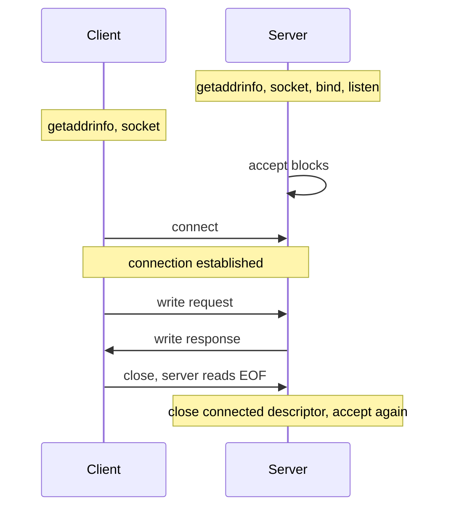
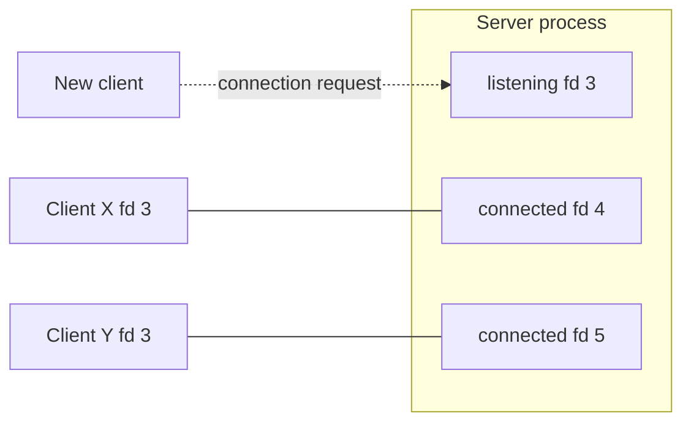
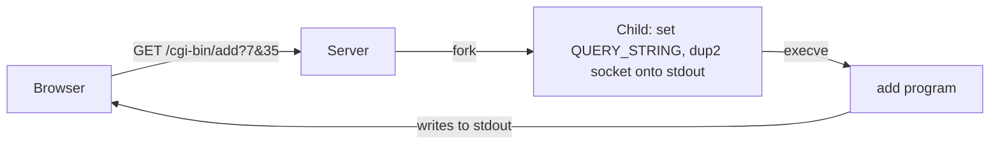

# Sockets, clients, servers and HTTP

> **Before this lesson:** You need IP addresses, ports, connections and byte order from [Networks, IP addresses and DNS](#/lesson/csapp/networks-ip), and robust reading with short counts from [Unix I/O and robust reading](#/lesson/csapp/unix-io). Redirection with `dup2` from [File sharing, redirection and standard I/O](#/lesson/csapp/file-sharing) is used once.

## In plain words

A **socket** is a program's end of a network connection. Once two programs are connected, each reads and writes through its socket much as it would with a file. Setting up the connection resembles a telephone call. A **server** is a program that waits for requests: it gets a phone line, publishes its number, and waits for the phone to ring. A **client** is a program that makes requests: it dials the number. When the server picks up, the two can talk in both directions. **HTTP**, the Hypertext Transfer Protocol, is the agreed "language" that web browsers and web servers speak over such a connection: the browser sends a few lines of text asking for a page, and the server replies with a few lines of text followed by the page.

Why this matters at work: every web application, programming interface and microservice rests on these calls, whether or not a framework hides them. Understanding them lets you diagnose connection errors, read a raw request when something misbehaves, and reason about server performance. Explaining what happens between typing a web address and seeing a page is a standard interview task.

## Why look closer

The previous lesson described the Internet as hosts with addresses, names, and connections between address:port endpoints. This lesson is about the programming interface that lets a process actually create one of those connections, and about the most widely used protocol spoken over them. By the end you should be able to read the source of a small web server and say what every system call is for, explain the difference between the two kinds of descriptor a server juggles, and write an HTTP request by hand.

## 1. The sockets interface in one picture

The **sockets interface** is a handful of functions that, together with `read`, `write` and `close`, are enough to build any networked program. To the kernel a socket is an endpoint of communication; to your program it is an open file with a descriptor.



The client's side is short: make a socket, connect it. The server's side has more steps because a server must first announce where it can be reached.

## 2. Socket addresses

Every function that names an endpoint takes a **socket address** structure. For IPv4 it looks like this:

```c
struct sockaddr_in {
    uint16_t       sin_family;   /* AF_INET */
    uint16_t       sin_port;     /* port, network byte order */
    struct in_addr sin_addr;     /* IPv4 address, network byte order */
    unsigned char  sin_zero[8];  /* padding */
};
struct sockaddr {                /* the generic type the API is declared with */
    uint16_t sa_family;
    char     sa_data[14];
};
```

The sockets API predates `void *` in C, so its designers declared functions to take a pointer to a generic `struct sockaddr` and required callers to cast their protocol-specific structure to it. That is why real code is full of `(struct sockaddr *)&addr` and why many codebases define a short alias for the type. The first field, the family, tells the kernel how to interpret the rest. IPv6 has its own larger `sockaddr_in6`, and `struct sockaddr_storage` is guaranteed big enough to hold any of them.

## 3. The five core calls

```c
int socket(int domain, int type, int protocol);
int connect(int clientfd, const struct sockaddr *addr, socklen_t addrlen);
int bind(int sockfd, const struct sockaddr *addr, socklen_t addrlen);
int listen(int sockfd, int backlog);
int accept(int listenfd, struct sockaddr *addr, socklen_t *addrlen);
```

**`socket`** creates an endpoint and returns a descriptor. With `AF_INET` and `SOCK_STREAM` it is a TCP socket over IPv4. The descriptor is only half open at this point: it cannot be read or written yet.

**`connect`** is the client's call. It blocks until a connection to the given server address is established or fails. On success the descriptor is ready for I/O, and the connection is named by the pair of the client's address and ephemeral port with the server's address and port.

**`bind`** is the first of the server's three calls. It asks the kernel to associate the socket with a particular local address and port, so clients have somewhere to aim.

**`listen`** converts the socket from an *active* one (the default, something a client would connect from) into a **listening** socket that can receive connection requests. The `backlog` argument hints at how many pending connections the kernel should queue before turning new ones away.

**`accept`** blocks until a connection request arrives on the listening descriptor, then returns a brand new **connected descriptor** for talking to that client. It can also fill in the client's address.

### Listening versus connected descriptors

This distinction confuses nearly everyone at first, so it is worth being slow about it.

| | Listening descriptor | Connected descriptor |
|---|---|---|
| Created by | `socket` + `bind` + `listen` | each successful `accept` |
| How many | one per server port | one per client currently being served |
| Lifetime | as long as the server runs | one client conversation |
| Used for | `accept` only | `read` and `write` with that client |

Why two? Because separating "the door" from "a conversation" is what makes concurrent servers possible. The server can hand each connected descriptor to a separate child process or thread while the listening descriptor stays free to accept the next arrival. If there were only one descriptor, a server could not begin a second conversation until the first one ended.



## 4. Finding addresses without hard-coding them

Filling in `sockaddr_in` by hand ties a program to IPv4. The modern, protocol-independent route is `getaddrinfo`, which turns a host name (or numeric address string) and a service name (or port string) into a linked list of ready-to-use socket addresses:

```c
#include <netdb.h>
int  getaddrinfo(const char *host, const char *service,
                 const struct addrinfo *hints, struct addrinfo **result);
void freeaddrinfo(struct addrinfo *result);
const char *gai_strerror(int errcode);

struct addrinfo {
    int              ai_flags;
    int              ai_family;      /* AF_INET, AF_INET6, ... */
    int              ai_socktype;    /* SOCK_STREAM, ... */
    int              ai_protocol;
    socklen_t        ai_addrlen;
    struct sockaddr *ai_addr;        /* pass straight to connect or bind */
    char            *ai_canonname;
    struct addrinfo *ai_next;        /* next candidate */
};
```

Each list node carries exactly the arguments that `socket` and then `connect` or `bind` want, so the caller never looks inside the address. The `hints` argument narrows the answers. The fields people set most often:

- `ai_socktype = SOCK_STREAM` so that each address appears once (for TCP) rather than once per socket type.
- `ai_family` to restrict results to IPv4 or IPv6; leaving it unspecified returns both.
- `AI_PASSIVE` in `ai_flags`, with `host` set to `NULL`, to request a wildcard address suitable for a *server* that should accept connections on any of the machine's interfaces.
- `AI_ADDRCONFIG` to return only address families the local machine is actually configured to use.
- `AI_NUMERICSERV` to insist that the service argument is a port number rather than a name such as `"http"`.

The function is thread-safe and reports failure through its return code, decoded with `gai_strerror`, not through `errno`. Always release the list with `freeaddrinfo`.

Its inverse, `getnameinfo`, converts a socket address back into host and service strings; with the flags `NI_NUMERICHOST` and `NI_NUMERICSERV` it skips DNS and returns the numeric forms, which is what a server usually wants when logging who connected.

### Two reusable helpers

Almost every program wraps these calls in two small functions. Here they are called `dial` and `announce`.

```c
int dial(const char *host, const char *port) {           /* client side */
    struct addrinfo hints = {0}, *list, *p;
    int fd = -1;
    hints.ai_socktype = SOCK_STREAM;
    hints.ai_flags = AI_NUMERICSERV | AI_ADDRCONFIG;
    if (getaddrinfo(host, port, &hints, &list) != 0) return -1;
    for (p = list; p; p = p->ai_next) {                   /* try candidates in turn */
        fd = socket(p->ai_family, p->ai_socktype, p->ai_protocol);
        if (fd < 0) continue;
        if (connect(fd, p->ai_addr, p->ai_addrlen) == 0) break;
        close(fd); fd = -1;                               /* failed: do not leak it */
    }
    freeaddrinfo(list);
    return fd;
}
```

`announce` is the mirror image for servers: call `getaddrinfo` with `AI_PASSIVE`, walk the list trying `socket` then `bind`, and finish with `listen`. One extra line matters in practice. Before `bind`, servers set the `SO_REUSEADDR` socket option with `setsockopt`. Without it, restarting a server shortly after stopping it fails with "address already in use" for up to a minute or so, because the kernel keeps the old port reserved while stray segments from previous connections die out.

Notice the loop in `dial`. A name can resolve to several addresses, and the first may be unreachable. Robust clients try each until one works, closing the failed sockets as they go.

## 5. An echo service end to end

The canonical first program is an echo server: whatever bytes the client sends, the server sends straight back. The server's main loop is `accept`, serve until end-of-file, `close`, repeat. Two facts about it are worth stating precisely.

**How does the server know the client is finished?** When the client closes its end, the server's next `read` on the connected descriptor returns 0. That zero-byte return *is* end-of-file on a connection. There is no special EOF character.

**Reads may come up short.** TCP is a stream of bytes with no record boundaries. If a client writes 2,000 bytes, the server may read 1,460 and then 540, or any other split, depending on packet sizes and timing. Code that assumes one `write` equals one `read` works on localhost and breaks over a real network. The remedy is to loop until you have what you need, or to use a buffered line reader (the earlier lesson on robust I/O covers both).

The following demo runs a tiny echo exchange over a connected socket pair inside one process, including a deliberately fragmented send. It prints a fallback explanation if sockets are unavailable in your sandbox.

```python-run
import socket

def read_exactly(sock, n):
    """Loop until n bytes have arrived or the peer closes."""
    chunks, got, calls = [], 0, 0
    while got < n:
        part = sock.recv(n - got)
        calls += 1
        if not part:                      # zero bytes = peer closed
            break
        chunks.append(part); got += len(part)
    return b"".join(chunks), calls

def demo():
    client, server = socket.socketpair()
    message = b"systems programming is fun\n"
    client.sendall(message[:9])           # the message leaves in two pieces
    first = server.recv(100)
    print("server's first recv saw only:", first)
    client.sendall(message[9:])
    rest, calls = read_exactly(server, len(message) - len(first))
    server.sendall((first + rest).upper())
    print("client got back:", client.recv(100))
    client.close()
    print("after client closes, server recv returns", server.recv(100), "-> that is EOF")
    server.close()

try:
    demo()
except Exception as exc:
    print("sockets unavailable in this sandbox:", type(exc).__name__)
    print("expected: a short first read, the upper-cased echo, then b'' for end-of-file")
```

## 6. The web: HTTP in practice

Web clients and servers are ordinary socket programs that speak a text protocol called **HTTP**. The essentials of a classic exchange:

1. The browser opens a connection to the server.
2. It sends a **request** asking for some **content**.
3. The server sends a **response** containing that content and, in the simplest case, closes the connection.
4. The browser renders what it received.

### Content and MIME types

To HTTP, content is a sequence of bytes labelled with a **MIME type** so the receiver knows how to interpret it:

| MIME type | What it is |
|---|---|
| `text/html` | an HTML page |
| `text/plain` | unformatted text |
| `application/json` | JSON data |
| `image/png`, `image/jpeg` | images |
| `application/octet-stream` | arbitrary bytes |

A server produces content in one of two ways. **Static content** is a file read from disk and sent as is. **Dynamic content** is the output of a program the server runs at request time. Either way, every piece of content is associated with a file the server manages, and that file is named by a **URL**.

### Anatomy of a URL

Take `http://shop.example.net:8080/cgi-bin/search?q=usb+cable&page=2`:

- `http` is the scheme.
- `shop.example.net` is the host; the **client** uses it to decide where to connect.
- `8080` is the port (80 is assumed for `http` if omitted).
- `/cgi-bin/search` is the path; the **server** uses it to locate a file or program.
- Everything after `?` is the query string, with `&` separating arguments. Spaces and other special characters must be encoded, for example as `+` or `%20`.

How a server maps the path to a file is a policy decision. Typical conventions: a designated directory (often `cgi-bin`) contains executables and everything else is static; the bare path `/` is expanded to a default page such as `/index.html`. Note that the leading `/` has nothing to do with the root of the server's filesystem. It is relative to whichever directory the server chose to publish.

```python-run
from urllib.parse import urlsplit, parse_qs
url = "http://shop.example.net:8080/cgi-bin/search?q=usb+cable&page=2"
u = urlsplit(url)
print("client uses -> host:", u.hostname, " port:", u.port)
print("server uses -> path:", u.path, " query:", u.query)
print("decoded arguments:", parse_qs(u.query))

def classify(path, dynamic_prefix="/cgi-bin/"):
    if path.endswith("/"):
        path += "index.html"                  # default page
    kind = "dynamic" if path.startswith(dynamic_prefix) else "static"
    return kind, "." + path                   # resolved under the published directory
for p in ("/", "/img/logo.png", "/cgi-bin/search"):
    print(f"{p:18} ->", classify(p))
```

### Requests

An HTTP request is a **request line**, then zero or more **header lines**, then an empty line that marks the end of the headers. Each line ends with a carriage return and a line feed.

```
GET /docs/intro.html HTTP/1.1
Host: shop.example.net
User-Agent: handwritten/0.1
Connection: close

```

The request line has three parts: the **method**, the target, and the protocol version. `GET` asks for content and accounts for most traffic; `POST` submits data in a body; `HEAD` asks for the headers alone; `PUT` and `DELETE` are used by APIs. In HTTP/1.1 the `Host` header is mandatory. It lets one server at one IP address host many sites, and lets proxies know where to forward the request.

### Responses

A response has the same skeleton: a **status line**, headers, a blank line, then the body.

```
HTTP/1.1 200 OK
Content-Type: text/html
Content-Length: 1532

<html>...
```

The two headers shown tell the client how to interpret the body and how many bytes to expect. The status code is a three-digit summary of what happened:

| Code | Meaning | Typical cause |
|---|---|---|
| 200 | OK | request handled |
| 301 | Moved Permanently | content lives at a new URL given in `Location` |
| 400 | Bad Request | the server could not parse what you sent |
| 403 | Forbidden | the server refuses to serve this file |
| 404 | Not Found | no such file |
| 500 | Internal Server Error | the server or its program failed |
| 501 | Not Implemented | the server does not support that method |

Because the protocol is text, you can speak it by hand with `telnet` or `nc`, which is a superb debugging habit.

```python-run
def parse_request(raw: bytes):
    head, _, body = raw.partition(b"\r\n\r\n")          # blank line ends the headers
    lines = head.decode("ascii").split("\r\n")
    method, target, version = lines[0].split(" ")
    headers = {}
    for line in lines[1:]:
        name, _, value = line.partition(":")
        headers[name.strip().lower()] = value.strip()
    return method, target, version, headers, body

def respond(status, reason, body: bytes, ctype="text/plain"):
    head = f"HTTP/1.1 {status} {reason}\r\nContent-Type: {ctype}\r\nContent-Length: {len(body)}\r\n\r\n"
    return head.encode() + body

pages = {"/hello.txt": b"hi there\n"}
raw = b"GET /hello.txt HTTP/1.1\r\nHost: localhost\r\nConnection: close\r\n\r\n"
method, target, version, headers, _ = parse_request(raw)
print(method, target, version, headers)
if method != "GET":
    reply = respond(501, "Not Implemented", b"unsupported method\n")
elif target not in pages:
    reply = respond(404, "Not Found", b"no such file\n")
else:
    reply = respond(200, "OK", pages[target])
print(reply.decode())
```

## 7. Dynamic content and CGI

When the URL names a program, the server has to answer three questions: how do the client's arguments reach the program, how does the program learn anything else about the request, and where does the program's output go? An old and very simple convention called **CGI** (Common Gateway Interface) answers all three with ordinary Unix process machinery.

1. The server `fork`s a child.
2. The child sets **environment variables** describing the request. For a `GET`, the text after the `?` goes into `QUERY_STRING`; others include `REQUEST_METHOD`, `CONTENT_LENGTH` and `REMOTE_ADDR`.
3. The child uses `dup2` to make its standard output refer to the connected socket.
4. The child calls `execve` to run the program.
5. The program reads its arguments from the environment, writes headers such as `Content-Type`, a blank line, and the body to standard output, which is now the socket. It has no idea a network is involved.
6. The parent waits for the child and closes its copy of the connected descriptor.

For a `POST`, the request body is likewise attached to the child's standard input.



CGI spawns a process per request, which is slow, so busy sites replaced it with persistent application servers long ago. It remains the clearest illustration of how environment variables, `fork`, `exec` and descriptor redirection compose.

> [!WARNING]
> Anything derived from a request (path, query string, headers) is untrusted input. A server must never let a path containing `..` climb out of its published directory, must never paste query text into a shell command, and must bound every buffer it reads into. These are the classic ways small servers get compromised.

## 8. What a minimal web server has to get right

A teaching-sized web server fits in a few hundred lines: `announce` on a port, loop on `accept`, read the request line and headers, decide between static and dynamic, send a response, close. The details that separate a toy from something that survives real clients:

- **Ignore `SIGPIPE`, check `write` results.** If the browser closes the connection early, the kernel sends `SIGPIPE` on the next write, and the default action kills the server. Ignore the signal and handle the `EPIPE` error instead.
- **Tolerate short reads and partial lines.** Never assume the whole request arrives at once.
- **Serve files efficiently.** Mapping the file with `mmap` or using `sendfile` avoids copying the content through a user buffer.
- **Send `Content-Length`,** or the client cannot tell where the body ends unless you close the connection.
- **Reap CGI children,** or they pile up as zombies.
- **Handle more than one client at a time.** An iterative server stalls behind one slow connection. The next lesson fixes this three different ways.

> [!INTERVIEW]
> **"Walk me through what happens when you type a URL and press Enter."** A strong answer follows the layers: parse the URL; resolve the host with DNS; create a socket and `connect` (TCP handshake, plus TLS for https); send a `GET` request with a `Host` header; the server's `accept` returns a connected descriptor; the server parses the request, maps the path to a file or program, and writes status line, headers, blank line, body; the client reads until `Content-Length` bytes have arrived, then renders and fetches sub-resources. Mention the listening/connected descriptor split and you will stand out.

> [!INTERVIEW]
> **"Why does `accept` return a new descriptor instead of reusing the listening one?"** So that the listening socket can keep accepting while existing conversations continue, each on its own descriptor that can be handed to a worker and closed independently. The connected descriptors all share the server's port; the kernel distinguishes them by the client half of the socket pair.

## 9. Pitfalls

- **Forgetting `listen`,** or calling `accept` on a socket that was never bound.
- **Closing the listening descriptor instead of the connected one** at the end of a conversation.
- **Leaking descriptors** on error paths in the address-list loop.
- **Skipping `SO_REUSEADDR`** and then wondering why the server will not restart.
- **Using `\n` instead of `\r\n`** in HTTP lines, or omitting the blank line after the headers so the peer waits forever.
- **Checking `errno` after `getaddrinfo`.** It has its own error codes.
- **Trusting the path.** Normalise it and confine it to the document root.

## Summary

- A client calls `socket` then `connect`. A server calls `socket`, `bind`, `listen`, then loops on `accept`.
- The listening descriptor exists for the life of the server; each `accept` yields a separate connected descriptor for one client.
- `getaddrinfo` and `getnameinfo` convert between names and socket addresses without tying code to IPv4 or IPv6; iterate over all returned candidates.
- A TCP connection is a byte stream: reads may be short, and a read of zero bytes means the peer closed.
- HTTP is text: request line, headers, blank line, optional body; responses carry a status code, `Content-Type` and `Content-Length`.
- Static content is a file; dynamic content is program output. CGI passes arguments through environment variables and redirects the program's standard output to the socket.

## Glossary

- **Socket**: one endpoint of a network connection, used by a program like an open file.
- **Socket address**: the structure holding an IP address and port that names an endpoint.
- **`connect`**: the client's call to establish a connection to a server.
- **`bind`**: the server's call to attach a socket to a particular address and port.
- **`listen`**: the server's call marking a socket as ready to receive connection requests.
- **`accept`**: the server's call that waits for a client and returns a new descriptor for talking to it.
- **Listening descriptor**: the server's long-lived descriptor on which connection requests arrive.
- **Connected descriptor**: the descriptor for one particular client's conversation.
- **`getaddrinfo`**: the function that converts a host name and service into ready-to-use socket addresses.
- **HTTP**: the text protocol used between web browsers and web servers.
- **URL**: a web address, made up of a scheme, host, optional port, path and optional query.
- **MIME type**: a label such as `text/html` that says what kind of content a response carries.
- **Status code**: the three-digit number in an HTTP response reporting the outcome, such as 200 or 404.
- **Static / dynamic content**: a file sent as it is / output produced by running a program for the request.
- **CGI (Common Gateway Interface)**: an early convention for a web server to run a program and return its output.

```quiz
[
  {"q": "Which sequence of calls does a TCP server make before it can receive its first client?",
   "options": ["socket, connect, accept", "socket, bind, listen, accept", "socket, listen, bind, connect", "bind, socket, accept, listen"],
   "answer": 1, "explain": "The server creates the socket, binds it to a local address and port, marks it as listening, and then blocks in accept."},
  {"q": "A server is currently talking to three clients on port 8080. How many descriptors related to that port does it hold?",
   "options": ["One", "Three", "Four: one listening and three connected", "Six"],
   "answer": 2, "explain": "There is one long-lived listening descriptor plus one connected descriptor returned by accept for each active client."},
  {"q": "A server's read on a connected descriptor returns 0. What does that mean?",
   "options": ["No data yet; try again", "The client has closed its end of the connection", "The read was interrupted by a signal", "The buffer was too small"],
   "answer": 1, "explain": "On a connection, a zero-byte read is end-of-file: the peer has closed. A blocking read with no data waits instead of returning 0."},
  {"q": "Why should a client loop over the list returned by getaddrinfo?",
   "options": ["The list is sorted by port number", "A name may resolve to several addresses and the first may not be reachable", "Only the last entry is valid", "To convert each entry to network byte order"],
   "answer": 1, "explain": "Each node is a candidate address. Robust clients try socket and connect on each until one succeeds, closing failed sockets."},
  {"q": "In the URL http://h.example:8000/cgi-bin/sum?12&30, which part is passed to a CGI program in QUERY_STRING?",
   "options": ["h.example:8000", "/cgi-bin/sum", "12&30", "sum?12&30"],
   "answer": 2, "explain": "The text following the question mark is the query string; the server places it in the QUERY_STRING environment variable for GET requests."},
  {"q": "How does a CGI program's output reach the browser?",
   "options": ["The server reads a temporary file the program writes", "The child redirects standard output to the connected socket with dup2 before exec", "The program opens its own connection to the browser", "Through a shared memory segment"],
   "answer": 1, "explain": "After fork, the child duplicates the connected descriptor onto descriptor 1, so the program's ordinary writes to standard output go straight to the client."},
  {"q": "What marks the end of the header section in an HTTP request?",
   "options": ["The Content-Length header", "An empty line (CRLF by itself)", "The closing of the connection", "A line containing END"],
   "answer": 1, "explain": "Headers are terminated by a blank line. A GET request typically ends right there with no body."},
  {"q": "Why do servers set SO_REUSEADDR before bind?",
   "options": ["To allow two servers to share all traffic on a port", "To be able to restart immediately instead of failing with address already in use", "To enable IPv6", "To make accept non-blocking"],
   "answer": 1, "explain": "After a server stops, the kernel keeps its port in a waiting state briefly. The option lets a new server bind to it right away."}
]
```

> **Source:** CS:APP 3e, §11.4–11.6
