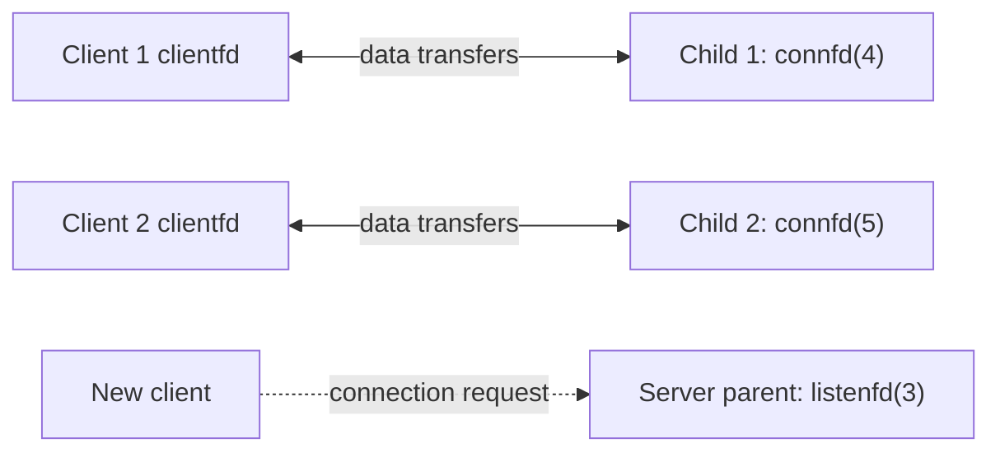
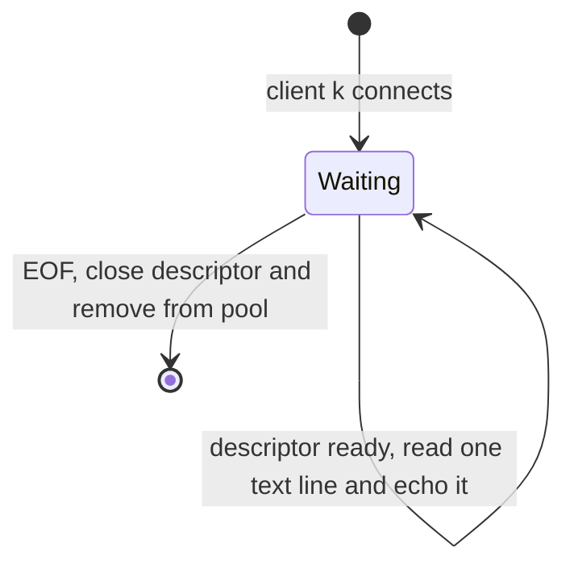

# Three ways to build concurrent servers

Logical control flows are **concurrent** if they overlap in time. This general phenomenon, concurrency, shows up at many levels of a computer system: hardware exception handlers, processes and Linux signal handlers are all familiar examples. So far we have treated concurrency mainly as a mechanism the operating system kernel uses to run multiple application programs. But concurrency is not limited to the kernel: it plays an important role in **application programs** too. Application-level concurrency is useful for:

- **Accessing slow I/O devices.** When an application is waiting for data to arrive from a slow device such as a disk, the kernel keeps the CPU busy by running other processes. Individual applications can exploit concurrency in a similar way, by alternating useful work with I/O requests.
- **Interacting with humans.** People expect to perform multiple tasks at the same time (resize a window while a document prints). Each time the user requests some action, a separate concurrent logical flow is created to perform it.
- **Reducing latency by deferring work.** A dynamic storage allocator might defer coalescing to a concurrent "coalescing" flow that runs at a lower priority, soaking up spare CPU cycles.
- **Servicing multiple network clients.** The iterative servers of the previous module are unrealistic, because they can only service one client at a time: a single slow client can deny service to every other client. A real server creates a separate logical flow for each client.
- **Computing in parallel on multi-core machines.** Applications partitioned into concurrent flows often run faster on multi-core machines than on uniprocessor machines, because the flows execute in parallel rather than being interleaved.

Applications that use application-level concurrency are known as **concurrent programs**. Modern operating systems provide three basic approaches for building them:

| Approach | Flows are... | Scheduled by | Address space |
|---|---|---|---|
| **Processes** | Processes | The kernel | Separate per flow; flows communicate via explicit **interprocess communication (IPC)** |
| **I/O multiplexing** | State machines inside one process | The application itself, explicitly | One, shared by all flows |
| **Threads** | Threads inside one process | The kernel | One, shared by all flows |

Threads can be thought of as a hybrid of the other two: scheduled by the kernel like process flows and sharing the same virtual address space like I/O multiplexing flows. We use a concurrent echo server as the running example.

## 1. Concurrent programming with processes

The simplest way to build a concurrent program is with processes, using familiar functions such as `fork`, `exec` and `waitpid`. A natural approach for a concurrent server is to **accept client connection requests in the parent and then create a new child process to service each new client**.

Suppose we have two clients and a server that is listening for connection requests on a listening descriptor (say, 3). The server accepts a connection request from client 1 and returns a connected descriptor (say, 4). After accepting the connection request, the server forks a child, which gets a complete copy of the server's descriptor table. **The child closes its copy of listening descriptor 3, and the parent closes its copy of connected descriptor 4**, since they are no longer needed. Since the connected descriptors in the parent and child each point to the same file table entry, it is crucial for the parent to close its copy of the connected descriptor: otherwise the file table entry for connected descriptor 4 will never be released, and the resulting **memory leak** will eventually consume the available memory and crash the system.



The server's main loop:

```c
/* SIGCHLD handler: reap every zombie that is available, without blocking */
while (waitpid(-1, 0, WNOHANG) > 0)
    ;

/* main server loop */
while (1) {
    connfd = Accept(listenfd, (SA *) &clientaddr, &clientlen);
    if (Fork() == 0) {          /* child */
        Close(listenfd);        /*   does not need the listening socket */
        echo(connfd);           /*   services this client until EOF */
        Close(connfd);
        exit(0);
    }
    Close(connfd);              /* parent: MUST close its copy of the connected socket */
}
```

Points worth noting:

- Servers typically run for a long time, so we must include a **`SIGCHLD` handler that reaps zombie children**. Since `SIGCHLD` signals are blocked while the handler is executing, and since Linux signals are not queued, the handler must be prepared to reap **multiple** zombie children (the `while` loop).
- The parent and the child must close their respective copies of `connfd`. This is especially important for the parent.
- Because of the reference count in the socket's file table entry, the connection to the client will not be terminated until **both** the parent's and child's copies of `connfd` are closed.

### Pros and cons of processes

Processes have a clean model for sharing state information between parents and children: **file tables are shared and user address spaces are not**. Having separate address spaces for processes is both an advantage and a disadvantage. It is impossible for one process to accidentally overwrite the virtual memory of another process, which eliminates a lot of confusing failures: an obvious advantage.

On the other hand, separate address spaces make it more difficult for processes to **share state information**. To share information, they must use explicit IPC mechanisms (pipes, FIFOs, System V shared memory and semaphores, sockets). Another disadvantage of process-based designs is that they tend to be **slower**, because the overhead for process control and IPC is high.

## 2. Concurrent programming with I/O multiplexing

Suppose you are asked to write an echo server that can also respond to interactive commands that the user types to standard input. The server must respond to two independent I/O events: (1) a network client making a connection request, and (2) a user typing a command line at the keyboard. Which event do we wait for first? Neither option is ideal. If we are waiting for a connection request in `accept`, then we cannot respond to input commands; if we are waiting for an input command in `read`, then we cannot respond to any connection requests.

One solution to this dilemma is a technique called **I/O multiplexing**. The basic idea is to use the **`select`** function to ask the kernel to suspend the process, returning control to the application only after one or more I/O events have occurred.

```c
#include <sys/select.h>
int select(int n, fd_set *fdset, NULL, NULL, NULL);   /* returns nonzero count of ready descriptors, -1 on error */

FD_ZERO(fd_set *fdset);            /* clear all bits in fdset */
FD_CLR(int fd, fd_set *fdset);     /* clear bit fd in fdset */
FD_SET(int fd, fd_set *fdset);     /* turn on bit fd in fdset */
FD_ISSET(int fd, fd_set *fdset);   /* is bit fd in fdset on? */
```

`select` manipulates sets of type `fd_set`, known as **descriptor sets**. Logically, we think of a descriptor set as a bit vector of size $n$: $b_{n-1}, \dots, b_1, b_0$. Each bit $b_k$ corresponds to descriptor $k$. Descriptor $k$ is a member of the descriptor set if and only if $b_k = 1$.

For our purposes, `select` takes two inputs: a descriptor set (`fdset`) called the **read set**, and the cardinality (`n`) of the read set (actually the maximum cardinality of any descriptor set). The `select` function **blocks until at least one descriptor in the read set is ready for reading**. A descriptor $k$ is ready for reading if and only if a request to read 1 byte from that descriptor would not block. As a side effect, `select` **modifies** the `fd_set` pointed to by argument `fdset` to indicate a subset of the read set called the **ready set**, consisting of the descriptors in the read set that are ready for reading. The value returned by the function indicates the cardinality of the ready set. Note that because of the side effect, we must update the read set every time `select` is called.

A server that waits for both a connection request and a keyboard command:

```c
FD_ZERO(&read_set);                    /* clear read set */
FD_SET(STDIN_FILENO, &read_set);       /* add stdin to read set */
FD_SET(listenfd, &read_set);           /* add listenfd to read set */

while (1) {
    ready_set = read_set;
    Select(listenfd + 1, &ready_set, NULL, NULL, NULL);
    if (FD_ISSET(STDIN_FILENO, &ready_set))
        command();                     /* read command line from stdin */
    if (FD_ISSET(listenfd, &ready_set)) {
        connfd = Accept(listenfd, (SA *) &clientaddr, &clientlen);
        echo(connfd);                  /* echo client input until EOF */
        Close(connfd);
    }
}
```

Instead of waiting for a connection request by calling the `accept` function, we call the `select` function, which blocks until either the listening descriptor or standard input is ready for reading. This is a good first step, but there is still a problem: once the server connects to a client, it continues echoing input lines until the client closes its end of the connection. If you type a command to standard input, you will not get a response until the server is finished with the client. A better approach would be to multiplex at a **finer granularity**, echoing (at most) one text line each time through the server loop.

### A concurrent event-driven server based on I/O multiplexing

I/O multiplexing can be used as the basis for concurrent **event-driven** programs, where flows make progress as a result of certain events. The general idea is to model logical flows as **state machines**. Informally, a state machine is a collection of *states*, *input events* and *transitions* that map states and input events to states. Each transition maps an (input state, input event) pair to an output state. A *self-loop* is a transition between the same input and output state.

For each new client $k$, a concurrent server based on I/O multiplexing creates a new state machine $s_k$ and associates it with connected descriptor $d_k$. Each state machine $s_k$ has one state ("waiting for descriptor $d_k$ to be ready for reading"), one input event ("descriptor $d_k$ is ready for reading"), and one transition ("read a text line from descriptor $d_k$").



The server uses I/O multiplexing, courtesy of the `select` function, to detect the occurrence of input events. As each connected descriptor becomes ready for reading, the server executes the transition for the corresponding state machine: in this case, reading and echoing a text line from the descriptor.

The book's implementation maintains the set of active clients in a **`pool`** structure: the read set and ready set, the maximum descriptor, an array of connected descriptors and their Rio read buffers. The main loop calls `select`; if the listening descriptor is ready, it accepts the connection and calls `add_client` (which finds an empty slot, adds the descriptor to the pool and to the read set); then `check_clients` echoes **one text line** from each ready connected descriptor, and on EOF closes the descriptor and removes it from the pool.

```python-run
# An event-driven echo "server" with the selectors module: one thread, many clients, explicit state per client.
import selectors, socket
try:
    sel = selectors.DefaultSelector()
    listenfd = socket.socket(); listenfd.bind(("127.0.0.1", 0)); listenfd.listen(); listenfd.setblocking(False)
    sel.register(listenfd, selectors.EVENT_READ, data=None)
    port = listenfd.getsockname()[1]

    clients = [socket.create_connection(("127.0.0.1", port)) for _ in range(3)]
    for i, c in enumerate(clients): c.sendall(f"hello from client {i}\n".encode())
    clients[1].close()                                   # client 1 hangs up after its line

    served = lines = 0
    while lines < 3 or served < 3:
        for key, _ in sel.select(timeout=1):
            if key.data is None:                         # event: listening descriptor ready -> accept
                connfd, addr = key.fileobj.accept(); connfd.setblocking(False)
                sel.register(connfd, selectors.EVENT_READ, data={"addr": addr, "bytes": 0}); served += 1
            else:                                        # event: connected descriptor ready -> one transition
                data = key.fileobj.recv(1024)
                if data:
                    key.data["bytes"] += len(data); lines += 1
                    key.fileobj.sendall(data.upper())
                else:                                    # EOF
                    sel.unregister(key.fileobj); key.fileobj.close()
    print("served", served, "clients in one thread;", "client 0 got:", clients[0].recv(100))
    for c in (clients[0], clients[2]): c.close()
    listenfd.close()
except Exception as e:
    print("sockets are not available in this sandbox:", e)
```

### Pros and cons of I/O multiplexing

**Advantages.** Event-driven designs give programmers **more control over the behavior** of their programs than process-based designs; for example, we can imagine writing an event-driven concurrent server that gives preferred service to some clients. An event-driven server runs in the context of a **single process**, so every logical flow has access to the entire address space of the process: sharing data between flows is easy. Because the program is a single process, you can debug it as you would any sequential program, with a familiar tool such as GDB. And event-driven designs are often **significantly more efficient** than process-based designs because they do not require a process context switch to schedule a new flow.

**Disadvantages.** **Coding complexity**: our event-driven concurrent echo server requires about three times more code than the process-based server, and the complexity increases as the granularity of the concurrency decreases (granularity = the number of instructions each logical flow executes per time slice). Our server is also **vulnerable to a malicious client that sends only a partial text line and then halts**: because the server reads a whole line per event, it would block. Modifying an event-driven server to handle partial text lines is a nontrivial task. Finally, event-driven designs **cannot fully utilize multi-core processors**.

> [!NOTE]
> Modern high-performance servers (nginx, Node.js, Redis) and frameworks (Python's asyncio) are event-driven, using scalable successors of `select` such as `epoll` (Linux) or `kqueue` (BSD/macOS). Their advantage in the face of the per-flow overhead of processes and threads is why this design matters.

## 3. Concurrent programming with threads

A **thread** is a logical flow that runs in the context of a process. Threads are scheduled automatically by the kernel. Each thread has its own **thread context**, including a unique integer **thread ID (TID)**, **stack**, **stack pointer**, **program counter**, **general-purpose registers** and **condition codes**. All threads running in a process **share the entire virtual address space** of that process: its code, data, heap, shared libraries and open files.

### Thread execution model

Each process begins life as a single thread called the **main thread**. At some point, the main thread creates a **peer thread**, and from this point in time the two threads run concurrently. Eventually, control passes to the peer thread via a context switch, either because the main thread executes a slow system call such as `read` or `sleep` or because it is interrupted by the system's interval timer.

Thread execution differs from processes in some important ways. Because a thread context is **much smaller** than a process context, a thread context switch is **faster** than a process context switch. Another difference is that threads, unlike processes, are **not organized in a rigid parent-child hierarchy**. The threads associated with a process form a **pool of peers**, independent of which threads were created by which other threads. The main thread is distinguished from other threads only in the sense that it is always the first thread to run in the process. The main impact of this notion of a pool of peers is that a thread can kill any of its peers or wait for any of its peers to terminate. Further, each peer can read and write the same shared data.

### Posix threads

**Posix threads (Pthreads)** is a standard interface for manipulating threads from C programs, adopted in 1995 and available on all Linux systems. It defines about 60 functions.

```c
#include "csapp.h"
void *thread(void *vargp);

int main() {
    pthread_t tid;
    Pthread_create(&tid, NULL, thread, NULL);
    Pthread_join(tid, NULL);
    exit(0);
}

void *thread(void *vargp) {    /* thread routine */
    printf("Hello, world!\n");
    return NULL;
}
```

The code and local data for a thread are encapsulated in a **thread routine**: each takes as input a single generic pointer and returns a generic pointer. To pass multiple arguments, put them into a structure and pass a pointer to the structure.

| Function | Purpose |
|---|---|
| `pthread_create(&tid, attr, f, arg)` | Create a new thread running `f(arg)`; when it returns, `tid` contains the ID of the new thread |
| `pthread_self()` | Return the caller's thread ID |
| `pthread_exit(retval)` | Terminate the calling thread. If the *main* thread calls it, it waits for all other peer threads to terminate and then terminates the process |
| `pthread_cancel(tid)` | Terminate another thread |
| `pthread_join(tid, &retval)` | Block until thread `tid` terminates, then **reap** any memory resources held by it. Unlike `wait`, it can only wait for a *specific* thread |
| `pthread_detach(tid)` | Detach thread `tid` |
| `pthread_once(&once, init)` | Run an initialization routine exactly once |

A thread terminates in one of four ways: **implicitly** when its top-level thread routine returns; **explicitly** by calling `pthread_exit`; when some peer thread calls the Linux **`exit`** function, which terminates the process and **all threads** associated with the process; or when another peer thread **cancels** it with `pthread_cancel`.

### Joinable vs. detached threads

At any point in time, a thread is **joinable** or **detached**. A joinable thread can be reaped and killed by other threads; its memory resources (such as the stack) are **not freed until it is reaped** by another thread. In contrast, a detached thread cannot be reaped or killed by other threads; its memory resources are **freed automatically by the system when it terminates**.

By default, threads are created joinable. In order to avoid memory leaks, **each joinable thread should be either explicitly reaped by another thread or detached** by a call to `pthread_detach` (a thread can detach itself with `pthread_detach(pthread_self())`). Although some of our examples use joinable threads, there are good reasons to use detached threads in real programs: a high-performance web server might create a new peer thread each time it receives a connection request from a web browser. Since each connection is handled independently by a separate thread, it is unnecessary, and indeed undesirable, for the server to explicitly wait for each peer thread to terminate.

### A concurrent server based on threads

```c
/* main thread */
while (1) {
    connfdp = Malloc(sizeof(int));                   /* a private slot for this connection's descriptor */
    *connfdp = Accept(listenfd, (SA *) &clientaddr, &clientlen);
    Pthread_create(&tid, NULL, thread, connfdp);
}

/* peer thread routine */
void *thread(void *vargp) {
    int connfd = *((int *)vargp);
    Pthread_detach(pthread_self());                  /* nobody will join us: reclaim resources automatically */
    Free(vargp);                                     /* the slot allocated by the main thread */
    echo(connfd);
    Close(connfd);
    return NULL;
}
```

The overall structure is similar to the process-based design: the main thread repeatedly waits for a connection request and then creates a peer thread to handle the request. While the code looks simple, there are a couple of general and somewhat subtle issues.

**How to pass the connected descriptor to the peer thread.** The obvious approach is to pass a pointer to the descriptor:

```c
connfd = Accept(listenfd, (SA *) &clientaddr, &clientlen);
Pthread_create(&tid, NULL, thread, &connfd);      /* WRONG: race */
```

and have the peer thread dereference the pointer: `int connfd = *((int *)vargp);`. This would be wrong, because it introduces a **race** between the assignment statement in the peer thread and the `accept` statement in the main thread. If the assignment completes before the next `accept`, the local `connfd` in the peer thread gets the correct descriptor value. However, if the assignment completes **after** the `accept`, then the local `connfd` variable in the peer thread gets the descriptor number of the *next* connection: two threads are now performing input and output on the same descriptor. To avoid the potentially deadly race, we must assign each connected descriptor returned by `accept` to its **own dynamically allocated memory block**.

**Avoiding memory leaks in the thread routine.** Since we are not explicitly reaping threads, we must **detach each thread** so that its memory resources will be reclaimed when it terminates. Further, we must be careful to **free the memory block** that was allocated by the main thread.

```python-run
# Thread-per-connection in Python: the argument is passed by value, so there is no race on it.
import socket, threading
try:
    listenfd = socket.socket(); listenfd.bind(("127.0.0.1", 0)); listenfd.listen()
    port = listenfd.getsockname()[1]
    log = []
    def serve(connfd, n):
        with connfd:
            for line in connfd.makefile("rb"):
                connfd.sendall(line)
        log.append(n)
    def acceptor(count):
        for n in range(count):
            connfd, _ = listenfd.accept()
            threading.Thread(target=serve, args=(connfd, n), daemon=True).start()    # 'detached' peer thread
    a = threading.Thread(target=acceptor, args=(3,)); a.start()
    clients = [socket.create_connection(("127.0.0.1", port)) for _ in range(3)]     # three clients at once
    for i, c in enumerate(reversed(clients)):                                         # served in any order
        c.sendall(f"line {i}\n".encode()); print(c.recv(100))
    for c in clients: c.close()
    a.join(); listenfd.close()
except Exception as e:
    print("sockets/threads are not available in this sandbox:", e)
```

## 4. Shared variables in threaded programs

From a programmer's perspective, one of the attractive aspects of threads is the ease with which multiple threads can share the same program variables. However, this sharing can be tricky. To write correctly threaded programs we must have a clear understanding of what we mean by sharing. A variable is **shared** if and only if **multiple threads reference some instance of the variable**.

**Threads memory model.** A pool of concurrent threads runs in the context of a process. Each thread has its own separate thread context (thread ID, stack, stack pointer, program counter, condition codes, general-purpose register values). Each thread shares the rest of the process context with the other threads: the entire user virtual address space, consisting of read-only text (code), read/write data, the heap, and any shared library code and data areas. The threads also share the same set of open files.

In an operational sense, it is impossible for one thread to read or write the register values of another thread. On the other hand, any thread can access any location in the shared virtual memory. If some thread modifies a memory location, then every other thread will eventually see the change if it reads that location. Thus registers are never shared, whereas virtual memory is always shared. The memory model for the separate thread stacks is not as clean: these stacks are contained in the stack area of the virtual address space and are *usually* accessed independently by their respective threads. We say *usually* rather than *always*, because different thread stacks are **not protected from other threads**. So if a thread somehow manages to acquire a pointer to another thread's stack, then it can read and write any part of that stack.

**Mapping variables to memory.**

- **Global variables** (declared outside of a function): at run time, the read/write area of virtual memory contains **exactly one instance** of each global variable that can be referenced by any thread.
- **Local automatic variables** (declared inside a function without the `static` attribute): at run time, **each thread's stack contains its own instances** of any local automatic variables. This is true even if multiple threads execute the same thread routine.
- **Local static variables** (declared inside a function with the `static` attribute): as with global variables, the read/write area of virtual memory contains **exactly one instance** of each local static variable declared in a program.

The book's example:

```c
char **ptr;                                  /* global */

int main() {
    char *msgs[2] = { "Hello from foo", "Hello from bar" };   /* automatic, on main's stack */
    ptr = msgs;                              /* ...but now reachable through a global */
    for (long i = 0; i < 2; i++)
        Pthread_create(&tid, NULL, thread, (void *)i);         /* i passed by value */
    Pthread_exit(NULL);
}

void *thread(void *vargp) {
    long myid = (long)vargp;                 /* automatic: one instance per thread */
    static int cnt = 0;                      /* static: one instance in total */
    printf("[%ld]: %s (cnt=%d)
", myid, ptr[myid], ++cnt);
    return NULL;
}
```

| Variable instance | Referenced by main thread? | By peer thread 0? | By peer thread 1? | Shared? |
|---|---|---|---|---|
| `ptr` | yes | yes | yes | **yes** |
| `cnt` | no | yes | yes | **yes** |
| `i.m` (main's `i`) | yes | no | no | no |
| `msgs.m` | yes | yes | yes | **yes** |
| `myid.p0` | no | yes | no | no |
| `myid.p1` | no | no | yes | no |

Notes: `cnt` is a local static variable with only one run-time instance, referenced by both peer threads, hence shared. `msgs` is a local automatic variable on the main thread's stack, yet it is **shared**, because the peer threads reference it indirectly through the global `ptr`: local automatic variables *can* be shared. And `i` is passed **by value** (cast into the pointer argument), so the peers never reference main's `i` — a deliberate trick to avoid the race described above.

> [!INTERVIEW]
> **"Process vs. thread?"** A process has its own address space, file descriptor table and other resources; a thread is a flow of control *within* a process with its own stack and registers, sharing the address space and open files with its peers. Threads are cheaper to create and switch (no address-space change, so no TLB flush) and share data trivially, but a bug in one thread can corrupt all of them and sharing requires synchronization. Processes give isolation and fault containment at the price of IPC.

> [!INTERVIEW]
> **"How would you design a server for 10,000 concurrent connections?"** Thread-per-connection wastes memory on stacks and time on context switches; process-per-connection is worse. The standard answer is an event-driven design: non-blocking sockets with `epoll`/`kqueue`, one event loop per core, connection state kept in small per-connection state machines; optionally a thread pool for CPU-heavy or blocking work. Trade-off: more complex code, and one slow handler stalls every connection on that loop.

> [!INTERVIEW]
> **"What do threads share and not share?"** Shared: code, globals and static data, heap, open files, signal handlers. Private: thread ID, registers including PC and SP, stack (though not *protected* from other threads), `errno` (thread-local).

## 5. Summary

- Concurrency lets a program serve slow devices, humans and many clients, and exploit multiple cores.
- **Processes**: `fork` per client; isolation and simplicity; reap children with a `SIGCHLD` handler; parent must close `connfd`; sharing needs IPC; highest overhead.
- **I/O multiplexing**: one process, `select` (or `epoll`) plus explicit state machines; easy sharing, efficient, debuggable; complex code, single core, coarse handlers can stall everyone.
- **Threads**: kernel-scheduled flows sharing one address space; Pthreads API; detach or join every thread; pass per-thread arguments carefully to avoid races.
- A variable is shared iff more than one thread references an instance of it: globals and local statics have one instance; automatic locals have one per thread stack but can still be shared via pointers.

## Check yourself

```quiz
[
  {"q": "In the process-based concurrent server, why must the parent close connfd after forking?", "options": ["To send EOF to the client immediately", "Otherwise the file table entry's reference count never reaches zero: a descriptor leak that eventually exhausts resources", "Because the child cannot use it otherwise", "To reap the child"], "answer": 1,
   "explain": "Parent and child both reference the connection; the parent's copy must be closed or it is never released."},
  {"q": "What does select do with the descriptor set passed to it?", "options": ["Leaves it unchanged", "Modifies it to contain only the descriptors that are ready", "Closes the ready descriptors", "Sorts it"], "answer": 1,
   "explain": "select overwrites the set with the ready set, so the read set must be re-copied before each call."},
  {"q": "Which is a disadvantage of an event-driven (I/O multiplexing) server?", "options": ["It cannot share data between flows", "It requires IPC", "It cannot fully use multi-core processors and its code is more complex", "Context switches are expensive"], "answer": 2,
   "explain": "A single process on one core runs all flows, and the state-machine style takes more code."},
  {"q": "Which of these is NOT part of a thread's private context?", "options": ["Stack pointer", "Program counter", "The heap", "General-purpose registers"], "answer": 2,
   "explain": "The heap is part of the process's shared virtual address space."},
  {"q": "What happens to the memory of a joinable thread that terminates and is never joined?", "options": ["It is freed automatically", "It leaks until another thread reaps it with pthread_join", "The process crashes", "It becomes a zombie process"], "answer": 1,
   "explain": "Joinable threads must be reaped; detached threads are cleaned up automatically."},
  {"q": "Why does the threaded echo server malloc a block for each connected descriptor instead of passing &connfd?", "options": ["Threads cannot read the main thread's stack", "To avoid a race: the main thread may overwrite connfd with the next accept before the peer reads it", "malloc is faster", "Descriptors must live on the heap"], "answer": 1,
   "explain": "Passing the address of a variable that the main thread keeps reusing creates a race."},
  {"q": "A function declares 'static int cnt = 0;' and is run by two threads. How many instances of cnt exist?", "options": ["One, shared by both threads", "Two, one per thread", "None until first use", "One per call"], "answer": 0,
   "explain": "Local static variables live in the data area with exactly one instance."},
  {"q": "Can a local automatic variable on one thread's stack be shared?", "options": ["Never", "Yes, if another thread obtains a pointer to it", "Only if declared volatile", "Only in the main thread"], "answer": 1,
   "explain": "Thread stacks are not protected from one another; msgs in the example is shared through the global ptr."}
]
```

> **Source:** CS:APP 3e, §12.1–12.4 (Concurrent programming with processes; with I/O multiplexing; with threads; Shared variables in threaded programs).
