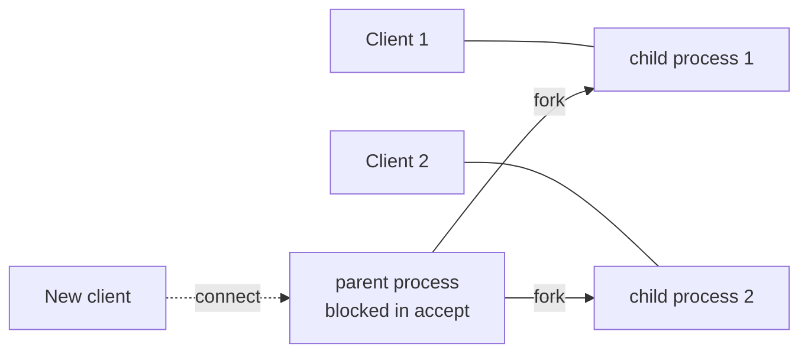
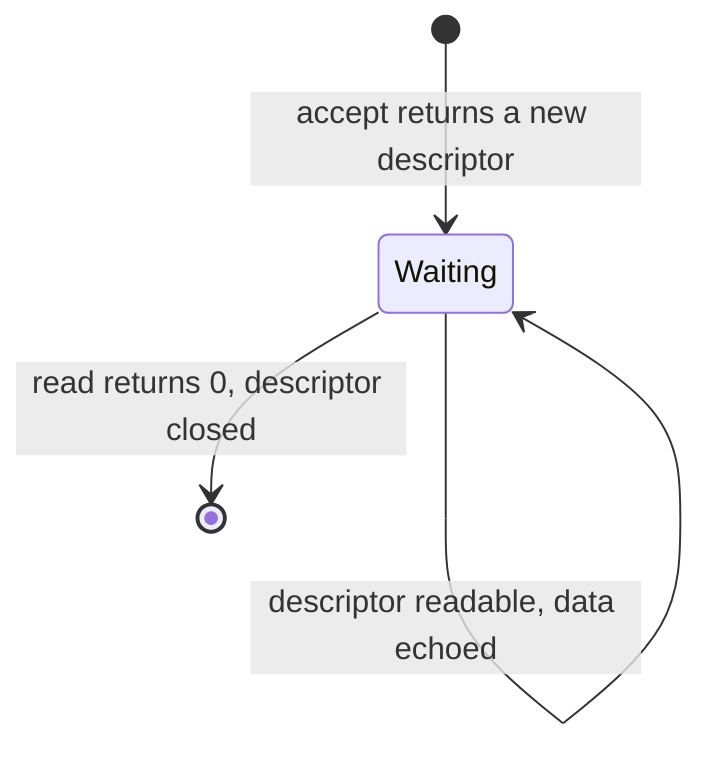
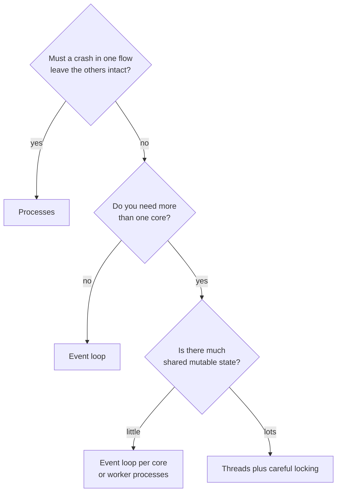

# Three ways to build concurrent servers

> **Before this lesson:** You need sockets, `accept` and the echo server from [Sockets, clients, servers and HTTP](#/lesson/csapp/sockets-http); `fork`, `waitpid` and zombies from [Processes: fork, exec, wait](#/lesson/csapp/processes); and signal handlers from [Signals and nonlocal jumps](#/lesson/csapp/signals).

## In plain words

A **server** is a program that waits for requests from other programs, called **clients**, and answers them. A server that deals with one client at a time makes everyone else wait, like a shop with a single till. **Concurrency** means having several tasks in progress during the same period. There are three classic ways to arrange it, and a restaurant illustrates all three. You can open a separate small restaurant for each group of guests: completely isolated and expensive (**processes**). You can have one very quick waiter who goes round all the tables and never stands waiting at any one of them (**I/O multiplexing**, also called an event loop). Or you can employ several waiters who share one kitchen and must take care not to collide (**threads**).

Why this matters at work: every server you will build or operate uses one of these models or a mixture, and the choice determines how it fails, how it scales, and what kinds of bugs it suffers. Well-known systems are built in different ways for good reasons. "Process or thread?" and "how does a single-threaded server handle thousands of clients?" are standard interview questions.

## Why look closer

A server that handles one client from start to finish before looking at the next is easy to write and useless in production. Picture a chat backend where one user on a train with patchy signal takes forty seconds to send a message: with a one-at-a-time design, every other user stares at a spinner for forty seconds. The cure is **concurrency**: several logical flows of control whose lifetimes overlap. The operating system gives an application programmer three quite different tools for building such flows, and each has a distinct personality. This lesson builds the same tiny service three times (once per tool) so that the trade-offs are concrete rather than abstract.

## 1. Why one flow is not enough

Call a server **iterative** if it loops: accept a connection, serve it completely, close it, repeat. Its weakness is that a single slow or silent client blocks the whole queue. Application-level concurrency fixes that, and it is useful well beyond servers:

- **Waiting on slow devices.** While one flow waits for a disk or a network peer, another can use the CPU.
- **Staying responsive to people.** A user interface must react to a click even while a long computation runs.
- **Deferring work.** A memory allocator or a logger can batch up chores and run them in a background flow.
- **Serving many clients.** The subject of this lesson.
- **Using several cores.** Flows that truly run at the same instant on different cores are **parallel**, a special case of concurrent.

```python-run
# One slow client in front of three fast ones: completion times, iterative vs concurrent.
service = {"slow": 40.0, "a": 0.2, "b": 0.3, "c": 0.1}    # seconds of attention each needs

clock, done = 0.0, {}
for name, need in service.items():            # iterative: strictly one after another
    clock += need
    done[name] = clock
print("iterative :", {k: round(v, 1) for k, v in done.items()})

# concurrent (idealised): every client progresses independently
print("concurrent:", service)
print("client 'a' waits", round(done["a"] / service["a"]), "times longer than necessary")
```

The three building blocks, in the order we will meet them:

| Approach | Who schedules the flows | Address space | Typical cost |
|---|---|---|---|
| **Processes** | kernel | separate per flow | highest |
| **I/O multiplexing** | your own code | one, shared | lowest |
| **Threads** | kernel | one, shared | in between |

## 2. Version one: a process per client

The oldest recipe uses nothing but `fork`. The parent process sits in a loop calling `accept`. Each time a connection arrives, it forks a child, and the child does all the talking with that client.

```c
int lfd = make_listener(port);
signal(SIGCHLD, reap_children);          /* see below */
for (;;) {
    int cfd = accept(lfd, NULL, NULL);
    if (fork() == 0) {                   /* child */
        close(lfd);                      /* child never accepts */
        serve(cfd);
        close(cfd);
        exit(0);
    }
    close(cfd);                          /* parent: MUST drop its copy */
}
```

Three housekeeping rules turn that sketch into a correct server.

**Reap the children.** Each finished child lingers as a zombie until the parent waits for it. The usual solution is a `SIGCHLD` handler. Because signals of the same type do not queue, one delivery may stand for several dead children, so the handler must loop:

```c
void reap_children(int sig) {
    while (waitpid(-1, NULL, WNOHANG) > 0)
        ;
}
```

**Close the descriptor on both sides.** After `fork`, parent and child each hold a descriptor referring to the same open connection, and the kernel's entry for that connection has a reference count of two. The connection is only torn down when the count reaches zero. If the parent forgets `close(cfd)`, the client never sees end-of-file even after the child exits, and the parent leaks one descriptor per client until `accept` starts failing. Symmetrically, the child should close the listening descriptor it inherited.

**Remember what is and is not shared.** The child gets a *copy* of the parent's memory. File tables are shared; variables are not.



### Verdict on processes

- **Strength: isolation.** A wild pointer in one child cannot corrupt another child's data. A crash kills one client's session and nothing else. For security-sensitive services this is a real feature, which is why some browsers and databases still use a process per tab or per connection.
- **Weakness: sharing is awkward.** If the flows need a common cache or a hit counter, they must use explicit inter-process communication: pipes, shared memory segments, message queues, sockets. All of it is clumsier than a plain variable.
- **Weakness: cost.** Creating a process and switching between processes involves the heaviest bookkeeping of the three models.

## 3. Version two: I/O multiplexing

Suppose we want the server to also react to an operator typing commands on standard input. Now there are two sources of events, a new connection and a typed line, and a blocking call on one of them makes us deaf to the other. **I/O multiplexing** solves this inside a single process: ask the kernel to put us to sleep until *any* of a set of descriptors is ready, then deal with whichever woke us.

The classic system call is `select`:

```c
#include <sys/select.h>
int select(int nfds, fd_set *readfds, fd_set *writefds, fd_set *exceptfds, struct timeval *timeout);

FD_ZERO(&set);         /* empty the set          */
FD_SET(fd, &set);      /* add fd                 */
FD_CLR(fd, &set);      /* remove fd              */
FD_ISSET(fd, &set);    /* is fd a member?        */
```

An `fd_set` is a bit vector with one bit per descriptor number. You hand `select` the set you are interested in (the *read set*, if you care about input) and the number of descriptors to examine. It blocks until at least one of them can be read without blocking, and then **overwrites your set** with the subset that is ready. Two consequences:

- The return value tells you how many are ready; `FD_ISSET` tells you which.
- Because the argument is destroyed, you must rebuild it or copy a master set before every call. Forgetting this is the classic `select` bug.

A descriptor counts as readable when a `read` of one byte would return immediately. That includes end-of-file, and for a listening socket it means a connection is waiting for `accept`.

### From multiplexing to an event-driven server

With `select` as the engine, a whole server can be written as an **event loop** driving a collection of **state machines**. Each connected client is one state machine. It has a state ("waiting for the next chunk from descriptor 7"), reacts to an input event ("descriptor 7 became readable"), and makes a transition (read what is available, echo it, go back to waiting).



The server keeps a pool of active descriptors plus whatever per-client context each state machine needs (a partial line buffer, a byte count, an authenticated user name). The loop is always the same shape:

1. Copy the master set and call `select`.
2. If the listening descriptor is ready, `accept` and add the new client to the pool.
3. For every client descriptor that is ready, perform **one bounded step** of work and return to the loop.

The demo below is a complete event-driven echo service in miniature. It uses connected socket pairs instead of a real network so that it can run anywhere, and falls back to a note if the sandbox has no socket support.

```python-run
import selectors, socket

def demo():
    sel = selectors.DefaultSelector()
    clients = {}                                   # server-side socket -> per-client state
    peers = []                                     # the "remote" ends
    for name in ("ann", "bo", "cy"):
        near, far = socket.socketpair()
        near.setblocking(False)
        sel.register(near, selectors.EVENT_READ)
        clients[near] = {"name": name, "bytes": 0}
        peers.append(far)

    peers[2].sendall(b"third speaks first\n")       # arrival order is NOT connection order
    peers[0].sendall(b"hello\n")
    peers[1].close()                                # bo hangs up without a word

    for _ in range(2):                              # two turns of the event loop
        for key, _mask in sel.select(timeout=0.2):
            sock, st = key.fileobj, clients[key.fileobj]
            data = sock.recv(4096)                  # will not block: select said it is ready
            if data:
                st["bytes"] += len(data)
                sock.sendall(data.upper())
                print(f"{st['name']}: echoed {len(data)} bytes (running total {st['bytes']})")
            else:
                print(f"{st['name']}: EOF, removing from the pool")
                sel.unregister(sock); sock.close()
    print("replies:", peers[0].recv(100), peers[2].recv(100))

try:
    demo()
except Exception as exc:
    print("sockets are not available in this sandbox:", type(exc).__name__)
    print("expected behaviour: cy and ann are echoed in arrival order, bo is dropped on EOF")
```

### Verdict on event-driven designs

- **Strength: control.** Your code decides which client gets attention next, so policies such as "premium users first" are a few lines.
- **Strength: sharing is trivial.** Everything lives in one address space and only one flow runs at a time, so there are no data races between handlers. You can also debug it with a normal single-threaded debugger.
- **Strength: efficiency.** No process or thread switch is needed to move between clients, which is why high-performance systems such as nginx, Node.js and Redis are built this way.
- **Weakness: code complexity.** You must chop every task into non-blocking steps and store the in-between state by hand. The finer the granularity, the worse it gets.
- **Weakness: one stall stops everything.** If a handler waits for a full line from a client who sends half a line and then pauses, every other client is frozen. Reading a partial request without blocking requires real care, and a malicious client can exploit any mistake.
- **Weakness: one core.** A single event loop cannot use a second processor. Real systems run one loop per core.

> [!NOTE]
> `select` scans a fixed-size bit vector on every call, which scales poorly beyond roughly a thousand descriptors. Production systems use `epoll` on Linux or `kqueue` on BSD and macOS, which report only the ready descriptors. The programming model (event loop plus state machines) is unchanged.

## 4. Version three: threads

A **thread** is a logical flow that runs *inside* a process. The kernel schedules threads automatically, as it does processes, yet all threads of a process live in one virtual address space, as the state machines of an event loop do. It is a hybrid of the two previous models.

What each thread owns privately is small:

- a thread ID,
- a stack and stack pointer,
- a program counter,
- the general-purpose registers and condition codes.

Everything else, including code, heap, global variables, shared libraries and open files, belongs to the process and is visible to every thread in it. Because a thread context is so much smaller than a process context, switching between threads is cheaper.

Threads also differ from processes socially. Processes form a strict parent-child tree; threads form a **pool of peers**. The thread that begins executing `main` is called the main thread, but it has no special authority: any thread can wait for, or terminate, any other.

### The essential Pthreads calls

```c
#include <pthread.h>
int   pthread_create(pthread_t *tid, const pthread_attr_t *attr, void *(*fn)(void *), void *arg);
pthread_t pthread_self(void);
void  pthread_exit(void *retval);
int   pthread_join(pthread_t tid, void **retval);
int   pthread_detach(pthread_t tid);
int   pthread_cancel(pthread_t tid);
int   pthread_once(pthread_once_t *once, void (*init)(void));
```

- **Creating.** `pthread_create` starts a new thread running `fn(arg)`. The routine takes one `void *` and returns one `void *`; to pass more, bundle the values in a struct.
- **Ending.** A thread ends when its routine returns, when it calls `pthread_exit`, when a peer cancels it, or when *any* thread calls `exit`, which ends the entire process. If the main thread calls `pthread_exit` instead, the process lives on until the remaining threads finish.
- **Reaping.** `pthread_join` blocks until the named thread ends and collects its return value. Unlike `wait`, it cannot wait for "whichever finishes first".
- **Detaching.** A thread is either **joinable** or **detached**. A joinable thread holds on to its stack and bookkeeping until somebody joins it; a detached thread releases them by itself the moment it ends. A server that never joins its workers must detach them, typically with `pthread_detach(pthread_self())` as the worker's first line, or it leaks memory per connection.
- **One-time setup.** `pthread_once` guarantees an initialisation routine runs exactly once however many threads race to call it.

### A thread-per-connection server, and its famous bug

```c
for (;;) {
    int *slot = malloc(sizeof *slot);          /* a private home for this descriptor */
    *slot = accept(lfd, NULL, NULL);
    pthread_t tid;
    pthread_create(&tid, NULL, worker, slot);
}

void *worker(void *arg) {
    int cfd = *(int *)arg;
    free(arg);
    pthread_detach(pthread_self());
    serve(cfd);
    close(cfd);                                /* shared table: closing here is enough */
    return NULL;
}
```

Why the `malloc`? The tempting shortcut is a single local `int cfd` in the main loop with `&cfd` passed to every worker. That is a **race**: the new thread may not run its first line until after the main thread has looped around and stored the *next* client's descriptor in the same variable. Two workers then serve the same client and one client is ignored. Giving each connection its own heap cell removes the shared variable. (Squeezing the integer into the pointer value itself also works and is common, at the price of a cast.)

Note also what is absent compared with the process version: the main thread does **not** close the connected descriptor. All threads share one descriptor table, so there is only one reference, and the worker's `close` ends the connection.

```python-run
import threading

def serve(n, results):
    results[n] = f"client {n} served by {threading.current_thread().name}"

def demo():
    results, workers = {}, []
    for n in range(4):
        t = threading.Thread(target=serve, args=(n, results), name=f"worker-{n}")
        t.start()                          # each thread received its own copy of n
        workers.append(t)
    for t in workers:
        t.join()
    for n in sorted(results):
        print(results[n])

try:
    demo()
except RuntimeError as exc:                # browser sandboxes may not allow thread creation
    print("threads unavailable here:", exc)
    print("on a normal interpreter you would see four lines, one per worker thread")

# The buggy pattern, modelled without threads: workers read a shared slot only AFTER the loop moved on.
slot = None
late_readers = []
for fd in (4, 5, 6):
    slot = fd                              # main thread overwrites the single shared variable
    late_readers.append(lambda: slot)      # worker has the address, not the value
print("descriptors the three late workers see:", [read() for read in late_readers])
```

### Verdict on threads

- **Strength: sharing is effortless.** A global cache is a global.
- **Strength: cheaper than processes** and able to use many cores.
- **Weakness: sharing is effortless.** The same property that helps also lets one thread scribble on another's data. Bugs depend on timing, appear once in a million runs, and vanish under a debugger. The next two lessons are devoted to taming this with synchronisation.
- **Weakness: no fault isolation.** A segmentation fault in one thread takes down the process and every client it was serving.

## 5. Choosing between them



| Question | Processes | Event-driven | Threads |
|---|---|---|---|
| Is data shared by default? | No | Yes | Yes |
| Can flows corrupt each other? | No | No preemption, so rarely | Yes |
| Uses multiple cores? | Yes | No, one loop per process | Yes |
| Overhead per client | High | Very low | Moderate |
| Hardest part | IPC and reaping | Splitting work into non-blocking steps | Synchronisation |

Real systems mix the models. A common production layout is a few worker processes for isolation and multi-core use, each running an event loop for cheap connection handling, with a small thread pool on the side for operations that have no non-blocking form.

> [!INTERVIEW]
> **"Process versus thread?"** Give the precise split: a thread has its own stack, registers, program counter and ID; it shares the address space, heap, globals and open files with its siblings. A process has all of those to itself. Then give the consequences: threads are cheaper to create and switch and share data trivially, but have no memory isolation, so a bug or crash in one affects all. Processes are isolated and need IPC to cooperate.

> [!INTERVIEW]
> **"How does a single-threaded server such as Node.js or Redis handle ten thousand clients?"** With I/O multiplexing: it registers every socket with `epoll` or `kqueue`, sleeps until some are ready, and runs a short non-blocking handler for each. No handler may block or compute for long, because that would stall every other client. CPU-heavy work is pushed to a pool or to other processes.

## 6. Pitfalls

- **Leaking the connected descriptor in a forking server.** The parent's copy keeps the connection open and eventually exhausts the descriptor table.
- **A `SIGCHLD` handler that reaps once.** Pending signals of one kind collapse into a single delivery; loop with `WNOHANG`.
- **Reusing the `fd_set` after `select`.** It now contains only the ready descriptors. Keep a master copy.
- **Blocking inside an event handler.** A buffered "read a whole line" call on a client that has sent half a line freezes the server.
- **Passing a pointer to a loop variable to a new thread.** Give each thread its own storage.
- **Never joining and never detaching.** Each finished joinable thread leaks its stack.
- **Calling `exit` from a worker thread.** It terminates the whole process, not the one thread. Use `return` or `pthread_exit`.
- **Assuming thread start order.** The scheduler may run a new thread immediately, much later, or on another core at once.

## Summary

- Iterative servers let one slow client block everybody; concurrent servers interleave many logical flows.
- **Processes**: `fork` per connection. Separate address spaces give safety and make sharing hard. Reap children and close duplicated descriptors.
- **I/O multiplexing**: one process waits on many descriptors with `select` or a modern equivalent and advances per-client state machines. Cheap and race-free, but the code is intricate, a blocking step stalls all clients, and it uses one core.
- **Threads**: kernel-scheduled flows within one address space, each with a private stack and registers. Cheap sharing and multi-core use, in exchange for race hazards and no isolation.
- Detach worker threads, give each its own argument storage, and never assume an ordering between threads.

## Glossary

- **Concurrency**: several tasks being in progress over the same period.
- **Iterative server**: a server that fully serves one client before accepting the next.
- **Process**: a running program with its own private memory.
- **IPC (inter-process communication)**: the methods separate processes use to exchange data, such as pipes and sockets.
- **I/O multiplexing**: one flow of control waiting on many input sources at once and serving whichever is ready.
- **`select` / `epoll`**: system calls that report which of many descriptors are ready for reading or writing.
- **Event loop**: a loop that repeatedly waits for events and runs a short handler for each.
- **State machine**: a description of a task as a set of states and the events that move it between them.
- **Thread**: a flow of control inside a process that shares the process's memory with other threads.
- **Pthreads**: the standard programming interface for threads on Unix-like systems.
- **Joinable / detached**: a thread whose resources are freed when another thread collects it / freed automatically when it ends.
- **Race**: a bug whose appearance depends on the timing of two flows.
- **Fault isolation**: the property that a failure in one part cannot damage another.

```quiz
[
  {"q": "In a fork-per-connection server, what goes wrong if the parent never closes its copy of the connected descriptor?",
   "options": ["Nothing; the child's close is sufficient", "The connection stays open after the child exits and the parent eventually runs out of descriptors", "The child receives SIGPIPE immediately", "The listening socket stops working after the first client"],
   "answer": 1, "explain": "Parent and child both reference the open connection. It is only torn down when every reference is closed, so the parent's stale copy keeps it alive and leaks a descriptor per client."},
  {"q": "After select returns, what does the read set you passed in contain?",
   "options": ["Exactly what you passed in", "Only the descriptors that are ready for reading", "All descriptors that are open in the process", "It is undefined"],
   "answer": 1, "explain": "select overwrites its set arguments with the ready subset, so the caller must keep a master copy and rebuild the argument before each call."},
  {"q": "Which item is private to each thread rather than shared by the process?",
   "options": ["The heap", "Global variables", "The stack pointer and registers", "The open file table"],
   "answer": 2, "explain": "Each thread has its own stack, stack pointer, program counter, registers and thread ID. Code, heap, globals and open files are shared."},
  {"q": "A server creates one thread per connection and never calls pthread_join. What must each worker do to avoid leaking resources?",
   "options": ["Call exit when finished", "Detach itself, for example with pthread_detach(pthread_self())", "Call fork", "Close the listening descriptor"],
   "answer": 1, "explain": "A joinable thread keeps its stack and bookkeeping until joined. A detached thread frees them automatically when it ends."},
  {"q": "The main loop passes the address of a single local variable holding the connected descriptor to every new thread. Why is this a bug?",
   "options": ["Stack variables cannot be accessed from other threads", "The next accept may overwrite the variable before the new thread reads it", "pthread_create copies the pointed-to value, wasting memory", "The descriptor is closed when the variable goes out of scope"],
   "answer": 1, "explain": "The new thread and the main thread race on the shared variable. If the main thread loops first, two workers read the same later descriptor."},
  {"q": "What is the main weakness of a single-process event-driven server?",
   "options": ["It cannot share data between clients", "A handler that blocks or runs long stalls every client, and it cannot use multiple cores", "It needs one kernel stack per client", "It must reap zombie children"],
   "answer": 1, "explain": "Only one flow runs at a time, so any blocking step freezes the loop, and one loop runs on one core."},
  {"q": "In a threaded server, why does the main thread NOT close the connected descriptor after creating the worker?",
   "options": ["Threads share one descriptor table, so closing it would close it for the worker too", "pthread_create closes it automatically", "Descriptors cannot be closed by the main thread", "The kernel reference count is two, as with fork"],
   "answer": 0, "explain": "Unlike fork, creating a thread does not duplicate the descriptor table. There is a single reference, and the worker closes it when done."},
  {"q": "Which model gives the strongest protection against one client's bug corrupting another client's state?",
   "options": ["Threads", "Event-driven I/O multiplexing", "Processes", "All are equal"],
   "answer": 2, "explain": "Each process has a private address space, so a stray write or crash is contained. Threads and event handlers share memory."}
]
```

> **Source:** CS:APP 3e, §12.1–12.3
