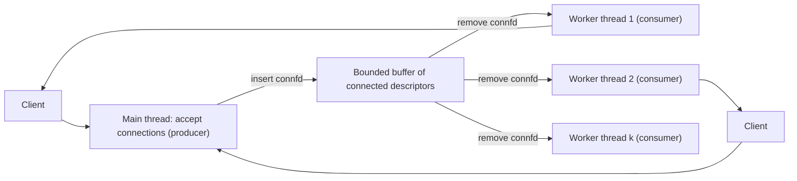

# Synchronization with semaphores

> **Before this lesson:** You need threads and what they share from [Three ways to build concurrent servers](#/lesson/csapp/concurrency-models). The idea that one line of C can become several machine instructions comes from [x86-64 basics: registers, operands, mov](#/lesson/csapp/asm-basics).

## In plain words

A **thread** is one line of execution within a program, and a program may have several working in overlapping time on the same data. When two of them change the same piece of data at once, the result can be wrong. Imagine two people editing the same line of a shared shopping list at the same moment: each reads "3 apples", each adds one, and each writes "4 apples", although five were intended. One update has been lost. The cure is a rule that only one person may edit at a time. A **semaphore** is a simple device for enforcing rules of that kind. It behaves like a bowl holding a fixed number of tokens: you must take a token before you proceed, and you wait if the bowl is empty.

Why this matters at work: lost updates and similar faults appear only occasionally and are very hard to reproduce, so they are costly when they reach customers. Semaphores and their close relative the mutex are the standard tools for preventing them, and they also coordinate producers and consumers of work in every server and data pipeline. Synchronisation is among the most frequently examined interview topics.

## Why look closer

Shared variables are what make threads convenient, and also what makes them dangerous. Two threads that update the same variable without coordination can silently produce wrong answers, and the bug may appear once in a thousand runs. This lesson dissects the classic example (a shared counter that comes out too small), introduces a visual tool for reasoning about interleavings (the progress graph), and then presents the semaphore, Dijkstra's simple and general synchronization primitive. With semaphores we build mutual exclusion, a bounded buffer for producers and consumers, a readers-writers lock, and finally a server that uses a pool of pre-created threads.

## 1. A program that counts badly

Imagine a program that starts two threads. Each runs the same routine: loop `niters` times, and on each pass add one to a global variable `cnt`. When both threads have finished, the main thread prints `cnt` and compares it with the expected `2 * niters`.

```c
volatile long cnt = 0;          /* shared by both threads */

void *worker(void *vargp) {
    long n = *(long *)vargp;
    for (long i = 0; i < n; i++)
        cnt++;                  /* looks atomic, is not */
    return NULL;
}
```

<!-- walkthrough:c -->
**Reading this C line by line**

- `volatile long cnt = 0;` creates a global counter that every thread can see. `volatile` tells the compiler to read and write it in memory each time, not to keep a private copy in a register.
- `void *worker(void *vargp)` defines the function each thread runs. Thread functions take one address of any type (`void *`) and return one.
- `long n = *(long *)vargp;` treats that address as the address of a `long` and reads the number stored there: how many times to count.
- `for (long i = 0; i < n; i++) cnt++;` adds one to the shared counter `n` times. `cnt++` looks like a single action, but the machine performs three: read the counter, add one, write it back.
- `return NULL;` ends the thread with no result.
- When two threads run this at once, their three-step sequences can interleave, and some additions are lost.

With a million iterations per thread you would expect 2,000,000. On a multi-core machine the program typically prints something smaller, and a different number on each run: 1,445,085 one time, 1,915,220 the next. Nothing crashes. The answer is wrong.

### Why: one C statement, three machine steps

The statement `cnt++` compiles into a short sequence of instructions. Grouping them by role, each loop iteration in thread $i$ does five things:

| Step | Meaning |
|---|---|
| $H_i$ | Head: loop bookkeeping before the update |
| $L_i$ | **Load** the shared `cnt` into a register private to thread $i$ |
| $U_i$ | **Update** (increment) that register |
| $S_i$ | **Store** the register back into the shared `cnt` |
| $T_i$ | Tail: loop bookkeeping after the update |

The head and tail touch only thread-local state. The middle three steps read and write the shared variable. Each thread has its own registers (they are part of the thread context), so the register being incremented is private, but `cnt` itself is one location in memory.

On a single core the kernel interleaves the two threads' instructions in some order. Some orders are harmless and some are not:

| Order | Result after one iteration each |
|---|---|
| $H_1, L_1, U_1, S_1, T_1, H_2, L_2, U_2, S_2, T_2$ | `cnt = 2` (correct) |
| $H_1, L_1, U_1, H_2, L_2, S_1, T_1, U_2, S_2, T_2$ | `cnt = 1` (wrong) |

In the second order, thread 2 loads `cnt` while it is still 0, because thread 1 has computed 1 in its register but not yet stored it. Both threads then store 1. One increment is **lost**. On a multi-core machine the same thing happens with true simultaneity. The general rule: you cannot predict whether the operating system will choose a correct ordering for your threads, so a correct program must work for **every** feasible ordering.

```python-run
# Simulate the three-step increment under different interleavings (no real threads needed).
def run(schedule):
    cnt, reg = 0, {1: 0, 2: 0}
    for thread, step in schedule:
        if step == "L":   reg[thread] = cnt
        elif step == "U": reg[thread] += 1
        elif step == "S": cnt = reg[thread]
    return cnt
safe   = [(1, "L"), (1, "U"), (1, "S"), (2, "L"), (2, "U"), (2, "S")]
unsafe = [(1, "L"), (1, "U"), (2, "L"), (1, "S"), (2, "U"), (2, "S")]
print("sequential order :", run(safe))
print("interleaved order:", run(unsafe), "<- lost update")

# How many of the 20 possible interleavings of one increment each are wrong?
from itertools import combinations
bad = 0
for pos in combinations(range(6), 3):               # positions taken by thread 1's L, U, S
    sched, a, b = [], iter("LUS"), iter("LUS")
    for k in range(6):
        sched.append((1, next(a)) if k in pos else (2, next(b)))
    bad += run(sched) != 2
print(bad, "of 20 interleavings lose an update")
```

<!-- walkthrough:python-run -->
**Reading this Python line by line**

- `def run(schedule):` replays a given ordering of steps. `cnt` is the shared counter and `reg` holds each thread's private register.
- `for thread, step in schedule:` takes the steps in order. `"L"` (load) copies the counter into that thread's register. `"U"` (update) adds one to the register. `"S"` (store) copies the register back to the counter.
- `return cnt` gives the final value of the counter.
- `safe = [...]` is an ordering in which thread 1 completes all three of its steps before thread 2 begins. The result is 2, as intended.
- The orderings tried after it mix the two threads' steps. Whenever both threads load before either stores, the result is 1: one increment has been lost.

Only the two fully sequential orders give 2. The coding problem `csapp-race-outcomes` generalizes this: for several iterations per thread, which final values are possible?

## 2. Progress graphs

A **progress graph** turns the execution of $n$ concurrent threads into a path through an $n$-dimensional grid. For two threads it is a plane:

- The horizontal axis is thread 1's progress, marked with its instructions in order; the vertical axis is thread 2's.
- A point $(I_1, I_2)$ is the **state** in which thread 1 has completed instruction $I_1$ and thread 2 has completed $I_2$. The origin is the initial state where neither has done anything.
- Executing one instruction of thread 1 is a step **right**; one instruction of thread 2 is a step **up**. Two instructions never execute at exactly the same instant in this model, so there are no diagonal steps, and programs never run backward, so no steps left or down.
- A complete execution is a **trajectory**: a monotone staircase path from the origin to the top-right corner.

Now mark the instructions that manipulate the shared variable. For thread $i$, the sequence $(L_i, U_i, S_i)$ is its **critical section** with respect to `cnt`: a stretch of code that must not be interleaved with the other thread's critical section. The states in which *both* threads are inside their critical sections form a rectangle in the middle of the graph called the **unsafe region**. (Its border is not part of it: a state where one thread has finished $S$ is fine.)

```
 Thread 2
   T2 |  .    .    .    .    .    .
   S2 |  .    .  +-----------+    .
   U2 |  .    .  |  UNSAFE   |    .
   L2 |  .    .  |  REGION   |    .
   H2 |  .    .  +-----------+    .
      +--------------------------------> Thread 1
         H1   L1   U1   S1   T1
```

A trajectory that skirts the unsafe region is a **safe trajectory**; one that touches any state inside it is **unsafe**. Every safe trajectory updates the counter correctly; every unsafe one loses an update. The picture makes the goal of synchronization concrete: **arrange things so that no trajectory can ever enter the unsafe region**. In other words, each thread must have **mutually exclusive access** to the shared variable while it runs its critical section.

Progress graphs model concurrent execution on a single processor as a sequence of states. On a multiprocessor, instructions from different threads genuinely overlap, but the set of possible outcomes is the same as for some interleaving, so the reasoning still applies.

## 3. Semaphores

Edsger Dijkstra proposed the classic solution. A **semaphore** `s` is a global variable holding a **nonnegative integer** that can be manipulated only by two special operations:

- **P(s)**: if `s` is nonzero, decrement it and return immediately. If `s` is zero, **suspend the calling thread** until `s` becomes nonzero and the thread is restarted by a V operation; after restarting, P decrements `s` and returns.
- **V(s)**: increment `s` by 1. If any threads are blocked in P waiting for `s` to become nonzero, restart **exactly one** of them, which then completes its P by decrementing `s`.

(The names come from Dutch: *proberen*, to test, and *verhogen*, to increment.)

Two details matter. First, the test and decrement in P happen **indivisibly**: once P sees a nonzero value, no other thread can sneak in before the decrement. The increment in V is likewise indivisible. Second, V makes **no promise about which** blocked thread is restarted, so when several threads wait on a semaphore you cannot predict the winner.

Together the definitions guarantee the **semaphore invariant**: a properly initialized semaphore **never has a negative value**. That one property is what we use to fence off unsafe regions.

In the Posix interface the operations are `sem_init(&s, 0, value)`, `sem_wait(&s)` for P, and `sem_post(&s)` for V. The book wraps the latter two as `P(&s)` and `V(&s)`.

## 4. Using semaphores for mutual exclusion

Associate a semaphore `mutex`, **initialized to 1**, with each shared variable (or related group of shared variables), and bracket the corresponding critical section with P and V:

```c
sem_t mutex;                       /* initialized once: Sem_init(&mutex, 0, 1); */

for (long i = 0; i < n; i++) {
    P(&mutex);
    cnt++;
    V(&mutex);
}
```

A semaphore used this way always has the value 0 or 1, so it is called a **binary semaphore**. A binary semaphore whose purpose is mutual exclusion is a **mutex**; performing P on it is *locking* the mutex, and performing V is *unlocking* it. A thread that has locked a mutex but not yet unlocked it is *holding* the mutex. A semaphore used as a counter for a set of available resources is a **counting semaphore**.

Why does this work? Look at the progress graph again and label each state with the value `mutex` would have there. Initially it is 1. Any state reached after exactly one thread has done its P has value 0. A state inside the old unsafe region would require *both* threads to have completed P without an intervening V: the value would be −1. The semaphore invariant says that cannot happen. So the P and V operations surround the unsafe region with a **forbidden region** of states that no trajectory can enter. Whatever the scheduler does, a thread arriving at P while the other is inside waits.

With the P/V pair in place, the counting program prints the right answer every time.

```python-run
import threading
cnt = 0
def unsafe(n):
    global cnt
    for _ in range(n):
        tmp = cnt          # load
        tmp += 1           # update
        cnt = tmp          # store
mutex = threading.Semaphore(1)          # binary semaphore
def safe(n):
    global cnt
    for _ in range(n):
        mutex.acquire()                 # P
        tmp = cnt; tmp += 1; cnt = tmp
        mutex.release()                 # V

for worker in (unsafe, safe):
    cnt = 0
    ts = [threading.Thread(target=worker, args=(200_000,)) for _ in range(2)]
    try:
        [t.start() for t in ts]; [t.join() for t in ts]
        print(f"{worker.__name__:6}: cnt = {cnt} (expected 400000)")
    except RuntimeError as e:
        print("threads are not available in this sandbox:", e); break
```

(Whether the unsafe version actually loses updates on a given run depends on the interpreter and scheduler. That unpredictability is exactly the point: a race is a bug even when the test passes.)

> [!WARNING]
> **Synchronization is not free.** The correct version of the counter runs far slower than the broken one, often by an order of magnitude or more, because P and V are expensive compared with an increment. Keep critical sections short, and avoid sharing when you can (accumulate in a local variable and add it to the shared total once).

> [!NOTE]
> Pthreads also provides dedicated mutex and condition-variable types (`pthread_mutex_t`, `pthread_cond_t`). A mutex differs from a binary semaphore mainly in having an *owner*: only the thread that locked it may unlock it. Semaphores have no owner, so one thread may P and another V, which is precisely what scheduling patterns such as producer-consumer need.

## 5. Using semaphores to schedule shared resources

Besides mutual exclusion, semaphores can make one thread wait for a **condition on the program state** established by another. Two classic patterns follow.

### Producer-consumer with a bounded buffer

A **producer** thread generates items and inserts them into a buffer with $n$ slots; a **consumer** thread removes and processes them. Real examples are everywhere: a video decoder (producer) feeding frames to a renderer (consumer) so that playback stays smooth even when decoding time varies; a GUI thread that records mouse and keyboard events while another thread paints the screen; a server whose main thread accepts connections and hands them to workers.

Three requirements:

1. Inserting and removing manipulate shared data (the array and its indices), so access to the buffer must be **mutually exclusive**.
2. A producer finding the buffer **full** must wait until a slot becomes available.
3. A consumer finding the buffer **empty** must wait until an item becomes available.

A clean solution uses **three semaphores** and a circular array:

| Semaphore | Initial value | Meaning |
|---|---|---|
| `mutex` | 1 | Protects the buffer's internals |
| `slots` | $n$ | Counts **empty** slots |
| `items` | 0 | Counts **available** items |

```
insert(item):                 remove():
    P(slots)                      P(items)
    P(mutex)                      P(mutex)
    buf[rear % n] = item          item = buf[front % n]
    rear++                        front++
    V(mutex)                      V(mutex)
    V(items)                      V(slots)
                                  return item
```

Read `insert` aloud: wait for an empty slot; lock the buffer; add the item; unlock; announce one more available item. `remove` is its mirror image. The counting semaphores do the waiting: a producer blocks in `P(slots)` exactly when the buffer is full, and a consumer blocks in `P(items)` exactly when it is empty. The book packages this as the `sbuf` module (`sbuf_init`, `sbuf_insert`, `sbuf_remove`, `sbuf_deinit`).

> [!WARNING]
> **Order of the two P operations matters.** If `insert` did `P(mutex)` before `P(slots)`, a producer facing a full buffer would go to sleep *while holding the mutex*. The consumer could then never get in to remove an item, so the slot would never free up: **deadlock**. Always acquire the counting semaphore first and the mutex second.

```python-run
import threading
class Sbuf:
    def __init__(self, n):
        self.buf, self.n, self.front, self.rear = [None] * n, n, 0, 0
        self.mutex, self.slots, self.items = threading.Semaphore(1), threading.Semaphore(n), threading.Semaphore(0)
    def insert(self, item):
        self.slots.acquire()                 # P(slots): wait for an empty slot
        self.mutex.acquire()                 # P(mutex)
        self.buf[self.rear % self.n] = item; self.rear += 1
        self.mutex.release()                 # V(mutex)
        self.items.release()                 # V(items): announce an item
    def remove(self):
        self.items.acquire()                 # P(items): wait for an item
        self.mutex.acquire()
        item = self.buf[self.front % self.n]; self.front += 1
        self.mutex.release()
        self.slots.release()                 # V(slots): announce an empty slot
        return item

try:
    sb, out = Sbuf(3), []
    def producer():
        for i in range(10): sb.insert(i)
    def consumer():
        for _ in range(10): out.append(sb.remove())
    ts = [threading.Thread(target=producer), threading.Thread(target=consumer)]
    [t.start() for t in ts]; [t.join() for t in ts]
    print("consumed in order:", out)
except RuntimeError as e:
    print("threads are not available in this sandbox:", e)
```

### Readers-writers

A generalization of mutual exclusion: a shared object (a cache, a database, a document) is accessed by **reader** threads that only look and **writer** threads that modify. Writers need **exclusive** access; any number of readers may share the object at once. An airline reservation system lets many customers browse seat maps simultaneously, but booking a seat must exclude everyone else.

There are several variants, defined by who gets priority:

- **First readers-writers problem (favors readers):** no reader is kept waiting unless a writer has already been granted access. A reader never waits merely because a writer is *waiting*.
- **Second readers-writers problem (favors writers):** once a writer is ready, it performs its write as soon as possible. A reader that arrives after a writer must wait, even if the writer is itself still waiting.

A solution to the first problem uses a semaphore `w` that controls access to the object, a counter `readcnt` of readers currently inside, and a `mutex` protecting that counter:

```
reader:                           writer:
    P(mutex)                          P(w)
    readcnt++                         ... write ...
    if readcnt == 1: P(w)             V(w)
    V(mutex)
    ... read ...
    P(mutex)
    readcnt--
    if readcnt == 0: V(w)
    V(mutex)
```

Only the **first** reader to enter locks `w`, and only the **last** reader to leave unlocks it. In between, further readers come and go freely, while a writer blocks in `P(w)`. A writer holds `w` for the duration of its update, which keeps out both other writers and the first reader (and therefore all readers).

The price: **starvation**. A thread starves if it blocks indefinitely and never makes progress. In this solution a steady stream of readers keeps `readcnt` above zero forever, and a writer may wait without bound. Writer-priority solutions can starve readers instead. Fair solutions exist but are more intricate; many libraries provide ready-made reader-writer locks with documented fairness policies.

## 6. Putting it together: a prethreaded concurrent server

The thread-per-connection server from the previous lesson pays the cost of creating a thread for every new client. A **prethreaded** server avoids it with the producer-consumer pattern:



- At start-up the main thread creates a fixed set of **worker threads**.
- The main thread loops: accept a connection, **insert** the connected descriptor into a bounded buffer.
- Each worker loops: **remove** a descriptor from the buffer, serve that client until it disconnects, close the descriptor, repeat.

If all workers are busy and the buffer fills, the main thread blocks in `insert`, which naturally applies back-pressure. The design bounds resource usage, and it is the ancestor of every modern thread pool.

A small extra illustrates one more technique. Suppose the service routine keeps a global byte counter that all workers update. It needs a mutex, and the mutex must be initialized **exactly once**, no matter which worker runs first. One could initialize it in the main thread, but a self-contained module can use `pthread_once`, which runs a given initialization function the first time any thread calls it and does nothing afterwards. That keeps the module usable without a separate setup call.

> [!NOTE]
> **Event-driven programs with threads.** I/O multiplexing is not the only way to write an event-driven program. The prethreaded server is event-driven too: the main thread is a state machine with states "waiting for a connection request" and "waiting for a free buffer slot", and each worker alternates between "waiting for an available item" and serving a client. Events are the things that P operations wait for.

## 7. Common pitfalls

- **Protecting only writes.** Readers of a multi-word structure can see a half-updated state. Decide which invariant a lock protects and hold it for every access that depends on the invariant.
- **Forgetting to release on every path.** An early `return` or error branch between P and V leaves the mutex locked forever. Structure the code so the release cannot be skipped.
- **Using the wrong initial value.** A mutex initialized to 0 blocks the very first thread forever; `items` initialized to $n$ lets consumers read garbage.
- **Assuming fairness.** V restarts *some* waiting thread, not the one that waited longest.
- **Holding a lock while blocking.** Sleeping, performing I/O, or waiting on another semaphore inside a critical section invites deadlock and destroys throughput.
- **"It passed the test, so it is correct."** Race bugs are timing-dependent. Reason about all interleavings; do not rely on runs.

> [!INTERVIEW]
> **"What is a race condition, and how do you fix one?"** A race exists when the correctness of a program depends on the relative timing of threads, typically an unsynchronized read-modify-write of shared data. Fixes, from best to worst: do not share (thread-local or per-thread accumulation, message passing, immutable data); use an atomic operation for a single word; protect the critical section with a mutex; redesign so one thread owns the data. Explain *why* `x++` is not atomic: load, add, store.

> [!INTERVIEW]
> **"Mutex vs. semaphore?"** A mutex provides mutual exclusion and has an owner that must unlock it. A semaphore is a counter with atomic wait/signal and no ownership: with initial value 1 it can act as a lock; with value $n$ it limits concurrency to $n$ or counts resources; and it can signal between threads (one waits, another posts). Condition variables are the third tool: wait for an arbitrary predicate while releasing a mutex.

> [!INTERVIEW]
> **"Implement a bounded blocking queue."** The three-semaphore solution above is the canonical answer: `slots` and `items` counting semaphores plus a mutex, with the counting semaphore acquired **before** the mutex. Be ready to explain what breaks if the order is swapped, and to give the mutex-plus-two-condition-variables version (`not_full`, `not_empty`, with waits in `while` loops).

## 8. Summary

- `cnt++` is load, update, store. Interleaving two threads' sequences can lose updates; the result is timing-dependent.
- A **progress graph** plots joint progress; the states where both threads are in their critical sections form the **unsafe region**. Correct synchronization keeps every trajectory out of it.
- A **semaphore** is a nonnegative integer with atomic P (wait/decrement) and V (increment/wake one). Invariant: it never goes negative.
- **Mutual exclusion**: binary semaphore initialized to 1, P before and V after the critical section.
- **Producer-consumer**: `mutex`, `slots` (init $n$) and `items` (init 0); take the counting semaphore first.
- **Readers-writers**: first reader locks `w`, last reader unlocks it; watch for starvation.
- **Prethreaded server**: accept in one thread, hand descriptors to a worker pool through a bounded buffer.

## Glossary

- **Thread**: a flow of control inside a process that shares the process's memory with other threads.
- **Shared variable**: a variable that more than one thread reads or writes.
- **Critical section**: a stretch of code that touches shared data and must not be run by two threads at once.
- **Race condition**: a bug in which the result depends on the timing of threads.
- **Atomic**: happening as one indivisible step, with no chance of interruption partway.
- **Mutual exclusion**: the guarantee that at most one thread is inside a critical section at a time.
- **Semaphore**: a counter that never goes below zero, with two operations: wait until it is positive then decrease it (P), and increase it (V).
- **Mutex**: a semaphore or lock used purely for mutual exclusion; it is either held or free.
- **Progress graph**: a diagram showing all the ways the steps of two threads can interleave.
- **Producer-consumer problem**: coordinating threads that add items to a shared buffer with threads that remove them.
- **Bounded buffer**: a queue with a fixed capacity shared between producers and consumers.
- **Readers-writers problem**: allowing many threads to read shared data together while giving writers exclusive access.
- **Starvation**: a thread waiting indefinitely because others are always served first.
- **Thread pool**: a fixed group of worker threads, created in advance, that take tasks from a queue.

## Check yourself

```quiz
[
  {"q": "Why can two threads executing cnt++ once each leave cnt at 1 instead of 2?", "options": ["The compiler removes one increment", "Both may load the old value before either stores, so one update overwrites the other", "Registers are shared between threads", "cnt overflows"], "answer": 1,
   "explain": "cnt++ is load, update, store on a private register; interleaving the two sequences can lose an update."},
  {"q": "In a progress graph for two threads, what is the unsafe region?", "options": ["States where neither thread has started", "States where both threads are inside their critical sections", "States where one thread has finished", "The diagonal of the graph"], "answer": 1,
   "explain": "Trajectories that touch states with both threads in their critical sections produce incorrect results."},
  {"q": "What does P(s) do when s is 0?", "options": ["Returns an error", "Sets s to -1", "Suspends the calling thread until a V makes s nonzero", "Spins forever"], "answer": 2,
   "explain": "P blocks until another thread performs V; then it decrements s and returns."},
  {"q": "What property of semaphores guarantees mutual exclusion when a mutex is initialized to 1?", "options": ["V wakes the longest waiter", "A semaphore's value can never be negative", "P is faster than V", "Semaphores are stored in the kernel"], "answer": 1,
   "explain": "Both threads being inside the critical section would require the value -1, which the invariant forbids."},
  {"q": "In the bounded buffer, what are the initial values of mutex, slots and items for a buffer of n slots?", "options": ["1, 0, n", "1, n, 0", "0, n, 0", "n, 1, 0"], "answer": 1,
   "explain": "The mutex starts unlocked (1), all n slots are empty, and no items are available."},
  {"q": "What goes wrong if insert performs P(mutex) before P(slots)?", "options": ["Items are lost", "A producer can block on a full buffer while holding the mutex, so no consumer can ever remove an item: deadlock", "Nothing", "The buffer overflows"], "answer": 1,
   "explain": "Blocking while holding the lock prevents the very action that would unblock you."},
  {"q": "In the readers-favoring solution, which reader performs P(w)?", "options": ["Every reader", "Only the first reader to enter", "Only the last reader to leave", "No reader"], "answer": 1,
   "explain": "The first reader locks out writers; the last reader to leave releases w."},
  {"q": "What is the main benefit of a prethreaded server over thread-per-connection?", "options": ["It needs no synchronization", "It avoids creating a thread for every request and bounds the number of threads", "It uses several processes", "It eliminates context switches"], "answer": 1,
   "explain": "Workers are created once and reused; connections are queued in a bounded buffer."}
]
```

> **Source:** CS:APP 3e, §12.5 (Synchronizing threads with semaphores: progress graphs, semaphores, mutual exclusion, scheduling shared resources, a concurrent server based on prethreading).
