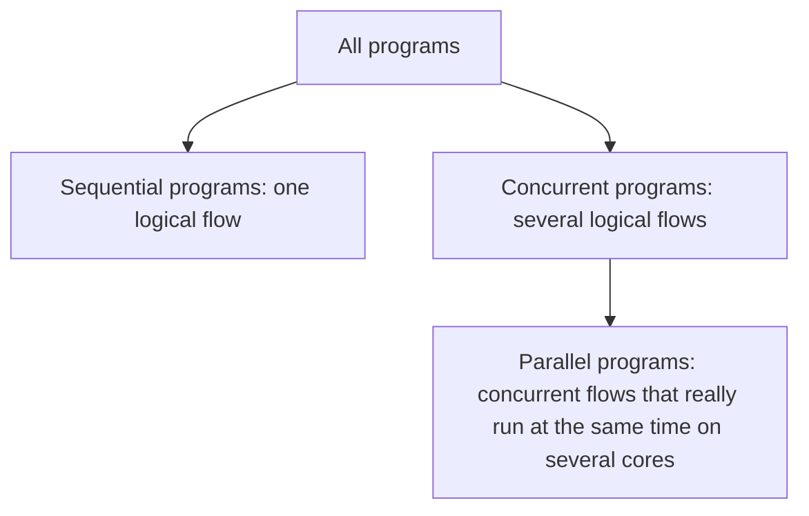
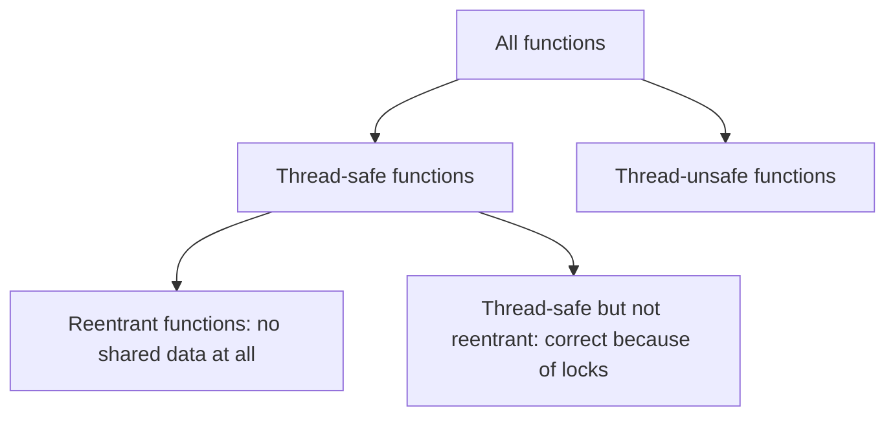

# Parallelism, thread safety, races and deadlock

Synchronization primitives are only half of concurrent programming. The other half is judgment: knowing when threads will actually make a program faster, which library functions are safe to call from several threads, how innocent-looking code hides races, and how locks that each look correct can combine into a program that freezes forever. This lesson covers those four topics. They are also the four most common subjects of concurrency questions in interviews.

## 1. Using threads for parallelism

It helps to be precise about three sets of programs:



A **sequential** program is a single logical flow. A **concurrent** program has several flows whose lifetimes overlap. A **parallel** program is a concurrent program running on multiple processors, so that its flows truly execute simultaneously. Parallel programs are a proper subset of concurrent programs: on a single core you can have concurrency (interleaving) without any parallelism.

On a machine with one core, threads add structure but no speed. On a multi-core machine the kernel schedules threads onto different cores, and a program divided into independent pieces of work can finish sooner. How much sooner depends heavily on how the threads share data.

### Three ways to sum a sequence

Take a deliberately simple task: add the integers $0, 1, \dots, n-1$ using $t$ threads. Split the range into $t$ equal chunks and give one chunk to each thread. We know the answer, $n(n-1)/2$, so correctness is easy to check. The interesting question is where each thread puts its partial result.

**Version 1: a shared total protected by a mutex.** Every thread adds each element directly into one global sum, locking and unlocking around every addition.

```c
for (i = start; i < end; i++) {
    P(&mutex);
    gsum += i;
    V(&mutex);
}
```

This is correct and disastrously slow. The single-threaded run is already much slower than a plain loop, because each iteration now performs two semaphore operations that dwarf the cost of an addition. Worse, **adding threads makes it slower still**, not faster: the cores spend their time fighting over the lock and bouncing the cache line that holds the sum between them. The lesson is general and worth memorizing: **synchronization overhead is expensive and should be avoided where possible; where it cannot be avoided, the cost should be amortized over as much useful work as possible.**

**Version 2: one slot per thread in a shared array.** Give each thread its own element of a global array `psum[]` and have it accumulate there. Because no two threads touch the same element, **no mutex is needed**. The main thread adds up the slots after joining the workers.

```c
for (i = start; i < end; i++)
    psum[myid] += i;
```

This is dramatically faster than version 1, and the running time now falls as threads are added, until the number of threads reaches the number of cores.

**Version 3: a local variable, written back once.** Recall from the optimization module that repeatedly reading and writing memory inside a loop is slower than accumulating in a local variable that the compiler keeps in a register. Apply the same idea:

```c
long sum = 0;
for (i = start; i < end; i++)
    sum += i;
psum[myid] = sum;
```

This removes the per-iteration memory traffic and gives another large improvement. It also sidesteps **false sharing**: in version 2 the per-thread slots sit next to each other in memory, so several of them fall in the same cache line, and every update by one core invalidates that line in the other cores' caches even though the threads never touch each other's data. Keeping the running total in a register (or padding the slots to cache-line size) eliminates the effect.

```python-run
# The three designs in miniature. Python's interpreter lock hides true parallel speedup,
# so we count synchronization operations instead of timing.
import threading
def run(version, n=200_000, t=4):
    lock, total, psum, ops = threading.Lock(), [0], [0] * t, [0] * t
    def worker(myid):
        lo, hi = myid * n // t, (myid + 1) * n // t
        if version == 1:
            for i in range(lo, hi):
                with lock: total[0] += i
            ops[myid] = hi - lo                 # one lock/unlock pair per element
        elif version == 2:
            for i in range(lo, hi): psum[myid] += i
        else:
            s = 0
            for i in range(lo, hi): s += i
            psum[myid] = s
    try:
        ts = [threading.Thread(target=worker, args=(k,)) for k in range(t)]
        [x.start() for x in ts]; [x.join() for x in ts]
    except RuntimeError:
        for k in range(t): worker(k)            # sandbox without threads: run the pieces in turn
    result = total[0] if version == 1 else sum(psum)
    return result == n * (n - 1) // 2, sum(ops)
for v, name in ((1, "shared total + mutex"), (2, "per-thread array slot"), (3, "local accumulator")):
    ok, locks = run(v)
    print(f"version {v} ({name:22}): correct={ok}, lock operations={locks}")
```

### Characterizing the performance of parallel programs

Plot running time against the number of threads on a machine with four cores and you get a characteristic shape: time drops as threads go from one to four, then **flattens or rises slightly** beyond four. Once every core is busy, extra threads bring no extra computation, only the overhead of switching among them. For CPU-bound work, the right number of threads is about the number of cores.

Two standard measures:

- **Speedup** $S_p = T_1 / T_p$, where $T_p$ is the running time on $p$ cores. If $T_1$ is the time of the *parallel* program run on one core, this is the **relative speedup**; if $T_1$ is the time of the best *sequential* program, it is the **absolute speedup**. Absolute speedup is the more honest number, because a parallel program often carries synchronization overhead even on one core, which flatters the relative figure. It is also harder to measure, since it needs two programs.
- **Efficiency** $E_p = S_p / p = T_1 / (p \, T_p)$, usually quoted as a percentage between 0 and 100. It measures how much of the hardware you paid for is doing useful work. Efficiency above 90% is very good; it is typical of problems that split into independent chunks with almost no communication.

| Threads $p$ | 1 | 2 | 4 | 8 |
|---|---|---|---|---|
| Hypothetical time $T_p$ (s) | 1.00 | 0.52 | 0.28 | 0.29 |
| Speedup $S_p$ | 1.00 | 1.92 | 3.57 | 3.45 |
| Efficiency $E_p$ on 4 cores | 100% | 96% | 89% | 86% |

(The eight-thread column is charged against the four cores actually available.)

There are also two ways to pose the scaling question. **Strong scaling** fixes the problem size and asks how much faster it runs with more cores; Amdahl's law (Module 1) caps it by the serial fraction. **Weak scaling** grows the problem with the number of cores and asks whether the running time stays constant: a program with 100% scaled efficiency does twice the work in the same time on twice the cores. Weak scaling is often the truer measure, because larger machines are usually bought to tackle larger problems, not to finish the old ones sooner.

```python-run
def metrics(times):                       # times[p] = running time with p threads
    t1 = times[1]
    for p, tp in sorted(times.items()):
        s = t1 / tp
        print(f"p={p}: time={tp:5.2f}  speedup={s:4.2f}  efficiency={100 * s / min(p, 4):5.1f}%")
metrics({1: 1.00, 2: 0.52, 4: 0.28, 8: 0.29})
```

## 2. Thread safety

A function is **thread-safe** if and only if it always produces correct results when called repeatedly from multiple concurrent threads. Otherwise it is **thread-unsafe**. Unsafe functions fall into four overlapping classes, and each class has its own cure.

**Class 1: functions that do not protect shared variables.** The unsynchronized counter of the previous lesson is the model case. The cure is direct: guard the shared variable with P and V (or a mutex). The advantage is that callers need not change; the disadvantage is that the synchronization slows the function down.

**Class 2: functions that keep state across invocations.** A pseudorandom number generator that stores its seed in a static variable is the standard example: each result depends on the hidden state left by the previous call. Called from a single thread after seeding, it gives a reproducible sequence. Called from several threads, the sequence each thread sees depends on the interleaving, and updates to the seed itself race. Locking makes each call atomic but still does not give a thread its own repeatable sequence. The real cure is to **rewrite the function so it has no hidden state**: the caller passes the state in through an argument. This changes the interface, so every call site must change too, which in a large program can be painful and error-prone.

**Class 3: functions that return a pointer to a static variable.** Some older library functions compute a result in a static buffer and return its address (`ctime` and `gethostbyname` are typical). If two threads call such a function, one thread's result can be overwritten while the other is still reading it. There are two cures. Rewrite the function so that the caller supplies the address of a buffer to fill; this removes all shared data but requires access to the source and changes every caller. Or, when the function cannot be changed, use the **lock-and-copy** technique: wrap each call in a mutex, and while holding the mutex copy the result into private memory, then unlock. Callers use the wrapper. A sketch:

```c
char *ctime_ts(const time_t *timep, char *privatep) {
    char *sharedp;
    P(&mutex);
    sharedp = ctime(timep);          /* result lives in a static buffer */
    strcpy(privatep, sharedp);       /* copy it out while still holding the lock */
    V(&mutex);
    return privatep;
}
```

**Class 4: functions that call thread-unsafe functions.** If `f` calls an unsafe `g`, is `f` unsafe? It depends. If `g` is in class 2 (hidden state), then `f` is unsafe too and nothing short of rewriting `g` helps. If `g` is in class 1 or 3, `f` can still be made safe by protecting the call site and any resulting shared data with a mutex, as in the lock-and-copy wrapper above.

### Reentrancy

A **reentrant** function is one that **references no shared data** when called by multiple threads. Reentrant functions are a proper subset of thread-safe functions:



Reentrant functions are typically **more efficient** than non-reentrant thread-safe ones, because they need no synchronization at all. Moreover, the only way to make a class 2 function thread-safe is to make it reentrant. A reentrant version of the random number generator takes a pointer to the caller's own state:

```c
int rand_r(unsigned int *nextp) {
    *nextp = *nextp * 1103515245 + 12345;
    return (unsigned int)(*nextp / 65536) % 32768;
}
```

Two shades of the term:

- A function is **explicitly reentrant** if all its arguments are passed by value (no pointers) and all data references are to local automatic variables. Its reentrancy can be verified by reading the function alone.
- A function is **implicitly reentrant** if it takes pointers but is reentrant *provided the callers pass pointers to non-shared data*. `rand_r` is like this: it is reentrant only if each thread hands it a different state variable.

Reentrancy is thus sometimes a property of both the callee and its callers.

Reentrancy also matters outside threading. A signal handler can interrupt the main program in the middle of a function and then call that same function; only reentrant (async-signal-safe) functions survive that, which is the reason for the rule from Module 8 about what may be called inside handlers.

### Using existing library functions in threaded programs

Most functions in the standard C library, including `malloc`, `free`, `realloc`, `printf` and `scanf`, are thread-safe, with only a few exceptions. The usual suspects, with their classes and reentrant replacements:

| Thread-unsafe function | Class | Linux thread-safe version |
|---|---|---|
| `rand` | 2 | `rand_r` |
| `strtok` | 2 | `strtok_r` |
| `asctime` | 3 | `asctime_r` |
| `ctime` | 3 | `ctime_r` |
| `gethostbyaddr` | 3 | `gethostbyaddr_r` |
| `gethostbyname` | 3 | `gethostbyname_r` |
| `inet_ntoa` | 3 | (none; use `inet_ntop`) |
| `localtime` | 3 | `localtime_r` |

For the class 3 functions, lock-and-copy also works, but it has drawbacks: the extra synchronization slows the program; functions that return pointers to complex structures of structures require a **deep copy** to capture the whole result; and it does nothing for class 2 functions such as `rand`. The practical rule: **use the reentrant `_r` versions whenever possible.**

```python-run
# Hidden state vs. caller-supplied state.
_seed = 1
def unsafe_rand():                      # class 2: keeps state across calls in a global
    global _seed
    _seed = (_seed * 1103515245 + 12345) & 0xFFFFFFFF
    return (_seed // 65536) % 32768
def rand_r(state):                      # reentrant: the caller owns the state
    state[0] = (state[0] * 1103515245 + 12345) & 0xFFFFFFFF
    return (state[0] // 65536) % 32768

a, b = [1], [1]                         # two "threads", each with private state
seq_a = [rand_r(a) for _ in range(3)]; seq_b = [rand_r(b) for _ in range(3)]
print("reentrant: both callers see the same reproducible sequence:", seq_a == seq_b, seq_a)
_seed = 1; mixed = [unsafe_rand() for _ in range(6)]        # two callers interleaved on one hidden seed
print("shared state: caller A gets", mixed[0::2], "caller B gets", mixed[1::2], "- depends on interleaving")
```

## 3. Races

A **race** occurs when the correctness of a program depends on one thread reaching point *x* in its control flow before another thread reaches point *y*. Races usually come from an unstated assumption about how threads will be scheduled. The golden rule: **threaded programs must work correctly for any feasible trajectory through the progress graph.**

A classic example creates several threads in a loop and tries to give each a unique integer ID:

```c
for (i = 0; i < N; i++)
    Pthread_create(&tid[i], NULL, thread, &i);     /* passes the ADDRESS of i */

void *thread(void *vargp) {
    int myid = *((int *)vargp);                    /* reads i... eventually */
    printf("Hello from thread %d\n", myid);
    return NULL;
}
```

Run it and you may see the same ID printed twice and another missing. The main thread passes each peer a pointer to **its own loop variable**. The race is between the peer's dereference of that pointer and the main thread's next `i++`. If the peer reads first, it gets its intended ID. If the main thread increments first, the peer reads the *next* thread's ID. Whether the program works depends on how the kernel happens to schedule the threads; it may work on one system and fail on another.

To eliminate the race, give each thread its **own copy** of the value. Either allocate a separate block for each ID, store the ID in it, pass the block's address, and have the peer free it; or, when the value fits in a pointer, pass it **by value** by casting the integer itself to the pointer argument. Both remove the shared variable, and with it the race.

```python-run
# The same mistake in another guise: every closure shares the loop variable, and reads it late.
actions = [lambda: i for i in range(4)]              # all capture the same i
print("shared loop variable :", [f() for f in actions])
actions = [lambda i=i: i for i in range(4)]          # each gets its own copy at creation time
print("private copy per task:", [f() for f in actions])
```

Other everyday forms of the same bug: checking a condition and then acting on it in two steps while another thread can change it in between ("check then act"); lazy initialization of a shared object by two threads at once; and reading a multi-field structure while another thread is halfway through updating it.

## 4. Deadlock

Semaphores introduce the possibility of a nasty run-time error called **deadlock**: a collection of threads is blocked, each waiting for a condition that will never become true.

The progress graph is again the tool for understanding it. Suppose two threads use two mutexes, `s` and `t`. Thread 1 does `P(s); P(t); ... V(s); V(t)` and thread 2 does `P(t); P(s); ... V(t); V(s)`. Each mutex defines a **forbidden region**: the rectangle of states in which both threads would hold it at once. With the two threads acquiring the locks in opposite orders, the two forbidden rectangles **overlap in an L-like shape**, and that shape has an inside corner.

```
 Thread 2
  V(s) |        +-------------------+
       |        |  forbidden for s  |
  V(t) |   +----+----+              |
       |   |forbidden|--------------+
  P(s) |   |  for t  |
       |   |    +----+
  P(t) | d |    |           d = deadlock region: both moves
       +---+----+-------------------------> Thread 1      (right and up) are blocked
           P(s) P(t)  V(s)  V(t)
```

The states tucked into that corner form the **deadlock region**. A trajectory that wanders into it can go neither right (thread 1 is waiting for `t`, held by thread 2) nor up (thread 2 is waiting for `s`, held by thread 1). The program is stuck forever. Three observations:

- The programmer has ordered the P and V operations incorrectly, so that the forbidden regions for the two semaphores overlap. If a trajectory reaches a deadlock **state**, no further progress is possible, because the overlapping forbidden regions block movement in every legal direction.
- Trajectories can **enter** the deadlock region but can never **leave** it.
- Deadlock is especially difficult because it is **not always predictable**. Some lucky trajectories skirt the region and finish normally; others get trapped. You might run the program a thousand times without a problem and have it hang on the next. Worse, the bug can vanish under a debugger or on a different machine, because timing changes.

Programs deadlock for many reasons, and preventing deadlock in general is hard. But when binary semaphores are used for mutual exclusion, there is a simple and effective rule.

> [!TIP]
> **Mutex lock ordering rule:** given a total ordering of all mutexes, a program is deadlock-free if **each thread acquires its mutexes in that order and releases them in reverse order**.

In the example, fix the order "`s` before `t`" and rewrite thread 2 to lock `s` first. The two forbidden rectangles then nest without forming a corner, the deadlock region disappears, and every trajectory can reach the end.

```python-run
# Explore every interleaving of two lock sequences and look for a stuck state.
def can_deadlock(t1, t2):
    seen, stack = set(), [(0, 0)]
    while stack:
        pcs = stack.pop()
        if pcs in seen: continue
        seen.add(pcs)
        if pcs == (len(t1), len(t2)): continue
        held = {}
        for t, pc in zip((t1, t2), pcs):
            for op, name in t[:pc]:
                held[name] = held.get(name, 0) + (1 if op == "P" else -1)
        moves = []
        for k, (t, pc) in enumerate(zip((t1, t2), pcs)):
            if pc < len(t) and not (t[pc][0] == "P" and held.get(t[pc][1], 0) > 0):
                moves.append((pcs[0] + (k == 0), pcs[1] + (k == 1)))
        if not moves: return True, pcs
        stack.extend(moves)
    return False, None
A = [("P", "s"), ("P", "t"), ("V", "s"), ("V", "t")]
B = [("P", "t"), ("P", "s"), ("V", "t"), ("V", "s")]
print("opposite order:", can_deadlock(A, B))
print("same order    :", can_deadlock(A, A))
```

The problem `csapp-deadlock-check` asks you to write this search for up to three threads.

### The broader picture

Four conditions must all hold for a deadlock to occur (the Coffman conditions): **mutual exclusion** (a resource is held by one thread at a time), **hold and wait** (a thread holds one resource while waiting for another), **no preemption** (a resource cannot be taken away), and **circular wait** (a cycle of threads each waiting for the next). Break any one and deadlock is impossible. Lock ordering breaks circular wait. Other practical defences: hold as few locks as possible and for as short a time as possible; never call unknown code (callbacks, virtual methods) while holding a lock; use `trylock` with back-off, or timeouts, when an ordering cannot be imposed; prefer a single coarse lock, or lock-free message passing, when the fine-grained design is hard to reason about.

Deadlock has two cousins. In a **livelock**, threads are not blocked but keep reacting to each other without making progress, like two people repeatedly stepping aside in a corridor. In **starvation**, the system as a whole progresses but some thread never gets its turn, as with writers in the readers-favoring lock of the previous lesson.

> [!INTERVIEW]
> **"What is a deadlock and how do you prevent it?"** State the definition (a cycle of threads each waiting for a resource held by the next), give the two-lock example with opposite acquisition orders, name the four necessary conditions, and offer fixes: a global lock order, acquiring all needed locks at once, `trylock` with back-off, timeouts, or reducing shared state. Mention that it is timing-dependent and therefore hard to reproduce.

> [!INTERVIEW]
> **"Thread-safe vs. reentrant?"** Thread-safe: correct when called concurrently, possibly thanks to internal locking. Reentrant: uses no shared state at all, so it is safe concurrently *and* when interrupted and re-entered (for example from a signal handler). Every reentrant function is thread-safe; the converse is false, and a function that takes a non-recursive lock is in fact *not* safe to re-enter from a handler.

> [!INTERVIEW]
> **"What is false sharing?"** Two threads write different variables that happen to share one cache line. Each write forces the other core to give up the line, so it ping-pongs between caches and performance collapses, though the program is logically correct and needs no lock. Fix by padding or aligning per-thread data to the cache-line size (typically 64 bytes) or by accumulating in locals.

> [!INTERVIEW]
> **"How many threads should a pool have?"** For CPU-bound work, about the number of cores: more threads only add switching overhead. For I/O-bound work, more, since threads spend most of their time blocked; a common estimate is cores × (1 + wait time / compute time). Measure rather than guess.

## 5. Summary

- Parallel programs are concurrent programs running on several cores. Share as little as possible: a mutex in the inner loop can make a parallel program slower than the sequential one; per-thread accumulation in locals is fastest and avoids false sharing.
- Speedup $S_p = T_1/T_p$; efficiency $E_p = S_p/p$. Beyond the core count, more threads do not help CPU-bound work. Strong scaling fixes the problem size; weak scaling grows it with the machine.
- Thread-unsafe functions: (1) unprotected shared variables, (2) state kept across calls, (3) pointers to static results, (4) callers of unsafe functions. Cures: locking, rewriting to take caller-supplied state, lock-and-copy, `_r` versions.
- Reentrant functions use no shared data and are a strict subset of thread-safe ones.
- A race is a dependence on thread timing; a program must be correct for every feasible interleaving. Give each thread its own copy of its arguments.
- Deadlock arises when forbidden regions overlap; acquiring mutexes in one global order (and releasing in reverse) prevents it.

## Check yourself

```quiz
[
  {"q": "A parallel sum protects a global total with a mutex inside the loop. Compared with a sequential loop it will most likely be:", "options": ["About t times faster with t threads", "Slower, and often slower still as threads are added", "Exactly the same speed", "Incorrect"], "answer": 1,
   "explain": "Two semaphore operations per element dominate the work, and contention grows with more threads."},
  {"q": "A program takes 12 s on one core and 4 s on four cores. What are its speedup and efficiency?", "options": ["3 and 75%", "4 and 100%", "3 and 100%", "8 and 50%"], "answer": 0,
   "explain": "S = 12/4 = 3 and E = 3/4 = 75%."},
  {"q": "Why does adding threads beyond the number of cores not speed up a CPU-bound computation?", "options": ["The kernel forbids it", "All cores are already busy, so extra threads only add context-switch overhead", "Threads share registers", "Caches are disabled"], "answer": 1,
   "explain": "There is no additional hardware to run the extra threads in parallel."},
  {"q": "The classic rand function is thread-unsafe because it:", "options": ["Fails to protect an argument", "Keeps state (the seed) across invocations in a static variable", "Returns a pointer to a static buffer", "Calls malloc"], "answer": 1,
   "explain": "It is a class 2 function; the fix is a version that takes the state from the caller."},
  {"q": "Which technique makes a function that returns a pointer to a static buffer usable from threads without changing it?", "options": ["Lock-and-copy: call it under a mutex and copy the result to private storage", "Calling it twice", "Declaring it inline", "Passing arguments by value"], "answer": 0,
   "explain": "The wrapper serializes the calls and gives each caller a private copy of the result."},
  {"q": "Which statement is true?", "options": ["Every thread-safe function is reentrant", "Every reentrant function is thread-safe", "Reentrant functions need a mutex", "Thread-safe functions use no shared data"], "answer": 1,
   "explain": "Reentrant functions reference no shared data, so they are automatically thread-safe; the converse does not hold."},
  {"q": "A loop creates threads with pthread_create(..., &i) where i is the loop counter, and some threads print the wrong ID. Why?", "options": ["pthread_create is thread-unsafe", "Each thread reads i through the pointer after the main thread may already have incremented it", "IDs must be longs", "Threads cannot read the main thread's stack"], "answer": 1,
   "explain": "All peers share the main thread's variable i; the dereference races with i++."},
  {"q": "Thread 1 locks s then t; thread 2 locks t then s. What rule would prevent the possible deadlock?", "options": ["Use counting semaphores", "Have every thread acquire the mutexes in the same global order", "Unlock in the same order as locking", "Add a third mutex"], "answer": 1,
   "explain": "A consistent acquisition order removes the circular wait."}
]
```

> **Source:** CS:APP 3e, §12.6–12.7 (Using threads for parallelism; Other concurrency issues: thread safety, reentrancy, using existing library functions in threaded programs, races, deadlocks).
