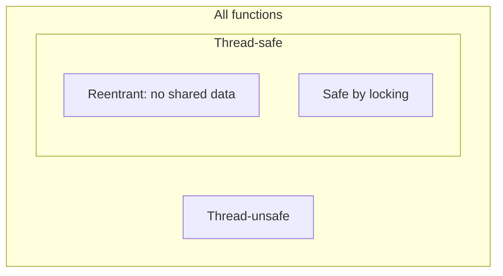
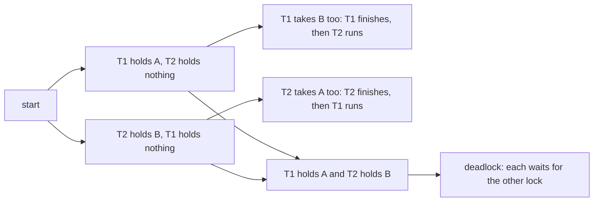

# Parallelism, thread safety, races and deadlock

> **Before this lesson:** You need threads from [Three ways to build concurrent servers](#/lesson/csapp/concurrency-models) and mutexes and semaphores from [Synchronization with semaphores](#/lesson/csapp/semaphores). Speedup and Amdahl's law were introduced in [Caches, the OS, and the big themes](#/lesson/csapp/tour-os).

## In plain words

A **thread** is one line of execution inside a program; a program with several threads does several things in overlapping time and, on a machine with several processor cores, can finish sooner. Threads share the program's memory, and a **lock** (also called a mutex) is the device that lets only one thread at a time use a piece of shared data. Sharing brings four typical problems, and a shared kitchen shows them all. Cooks queueing for the one good knife get less done than a single cook would (slow parallel code). A recipe that says "use whatever was left in the bowl" goes wrong when someone else used the bowl in between (code that is not thread-safe). Whether the dish works out depends on who reached the stove first (a race). And two cooks each hold one tool and wait for the other's, so nobody ever moves (deadlock).

Why this matters at work: these faults appear rarely, only under load, and often disappear when you try to observe them, which makes them some of the most expensive bugs in the industry. Recognising the patterns in a design review or code review prevents them. Deadlock, races and thread safety are asked about in almost every backend and systems interview.

## Why look closer

Threads promise two things: programs that stay responsive while doing several jobs, and programs that finish sooner on a machine with many cores. The previous lessons showed how to create threads and how to protect shared data with semaphores and mutexes. This lesson is about what goes wrong, and it goes wrong in four characteristic ways. A parallel program can be correct and yet *slower* than the sequential one it replaced. A function that has worked for years can corrupt data the first time two threads call it together. A program can produce the right answer a million times and the wrong one on the next run, because of timing. And a program can stop, forever, with every thread waiting politely for another. Each of these has a recognisable cause and a standard remedy. Knowing them is what separates writing threaded code from writing threaded code that works.

## 1. Using threads to go faster

A **sequential** program is one logical flow. A **concurrent** program has several flows whose lifetimes overlap. A **parallel** program is a concurrent program whose flows actually run at the same time on different cores. On a multi-core machine the kernel schedules a process's threads across the cores, so in principle a job divided among *t* threads can run up to *t* times faster.

Take the simplest possible job: adding up the integers from 0 to *n* − 1. Give each of *t* threads an equal slice of the range. Three ways of collecting the result illustrate nearly everything about parallel performance.

**Design A: one shared total, locked on every addition.**

```c
long total = 0;
pthread_mutex_t lock = PTHREAD_MUTEX_INITIALIZER;

void *worker(void *arg) {
    range_t *r = arg;
    for (long i = r->lo; i < r->hi; i++) {
        pthread_mutex_lock(&lock);
        total += i;
        pthread_mutex_unlock(&lock);
    }
    return NULL;
}
```

This is correct, and disastrous. Locking and unlocking are far more expensive than an addition, so even one thread runs many times slower than a plain loop. Worse, adding threads makes it *slower still*: the cores spend their time fighting over the lock and passing the cache line holding `total` back and forth. The lesson is blunt: **synchronisation is expensive; avoid it wherever you can, and where you cannot, do as much useful work as possible per lock acquisition.**

**Design B: each thread adds into its own slot of a shared array.**

```c
long partial[MAX_THREADS];

void *worker(void *arg) {
    range_t *r = arg;
    for (long i = r->lo; i < r->hi; i++)
        partial[r->id] += i;          /* no lock: nobody else touches this slot */
    return NULL;
}
/* the main thread adds up partial[0..t-1] after joining all workers */
```

No two threads write the same element, so no lock is needed and the result is correct. Speed now improves with the number of threads, up to the number of cores. There is still hidden waste: every iteration reads and writes memory, and neighbouring slots of the array probably share a cache line, so cores keep invalidating one another's copy of it even though they never touch the same element. That effect is called **false sharing**.

**Design C: each thread accumulates in a local variable and stores once.**

```c
void *worker(void *arg) {
    range_t *r = arg;
    long sum = 0;                     /* lives in a register */
    for (long i = r->lo; i < r->hi; i++)
        sum += i;
    partial[r->id] = sum;             /* a single write at the end */
    return NULL;
}
```

The inner loop touches no shared memory at all. This version is the fastest by a wide margin.

The demo counts the costly events in each design rather than timing them, since an interpreter cannot show true parallel speed. It then runs design C with real threads where the environment permits.

```python-run
import threading

def plan(n, t):
    step = n // t
    return [(k * step, n if k == t - 1 else (k + 1) * step) for k in range(t)]

n, t = 1_000_000, 4
print("design A: lock operations =", 2 * n, "| writes to shared memory =", n)
print("design B: lock operations = 0", "       | writes to shared memory =", n)
print("design C: lock operations = 0", "       | writes to shared memory =", t)

partial = [0] * t
def worker(k, lo, hi):
    s = 0
    for i in range(lo, hi):
        s += i
    partial[k] = s                      # one shared write per thread

try:
    threads = [threading.Thread(target=worker, args=(k, lo, hi)) for k, (lo, hi) in enumerate(plan(n, t))]
    for th in threads: th.start()
    for th in threads: th.join()
except RuntimeError:                    # no thread support in this sandbox: run the slices in turn
    for k, (lo, hi) in enumerate(plan(n, t)):
        worker(k, lo, hi)
print("design C result:", sum(partial), "| expected:", n * (n - 1) // 2)
```

### Measuring a parallel program

Let $T_p$ be the running time on $p$ cores. Two numbers summarise how well a program parallelises.

- **Speedup**: $S_p = T_1 / T_p$. When $T_1$ is the time of the best *sequential* program this is called absolute speedup; when it is the time of the parallel program run on one core it is relative speedup, which flatters the result because the parallel version carries synchronisation overhead even when alone.
- **Efficiency**: $E_p = S_p / p$, usually given as a percentage. It reports how much of the added hardware is doing useful work.

A typical pattern: time falls as threads are added until the thread count equals the core count, then rises slightly, because extra threads only add context switches.

```python-run
times = {1: 12.0, 2: 6.2, 4: 3.3, 8: 1.9, 16: 2.0}        # seconds, measured on an 8-core machine
print("threads   time   speedup   efficiency")
for p, tp in times.items():
    s = times[1] / tp
    print(f"{p:5}   {tp:5.1f}   {s:6.2f}   {100 * s / min(p, 8):8.1f}%")
```

There are also two ways to think about scaling. **Strong scaling** holds the problem fixed and asks how much faster more cores make it. **Weak scaling** grows the problem with the number of cores and asks whether the time stays constant. Weak scaling is often the more honest measure for workloads such as servers and scientific simulation, where bigger machines are bought to do more work, not the same work faster.

## 2. Thread safety

A function is **thread-safe** if it always produces correct results when called repeatedly from multiple concurrent threads. Functions that are not thread-safe fall into four groups. Recognising the group tells you the fix.

**Group 1: functions that do not protect shared variables.** An unsynchronised increment of a global counter is the standard example. The fix is to guard the shared variable with a lock. Callers need not change, but every call pays for synchronisation.

**Group 2: functions that keep state from one call to the next.** A pseudo-random generator is the classic case: each result depends on a hidden seed left behind by the previous call.

```c
static unsigned long state = 1;
int next_random(void) {
    state = state * 1103515245 + 12345;
    return (unsigned)(state / 65536) % 32768;
}
```

Called from one thread, a given seed yields a repeatable sequence. Called from several, the sequence each thread sees depends on how their calls interleave. A lock would stop the state being corrupted but would not make each thread's sequence repeatable. The real fix is to **rewrite the function so that the caller supplies the state** as an argument. That changes the interface, and with it every call site.

**Group 3: functions that return a pointer to a static variable.** Some library functions compute a result into an internal static buffer and hand back its address. If another thread calls the function before the first has finished using the buffer, the first thread's result changes underneath it. Two remedies exist. If you can modify the function, rewrite it so that the caller passes in the buffer to fill. If you cannot, use **lock-and-copy**: wrap each call in a mutex, and while holding it copy the result to private memory.

```c
char *describe_time_safe(const time_t *when, char *private_copy) {
    pthread_mutex_lock(&time_lock);
    char *shared = ctime(when);          /* result lives in a static buffer */
    strcpy(private_copy, shared);        /* copy before releasing the lock */
    pthread_mutex_unlock(&time_lock);
    return private_copy;
}
```

**Group 4: functions that call thread-unsafe functions.** Whether this makes the caller unsafe depends on the callee. If the callee is in group 2, the caller is unsafe and nothing short of rewriting the callee helps. If the callee is in group 1 or 3, the caller can be made safe by protecting the call site and any resulting shared data with a lock.

### Reentrancy

A particularly well-behaved subset of thread-safe functions are the **reentrant** ones: functions that reference *no shared data at all* when called by multiple threads.



Reentrant functions are usually faster than other thread-safe ones because they need no synchronisation. They are also the only functions safe to interrupt and call again from a signal handler.

- A function is **explicitly reentrant** if all its arguments are passed by value and all its data references are to local stack variables. It is reentrant however it is called.
- A function is **implicitly reentrant** if it takes pointers but is reentrant *provided the callers pass pointers to data that is not shared*. The rewritten random generator is like this:

```c
int next_random_r(unsigned long *state) {
    *state = *state * 1103515245 + 12345;
    return (unsigned)(*state / 65536) % 32768;
}
```

It touches only what `state` points to. If every thread passes a pointer to its own variable, no data is shared.

```python-run
# Hidden state versus caller-owned state, with two "threads" whose calls are interleaved by hand.
def make_hidden():
    state = [1]
    def nxt():
        state[0] = (state[0] * 1103515245 + 12345) % 2**31
        return (state[0] // 65536) % 32768
    return nxt

def next_r(state):                                  # the caller owns the state
    state[0] = (state[0] * 1103515245 + 12345) % 2**31
    return (state[0] // 65536) % 32768

alone = make_hidden(); print("thread A alone, hidden state     :", [alone() for _ in range(3)])
shared = make_hidden()
seq_a = []
for _ in range(3):
    seq_a.append(shared()); shared()                # thread B slips a call in between each of A's
print("thread A interleaved with B      :", seq_a, " <- A's sequence changed")

mine, theirs = [1], [1]
seq_a = []
for _ in range(3):
    seq_a.append(next_r(mine)); next_r(theirs)
print("thread A with caller-owned state :", seq_a, " <- unaffected by B")
```

### Library functions

Most functions in the standard C library are thread-safe, including `malloc`, `free`, `realloc`, `printf` and `scanf`. A few historical ones are not, because of static buffers or hidden state:

| Unsafe function | Why | Use instead |
|---|---|---|
| `rand` | hidden seed | `rand_r` |
| `strtok` | remembers its position in a static pointer | `strtok_r` |
| `asctime`, `ctime`, `localtime` | return pointers to static storage | `asctime_r`, `ctime_r`, `localtime_r` |
| `gethostbyname`, `gethostbyaddr` | static result structure | `getaddrinfo`, `getnameinfo` |
| `inet_ntoa` | static buffer | `inet_ntop` |

The `_r` suffix marks the reentrant version, which takes the state or the output buffer as an extra argument. Prefer those to lock-and-copy: the lock slows the program, and copying complicated structures with internal pointers is easy to get wrong.

## 3. Races

A **race** exists when the correctness of a program depends on one thread reaching some point in its code before another thread reaches some point in its own. Races usually come from an unspoken assumption about scheduling. The golden rule of threaded programming is that a program must work for **every feasible ordering** of its threads' instructions.

Here is a famous one. The main thread starts four workers and wants each to know its index:

```c
for (int i = 0; i < 4; i++)
    pthread_create(&tid[i], NULL, worker, &i);      /* BUG: every worker gets the same address */

void *worker(void *arg) {
    int me = *(int *)arg;                           /* reads i... but when? */
    printf("worker %d\n", me);
    return NULL;
}
```

Each worker receives a pointer to the *same* variable `i`, which the main thread goes on changing. The read in the worker races with the increment in the loop. If a worker happens to run before the next increment, it sees its own index. Otherwise it sees a later value. Typical output might be `1 2 2 4`: duplicates, gaps, and an index that is out of range. It may print `0 1 2 3` on one machine and fail on another, which is exactly what makes races dangerous.

The cure is to remove the shared variable. Give each thread its own copy of the value:

```c
for (int i = 0; i < 4; i++) {
    int *id = malloc(sizeof *id);
    *id = i;                                        /* a private cell per worker */
    pthread_create(&tid[i], NULL, worker, id);
}
void *worker(void *arg) {
    int me = *(int *)arg;
    free(arg);                                      /* the worker releases it */
    ...
}
```

The same bug appears in other languages wherever a closure captures a loop variable by reference instead of by value:

```python-run
# Every callback shares the loop variable and reads it late.
late = [lambda: i for i in range(4)]
print("captured by reference:", [f() for f in late])

# Give each callback its own copy at creation time.
bound = [lambda i=i: i for i in range(4)]
print("captured by value    :", [f() for f in bound])

# Exhaustive view of the C race: the worker may read i before or after any number of increments.
possible = sorted({seen for created_at in range(4) for seen in range(created_at, 5)})
print("values a C worker might observe for its index:", possible)
```

## 4. Deadlock

Locks introduce a failure mode of their own. A **deadlock** is a situation in which a collection of threads is blocked, each waiting for a condition that will never become true.

The standard scenario needs only two threads and two locks:

| Thread 1 | Thread 2 |
|---|---|
| lock A | lock B |
| lock B | lock A |
| ... work ... | ... work ... |
| unlock both | unlock both |

If thread 1 takes A and, before it takes B, thread 2 takes B, then thread 1 waits for B, which thread 2 holds, and thread 2 waits for A, which thread 1 holds. Neither can ever proceed.

### Seeing it in a progress graph

A **progress graph** makes this visible. Draw thread 1's sequence of instructions along the horizontal axis and thread 2's along the vertical. Any execution of the program is a path from the origin that moves only right or up. For each lock, the combinations of positions in which *both* threads would hold it form a rectangle that no path may enter: a **forbidden region**.

With the lock orders above, the forbidden rectangles for A and B overlap in an L-like arrangement that leaves a pocket in the corner between them. That pocket is the **deadlock region**. A path that wanders into it can move neither right (blocked by one rectangle) nor up (blocked by the other). It is stuck, although it has not yet broken any rule.



Three properties of deadlock make it especially unpleasant:

- **It is not deterministic.** Some schedules pass safely on either side of the trap. The program may run correctly thousands of times before the unlucky interleaving occurs.
- **It depends on the machine.** Different core counts, loads or compiler versions shift the timing.
- **It is hard to reproduce.** When it finally happens, it may not happen again under a debugger.

### Preventing it: one global lock order

Deadlock in general is a hard problem, but for programs that use mutexes there is a simple, effective discipline:

> **Lock ordering rule.** Fix a total order on all the locks in the program. If every thread acquires the locks it needs in that order, the program cannot deadlock.

In the example, make both threads take A before B. Then whichever thread gets A first will also get B, since the other cannot be holding B without having taken A. In the progress graph the two forbidden rectangles now nest neatly with no pocket between them. The order of *releasing* does not matter.

When there is no natural order, a common trick is to order locks by their memory address. For instance, a function that transfers money between two accounts locks the account at the lower address first, whichever direction the money is moving.

The demo explores every interleaving of two threads' lock operations and reports whether any of them ends stuck.

```python-run
def explore(seq1, seq2):
    """Each sequence is a list of ('lock'|'unlock', name). Returns (complete runs, deadlocked states)."""
    seen, deadlocks, complete = set(), set(), 0
    def step(i, j, held):
        nonlocal complete
        key = (i, j)
        if key in seen:
            return
        seen.add(key)
        if i == len(seq1) and j == len(seq2):
            complete += 1
            return
        moved = False
        for who, idx, seq in ((1, i, seq1), (2, j, seq2)):
            if idx == len(seq):
                continue
            action, name = seq[idx]
            if action == "lock" and name in held:
                continue                              # blocked: somebody holds it
            new_held = dict(held)
            if action == "lock": new_held[name] = who
            else:                del new_held[name]
            moved = True
            step(i + (who == 1), j + (who == 2), new_held)
        if not moved:
            deadlocks.add(key)
    step(0, 0, {})
    return complete, sorted(deadlocks)

def uses(first, second):
    return [("lock", first), ("lock", second), ("unlock", second), ("unlock", first)]

done, stuck = explore(uses("A", "B"), uses("B", "A"))
print("opposite orders: reaches the end:", bool(done), "| stuck states (T1 step, T2 step):", stuck)
done, stuck = explore(uses("A", "B"), uses("A", "B"))
print("same order     : reaches the end:", bool(done), "| stuck states:", stuck or "none")
```

The single stuck state in the first run, `(1, 1)`, is exactly the pocket: each thread has completed one step, holding one lock and wanting the other.

### Other tools

Lock ordering is the workhorse, but other approaches exist and are worth knowing by name:

- **Hold one lock at a time** where the design allows; a thread holding a single lock cannot be part of a cycle.
- **Try-lock with back-off**: attempt the second lock without blocking and, on failure, release the first and retry later.
- **Timeouts** on lock acquisition, treating expiry as an error to recover from.
- **Coarser locks**: one lock covering both resources is slower but cannot deadlock with itself.
- **Avoiding shared mutable state** altogether, by passing messages or using immutable data.

Classical theory lists four conditions that must all hold for deadlock: mutual exclusion, hold-and-wait, no preemption, and a circular wait. Each technique above works by breaking one of them. Lock ordering breaks the circular wait.

> [!INTERVIEW]
> **"What is a deadlock and how do you prevent it?"** Two or more threads each hold a resource and wait for one held by another, so none can continue. Give the two-lock example with opposite acquisition orders. Then the prevention: impose a single global order on locks and always acquire in that order, which makes a cycle of waiting impossible. Mention alternatives (try-lock with back-off, timeouts, a single coarser lock) and the four necessary conditions if asked for theory.

> [!INTERVIEW]
> **"Thread-safe versus reentrant?"** Thread-safe means correct when called concurrently from several threads, by whatever means, including internal locking. Reentrant is stricter: the function uses no shared state at all, only its arguments and locals, so it needs no locks and may even be interrupted and called again, as from a signal handler. Every reentrant function is thread-safe; a function that is safe only because it takes a lock is not reentrant. `strtok` is neither; `strtok_r` is reentrant.

> [!INTERVIEW]
> **"Your multithreaded version is slower than the single-threaded one. Why?"** The usual suspects: a lock taken inside the hot loop, so threads serialise and pay for synchronisation; false sharing, where threads write to distinct variables that sit in one cache line; more threads than cores, adding context switches; or a workload limited by memory bandwidth or I/O. The fix is typically to accumulate in thread-local variables and combine once at the end.

## 5. Pitfalls

- **Locking inside the innermost loop.** Restructure so each thread works on private data and synchronises rarely.
- **Assuming a thread-safe function is fast,** or that a fast one is thread-safe.
- **Calling legacy library functions with static buffers** from threads. Use the `_r` versions.
- **Passing the address of a loop variable or other short-lived local to a new thread.**
- **Testing as proof.** A race or deadlock that does not appear in a thousand test runs is not thereby absent. Reason about all interleavings; use tools such as ThreadSanitizer.
- **Acquiring locks in an order that depends on arguments.** `transfer(x, y)` and `transfer(y, x)` running together lock in opposite orders unless you sort them.
- **Calling unknown code while holding a lock.** A callback may try to take a lock you already hold, or one that is ordered before it.
- **Reporting speedup against the wrong baseline.** Compare with the best sequential program.

## Summary

- Parallel speed comes from dividing work among cores, and it is easily lost to synchronisation. Keep hot loops free of locks and shared writes; combine per-thread results at the end.
- Speedup is $T_1/T_p$ and efficiency is speedup divided by the number of cores. Strong scaling fixes the problem size; weak scaling grows it with the machine.
- Thread-unsafe functions fail to protect shared variables, keep state between calls, return pointers to static storage, or call other unsafe functions. Fixes are locking, passing state explicitly, caller-supplied buffers or lock-and-copy.
- Reentrant functions share no data and need no locks; they form a subset of thread-safe functions.
- A race is a dependence on timing between threads. Eliminate the shared data, or synchronise access to it, so that every interleaving is correct.
- Deadlock is mutual waiting. Acquiring locks in one fixed global order prevents it.

## Glossary

- **Thread**: a flow of control within a process that shares its memory with the process's other threads.
- **Parallel program**: a program whose threads actually run at the same time on different cores.
- **Mutex (lock)**: a device ensuring that only one thread at a time executes a protected piece of code.
- **Synchronisation**: coordinating threads, usually with locks, so that shared data stays correct.
- **Speedup**: the time on one core divided by the time on several.
- **Efficiency**: speedup divided by the number of cores, as a percentage.
- **False sharing**: slowdown when threads write to different variables that share one cache block.
- **Thread-safe**: describes a function that gives correct results when called from several threads at once.
- **Reentrant**: describes a function that uses no shared data at all, so it needs no lock.
- **Lock-and-copy**: holding a lock while calling an unsafe function and copying its result to private memory.
- **Race**: a bug in which correctness depends on which thread reaches a certain point first.
- **Deadlock**: a state in which threads wait for one another forever.
- **Progress graph**: a diagram of the possible interleavings of two threads.
- **Lock ordering**: the rule that all threads acquire locks in one agreed order, which prevents deadlock.

```quiz
[
  {"q": "A parallel sum protects a single global total with a mutex locked on every addition. Why does it run slower with more threads?",
   "options": ["The additions become more expensive", "Lock and unlock dominate the work, and threads contend for the lock and the cache line holding the total", "Threads cannot run on multiple cores", "The compiler disables optimisation for threads"],
   "answer": 1, "explain": "Synchronisation costs far more than an addition, and contention makes each acquisition costlier as threads are added. Accumulating privately and combining once avoids both."},
  {"q": "A program takes 20 s on 1 core and 4 s on 8 cores. What are its speedup and efficiency?",
   "options": ["Speedup 5, efficiency 62.5%", "Speedup 8, efficiency 100%", "Speedup 5, efficiency 40%", "Speedup 2.5, efficiency 31%"],
   "answer": 0, "explain": "Speedup is 20/4 = 5. Efficiency is speedup divided by cores: 5/8 = 62.5%."},
  {"q": "A function computes its result in a static local buffer and returns a pointer to it. What is the least invasive way to use it safely from several threads when you cannot change it?",
   "options": ["Call it faster", "Lock-and-copy: hold a mutex around the call and copy the result to private storage before unlocking", "Declare the pointer volatile", "Call it only from detached threads"],
   "answer": 1, "explain": "The mutex prevents another thread from overwriting the static buffer until the caller has taken a private copy of the result."},
  {"q": "Which statement about reentrant functions is true?",
   "options": ["They must use a mutex", "They access no shared data, so they are thread-safe without synchronisation", "They are never thread-safe", "They may keep state in static variables"],
   "answer": 1, "explain": "Reentrancy means no shared data is referenced. Such functions are a proper subset of the thread-safe functions."},
  {"q": "Why is rand not thread-safe, and why does adding a lock not fully fix it?",
   "options": ["It is too slow; a lock makes it slower", "It keeps a hidden seed across calls; a lock prevents corruption but each thread's sequence still depends on how calls interleave", "It returns a pointer to a static buffer", "It calls malloc"],
   "answer": 1, "explain": "State carried between invocations makes results depend on the global order of calls. The fix is a version, such as rand_r, where the caller supplies the state."},
  {"q": "The main thread passes &i to each new thread inside a for loop over i. What is the bug?",
   "options": ["The threads cannot read stack variables", "All threads share one variable that the main thread keeps changing, so the value a thread reads depends on timing", "pthread_create copies i incorrectly", "i is deallocated before the first thread starts"],
   "answer": 1, "explain": "The dereference in each thread races with the loop's increment. Each thread should receive its own copy of the value."},
  {"q": "Thread 1 locks A then B. Thread 2 locks B then A. Which statement is correct?",
   "options": ["The program always deadlocks", "The program never deadlocks", "The program may deadlock, depending on the interleaving", "Deadlock occurs only on a single core"],
   "answer": 2, "explain": "If each thread acquires its first lock before the other acquires its second, both wait forever. Other schedules complete normally, which is why the bug is intermittent."},
  {"q": "What does the lock ordering rule require?",
   "options": ["Locks are released in the order they were acquired", "Every thread acquires the locks it needs according to one fixed global order", "Each thread holds at most one lock", "Locks are always acquired in alphabetical order of thread name"],
   "answer": 1, "explain": "A single total order over locks makes a cycle of waiting threads impossible. The release order is irrelevant."}
]
```

> **Source:** CS:APP 3e, §12.6–12.7
