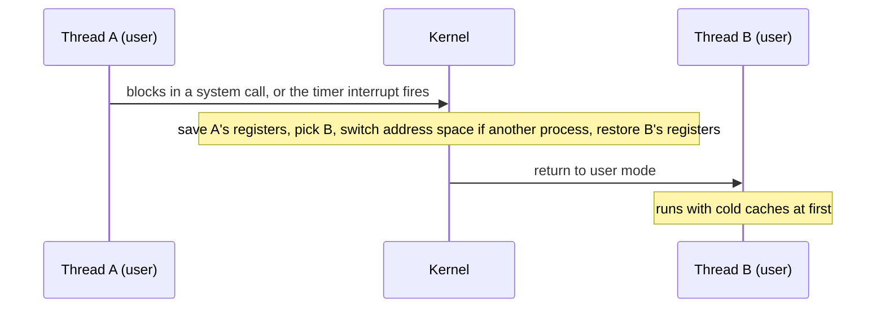
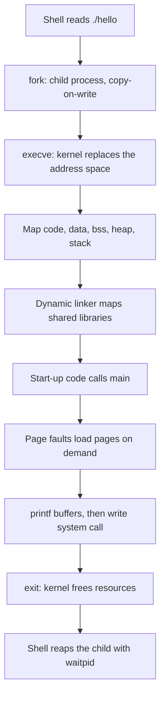

# Systems interview essentials

Systems questions in interviews are rarely about trivia. They test whether you carry an accurate mental model of the machine: where data lives, what an operation really costs, and what the kernel does on your behalf. This lesson pulls the whole track together into the handful of topics that come up again and again, each with the short answer, the reasoning behind it, the follow-ups an interviewer is likely to ask, and the traps candidates fall into. Treat it as a revision sheet and as a set of answers to practise saying aloud.

## 1. Stack vs. heap

**The short answer.** Both are regions of a process's virtual address space. The **stack** holds function call frames: return addresses, saved registers and local variables. It is managed automatically by the compiler with last-in, first-out discipline, and allocation is just a change to the stack pointer. The **heap** holds dynamically allocated objects whose lifetime is controlled by the program (`malloc`/`free`, `new`/`delete`, or a garbage collector). It is managed by an allocator library on top of memory obtained from the kernel.

| | Stack | Heap |
|---|---|---|
| Lifetime | Until the function returns | Until freed (or collected) |
| Allocation cost | One instruction (move `%rsp`) | A search of free lists, possibly a system call |
| Size | Small and fixed per thread (commonly 8 MB for the main thread on Linux) | Limited by virtual memory |
| Growth direction on x86-64 | Toward lower addresses | Toward higher addresses |
| Fragmentation | None | Internal and external |
| Typical bugs | Overflow from deep recursion or huge locals; returning a pointer to a local | Leaks, use after free, double free, overruns |
| Sharing between threads | One stack per thread | One heap shared by all threads |

**Why the stack is fast.** Frames are allocated and freed in strict nesting order, so no bookkeeping is needed, and the top of the stack is almost always in the L1 cache.

**What goes where.** A local `int` or small struct lives on the stack or purely in a register. Anything whose size is unknown until run time, that is large, or that must outlive the function that creates it goes on the heap. Global and `static` variables are in neither: they live in the data or bss segments for the whole run.

**Follow-ups.**

- *What happens on a stack overflow?* The stack pointer moves into an unmapped guard page; the access faults and the kernel delivers `SIGSEGV`.
- *Why is returning the address of a local variable wrong?* The frame is released on return and reused by the next call, so the pointer dangles.
- *Where do the variables of a thread live?* Each thread has its own stack inside the shared address space; nothing protects one stack from another thread that holds a pointer into it.

```python-run
# A picture of a typical Linux x86-64 process, low addresses first.
layout = [
    ("0x400000",        "code (.text, .rodata)", "read/execute, mapped from the executable"),
    ("0x600000 or so",  "data (.data, .bss)",    "globals and statics; bss is zero-filled on demand"),
    ("above the data",  "heap",                  "grows upward via brk/mmap; managed by malloc"),
    ("middle",          "shared libraries, mmap regions", "libc.so and friends; file and anonymous mappings"),
    ("near 2^47",       "stack",                 "grows downward; one per thread"),
    ("above 2^47",      "kernel",                "not accessible from user mode"),
]
for addr, name, note in layout:
    print(f"{addr:16} {name:32} {note}")
```

## 2. Cache lines and locality

**The short answer.** Memory is not uniformly fast. Data moves between main memory and the CPU caches in fixed-size blocks called **cache lines**, 64 bytes on current x86 processors. Touching one byte brings its whole line into the cache, so the next accesses to neighbouring bytes are nearly free, while a jump to a distant address may cost a hundred times more.

Rough costs to keep in your head:

| Access | Approximate cost |
|---|---|
| Register | Free |
| L1 cache hit | About 4 cycles, roughly 1 ns |
| L2 cache hit | About 10 cycles |
| L3 cache hit | About 40 to 75 cycles |
| Main memory | About 200 cycles, roughly 100 ns |
| SSD read | About 100 microseconds |
| Rotating disk seek | About 10 milliseconds |

**Consequences worth stating.**

- Sequential traversal of an array is the best case: one miss per line (every sixteenth `int`), and the hardware prefetcher recognises the pattern and fetches ahead.
- Iterating a two-dimensional C array row by row is far faster than column by column, because C stores rows contiguously.
- Linked lists and trees of separately allocated nodes scatter data across memory; each pointer hop is a potential miss, and the address of the next node is unknown until the current one arrives, so the processor cannot overlap the fetches.
- Hash tables with open addressing beat chained ones in practice for the same reason, and B-trees beat binary trees for large ordered sets.
- Complexity analysis hides these constants. For small inputs a linear scan of a contiguous array often beats a logarithmic structure built from pointers.

**Follow-ups.** *How is an address looked up in a cache?* Split it into tag, set index and block offset; the index selects a set, the tags in that set are compared, the offset selects the byte. *What are the kinds of miss?* Cold (first touch), conflict (too many blocks mapping to one set) and capacity (working set larger than the cache). *How do you measure it?* Hardware performance counters, for example `perf stat -e cache-misses`.

```python-run
def misses(n_elems, elem_size, stride, line=64):
    """Cold-cache misses when visiting every stride-th element of a large array."""
    lines = {(i * elem_size) // line for i in range(0, n_elems, stride)}
    visited = len(range(0, n_elems, stride))
    return len(lines), visited
for stride in (1, 2, 4, 8, 16, 32):
    m, v = misses(1 << 16, 4, stride)
    print(f"stride {stride:2}: {v:6} accesses, {m:5} misses, miss rate {m / v:.3f}")
```

## 3. False sharing

**The short answer.** False sharing happens when threads on different cores write to **different variables that occupy the same cache line**. The cores are not sharing data logically, but the cache-coherence protocol works on whole lines: each write forces the other core's copy of the line to be invalidated, so the line bounces back and forth. The program stays correct and becomes mysteriously slow, sometimes slower than the single-threaded version.

**The typical setting.** An array of per-thread counters, `long count[NTHREADS]`, updated in a hot loop. Eight `long`s fit in one line, so all the threads hammer the same line.

**Fixes.**

- Accumulate in a local variable and write the result once at the end.
- Pad or align each per-thread slot to the cache-line size (for instance `alignas(64)` in C11/C++).
- Group data by the thread that writes it, not by type.

**How to recognise it.** Scaling gets worse as threads are added even though there is no lock contention; a profiler shows time concentrated on a plain store instruction; tools such as `perf c2c` report contended lines.

**Contrast with true sharing.** If threads really update the same variable, the remedy is different: reduce sharing, use an atomic operation, or protect it with a lock. False sharing needs no synchronization at all, only a change of layout.

## 4. Context switches

**The short answer.** A context switch is the kernel suspending one thread of execution and resuming another on the same core. The kernel saves the outgoing thread's registers (general-purpose registers, program counter, stack pointer, flags, floating-point and vector state), updates its scheduling records, chooses the next thread, restores that thread's registers, and returns to user mode. If the incoming thread belongs to a **different process**, the kernel also switches address spaces by loading a new page-table root.

**When they happen.** When a thread blocks (waiting for I/O, a lock or a timer), when its time slice ends (the periodic timer interrupt gives the kernel control), when a higher-priority thread becomes runnable, or when the thread yields voluntarily.

**What it costs.** The direct work is on the order of a microsecond or a few. The larger cost is indirect: the new thread's data and code are not in the caches, and after an address-space change the translation lookaside buffer no longer helps, so the first stretch of execution runs with many misses.

**Process switch vs. thread switch.** Threads of one process share an address space, so switching between them keeps the page tables and the TLB contents; switching between processes does not. That is one reason threads are described as lightweight.

**Follow-ups.**

- *Mode switch vs. context switch?* A system call changes the privilege level and stack but stays in the same thread; it is cheaper than a full context switch.
- *How would you reduce context switching?* Use fewer runnable threads than cores for CPU-bound work, avoid lock contention, batch I/O, use non-blocking I/O with an event loop, or user-level scheduling (coroutines, green threads).
- *How do you observe them?* `vmstat`, `pidstat -w`, or `/proc/<pid>/status` (voluntary and involuntary counts).



## 5. System calls

**The short answer.** A system call is how a user program asks the kernel to do something it is not allowed to do itself: read a file, create a process, map memory, send a packet. User code cannot simply call a kernel function, because the kernel runs at a higher privilege level in protected memory. Instead the program executes a special trap instruction that switches the processor to kernel mode at a fixed entry point.

**The mechanics on Linux x86-64.**

1. A library wrapper (for example `write` in libc) places the system call number in `%rax` and up to six arguments in `%rdi`, `%rsi`, `%rdx`, `%r10`, `%r8`, `%r9`.
2. It executes the `syscall` instruction. The processor switches to kernel mode, saves the user return address and flags, and jumps to the kernel's entry routine, which switches to the kernel stack.
3. The kernel validates the arguments (never trusting user pointers), looks up the handler in its system call table and runs it. If the request cannot complete yet, the thread is put to sleep and another runs.
4. The result is placed in `%rax` (a small negative value signals an error, which the wrapper converts to `-1` and `errno`), and the processor returns to user mode.

**What it costs.** Hundreds of nanoseconds for a trivial call, far more than a function call, because of the privilege transition, the argument checks and the disturbance to caches and predictors. This is the reason for **buffering**: `printf` collects output in user space and issues one `write` for many lines; reading a file a byte at a time with `read` is slow while `fread` or `mmap` is not.

**Follow-ups.**

- *System call vs. library function?* `strlen` runs entirely in user mode. `fopen` is a library function that eventually makes the `open` system call. `strace` shows exactly which system calls a program makes.
- *What are the main families?* Process control (`fork`, `execve`, `exit`, `wait`), files (`open`, `read`, `write`, `close`, `stat`), memory (`brk`, `mmap`), networking (`socket`, `connect`, `accept`), and signals (`kill`, `sigaction`).
- *Interrupt vs. trap vs. fault?* An interrupt is asynchronous and comes from a device; a trap is a deliberate, synchronous entry such as a system call; a fault is a synchronous error that may be repairable, such as a page fault.

```python-run
import os, time
fd = os.open(os.devnull, os.O_WRONLY)
n, payload = 20_000, b"x"
t = time.perf_counter()
for _ in range(n): os.write(fd, payload)                 # one system call per byte
per_call = (time.perf_counter() - t) / n
t = time.perf_counter()
os.write(fd, payload * n)                                # one system call for everything
batched = time.perf_counter() - t
os.close(fd)
print(f"unbatched: about {per_call * 1e9:8.0f} ns per 1-byte write ({n} calls)")
print(f"batched  : {batched * 1e6:8.1f} microseconds for all {n} bytes in one call")
```

(The absolute numbers include interpreter overhead; the ratio is what matters.)

## 6. What happens when you run a program?

This is the classic open-ended question, and a good answer walks through the layers in order. Suppose you type `./hello` in a shell.

1. **The shell reads and parses the command.** It decides this is not a built-in.
2. **`fork`.** The shell creates a child process. The child gets a copy of the parent's address space (shared copy-on-write, so almost nothing is physically copied) and its open file descriptors.
3. **`execve`.** The child asks the kernel to replace its program with `hello`. The kernel checks permissions, reads the file's header to learn its format and layout, and discards the old address space.
4. **Mapping, not copying.** The kernel sets up new regions: code and read-only data mapped from the file, initialised data mapped privately from the file, zero-filled bss, a heap, and a stack on which it places the argument and environment strings. No file contents are read yet.
5. **Dynamic linking.** If the program uses shared libraries, the kernel also maps the dynamic linker and starts there. The dynamic linker maps the libraries the program needs (for example the C library), fills in the table of addresses of global data, and arranges for function addresses to be resolved lazily on first call.
6. **Start-up code.** Control reaches the program's entry point, a small routine supplied by the C runtime, which initialises the library and calls `main(argc, argv, envp)`.
7. **Demand paging.** The first instruction touches a page that is mapped but not present. The processor raises a page fault; the kernel finds the page in its file cache or reads it from disk, installs a page-table entry and restarts the instruction. This repeats for each new page, so only the parts of the program that are actually used are ever loaded.
8. **Execution.** Instructions are fetched through the instruction cache, decoded, and executed out of order by a pipelined core. Each memory access translates a virtual address through the TLB (or a page-table walk on a miss) and then goes through the data caches.
9. **Output.** `printf` formats into a user-space buffer; when it is flushed, the library makes a `write` system call on descriptor 1. The kernel passes the bytes to the terminal driver, and they appear on screen.
10. **Exit.** `main` returns to the start-up code, which runs exit handlers, flushes buffers and calls `exit`. The kernel releases the process's memory and files and keeps a small record of its status.
11. **Reaping.** The shell, blocked in `waitpid`, is woken (it also receives `SIGCHLD`), collects the exit status so the child does not remain a zombie, and prints the next prompt.



**Earlier chapter: how the executable came to exist.** The preprocessor expands includes and macros; the compiler translates C to assembly; the assembler produces a relocatable object file; the linker resolves symbols across object files and libraries and relocates code and data to their final addresses.

**Depth cues that impress.** Mention copy-on-write in `fork`; that `execve` keeps the process ID and open descriptors (which is how redirection works); that loading is lazy; that randomised layout changes addresses from run to run; and that Ctrl+C would reach the program as `SIGINT` sent to the foreground process group.

## 7. Rapid-fire questions and answers

**Process vs. thread.** A process is an instance of a running program with its own address space and resources. A thread is a flow of control within a process, with its own stack and registers, sharing memory and files with its peers. Threads are cheaper to create and switch and communicate through shared memory; processes are isolated and communicate through pipes, sockets or explicitly shared mappings.

**Virtual memory in one breath.** Every process sees its own large, contiguous address space. The hardware translates each virtual address to a physical one using per-process page tables, cached in the TLB. Pages are loaded on demand, can be shared between processes, are protected by permission bits, and can be moved to disk when memory is tight.

**What is a page fault?** An access to a page with no valid translation. If the address is legal, the kernel supplies the page (from a file, from swap, or as a fresh zero page) and restarts the instruction. If it is not legal, or the access violates permissions, the process receives `SIGSEGV`.

**What is a segmentation fault?** The second case above: touching an address outside every mapped region (null or wild pointer, running off the stack) or violating permissions (writing to code or read-only data).

**How does `malloc` work?** It manages a pool of memory from the kernel, keeps a small header on each block with its size and status, finds a free block of sufficient size (often using free lists segregated by size), splits off any large remainder, and returns a pointer just past the header. `free` uses the header to find the size, marks the block free and merges it with free neighbours.

**Two's complement and overflow.** Signed integers give the top bit a negative weight; the same adder serves signed and unsigned arithmetic. Signed overflow occurs when two operands of the same sign produce a result of the other sign; in C it is undefined behavior, while unsigned arithmetic wraps. Mixing signed and unsigned in a comparison converts the signed operand to unsigned, with surprising results for negative values.

**Why does `0.1 + 0.2 != 0.3`?** Binary floating point can represent only fractions whose denominators are powers of two, so each of those literals is rounded, and the rounded sum differs from the rounded 0.3 in the last bit. Compare with a tolerance; use integers or decimals for money.

**Big-endian vs. little-endian.** The order of a multi-byte value's bytes in memory: least significant byte first on x86, most significant first in network byte order. It matters when exchanging binary data between machines or reinterpreting memory.

**What does the linker do?** It combines object files, matches each symbol reference with exactly one definition, and patches addresses once the final layout is known. Static linking copies library code into the executable; dynamic linking defers it to load time and shares one copy among processes.

**Mutex vs. semaphore; race vs. deadlock.** A mutex gives exclusive access and has an owner; a semaphore is a counter with atomic wait and signal. A race is a result that depends on timing; a deadlock is a set of threads each waiting for something another holds. Locks cure races and can cause deadlocks; a consistent lock order cures those.

**Blocking vs. non-blocking I/O.** A blocking call suspends the thread until data is ready. A non-blocking call returns at once, and the program uses a readiness mechanism such as `select` or `epoll` to learn when to try again, which lets one thread serve many connections.

**Why is a branch misprediction expensive?** A pipelined processor fetches and starts executing instructions along the predicted path long before the branch is resolved. If the prediction was wrong, that speculative work is discarded and fetching restarts, costing roughly fifteen to twenty cycles. Predictable branches are almost free; random ones are not, which is why sorted data can process faster than unsorted data.

**What makes buffer overflows dangerous, and what defends against them?** C does not check array bounds, and a function's local buffers sit on the stack next to its saved state, including the return address. Copying more data into a buffer than it can hold overwrites that neighbouring state, which can crash the program or redirect its control flow. Defences work in layers: length-checked library functions and safer languages prevent the overrun; a stack protector places a random guard value before the saved state and checks it on return; address-space layout randomisation makes addresses unpredictable; and marking the stack and heap non-executable stops injected data from being run as code.

## 8. How to answer systems questions well

- **Start with one sentence that is correct**, then add layers. The interviewer can stop you when they have heard enough.
- **Name the mechanism and its cost.** "A system call traps into the kernel, which costs a privilege switch" is stronger than "it calls the OS".
- **Use numbers at the right order of magnitude.** A cache line is 64 bytes; a page is 4 KB; an L1 hit is about a nanosecond; memory is about a hundred; a disk seek is about ten milliseconds.
- **Say what you would measure.** `strace` for system calls, `perf` for cache and branch behavior, `valgrind` or sanitizers for memory errors, `/proc` for a process's mappings.
- **Admit the boundary of your knowledge** and reason from first principles past it. Reasoning aloud from a sound model is exactly what is being tested.

> [!TIP]
> Practise by explaining each of the six main topics above to someone else in two minutes, without notes. If you can draw the address-space picture, the three file tables, the cache address split and the fork-exec-wait sequence from memory, you are in good shape.

## Check yourself

```quiz
[
  {"q": "Which statement about stack and heap allocation is correct?", "options": ["Heap allocation is faster because it avoids the stack pointer", "Stack allocation is essentially a stack-pointer adjustment, while heap allocation requires allocator bookkeeping", "Both require a system call each time", "The stack is shared by all threads"], "answer": 1,
   "explain": "Frames are allocated by moving the stack pointer; malloc must search and maintain free lists. Each thread has its own stack."},
  {"q": "An int array is scanned sequentially on a machine with 64-byte cache lines. Roughly how often does a cold-cache access miss?", "options": ["Every access", "Every 4th access", "Every 16th access", "Never"], "answer": 2,
   "explain": "Sixteen 4-byte ints fit in one 64-byte line, so one miss brings in the next fifteen elements."},
  {"q": "Two threads increment separate counters stored next to each other in an array and the program scales badly. The cause is most likely:", "options": ["A deadlock", "False sharing of a cache line", "A race condition on the counters", "Too many system calls"], "answer": 1,
   "explain": "The counters are logically independent but share a cache line, which bounces between the cores."},
  {"q": "Why is switching between two threads of the same process cheaper than switching between two processes?", "options": ["Threads have no registers to save", "The address space stays the same, so page tables and TLB contents remain valid", "The kernel is not involved", "Threads share a stack"], "answer": 1,
   "explain": "Only the thread context changes; no address-space switch is needed."},
  {"q": "In which register does a Linux x86-64 program pass the system call number?", "options": ["%rdi", "%rax", "%rsp", "%rcx"], "answer": 1,
   "explain": "%rax holds the number and later the return value; arguments use %rdi, %rsi, %rdx, %r10, %r8, %r9."},
  {"q": "When a program is started with execve, how much of the executable file is read into memory immediately?", "options": ["All of it", "Only the code", "Almost none: regions are mapped and pages are loaded on demand by page faults", "Only the data"], "answer": 2,
   "explain": "Loading sets up mappings; the contents arrive lazily when pages are first touched."},
  {"q": "After the child process running your program exits, what must the shell do?", "options": ["Nothing", "Call execve again", "Reap it with wait or waitpid so that it does not remain a zombie", "Send it SIGKILL"], "answer": 2,
   "explain": "A terminated child stays in the process table until its parent collects its status."},
  {"q": "Why does buffered output (printf) usually outperform calling write for every small piece of data?", "options": ["write is deprecated", "Each write is a system call with a privilege switch; buffering turns many small calls into few large ones", "printf bypasses the kernel", "Buffers are stored in registers"], "answer": 1,
   "explain": "The fixed cost of entering the kernel is amortised over much more data."}
]
```

> **Source:** A synthesis of CS:APP 3e: §1 (overview), §2 (data representation), §3.7 and §3.10 (stack, buffer overflow defences), §6 (memory hierarchy), §7 (linking and loading), §8 (processes, system calls, signals), §9 (virtual memory, allocation), §10 (I/O) and §12 (concurrency).
