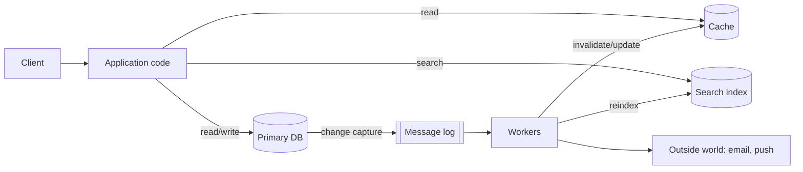

# Reliability and maintainability

Most applications people build today are **data-intensive** rather than compute-intensive. CPU cycles are rarely what holds them back. The hard parts are how much data there is, how complicated it is, and how fast it changes. Kleppmann opens *Designing Data-Intensive Applications* (DDIA) by arguing that we should stop thinking of "the database", "the cache" and "the queue" as separate product categories. A real system glues several of them together behind an API, and whoever designs that API has become a **data-system designer**.

This lesson covers two of the three big non-functional goals from Chapter 1: **reliability** and **maintainability**. The third, scalability, gets its own lesson.

## 1. Thinking about data systems

A typical web backend might contain:

- a primary **database** (PostgreSQL, MySQL) as the system of record,
- a **cache** (Redis, Memcached) to speed up expensive reads,
- a **search index** (Elasticsearch) for keyword search,
- a **message queue / log** (Kafka, RabbitMQ) for asynchronous work,
- **stream processors** and **batch jobs** that compute derived data.



The boundaries between these tools are fuzzy. Redis can act as a datastore and also as a message queue. Kafka is a log with database-like durability. As soon as application code has to keep the cache and the index in sync with the database, *you* are responsible for guarantees such as "the cache is invalidated on every write". The three questions DDIA keeps asking are:

1. **Reliability.** The system keeps working correctly, meaning the right function at the expected performance, even when things go wrong.
2. **Scalability.** As data volume, traffic or complexity grow, there are reasonable ways to cope.
3. **Maintainability.** Over time, many different people can work on the system productively, both keeping it running and adapting it.

## 2. Reliability: faults vs failures

Informally, a reliable system "continues to work correctly, even when things go wrong". The things that can go wrong are **faults**. A system that anticipates them and copes is **fault-tolerant** (or *resilient*).

The vocabulary matters:

| Term | Meaning |
|---|---|
| **Fault** | One component deviating from its spec, such as a disk dying or a process crashing |
| **Failure** | Users can no longer get the service they came for: the whole system has let them down |

Driving the probability of faults to zero is impossible, so the goal is to keep faults from turning into failures. A counterintuitive corollary is that you can *raise* reliability by deliberately injecting faults. Netflix's **Chaos Monkey** kills random production processes so that the fault-handling code gets exercised constantly instead of rotting until a real outage. Many critical bugs live in poorly tested error-handling paths.

> [!NOTE]
> Prevention still beats cure for some faults. For a security breach, for example, the damage cannot be undone. DDIA focuses on faults that *can* be tolerated.

### 2.1 Hardware faults

Hard disks have a mean time to failure (MTTF) of roughly 10–50 years. In a cluster of 10,000 disks you should therefore expect about **one disk to die per day**. RAM gets corrupted, power fails, and someone unplugs the wrong network cable.

The traditional answer is **redundancy at the component level**: RAID, dual power supplies, hot-swappable CPUs, generators. That lets a single machine run for years. As data volumes and compute demands grew, though, applications started running on many machines, and cloud platforms such as AWS prefer flexibility to single-machine durability, so a VM can vanish without warning. The trend is toward **software fault tolerance**: systems that survive the loss of whole machines. This has an operational benefit too, because you can patch machines one at a time with a **rolling upgrade** and avoid planned downtime.

### 2.2 Software errors

Hardware faults are mostly random and independent. Software faults are **systematic and correlated**. One bug can take down every node at once. Examples:

- A leap second on 30 June 2012 made many Linux-based applications hang at the same moment because of a kernel bug.
- A runaway process consumes a shared resource such as CPU, memory, disk or network bandwidth.
- A dependency slows down, stops responding or returns corrupt responses.
- **Cascading failures**, where a fault in one component triggers faults in others.

These bugs tend to lie dormant until an unusual circumstance triggers them, at which point it turns out the software was making some assumption about its environment that is no longer true. No silver bullet exists, but many small things help: questioning what the code assumes about its environment, testing heavily, isolating processes from one another, designing for crash-and-restart, and watching production with metrics and alerts. A system that promises an invariant, such as "a queue's incoming messages equal outgoing messages", can check that invariant continuously.

### 2.3 Human errors

People design, build and operate systems, and people make mistakes. One study of large internet services found that operator **configuration errors** were the leading cause of outages, while hardware faults explained only 10–25%. Defences:

- **Design for the right thing to be easy.** Good abstractions, APIs and admin interfaces should make the correct action natural, without being so restrictive that people work around them.
- **Sandboxes.** Give people non-production environments with real data where they can explore safely.
- **Test thoroughly.** Use unit tests through whole-system integration tests, plus automated tests for corner cases that rarely come up in normal operation.
- **Quick recovery.** Undoing a bad config change should take seconds, new releases should reach a small slice of traffic first, and there should be a way to rebuild derived data when an earlier job turns out to have been buggy.
- **Detailed monitoring** (*telemetry*): performance metrics and error rates.
- **Good management practices and training.**

> [!INTERVIEW]
> "How would you make this system reliable?" is not only about replicas. A strong answer covers three fault classes. **Hardware** is handled with redundancy and replication. **Software** is handled with isolation, gradual rollout, invariants and chaos testing. **Human** error is handled with safe defaults, staging environments, fast rollback and observability. Also mention that you would *measure* reliability with an SLO.

### 2.4 How important is reliability?

Reliability matters for "boring" applications too. Bugs in business software cost productivity and can create legal exposure from wrongly reported figures. Imagine a parent who stores every photo of their children in your app, and then the database gets corrupted. Sometimes reliability is traded away on purpose, for example to ship a prototype or run a low-margin service, but that should be a conscious decision.

## 3. Maintainability

The majority of software cost is not initial development. It is **ongoing maintenance**: fixing bugs, keeping it operational, investigating failures, adapting to new platforms, paying down technical debt and adding features. Everyone dreads inheriting a "legacy system". DDIA breaks maintainability into three design principles.

### 3.1 Operability: making life easy for operations

"Good operations can often work around bad software, but good software cannot run reliably with bad operations." An operations team is responsible for:

- monitoring health and restoring service quickly when it is unhealthy,
- tracking down causes of problems such as failures and degraded performance,
- keeping software and platforms patched,
- knowing which systems depend on which, so that a risky change is caught before it hurts something downstream,
- anticipating future problems such as capacity planning,
- establishing good deployment and configuration practices,
- complex maintenance tasks such as moving an application between platforms,
- preserving the organisation's knowledge as people come and go.

Software helps its operators when it offers **visibility** (metrics and logs that show what it is doing), is easy to **automate**, keeps working while any one machine is taken out for maintenance, comes with **documentation** and a simple mental model of cause and effect ("if I do X, Y will happen"), ships **sensible defaults** that an administrator may still override, **heals itself** in routine cases while leaving a manual override, and behaves **predictably**.

### 3.2 Simplicity: managing complexity

Small projects are pleasant. As they grow they turn into a **big ball of mud**. Symptoms of excess complexity include an explosion of state space, tight coupling between modules, tangled dependencies, inconsistent naming, performance hacks and special cases everywhere. Complexity makes bugs more likely and slows everyone down.

The key distinction (after Moseley and Marks) is between **essential** complexity, inherent in the problem users want solved, and **accidental** complexity, which arises only from the implementation. The best tool against accidental complexity is **abstraction**: a clean façade that hides implementation detail. High-level languages hide machine code and registers. SQL hides on-disk data structures, concurrency control and crash recovery. Much of DDIA is about finding good abstractions for pieces of a data system.

### 3.3 Evolvability: making change easy

Requirements never stay still. You learn new facts, new use cases emerge, priorities change, regulations change and the system grows. Agile practices such as TDD and refactoring help at small scale. DDIA asks how to get that same agility at the level of a whole data system made of several applications. One example is refactoring Twitter's timeline architecture (approach 1 to approach 2, see the next lesson). Evolvability is tied to simplicity: simple systems are easier to change. Encoding formats that allow **backward and forward compatibility** (Chapter 4) are a key technical enabler.

## 4. Worked example: from faults to an availability budget

Here is a small simulation that makes the "faults are inevitable" argument concrete. We model a cluster of disks, each with an annual failure rate, and count how many die per day.

```python-run
import random
random.seed(7)

disks = 10_000
mttf_years = 30                       # mean time to failure of one disk
p_fail_per_day = 1 / (mttf_years * 365)

days = 90   # a quarter (keeps the demo fast in the browser)
failures_per_day = []
for d in range(days):
    f = sum(1 for _ in range(disks) if random.random() < p_fail_per_day)
    failures_per_day.append(f)

print("expected failures/day:", round(disks * p_fail_per_day, 2))
print("observed mean/day    :", round(sum(failures_per_day) / days, 2))
print("days with >=1 failure:", sum(1 for f in failures_per_day if f > 0), "of", days)
print("worst day            :", max(failures_per_day), "disks")
```

At about one failure a day, disk replacement is a *routine operational process* and not an emergency. The software has to treat a missing disk as normal.

The next snippet turns an availability target into a downtime **error budget**, which is how SRE teams make the reliability vs velocity trade-off explicit:

```python-run
targets = [0.99, 0.999, 0.9999, 0.99999]
minutes_per_year = 365.25 * 24 * 60
for t in targets:
    budget = (1 - t) * minutes_per_year
    print(f"{t*100:.3f}% availability -> {budget:8.1f} min/year  ({budget/12:6.1f} min/month)")
```

Each extra "nine" cuts the allowed downtime by a factor of ten. At four nines you get about 52 minutes a year, which is less time than it takes a human to notice and roll back a bad deploy unless rollback is automated.

## 5. Pitfalls

- **Treating redundancy as reliability.** Three replicas of a database all running the same buggy code will corrupt data three times. Correlated software faults defeat naive redundancy.
- **Untested failover.** A failover path that has never run in production is a hypothesis, not a feature.
- **Ignoring humans.** Most big outages start with a config push. Gradual rollout and fast rollback beat heroics.
- **"We'll fix maintainability later."** Accidental complexity compounds. Pay for good abstractions early.

## 6. Summary

- A **fault** is a component misbehaving. A **failure** is the user-visible service breaking. Fault tolerance stops faults from becoming failures.
- Hardware faults are random and mostly independent, and redundancy helps. Software faults are correlated and systematic. Human configuration error is a leading cause of outages.
- Maintainability = **operability** + **simplicity** (remove accidental complexity with abstractions) + **evolvability**.
- Deliberately injecting faults (chaos engineering) keeps fault-tolerance machinery honest.

```quiz
[
  {"q": "What is the difference between a fault and a failure in DDIA's terminology?",
   "options": ["They are synonyms", "A fault is one component deviating from spec; a failure is the whole system no longer serving users", "A failure is a hardware problem; a fault is a software problem", "A fault is permanent; a failure is transient"],
   "answer": 1,
   "explain": "Fault tolerance is about preventing component-level faults from turning into system-level failures."},
  {"q": "With 10,000 disks whose MTTF is 10-50 years, roughly how often should you expect a disk failure?",
   "options": ["Once a decade", "Once a year", "About once per day", "Every second"],
   "answer": 2,
   "explain": "10,000 disks divided by roughly 10,000-18,000 disk-days of life gives on the order of one failure per day."},
  {"q": "Why are software faults often more dangerous than hardware faults?",
   "options": ["They are more frequent per machine", "They tend to be correlated across nodes, so one bug can take down many machines at once", "They cannot be detected", "They only happen during deploys"],
   "answer": 1,
   "explain": "Hardware faults are largely independent and random; a software bug, such as the 2012 leap-second bug, hits every node running the same code."},
  {"q": "Which practice deliberately increases the rate of faults to improve reliability?",
   "options": ["RAID", "Chaos engineering such as Chaos Monkey", "Write-ahead logging", "Two-phase commit"],
   "answer": 1,
   "explain": "Killing processes at random ensures fault-handling code is continuously exercised and tested."},
  {"q": "Which of these is accidental (not essential) complexity?",
   "options": ["Tax rules a payroll app must implement", "A tangle of special cases added to work around a slow ORM", "The fact that users can follow each other", "Business requirement for audit logging"],
   "answer": 1,
   "explain": "Accidental complexity arises from the implementation rather than from the problem itself; abstraction is the main tool for removing it."},
  {"q": "A 99.99% availability SLO allows approximately how much downtime per year?",
   "options": ["8.8 hours", "52.6 minutes", "5.3 minutes", "3.65 days"],
   "answer": 1,
   "explain": "0.0001 x 525,960 minutes is about 52.6 minutes. 99.9% is about 8.8 hours and 99.999% about 5.3 minutes."},
  {"q": "Which of the three maintainability principles is most directly helped by encodings with forward/backward compatibility?",
   "options": ["Operability", "Simplicity", "Evolvability", "Durability"],
   "answer": 2,
   "explain": "Compatible encodings allow rolling upgrades and gradual schema change, which makes the system easier to evolve."}
]
```

> **Source:** DDIA ch. 1, "Reliable, Scalable and Maintainable Applications" (sections Thinking About Data Systems, Reliability, Maintainability).
