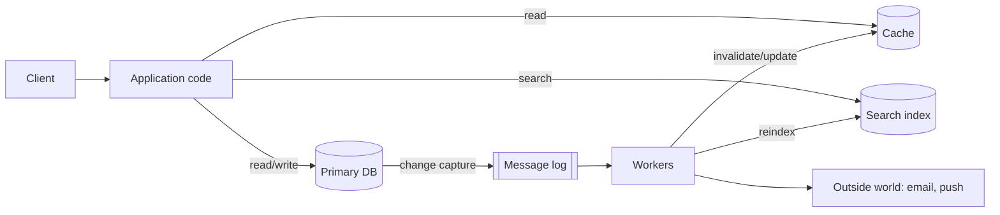

# Reliability and maintainability

> **Before this lesson:** nothing is assumed beyond a little Python (variables, loops, `print`) and
> having seen a SQL query such as `SELECT name FROM users`. This is the first lesson of the track.
> Every technical word is explained where it first appears and collected in the glossary at the end.

## In plain words

A **database** is a program whose job is to remember things for other programs: it stores information, keeps it safe, and hands it back when asked. This track is about how such programs work inside, and about what happens when one computer is no longer enough and the data has to be spread over many.

Before looking inside any database, this lesson asks a more basic question: what does it mean for a system to be *good*? Two of the answers are covered here.

- **Reliability** means the system keeps doing its job even when parts of it break.
- **Maintainability** means people can keep running and changing the system for years without it becoming a nightmare.

An everyday picture: think of a busy restaurant kitchen. Ovens break, a delivery is late, a new cook misreads an order. A reliable kitchen still gets correct meals to the tables, because it has a spare oven, a backup supplier and a second person checking each plate. A maintainable kitchen is one where a new cook can find the knives, the recipes are written down, and changing the menu does not mean rebuilding the room. Notice that neither quality is about how *fast* the kitchen is. Speed under growing demand is a third quality, **scalability**, which gets the next lesson to itself.

Why this matters for a job: in a system-design interview you are asked to sketch a service such as a chat app or a photo store. The interviewer then asks "what happens when this machine dies?" and "how would a team operate this?". The vocabulary in this lesson (fault, failure, redundancy, rollback, error budget) is the vocabulary those answers are built from. On the job, the same ideas decide whether you are woken at 3 a.m.

## Where these ideas come from

Most applications people build today are **data-intensive** rather than compute-intensive. A compute-intensive program is limited by how fast the processor (the **CPU**, the chip that carries out instructions) can calculate, as in weather simulation. A data-intensive program is limited by the data itself: how much of it there is, how complicated it is, and how fast it changes. A social network or an online shop is data-intensive.

Martin Kleppmann opens his book *Designing Data-Intensive Applications* (shortened to DDIA from here on) by arguing that we should stop thinking of "the database", "the cache" and "the queue" as separate product categories. A real system glues several of them together and hides them behind an **API** (application programming interface: the set of requests a program accepts from other programs). Whoever designs that glue has become a **data-system designer**, whether or not it says so on their business card.

This lesson covers two of the three big goals from DDIA's first chapter: **reliability** and **maintainability**. These are called *non-functional* goals because they describe how well the system behaves, as opposed to *functional* requirements, which describe what it does ("users can post photos").

## 1. Thinking about data systems

Start with the simplest possible system: one program and one database. A user's phone (the **client**) sends a request, the program (the **application code**, running on a **server**, which is a computer that answers requests) reads or writes the database, and replies. Many small products run exactly like this for years.

As the product grows, single pieces of work become too slow or too awkward for one database, and specialised tools are added one at a time. A typical web **backend** (everything that runs on the company's servers, as opposed to on the user's device) might end up containing:

- a primary **database** (PostgreSQL, MySQL) as the **system of record**, meaning the one place that holds the authoritative copy of the data. If two stores disagree, this one wins.
- a **cache** (Redis, Memcached): a small, fast store holding copies of answers that were expensive to compute, so the next request for the same thing is quick.
- a **search index** (Elasticsearch): a structure, like the index at the back of a book, that maps each word to the documents containing it, so keyword search does not have to read every document.
- a **message queue** or **log** (RabbitMQ, Kafka): a waiting line of small notes ("send welcome email to user 42") that one program writes and another picks up later. Work done this way is **asynchronous**: the sender does not wait for it to finish.
- **batch jobs** and **stream processors** that compute **derived data**, which is data that could be rebuilt from other data, such as a daily sales total. A batch job chews through a large pile of stored data on a schedule; a stream processor handles each event moments after it happens.

The diagram below shows how these pieces connect. Arrows show who sends data to whom. **Workers** are background programs that pick up queued notes and act on them.



The boundaries between these tools are fuzzy. Redis can act as a datastore and also as a message queue. Kafka is a log with database-like durability. As soon as application code has to keep the cache and the index in sync with the database, *you* are responsible for guarantees such as "the cache is invalidated on every write". The three questions DDIA keeps asking are:

1. **Reliability.** The system keeps working correctly, meaning the right function at the expected performance, even when things go wrong.
2. **Scalability.** As data volume, traffic or complexity grow, there are reasonable ways to cope.
3. **Maintainability.** Over time, many different people can work on the system productively, both keeping it running and adapting it.

## 2. Reliability: faults vs failures

In everyday speech a reliable thing is one that "keeps working". For software the phrase needs sharpening, because something inside a large system is always broken somewhere. Two words carry the distinction, and interviewers listen for whether you keep them apart.

| Term | Meaning | Kitchen picture |
|---|---|---|
| **Fault** | One part of the system stops behaving the way it is supposed to: a disk dies, a program crashes, a network cable is unplugged | One oven stops heating |
| **Failure** | The system as a whole stops giving users the service they came for | Diners do not get their meals |

A **component** is any one part of a system: a disk, a machine, one running program. A fault belongs to a component. A failure belongs to the whole system. The goal of reliability engineering is not "no faults", because that cannot be achieved. The goal is to stop faults from growing into failures. A system built to do that is called **fault-tolerant** (some people say *resilient*, meaning the same thing).

A small example makes the difference concrete. A photo site keeps every picture on two disks. One disk dies: that is a fault. Users still see their photos, served from the second disk, so there is no failure. If both disks die in the same hour, the fault has become a failure.

A surprising consequence follows. You can make a system *more* reliable by breaking it on purpose. Netflix runs a tool called **Chaos Monkey** that kills randomly chosen running programs in **production** (the live system that real customers use, as opposed to a test copy). Why would anyone do that? Because the code that handles a crash is code like any other, and code that never runs is code nobody has tested. If the recovery path is exercised every day, its bugs are found on a quiet Tuesday afternoon and not during a real outage at night. The practice has a name: **chaos engineering**.

> [!NOTE]
> Tolerating faults is not always the right plan. Some faults are better prevented than cured. If an attacker steals customer data, nothing done afterwards can un-steal it. This lesson, like DDIA, concentrates on the kinds of fault a system *can* recover from.

Faults come from three sources: hardware, software and people. Each needs a different defence, so they are taken one at a time.

### 2.1 Hardware faults

**Hardware** is the physical machinery: disks, memory chips, power supplies, cables. Each piece breaks rarely, but a large system has a great many pieces.

Take hard disks. Manufacturers describe a disk's reliability with a number called **MTTF** (mean time to failure): the average time a disk of that model runs before it breaks. For hard disks the figure is roughly 10 to 50 years. That sounds comfortable until you multiply. A **cluster** is a group of machines working together as one system. A cluster holding 10,000 disks should expect about **one disk to die every day**. Section 4 checks that arithmetic with a short program. Disks are not the only culprits: **RAM** (random-access memory, the fast working memory that is wiped when the power goes off) can silently flip a stored value, the electricity supply can fail, and a person can pull out the wrong cable.

The traditional defence is **redundancy**, which means having spare parts that take over when the main one breaks. Common forms are:

- **RAID** (redundant array of independent disks): several disks arranged so that the contents of any one can be rebuilt from the others.
- Two power supplies per machine, plus batteries and diesel generators for the building.
- Parts that are **hot-swappable**, meaning they can be replaced while the machine keeps running.

Redundant parts let a single machine run for years, and for a long time that was enough. Two things changed. First, applications grew until they needed many machines, and more machines means more faults per day. Second, companies moved to **cloud platforms** such as AWS (Amazon Web Services), where you rent **virtual machines** (VMs: simulated computers that share real hardware with other customers). A cloud provider may take a VM away with almost no warning, because the platform is designed for flexibility across thousands of customers and not for keeping any single machine alive.

The response is **software fault tolerance**: design the software so the system survives the loss of an entire machine. This is more work, but it pays for itself in daily operations as well. A system that tolerates a missing machine can be updated one machine at a time while the others keep serving users. That procedure is a **rolling upgrade**, and it removes the need to shut everything down for maintenance.

### 2.2 Software errors

Hardware faults are mostly **independent**: one disk dying does not make its neighbour more likely to die. That independence is the reason spare parts work.

Software faults behave differently. A **bug** is a mistake in a program. Every machine running the same program contains the same bug, so one trigger can knock all of them over at the same moment. Faults that tend to strike together are called **correlated**, and correlated faults are far more dangerous than independent ones, because the spare you were counting on is broken in the same way. Some examples:

- On 30 June 2012 an extra second (a **leap second**) was added to the world's clocks. A bug in the Linux **kernel** (the core of the operating system) caused many programs around the world to hang at that same moment.
- A **process** (one running program) gets stuck in a loop and uses up something that others share: processor time, memory, disk space or network capacity.
- A service that the system depends on becomes slow, stops answering, or starts returning garbage.
- A **cascading failure**: one overloaded part gives up, its work is pushed onto the next part, which then overloads and gives up too, and so on down the line like falling dominoes.

Bugs of this kind usually sleep for a long time. The software quietly assumes something about its surroundings ("a minute always has 60 seconds", "the disk is never full"), the assumption holds for years, and then one day it does not. There is no single cure. What helps is a collection of habits:

- Write down and question what the code assumes about its environment.
- Test thoroughly, including the unusual cases.
- **Isolate** processes, so that a misbehaving one cannot drag down its neighbours.
- Design programs so they can crash and restart cleanly.
- Measure what the live system is doing and raise an alert when it looks wrong.

One especially useful habit is to check an **invariant** continuously. An invariant is a statement that must always be true. For a message queue, "the number of messages that went in equals the number that came out plus the number still waiting" is an invariant. A small program can verify it every minute and warn a human the moment it is violated.

### 2.3 Human errors

People design, build and run these systems, and people make mistakes. An **operator** is a person whose job is to keep a system running. **Configuration** is the collection of settings that tell software how to behave, such as which machines to talk to or how much memory to use. One study of large internet services found that configuration mistakes made by operators were the leading cause of **outages** (periods when the service is down). Hardware faults explained only 10 to 25 percent.

Blaming the humans changes nothing. The effective response is to design the system and its surroundings so that mistakes are hard to make and cheap to undo:

- **Make the right thing easy.** Well-designed tools and admin screens steer people toward the correct action. They should not be so restrictive that people route around them.
- **Provide a sandbox.** A sandbox is a practice copy of the system with realistic data, where experiments cannot hurt real users.
- **Test at every level.** A **unit test** checks one small piece of code by itself. An **integration test** checks that the pieces work together. Automated tests are especially valuable for rare situations that never come up during normal use.
- **Make recovery fast.** Undoing a bad change (a **rollback**) should take seconds. New versions should go to a small fraction of users first, a practice called a **gradual rollout**, so a mistake hurts few people. Keep the means to recompute derived data in case an earlier job turns out to have been wrong.
- **Monitor in detail.** Collect numbers such as error counts and response times from the running system. This stream of measurements is called **telemetry**.
- **Train people and manage them well.** This is beyond the scope of a technical lesson, but it matters.

> [!INTERVIEW]
> "How would you make this system reliable?" is not only about keeping extra copies. A strong answer names all three kinds of fault. **Hardware**: redundancy and copies on several machines. **Software**: isolation, gradual rollout, invariant checks and chaos testing. **Human**: safe defaults, practice environments, fast rollback and good monitoring. Finish by saying you would *measure* reliability against an agreed target. Such a target is called an SLO, and the next lesson explains it.

### 2.4 How important is reliability?

It is tempting to think reliability only matters for nuclear plants and aircraft. Ordinary software needs it too. A bug in an accounting program can cost a company days of work, or get it into legal trouble for reporting wrong figures. Picture a parent who keeps every photo of their children in your app, and then your database is damaged and the photos are gone.

There are situations where a team chooses less reliability on purpose, for example to get an early prototype in front of users, or to keep costs down for a service that earns very little. That is a legitimate decision. What matters is that it is made knowingly and not by accident.

## 3. Maintainability

Writing the first version of a program is the cheap part. Most of the money spent on software over its life goes to **maintenance**: fixing bugs, keeping it running, working out why it broke, moving it to new machines, and adding features nobody imagined at the start. A **legacy system** is an old system that is still in use and that people are afraid to change. Nobody sets out to build one. DDIA names three design principles that help avoid it.

### 3.1 Operability: making life easy for operations

**Operations** (often shortened to "ops") is the work of keeping a system running day to day, and the team that does it. There is a saying that good operations can often make up for limitations in the software, but no software runs reliably when it is operated badly. An operations team typically has to:

- watch the system's health and restore service quickly when something is wrong,
- find the cause of problems such as crashes or slowness,
- keep software and operating systems up to date, including security fixes,
- know which systems depend on which, so a risky change is caught before it hurts something downstream,
- anticipate future trouble, for example by planning how much hardware next year's traffic will need (**capacity planning**),
- set up good habits and tools for releasing new versions (**deployment**) and for managing configuration,
- carry out complex maintenance, such as moving an application from one platform to another,
- keep the organisation's knowledge alive as individual people join and leave.

Software can make that work easier or harder. Software that is kind to its operators:

- offers **visibility**: it reports numbers and writes records that show what it is doing inside,
- is easy to **automate**, so routine tasks can be handed to scripts,
- keeps working while any one machine is taken away for maintenance,
- comes with **documentation** and a clear mental model of cause and effect ("if I do X, then Y happens"),
- ships with **sensible defaults** that an administrator can still override,
- **heals itself** in routine cases while leaving a manual control for the unusual ones,
- behaves **predictably**, with few surprises.

### 3.2 Simplicity: managing complexity

A small program is pleasant to work on. As it grows, it tends toward what programmers call a **big ball of mud**: a system with no visible structure, where everything depends on everything else. The warning signs are:

- too many possible combinations of internal conditions to reason about,
- **tight coupling**, meaning a change in one part forces changes in others,
- tangled dependencies and inconsistent names,
- special cases and speed tricks scattered everywhere.

Complexity is expensive. It makes bugs more likely, makes every change slower, and makes new team members take longer to become useful.

A helpful distinction, due to Ben Moseley and Peter Marks, separates two kinds of complexity:

- **Essential complexity** comes from the problem itself. Tax rules are complicated, so a payroll program has to be.
- **Accidental complexity** comes only from how the solution happens to be built. It could be removed without changing what users get.

The best tool against accidental complexity is **abstraction**: hiding a great deal of detail behind a small, clean surface. A programming language such as Python is an abstraction that hides the processor's raw instructions. **SQL** (Structured Query Language, the language used to ask questions of many databases) is an abstraction too. When you write `SELECT name FROM users`, you do not say which file to open, how to stay out of the way of other users, or how to recover if the power fails halfway. The database handles all of that. Much of this track is about finding good abstractions for the parts of a data system.

### 3.3 Evolvability: making change easy

Requirements never hold still. You learn things you did not know, customers ask for features, laws change, and the system grows. **Evolvability** is how easy it is to change a system to meet new needs.

At the scale of one program, practices such as **refactoring** (improving the structure of code without changing its behaviour) and **test-driven development** (TDD, writing a test before the code that satisfies it) help. DDIA asks how to keep the same freedom at the scale of a whole system made of several programs and databases. The next lesson has a worked case: the service once called Twitter changed the way it built each user's home page when its first design could not keep up.

Evolvability leans on simplicity, because a system that is easy to understand is easy to change. It also leans on a technical idea covered in the lesson on encoding formats: storing and sending data in a form where old and new versions of a program can still read each other's data. That property is called **backward and forward compatibility**, and without it every change would require stopping the whole system.

## 4. Worked example: from faults to an availability budget

The claim "about one disk dies per day" is worth checking, because it changes how you think about hardware. The program below is a **simulation**: it uses random numbers to imitate the cluster and counts what happens.

```python-run
import random
random.seed(7)

disks = 10_000
mttf_years = 30                       # mean time to failure of one disk
p_fail_per_day = 1 / (mttf_years * 365)

days = 90   # a quarter (keeps the demo fast in the browser)
failures_per_day = []
for d in range(days):
    f = sum(1 for _ in range(disks) if random.random() < p_fail_per_day)
    failures_per_day.append(f)

print("expected failures/day:", round(disks * p_fail_per_day, 2))
print("observed mean/day    :", round(sum(failures_per_day) / days, 2))
print("days with >=1 failure:", sum(1 for f in failures_per_day if f > 0), "of", days)
print("worst day            :", max(failures_per_day), "disks")
```

What each part does:

- `import random` loads Python's random-number tools. `random.seed(7)` fixes the starting point of the random sequence, so the program prints the same numbers on every run.
- `disks = 10_000` stores the number of disks. The underscore is only there for readability; Python reads it as 10000.
- `p_fail_per_day = 1 / (mttf_years * 365)` converts "lasts 30 years on average" into "chance of dying on any given day". Thirty years is 10,950 days, so the chance is about 1 in 10,950.
- The `for d in range(days)` loop plays out 90 days, one at a time.
- `random.random()` returns a random number between 0 and 1. The comparison `random.random() < p_fail_per_day` is true with exactly the daily failure chance. The line starting `f = sum(...)` performs that test once for each of the 10,000 disks and counts how many came out true: the number of disks that died that day.
- The `print` lines report the result.

The output is:

```
expected failures/day: 0.91
observed mean/day    : 0.91
days with >=1 failure: 53 of 90
worst day            : 4 disks
```

The first line is plain arithmetic: 10,000 disks times a 1-in-10,950 chance is 0.91 failures per day. The second line confirms that the simulation agrees. The last two lines are the instructive ones. On 53 days out of 90 at least one disk died, and on the worst day four died together. Replacing a disk in a cluster this size is therefore a routine chore, like restocking a shelf, and not an emergency. The software has to treat a missing disk as a normal condition.

The second program is about measuring reliability. **Availability** is the fraction of time a service is working. People quote it as a percentage and count its "nines": 99.9% is "three nines". Whatever is left over is the allowed downtime, called the **error budget**. Teams of **SREs** (site reliability engineers, the people responsible for keeping large services running) use the error budget to decide how much risk they can afford when releasing changes.

```python-run
targets = [0.99, 0.999, 0.9999, 0.99999]
minutes_per_year = 365.25 * 24 * 60
for t in targets:
    budget = (1 - t) * minutes_per_year
    print(f"{t*100:.3f}% availability -> {budget:8.1f} min/year  ({budget/12:6.1f} min/month)")
```

What each part does:

- `targets` is a list of four availability levels written as fractions, so `0.999` means 99.9%.
- `minutes_per_year` multiplies days by hours by minutes: 525,960 minutes in an average year.
- Inside the loop, `(1 - t)` is the fraction of time the service is allowed to be down. Multiplying it by the minutes in a year gives the budget.
- The `print` line uses an **f-string**, a piece of text with values dropped into the curly braces. `{budget:8.1f}` means "show this number with one decimal place, padded to 8 characters wide", which lines the columns up.

The output is:

```
99.000% availability ->   5259.6 min/year  ( 438.3 min/month)
99.900% availability ->    526.0 min/year  (  43.8 min/month)
99.990% availability ->     52.6 min/year  (   4.4 min/month)
99.999% availability ->      5.3 min/year  (   0.4 min/month)
```

Each extra nine divides the allowed downtime by ten. At four nines the budget is about 52 minutes for the whole year, or a little over four minutes a month. A person who is paged, wakes up, opens a laptop and finds the cause will usually spend more than four minutes. So a four-nines target cannot be met by humans reacting quickly. It needs detection and rollback that happen automatically.

> [!TIP]
> When someone asks for "five nines", translate it into minutes before agreeing. "You are asking for at most 5.3 minutes of downtime a year" starts a far more useful conversation than a percentage does.

## 5. Pitfalls

- **Treating redundancy as reliability.** Three copies of a database, all running the same faulty code, will damage the data three times. Spare copies defend against independent hardware faults, not against correlated software faults.
- **Untested failover.** **Failover** is the act of switching to a spare when the main component dies. A failover procedure that has never been run on the live system is a guess, not a feature.
- **Ignoring humans.** Most large outages begin with someone changing a setting. Gradual rollout and fast rollback prevent more downtime than any amount of heroic late-night debugging.
- **"We'll fix maintainability later."** Accidental complexity grows on itself, like interest on a debt. Good abstractions are cheapest at the start.
- **Mixing up fault and failure.** Saying "the system had a failure" when one disk died hides the important question, which is whether users noticed.

## 6. Summary

- A **fault** is one component misbehaving. A **failure** is the whole service letting users down. Fault tolerance stops the first from becoming the second.
- Hardware faults are random and mostly independent, so spare parts and extra copies work well against them. Software faults are correlated, because the same bug is on every machine. Human configuration mistakes are a leading cause of outages.
- Reliability can be measured: an availability target leaves an error budget, and each extra nine cuts that budget by a factor of ten.
- Maintainability has three parts: **operability** (easy to run), **simplicity** (accidental complexity removed by good abstractions) and **evolvability** (easy to change).
- Breaking things on purpose (chaos engineering) keeps the recovery machinery tested.

## Glossary

- **Database** - a program that stores data for other programs and returns it on request.
- **Data-intensive application** - software whose main difficulty is the amount, complexity or rate of change of its data, not raw calculation.
- **Client / server** - the program that sends a request / the program (or machine) that answers it.
- **API (application programming interface)** - the set of requests a program accepts from other programs.
- **System of record** - the store that holds the authoritative copy of some data.
- **Cache** - a fast store of copies of results that were slow to compute or fetch.
- **Derived data** - data that can be rebuilt from other data, such as a total or an index.
- **Component** - one part of a larger system, such as a disk, a machine or a running program.
- **Fault** - one component deviating from what it is supposed to do.
- **Failure** - the system as a whole no longer providing its service to users.
- **Fault-tolerant (resilient)** - able to keep working when faults occur.
- **MTTF (mean time to failure)** - the average time a part runs before it breaks.
- **Cluster** - a group of machines working together as one system.
- **Redundancy** - spare parts or spare copies that take over when one breaks.
- **RAID** - an arrangement of several disks in which any one disk's contents can be rebuilt from the others.
- **Virtual machine (VM)** - a simulated computer that shares physical hardware with others.
- **Rolling upgrade** - updating a system one machine at a time while the rest keep serving.
- **Correlated faults** - faults that tend to happen together, for example the same bug on every machine.
- **Cascading failure** - a fault in one part that overloads the next part, and so on.
- **Invariant** - a statement about the system that must always be true.
- **Chaos engineering** - deliberately causing faults in the live system to test its recovery.
- **Production** - the live system used by real customers.
- **Configuration** - the settings that tell software how to behave.
- **Rollback** - undoing a change by returning to the previous version.
- **Telemetry (monitoring)** - measurements collected from a running system.
- **Availability** - the fraction of time a service is working.
- **Error budget** - the downtime an availability target allows.
- **Operability** - how easy a system is to keep running.
- **Essential / accidental complexity** - complexity that comes from the problem itself / from the way the solution was built.
- **Abstraction** - a small, clean surface that hides a lot of detail.
- **Evolvability** - how easy a system is to change.

```quiz
[
  {"q": "What is the difference between a fault and a failure in DDIA's terminology?",
   "options": ["They are synonyms", "A fault is one component deviating from spec; a failure is the whole system no longer serving users", "A failure is a hardware problem; a fault is a software problem", "A fault is permanent; a failure is transient"],
   "answer": 1,
   "explain": "Fault tolerance is about preventing component-level faults from turning into system-level failures."},
  {"q": "With 10,000 disks whose MTTF is 10-50 years, roughly how often should you expect a disk failure?",
   "options": ["Once a decade", "Once a year", "About once per day", "Every second"],
   "answer": 2,
   "explain": "10,000 disks divided by roughly 10,000-18,000 disk-days of life gives on the order of one failure per day."},
  {"q": "Why are software faults often more dangerous than hardware faults?",
   "options": ["They are more frequent per machine", "They tend to be correlated across nodes, so one bug can take down many machines at once", "They cannot be detected", "They only happen during deploys"],
   "answer": 1,
   "explain": "Hardware faults are largely independent and random; a software bug, such as the 2012 leap-second bug, hits every node running the same code."},
  {"q": "Which practice deliberately increases the rate of faults to improve reliability?",
   "options": ["RAID", "Chaos engineering such as Chaos Monkey", "Write-ahead logging", "Two-phase commit"],
   "answer": 1,
   "explain": "Killing processes at random ensures fault-handling code is continuously exercised and tested."},
  {"q": "Which of these is accidental (not essential) complexity?",
   "options": ["Tax rules a payroll app must implement", "A tangle of special cases added to work around a slow ORM", "The fact that users can follow each other", "Business requirement for audit logging"],
   "answer": 1,
   "explain": "Accidental complexity arises from the implementation rather than from the problem itself; abstraction is the main tool for removing it."},
  {"q": "A 99.99% availability SLO allows approximately how much downtime per year?",
   "options": ["8.8 hours", "52.6 minutes", "5.3 minutes", "3.65 days"],
   "answer": 1,
   "explain": "0.0001 x 525,960 minutes is about 52.6 minutes. 99.9% is about 8.8 hours and 99.999% about 5.3 minutes."},
  {"q": "Which of the three maintainability principles is most directly helped by encodings with forward/backward compatibility?",
   "options": ["Operability", "Simplicity", "Evolvability", "Durability"],
   "answer": 2,
   "explain": "Compatible encodings allow rolling upgrades and gradual schema change, which makes the system easier to evolve."}
]
```

> **Source:** DDIA ch. 1, "Reliable, Scalable and Maintainable Applications" (sections Thinking About Data Systems, Reliability, Maintainability).
