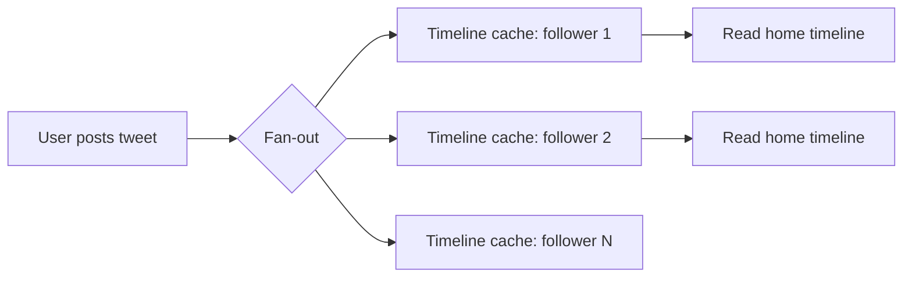

# Scalability: load parameters, percentiles and SLOs

"Is X scalable?" is a meaningless question in isolation. **Scalability** describes how a system copes with *increased load*. It only makes sense as a specific question, such as: "Suppose this particular kind of load doubles - what could we do about it?" Answering it takes two tools: a way to **describe load** and a way to **describe performance**.

## 1. Describing load: load parameters

**Load parameters** are the numbers that best characterise your workload. Which ones matter depends on the architecture:

- requests per second to a web server,
- the ratio of reads to writes in a database,
- how many people are online in a chat room at once,
- the cache hit rate,
- the *distribution* of something, such as followers per user.

Sometimes the average case drives the bottleneck. Sometimes a small number of extreme cases do.

### 1.1 The Twitter home timeline case study

DDIA's running example uses Twitter's November 2012 numbers:

- **Post tweet**: about 4.6k requests/sec on average, over 12k/sec at peak.
- **Home timeline**: about 300k requests/sec. A user reads the tweets of the people they follow.

Writes are cheap at 4.6k/sec. The difficulty is **fan-out**. Each user follows many people and is followed by many people. There are two ways to implement the home timeline.

**Approach 1: compute on read.** Store each tweet once in a global table. To build a timeline, look up everyone the user follows, find their tweets, and merge by time:

```sql
SELECT tweets.*, users.* FROM tweets
JOIN users   ON tweets.sender_id = users.id
JOIN follows ON follows.followee_id = users.id
WHERE follows.follower_id = :current_user
```

**Approach 2: fan-out on write.** Keep a cache (a "mailbox") for each user's home timeline. When someone tweets, insert the tweet into the timeline cache of *every follower*. Reads then become cheap.



Twitter started with approach 1, struggled to keep up with 300k reads/sec, and moved to approach 2. Because there are almost two orders of magnitude more reads than writes, it pays to do more work at write time. On average a tweet goes to about 75 followers, so 4.6k tweets/sec turns into about 345k cache writes/sec. The average hides the tail, though: some accounts have over 30 million followers, so one celebrity tweet can mean 30 million writes, all supposed to land within about 5 seconds.

For Twitter, then, the key load parameter is the **distribution of followers per user**, weighted by how often each user tweets. The final design is a **hybrid**. Most tweets are fanned out on write. Tweets from a small set of celebrities are fetched at read time and merged in.

> [!INTERVIEW]
> The push vs pull (fan-out on write vs fan-out on read) trade-off comes up in feed, notification and chat system-design questions. Name the **load parameter** that decides it (follower distribution, read/write ratio). Propose the **hybrid** for heavy hitters. Estimate the write amplification as average fan-out × write rate.

```python-run
import random
random.seed(1)
# Simulate a heavy-tailed follower distribution (Pareto-like)
users = 100_000
followers = [int(random.paretovariate(1.2)) for _ in range(users)]
tweets_per_sec = 4600
avg_fanout = sum(followers) / users
print(f"mean followers  : {avg_fanout:.1f}")
print(f"max followers   : {max(followers):,}")
print(f"timeline writes/s (pure fan-out): {tweets_per_sec*avg_fanout:,.0f}")

# Hybrid: skip fan-out for 'celebrities' above a threshold
for threshold in [10_000, 1_000, 100]:
    celebs = [f for f in followers if f > threshold]
    normal = [f for f in followers if f <= threshold]
    writes = tweets_per_sec * sum(normal) / users
    print(f"threshold {threshold:>6}: celebs={len(celebs):>4}, writes/s={writes:,.0f}, "
          f"extra merges per read = #celebs you follow")
```

## 2. Describing performance

With load described, you can ask two questions:

1. If a load parameter grows and resources stay fixed, how does performance degrade?
2. If a load parameter grows, how much must resources grow to keep performance unchanged?

Batch systems such as Hadoop care about **throughput**: records per second, or total job time. Online systems care about **response time**: the delay, measured at the client, from issuing a request until the answer is back.

> [!NOTE]
> **Latency vs response time.** Response time is what the client sees: service time plus network delay plus queueing delay. Latency, strictly, is the time a request spends *latent*, waiting to be handled. People use the terms loosely, but the distinction helps when you are debugging.

### 2.1 Response time is a distribution

Send the same request a thousand times and you get a thousand different response times. Random extra latency comes from context switches, TCP retransmissions after packet loss, GC pauses, page faults, even mechanical vibration in a server rack. So think of response time as a **distribution**, not a single number.

The **mean** is a poor summary because it tells you nothing about how many users actually saw a given delay. Use **percentiles**:

- **Median (p50).** Half of requests are faster, half slower. It is a good measure of "typical".
- **p95, p99, p999.** The thresholds that 95%, 99% and 99.9% of requests beat. These are the **tail latencies**.

Amazon specifies internal service response-time requirements at **p999**, because the slowest requests often belong to the customers with the most data, who are frequently the most valuable ones. Amazon reportedly measured that 100 ms of extra latency cost 1% of sales. Optimising p9999 was judged too expensive for the benefit, since such extreme outliers are dominated by random events outside your control.

### 2.2 SLOs and SLAs

Percentiles are the language of **service level objectives (SLOs)** and **service level agreements (SLAs)**. A typical example: "the service is up if median response time < 200 ms and p99 < 1 s, and it must be up 99.9% of the time." An SLO is an internal target. An SLA is a contract with consequences such as refunds.

### 2.3 Queueing and head-of-line blocking

At high percentiles **queueing delay** dominates. A server can process only a few requests in parallel (bounded by its cores), so a few slow requests hold up everything behind them. This is **head-of-line blocking**. Two consequences:

- **Measure on the client side**, because the server only sees its service time.
- **Load generators must not wait** for responses before sending the next request. A closed-loop client artificially keeps queues short and produces flattering results (this is called *coordinated omission*).

### 2.4 Tail latency amplification

When one end-user request fans out to many backend calls in parallel, the user waits for the **slowest** call. If each backend call has a 1% chance of being slow, a request that makes 100 calls is slow with probability $1 - 0.99^{100} \approx 63\%$.

```python-run
for n in [1, 5, 10, 50, 100]:
    p_slow = 1 - 0.99 ** n
    print(f"{n:>3} parallel backend calls -> P(user request hits a p99-slow call) = {p_slow:.1%}")
```

This is why p99 and p999 matter far more in microservice architectures than you might guess.

### 2.5 Computing percentiles correctly

Here is a naive way to compute percentiles over a rolling window, and the right and wrong ways to combine them across machines:

```python-run
import random, math
random.seed(42)

def percentile(sorted_vals, p):
    """Nearest-rank percentile: smallest value with at least p% of data <= it."""
    if not sorted_vals:
        return None
    k = max(1, math.ceil(p / 100 * len(sorted_vals)))
    return sorted_vals[k - 1]

# two servers: one healthy, one with a slow GC tail
a = [random.lognormvariate(3.5, 0.3) for _ in range(9000)]     # ~33 ms typical
b = [random.lognormvariate(3.5, 0.3) if random.random() > 0.05 else random.uniform(300, 900)
     for _ in range(1000)]
sa, sb, sall = sorted(a), sorted(b), sorted(a + b)
for p in (50, 95, 99, 99.9):
    avg_of_pcts = (percentile(sa, p) + percentile(sb, p)) / 2
    print(f"p{p:<5} server A={percentile(sa,p):6.1f}  B={percentile(sb,p):6.1f}  "
          f"WRONG avg={avg_of_pcts:6.1f}  RIGHT merged={percentile(sall,p):6.1f}")
print("mean overall:", round(sum(a + b) / len(a + b), 1), "ms  (hides the tail!)")
```

Averaging percentiles is **mathematically meaningless**. The correct way to aggregate is to merge the raw data or, at scale, to **add histograms**. Production systems use approximate structures such as **HdrHistogram**, **t-digest** or forward decay, which compute percentiles at low CPU and memory cost.

## 3. Approaches for coping with load

An architecture that works at one load level usually will not work at ten times that load. Plan to **rethink architecture on every order-of-magnitude growth**.

- **Scaling up (vertical).** Buy a bigger machine. It is simple but expensive at the high end and still a single point of failure.
- **Scaling out (horizontal).** Distribute load across many smaller machines. This is also called a **shared-nothing** architecture.
- **Elastic** systems add resources automatically when load rises. **Manually scaled** systems are simpler and have fewer surprises.

Distributing **stateless** services is easy. Distributing **stateful** data systems adds a great deal of complexity, which is the subject of Part II of DDIA. The conventional wisdom used to be "keep the database on one node until you are forced to distribute". As distributed tooling improves, that line is moving.

There is **no generic, one-size-fits-all scalable architecture** (Kleppmann's phrase is "magic scaling sauce"). A system handling 100k requests/sec of 1 kB each looks very different from one handling 3 requests/minute of 2 GB each, even though the throughput is the same. Good architectures are built around **assumptions about which operations are common and which are rare**, which are exactly the load parameters. If those assumptions are wrong, the scaling effort is wasted, which is why early-stage products should optimise for iteration speed over hypothetical future load.

## 4. Back-of-the-envelope estimation

System-design interviews expect quick capacity math. A useful set of approximate numbers:

| Operation | Approx. time |
|---|---|
| L1 cache reference | 1 ns |
| Main memory reference | 100 ns |
| SSD random read (4 kB) | 16–100 µs |
| Round trip within a datacenter | 0.5 ms |
| HDD seek | 2–10 ms |
| Round trip US↔Europe | 70–150 ms |

```python-run
# Estimate storage and QPS for a photo-sharing app
dau = 50_000_000
uploads_per_user_day = 0.2
avg_photo_mb = 2.0
reads_per_user_day = 30
secs = 86_400

write_qps = dau * uploads_per_user_day / secs
read_qps  = dau * reads_per_user_day / secs
storage_tb_year = dau * uploads_per_user_day * avg_photo_mb * 365 / 1e6
print(f"avg write QPS ~ {write_qps:,.0f}, peak (x3) ~ {3*write_qps:,.0f}")
print(f"avg read QPS  ~ {read_qps:,.0f}, peak (x3) ~ {3*read_qps:,.0f}")
print(f"new storage/year ~ {storage_tb_year:,.0f} TB (before replication x3 -> {3*storage_tb_year:,.0f} TB)")
print(f"read:write ratio ~ {read_qps/write_qps:.0f}:1  -> favour read-optimised design / caching / CDN")
```

## 5. Pitfalls

- **Reporting means.** The mean is dragged by outliers yet hides how many users suffer. Report p50/p95/p99.
- **Averaging percentiles** across servers or time buckets. Merge histograms instead.
- **Server-side-only measurement** misses queueing and network delay.
- **Closed-loop load tests** understate tail latency.
- **Premature scale-out.** Distributed systems cost real complexity. Make sure the load parameters justify it.

## 6. Summary

- Describe load with **load parameters** that capture what really drives cost, often a *distribution* (followers per user).
- Describe performance with **percentiles** of client-observed response time. Tails matter because of fan-out amplification and valuable heavy users.
- SLOs/SLAs are written in percentiles and availability targets.
- Re-architect at each order of magnitude. There is no universal scalable architecture, only designs that fit your assumptions.

```quiz
[
  {"q": "Twitter switched from computing timelines on read to fanning out on write mainly because...",
   "options": ["Writes were more frequent than reads", "Home-timeline reads outnumbered tweet writes by almost two orders of magnitude", "Joins are not supported in MySQL", "Celebrities had few followers"],
   "answer": 1,
   "explain": "300k reads/s vs 4.6k writes/s: doing more work at write time makes the dominant operation cheap."},
  {"q": "Why does Twitter use a hybrid approach for celebrity accounts?",
   "options": ["Celebrities tweet more often", "Fanning out a tweet to 30M+ followers on write is too expensive, so those tweets are merged at read time", "To comply with regulations", "Because celebrity tweets are cached in a CDN"],
   "answer": 1,
   "explain": "The follower-count distribution is heavy-tailed; the few extreme accounts dominate fan-out cost."},
  {"q": "A backend request fans out to 100 services in parallel, each with a 1% chance of being slow. Probability that the user request is slow?",
   "options": ["1%", "About 10%", "About 63%", "100%"],
   "answer": 2,
   "explain": "1 - 0.99^100 is about 0.634: tail latency amplification."},
  {"q": "You have p99 latencies from 10 servers. How should you compute the fleet-wide p99?",
   "options": ["Average the ten p99 values", "Take the max of the ten values", "Merge the underlying histograms (or raw samples) and compute p99 from the merged distribution", "Take the median of the ten values"],
   "answer": 2,
   "explain": "Percentiles do not compose by averaging; histograms do compose by addition."},
  {"q": "Why should a load-testing client not wait for each response before sending the next request?",
   "options": ["It wastes CPU", "It keeps queues artificially short and understates response times (coordinated omission)", "It violates HTTP semantics", "It causes TCP retransmits"],
   "answer": 1,
   "explain": "Real users arrive independently of how fast the server responds; a closed loop hides queueing delay."},
  {"q": "Which statement about 'latency' vs 'response time' matches DDIA?",
   "options": ["They are strictly identical", "Response time is what the client sees (including network and queueing delay); latency is the time a request waits to be handled", "Latency includes response time", "Response time excludes queueing"],
   "answer": 1,
   "explain": "Response time = service time + network delays + queueing delays."},
  {"q": "What does 'shared-nothing' architecture mean?",
   "options": ["Machines share a SAN", "Scaling out across independent machines, each with its own CPU, memory and disks, coordinating over the network", "No data is replicated", "A single big machine"],
   "answer": 1,
   "explain": "Shared-nothing = horizontal scaling; nodes communicate only via the network."}
]
```

> **Source:** DDIA ch. 1, "Scalability" (Describing load, Describing performance, Approaches for coping with load).
