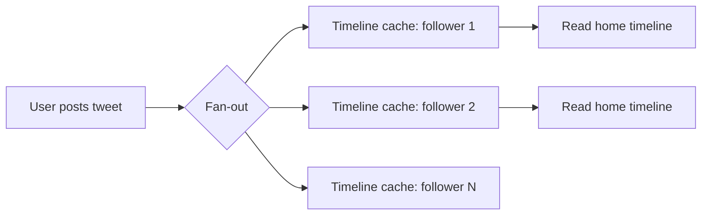

# Scalability: load parameters, percentiles and SLOs

> **Before this lesson:** you should know the difference between a fault and a failure, and what a cache, a client and a server are. All of that is in the previous lesson, [Reliability and maintainability](#/lesson/databases/reliability-maintainability). A little Python and one SQL query you have seen before are enough for the code.

## In plain words

**Scalability** is a system's ability to keep working well as the amount of work it is given grows. A system is never "scalable" in general. It copes, or fails to cope, with a specific kind of growth.

Think of a coffee shop. With ten customers an hour, one person takes orders and makes drinks. With two hundred an hour, that arrangement collapses: a queue forms, and the people at the back wait far longer than the people at the front. To fix it you first have to know *what* grew. More customers? Bigger orders? Everyone arriving at 8:55? Then you need a way to say how bad things are. "The average wait is three minutes" hides the person who waited twenty. Only after those two steps can you choose a remedy: a faster machine, a second counter, or drinks prepared in advance.

This lesson follows the same three steps for software:

1. Describe the **load** (how much work arrives, and of what kind).
2. Describe the **performance** (how long users wait), using numbers that do not hide the unlucky users.
3. Choose a way to cope.

Why this matters for a job: nearly every system-design interview contains the sentence "now suppose it has to serve a hundred times more users". The interviewer wants to hear which number is growing, what breaks first, and how you would measure it. On the job, the same vocabulary (p99, SLO, fan-out) appears on every monitoring screen.

## 1. Describing load: load parameters

**Load** is the amount of work a system is being asked to do. A **load parameter** is a number that describes one aspect of that work. Which numbers matter depends on what the system does. Common ones:

- **Requests per second** arriving at a web server. A request is one question sent to the server, such as "show me this page".
- The **ratio of reads to writes** in a database. A read fetches stored data; a write stores or changes it.
- The number of people online at the same moment in a chat room.
- The **cache hit rate**: the fraction of lookups that find their answer already in the cache.
- The *distribution* of some quantity, meaning not one number but how the values are spread out, such as how many followers each user has.

Sometimes the typical case is what strains the system. Sometimes it is a small number of extreme cases. The next example is of the second kind, and it is the best-known case study in this field.

### 1.1 The Twitter home timeline case study

DDIA uses figures that Twitter published in November 2012. Two operations matter:

- **Post tweet.** A user publishes a short message (a "tweet") to their followers. About 4,600 requests per second on average, and more than 12,000 per second at the busiest moments.
- **Home timeline.** A user opens the app and sees recent tweets from everyone they follow. About 300,000 requests per second.

Handling 4,600 writes per second is not hard for modern hardware. The difficulty is something called **fan-out**: one incoming request that causes many pieces of downstream work. Each user follows many people and is followed by many people, so "who needs to see this tweet?" has a large answer. There are two ways to build the home timeline.

**Approach 1: compute on read.** Store each tweet once, in one big table of all tweets. When a user asks for their timeline, find everyone they follow, find those people's tweets, and sort them by time. In SQL:

```sql
SELECT tweets.*, users.* FROM tweets
JOIN users   ON tweets.sender_id = users.id
JOIN follows ON follows.followee_id = users.id
WHERE follows.follower_id = :current_user
```

Reading that query from the top: `FROM tweets` starts with the table of all tweets. Each `JOIN` attaches matching rows from another table: first the user who sent each tweet, then the "follows" records that point at that sender. The `WHERE` line keeps only the rows where the follower is the person asking. All the work happens at the moment of reading, and it happens 300,000 times a second.

**Approach 2: fan-out on write.** Give every user a ready-made list of their home timeline, kept in a cache, like a personal mailbox. When someone posts a tweet, find all of their followers and drop a copy of the tweet into each follower's mailbox. Reading a timeline is then cheap, because the answer was prepared in advance.



In the diagram, one post on the left spreads out into one cache write per follower. Each read on the right touches a single prepared list.

Twitter began with approach 1 and could not keep up with the read load. It switched to approach 2. The reasoning is worth memorising because it applies widely: reads outnumbered writes by a factor of about 65, so it pays to do extra work on the rare operation (writing) to make the common one (reading) cheap.

Approach 2 has a cost of its own. A tweet reaches about 75 followers on average, so 4,600 tweets per second become roughly 345,000 mailbox writes per second. And the average hides the extremes. Some accounts had more than 30 million followers. One tweet from such an account means 30 million writes, and Twitter aimed to deliver tweets within about five seconds.

So the load parameter that decides Twitter's design is the **distribution of followers per user**, weighted by how often those users tweet. The design Twitter settled on is a **hybrid**: most users' tweets are fanned out on write, while tweets from a small number of celebrity accounts are fetched at read time and merged into the timeline, as in approach 1.

> [!INTERVIEW]
> The push versus pull trade-off (fan-out on write versus fan-out on read) comes up in questions about news feeds, notifications and chat. Name the **load parameter** that decides it: the follower distribution and the read-to-write ratio. Propose the **hybrid** for the accounts with the most followers. Estimate the extra write work as average fan-out multiplied by the write rate.

The program below builds a pretend population of users whose follower counts are very uneven, then measures how much write work the hybrid saves.

```python-run
import random
random.seed(1)
# Simulate a heavy-tailed follower distribution (Pareto-like)
users = 100_000
followers = [int(random.paretovariate(1.2)) for _ in range(users)]
tweets_per_sec = 4600
avg_fanout = sum(followers) / users
print(f"mean followers  : {avg_fanout:.1f}")
print(f"max followers   : {max(followers):,}")
print(f"timeline writes/s (pure fan-out): {tweets_per_sec*avg_fanout:,.0f}")

# Hybrid: skip fan-out for 'celebrities' above a threshold
for threshold in [10_000, 1_000, 100]:
    celebs = [f for f in followers if f > threshold]
    normal = [f for f in followers if f <= threshold]
    writes = tweets_per_sec * sum(normal) / users
    print(f"threshold {threshold:>6}: celebs={len(celebs):>4}, writes/s={writes:,.0f}, "
          f"extra merges per read = #celebs you follow")
```

What each part does:

- `random.seed(1)` fixes the random sequence so the output is repeatable.
- `random.paretovariate(1.2)` draws a number from a **Pareto distribution**, a pattern in which most values are small and a few are enormous. A distribution with that shape is called **heavy-tailed**. The line that builds `followers` uses a **list comprehension**: `[expression for _ in range(users)]` evaluates the expression once per user and collects the results in a list.
- `avg_fanout` is the mean number of followers. Multiplying it by the tweet rate gives the number of mailbox writes per second if every tweet is fanned out.
- The `for threshold in [...]` loop tries three cut-off points. Users with more followers than the threshold are treated as celebrities and are not fanned out. `celebs` and `normal` are two more list comprehensions, each with an `if` filter at the end.

The output is:

```
mean followers  : 5.2
max followers   : 17,785
timeline writes/s (pure fan-out): 23,827
threshold  10000: celebs=   3, writes/s=21,816, extra merges per read = #celebs you follow
threshold   1000: celebs=  24, writes/s=19,399, extra merges per read = #celebs you follow
threshold    100: celebs= 429, writes/s=14,862, extra merges per read = #celebs you follow
```

Look at the first threshold row. Three accounts out of 100,000 are responsible for about 2,000 of the 23,827 writes per second, which is 8% of all the work. With the threshold at 100, fewer than half a percent of users (429 of them) account for more than a third of the writes. Skipping fan-out for a handful of accounts removes a large share of the load, and the price is a few extra lookups when a timeline is read. That is why the hybrid wins.

## 2. Describing performance

Once the load is described, two questions can be asked about any growth in it:

1. If the load goes up and the hardware stays the same, how much worse does performance get?
2. If the load goes up, how much more hardware is needed to keep performance the same?

Both need a definition of "performance". It depends on the kind of system.

- A **batch system** processes a large pile of stored data in one long run, for example overnight. What matters there is **throughput**: how many records are handled per second, or how long the whole job takes.
- An **online system** answers users while they wait. What matters there is **response time**: the time between a client sending a request and receiving the answer.

> [!NOTE]
> **Latency versus response time.** People often use these two words as if they meant the same thing. Strictly, *response time* is what the client experiences: the time the server spends working (the **service time**) plus time on the network plus time spent waiting in queues. *Latency* is only the waiting part, the time a request sits idle before anyone handles it. The distinction helps when you are hunting for where the time went.

### 2.1 Response time is a distribution

Send the identical request a thousand times and you will measure a thousand different response times. Most are close together; a few are much slower. The slow ones are called **outliers**. They have many causes, none of which the request itself controls:

- The operating system paused the program to let another one run (a **context switch**).
- A piece of the message was lost on the network and had to be sent again.
- The program stopped briefly to clean up memory it no longer needed. This is **garbage collection**, shortened to GC.
- Data the program needed had to be fetched from disk because it was not in memory (a **page fault**).

So response time is not one number. It is a **distribution**: a whole spread of values.

The obvious way to summarise many numbers is the **mean** (add them up and divide by the count). It is a poor choice here, because it does not tell you how many users had a bad time. Suppose nine requests take 10 milliseconds and one takes 1,000. A millisecond (ms) is a thousandth of a second. The mean is 109 ms, a figure that describes none of the ten requests.

**Percentiles** do better. Sort all the measured response times from fastest to slowest.

- The **median**, written **p50**, is the value in the middle. Half the requests were faster and half slower. It answers "what does a typical user see?".
- **p95** is the value that 95% of requests beat. Only 1 request in 20 is slower.
- **p99** is beaten by 99% of requests, and **p999** (also written p99.9) by 99.9%. Only 1 request in 1,000 is slower than p999.

The high percentiles are called **tail latencies**, because on a chart of the distribution they sit in the long thin "tail" on the right.

Why would anyone care about 1 request in 1,000? Amazon sets requirements for its internal services at p999, for a reason that is easy to miss: the slowest requests often belong to the customers with the most data in their accounts, because they have bought the most. Those are the most valuable customers. Amazon has also reported that 100 ms of added delay reduced sales by about 1%. On the other hand, Amazon judged that improving p9999 (1 request in 10,000) cost more than it returned, since at that extreme the delays are caused by random events nobody can control.

### 2.2 SLOs and SLAs

Percentiles are the vocabulary used to write down promises about a service.

- An **SLO** (service level objective) is a target that a team sets for itself. Example: "the median response time is under 200 ms and p99 is under 1 second, and this holds 99.9% of the time."
- An **SLA** (service level agreement) is a contract with a customer that contains such targets together with consequences, such as a refund, if they are missed.

The error budget from the previous lesson is the other half of an SLO: the target says what "working" means, and the budget says how much "not working" is allowed.

### 2.3 Queueing and head-of-line blocking

A server can do only a limited number of things at once, roughly one per **CPU core** (a core is one independent processing unit inside the processor chip). When more requests arrive than there are free cores, the extra ones wait in a queue. That waiting time is the **queueing delay**, and at the high percentiles it is usually the largest part of the response time.

A handful of slow requests can hold up many fast ones stuck behind them, like one customer with a complicated order at the front of the coffee line. This is **head-of-line blocking**. The requests behind were quick to process, yet their users experienced a long wait. Two practical rules follow:

- **Measure on the client side.** The server's own clock starts when it begins working on a request, so it never sees the time the request spent queueing or travelling.
- **A load test must not wait politely.** A **load test** sends artificial traffic at a system to see how it behaves. If the test program waits for each answer before sending the next request, a slow server automatically receives fewer requests, the queue never builds, and the results look far better than reality. Real users do not coordinate with the server like that. The mistake has a name: **coordinated omission**.

### 2.4 Tail latency amplification

Modern services are often built from many small services that call one another, an arrangement known as **microservices**. A single page view may trigger calls to dozens of them at the same time. The page is ready only when the *slowest* call has returned.

Suppose each call is slow 1% of the time. For one call, the chance of a slow page is 1%. For 100 calls, the chance that *none* of them is slow is $0.99^{100}$, so the chance that at least one is slow is $1 - 0.99^{100} \approx 63\%$.

```python-run
for n in [1, 5, 10, 50, 100]:
    p_slow = 1 - 0.99 ** n
    print(f"{n:>3} parallel backend calls -> P(user request hits a p99-slow call) = {p_slow:.1%}")
```

The loop evaluates that formula for five values of `n`. `0.99 ** n` is Python for "0.99 raised to the power n". The format code `{p_slow:.1%}` prints the fraction as a percentage with one decimal place.

```
  1 parallel backend calls -> P(user request hits a p99-slow call) = 1.0%
  5 parallel backend calls -> P(user request hits a p99-slow call) = 4.9%
 10 parallel backend calls -> P(user request hits a p99-slow call) = 9.6%
 50 parallel backend calls -> P(user request hits a p99-slow call) = 39.5%
100 parallel backend calls -> P(user request hits a p99-slow call) = 63.4%
```

A delay that only 1 call in 100 suffers becomes the *normal experience* for a user whose page needs 100 calls. This effect is **tail latency amplification**, and it is the reason teams that run microservices watch p99 and p999 so closely.

### 2.5 Computing percentiles correctly

A service usually runs on many machines, and each reports its own percentiles. It is tempting to average them. The next program shows why that gives a wrong answer.

```python-run
import random, math
random.seed(42)

def percentile(sorted_vals, p):
    """Nearest-rank percentile: smallest value with at least p% of data <= it."""
    if not sorted_vals:
        return None
    k = max(1, math.ceil(p / 100 * len(sorted_vals)))
    return sorted_vals[k - 1]

# two servers: one healthy, one with a slow GC tail
a = [random.lognormvariate(3.5, 0.3) for _ in range(9000)]     # ~33 ms typical
b = [random.lognormvariate(3.5, 0.3) if random.random() > 0.05 else random.uniform(300, 900)
     for _ in range(1000)]
sa, sb, sall = sorted(a), sorted(b), sorted(a + b)
for p in (50, 95, 99, 99.9):
    avg_of_pcts = (percentile(sa, p) + percentile(sb, p)) / 2
    print(f"p{p:<5} server A={percentile(sa,p):6.1f}  B={percentile(sb,p):6.1f}  "
          f"WRONG avg={avg_of_pcts:6.1f}  RIGHT merged={percentile(sall,p):6.1f}")
print("mean overall:", round(sum(a + b) / len(a + b), 1), "ms  (hides the tail!)")
```

What each part does:

- `percentile(sorted_vals, p)` implements the definition from section 2.1 using the **nearest-rank** rule. `math.ceil` rounds up. For 1,000 sorted values and `p = 99`, `k` is 990, and the function returns the 990th smallest value.
- List `a` holds 9,000 response times from a healthy server, clustered around 33 ms. `random.lognormvariate` produces values with a realistic shape: mostly close together, with a mild tail.
- List `b` holds 1,000 response times from a server with a problem. The expression `X if condition else Y` picks a normal value 95% of the time and a very slow one (300 to 900 ms) the other 5%.
- `sorted(a + b)` joins the two lists and sorts the result. That is the true combined data.
- The loop prints, for each percentile, the value on each server, the average of those two values, and the value computed from the merged data.

```
p50    server A=  33.0  B=  34.1  WRONG avg=  33.6  RIGHT merged=  33.1
p95    server A=  55.1  B=  68.6  WRONG avg=  61.9  RIGHT merged=  55.5
p99    server A=  67.1  B= 747.5  WRONG avg= 407.3  RIGHT merged=  70.4
p99.9  server A=  85.2  B= 896.1  WRONG avg= 490.7  RIGHT merged= 753.9
mean overall: 36.9 ms  (hides the tail!)
```

Look at the p99 row. Averaging the two servers claims 407 ms. The true p99 across all 10,000 requests is 70 ms. The average is wrong by a factor of almost six, because server B handled only a tenth of the traffic yet counts for half of the average. At p99.9 the error goes the other way: the average says 491 ms while the truth is 754 ms. And the last line shows the mean, 36.9 ms, which gives no hint that some users waited most of a second.

The correct way to combine percentiles is to combine the underlying data first. Keeping every raw measurement is too expensive at scale, so real systems keep a **histogram**: a set of counters, one per range of values ("how many requests took 10 to 20 ms?"). Histograms from different machines can be added together counter by counter, and percentiles are then read from the total. Libraries such as **HdrHistogram** and **t-digest** do this using very little memory.

## 3. Approaches for coping with load

A design that works well at one level of load rarely survives ten times that load. A sensible habit is to expect to rethink the design each time the load grows by a factor of ten (an **order of magnitude**). The basic choices are:

- **Scaling up**, also called **vertical scaling**: move to a more powerful machine. It keeps the design uncomplicated. But powerful machines get expensive quickly, there is a limit to how big a machine can be bought, and one machine is still one thing that can die.
- **Scaling out**, also called **horizontal scaling**: spread the work across many ordinary machines. Each machine (a **node**) has its own processor, memory and disks, and the nodes cooperate only by sending messages over the network. Because the nodes share no hardware, this is called a **shared-nothing** architecture.
- An **elastic** system adds machines automatically when it detects more load. A manually scaled system waits for a person to decide. Elastic helps when load is unpredictable; manual has fewer surprises.

Not everything is equally easy to spread out. A **stateless** service remembers nothing between requests, so any copy can answer any request, and adding copies is easy. A **stateful** system, such as a database, holds data that must stay correct and consistent across machines. Spreading that over many nodes is hard, and it is the subject of most of the remaining lessons in this track. The traditional advice was to keep the database on one machine until forced to do otherwise. As tools improve, that advice is slowly loosening.

There is no universal recipe that scales everything. A system serving 100,000 requests per second of one kilobyte each has nothing in common with a system serving three requests a minute of two gigabytes each, even though both move the same number of bytes per second. Every good design rests on **assumptions about which operations are common and which are rare**, which is another way of saying its load parameters. If the assumptions turn out wrong, the effort spent on scaling was wasted. That is why a brand-new product should care more about being quick to change than about a load it may never see.

## 4. Back-of-the-envelope estimation

Interviewers expect rough capacity arithmetic done quickly, as if on the back of an envelope. Two things are needed: a feeling for how long basic operations take, and the habit of multiplying.

The units first: a nanosecond (ns) is a billionth of a second, a microsecond (µs) is a millionth, and a millisecond (ms) is a thousandth.

| Operation | Approximate time | What it is |
|---|---|---|
| L1 cache reference | 1 ns | Reading from the tiny, fastest memory inside the processor |
| Main memory reference | 100 ns | Reading from RAM |
| SSD random read | 16-100 µs | Reading a small block from a solid-state drive, a disk with no moving parts |
| Round trip within a datacenter | 0.5 ms | A message to a nearby machine and its reply |
| HDD seek | 2-10 ms | A spinning hard disk moving its arm to the right track |
| Round trip US to Europe | 70-150 ms | A message across the Atlantic and its reply |

The steps between rows are large. Memory is about a thousand times faster than a solid-state drive, and a hard-disk seek costs as much as tens of thousands of memory reads. A great deal of database design, as later lessons show, is about avoiding the slow rows.

The program below estimates the needs of a photo-sharing app from a few assumptions.

```python-run
# Estimate storage and QPS for a photo-sharing app
dau = 50_000_000
uploads_per_user_day = 0.2
avg_photo_mb = 2.0
reads_per_user_day = 30
secs = 86_400

write_qps = dau * uploads_per_user_day / secs
read_qps  = dau * reads_per_user_day / secs
storage_tb_year = dau * uploads_per_user_day * avg_photo_mb * 365 / 1e6
print(f"avg write QPS ~ {write_qps:,.0f}, peak (x3) ~ {3*write_qps:,.0f}")
print(f"avg read QPS  ~ {read_qps:,.0f}, peak (x3) ~ {3*read_qps:,.0f}")
print(f"new storage/year ~ {storage_tb_year:,.0f} TB (before replication x3 -> {3*storage_tb_year:,.0f} TB)")
print(f"read:write ratio ~ {read_qps/write_qps:.0f}:1  -> favour read-optimised design / caching / CDN")
```

What each part does:

- `dau` is the number of **daily active users**: people who use the app on a given day. The next three lines are assumptions: one upload every five days per user, 2 megabytes per photo, 30 photo views per user per day.
- `secs = 86_400` is the number of seconds in a day. Dividing a daily total by it gives an average rate per second. **QPS** means queries per second.
- `storage_tb_year` multiplies users by uploads by size by 365 days, and divides by a million to turn megabytes into terabytes (TB).
- The prints multiply the averages by 3 as a rough allowance for busy hours.

```
avg write QPS ~ 116, peak (x3) ~ 347
avg read QPS  ~ 17,361, peak (x3) ~ 52,083
new storage/year ~ 7,300 TB (before replication x3 -> 21,900 TB)
read:write ratio ~ 150:1  -> favour read-optimised design / caching / CDN
```

Three conclusions come straight out of the numbers. Writes are rare (about a hundred per second), so one database could accept them. Reads are 150 times more common, so the design should be built around making reads cheap, with caches and a **CDN** (content delivery network: servers placed around the world that hold copies of files close to users). And storage, not request rate, is the hard part: 7,300 terabytes of new photos per year, tripled if three copies are kept for safety.

## 5. Pitfalls

- **Reporting means.** A mean is pulled around by outliers and still hides how many users suffered. Report p50, p95 and p99.
- **Averaging percentiles** across servers or across time periods. Add histograms together, then compute.
- **Measuring only on the server.** This misses queueing and network time, which is often most of the delay.
- **Load tests that wait for each response.** They hide the queue and make tail latency look better than it is.
- **Scaling out too early.** Many machines bring real complexity. Check that the load parameters call for it.
- **Asking "is it scalable?"** without saying which load grows. The question has no answer until the load parameter is named.

## 6. Summary

- Describe load with **load parameters** that capture what really drives cost. Often the important one is a *distribution*, such as followers per user.
- Describe performance with **percentiles** of response time measured at the client. The tail matters because fan-out amplifies it and because heavy users, who are often the most valuable, live there.
- SLOs and SLAs are written in terms of percentiles and availability.
- Scale up while it is cheap, scale out when you must, and expect to redesign at each tenfold growth. No design scales for every kind of load.

## Glossary

- **Scalability** - how well a system copes when a specific kind of load grows.
- **Load / load parameter** - the work a system is asked to do / a number describing one aspect of it.
- **Fan-out** - one request causing many pieces of downstream work.
- **Fan-out on write / on read** - doing that work when data is written (push) / when it is read (pull).
- **Heavy-tailed distribution** - a spread of values in which most are small and a few are enormous.
- **Throughput** - how much work is completed per unit of time.
- **Response time** - the time from sending a request to receiving the answer, measured by the client.
- **Latency** - strictly, the time a request spends waiting to be handled.
- **Service time** - the time the server spends working on a request.
- **Percentile (p50, p95, p99, p999)** - the value that the given percentage of measurements fall below.
- **Median** - the 50th percentile, the middle value.
- **Tail latency** - the response times at high percentiles.
- **SLO (service level objective)** - a team's own target for performance or availability.
- **SLA (service level agreement)** - a contract containing such targets and penalties.
- **Queueing delay** - time a request waits because the server is busy.
- **Head-of-line blocking** - slow requests at the front of a queue delaying fast ones behind them.
- **Coordinated omission** - a load-testing mistake where the tester waits for the server and so hides queueing.
- **Tail latency amplification** - a rare slow call becoming common when one request needs many calls.
- **Histogram** - counts of how many measurements fell into each range of values.
- **Scaling up (vertical)** - moving to a bigger machine.
- **Scaling out (horizontal) / shared-nothing** - spreading work over many independent machines joined only by a network.
- **Node** - one machine in such a group.
- **Elastic** - adding or removing machines automatically as load changes.
- **Stateless / stateful** - keeping no data between requests / holding data that must be preserved.
- **QPS** - queries (requests) per second.
- **CDN (content delivery network)** - servers around the world holding copies of files near users.

```quiz
[
  {"q": "Twitter switched from computing timelines on read to fanning out on write mainly because...",
   "options": ["Writes were more frequent than reads", "Home-timeline reads outnumbered tweet writes by almost two orders of magnitude", "Joins are not supported in MySQL", "Celebrities had few followers"],
   "answer": 1,
   "explain": "300k reads/s vs 4.6k writes/s: doing more work at write time makes the dominant operation cheap."},
  {"q": "Why does Twitter use a hybrid approach for celebrity accounts?",
   "options": ["Celebrities tweet more often", "Fanning out a tweet to 30M+ followers on write is too expensive, so those tweets are merged at read time", "To comply with regulations", "Because celebrity tweets are cached in a CDN"],
   "answer": 1,
   "explain": "The follower-count distribution is heavy-tailed; the few extreme accounts dominate fan-out cost."},
  {"q": "A backend request fans out to 100 services in parallel, each with a 1% chance of being slow. Probability that the user request is slow?",
   "options": ["1%", "About 10%", "About 63%", "100%"],
   "answer": 2,
   "explain": "1 - 0.99^100 is about 0.634: tail latency amplification."},
  {"q": "You have p99 latencies from 10 servers. How should you compute the fleet-wide p99?",
   "options": ["Average the ten p99 values", "Take the max of the ten values", "Merge the underlying histograms (or raw samples) and compute p99 from the merged distribution", "Take the median of the ten values"],
   "answer": 2,
   "explain": "Percentiles do not compose by averaging; histograms do compose by addition."},
  {"q": "Why should a load-testing client not wait for each response before sending the next request?",
   "options": ["It wastes CPU", "It keeps queues artificially short and understates response times (coordinated omission)", "It violates HTTP semantics", "It causes TCP retransmits"],
   "answer": 1,
   "explain": "Real users arrive independently of how fast the server responds; a closed loop hides queueing delay."},
  {"q": "Which statement about 'latency' vs 'response time' matches DDIA?",
   "options": ["They are strictly identical", "Response time is what the client sees (including network and queueing delay); latency is the time a request waits to be handled", "Latency includes response time", "Response time excludes queueing"],
   "answer": 1,
   "explain": "Response time = service time + network delays + queueing delays."},
  {"q": "What does 'shared-nothing' architecture mean?",
   "options": ["Machines share a SAN", "Scaling out across independent machines, each with its own CPU, memory and disks, coordinating over the network", "No data is replicated", "A single big machine"],
   "answer": 1,
   "explain": "Shared-nothing = horizontal scaling; nodes communicate only via the network."}
]
```

> **Source:** DDIA ch. 1, "Scalability" (Describing load, Describing performance, Approaches for coping with load).
