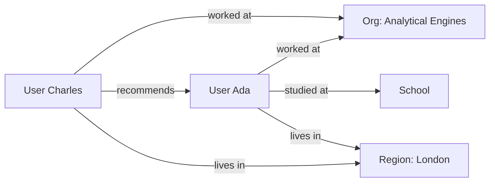

# Relational vs document models

> **Before this lesson:** you should know what a database, a client and an API are, from [Reliability and maintainability](#/lesson/databases/reliability-maintainability). You should have seen a SQL query such as `SELECT name FROM users` and be able to read a Python dictionary and a `for` loop. Nothing else is assumed.

## In plain words

A **data model** is the shape in which a database lets you describe your information. Two shapes dominate.

- In the **relational model**, data lives in **tables**. A table is a grid, like a spreadsheet tab: each **row** is one thing (one customer, one order) and each **column** is one fact about it (name, price).
- In the **document model**, data lives in **documents**. A document is a self-contained record that can hold lists and smaller records inside it, like a filled-in form with attached pages.

An everyday picture: think of how a clinic could keep patient information. One way is a set of ledgers, one for patients, one for appointments, one for prescriptions, each line carrying a patient number so the ledgers can be matched up. That is the relational way. The other way is one folder per patient with everything about that person inside. That is the document way. The folder is wonderful when you want everything about one patient. The ledgers are wonderful when you want to ask "which patients were prescribed this drug?", a question that would mean opening every folder.

Why this matters for a job: "would you use SQL or NoSQL here?" is among the most common system-design questions, and the wrong data model is expensive to change once a product has real data in it. The right answer is never a brand name. It is a statement about how the pieces of data relate to each other and how they will be read. This lesson gives you the words for that answer.

## 1. Models stacked on models

Software is built in layers, and each layer describes its data using the layer below.

1. An application programmer thinks about real things (people, orders, sensors) and represents them as **objects** or **data structures** in a programming language: dictionaries, lists, classes.
2. To store those structures, the programmer expresses them in a **general-purpose data model**: tables, documents, or a graph.
3. The engineers who build the database decide how tables or documents become **bytes** in memory and on disk. A byte is the basic unit of computer storage, a number from 0 to 255.
4. Hardware engineers decide how bytes become electrical charges and magnetic fields.

Each layer hides the mess below it behind a clean surface, which is the idea of abstraction from the first lesson. This lesson is about layer 2. It compares the relational and document models. The next lesson covers the third option, graphs.

## 2. A short history

Knowing where the models came from explains why they look the way they do.

- **Hierarchical model** (IBM's IMS, 1960s). All data formed one big tree: a record had one parent and any number of children. This suits **one-to-many** relationships, where one thing owns several others, such as one customer with many orders. It handles **many-to-many** relationships badly (many students take many courses), and it had no way to combine records from different branches.
- **Network model** (a standard known as CODASYL). A record could have several parents. To reach a record, the programmer wrote code that followed links from record to record by hand. The route taken is called an **access path**. If the layout of the data changed, every program that walked the old route had to be rewritten.
- **Relational model** (proposed by Edgar Codd in 1970). Data is laid out in the open as tables. The formal names are **relation** for a table and **tuple** for a row. There are no access paths in your code. You state what you want, and a part of the database called the **query optimizer** works out the route. An **index**, an extra structure that speeds up lookups in the way a book's index does, can be added later without changing a single query.

The relational model won, and by the mid-1980s it was the default choice for business data. It outlasted several challengers. Around 2010 a new wave arrived under the name **NoSQL**. The word began as a label for a meetup and was later explained as "Not Only SQL". Several forces were behind it:

- a need to handle more data, or more writes per second, than the relational databases of the day managed comfortably,
- a preference for free, open-source software,
- kinds of query that the relational model expressed awkwardly,
- frustration with rigid table definitions, and a wish for something more flexible.

The outcome was not a replacement. Most companies now use relational databases alongside other kinds of store, each for the job it does best. That mix is called **polyglot persistence**.

## 3. The object-relational mismatch

Most application code is **object-oriented**: it handles data as objects, where one object can contain lists of other objects. Tables are flat. So a translation step is needed between the two, and it is awkward enough to have a name, the **impedance mismatch**. Libraries called **ORMs** (object-relational mappers, such as Hibernate or ActiveRecord) automate much of the translation, but they cannot make the difference disappear.

A concrete case: a professional profile, like a résumé. Each profile has one user ID, one name and one summary. It also has lists: several jobs held, several schools attended, several ways to get in touch. Each of those is a one-to-many relationship.

**How a relational database stores it.** There are three common choices:

- Put jobs, schools and contact details in separate tables. Each row in those tables carries the ID of the user it belongs to. A column that holds the ID of a row in another table is called a **foreign key**.
- Keep the lists inside one column using a structured type. PostgreSQL, for example, has a column type called `jsonb` for this.
- Store the whole profile as a blob of text and let the application interpret it. The database then cannot search inside it.

**How a document database stores it.** As one document, usually written in **JSON** (JavaScript Object Notation), a text format made of names paired with values:

```json
{
  "user_id": 251,
  "first_name": "Ada",
  "last_name": "Lovelace",
  "region_id": "eu:gb:london",
  "industry_id": 131,
  "positions": [
    {"job_title": "Analyst", "organization": "Analytical Engines Ltd"},
    {"job_title": "Translator", "organization": "Royal Society"}
  ],
  "education": [{"school_name": "Home-schooled", "start": 1825, "end": 1835}],
  "contact_info": {"blog": "https://example.org/ada"}
}
```

Reading the notation: curly braces `{ }` enclose a record made of `"name": value` pairs. Square brackets `[ ]` enclose a list. So `"positions"` is a list holding two small records, each with a job title and an organisation.

The document has better **locality**, meaning that data used together is stored together. Fetching the profile is one lookup. The version with separate tables needs several queries, or one query that combines several tables. Notice also that the one-to-many relationships form a **tree**: the user at the root, lists branching off it. JSON writes that tree down directly.

## 4. Many-to-one and many-to-many relationships

Look again at the document. Why does it say `"region_id": "eu:gb:london"` and not the words "Greater London"?

Storing an ID that points to the real name, kept in one place, is called **normalisation**. It has several advantages:

- Every profile uses the same spelling and style.
- There is no confusion between two cities with the same name.
- A rename is one change in one place.
- The name can be shown in the reader's own language.
- Search improves, because the database can know that London is inside Great Britain.

The underlying principle: an ID means nothing to humans, so it never needs to change. Anything meaningful to humans may need to change someday. If the meaningful text is copied into a thousand profiles, all thousand copies must be updated, which costs time and risks missing some. Copies that disagree are called an **inconsistency**. Normalisation is the removal of such duplication.

Normalisation creates **many-to-one** relationships: many people live in one region. To show a profile, the region's name has to be looked up from its ID. Combining rows from two tables through a shared value is called a **join**. Relational databases are built around joins. Document databases historically supported them poorly, so the application had to do the lookup itself with extra queries.

There is a second problem, and it grows over time. Data tends to become more interconnected as a product gains features. Suppose organisations and schools get their own pages, so a profile should link to them and not merely name them. Suppose users can write recommendations for one another, and each recommendation should show the writer's current photo. One user now connects to many organisations and each organisation to many users. These are **many-to-many** relationships, and the tidy tree no longer describes the data.



In the diagram each box is a record and each arrow is a relationship. Two users point at the same organisation and the same region, and one user points at another. No single box can be the root with everything else nested inside it.

> [!NOTE]
> Document databases reopened an argument from the 1970s. The old network model and today's document stores both find many-to-many relationships difficult. The relational answer was joins, planned by the optimizer. Once records refer to other records, the two models do the same thing underneath: each stores a unique identifier of the related item. Relational databases call it a *foreign key*; document databases call it a *document reference*.

The program below shows the trade-off with a tiny dataset held in Python dictionaries.

```python-run
# Same data, two shapes: normalized (relational) vs embedded (document).
users = {251: {"name": "Ada", "region_id": "lon"}, 252: {"name": "Charles", "region_id": "lon"}}
regions = {"lon": "Greater London"}
positions = [(251, "Analyst"), (251, "Translator"), (252, "Engineer")]

# relational-style 'join' at query time
def profile_relational(uid):
    u = users[uid]
    return {"name": u["name"], "region": regions[u["region_id"]],
            "positions": [t for (owner, t) in positions if owner == uid]}

# document-style: denormalized copy of region name embedded in each doc
docs = {uid: profile_relational(uid) for uid in users}

print(profile_relational(251))
print(docs[251])

# Now rename the region -- normalized: one write; denormalized: N writes
regions["lon"] = "London (Greater)"
stale = [uid for uid, d in docs.items() if d["region"] != regions["lon"]]
print("relational read after rename:", profile_relational(251)["region"])
print("document copies now stale   :", stale, "-> must update", len(stale), "docs")
```

What each part does:

- `users`, `regions` and `positions` play the part of three tables. `users` maps a user ID to that user's fields. `positions` is a list of pairs `(user ID, job title)`.
- `profile_relational(uid)` builds a profile at the moment it is asked for. It looks up the user, then follows `region_id` into `regions` (a join done by hand), then collects the job titles whose owner matches. The expression `[t for (owner, t) in positions if owner == uid]` is a list comprehension: it walks through `positions` and keeps the title from every pair that belongs to this user.
- `docs` builds one finished document per user, each containing its own copy of the region's name. Storing copies like this is **denormalisation**.
- Then the region is renamed in the `regions` table, and `stale` lists every document whose copy no longer matches.

The output is:

```
{'name': 'Ada', 'region': 'Greater London', 'positions': ['Analyst', 'Translator']}
{'name': 'Ada', 'region': 'Greater London', 'positions': ['Analyst', 'Translator']}
relational read after rename: London (Greater)
document copies now stale   : [251, 252] -> must update 2 docs
```

The first two lines are identical: both shapes answer the same question. The difference appears after the rename. The normalised version picks up the new name on its next read, because there was only one copy. The document version has two stale copies to find and fix. With two users that is trivial; with fifty million it is a serious job, and while it runs, some profiles show the old name and some the new.

## 5. Relational vs document databases today

### 5.1 Which model leads to simpler application code?

- If the data is **document-like**, meaning a tree of one-to-many relationships that is usually loaded all at once, the document model fits well. Splitting such data across many tables (sometimes called **shredding**) produces clumsy table layouts and complicated code.
- Documents have limits. You cannot point directly at an item nested inside one. You have to say something like "the second position in the list for user 251", which resembles the old access paths. And joins may be weak or missing.
- **Many-to-many** relationships remove most of the document model's appeal. Either you keep copies and take on the burden of keeping them consistent, or you join in application code, which is slower and more complicated than a join inside the database.
- When nearly everything links to everything else, documents fit poorly, tables cope, and a **graph** model (next lesson) is the most natural.

### 5.2 Schema flexibility: schema-on-read vs schema-on-write

A **schema** is a description of the structure data must have: which fields exist and what type each one is. Document databases are often called "schemaless". That word misleads. The code that reads the data still expects *some* structure, so a schema exists. It is **implicit**, living in the application code, and the database does not check it.

- **Schema-on-write** (typical of relational databases): the structure is declared in advance, and the database refuses any write that does not fit.
- **Schema-on-read** (typical of document databases): anything can be written, and the structure is interpreted only when the data is read.

Programmers will recognise the parallel with type checking. Schema-on-write resembles **static typing**, where mistakes are caught before the program runs. Schema-on-read resembles **dynamic typing**, where they surface while it runs.

The difference is clearest when the format has to change. Suppose a `name` field should become `first_name` and `last_name`.

With schema-on-read, the application starts writing new documents in the new form and copes with old documents when it meets them:

```python
if user and user.get("name") and not user.get("first_name"):
    # documents written before Dec 8 2023 lack first_name
    user["first_name"] = user["name"].split(" ")[0]
```

`user.get("name")` returns the value stored under `"name"`, or `None` if there is no such field. The `if` line therefore reads: "this user has a `name` but no `first_name`". The last line splits the name at the space and keeps the first piece.

With schema-on-write, you change the table definition and convert the existing data. Such a change is called a **migration**:

```sql
ALTER TABLE users ADD COLUMN first_name text;
UPDATE users SET first_name = split_part(name, ' ', 1);      -- PostgreSQL
```

The first statement adds an empty column to every row. The second fills it in by taking the first space-separated part of `name`.

`ALTER TABLE` is quick in most databases. MySQL was the notable exception for a long time: it copied the entire table, which could mean hours of unavailability on a large one, though newer versions and extra tools have eased this. The `UPDATE` that rewrites every row is slow on a big table in any database. A common way out is to leave the new column empty (`NULL`) and fill it in when a row is read, which is the same trick the document approach uses.

Schema-on-read is the better choice when the items in a collection are **heterogeneous**, meaning they do not all look alike. Two typical cases:

- There are many different kinds of object, and one table per kind would be impractical.
- The structure is decided by an outside system you do not control, and it may change without notice.

When all records are supposed to look the same, a declared schema is valuable. It documents the structure and enforces it.

### 5.3 Data locality for queries

A document is normally stored as one continuous run of bytes, in JSON or a compact binary variant such as MongoDB's BSON. If the application usually needs the *whole* document, that is a speed advantage: one read fetches everything, where separate tables would need several index lookups.

The advantage has conditions. It helps only when large parts of the document are needed together, since the database generally loads the whole document even to read one field. On an update, the whole document usually has to be written out again. Only a change that leaves the stored size unchanged can be made in place. The practical advice is to keep documents fairly small and avoid updates that make them grow.

Locality is not exclusive to document databases. Google's **Spanner** can store a child table's rows physically inside their parent row. Oracle has a similar feature. The **column-family** idea used by Bigtable, Cassandra and HBase serves the same purpose: keeping related data physically close together.

### 5.4 Convergence

The two families are growing toward each other. PostgreSQL, MySQL and IBM's DB2 can store JSON documents in a column and search inside them. On the other side, document databases have added joins: MongoDB, for example, offers a `$lookup` operation. A database that handles both tables and documents well lets you pick the better fit feature by feature, and that is probably where things are heading.

## 6. Query languages: declarative vs imperative

A **query language** is the language you use to ask a database for data. There are two styles.

An **imperative** language tells the computer which steps to perform and in what order. Most programming languages work this way. Here is an imperative search for all sharks in a list of animals:

```python
# imperative: tells the computer which operations to perform, in order
def get_sharks(animals):
    sharks = []
    for a in animals:
        if a["family"] == "Sharks":
            sharks.append(a)
    return sharks
```

The function starts with an empty list, visits each animal in turn, tests its family, and appends matches. Every step is spelled out.

A **declarative** language states what result is wanted and leaves the method to the system. SQL is declarative:

```sql
-- declarative
SELECT * FROM animals WHERE family = 'Sharks';
```

This says "all rows of `animals` whose family is Sharks". It does not say whether to scan the table from the top, use an index, or split the work across several processors.

Declarative languages have three advantages:

- They are shorter and easier to read.
- They **hide how the work is done**, so the database can improve without breaking your queries. It can add an index or reorganise its storage, and the same query will run faster. The imperative loop above promises to return animals in list order. SQL makes no such promise unless asked, which leaves the database free to choose.
- They are easier to run **in parallel**. A description of the desired result puts no restriction on the order of work, so the database can divide it among many processors. Imperative code fixes a sequence.

The same contrast exists on the web. A style rule in CSS such as `li.selected > p` declares which elements should look a certain way. Achieving the same effect with step-by-step JavaScript is longer, and it stops being correct when the page changes, because the steps are not run again.

### 6.1 MapReduce querying

**MapReduce** is a way of processing large amounts of data across many machines, made popular by Google. As a query style it sits between the two: the overall pattern is fixed and declarative, but you supply two small pieces of imperative code. MongoDB used to offer it. This counts shark sightings per month:

```javascript
db.observations.mapReduce(
  function map() { var y = this.observationTimestamp.getFullYear(), m = this.observationTimestamp.getMonth() + 1;
                   emit(y + "-" + m, this.numAnimals); },
  function reduce(key, values) { return Array.sum(values); },
  { query: { family: "Sharks" }, out: "monthlySharkReport" }
);
```

The **map** function is called once per matching document. It produces a pair: a key (the year and month, like `"1995-12"`) and a value (the number of animals seen). The system then gathers together all values that share a key. The **reduce** function is called once per key with the list of its values, and adds them up.

Both must be **pure functions**: they may use only the input handed to them, may not run further queries, and may not change anything outside themselves. That restriction is what lets the system run them on any machine, in any order, and run them again if a machine fails.

Writing two functions that have to fit together is harder than writing one query. So MongoDB added a declarative alternative, the **aggregation pipeline**:

```javascript
db.observations.aggregate([
  { $match: { family: "Sharks" } },
  { $group: { _id: { year: { $year: "$observationTimestamp" }, month: { $month: "$observationTimestamp" } },
              totalAnimals: { $sum: "$numAnimals" } } }
]);
```

`$match` filters the documents and `$group` gathers them by year and month while summing the animal counts. It can express what SQL can, written as JSON. There is a lesson in that: systems that set out to avoid SQL often end up rebuilding it under another name.

The three stages of MapReduce are easy to act out in a few lines of Python:

```python-run
from collections import defaultdict
obs = [
    {"ts": "1995-12-25", "family": "Sharks", "n": 3},
    {"ts": "1995-12-12", "family": "Sharks", "n": 4},
    {"ts": "1995-11-02", "family": "Whales", "n": 1},
    {"ts": "1996-01-07", "family": "Sharks", "n": 2},
]
# map: emit (key, value) pairs
emitted = [(o["ts"][:7], o["n"]) for o in obs if o["family"] == "Sharks"]
# shuffle: group by key
groups = defaultdict(list)
for k, v in emitted:
    groups[k].append(v)
# reduce
print({k: sum(vs) for k, vs in sorted(groups.items())})
```

- `obs` is a list of four observations.
- The `emitted` line is the map step: for each shark observation it produces a pair of the first seven characters of the date (`o["ts"][:7]` turns `"1995-12-25"` into `"1995-12"`) and the count.
- `defaultdict(list)` is a dictionary that creates an empty list the first time a new key is used. The loop puts each value into the list for its key. Grouping by key like this is called the **shuffle**.
- The last line is the reduce step: for each key, `sum(vs)` adds up its list.

The output is `{'1995-12': 7, '1996-01': 2}`. The two December sightings (3 and 4) were combined, the January one stands alone, and the whale observation was filtered out before the map step.

> [!INTERVIEW]
> "SQL or NoSQL?" is a poor way to frame the choice. Answer in terms of **how the data is read and how its parts relate**. Self-contained records loaded whole, with a structure that changes often or varies between records, point to documents. Many-to-one and many-to-many relationships, unplanned queries and strict rules about valid data point to relational. Richly connected data that you explore by following links points to a graph. Mention that PostgreSQL's `jsonb` column type often gives you both in one system.

## 7. Pitfalls

- **Believing "schemaless" means no migration work.** The schema lives in your code. Old documents must either be handled by that code forever or converted.
- **Embedding lists that grow without limit**, such as every comment on a post, inside one document. The document keeps growing and each update rewrites all of it.
- **Denormalising too early.** Copies drift apart. Start normalised, and add copies only for reads you have measured to be slow. Such a copy is in effect a cache.
- **Joins done in a loop by the application.** Fetching 100 posts and then running one extra query per post for its author is 101 queries where one join would do. This is known as the **N+1 query problem**.

## 8. Summary

- The history runs hierarchical, then network, then relational. The relational model won by replacing hand-written access paths with declarative queries and an optimizer.
- The document model is strongest for **tree-shaped, self-contained** data read as a whole. It struggles with **many-to-many** relationships.
- **Schema-on-read** versus **schema-on-write** parallels dynamic versus static typing. Neither is truly schemaless.
- Declarative languages leave the database free to optimise and to work in parallel. MapReduce sits in the middle, and many NoSQL systems grow SQL-like languages over time.

## Glossary

- **Data model** - the shape in which a database lets you describe information: tables, documents or a graph.
- **Relational model / table / row / column** - data as grids; a row is one item, a column is one attribute.
- **Relation / tuple** - the formal names for a table / a row.
- **Document** - a self-contained record that can contain lists and nested records.
- **JSON** - a text format of named values, lists and nested records.
- **One-to-many / many-to-one / many-to-many** - one item owns several others / several items share one / items on both sides link to several on the other.
- **Access path** - a hand-coded route through linked records to reach the one you want.
- **Query optimizer** - the part of a database that decides how to carry out a query.
- **Index** - an extra structure that speeds up finding rows.
- **NoSQL** - an umbrella term for non-relational databases.
- **Polyglot persistence** - using several kinds of database together.
- **Impedance mismatch** - the awkward fit between objects in code and rows in tables.
- **ORM (object-relational mapper)** - a library that translates between objects and rows.
- **Foreign key / document reference** - a stored ID pointing at another row / another document.
- **Locality** - storing together the data that is used together.
- **Normalisation / denormalisation** - keeping each fact in one place and referring to it by ID / storing copies of it for faster reads.
- **Join** - combining rows from two tables through a shared value.
- **Schema** - a description of the structure data must have.
- **Schema-on-write / schema-on-read** - structure enforced when data is stored / interpreted when it is read.
- **Migration** - a change to a schema together with the conversion of existing data.
- **Declarative / imperative** - stating the result wanted / listing the steps to perform.
- **MapReduce** - a processing pattern built from a map function that emits key-value pairs and a reduce function that combines the values for each key.
- **Pure function** - a function that depends only on its input and changes nothing outside itself.
- **N+1 query problem** - running one query per item in a loop where a single join would do.

```quiz
[
  {"q": "Which kind of relationship is the document model naturally best at representing?",
   "options": ["Many-to-many", "One-to-many (tree-structured) data", "Arbitrary graphs", "Recursive hierarchies of unknown depth with cross links"],
   "answer": 1,
   "explain": "A JSON document is a tree; one-to-many nesting gives locality. Many-to-many needs references and joins."},
  {"q": "Why store region_id instead of the string 'Greater London' in every profile?",
   "options": ["IDs are smaller", "Normalization: the human-meaningful name lives in one place, avoiding duplication and inconsistent updates", "Strings cannot be indexed", "JSON does not support strings"],
   "answer": 1,
   "explain": "Anything meaningful to humans may change; an ID never needs to, so only one copy must be updated."},
  {"q": "'Schema-on-read' is most analogous to...",
   "options": ["Static type checking", "Dynamic (runtime) type checking", "No types at all", "Compile-time code generation"],
   "answer": 1,
   "explain": "The structure is implicit and interpreted when data is read, like dynamic typing; schema-on-write is like static typing."},
  {"q": "When does schema-on-read clearly help?",
   "options": ["All records have identical structure", "Records are heterogeneous or their structure is dictated by external systems that change", "You need foreign keys", "You need strong constraints"],
   "answer": 1,
   "explain": "Many object types or externally determined structure make a rigid schema a burden."},
  {"q": "Which is an advantage of declarative query languages like SQL over imperative code?",
   "options": ["They guarantee result order", "They let the engine choose indexes, algorithms and parallelism without changing the query", "They run without an optimizer", "They avoid the need for indexes"],
   "answer": 1,
   "explain": "Specifying only the pattern of results leaves the database free to optimize and parallelize."},
  {"q": "Why must map and reduce functions in MapReduce be pure?",
   "options": ["For readability", "So the framework can run them anywhere, in any order, and re-run them on failure", "Because JavaScript requires it", "To allow joins"],
   "answer": 1,
   "explain": "Purity (no side effects, no extra queries) makes distribution and retry safe."},
  {"q": "The document model's locality advantage applies mainly when...",
   "options": ["You update small fields frequently", "You usually need large parts of the document at the same time", "Documents are very large", "You need many-to-many joins"],
   "answer": 1,
   "explain": "Loading the whole document is one seek; but updates often rewrite the whole document, so keep documents small."}
]
```

> **Source:** DDIA ch. 2, "Data Models and Query Languages" (Relational Model vs. Document Model; Query Languages for Data).
