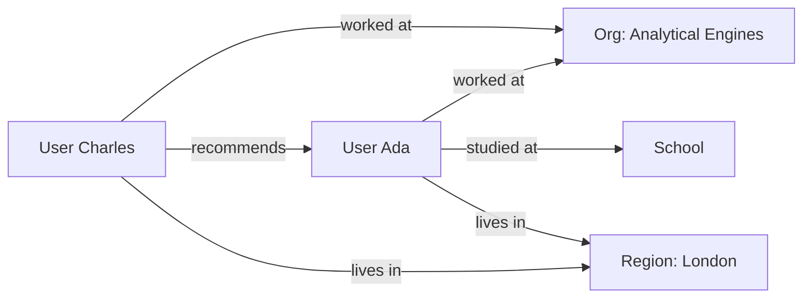

# Relational vs document models

Data models may be the most important part of a software design, because they shape *how we think about the problem* as well as how the code is written. Applications are built in layers. Each layer represents its data in terms of the next model down:

1. The application developer models the real world as **objects and data structures**, with APIs that manipulate them.
2. Those structures are stored in a **general-purpose data model**: relational tables, JSON documents or a graph.
3. Database engineers decide how that model is represented as **bytes** in memory, on disk and on the network.
4. Hardware engineers represent bytes as electrical currents, magnetic fields and pulses of light.

Each layer hides the complexity of the one below behind a clean model. This lesson compares the two dominant general-purpose models, **relational** and **document**. The next one covers **graphs**.

## 1. A short history

- **Hierarchical model** (IBM IMS, 1960s). Data is one big tree of records. It handles one-to-many relationships well and many-to-many relationships badly, and it has no joins.
- **Network model** (CODASYL). Records can have multiple parents. Programmers navigate **access paths** by following pointers by hand. That makes queries brittle: change the access path and the code must change.
- **Relational model** (Codd, 1970). Data is organised into **relations** (tables) of **tuples** (rows). There are no access paths. The **query optimizer** decides how to execute a query and which indexes to use. New indexes can be added without changing queries.

The relational model dominated from the mid-1980s for transaction processing and batch work and outlived several challengers (object databases, XML databases). Around 2010 **NoSQL** arrived. The name started as a Twitter hashtag for a meetup and was later back-filled as "Not Only SQL". The forces behind it:

- a need for greater scalability than relational databases offered at the time (very large datasets, very high write throughput),
- a preference for free and open source software,
- specialised query operations the relational model did not support well,
- a feeling that fixed relational schemas got in the way, and an appetite for data models that bend more easily.

The likely future is **polyglot persistence**: relational databases used alongside a variety of non-relational stores.

## 2. The object-relational mismatch

Most application code is object-oriented, and an awkward translation layer is needed between objects and tables. Kleppmann calls this the **impedance mismatch**. ORMs such as Hibernate or ActiveRecord reduce the boilerplate but cannot hide the differences completely.

Consider a résumé or LinkedIn-style profile. It has one `user_id`, a name, a summary, and then **one-to-many** lists: positions held, education, contact info.

**Relational options:**

- normalised: separate `positions`, `education` and `contact_info` tables, each with a foreign key to `users`,
- structured or JSON columns (SQL:1999 added structured types; PostgreSQL has `jsonb`),
- store the whole thing as a text blob and let the app interpret it, which makes it impossible to query inside.

**Document option:** a single JSON document:

```json
{
  "user_id": 251,
  "first_name": "Ada",
  "last_name": "Lovelace",
  "region_id": "eu:gb:london",
  "industry_id": 131,
  "positions": [
    {"job_title": "Analyst", "organization": "Analytical Engines Ltd"},
    {"job_title": "Translator", "organization": "Royal Society"}
  ],
  "education": [{"school_name": "Home-schooled", "start": 1825, "end": 1835}],
  "contact_info": {"blog": "https://example.org/ada"}
}
```

The document has better **locality**. Fetching the profile is one lookup, while the normalised version needs several queries or a multi-way join. The one-to-many relationships form a **tree**, and JSON makes the tree explicit.

## 3. Many-to-one and many-to-many relationships

Why is `region_id` an ID and not the string `"Greater London"`? Using IDs (**normalisation**) has several benefits:

- consistent style and spelling across profiles,
- no ambiguity, for example between several cities with the same name,
- ease of updating, because the name lives in one place,
- localisation, since the display name can be translated,
- better search, because a hierarchy of regions can be encoded.

The ID is meaningful only to the database and never needs to change, while anything human-meaningful might need to change one day. If the information were duplicated, every copy would need updating. That causes write overhead and risks **inconsistency**. Removing duplication is the core idea of normalisation.

Normalisation creates **many-to-one** relationships: many people live in one region. Those need **joins**. Relational databases make joins easy. Document databases historically had weak join support, so the application had to emulate the join with multiple queries.

Data also tends to become *more interconnected* as features are added. Suppose organisations and schools become entities with their own pages, and users can write **recommendations** for each other that show the recommender's current photo. You now have **many-to-many** relationships, and the tree shape breaks down.



> [!NOTE]
> Document databases reopened a 1970s debate. CODASYL's network model and today's document stores both struggle with many-to-many relationships. The relational answer was declarative joins planned by an optimizer. Once records point at other records, the two models handle it in much the same way: both use a unique identifier to refer to the related item, called a *foreign key* in one and a *document reference* in the other.

## 4. Relational vs document databases today

### 4.1 Which model leads to simpler application code?

- If the data is **document-like**, a tree of one-to-many relationships usually loaded all at once, the document model is a good fit. **Shredding** it into many tables leads to cumbersome schemas and complicated code.
- Limitations of documents: you cannot refer directly to a nested item (you say "the second position in the list for user 251", similar to an access path), and **join support** may be weak.
- **Many-to-many** relationships take away most of the document model's charm. Denormalisation leaves you keeping copies consistent, and application-side joins are slower and more complex than joins inside the database.
- When **almost everything links to everything else**, documents are a poor fit, tables cope, and a **graph** model feels the most natural.

### 4.2 Schema flexibility: schema-on-read vs schema-on-write

Calling document databases "schemaless" is misleading. The code that reads the data assumes *some* structure, so there is an **implicit** schema that the database does not enforce.

- **Schema-on-write** (relational): the structure is declared up front and the database rejects any write that does not match it. It is analogous to **static** type checking.
- **Schema-on-read** (document): the structure is implicit and interpreted only when data is read. It is analogous to **dynamic** type checking.

The difference shows up when the format changes. Say you want to split `name` into `first_name` and `last_name`.

Schema-on-read: write new documents with the new fields and handle old ones in code:

```python
if user and user.get("name") and not user.get("first_name"):
    # documents written before Dec 8 2023 lack first_name
    user["first_name"] = user["name"].split(" ")[0]
```

Schema-on-write: run a migration:

```sql
ALTER TABLE users ADD COLUMN first_name text;
UPDATE users SET first_name = split_part(name, ' ', 1);      -- PostgreSQL
```

`ALTER TABLE` is fast in most databases. MySQL historically copied the whole table on `ALTER TABLE`, which could mean minutes or hours of downtime, although tools and newer versions mitigate this. An `UPDATE` that rewrites every row of a big table is slow in any database. You can leave the new column `NULL` by default and fill it at read time, as a document database would.

Schema-on-read is advantageous when the items in a collection are **heterogeneous**, for example:

- many different types of objects, each impractical to put in its own table,
- structure determined by external systems you do not control, which may change at any time.

When all records are expected to share a structure, an explicit schema is a useful mechanism for documenting and enforcing it.

### 4.3 Data locality for queries

A document is usually stored as one continuous string (JSON, or a binary variant such as MongoDB's BSON). If the app often needs the *whole* document, locality is a performance win, because related data split across tables needs multiple index lookups and disk seeks. The advantage applies only when you need large parts of the document at once. On an update, the whole document typically has to be rewritten, and only modifications that do not change the encoded size can be done in place. The advice is to keep documents fairly small and avoid writes that grow them.

Locality is not unique to documents. Google **Spanner** can interleave child-table rows within a parent row. Oracle has **multi-table index cluster tables**. The **column-family** concept in Bigtable, Cassandra and HBase serves a similar purpose.

### 4.4 Convergence

The models are converging. PostgreSQL (since 9.3), MySQL (5.7) and DB2 support JSON documents, including indexing inside them. Document stores such as RethinkDB support relational-like joins, and MongoDB drivers resolve references automatically (with `$lookup` in the aggregation pipeline). Databases that offer both styles side by side are probably heading in the right direction.

```python-run
# Same data, two shapes: normalized (relational) vs embedded (document).
users = {251: {"name": "Ada", "region_id": "lon"}, 252: {"name": "Charles", "region_id": "lon"}}
regions = {"lon": "Greater London"}
positions = [(251, "Analyst"), (251, "Translator"), (252, "Engineer")]

# relational-style 'join' at query time
def profile_relational(uid):
    u = users[uid]
    return {"name": u["name"], "region": regions[u["region_id"]],
            "positions": [t for (owner, t) in positions if owner == uid]}

# document-style: denormalized copy of region name embedded in each doc
docs = {uid: profile_relational(uid) for uid in users}

print(profile_relational(251))
print(docs[251])

# Now rename the region -- normalized: one write; denormalized: N writes
regions["lon"] = "London (Greater)"
stale = [uid for uid, d in docs.items() if d["region"] != regions["lon"]]
print("relational read after rename:", profile_relational(251)["region"])
print("document copies now stale   :", stale, "-> must update", len(stale), "docs")
```

## 5. Query languages: declarative vs imperative

SQL is **declarative**: you specify the pattern of the data you want (which conditions, which transformations such as sort or group) and not *how* to get it. IMS and CODASYL were **imperative**: code walked records step by step.

```python
# imperative: tells the computer which operations to perform, in order
def get_sharks(animals):
    sharks = []
    for a in animals:
        if a["family"] == "Sharks":
            sharks.append(a)
    return sharks
```

```sql
-- declarative
SELECT * FROM animals WHERE family = 'Sharks';
```

Advantages of declarative languages:

- They are more concise and easier to work with.
- They **hide implementation details**, so the engine can add indexes, reorder data or change algorithms without breaking queries. The imperative code above promises an order of results. SQL does not, which leaves the engine free to optimise.
- They **parallelise** well because they specify only the pattern of results, not the algorithm. Imperative code imposes a particular sequence.

DDIA makes the point with the web. CSS selectors (`li.selected > p`) are declarative. Doing the same styling imperatively in JavaScript DOM code is longer, and it breaks when the class changes, because the imperative code does not re-run.

### 5.1 MapReduce querying

MapReduce, popularised by Google, sits in between: it is neither fully declarative nor fully imperative. MongoDB historically offered a `mapReduce` function. Here is counting shark sightings per month:

```javascript
db.observations.mapReduce(
  function map() { var y = this.observationTimestamp.getFullYear(), m = this.observationTimestamp.getMonth() + 1;
                   emit(y + "-" + m, this.numAnimals); },
  function reduce(key, values) { return Array.sum(values); },
  { query: { family: "Sharks" }, out: "monthlySharkReport" }
);
```

`map` and `reduce` must be **pure functions**. They use only their input, have no side effects and do no extra queries, so the framework can run them anywhere, in any order, and retry them. Writing two carefully coordinated JavaScript functions is harder than writing one query, so MongoDB added the declarative **aggregation pipeline**:

```javascript
db.observations.aggregate([
  { $match: { family: "Sharks" } },
  { $group: { _id: { year: { $year: "$observationTimestamp" }, month: { $month: "$observationTimestamp" } },
              totalAnimals: { $sum: "$numAnimals" } } }
]);
```

It is SQL-like in expressiveness but written in JSON. The moral: NoSQL systems can end up reinventing SQL in disguise.

```python-run
from collections import defaultdict
obs = [
    {"ts": "1995-12-25", "family": "Sharks", "n": 3},
    {"ts": "1995-12-12", "family": "Sharks", "n": 4},
    {"ts": "1995-11-02", "family": "Whales", "n": 1},
    {"ts": "1996-01-07", "family": "Sharks", "n": 2},
]
# map: emit (key, value) pairs
emitted = [(o["ts"][:7], o["n"]) for o in obs if o["family"] == "Sharks"]
# shuffle: group by key
groups = defaultdict(list)
for k, v in emitted:
    groups[k].append(v)
# reduce
print({k: sum(vs) for k, vs in sorted(groups.items())})
```

> [!INTERVIEW]
> "SQL or NoSQL?" is a poor framing. Answer in terms of **access patterns and relationships**. Self-contained aggregates loaded whole, with a rapidly evolving or heterogeneous schema, point to documents. Many-to-one and many-to-many relationships, ad-hoc queries and strong constraints point to relational. Richly connected data with traversal queries points to a graph. Mention that PostgreSQL's `jsonb` often gives you both.

## 6. Pitfalls

- **Assuming "schemaless" means no migration work.** The schema still exists in your code, and old documents must be handled forever or backfilled.
- **Embedding unbounded lists** (all comments on a post) inside a document. The document grows without limit and every update rewrites it.
- **Denormalising too early.** Copies drift out of sync. Normalise first, and denormalise for proven read hot paths, which is effectively a cache.
- **Application-side joins in loops** (the N+1 query problem).

## 7. Summary

- Hierarchical → network → relational: the relational model won by replacing hand-coded access paths with declarative queries and an optimizer.
- The document model shines for **tree-shaped, self-contained** data with locality. It struggles with **many-to-many** relationships.
- **Schema-on-read** vs **schema-on-write** is like dynamic vs static typing. Neither is "schemaless".
- Declarative languages enable optimisation and parallelism. MapReduce is a middle ground, and many NoSQL systems grow SQL-like query languages over time.

```quiz
[
  {"q": "Which kind of relationship is the document model naturally best at representing?",
   "options": ["Many-to-many", "One-to-many (tree-structured) data", "Arbitrary graphs", "Recursive hierarchies of unknown depth with cross links"],
   "answer": 1,
   "explain": "A JSON document is a tree; one-to-many nesting gives locality. Many-to-many needs references and joins."},
  {"q": "Why store region_id instead of the string 'Greater London' in every profile?",
   "options": ["IDs are smaller", "Normalization: the human-meaningful name lives in one place, avoiding duplication and inconsistent updates", "Strings cannot be indexed", "JSON does not support strings"],
   "answer": 1,
   "explain": "Anything meaningful to humans may change; an ID never needs to, so only one copy must be updated."},
  {"q": "'Schema-on-read' is most analogous to...",
   "options": ["Static type checking", "Dynamic (runtime) type checking", "No types at all", "Compile-time code generation"],
   "answer": 1,
   "explain": "The structure is implicit and interpreted when data is read, like dynamic typing; schema-on-write is like static typing."},
  {"q": "When does schema-on-read clearly help?",
   "options": ["All records have identical structure", "Records are heterogeneous or their structure is dictated by external systems that change", "You need foreign keys", "You need strong constraints"],
   "answer": 1,
   "explain": "Many object types or externally determined structure make a rigid schema a burden."},
  {"q": "Which is an advantage of declarative query languages like SQL over imperative code?",
   "options": ["They guarantee result order", "They let the engine choose indexes, algorithms and parallelism without changing the query", "They run without an optimizer", "They avoid the need for indexes"],
   "answer": 1,
   "explain": "Specifying only the pattern of results leaves the database free to optimize and parallelize."},
  {"q": "Why must map and reduce functions in MapReduce be pure?",
   "options": ["For readability", "So the framework can run them anywhere, in any order, and re-run them on failure", "Because JavaScript requires it", "To allow joins"],
   "answer": 1,
   "explain": "Purity (no side effects, no extra queries) makes distribution and retry safe."},
  {"q": "The document model's locality advantage applies mainly when...",
   "options": ["You update small fields frequently", "You usually need large parts of the document at the same time", "Documents are very large", "You need many-to-many joins"],
   "answer": 1,
   "explain": "Loading the whole document is one seek; but updates often rewrite the whole document, so keep documents small."}
]
```

> **Source:** DDIA ch. 2, "Data Models and Query Languages" (Relational Model vs. Document Model; Query Languages for Data).
