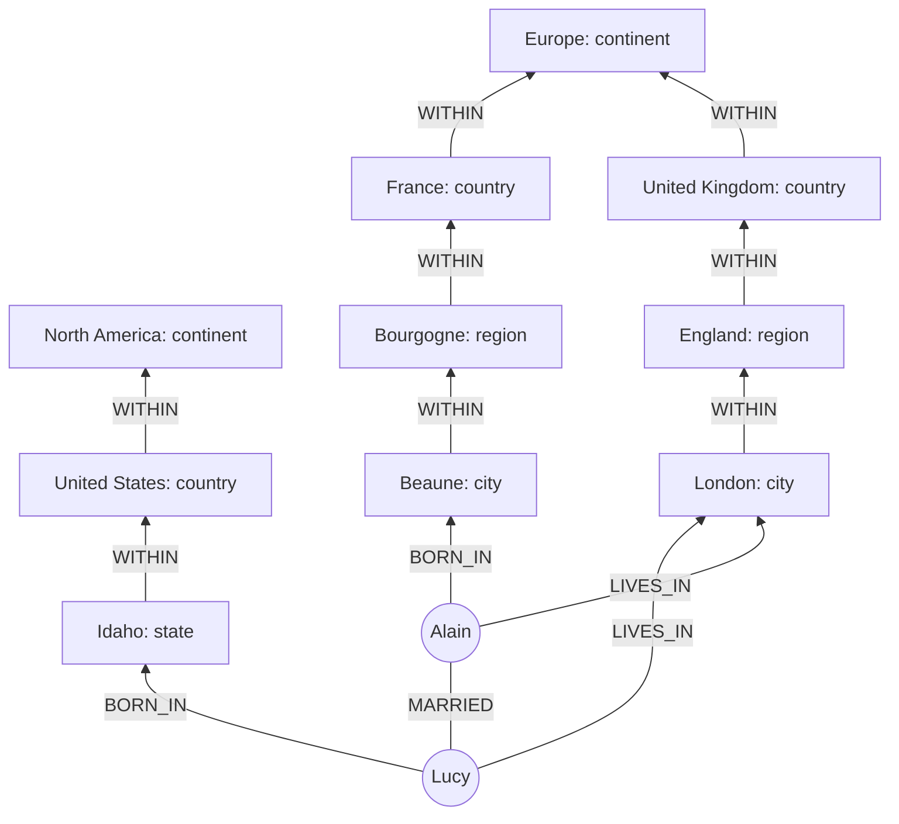

# Graph models and query languages

When **many-to-many** relationships dominate your data and anything may be connected to anything, model the data as a **graph**. A graph has two kinds of objects: **vertices** (nodes, entities) and **edges** (relationships, arcs). Some typical examples:

- **Social graphs**: vertices are people, edges say who knows whom.
- **The web graph**: vertices are pages, edges are links. PageRank ranks pages using this structure.
- **Road or rail networks**: vertices are junctions, edges are roads. Navigation means shortest path search.

Graphs can also hold **heterogeneous** objects in one store. Facebook's single graph contains people, locations, events, check-ins and comments, all as vertices, with edges for friendship, who checked in where, who commented on what, and so on.

DDIA's running example is a graph of two people, Lucy (born in Idaho, USA) and Alain (born in Beaune, France), who married and now live in London. Location vertices nest inside each other with `WITHIN` edges: city → region → country → continent.



Different countries have different structures. The US has states, France has régions and départements, and the UK has countries within a country. Graphs handle this **varying granularity** gracefully.

## 1. Property graphs

The property graph model is used by Neo4j, Titan/JanusGraph and InfiniteGraph. In it:

- Each **vertex** has a unique id, a set of outgoing edges, a set of incoming edges, and a collection of key-value **properties**.
- Each **edge** has a unique id, a **tail** vertex (where it starts), a **head** vertex (where it ends), a **label** describing the relationship, and properties.

You can picture it as two relational tables:

```sql
CREATE TABLE vertices (
  vertex_id  integer PRIMARY KEY,
  properties json
);
CREATE TABLE edges (
  edge_id     integer PRIMARY KEY,
  tail_vertex integer REFERENCES vertices (vertex_id),
  head_vertex integer REFERENCES vertices (vertex_id),
  label       text,
  properties  json
);
CREATE INDEX edges_tails ON edges (tail_vertex);
CREATE INDEX edges_heads ON edges (head_vertex);
```

Important properties of the model:

1. **Any vertex can connect to any other.** No schema restricts which kinds of things can be associated.
2. Given a vertex, you can efficiently find **both incoming and outgoing** edges and so **traverse** the graph in either direction. That is why both indexes exist.
3. **Labels** let you store many kinds of relationships in one graph while keeping the model clean.

This flexibility makes graphs good for **evolvability**. New features add new vertex and edge types without migrations.

## 2. Cypher

Cypher is Neo4j's declarative query language. The name comes from *The Matrix*, not from cryptography. Creating part of the example graph:

```
CREATE
  (NAmerica:Location {name:'North America', type:'continent'}),
  (USA:Location      {name:'United States', type:'country'}),
  (Idaho:Location    {name:'Idaho',         type:'state'}),
  (Lucy:Person       {name:'Lucy'}),
  (Idaho) -[:WITHIN]->  (USA)  -[:WITHIN]-> (NAmerica),
  (Lucy)  -[:BORN_IN]-> (Idaho)
```

Query: *find everyone who emigrated from the US to Europe*, meaning they were born somewhere within the US and now live somewhere within Europe.

```
MATCH
  (person) -[:BORN_IN]->  () -[:WITHIN*0..]-> (us:Location {name:'United States'}),
  (person) -[:LIVES_IN]-> () -[:WITHIN*0..]-> (eu:Location {name:'Europe'})
RETURN person.name
```

`-[:WITHIN*0..]->` means "follow a `WITHIN` edge **zero or more times**", like `*` in a regular expression. Because the query is declarative, the engine picks the execution strategy. It could start from every person and walk up, or start from the two location vertices and walk down the incoming `WITHIN` edges, which is probably cheaper.

## 3. Graph queries in SQL

The graph can live in relational tables, but there is a catch. The number of joins is **not known in advance**: Lucy's `LIVES_IN` might point at a street, a city, a region or a country. SQL:1999 added **recursive common table expressions** (`WITH RECURSIVE`) for this:

```sql
WITH RECURSIVE
  in_usa(vertex_id) AS (
      SELECT vertex_id FROM vertices WHERE properties->>'name' = 'United States'
    UNION
      SELECT edges.tail_vertex FROM edges
        JOIN in_usa ON edges.head_vertex = in_usa.vertex_id
        WHERE edges.label = 'within'
  ),
  in_europe(vertex_id) AS (
      SELECT vertex_id FROM vertices WHERE properties->>'name' = 'Europe'
    UNION
      SELECT edges.tail_vertex FROM edges
        JOIN in_europe ON edges.head_vertex = in_europe.vertex_id
        WHERE edges.label = 'within'
  ),
  born_in_usa(vertex_id) AS (
      SELECT edges.tail_vertex FROM edges
        JOIN in_usa ON edges.head_vertex = in_usa.vertex_id
        WHERE edges.label = 'born_in'
  ),
  lives_in_europe(vertex_id) AS (
      SELECT edges.tail_vertex FROM edges
        JOIN in_europe ON edges.head_vertex = in_europe.vertex_id
        WHERE edges.label = 'lives_in'
  )
SELECT vertices.properties->>'name'
FROM vertices
  JOIN born_in_usa     ON vertices.vertex_id = born_in_usa.vertex_id
  JOIN lives_in_europe ON vertices.vertex_id = lives_in_europe.vertex_id;
```

That is 4 lines of Cypher against roughly 30 lines of SQL. Both work, but a data model built for the use case makes the query far more natural.

## 4. Triple-stores and SPARQL

A **triple-store** (Datomic, AllegroGraph) stores everything as **(subject, predicate, object)** triples, for example `(Jim, likes, bananas)`. The object is one of two things:

- a **primitive value**, in which case the predicate and object act like a property key and value: `(lucy, age, 33)`,
- **another vertex**, in which case the predicate is an edge label: `(lucy, marriedTo, alain)`.

In **Turtle** notation:

```
@prefix : <urn:example:>.
_:lucy   a :Person;   :name "Lucy";          :bornIn _:idaho.
_:idaho  a :Location; :name "Idaho";         :type "state";   :within _:usa.
_:usa    a :Location; :name "United States"; :type "country"; :within _:namerica.
```

Triple-stores are associated with the **semantic web** and **RDF** (Resource Description Framework), the idea that websites would publish machine-readable data and form a "web of data". The vision was over-hyped and never fully materialised, but triples remain a useful internal model. RDF uses URIs such as `<http://my-company.com/namespace#within>` as predicates so that data from different sources can be combined without name clashes.

**SPARQL** is the query language for RDF triple-stores. Cypher's pattern matching borrows from it, so the two look alike:

```
PREFIX : <urn:example:>
SELECT ?personName WHERE {
  ?person :name ?personName.
  ?person :bornIn  / :within* / :name "United States".
  ?person :livesIn / :within* / :name "Europe".
}
```

> [!NOTE]
> A graph database is **not** a revival of CODASYL. CODASYL had a schema restricting which record types could nest, offered only navigation along access paths, kept ordered child sets, and was purely imperative. Graph databases allow any vertex to connect to any other, can look up vertices by id or index, leave vertices and edges unordered, and offer declarative query languages.

## 5. The foundation: Datalog

**Datalog** (1980s) is older than SPARQL and Cypher and gives the foundation that later languages build on. Datomic and Cascalog use it. Its data model resembles triples, written `predicate(subject, object)`:

```
name(namerica, 'North America').
type(namerica, continent).
name(usa, 'United States').
type(usa, country).
within(usa, namerica).
name(idaho, 'Idaho').
within(idaho, usa).
born_in(lucy, idaho).
```

Queries are built from **rules**, which derive new predicates from facts and other rules. Rules can be recursive:

```
within_recursive(Location, Name) :- name(Location, Name).                       /* Rule 1 */
within_recursive(Location, Name) :- within(Location, Via),
                                    within_recursive(Via, Name).               /* Rule 2 */
migrated(Name, BornIn, LivingIn) :- name(Person, Name),
                                    born_in(Person, BornLoc),
                                    within_recursive(BornLoc, BornIn),
                                    lives_in(Person, LivingLoc),
                                    within_recursive(LivingLoc, LivingIn).      /* Rule 3 */
?- migrated(Who, 'United States', 'Europe').
```

Read `:-` as "if". A rule fires when the database contains facts matching *all* the predicates on its right-hand side, and then the left-hand side is added. Datalog takes small steps. Each rule is a building block that is named and reused, which makes complex queries composable even though simple one-off queries are less convenient than in Cypher.

### 5.1 Try it: a tiny triple-store with a recursive rule

```python-run
triples = [
    ("namerica", "name", "North America"), ("usa", "name", "United States"),
    ("usa", "within", "namerica"), ("idaho", "name", "Idaho"), ("idaho", "within", "usa"),
    ("europe", "name", "Europe"), ("france", "name", "France"), ("france", "within", "europe"),
    ("bourgogne", "within", "france"), ("beaune", "within", "bourgogne"),
    ("uk", "name", "United Kingdom"), ("uk", "within", "europe"),
    ("england", "within", "uk"), ("london", "within", "england"), ("london", "name", "London"),
    ("lucy", "name", "Lucy"), ("lucy", "born_in", "idaho"), ("lucy", "lives_in", "london"),
    ("alain", "name", "Alain"), ("alain", "born_in", "beaune"), ("alain", "lives_in", "london"),
]

def objs(s, p):   return [o for (s2, p2, o) in triples if s2 == s and p2 == p]
def subjects(p, o): return [s for (s, p2, o2) in triples if p2 == p and o2 == o]

def within_recursive(loc):
    """Datalog rules 1+2: all names of loc and everything it is (transitively) within."""
    names, frontier, seen = set(), [loc], set()
    while frontier:
        x = frontier.pop()
        if x in seen: continue
        seen.add(x)
        names.update(objs(x, "name"))
        frontier.extend(objs(x, "within"))
    return names

def migrated(born_region, living_region):
    out = []
    for person in {s for (s, p, o) in triples if p == "born_in"}:
        b = any(born_region in within_recursive(l) for l in objs(person, "born_in"))
        l = any(living_region in within_recursive(x) for x in objs(person, "lives_in"))
        if b and l:
            out.extend(objs(person, "name"))
    return out

print("US -> Europe:", migrated("United States", "Europe"))
print("Europe -> Europe:", migrated("Europe", "Europe"))
print("Places within Europe (reverse traversal):",
      sorted(set(subjects("within", "europe"))))
```

This is a naive *top-down* evaluator. Real Datalog engines evaluate *bottom-up*, applying rules repeatedly until no new facts appear (a fixpoint), with semi-naive optimisation.

## 6. Choosing among models

| Need | Best fit |
|---|---|
| Self-contained aggregates, read whole, flexible schema | Document |
| Many-to-one / many-to-many joins, constraints, ad-hoc analytics | Relational |
| Highly connected data, variable-length traversals (friends-of-friends, fraud rings, knowledge graphs) | Graph |
| Combining heterogeneous sources with global identifiers | RDF triple-store |

> [!INTERVIEW]
> When someone asks "why a graph DB?", point to *variable-length path* queries (`*0..` in Cypher, `WITH RECURSIVE` in SQL) and index-free adjacency for traversals. A two-hop query at fixed depth is fine in SQL. Unbounded recursion and multi-hop pattern matching are where graph engines earn their keep. Also note the alternative of Spark GraphX or Pregel-style batch graph processing for whole-graph analytics such as PageRank (Chapter 10).

## 7. Pitfalls

- Using a graph DB for data that is really tabular, so you lose mature tooling and SQL analytics for nothing.
- Forgetting **supernodes**, vertices with millions of edges (celebrities), which make traversals explode. This is the same hot-spot problem as Twitter's fan-out.
- Unbounded `*` traversals without a depth limit on big graphs.

## 8. Summary

- **Property graphs** (vertices and edges with properties, labels, and two-way traversal) and **triple-stores** are two equivalent ways to model graphs.
- **Cypher** and **SPARQL** are declarative pattern-matching languages. **Datalog** builds queries from reusable recursive rules.
- SQL can do graph queries with `WITH RECURSIVE`, but verbosely.
- Graph and document databases both usually forgo enforced schemas. Document DBs target self-contained data, and graph DBs target "everything relates to everything".

```quiz
[
  {"q": "In the property graph model, why are there indexes on both tail_vertex and head_vertex?",
   "options": ["To enforce uniqueness", "So you can efficiently traverse edges in both directions (outgoing and incoming)", "To support transactions", "To compress the graph"],
   "answer": 1,
   "explain": "Graph traversal needs both outgoing and incoming edge lookups for any vertex."},
  {"q": "What does -[:WITHIN*0..]-> mean in Cypher?",
   "options": ["Exactly one WITHIN edge", "Follow WITHIN edges zero or more times", "No WITHIN edges allowed", "Follow at most 0 edges"],
   "answer": 1,
   "explain": "Like * in regular expressions: a variable-length path of zero or more WITHIN edges."},
  {"q": "Why is a graph query awkward in plain SQL?",
   "options": ["SQL has no JOIN", "The number of joins needed is not known in advance; you need recursive CTEs", "SQL cannot store edges", "SQL forbids self-joins"],
   "answer": 1,
   "explain": "Variable-length traversal requires WITH RECURSIVE, which is verbose compared with Cypher."},
  {"q": "In a triple (subject, predicate, object), when the object is a primitive value, the predicate acts like...",
   "options": ["An edge label", "A property key on the subject vertex", "A foreign key", "A partition key"],
   "answer": 1,
   "explain": "(lucy, age, 33) is a property; (lucy, marriedTo, alain) is an edge."},
  {"q": "How does a graph database differ from the CODASYL network model?",
   "options": ["It doesn't; it is the same", "Any vertex can link to any other, vertices can be looked up directly, and queries are declarative", "CODASYL supported declarative queries", "Graph DBs require a fixed schema of record types"],
   "answer": 1,
   "explain": "CODASYL restricted nesting by schema and required imperative navigation along access paths."},
  {"q": "What is distinctive about how Datalog builds queries?",
   "options": ["It uses JSON pipelines", "It defines reusable, possibly recursive rules that derive new predicates from facts", "It is imperative", "It cannot express recursion"],
   "answer": 1,
   "explain": "Rules are building blocks referenced by name; recursion handles transitive relationships such as within."}
]
```

> **Source:** DDIA ch. 2, "Graph-Like Data Models" (Property graphs, Cypher, Graph queries in SQL, Triple-stores and SPARQL, Datalog).
