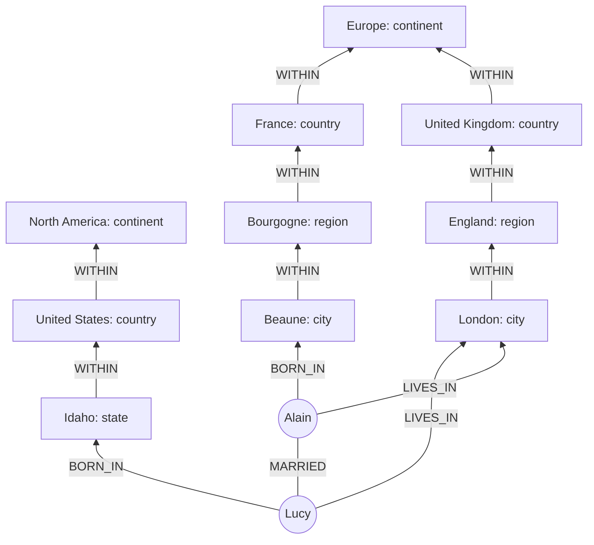

# Graph models and query languages

> **Before this lesson:** you should know what tables, rows, joins, documents and many-to-many relationships are, and the difference between a declarative and an imperative query. All of that is in [Relational vs document models](#/lesson/databases/relational-vs-document). The Python demo uses lists, sets and a `while` loop.

## In plain words

A **graph** is a way of describing data as dots joined by lines. Each dot is a thing (a person, a city, a web page). Each line says how two things are related ("is married to", "is inside", "links to"). In this sense the word has nothing to do with charts.

An everyday picture: a family tree pinned to a wall, or the map of an underground railway. On the railway map the stations are the dots and the tracks are the lines. Nobody reads that map row by row like a table. You put a finger on one station and follow the lines. A **graph database** stores data in that shape and lets you ask questions by following connections: "which stations can I reach from here?", "who are the friends of my friends?".

The previous lesson ended with a warning: when records point at each other in every direction, documents stop fitting and tables need join after join. The graph model was built for that situation.

Why this matters for a job: friend recommendations, fraud detection ("these five accounts share a phone number and a delivery address"), route planning and knowledge bases are all graph problems. In an interview, noticing that a question is about following connections to an unknown depth, and saying which tool handles that well, is a strong signal.

## 1. Vertices and edges

A graph has two kinds of object:

- A **vertex** (plural vertices, also called a node) is one thing.
- An **edge** (also called a relationship) is a connection from one vertex to another.

Some well-known graphs:

- **Social graphs.** Vertices are people; edges say who knows whom.
- **The web.** Vertices are pages; edges are the links between them. Google's original ranking method, PageRank, scored a page by the links pointing to it.
- **Road and rail networks.** Vertices are junctions; edges are stretches of road or track. A navigation app searches this graph for the shortest route.

In those examples all the vertices are the same kind of thing. That is not required. One graph can hold completely different kinds of object side by side, which is called being **heterogeneous**. Facebook keeps people, places, events and comments as vertices in a single graph, with edges for who is friends with whom, who attended which event, and who commented on what.

This lesson uses the example from DDIA. Two people, Lucy and Alain, are married and live in London. Lucy was born in Idaho in the United States. Alain was born in Beaune in France. Places sit inside larger places: a city inside a region, a region inside a country, a country inside a continent.



How to read the diagram: each box or circle is a vertex, and each arrow is an edge whose label names the relationship. Follow the arrows up from Idaho and you reach the United States and then North America. Follow them up from London and you pass England and the United Kingdom on the way to Europe.

Notice that the three countries are organised differently. The United States is divided into states. France has regions. The United Kingdom contains countries of its own. In a table you would have to decide in advance how many levels a location has. A graph has no such requirement, since each place points at whatever contains it.

## 2. Property graphs

The most widely used form of graph model is the **property graph**, found in the graph database Neo4j and several others. In it:

- Each **vertex** has a unique identifier, a set of edges going out, a set of edges coming in, and a collection of **properties**. A property is a named value attached to the vertex, such as `name: "Lucy"`.
- Each **edge** has a unique identifier, the vertex where it starts (called its **tail**), the vertex where it ends (called its **head**), a **label** naming the kind of relationship, and its own properties.

The naming trips people up, so here it is with an arrow: `tail --label--> head`. In `Lucy --BORN_IN--> Idaho`, Lucy is the tail and Idaho is the head.

One way to understand the model is to see that it could be stored in two ordinary tables:

```sql
CREATE TABLE vertices (
  vertex_id  integer PRIMARY KEY,
  properties json
);
CREATE TABLE edges (
  edge_id     integer PRIMARY KEY,
  tail_vertex integer REFERENCES vertices (vertex_id),
  head_vertex integer REFERENCES vertices (vertex_id),
  label       text,
  properties  json
);
CREATE INDEX edges_tails ON edges (tail_vertex);
CREATE INDEX edges_heads ON edges (head_vertex);
```

Reading the SQL: the first statement creates a table of vertices with an ID and a JSON column for properties. `PRIMARY KEY` means the ID is unique and identifies the row. The second creates a table of edges. `REFERENCES vertices (vertex_id)` says that `tail_vertex` and `head_vertex` must hold IDs that exist in the vertices table. The two `CREATE INDEX` lines build lookup structures so the database can quickly find all edges that start at a given vertex and all edges that end at it.

Three features of the model matter most:

1. **Any vertex can be connected to any other.** Nothing restricts which kinds of things may be related.
2. **Edges can be followed in both directions.** Given a vertex, the database can find its outgoing edges and its incoming edges quickly. That is the reason for two indexes. Moving from vertex to vertex along edges is called **traversing** the graph.
3. **Labels keep different relationships apart.** "Born in" and "lives in" both connect a person to a place, and the label tells them apart, so many kinds of relationship can share one graph.

These features make graphs easy to extend, which is the evolvability goal from the first lesson. A new feature can add new kinds of vertices and edges without restructuring the data already stored. For example, adding "is allergic to" edges between people and foods changes nothing that exists.

## 3. Cypher

**Cypher** is the declarative query language created for Neo4j. (It is named after a character in the film *The Matrix* and has nothing to do with secret codes.) Its main idea is to let you draw the pattern you are looking for using text arrows.

First, creating part of the example data:

```
CREATE
  (NAmerica:Location {name:'North America', type:'continent'}),
  (USA:Location      {name:'United States', type:'country'}),
  (Idaho:Location    {name:'Idaho',         type:'state'}),
  (Lucy:Person       {name:'Lucy'}),
  (Idaho) -[:WITHIN]->  (USA)  -[:WITHIN]-> (NAmerica),
  (Lucy)  -[:BORN_IN]-> (Idaho)
```

Each parenthesised item is a vertex. Inside it, the first word (`USA`) is a temporary name used only within this statement, `:Location` says what kind of vertex it is, and the curly braces hold its properties. The last two lines create edges: `(Idaho) -[:WITHIN]-> (USA)` reads "an edge labelled WITHIN from Idaho to USA". The parentheses look like circles and the arrow looks like an arrow, which is deliberate.

Now a question: *who emigrated from the United States to Europe?* More exactly, find every person who was born in a place that lies within the United States and who now lives in a place that lies within Europe.

```
MATCH
  (person) -[:BORN_IN]->  () -[:WITHIN*0..]-> (us:Location {name:'United States'}),
  (person) -[:LIVES_IN]-> () -[:WITHIN*0..]-> (eu:Location {name:'Europe'})
RETURN person.name
```

Take the first pattern piece by piece:

- `(person) -[:BORN_IN]-> ()` finds a person with a BORN_IN edge to some vertex. The empty `()` means "any vertex, and I do not need a name for it".
- `-[:WITHIN*0..]->` means "follow WITHIN edges zero or more times". The `*0..` is the important part. Lucy was born in Idaho, which is one step from the United States. Someone else might have been born in a city, two or three steps away. The pattern covers every case.
- `(us:Location {name:'United States'})` says the chain must end at the vertex named United States.

The second pattern does the same for where the person lives. The same variable `person` appears in both, so both must hold for the same person. `RETURN person.name` gives back the name.

Because Cypher is declarative, the database decides how to find the matches. It could start from every person and climb upward. Or it could start at the two named places and work downward along incoming edges, which is likely to be faster if there are many people and few places. The query does not change either way.

## 4. Graph queries in SQL

Section 2 showed that a graph fits in two tables, so can it be queried with SQL? Yes, with difficulty. The trouble is that in an ordinary SQL query you write out each join. Here the number of joins is **not known in advance**: reaching the United States from a birthplace might take one WITHIN step or four.

SQL has a feature for this, the **recursive common table expression**, written `WITH RECURSIVE`. A common table expression (CTE) is a named temporary result that the rest of the query can use. A recursive one is allowed to refer to itself, so it keeps growing until no new rows appear. Here is the same emigration query:

```sql
WITH RECURSIVE
  in_usa(vertex_id) AS (
      SELECT vertex_id FROM vertices WHERE properties->>'name' = 'United States'
    UNION
      SELECT edges.tail_vertex FROM edges
        JOIN in_usa ON edges.head_vertex = in_usa.vertex_id
        WHERE edges.label = 'within'
  ),
  in_europe(vertex_id) AS (
      SELECT vertex_id FROM vertices WHERE properties->>'name' = 'Europe'
    UNION
      SELECT edges.tail_vertex FROM edges
        JOIN in_europe ON edges.head_vertex = in_europe.vertex_id
        WHERE edges.label = 'within'
  ),
  born_in_usa(vertex_id) AS (
      SELECT edges.tail_vertex FROM edges
        JOIN in_usa ON edges.head_vertex = in_usa.vertex_id
        WHERE edges.label = 'born_in'
  ),
  lives_in_europe(vertex_id) AS (
      SELECT edges.tail_vertex FROM edges
        JOIN in_europe ON edges.head_vertex = in_europe.vertex_id
        WHERE edges.label = 'lives_in'
  )
SELECT vertices.properties->>'name'
FROM vertices
  JOIN born_in_usa     ON vertices.vertex_id = born_in_usa.vertex_id
  JOIN lives_in_europe ON vertices.vertex_id = lives_in_europe.vertex_id;
```

The query builds four temporary sets and then combines them:

- `in_usa` starts with the single vertex named United States (the part before `UNION`). The part after `UNION` then repeatedly adds every vertex that has a `within` edge pointing at something already in the set. First the states are added, then the cities in those states, and so on until nothing new turns up.
- `in_europe` does the same for Europe.
- `born_in_usa` is every vertex with a `born_in` edge into the first set, which means every person born somewhere in the United States.
- `lives_in_europe` is every person with a `lives_in` edge into the second set.
- The final `SELECT` joins the last two sets and returns the names of the people who appear in both.

The notation `properties->>'name'` is PostgreSQL's way of pulling one field out of a JSON column.

Four lines of Cypher became about thirty lines of SQL. Both give the same answer. The comparison shows how much the choice of data model affects the effort of asking a question.

## 5. Triple-stores and SPARQL

A second graph model looks different on the surface and turns out to be nearly the same thing. A **triple-store** records all information as three-part statements called **triples**: a **subject**, a **predicate** and an **object**. For example `(Jim, likes, bananas)`. The subject is always a vertex. The object is one of two things:

- A plain value such as a number or a piece of text. Then the predicate and object act as a property of the subject: `(lucy, age, 33)` says Lucy's age is 33.
- Another vertex. Then the predicate is an edge label: `(lucy, marriedTo, alain)` is an edge from Lucy to Alain.

Triples are often written in a compact text format called **Turtle**:

```
@prefix : <urn:example:>.
_:lucy   a :Person;   :name "Lucy";          :bornIn _:idaho.
_:idaho  a :Location; :name "Idaho";         :type "state";   :within _:usa.
_:usa    a :Location; :name "United States"; :type "country"; :within _:namerica.
```

Each line gives a subject followed by several predicate-object pairs separated by semicolons. `_:lucy` is a vertex. `a :Person` says it is a person (the word `a` is shorthand for "is a"). `:name "Lucy"` is a property, and `:bornIn _:idaho` is an edge to another vertex.

Triple-stores grew out of a project called the **semantic web**. The idea was that websites would publish their information as data for programs as well as text for people, using a standard called **RDF** (Resource Description Framework). That vision was heavily promoted and never fully arrived, but triples have remained useful inside applications. RDF has one distinctive habit: predicates are written as full web addresses, so that when data from two organisations is merged, one organisation's "within" cannot be confused with the other's.

The query language for RDF data is **SPARQL** (pronounced "sparkle"). Cypher borrowed its pattern-matching style from SPARQL, so the two look alike:

```
PREFIX : <urn:example:>
SELECT ?personName WHERE {
  ?person :name ?personName.
  ?person :bornIn  / :within* / :name "United States".
  ?person :livesIn / :within* / :name "Europe".
}
```

Names starting with `?` are variables to be filled in. The second line of the pattern reads: starting from `?person`, follow `bornIn`, then follow `within` any number of times (`*`), then check that the `name` is "United States". The slashes chain the steps into a path.

> [!NOTE]
> Graph databases are sometimes mistaken for a return of the network model from the previous lesson. They differ in four ways. The network model had a schema that fixed which record types could be nested in which; a graph lets any vertex connect to any other. The network model could reach a record only by walking an access path; a graph database can also look a vertex up directly by ID or by index. The network model kept a record's children in a fixed order; graph vertices and edges are unordered. And the network model was imperative, while graph databases offer declarative languages.

## 6. The foundation: Datalog

**Datalog** is a query language from the 1980s, older than both Cypher and SPARQL, and it supplies the theory they rest on. A few current systems use it directly, including the database Datomic. Its data looks like triples written in a different order, as `predicate(subject, object)`:

```
name(namerica, 'North America').
type(namerica, continent).
name(usa, 'United States').
type(usa, country).
within(usa, namerica).
name(idaho, 'Idaho').
within(idaho, usa).
born_in(lucy, idaho).
```

Each line is a **fact**: a statement taken as true. `within(idaho, usa).` says Idaho is within the USA.

Where Cypher has you write one pattern, Datalog has you define **rules**. A rule tells the system how to work out new facts from existing ones. Rules can use other rules, and a rule can use itself:

```
within_recursive(Location, Name) :- name(Location, Name).                       /* Rule 1 */
within_recursive(Location, Name) :- within(Location, Via),
                                    within_recursive(Via, Name).               /* Rule 2 */
migrated(Name, BornIn, LivingIn) :- name(Person, Name),
                                    born_in(Person, BornLoc),
                                    within_recursive(BornLoc, BornIn),
                                    lives_in(Person, LivingLoc),
                                    within_recursive(LivingLoc, LivingIn).      /* Rule 3 */
?- migrated(Who, 'United States', 'Europe').
```

Read `:-` as "if", and read a comma as "and". Words starting with a capital letter are variables.

- Rule 1: a location is `within_recursive` a name if the location itself has that name. This is the starting case.
- Rule 2: a location is `within_recursive` a name if the location is within some other place `Via`, and `Via` is `within_recursive` that name. This is the step that climbs one level, and because it refers to itself it can climb any number of levels.
- Rule 3: a person `migrated` from `BornIn` to `LivingIn` if they have a name, were born in a location that is recursively within `BornIn`, and live in a location that is recursively within `LivingIn`.
- The last line is the question: who migrated from the United States to Europe?

Follow it for Lucy. Rule 1 gives `within_recursive(usa, 'United States')`. Rule 2, with `within(idaho, usa)`, then gives `within_recursive(idaho, 'United States')`. Lucy was born in Idaho, so the birth half of rule 3 is satisfied. The same climb from London reaches Europe.

Datalog works in small named steps. For a one-off question that feels slower than Cypher. For complicated questions it is an advantage, because each rule is a reusable part that can be combined with others.

### 6.1 Try it: a tiny triple-store with a recursive rule

The program below stores the example as triples in a Python list and answers the emigration question.

```python-run
triples = [
    ("namerica", "name", "North America"), ("usa", "name", "United States"),
    ("usa", "within", "namerica"), ("idaho", "name", "Idaho"), ("idaho", "within", "usa"),
    ("europe", "name", "Europe"), ("france", "name", "France"), ("france", "within", "europe"),
    ("bourgogne", "within", "france"), ("beaune", "within", "bourgogne"),
    ("uk", "name", "United Kingdom"), ("uk", "within", "europe"),
    ("england", "within", "uk"), ("london", "within", "england"), ("london", "name", "London"),
    ("lucy", "name", "Lucy"), ("lucy", "born_in", "idaho"), ("lucy", "lives_in", "london"),
    ("alain", "name", "Alain"), ("alain", "born_in", "beaune"), ("alain", "lives_in", "london"),
]

def objs(s, p):   return [o for (s2, p2, o) in triples if s2 == s and p2 == p]
def subjects(p, o): return [s for (s, p2, o2) in triples if p2 == p and o2 == o]

def within_recursive(loc):
    """Datalog rules 1+2: all names of loc and everything it is (transitively) within."""
    names, frontier, seen = set(), [loc], set()
    while frontier:
        x = frontier.pop()
        if x in seen: continue
        seen.add(x)
        names.update(objs(x, "name"))
        frontier.extend(objs(x, "within"))
    return names

def migrated(born_region, living_region):
    out = []
    for person in {s for (s, p, o) in triples if p == "born_in"}:
        b = any(born_region in within_recursive(l) for l in objs(person, "born_in"))
        l = any(living_region in within_recursive(x) for x in objs(person, "lives_in"))
        if b and l:
            out.extend(objs(person, "name"))
    return out

print("US -> Europe:", migrated("United States", "Europe"))
print("Europe -> Europe:", migrated("Europe", "Europe"))
print("Places within Europe (reverse traversal):",
      sorted(set(subjects("within", "europe"))))
```

What each part does:

- `triples` is a list of three-part tuples: subject, predicate, object.
- `objs(s, p)` returns every object for a given subject and predicate, so `objs("lucy", "born_in")` is `["idaho"]`. `subjects(p, o)` goes the other way: every subject that has this predicate pointing at this object. These two helpers correspond to following an edge forwards and backwards.
- `within_recursive(loc)` plays the part of Datalog rules 1 and 2. It keeps a to-do list called `frontier`, starting with one location. Each time round the loop it removes a place from the list, records that place's names, and adds whatever that place is within. The set `seen` prevents visiting a place twice. When the to-do list is empty, `names` holds the name of the starting place and of everything that contains it.
- `migrated` plays the part of rule 3. For each person it asks whether the wanted birth region is among the names reachable from the birthplace, and the same for the place they live. `any(...)` is true if at least one item passes the test.

The output is:

```
US -> Europe: ['Lucy']
Europe -> Europe: ['Alain']
Places within Europe (reverse traversal): ['france', 'uk']
```

Lucy is found for the first question, because Idaho leads up to the United States and London leads up to Europe. Alain was born in Beaune, which leads up to Europe, so he answers the second. The third line follows `within` edges backwards from Europe by one step and finds the two countries directly inside it.

This program starts from the question and works toward the facts, which is called *top-down* evaluation. Real Datalog systems usually work *bottom-up*: they apply every rule to the known facts, add what they learn, and repeat until a round adds nothing new. That end state is called a **fixpoint**.

## 7. Choosing among models

| What the data and questions look like | Best fit |
|---|---|
| Self-contained records, read whole, with a structure that varies or changes often | Document |
| Many-to-one and many-to-many links joined at fixed depth, strict rules on valid data, unplanned reporting queries | Relational |
| Highly connected data explored by paths of unknown length: friends of friends, rings of fraudulent accounts, knowledge bases | Graph |
| Merging data from many independent sources that need globally unique names | RDF triple-store |

> [!INTERVIEW]
> When asked "why a graph database?", point to **variable-length path** queries: `*0..` in Cypher, `WITH RECURSIVE` in SQL. A question that needs exactly two hops is fine in SQL with two joins. Questions with an unknown number of hops are where graph databases earn their place. You can add that many graph databases store, with each vertex, direct pointers to its neighbours, so following an edge costs the same however large the whole graph is. This is called **index-free adjacency**. For calculations over an entire graph, such as PageRank, mention batch graph-processing systems like Pregel or Spark GraphX, which appear in the batch-processing lessons.

## 8. Pitfalls

- **Using a graph database for data that is really tabular.** You give up mature SQL tools and reporting and gain nothing.
- **Forgetting supernodes.** A **supernode** is a vertex with an enormous number of edges, such as a celebrity with millions of followers. Any traversal that passes through it suddenly has millions of branches to explore. This is the same heavy-tail problem as the celebrity accounts in the Twitter fan-out example.
- **Unbounded traversals.** A pattern like `*0..` with no upper limit can wander across an entire large graph. Set a maximum depth.
- **Mixing up tail and head.** The edge starts at the tail and points to the head. Getting it backwards reverses every query.

## 9. Summary

- A graph is made of **vertices** and **edges**. It suits data in which anything may relate to anything.
- **Property graphs** (vertices and labelled edges, both with properties, traversable in both directions) and **triple-stores** (subject, predicate, object) are two ways of writing down the same idea.
- **Cypher** and **SPARQL** are declarative languages in which you describe a pattern. **Datalog** builds answers from reusable rules that may refer to themselves.
- SQL can answer graph questions using `WITH RECURSIVE`, at the cost of much longer queries.
- Document and graph databases both tend not to enforce a schema. Documents target self-contained records; graphs target data where everything relates to everything.

## Glossary

- **Graph** - data described as things joined by relationships.
- **Vertex (node)** - one thing in a graph.
- **Edge (relationship)** - a connection from one vertex to another.
- **Heterogeneous** - containing different kinds of object together.
- **Property graph** - a graph model in which vertices and edges carry named values, and edges have labels.
- **Property** - a named value attached to a vertex or edge.
- **Tail / head** - the vertex where an edge starts / where it ends.
- **Label** - the name of the kind of relationship an edge represents.
- **Traversal** - moving through a graph by following edges.
- **Cypher** - the declarative pattern-matching query language of Neo4j.
- **Variable-length path** - a pattern that follows an edge type an unspecified number of times.
- **Recursive CTE (`WITH RECURSIVE`)** - a named temporary result in SQL that refers to itself and grows until nothing new is added.
- **Triple / triple-store** - a three-part statement (subject, predicate, object) / a database made of them.
- **Subject / predicate / object** - the thing described / the property name or edge label / the value or the other vertex.
- **RDF** - a standard format for publishing triples.
- **Turtle** - a compact text notation for triples.
- **SPARQL** - the query language for RDF data.
- **Datalog** - a query language built from facts and rules.
- **Fact / rule** - a statement taken as true / a recipe for deriving new facts from existing ones.
- **Fixpoint** - the state reached when applying the rules again produces nothing new.
- **Index-free adjacency** - storing with each vertex direct pointers to its neighbours.
- **Supernode** - a vertex with a very large number of edges.

```quiz
[
  {"q": "In the property graph model, why are there indexes on both tail_vertex and head_vertex?",
   "options": ["To enforce uniqueness", "So you can efficiently traverse edges in both directions (outgoing and incoming)", "To support transactions", "To compress the graph"],
   "answer": 1,
   "explain": "Graph traversal needs both outgoing and incoming edge lookups for any vertex."},
  {"q": "What does -[:WITHIN*0..]-> mean in Cypher?",
   "options": ["Exactly one WITHIN edge", "Follow WITHIN edges zero or more times", "No WITHIN edges allowed", "Follow at most 0 edges"],
   "answer": 1,
   "explain": "Like * in regular expressions: a variable-length path of zero or more WITHIN edges."},
  {"q": "Why is a graph query awkward in plain SQL?",
   "options": ["SQL has no JOIN", "The number of joins needed is not known in advance; you need recursive CTEs", "SQL cannot store edges", "SQL forbids self-joins"],
   "answer": 1,
   "explain": "Variable-length traversal requires WITH RECURSIVE, which is verbose compared with Cypher."},
  {"q": "In a triple (subject, predicate, object), when the object is a primitive value, the predicate acts like...",
   "options": ["An edge label", "A property key on the subject vertex", "A foreign key", "A partition key"],
   "answer": 1,
   "explain": "(lucy, age, 33) is a property; (lucy, marriedTo, alain) is an edge."},
  {"q": "How does a graph database differ from the CODASYL network model?",
   "options": ["It doesn't; it is the same", "Any vertex can link to any other, vertices can be looked up directly, and queries are declarative", "CODASYL supported declarative queries", "Graph DBs require a fixed schema of record types"],
   "answer": 1,
   "explain": "CODASYL restricted nesting by schema and required imperative navigation along access paths."},
  {"q": "What is distinctive about how Datalog builds queries?",
   "options": ["It uses JSON pipelines", "It defines reusable, possibly recursive rules that derive new predicates from facts", "It is imperative", "It cannot express recursion"],
   "answer": 1,
   "explain": "Rules are building blocks referenced by name; recursion handles transitive relationships such as within."}
]
```

> **Source:** DDIA ch. 2, "Graph-Like Data Models" (Property graphs, Cypher, Graph queries in SQL, Triple-stores and SPARQL, Datalog).
