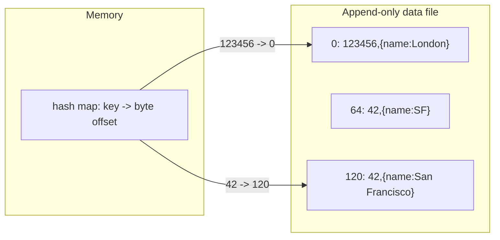
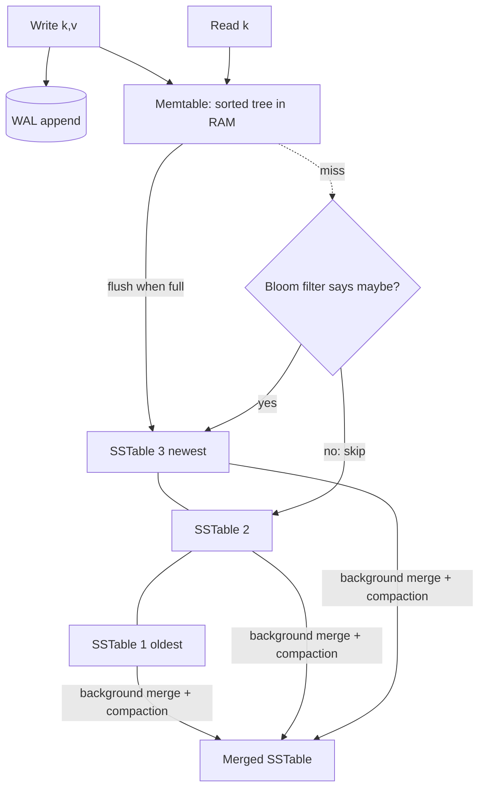
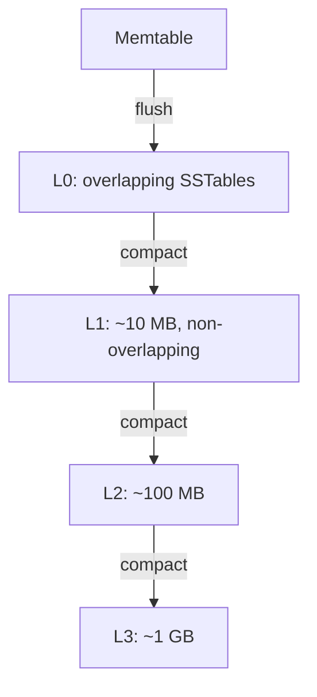

# Log-structured storage: hash indexes, SSTables, LSM-trees

> **Before this lesson:** you should know what a database, an index and a cache are, from [Reliability and maintainability](#/lesson/databases/reliability-maintainability) and [Relational vs document models](#/lesson/databases/relational-vs-document). You should be comfortable with Python dictionaries, lists and classes. No knowledge of how disks or files work inside is assumed.

## In plain words

A **storage engine** is the part of a database that decides how data is physically written to disk and how it is found again. Everything a database offers on top (queries, tables, documents) rests on it.

This lesson covers one family of storage engines, called **log-structured**. The idea is to never go back and change what has been written. New information is always added at the end of a file, and tidying up happens later in the background.

An everyday picture: a notebook in which you may only write on the next blank line. To record that Sam's phone number changed, you do not hunt for the old line and erase it. You write "Sam: new number" at the bottom. Writing is as fast as it could be. Reading is the problem: to find Sam's current number you would have to read the notebook backwards from the end. So you keep a card on the front cover saying "Sam: page 47, line 3". The notebook is the **log**, the card is the **index**, and every so often you copy the lines that still matter into a fresh notebook and throw the old one away. That copying is **compaction**.

Why this matters for a job: you will probably never write a storage engine, but you will often choose between databases and tune them, and the choice depends on what happens underneath. "Why is Cassandra fast at writes?" and "design a key-value store" are standard interview questions, and both are answered by this lesson.

Storage engines come from two big families:

- **Log-structured** engines, used by Cassandra, RocksDB, LevelDB, HBase and the search library Lucene. This lesson.
- **Update-in-place** engines built on a structure called a **B-tree**, used by nearly every relational database. Next lesson.

## 1. The world's simplest database

A **key-value store** is the most basic kind of database: you hand it a **key** (a name) and a **value** (the data to remember under that name), and later you ask for the value by its key. Here is one written as two functions for the Unix command line.

```bash
#!/bin/bash
db_set () { echo "$1,$2" >> database; }
db_get () { grep "^$1," database | sed -e "s/^$1,//" | tail -n 1; }
```

You do not need to know shell scripting to follow it:

- `db_set` takes a key (`$1`) and a value (`$2`) and adds one line of text, `key,value`, to the end of a file called `database`. The `>>` means "append to the end of the file".
- `db_get` searches the file for every line beginning with the key (`grep`), strips the key off the front (`sed`), and keeps only the last match (`tail -n 1`).

Calling `db_set 42 Paris` and later `db_set 42 London` leaves two lines in the file. `db_get 42` returns `London`, because the last line for a key is the newest. Old values are never changed.

A file that is only ever added to at the end is called a **log**. In this track the word means exactly that, an **append-only** sequence of records. It does not mean the human-readable messages a program prints while running.

How good is this database?

- **Writing is excellent.** Adding to the end of a file is about the cheapest thing a disk can do, and it costs the same however big the file is. In the notation used to describe how cost grows with size, that is **O(1)**, read "constant time".
- **Reading is terrible.** `db_get` has to look through the entire file. Double the data and a read takes twice as long. That is **O(n)**, "linear time", where n is the number of records.

To read quickly we need an **index**: an extra structure, built from the main data, that says where things are. The card on the notebook cover is an index. An index is never free. Each one has to be updated whenever data is written, so **indexes speed up reads and slow down writes**. That trade-off runs through the whole of this lesson and the next, and it is the reason databases ask you to choose which indexes to create and do not index everything automatically.

## 2. Hash indexes (Bitcask)

The simplest index for a log is a **hash map** kept in memory. A hash map is the structure behind a Python `dict`: given a key, it finds the stored item almost instantly. Here the item stored for each key is a **byte offset**, which is a position in the data file counted in bytes from the start. It tells the database where the newest record for that key begins.



In the diagram the file holds three records. Key `42` was written twice, at positions 64 and 120. The hash map points key `42` at position 120, the newer one, and the older record is still in the file but no longer referenced.

- **To write:** append the record to the file, then set `index[key] = offset`.
- **To read:** look up the offset in the hash map, jump to that position in the file, and read the record. Moving a disk's read position is called a **seek**. This costs one seek, or none if the operating system still has that part of the file in memory.

This is how a storage engine called **Bitcask** works. It suits a specific situation: a modest number of distinct keys, each updated very often. All the keys fit in memory, and it does not matter how many times the values change. A counter of how often each video has been played is a good example.

### 2.1 Segments and compaction

A file that only grows will eventually fill the disk. The fix has three parts:

1. Split the log into **segments**. A segment is a file of limited size. When the current one is full it is closed, and writing continues in a new one.
2. **Compact** closed segments. Compaction throws away every record that has been replaced by a newer one for the same key and keeps only the latest.
3. **Merge** several compacted segments into one new segment. This runs in the background. The old segments keep answering reads until the new one is complete. Then reads switch over and the old files are deleted.

Each segment has its own hash map in memory. To read a key, the database checks the newest segment's map, then the next newest, and so on. Merging keeps the number of segments small, so that chain stays short.

### 2.2 Details that matter in a real implementation

- **File format.** Text with commas is easy to show in a lesson. A real engine uses a **binary format**: raw bytes, where each record begins with its length. That is faster to read and has no trouble with values that contain commas.
- **Deleting a record.** You cannot erase from an append-only file. To delete, you append a special marker called a **tombstone**, which says "this key is gone". During merging, the tombstone causes every older value for that key to be dropped.
- **Recovering after a crash.** The hash maps live in memory, so they vanish when the program stops. Rebuilding them by rereading every segment would take too long. Bitcask saves a copy of each segment's hash map to disk (a **snapshot**) and loads that at start-up.
- **Half-written records.** A crash can happen in the middle of writing a record. Each record is stored with a **checksum**, a small number calculated from its contents. If the checksum does not match after a restart, the record is damaged and is ignored.
- **Many users at once.** Handling several operations at the same time is called **concurrency**. The usual design has one writer that appends. Closed segments never change, so any number of readers can read them at the same time safely.

### 2.3 Why append-only and not update in place?

Overwriting the old value where it sits looks more economical. Appending is preferred for three reasons:

- **Sequential writes are fast.** Writing one record after another to the end of a file is called a *sequential write*. Jumping around to overwrite scattered locations is a *random write*. A spinning hard disk has to physically move an arm for every jump, so sequential writing is far faster. Solid-state drives (SSDs) have no moving parts, but they also handle sequential writes better.
- **Crashes and concurrency are easier to handle.** A segment that is never modified cannot be caught half-changed. You never find a value that is part old and part new.
- **Merging prevents fragmentation.** Files that are updated in place slowly accumulate gaps of wasted space. Rewriting segments during merges avoids that.

A hash index has two limits:

- **Every key must fit in memory.** Keeping the hash map on disk does not work well, because looking things up in it would need many random disk reads.
- **Range queries are slow.** A **range query** asks for all keys between two values, such as every key from `kitty00000` to `kitty99999`. A hash map has no notion of order, so each key in the range would have to be looked up separately.

## 3. SSTables and LSM-trees

One change to the segment format removes both limits. Require that the records inside each segment are **sorted by key**. A segment in this format is a **Sorted String Table**, shortened to **SSTable**. Each key appears at most once in a segment, which compaction already guarantees.

Sorting brings three advantages:

1. **Merging is cheap, even for files larger than memory.** It works the way you would merge two sorted piles of exam papers into one: look at the top paper of each pile, take whichever comes first alphabetically, and repeat. Programmers know this as the merge step of **mergesort**. Only the front of each file is in memory at any moment. When the same key shows up in several segments, the value from the **most recent** segment is kept.
2. **The index no longer needs every key.** It can be **sparse**: it remembers one key every few kilobytes and skips the rest. Suppose the index knows where `handbag` and `handsome` are and you want `handiwork`. Alphabetical order guarantees it lies between them, so the database jumps to `handbag` and reads forward a short way.
3. **Blocks can be compressed.** The records between two index entries form a **block**. A block can be **compressed** (encoded to take fewer bytes) before it is written. The index then points at the start of each compressed block. This saves disk space and reduces the amount of data read.

### 3.1 Constructing and maintaining SSTables

Writes arrive in whatever order users send them, so how does a sorted file get produced? Sorting on disk is slow. Sorting in memory is easy, using a **balanced tree**: a structure that keeps its contents in order as items are inserted. (Red-black trees and AVL trees are two well-known kinds. Their internals are not needed here.)

The engine works like this:

1. A new write goes into an in-memory balanced tree. This tree is called the **memtable**.
2. When the memtable grows past a few megabytes, it is written to disk as a new SSTable. This is fast because the tree already holds the keys in order. Writing the memtable out is called a **flush**. A fresh, empty memtable takes over for new writes.
3. To read a key, look in the memtable first, then in the newest SSTable on disk, then the next older one, and so on.
4. Every so often, merge and compact the SSTables in the background.

One weakness remains. The memtable is in memory, so a crash would lose every write that has not yet been flushed. The remedy is a second file on disk, a **write-ahead log** (WAL). Each write is appended to the WAL *before* it goes into the memtable. The WAL is not sorted and is never searched. Its only purpose is to rebuild the memtable after a crash, and once a memtable has been flushed, the matching part of the WAL is deleted.



The diagram shows both paths. A write (top left) goes to the WAL and the memtable. A full memtable is flushed to become the newest SSTable, and the SSTables are merged in the background. A read (bottom) tries the memtable and then the SSTables from newest to oldest. The diamond marked "Bloom filter" is a shortcut explained in section 3.3.

This design is the **Log-Structured Merge-Tree**, or **LSM-tree**, described by Patrick O'Neil and colleagues in 1996. It is used in LevelDB, RocksDB, Cassandra, HBase and Google's Bigtable. The words *SSTable* and *memtable* come from the Bigtable paper. Lucene, the library underneath the search engines Elasticsearch and Solr, uses the same approach to store its mapping from each word to the list of documents containing it.

### 3.2 Try it: a tiny LSM tree

The class below is a complete, small LSM-tree. To keep it short, the memtable is a plain dictionary that gets sorted at flush time, and the "disk" is a Python list.

```python-run
import bisect

class TinyLSM:
    TOMBSTONE = object()

    def __init__(self, memtable_limit=3):
        self.memtable = {}               # stand-in for a red-black tree
        self.sstables = []               # list of sorted [(key, value)], newest LAST
        self.limit = memtable_limit
        self.wal = []                    # write-ahead log

    def put(self, k, v):
        self.wal.append((k, v))
        self.memtable[k] = v
        if len(self.memtable) >= self.limit:
            self.flush()

    def delete(self, k):
        self.put(k, self.TOMBSTONE)

    def flush(self):
        if not self.memtable:
            return
        table = sorted(self.memtable.items())
        self.sstables.append(table)
        self.memtable, self.wal = {}, []          # WAL can be discarded after flush
        print(f"  flush -> SSTable #{len(self.sstables)}: {[k for k, _ in table]}")

    def get(self, k):
        if k in self.memtable:
            v = self.memtable[k]
            return None if v is self.TOMBSTONE else v
        for t in reversed(self.sstables):          # newest first
            keys = [kk for kk, _ in t]
            i = bisect.bisect_left(keys, k)
            if i < len(t) and t[i][0] == k:
                v = t[i][1]
                return None if v is self.TOMBSTONE else v
        return None

    def compact(self):
        merged = {}
        for t in self.sstables:                     # oldest -> newest, later wins
            for k, v in t:
                merged[k] = v
        self.sstables = [sorted((k, v) for k, v in merged.items() if v is not self.TOMBSTONE)]
        print("  compacted ->", self.sstables[0])

db = TinyLSM()
for k, v in [("cat", 1), ("ant", 2), ("dog", 3), ("cat", 4), ("bee", 5), ("eel", 6)]:
    db.put(k, v)
db.delete("ant")
db.put("fox", 7); db.put("ant", 8); db.delete("dog")
print("get cat ->", db.get("cat"), "| get dog ->", db.get("dog"), "| get ant ->", db.get("ant"))
print("SSTables before compaction:", len(db.sstables), "memtable:", db.memtable)
db.flush(); db.compact()
print("get cat ->", db.get("cat"), "| get bee ->", db.get("bee"))
```

What each part does:

- `TOMBSTONE = object()` creates a unique marker that cannot be confused with any real value.
- `__init__` sets up an empty memtable, an empty list of SSTables (the newest goes at the end), the size at which the memtable is flushed (3 keys), and an empty WAL.
- `put` appends to the WAL first, then stores the value in the memtable. If the memtable has reached its limit, it calls `flush`.
- `delete` is a `put` of the tombstone. Nothing is erased.
- `flush` sorts the memtable's contents by key, appends the sorted list as a new SSTable, and empties both the memtable and the WAL.
- `get` checks the memtable. If the key is not there, it goes through the SSTables from newest to oldest (`reversed`). `bisect.bisect_left` performs a **binary search**: it finds a key's position in a sorted list by repeatedly halving the search range, which is only possible because the list is sorted. The first SSTable that contains the key gives the answer. If the value found is the tombstone, the answer is `None`.
- `compact` reads the SSTables from oldest to newest into one dictionary, so a later value overwrites an earlier one. It then writes out a single SSTable, leaving out tombstones.

The output is:

```
  flush -> SSTable #1: ['ant', 'cat', 'dog']
  flush -> SSTable #2: ['bee', 'cat', 'eel']
  flush -> SSTable #3: ['ant', 'dog', 'fox']
get cat -> 4 | get dog -> None | get ant -> 8
SSTables before compaction: 3 memtable: {}
  compacted -> [('ant', 8), ('bee', 5), ('cat', 4), ('eel', 6), ('fox', 7)]
get cat -> 4 | get bee -> 5
```

Follow the key `cat`. It was written as 1 and landed in SSTable #1. It was written again as 4 and landed in SSTable #2. A read finds it in #2 first and returns 4. The old 1 is still on "disk", wasting space, until compaction.

Now follow `dog`. Its value 3 is in SSTable #1. The delete put a tombstone into SSTable #3. A read meets the tombstone first and reports `None`. The tombstone *shadows* the older value: the value is physically present but can no longer be seen. After compaction both the tombstone and the old value are gone, and five live keys remain in one sorted table.

### 3.3 Performance optimisations

**Bloom filters.** Asking an LSM-tree for a key that does not exist is its slowest operation. The engine checks the memtable and then *every* SSTable back to the oldest before it can say "not found". A **Bloom filter** avoids most of that work. It is a small in-memory structure that answers the question "is this key in this SSTable?" with one of two replies: "definitely not" or "possibly". Each SSTable has one. When the reply is "definitely not", the engine skips the file without touching the disk.

How it works: start with a row of $m$ **bits** (a bit is a single 0 or 1), all set to 0. Choose $k$ **hash functions**. A hash function turns any input into a number that looks random but is always the same for the same input. To add a key, run it through all $k$ functions to get $k$ positions, and set those bits to 1. To test a key, compute the same $k$ positions and check them. If any of those bits is 0, the key was never added. If all are 1, the key was probably added, though different keys may have set those bits between them.

So a Bloom filter can produce a **false positive** (saying "possibly" for a key that is absent) but never a false negative. With $n$ keys added, the chance of a false positive is approximately

$$p \approx \left(1 - e^{-kn/m}\right)^k, \qquad k_{opt} = \frac{m}{n}\ln 2.$$

In practice, about **10 bits per key** gives a false-positive rate near 1%. The next program builds a Bloom filter and measures this.

```python-run
import hashlib, math

class Bloom:
    def __init__(self, m, k):
        self.m, self.k, self.bits = m, k, bytearray(m)
    def _hashes(self, key):
        # double hashing: h_i = h1 + i*h2  (Kirsch-Mitzenmacher)
        d = hashlib.sha256(key.encode()).digest()
        h1 = int.from_bytes(d[:8], "big"); h2 = int.from_bytes(d[8:16], "big") | 1
        return [(h1 + i * h2) % self.m for i in range(self.k)]
    def add(self, key):
        for h in self._hashes(key): self.bits[h] = 1
    def might_contain(self, key):
        return all(self.bits[h] for h in self._hashes(key))

n = 2000
for bits_per_key in (4, 8, 10, 16):
    m = n * bits_per_key
    k = max(1, round(m / n * math.log(2)))
    bf = Bloom(m, k)
    for i in range(n): bf.add(f"key{i}")
    fp = sum(bf.might_contain(f"absent{i}") for i in range(5000)) / 5000
    theory = (1 - math.exp(-k * n / m)) ** k
    print(f"{bits_per_key:>2} bits/key, k={k:<2} measured FP={fp:.3%}  theory={theory:.3%}")
assert all(bf.might_contain(f"key{i}") for i in range(n))   # never a false negative
```

What each part does:

- `bytearray(m)` makes a list of `m` zeros to serve as the bits.
- `_hashes` produces the `k` positions for a key. It computes one strong hash of the key with SHA-256, cuts two numbers `h1` and `h2` out of the result, and combines them as `h1 + i*h2` for `i` from 0 to `k-1`. This standard trick yields `k` different positions from a single hash computation. The `% self.m` keeps each position inside the bit array.
- `add` sets those positions to 1. `might_contain` returns true only if all of them are 1.
- The loop tries four sizes. For each, it adds 2,000 keys, then tests 5,000 keys that were never added and counts how many the filter wrongly accepts.
- The final `assert` checks that every key that was added is still reported as present.

```
 4 bits/key, k=3  measured FP=15.900%  theory=14.689%
 8 bits/key, k=6  measured FP=2.120%  theory=2.158%
10 bits/key, k=7  measured FP=0.840%  theory=0.819%
16 bits/key, k=11 measured FP=0.040%  theory=0.046%
```

The measured rates agree with the formula. At 10 bits per key, fewer than 1 in 100 lookups for a missing key will read the SSTable needlessly. Ten bits is tiny compared with the key and value themselves, which is why nearly every LSM engine uses Bloom filters.

**Compaction strategies** decide which SSTables are merged and when. There are two main ones:

- **Size-tiered** (HBase, and the default in Cassandra). When several SSTables of similar size exist, they are merged into one larger table. Newer, smaller tables are gradually folded into older, larger ones. Data is rewritten less often, but during a merge the old and new copies exist side by side, so more spare disk space is needed.
- **Leveled** (LevelDB, RocksDB, optional in Cassandra). SSTables are kept small and arranged in levels named L0, L1, L2 and so on. Each level holds about ten times as much data as the one above it. Within a level, the tables cover separate, non-overlapping key ranges. A read therefore needs to check about one table per level. Disk space is used more efficiently, but data is rewritten more often as it moves down the levels.



The basic recipe of sorted files merged in the background is short to state and very effective. It keeps working when the data is far bigger than memory. Because data is stored in key order, range queries are efficient. Because writes are sequential, the engine can accept a very high rate of writes.

> [!INTERVIEW]
> For "design a key-value store" or "why is Cassandra fast at writes?", walk through both paths. Write: append to the WAL, insert into the memtable, flush to an unchangeable SSTable, compact in the background. Read: memtable, then for each SSTable the Bloom filter, the sparse index and one block. Then name the trade-off: writes are cheap and sequential, while a read may check several files, and compaction uses disk capacity that can compete with user requests.

## 4. Amplification vocabulary

Engineers compare storage engines using three ratios. "Amplification" means the engine does more work than the request seemed to ask for.

- **Write amplification:** bytes actually written to disk divided by bytes the application asked to write. Compaction rewrites the same data several times over its life. This matters on SSDs, which wear out after a limited number of overwrites.
- **Read amplification:** the number of disk reads needed to answer one query, for instance checking several SSTables for one key.
- **Space amplification:** disk space used divided by the size of the live data. Replaced values and tombstones occupy space until compaction removes them.

All three cannot be minimised together. Improving one costs another, an observation sometimes called the *RUM conjecture* (Read, Update, Memory). The compaction strategy is the control that chooses the balance.

## 5. Pitfalls

- **Tombstones piling up.** A workload that deletes heavily, such as using a table as a queue, fills the SSTables with tombstones, and reads slow down as they wade through them. In a database with copies on several machines, tombstones are also kept for a waiting period before removal (Cassandra's setting is `gc_grace_seconds`). Otherwise a copy that missed the delete could bring the deleted data back.
- **Compaction falling behind.** If data is written faster than compaction can merge it, SSTables accumulate, reads slow down, and the disk fills. Most LSM engines do not slow down incoming writes by themselves, so this has to be monitored.
- **Not knowing the WAL's sync setting.** An operating system normally holds written data in memory for a moment before putting it on the disk. A program can demand that it be written through immediately with a call named **fsync**. Calling fsync on every write is safe but slow. Calling it every few milliseconds is fast but can lose the last few writes if the power fails. Know which your database does.

## 6. Summary

- An append-only log plus an index makes a database. **Indexes speed up reads and slow down writes.**
- **Hash index** (Bitcask): an in-memory map from key to file position, with segments and compaction. Fast, but every key must fit in memory and range queries are slow.
- **SSTable**: a segment sorted by key. Sorting allows cheap merging, a sparse index and compressed blocks.
- **LSM-tree**: writes go to a WAL and a memtable, the memtable is flushed to SSTables, and SSTables are compacted in the background by a size-tiered or leveled strategy. **Bloom filters** let reads skip SSTables that cannot contain the key.

## Glossary

- **Storage engine** - the part of a database that writes data to disk and finds it again.
- **Key-value store** - a database that saves a value under a key and returns it by that key.
- **Log** - an append-only sequence of records.
- **Append-only** - written only by adding at the end, never changed in place.
- **O(1) / O(n)** - a cost that stays constant / grows in proportion to the amount of data.
- **Index** - an extra structure, derived from the data, that speeds up finding records.
- **Hash map** - an in-memory structure that finds the item stored under a key almost instantly.
- **Byte offset** - a position in a file, counted in bytes from the start.
- **Seek** - moving the disk's read position to another place in a file.
- **Segment** - one file of limited size that forms part of the log.
- **Compaction** - discarding replaced and deleted records, keeping the newest value of each key.
- **Merge** - combining several segments into one.
- **Tombstone** - a marker record meaning "this key has been deleted".
- **Checksum** - a small number computed from data, used to detect damage.
- **Sequential / random write** - writing in order to the end of a file / writing to scattered positions.
- **Range query** - a request for all keys between two values.
- **SSTable (Sorted String Table)** - a segment whose records are sorted by key.
- **Sparse index** - an index that holds only some of the keys.
- **Block** - a group of neighbouring records stored, and often compressed, together.
- **Memtable** - the in-memory sorted structure that receives new writes.
- **Flush** - writing the memtable to disk as a new SSTable.
- **Write-ahead log (WAL)** - an append-only file of recent writes, used to rebuild the memtable after a crash.
- **LSM-tree** - the design that combines a memtable, a WAL, SSTables and background compaction.
- **Bloom filter** - a compact structure that says a key is "definitely absent" or "possibly present".
- **Hash function** - a function that turns any input into a fixed-looking random number, the same every time for the same input.
- **False positive** - answering "possibly present" for something that is absent.
- **Size-tiered / leveled compaction** - merging tables of similar size / arranging tables in levels with separate key ranges.
- **Write / read / space amplification** - extra bytes written / extra reads per query / extra disk used, compared with the minimum.
- **fsync** - a request that data be put on the disk now, not held in memory.

```quiz
[
  {"q": "In the Bitcask-style hash index, what does the in-memory hash map store?",
   "options": ["The full value for each key", "The byte offset in the data file of the most recent value for each key", "Only deleted keys", "A Bloom filter"],
   "answer": 1,
   "explain": "Each key maps to the location of its latest record; reads are one seek."},
  {"q": "What is the main limitation of a pure hash index compared to SSTables?",
   "options": ["Slow writes", "All keys must fit in memory and range queries are inefficient", "It cannot handle deletes", "It needs B-trees"],
   "answer": 1,
   "explain": "Hash tables are unordered and on-disk hash maps perform poorly."},
  {"q": "Why can an SSTable use a sparse in-memory index?",
   "options": ["Because it is compressed", "Because keys are sorted, so you can seek to the nearest indexed key and scan forward", "Because it uses a hash function", "Because it has a Bloom filter"],
   "answer": 1,
   "explain": "Sorted order means one index entry per few KB is enough to bound the scan."},
  {"q": "When merging several SSTables and the same key appears in more than one, which value is kept?",
   "options": ["The smallest value", "The value from the oldest segment", "The value from the most recent segment", "All values"],
   "answer": 2,
   "explain": "More recent segments contain the more recent writes, so their value supersedes older ones."},
  {"q": "What is the purpose of the separate write-ahead log in an LSM engine?",
   "options": ["To speed up reads", "To rebuild the memtable after a crash so recent writes are not lost", "To store tombstones", "To compress SSTables"],
   "answer": 1,
   "explain": "The memtable is in RAM; every write is also appended to the WAL, which is discarded after the memtable is flushed."},
  {"q": "A Bloom filter reports 'maybe present' for a key. What is true?",
   "options": ["The key is definitely present", "The key may or may not be present; you must check the SSTable", "The key is definitely absent", "The filter is corrupted"],
   "answer": 1,
   "explain": "Bloom filters have false positives but no false negatives."},
  {"q": "Compared with size-tiered compaction, leveled compaction typically has...",
   "options": ["Higher space amplification and lower write amplification", "Lower space amplification and more predictable reads, but higher write amplification", "No compaction at all", "Unsorted SSTables"],
   "answer": 1,
   "explain": "Leveled compaction keeps non-overlapping tables per level, which bounds read cost and space but rewrites data more often."},
  {"q": "How is a key deleted in a log-structured store?",
   "options": ["Overwrite its bytes with zeros", "Append a tombstone record; merges later discard older values", "Remove it from every segment immediately", "Rebuild the database"],
   "answer": 1,
   "explain": "Segments are immutable; a tombstone shadows old values until compaction."}
]
```

> **Source:** DDIA ch. 3, "Storage and Retrieval" (Data Structures that Power Your Database: hash indexes, SSTables and LSM-trees, performance optimizations).
