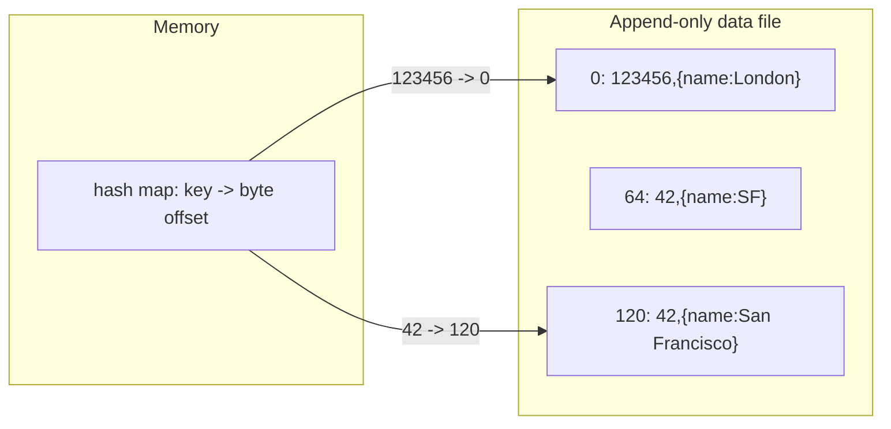
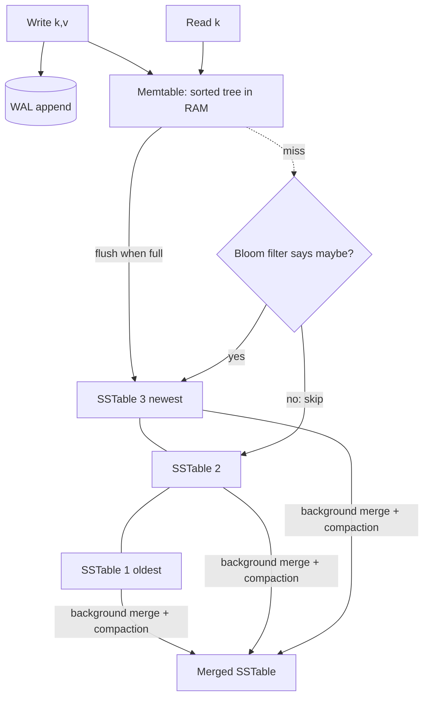
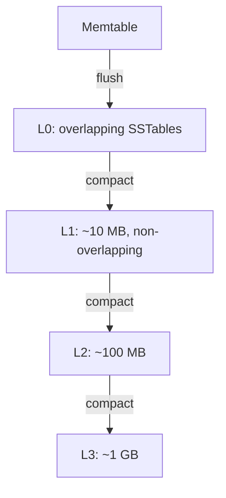

# Log-structured storage: hash indexes, SSTables, LSM-trees

A database does two things: when you give it data, it **stores** it, and when you ask again later, it **gives the data back**. Chapter 3 of DDIA looks at *how* it does that. You will rarely write a storage engine, but you constantly *choose* and *tune* one, and that requires knowing what happens underneath. Storage engines come from two big families:

- **Log-structured** engines: Bitcask, LevelDB, RocksDB, Cassandra, HBase, Lucene. This lesson.
- **Page-oriented / update-in-place** engines: **B-trees**, used by nearly every relational database. Next lesson.

## 1. The world's simplest database

```bash
#!/bin/bash
db_set () { echo "$1,$2" >> database; }
db_get () { grep "^$1," database | sed -e "s/^$1,//" | tail -n 1; }
```

`db_set key value` appends a line to a file. `db_get key` returns the *last* value for that key. Old values are never overwritten, because the newest line wins.

- **Writes are excellent**, O(1). Appending to a file is about the most efficient write there is, and many real databases use an append-only **log** internally. Here *log* means an append-only sequence of records, not human-readable application logs.
- **Reads are terrible**, O(n), because `db_get` scans the whole file.

To find data efficiently we need an **index**: an additional structure, derived from the primary data, that acts as a signpost. Indexes speed up reads but **slow down writes**, because every write must also update each index. That is the fundamental trade-off, and it is why databases make you choose indexes explicitly instead of indexing everything.

## 2. Hash indexes (Bitcask)

The simplest index for an append-only log is an **in-memory hash map** from each key to the **byte offset** in the data file where the latest value for that key starts.



- **Write**: append the record and set `index[key] = offset`.
- **Read**: look up the offset, seek, and read the record. That is one disk seek, or zero if the page is in the OS cache.

This is essentially **Bitcask**, the default storage engine in Riak. Its sweet spot is a modest number of distinct keys that are overwritten again and again: the key set stays small enough for memory while the values churn. An example is a counter of video plays per URL.

### 2.1 Segments and compaction

If we only ever append, we eventually run out of disk. The solution:

1. Break the log into **segments** of a certain size. When a segment fills, close it and write to a new one.
2. **Compaction**: throw away duplicate keys within a segment and keep only the most recent value of each.
3. **Merge** several compacted segments into a new one in a background thread. Old segments keep serving reads until the merge finishes, then reads switch to the new segment and the old files are deleted.

Each segment has its own in-memory hash map. A read checks the newest segment's map first, then the next newest, and so on. Merging keeps the number of segments small.

### 2.2 Details that matter in a real implementation

- **File format.** Binary, with length-prefixed records, is faster and simpler than CSV.
- **Deleting records.** Append a special **tombstone** record. Merging discards earlier values for the deleted key.
- **Crash recovery.** In-memory hash maps are lost on restart. A full rescan of all segments at startup would take too long, so Bitcask also saves **each segment's hash map as a snapshot file** and loads that instead.
- **Partially written records.** Checksums let you detect and ignore torn writes after a crash.
- **Concurrency control.** Use a single writer thread. Segments are append-only and otherwise immutable, so readers can read them concurrently.

### 2.3 Why append-only and not update in place?

- **Sequential writes** (appending, merging) are much faster than random writes on spinning disks and also preferable on SSDs.
- **Concurrency and crash recovery** get much simpler with immutable segments. You never find a value half old and half new.
- **Merging** avoids data-file fragmentation over time.

Limitations of hash indexes:

- The hash table must **fit in memory**. On-disk hash maps perform poorly because they need lots of random I/O, are expensive to grow and need fiddly collision logic.
- **Range queries are not efficient.** You cannot scan all keys between `kitty00000` and `kitty99999` without looking up each key separately.

## 3. SSTables and LSM-trees

Now change the segment format. Require that the records in each segment are **sorted by key**. This is a **Sorted String Table**, or **SSTable**. Each key appears only once within a merged segment, which compaction already ensures.

SSTables have big advantages over hash-indexed logs:

1. **Merging is simple and efficient** even when files are larger than memory. It is the **mergesort** merge step. Read the input files side by side, repeatedly copy the lowest key to the output, and when the same key appears in several segments keep the value from the **most recent** segment.
2. **You no longer need every key in memory.** The index can be **sparse**: one key per few kilobytes. To find `handiwork`, if you know the offsets of `handbag` and `handsome`, scan from `handbag`'s offset.
3. **Compression.** Records between two sparse-index entries can be grouped into a **block** and compressed. Each sparse-index entry points to the start of a compressed block, which saves disk space and I/O bandwidth.

### 3.1 Constructing and maintaining SSTables

Incoming writes arrive in any order. How do we produce sorted files? Sorting in memory is easy with a balanced tree such as a red-black or AVL tree.

1. A write goes into an in-memory balanced tree called the **memtable**.
2. When the memtable exceeds a threshold of a few megabytes, write it out to disk as a new SSTable. This is fast because the tree is already sorted. That SSTable becomes the newest segment. New writes go to a fresh memtable meanwhile.
3. For a read, check the memtable, then the newest on-disk segment, then the next older, and so on.
4. From time to time, run **merging and compaction** in the background.

One problem remains. If the database crashes, the most recent writes in the memtable are lost. Fix it with a separate append-only **write-ahead log** on disk. Every write is appended to the log immediately, the log is used only to rebuild the memtable after a crash, and it is discarded when its memtable is flushed.



The algorithm was described by Patrick O'Neil and colleagues as the **Log-Structured Merge-Tree (LSM-tree)** in 1996. It is used in **LevelDB**, **RocksDB**, **Cassandra**, **HBase** and Google **Bigtable**, the paper that introduced the terms *SSTable* and *memtable*. Lucene, the indexing engine behind Elasticsearch and Solr, uses the same idea for its **term dictionary**, mapping each term to its postings list of document ids.

### 3.2 Try it: a tiny LSM tree

```python-run
import bisect

class TinyLSM:
    TOMBSTONE = object()

    def __init__(self, memtable_limit=3):
        self.memtable = {}               # stand-in for a red-black tree
        self.sstables = []               # list of sorted [(key, value)], newest LAST
        self.limit = memtable_limit
        self.wal = []                    # write-ahead log

    def put(self, k, v):
        self.wal.append((k, v))
        self.memtable[k] = v
        if len(self.memtable) >= self.limit:
            self.flush()

    def delete(self, k):
        self.put(k, self.TOMBSTONE)

    def flush(self):
        if not self.memtable:
            return
        table = sorted(self.memtable.items())
        self.sstables.append(table)
        self.memtable, self.wal = {}, []          # WAL can be discarded after flush
        print(f"  flush -> SSTable #{len(self.sstables)}: {[k for k, _ in table]}")

    def get(self, k):
        if k in self.memtable:
            v = self.memtable[k]
            return None if v is self.TOMBSTONE else v
        for t in reversed(self.sstables):          # newest first
            keys = [kk for kk, _ in t]
            i = bisect.bisect_left(keys, k)
            if i < len(t) and t[i][0] == k:
                v = t[i][1]
                return None if v is self.TOMBSTONE else v
        return None

    def compact(self):
        merged = {}
        for t in self.sstables:                     # oldest -> newest, later wins
            for k, v in t:
                merged[k] = v
        self.sstables = [sorted((k, v) for k, v in merged.items() if v is not self.TOMBSTONE)]
        print("  compacted ->", self.sstables[0])

db = TinyLSM()
for k, v in [("cat", 1), ("ant", 2), ("dog", 3), ("cat", 4), ("bee", 5), ("eel", 6)]:
    db.put(k, v)
db.delete("ant")
db.put("fox", 7); db.put("ant", 8); db.delete("dog")
print("get cat ->", db.get("cat"), "| get dog ->", db.get("dog"), "| get ant ->", db.get("ant"))
print("SSTables before compaction:", len(db.sstables), "memtable:", db.memtable)
db.flush(); db.compact()
print("get cat ->", db.get("cat"), "| get bee ->", db.get("bee"))
```

Note that the tombstone for `dog` *shadows* the older value until compaction removes both.

### 3.3 Performance optimisations

**Bloom filters.** Looking up a key that does not exist is slow. You check the memtable and then *every* SSTable all the way back to the oldest. A **Bloom filter** is a compact probabilistic set. It can answer "definitely not present" or "maybe present". Each SSTable keeps one, so most negative lookups skip the disk.

A Bloom filter is a bit array of $m$ bits with $k$ hash functions. To add a key, set the bits at $h_1(x), \dots, h_k(x)$. To query, check whether *all* those bits are set. False positives are possible and false negatives are not. With $n$ inserted keys, the false-positive rate is approximately

$$p \approx \left(1 - e^{-kn/m}\right)^k, \qquad k_{opt} = \frac{m}{n}\ln 2.$$

About **10 bits per key** gives roughly a 1% false-positive rate.

```python-run
import hashlib, math

class Bloom:
    def __init__(self, m, k):
        self.m, self.k, self.bits = m, k, bytearray(m)
    def _hashes(self, key):
        # double hashing: h_i = h1 + i*h2  (Kirsch-Mitzenmacher)
        d = hashlib.sha256(key.encode()).digest()
        h1 = int.from_bytes(d[:8], "big"); h2 = int.from_bytes(d[8:16], "big") | 1
        return [(h1 + i * h2) % self.m for i in range(self.k)]
    def add(self, key):
        for h in self._hashes(key): self.bits[h] = 1
    def might_contain(self, key):
        return all(self.bits[h] for h in self._hashes(key))

n = 2000
for bits_per_key in (4, 8, 10, 16):
    m = n * bits_per_key
    k = max(1, round(m / n * math.log(2)))
    bf = Bloom(m, k)
    for i in range(n): bf.add(f"key{i}")
    fp = sum(bf.might_contain(f"absent{i}") for i in range(5000)) / 5000
    theory = (1 - math.exp(-k * n / m)) ** k
    print(f"{bits_per_key:>2} bits/key, k={k:<2} measured FP={fp:.3%}  theory={theory:.3%}")
assert all(bf.might_contain(f"key{i}") for i in range(n))   # never a false negative
```

**Compaction strategies** decide the order and timing of merges:

- **Size-tiered** (HBase; Cassandra's default STCS). Newer, smaller SSTables are merged into older, larger ones once there are several of similar size. Write amplification is lower, but space amplification is higher during merges.
- **Leveled** (LevelDB, RocksDB; Cassandra LCS). The key range is split into small SSTables, and older data moves into separate "levels" L0, L1, L2…, each about 10× bigger than the one before, with non-overlapping tables within a level. Compaction is more incremental and uses less disk space, and reads touch roughly one table per level, but write amplification is higher.



The basic idea, a cascade of SSTables merged in the background, is simple and effective. Even when the dataset is far larger than memory it keeps working well. Data is stored sorted, so **range queries** are efficient (scan from the minimum key upward), and writes are sequential, so **write throughput is very high**.

> [!INTERVIEW]
> "Design a key-value store" or "why is Cassandra fast at writes?" Walk through write → WAL + memtable → flush to immutable SSTable → background compaction, then read → memtable → Bloom filter → sparse index → block. Name the trade-off: LSM gives cheap sequential writes, while reads may check several files and compaction costs I/O and can interfere with foreground traffic.

## 4. Amplification vocabulary

- **Write amplification.** Bytes written to disk divided by bytes the application wrote. Compaction rewrites data several times. It matters on SSDs, which tolerate a limited number of overwrites before wearing out.
- **Read amplification.** The number of disk reads per query, such as several SSTables per lookup.
- **Space amplification.** Disk used divided by live data. Stale versions and tombstones wait around for compaction.

You cannot minimise all three at once (this is the *RUM conjecture*: Read, Update, Memory). Compaction strategy is the knob.

## 5. Pitfalls

- **Tombstone build-up.** Deleting lots of keys (queue-like workloads in Cassandra) leaves tombstones that slow reads until compaction purges them, and in a replicated system only after `gc_grace_seconds`, to avoid deleted data being "resurrected" by a replica that missed the delete.
- **Compaction falling behind.** If write throughput exceeds compaction throughput, unmerged segments pile up, reads slow down and disk fills. You must *monitor* for this, because LSM engines typically do not throttle incoming writes on their own.
- **Forgetting the WAL fsync policy.** Batching fsyncs trades durability of the last few milliseconds for throughput.

## 6. Summary

- An append-only log plus an index makes a database. **Indexes speed reads and slow writes.**
- **Hash index** (Bitcask): in-memory map from key to offset, segments plus compaction. Fast, but all keys must fit in RAM and there are no range queries.
- **SSTable**: a sorted segment, which allows mergesort-style merging, a sparse in-memory index and block compression.
- **LSM-tree**: memtable + WAL → flush to SSTables → background compaction (size-tiered or leveled), with **Bloom filters** to skip SSTables on reads.

```quiz
[
  {"q": "In the Bitcask-style hash index, what does the in-memory hash map store?",
   "options": ["The full value for each key", "The byte offset in the data file of the most recent value for each key", "Only deleted keys", "A Bloom filter"],
   "answer": 1,
   "explain": "Each key maps to the location of its latest record; reads are one seek."},
  {"q": "What is the main limitation of a pure hash index compared to SSTables?",
   "options": ["Slow writes", "All keys must fit in memory and range queries are inefficient", "It cannot handle deletes", "It needs B-trees"],
   "answer": 1,
   "explain": "Hash tables are unordered and on-disk hash maps perform poorly."},
  {"q": "Why can an SSTable use a sparse in-memory index?",
   "options": ["Because it is compressed", "Because keys are sorted, so you can seek to the nearest indexed key and scan forward", "Because it uses a hash function", "Because it has a Bloom filter"],
   "answer": 1,
   "explain": "Sorted order means one index entry per few KB is enough to bound the scan."},
  {"q": "When merging several SSTables and the same key appears in more than one, which value is kept?",
   "options": ["The smallest value", "The value from the oldest segment", "The value from the most recent segment", "All values"],
   "answer": 2,
   "explain": "More recent segments contain the more recent writes, so their value supersedes older ones."},
  {"q": "What is the purpose of the separate write-ahead log in an LSM engine?",
   "options": ["To speed up reads", "To rebuild the memtable after a crash so recent writes are not lost", "To store tombstones", "To compress SSTables"],
   "answer": 1,
   "explain": "The memtable is in RAM; every write is also appended to the WAL, which is discarded after the memtable is flushed."},
  {"q": "A Bloom filter reports 'maybe present' for a key. What is true?",
   "options": ["The key is definitely present", "The key may or may not be present; you must check the SSTable", "The key is definitely absent", "The filter is corrupted"],
   "answer": 1,
   "explain": "Bloom filters have false positives but no false negatives."},
  {"q": "Compared with size-tiered compaction, leveled compaction typically has...",
   "options": ["Higher space amplification and lower write amplification", "Lower space amplification and more predictable reads, but higher write amplification", "No compaction at all", "Unsorted SSTables"],
   "answer": 1,
   "explain": "Leveled compaction keeps non-overlapping tables per level, which bounds read cost and space but rewrites data more often."},
  {"q": "How is a key deleted in a log-structured store?",
   "options": ["Overwrite its bytes with zeros", "Append a tombstone record; merges later discard older values", "Remove it from every segment immediately", "Rebuild the database"],
   "answer": 1,
   "explain": "Segments are immutable; a tombstone shadows old values until compaction."}
]
```

> **Source:** DDIA ch. 3, "Storage and Retrieval" (Data Structures that Power Your Database: hash indexes, SSTables and LSM-trees, performance optimizations).
