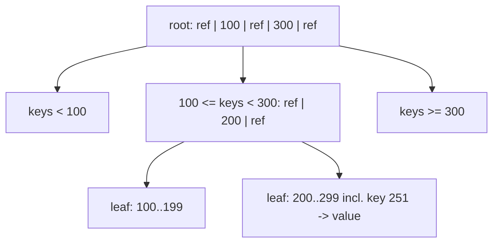
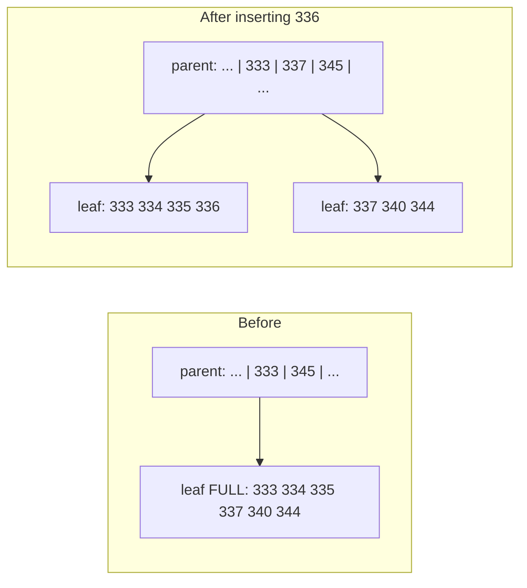

# B-trees, write-ahead logs and the LSM vs B-tree trade-off

> **Before this lesson:** read [Log-structured storage](#/lesson/databases/log-structured) first. This lesson relies on its terms: storage engine, index, segment, SSTable, memtable, LSM-tree, compaction, write-ahead log, sequential and random writes, and the three kinds of amplification.

## In plain words

A **B-tree** is the index structure inside nearly every relational database. It keeps keys in sorted order on disk, arranged so that any single key among billions can be found in three or four steps.

An everyday picture: a large paper dictionary with thumb tabs. You do not read from page one to find "quorum". The tabs take you to Q. The guide words printed at the top of each page take you to the right page. Then you scan that one page. Three steps, in a book of a thousand pages. A B-tree does the same thing: a top-level page sends you to a narrower page, which sends you to a narrower one, until you arrive at the page that holds your key.

There is one more difference from the notebook of the previous lesson. In a dictionary bound as a ring binder, a new word is added by opening the right page and writing it there. If the page is full, you insert a fresh sheet and move half the entries onto it. A B-tree likewise changes pages **in place**, where an LSM-tree only ever appends.

Why this matters for a job: every time you write `CREATE INDEX` in PostgreSQL or MySQL you are creating a B-tree. Knowing its shape explains why some queries use an index and others cannot, why the order of columns in an index matters, and why random IDs can slow inserts down. "LSM-tree or B-tree?" is also a favourite interview question, and section 5 gives the full comparison.

The B-tree dates from 1970 and is the standard index in PostgreSQL, MySQL (through its InnoDB storage engine), Oracle, SQL Server and SQLite, as well as many non-relational databases.

## 1. Pages, not segments

A B-tree and an SSTable have one thing in common: both keep entries **sorted by key**, so both can find one key quickly and can read a range of neighbouring keys in order. They differ in how the file is organised.

- A log-structured engine divides its data into **segments** of varying size, often many megabytes, and writes them sequentially from start to finish.
- A B-tree divides its file into **pages** of one fixed size. The traditional size is 4 kilobytes (KB); PostgreSQL uses 8 KB and InnoDB 16 KB. The database reads and writes one whole page at a time. This matches the hardware, because disks are themselves organised in fixed-size blocks.

Every page has an address, which is its position in the file. A page can hold the address of another page, and such an address is called a **reference** or **pointer**. Through these references the pages form a **tree**: a structure that starts from a single page, called the **root**, and branches out. (Computer-science trees are drawn upside down, root at the top.)

A page that is not at the bottom contains some keys and some references to **child** pages, in alternating order. The keys act as dividers. Each child is responsible for one continuous range of keys, and the dividers on either side of its reference say where that range starts and ends.



To find key 251 in the diagram:

1. Start at the root. It has dividers 100 and 300. Since 251 falls between them, follow the middle reference.
2. That page has a divider at 200. Since 251 is at least 200, follow the right-hand reference.
3. Arrive at a **leaf page**, a page at the bottom of the tree with no children. A leaf holds the keys themselves together with their values, or with references to where the values are stored.

The number of child references in one page is the **branching factor**. It is usually several hundred, because a 4 KB page has room for that many keys. A large branching factor makes the tree very shallow. With $n$ keys the depth grows as $O(\log n)$: each additional level multiplies the capacity by the branching factor. The program below shows how quickly that grows.

```python-run
for b in (100, 300, 500):
    for depth in (2, 3, 4):
        pages = b ** depth
        print(f"branching={b:<4} depth={depth}  leaf pages={pages:>16,}  ~{pages*4/1e9:,.1f} TB at 4KB")
```

The outer loop tries three branching factors and the inner loop three depths. `b ** depth` is `b` raised to the power `depth`: the number of leaf pages reachable when every page has `b` children. Multiplying by 4 KB and dividing by a billion converts the page count to terabytes (TB).

```
branching=100  depth=2  leaf pages=          10,000  ~0.0 TB at 4KB
branching=100  depth=3  leaf pages=       1,000,000  ~0.0 TB at 4KB
branching=100  depth=4  leaf pages=     100,000,000  ~0.4 TB at 4KB
branching=300  depth=2  leaf pages=          90,000  ~0.0 TB at 4KB
branching=300  depth=3  leaf pages=      27,000,000  ~0.1 TB at 4KB
branching=300  depth=4  leaf pages=   8,100,000,000  ~32.4 TB at 4KB
branching=500  depth=2  leaf pages=         250,000  ~0.0 TB at 4KB
branching=500  depth=3  leaf pages=     125,000,000  ~0.5 TB at 4KB
branching=500  depth=4  leaf pages=  62,500,000,000  ~250.0 TB at 4KB
```

The last line is the one to remember. With a branching factor of 500, four levels are enough to address 250 terabytes. That is why most real databases have B-trees only **three or four levels deep**, and why a lookup needs so few page reads.

## 2. Updates and page splits

- **Changing the value of an existing key.** Walk down from the root to the leaf that holds the key, change the value in that page, and write the page back to disk at the same address. Every reference to the page is still correct, because the page has not moved.
- **Adding a new key.** Walk down to the leaf whose range includes the new key and add it there. If the leaf has no room, **split** it: create a second page, move half of the entries into it, and add a new divider and reference to the parent so the parent knows about both halves. The parent may then be full as well, in which case it splits in the same way, and so on upward. If the root splits, a new root is created above it and the tree becomes one level taller.

Because growth happens by splitting and the tree only gets taller at the root, every leaf is always the same distance from the root. A tree with that property is called **balanced**, and it guarantees that no lookup is much slower than any other.



In the diagram a leaf already holds six keys, its maximum. Inserting 336 makes it overflow. It splits into two leaves, and the parent gains the divider 337 between its existing dividers 333 and 345.

### 2.1 Try it: leaf split

```python-run
import bisect

def insert_into_leaf(keys, key, capacity):
    """Insert key into a sorted leaf; split if it overflows.
    Returns (left, right, separator) or (keys, None, None)."""
    keys = keys[:]
    bisect.insort(keys, key)
    if len(keys) <= capacity:
        return keys, None, None
    mid = len(keys) // 2
    left, right = keys[:mid], keys[mid:]
    return left, right, right[0]          # in a B+tree the separator is copied up

leaf = [333, 334, 335, 337, 340, 344]
print(insert_into_leaf(leaf, 336, capacity=6))
print(insert_into_leaf([10, 20], 15, capacity=4))

# Build a 2-level tree by repeated inserts and watch splits happen
import random
random.seed(3)
leaves, seps, cap = [[]], [], 4
for k in random.sample(range(100), 20):
    i = bisect.bisect_right(seps, k)
    l, r, s = insert_into_leaf(leaves[i], k, cap)
    leaves[i] = l
    if r is not None:
        leaves.insert(i + 1, r); seps.insert(i, s)
        print(f"insert {k:>2}: split -> separator {s}")
print("separators (root):", seps)
print("leaves:", leaves)
```

What each part does:

- `insert_into_leaf(keys, key, capacity)` takes a sorted list representing a leaf. `keys[:]` makes a copy so the caller's list is not changed. `bisect.insort` inserts the new key at the correct sorted position.
- If the leaf still fits within `capacity`, the function returns it with `None` for the other two results, meaning "no split".
- Otherwise it cuts the list in the middle. `keys[:mid]` is the left half and `keys[mid:]` the right half. The third result, `right[0]`, is the **separator**: the smallest key of the right half, which the parent will use as the divider between the two new leaves.
- The second part builds a small two-level tree. `leaves` is the list of leaf pages and `seps` is the list of dividers that the root would hold. For each of 20 random keys, `bisect.bisect_right(seps, k)` works out which leaf the key belongs to, the key is inserted there, and if a split happened the new right-hand leaf and its separator are added.

```
([333, 334, 335], [336, 337, 340, 344], 336)
([10, 15, 20], None, None)
insert 47: split -> separator 47
insert 60: split -> separator 69
insert 74: split -> separator 75
insert 33: split -> separator 16
insert 24: split -> separator 29
insert 81: split -> separator 80
separators (root): [16, 29, 47, 69, 75, 80]
leaves: [[1, 8], [16, 19, 24], [29, 30, 33], [47, 50, 60, 66], [69, 70, 74], [75, 77], [80, 81, 91]]
```

The first line is the split from the diagram, cut at a slightly different point: seven keys became a leaf of three and a leaf of four, with 336 as the separator. The second line shows an insert with room to spare, so nothing splits. After 20 inserts there are seven leaves and six separators. Check the final state against the rule: every key in the second leaf is at least 16 and below 29, every key in the third is at least 29 and below 47, and so on. Each separator marks exactly where one leaf ends and the next begins.

A full B-tree does two more things that this sketch leaves out. It splits the non-leaf pages too, where the middle key moves up into the parent instead of being copied. And after deletions it may **merge** two pages that have become nearly empty.

## 3. Making B-trees reliable: the write-ahead log

The basic write in a B-tree **overwrites a page on disk where it sits**. That is the opposite of an LSM-tree, which only appends and never changes a file once written. Overwriting is risky for two reasons:

- A split has to write *several* pages: the two halves and the parent. If the machine loses power after one of those writes and before the others, the tree is left broken. One possible result is an **orphan page**, a page that no parent points to, so its keys can never be found.
- Even a single page may not be written all at once. A power cut can leave a page half new and half old. This is called a **torn page**.

The defence is the same tool the LSM-tree used for a different purpose: a **write-ahead log** (WAL), sometimes called a *redo log*. Before the database changes any page, it appends a description of the intended change to the WAL. The pages are modified only after that. If the database crashes, on restart it reads the WAL and repeats any changes that may not have been completed, which returns the tree to a correct state. The WAL is useful for more than crash recovery. PostgreSQL also sends its WAL to other machines to keep copies of the database up to date, a topic that returns in the replication lessons.

A second problem is **concurrency**: several operations working on the tree at the same moment. A reader walking down the tree while another operation is half-way through a split could see a tree that makes no sense. B-trees prevent this with **latches**, which are very short-lived locks placed on individual pages while they are being changed. Log-structured engines have an easier time here. Their merging happens in the background on files nobody else is changing, and a finished segment replaces the old ones in a single step.

### 3.1 Alternative: copy-on-write

Some databases, such as LMDB, avoid overwriting altogether. With **copy-on-write**, a changed page is written to a *new* location, and then new copies of its parent, grandparent and so on up to the root are written to point at it. The old pages remain intact until the new root is in place, so a crash cannot leave a half-changed tree and no WAL is needed. It has a second benefit: the old root still describes the tree as it was, which gives readers a stable view of the past. That idea reappears in the lesson on snapshot isolation.

## 4. B-tree optimisations

The B-tree has been refined for fifty years. The common improvements:

- **Copy-on-write** in place of overwriting plus a WAL, as described above.
- **Shortened keys in the upper pages.** A non-leaf page only needs enough of each key to tell which way to go. If the dividers are abbreviated, more of them fit on a page, the branching factor rises, and the tree gets shallower. The common variant in which values are stored only in the leaves and the upper pages hold nothing but dividers is called a **B+ tree**.
- **Leaves laid out in order on disk.** Reading a range of keys is fastest if neighbouring leaves are next to each other on the disk. A B-tree tries to arrange this but cannot always keep it up as pages split. LSM-trees do better here, because each merge rewrites a large stretch of data in one piece.
- **Sibling pointers.** Each leaf stores the addresses of the leaf before and after it. A range scan can then move from leaf to leaf sideways without climbing back up to the parent.
- **Hybrid designs** such as fractal trees, which borrow log-structured techniques to reduce disk seeks.

## 5. Comparing B-trees and LSM-trees

A rule of thumb to start from: **LSM-trees tend to be faster for writes and B-trees faster for reads.** A read from an LSM-tree may have to check the memtable and several SSTables before it finds the key, while a B-tree read follows one path from root to leaf. Real results depend heavily on the workload, so the only reliable comparison is a test with your own data.

### 5.1 Advantages of LSM-trees

- **Often lower write amplification.** A B-tree writes every change at least twice, once to the WAL and once to the page. It also rewrites a whole page of 4 to 16 KB even when only a few bytes changed. An LSM-tree rewrites data several times through compaction as well, but in large sequential batches.
- **Higher write throughput.** Sequential writes are cheaper than scattered ones. On spinning disks the difference is large.
- **Smaller files.** When a B-tree page splits, both halves are left partly empty. This wasted room is called **fragmentation**. An LSM-tree rewrites its SSTables regularly, which squeezes the gaps out, and sorted data in large blocks compresses well.
- **A note on SSDs.** The control software inside a solid-state drive already converts scattered writes into sequential ones internally, which reduces the penalty for a B-tree. Lower write amplification still helps, because it leaves more of the drive's capacity for real work and wears the drive out more slowly.

### 5.2 Downsides of LSM-trees

- **Compaction competes with user requests.** A disk can transfer only so many bytes per second. When a large compaction is running, a user's read or write may have to wait. Average speed stays good, but the high percentiles of response time (p99 and above, from the scalability lesson) can be poor. B-trees are more **predictable**.
- **Compaction has to keep up.** At a high write rate, flushing memtables and compacting SSTables share the same disk. If compaction falls behind, unmerged SSTables accumulate, reads slow down, and the disk can fill up.
- **A key can exist in several places.** In a B-tree each key is in exactly one page. In an LSM-tree, older versions of a key may sit in several SSTables. Having one place per key makes it easier to offer strong guarantees about **transactions** (groups of operations that must succeed or fail together), because a lock on a range of keys can be attached directly to the tree. The lessons on transactions explain why that matters.

| | LSM-tree | B-tree |
|---|---|---|
| Write pattern | Sequential appends, background merge | In-place page overwrite + WAL |
| Write throughput | Higher | Lower |
| Read cost | Several SSTables (mitigated by Bloom filters) | One root-to-leaf path |
| Tail latency | Compaction spikes | More predictable |
| Space | Compact (no fragmentation, compresses well) | Fragmented pages |
| Examples | RocksDB, LevelDB, Cassandra, HBase, ScyllaDB | PostgreSQL, InnoDB, SQLite, LMDB |

> [!INTERVIEW]
> For "would you choose an LSM-tree or a B-tree engine?", start from the workload. Heavy ingestion of writes, such as metrics, event records or time series, points to an LSM-tree. Read-heavy work with strict response-time targets, or complex transactions, points to a B-tree. Use the vocabulary: write, read and space amplification, and the response-time spikes caused by compaction. A good closing remark is that the choice is often configurable: MySQL, for example, can run on RocksDB (an LSM engine) through a project called MyRocks.

## 6. Other indexing structures

### 6.1 Secondary indexes

Every row in a table has a **primary key**: a value that identifies that row and no other, such as a user ID. The index on the primary key is the main way to find a row. A **secondary index** is any further index, on some other column, created with `CREATE INDEX` in SQL. Secondary indexes make it fast to search by something other than the primary key, such as finding users by email address or by city.

The difference in a secondary index is that its keys need **not be unique**. Many users live in the same city. There are two ways to deal with that. Either each index entry holds a list of all the matching row identifiers, or each entry is made unique by attaching the row identifier to the key.

### 6.2 Storing values within the index

What does a leaf entry hold as its "value"? There are three designs.

- **A reference into a heap file.** The rows are stored in a separate file in no particular order, called a **heap file**, and the index holds the position of the row in that file. When a table has several indexes, each one points at the same single copy of the row, so nothing is duplicated. Updating a row in place is fine if the new version is not larger. If it is larger, it may have to move, and then either every index must be corrected or a forwarding note is left at the old position.
- **The row itself.** An index that stores the whole row inside its leaves is a **clustered index**. In MySQL's InnoDB the table *is* the primary-key index, and each secondary index stores primary-key values, not row positions. Looking up through a secondary index therefore takes two steps: find the primary key, then find the row.
- **Some of the columns.** A **covering index** stores a few chosen extra columns alongside the key. A query that needs only those columns can be answered from the index without fetching the row at all. Such a query is said to be *covered*.

Clustered and covering indexes make reads faster. They cost extra disk space and extra work on every write, and because the same data now exists in more than one place, the database has to work harder to keep the copies in agreement.

### 6.3 Multi-column indexes

- A **concatenated index** (also called a composite index) joins several columns into a single key in a fixed order, such as `(last_name, first_name)`. A printed phone book is exactly this. It lets you find everyone with a given last name, or one person by last and first name. It does **not** help you find everyone with a given first name, because those entries are scattered through the whole book.
- A **multi-dimensional** query restricts two or more columns to ranges at once. Finding all shops inside a rectangle on a map is the standard example: latitude between two values *and* longitude between two values. A B-tree sorted by latitude narrows only one of the two. Specialised structures handle this, most commonly the **R-tree**, which the PostGIS extension for PostgreSQL uses for geographic data. The same need arises outside geography, for example searching products by a range of red, green and blue colour values.

### 6.4 Full-text search and fuzzy indexes

The indexes so far find exact keys. They cannot find a word spelled slightly wrong. Search libraries such as Lucene support **fuzzy** search, which finds words within a given **edit distance** of the search term. An edit distance of 1 means one letter added, removed or changed. Lucene achieves this by keeping its dictionary of words in memory as a compact structure that can be walked letter by letter, in a way that tolerates a set number of mismatches.

### 6.5 Keeping everything in memory

RAM has become cheap enough that many datasets fit in it entirely. **In-memory databases** take advantage of that. Memcached is used purely as a cache, where losing the data in a restart is acceptable. Others, including Redis and VoltDB, aim to be durable. They achieve it by also appending changes to a log on disk, writing periodic snapshots, or keeping copies on other machines. The disk is used only as a safety net, and all reads come from memory.

There is a common misunderstanding about why such databases are fast. It is tempting to say "because they do not read from disk". But a disk-based database with enough memory rarely reads from disk either, since the operating system keeps recently used disk blocks in memory. The real saving is that an in-memory database **never has to convert its data structures into a form suitable for disk**. That conversion costs processor time on every operation. Being free of the disk layout also lets these databases offer structures that are hard to build on disk, such as the sorted sets and queues in Redis.

## 7. Pitfalls

- **Too many indexes.** Each index must be updated on every write and takes disk space. Create indexes for the queries the application really runs.
- **Wrong column order in a concatenated index.** An index on `(a, b)` does not help a query that filters only on `b`.
- **Random identifiers as the key of a clustered index.** A fully random ID (the common "UUID version 4") sends each new row to an unpredictable page. Pages all over the tree are read, changed and split, and the tree fragments. IDs that increase over time (UUID version 7, or ULID) send new rows to the right-hand edge of the tree, which is much cheaper.
- **Believing in-memory means fast because it skips the disk.** The gain comes from avoiding the conversion to an on-disk format.

## 8. Summary

- A B-tree stores sorted keys in fixed-size **pages** that form a balanced tree. With several hundred children per page, three or four levels cover almost any database.
- Adding a key to a full page **splits** it, and the split can travel up to the root. Because pages are overwritten in place, a **write-ahead log** (or copy-on-write) is needed to survive crashes, and **latches** protect pages during simultaneous access.
- LSM-trees usually win on write throughput and compactness. B-trees win on predictable read times and keep each key in one place.
- Secondary, clustered, covering, concatenated and multi-dimensional indexes all spend disk space and write effort to make particular reads faster.

## Glossary

- **B-tree** - a balanced tree of fixed-size pages holding sorted keys; the standard database index.
- **Page** - a fixed-size block of the database file, read and written as a unit.
- **Reference (pointer)** - a stored address of another page.
- **Root / leaf / child** - the top page of the tree / a bottom page holding keys and values / a page referred to by the page above it.
- **Branching factor** - the number of child references in one page.
- **Balanced** - every leaf is the same distance from the root.
- **Page split** - dividing a full page into two and adding a divider to the parent.
- **Separator** - the key in a parent that marks the boundary between two children.
- **Orphan page** - a page that no parent refers to, usually left by an interrupted split.
- **Torn page** - a page only partly written because of a crash.
- **Write-ahead log (WAL, redo log)** - an append-only file where each change is recorded before pages are modified.
- **Latch** - a brief lock on a page while it is being changed.
- **Copy-on-write** - writing a changed page to a new location and updating the path to it, leaving the old pages intact.
- **B+ tree** - a B-tree variant that keeps values only in the leaves.
- **Sibling pointer** - a leaf's reference to the next or previous leaf.
- **Fragmentation** - unused space left inside pages.
- **Primary key** - the value that uniquely identifies a row.
- **Secondary index** - an index on a column other than the primary key.
- **Heap file** - a file holding rows in no particular order.
- **Clustered index** - an index whose leaves contain the whole rows.
- **Covering index** - an index that also stores some extra columns so certain queries need nothing else.
- **Concatenated (composite) index** - an index whose key is several columns joined in a fixed order.
- **R-tree** - an index for ranges in two or more dimensions, such as map coordinates.
- **Edit distance** - the number of single-letter changes needed to turn one word into another.
- **In-memory database** - a database that keeps all its data in RAM and uses disk only for safety.

```quiz
[
  {"q": "Typical depth of a B-tree for a large database?",
   "options": ["1-2 levels", "3-4 levels", "20-30 levels", "It is unbounded"],
   "answer": 1,
   "explain": "With branching factors in the hundreds, 3-4 levels covers terabytes of data."},
  {"q": "What happens when you insert into a full B-tree leaf page?",
   "options": ["The insert is rejected", "The page is split into two half-full pages and the parent is updated with a new separator", "A new root is always created", "The page is compressed"],
   "answer": 1,
   "explain": "Splits may propagate upwards; if the root splits, the tree gains a level."},
  {"q": "Why do B-trees need a write-ahead log?",
   "options": ["To speed up reads", "Because in-place page overwrites, especially multi-page splits, can leave the tree corrupted if the database crashes midway", "To support Bloom filters", "To enable compression"],
   "answer": 1,
   "explain": "Every modification is appended to the WAL before pages are changed, so recovery can restore consistency."},
  {"q": "Which statement about LSM-trees vs B-trees is generally true?",
   "options": ["LSM-trees have more predictable tail latencies", "LSM-trees typically sustain higher write throughput, while B-trees give more predictable read latency", "B-trees never fragment", "LSM-trees store each key in exactly one place"],
   "answer": 1,
   "explain": "Sequential writes favor LSM; compaction can cause latency spikes; B-trees keep one copy per key."},
  {"q": "A composite index on (last_name, first_name) can efficiently serve which query?",
   "options": ["WHERE first_name = 'Ada'", "WHERE last_name = 'Lovelace'", "WHERE first_name LIKE '%a'", "None"],
   "answer": 1,
   "explain": "Like a phone book, a concatenated index works for a prefix of its columns."},
  {"q": "What is a covering index?",
   "options": ["An index on every column", "An index that stores some extra columns so certain queries can be answered from the index alone", "A clustered primary key", "A Bloom filter over an index"],
   "answer": 1,
   "explain": "Including columns avoids a lookup into the heap or clustered index."},
  {"q": "According to DDIA, the main reason in-memory databases are faster is...",
   "options": ["They never touch the disk", "They avoid the overhead of encoding in-memory data structures in a form that can be written to disk", "RAM has higher bandwidth than CPUs", "They have no indexes"],
   "answer": 1,
   "explain": "The OS page cache already keeps hot data in memory for disk-based engines; serialization overhead is what is saved."},
  {"q": "Which structure is suited to 2-D range queries like latitude/longitude boxes?",
   "options": ["Hash index", "Concatenated B-tree index", "R-tree (or space-filling curve index)", "Bloom filter"],
   "answer": 2,
   "explain": "Multi-dimensional indexes such as R-trees (PostGIS GiST) handle multi-attribute ranges."}
]
```

> **Source:** DDIA ch. 3, "Storage and Retrieval" (B-trees, Comparing B-trees and LSM-trees, Other indexing structures, Keeping everything in memory).
