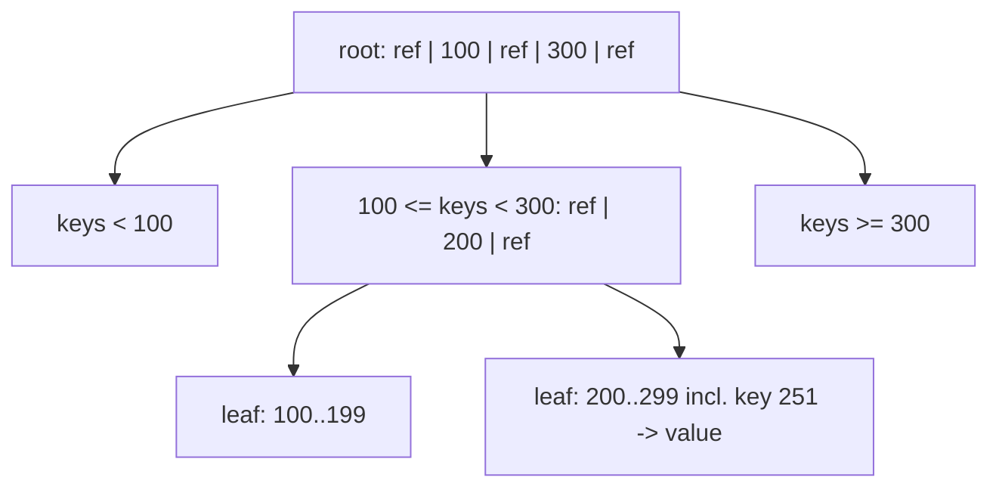
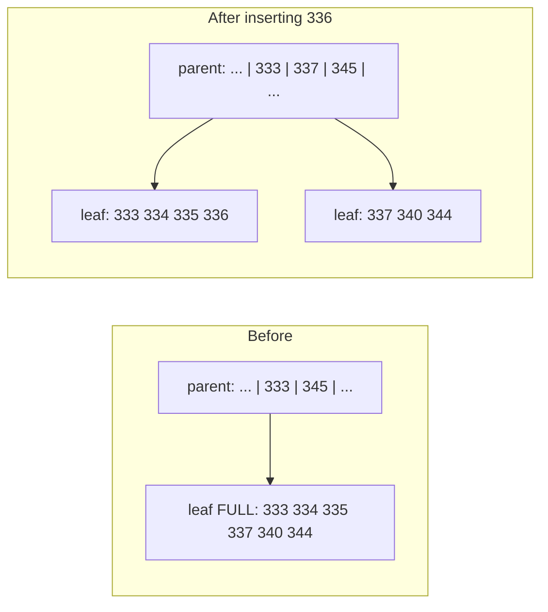

# B-trees, write-ahead logs and the LSM vs B-tree trade-off

The log-structured indexes of the previous lesson are gaining ground, but the **B-tree** is still the most widely used index structure. Introduced in 1970 and called "ubiquitous" within a decade, it is the standard index in almost every relational database (PostgreSQL, MySQL InnoDB, Oracle, SQL Server, SQLite) and in many non-relational stores.

## 1. Pages, not segments

A B-tree shares one property with SSTables: entries are **ordered by key**, so both single-key lookups *and* range scans are cheap. That is where the similarity ends.

- Log-structured indexes break the database into variable-size **segments** (megabytes or more) and always write sequentially.
- A B-tree divides its file into **pages** (blocks) of one fixed size - 4 KB classically, 8 KB in PostgreSQL, 16 KB in InnoDB - and all I/O happens **a whole page at a time**. This matches the hardware, since disks are also arranged in fixed-size blocks.

Each page has an address, and pages refer to each other like pointers, but on disk. One page is the **root**. A page contains keys and references to child pages, and each child covers a continuous **range** of keys. The keys between the references mark the range boundaries.



To look up key 251, start at the root, follow the reference for the 100–300 range, then the 200–300 child, until you reach a **leaf page** that holds the value itself or a reference to where the value can be found.

The number of child references per page is the **branching factor**, typically several hundred. A B-tree with $n$ keys therefore has depth $O(\log n)$. Most databases fit in a tree **three or four levels** deep. A four-level tree of 4 KB pages with a branching factor of 500 can store up to $500^4 \times 4\text{ KB} = 256$ TB.

```python-run
for b in (100, 300, 500):
    for depth in (2, 3, 4):
        pages = b ** depth
        print(f"branching={b:<4} depth={depth}  leaf pages={pages:>16,}  ~{pages*4/1e9:,.1f} TB at 4KB")
```

## 2. Updates and page splits

- **Update a value.** Walk down to the leaf that holds the key, modify the entry there, and flush that one page. Any references to the page remain valid.
- **Insert a key.** Find the page whose range covers the key and add it. If the page is **full**, **split** it into two half-full pages and update the parent to account for the new subdivision of key ranges. If the parent overflows it splits too, recursively, all the way up. If the root splits, the tree grows one level taller.

This algorithm keeps the tree **balanced**: every leaf is at the same depth.



### 2.1 Try it: leaf split

```python-run
import bisect

def insert_into_leaf(keys, key, capacity):
    """Insert key into a sorted leaf; split if it overflows.
    Returns (left, right, separator) or (keys, None, None)."""
    keys = keys[:]
    bisect.insort(keys, key)
    if len(keys) <= capacity:
        return keys, None, None
    mid = len(keys) // 2
    left, right = keys[:mid], keys[mid:]
    return left, right, right[0]          # in a B+tree the separator is copied up

leaf = [333, 334, 335, 337, 340, 344]
print(insert_into_leaf(leaf, 336, capacity=6))
print(insert_into_leaf([10, 20], 15, capacity=4))

# Build a 2-level tree by repeated inserts and watch splits happen
import random
random.seed(3)
leaves, seps, cap = [[]], [], 4
for k in random.sample(range(100), 20):
    i = bisect.bisect_right(seps, k)
    l, r, s = insert_into_leaf(leaves[i], k, cap)
    leaves[i] = l
    if r is not None:
        leaves.insert(i + 1, r); seps.insert(i, s)
        print(f"insert {k:>2}: split -> separator {s}")
print("separators (root):", seps)
print("leaves:", leaves)
```

Real B-trees also split **internal** nodes, where the median key moves *up* rather than being copied, and they may **merge** underfull pages after deletes.

## 3. Making B-trees reliable: the write-ahead log

The B-tree's basic write operation **overwrites a page on disk in place**. Its location does not change, so references remain valid. This is the opposite of LSM-trees, which only append and never modify files. Overwriting is risky:

- A page split must write *several* pages: the two halves plus the updated parent. If the database crashes midway, the index is left **corrupted**, for example with an **orphan page** that is no parent's child.
- The hardware itself may not write a page atomically (a **torn page**).

The standard defence is a **write-ahead log (WAL)**, also called a *redo log*. Every change to the tree is first appended to this log, and only **afterwards** are the tree pages touched. After a crash, the database replays the WAL to restore the tree to a consistent state. PostgreSQL's WAL is also the basis of its replication and point-in-time recovery, and InnoDB adds a **doublewrite buffer** against torn pages.

**Concurrency control** is needed because several threads may access the tree at once and one could see it in an inconsistent state mid-split. B-trees protect themselves with **latches**, which are lightweight locks on pages. Log-structured engines have it easier, since merging happens in the background and new segments replace old ones atomically.

### 3.1 Alternative: copy-on-write

LMDB and some others avoid the WAL with **copy-on-write**. A modified page is written to a *new* location, and new versions of the parent pages up to the root point at it. This also helps snapshot isolation (Chapter 7): old roots remain valid snapshots.

## 4. B-tree optimisations

- **Copy-on-write** pages (above) instead of overwrite plus WAL.
- **Key abbreviation.** Interior pages need only enough of each key to act as a boundary, so more keys fit per page, raising the branching factor and lowering the depth. This variant is sometimes called a **B+ tree**.
- **Sequential leaf layout.** The tree tries to place leaves sequentially on disk to speed range scans, but that is hard to maintain as the tree grows. LSM-trees do better here because merging rewrites large segments in one go.
- **Sibling pointers.** Each leaf references its left and right siblings, so you can scan keys in order without jumping back to parents.
- **Fractal trees** borrow log-structured ideas to reduce disk seeks.

## 5. Comparing B-trees and LSM-trees

The rule of thumb: **As a rule of thumb, LSM-trees win on write throughput and B-trees on read latency.** An LSM read may have to consult the memtable and a number of SSTables on different levels before it finds the key. Benchmarks are sensitive to workload, so test with *your* data.

### 5.1 Advantages of LSM-trees

- **Lower write amplification (often).** A B-tree writes each piece of data at least twice (WAL plus page), and rewrites a whole 4–16 KB page even if only a few bytes changed. LSM engines rewrite data several times during compaction too, but in large sequential writes.
- **Higher write throughput**, because the writes are sequential. This matters a lot on magnetic disks, where sequential writes are far faster than random ones.
- **Better compression and smaller files.** B-trees leave unused space on pages after splits (**fragmentation**). LSM-trees rewrite SSTables periodically, which removes fragmentation.
- On **SSDs** the firmware internally uses a log-structured algorithm to turn random writes into sequential ones, which lessens the random-write penalty. Lower write amplification and less fragmentation still help bandwidth.

### 5.2 Downsides of LSM-trees

- **Compaction interferes with foreground work.** Disk bandwidth is finite. A request may wait while the disk finishes an expensive compaction. Average throughput is fine, but **high-percentile** read and write latency can be quite high. B-trees are more **predictable**.
- **Compaction must keep up.** At high write rates the initial write (memtable flush plus WAL) and compaction share disk bandwidth. If compaction falls behind, unmerged segments pile up, reads slow and the disk eventually fills.
- **One copy per key.** In a B-tree each key exists in exactly **one place**. An LSM may hold several versions in different segments. That makes B-trees attractive for strong **transactional semantics**: locks on key ranges can be attached directly to the tree (Chapter 7).

| | LSM-tree | B-tree |
|---|---|---|
| Write pattern | Sequential appends, background merge | In-place page overwrite + WAL |
| Write throughput | Higher | Lower |
| Read cost | Several SSTables (mitigated by Bloom filters) | One root-to-leaf path |
| Tail latency | Compaction spikes | More predictable |
| Space | Compact (no fragmentation, compresses well) | Fragmented pages |
| Examples | RocksDB, LevelDB, Cassandra, HBase, ScyllaDB | PostgreSQL, InnoDB, SQLite, LMDB |

> [!INTERVIEW]
> "Would you choose an LSM or B-tree engine for X?" Write-heavy ingestion (metrics, event logs, time series) points to LSM. Read-heavy with strict latency SLOs or complex transactions points to B-tree. Name **write/read/space amplification** and **compaction-induced tail latency**. Bonus: MySQL can use RocksDB through MyRocks, and many systems let you pick the engine.

## 6. Other indexing structures

### 6.1 Secondary indexes

A **primary key** index uniquely identifies a row. **Secondary indexes** (`CREATE INDEX` in SQL) are crucial for joins and filters. The key is **not unique**. Either each value in the index is a list of matching row ids (like a postings list), or each key is made unique by appending a row id.

### 6.2 Storing values within the index

The value in an index can be the row itself, or a reference to a row stored elsewhere in a **heap file**, which keeps rows in no particular order.

- The **heap file** approach avoids duplicating data when there are several secondary indexes, since each just references the heap location. An update that does not change the size can overwrite in place. If the new value is larger it may need to move, and then either every index is updated or a forwarding pointer is left behind.
- A **clustered index** stores the row *within* the index. In InnoDB the table is itself the primary-key index, and a secondary index stores primary-key values, not physical row addresses. SQL Server lets you choose one clustered index per table.
- A **covering index** (an *index with included columns*) stores *some* columns in the index, so some queries can be answered from the index alone. The query is then said to be *covered*.

Clustered and covering indexes speed reads but cost space and write overhead, and they complicate transactional guarantees because duplicated data must stay consistent.

### 6.3 Multi-column indexes

- A **concatenated index** joins several fields into one key in a fixed order, `(last_name, first_name)`, like a phone book. It serves queries on `last_name`, or on `last_name AND first_name`, but **not** on `first_name` alone.
- A **multi-dimensional** query such as `latitude BETWEEN a AND b AND longitude BETWEEN c AND d` cannot be served by a standard B-tree. Options include space-filling curves that map 2-D to 1-D, or **R-trees** (PostGIS uses GiST-based R-trees). The same need comes up for colour ranges `(r, g, b)` and for weather `(date, temperature)`.

### 6.4 Full-text search and fuzzy indexes

Exact-key indexes cannot find misspellings or synonyms. Lucene supports searching for words within an edit distance. The term dictionary it holds in memory is a trie-like **finite-state automaton** built from the keys' characters; converting it to a **Levenshtein automaton** makes search within a given edit distance fast.

### 6.5 Keeping everything in memory

As RAM gets cheaper, many datasets fit entirely in memory, possibly spread across machines. Examples include Memcached (a cache whose data may be lost), VoltDB, MemSQL, Oracle TimesTen, RAMCloud, and Redis (weak durability through async disk writes). They achieve durability with battery-backed RAM, logs on disk, periodic snapshots or replication.

Counter-intuitively, the speed of in-memory databases comes **not** from avoiding disk reads, since the OS caches hot disk blocks anyway. The gain comes from **never having to translate in-memory structures into an on-disk layout**. In-memory databases can also offer data models that are hard to build on disk, such as Redis's priority queues and sets. The **anti-caching** approach evicts least-recently-used records to disk and loads them back on access, which lets an in-memory design support datasets larger than RAM.

## 7. Pitfalls

- **Too many indexes.** Every index slows every write and takes space. Index for real query patterns.
- **Wrong column order** in composite indexes. `(a, b)` does not help `WHERE b = ?`.
- **Random UUIDv4 primary keys in a clustered B-tree.** Inserts land on random pages, which causes page splits, cache misses and fragmentation. Prefer sequential or time-ordered ids (UUIDv7, ULID) when locality matters.
- **Assuming in-memory means fast because it skips disk.** The real win is avoiding serialisation overhead.

## 8. Summary

- B-trees store sorted keys in fixed-size **pages** forming a balanced tree with a high branching factor, usually 3–4 levels deep.
- Inserts may **split pages** recursively. Overwriting pages in place needs a **WAL** (or copy-on-write) for crash safety, and **latches** for concurrency.
- LSM-trees usually win on write throughput and compression. B-trees win on read latency predictability and per-key locking.
- Secondary, clustered, covering, concatenated and multi-dimensional indexes all trade write cost and space for read speed.

```quiz
[
  {"q": "Typical depth of a B-tree for a large database?",
   "options": ["1-2 levels", "3-4 levels", "20-30 levels", "It is unbounded"],
   "answer": 1,
   "explain": "With branching factors in the hundreds, 3-4 levels covers terabytes of data."},
  {"q": "What happens when you insert into a full B-tree leaf page?",
   "options": ["The insert is rejected", "The page is split into two half-full pages and the parent is updated with a new separator", "A new root is always created", "The page is compressed"],
   "answer": 1,
   "explain": "Splits may propagate upwards; if the root splits, the tree gains a level."},
  {"q": "Why do B-trees need a write-ahead log?",
   "options": ["To speed up reads", "Because in-place page overwrites, especially multi-page splits, can leave the tree corrupted if the database crashes midway", "To support Bloom filters", "To enable compression"],
   "answer": 1,
   "explain": "Every modification is appended to the WAL before pages are changed, so recovery can restore consistency."},
  {"q": "Which statement about LSM-trees vs B-trees is generally true?",
   "options": ["LSM-trees have more predictable tail latencies", "LSM-trees typically sustain higher write throughput, while B-trees give more predictable read latency", "B-trees never fragment", "LSM-trees store each key in exactly one place"],
   "answer": 1,
   "explain": "Sequential writes favor LSM; compaction can cause latency spikes; B-trees keep one copy per key."},
  {"q": "A composite index on (last_name, first_name) can efficiently serve which query?",
   "options": ["WHERE first_name = 'Ada'", "WHERE last_name = 'Lovelace'", "WHERE first_name LIKE '%a'", "None"],
   "answer": 1,
   "explain": "Like a phone book, a concatenated index works for a prefix of its columns."},
  {"q": "What is a covering index?",
   "options": ["An index on every column", "An index that stores some extra columns so certain queries can be answered from the index alone", "A clustered primary key", "A Bloom filter over an index"],
   "answer": 1,
   "explain": "Including columns avoids a lookup into the heap or clustered index."},
  {"q": "According to DDIA, the main reason in-memory databases are faster is...",
   "options": ["They never touch the disk", "They avoid the overhead of encoding in-memory data structures in a form that can be written to disk", "RAM has higher bandwidth than CPUs", "They have no indexes"],
   "answer": 1,
   "explain": "The OS page cache already keeps hot data in memory for disk-based engines; serialization overhead is what is saved."},
  {"q": "Which structure is suited to 2-D range queries like latitude/longitude boxes?",
   "options": ["Hash index", "Concatenated B-tree index", "R-tree (or space-filling curve index)", "Bloom filter"],
   "answer": 2,
   "explain": "Multi-dimensional indexes such as R-trees (PostGIS GiST) handle multi-attribute ranges."}
]
```

> **Source:** DDIA ch. 3, "Storage and Retrieval" (B-trees, Comparing B-trees and LSM-trees, Other indexing structures, Keeping everything in memory).
