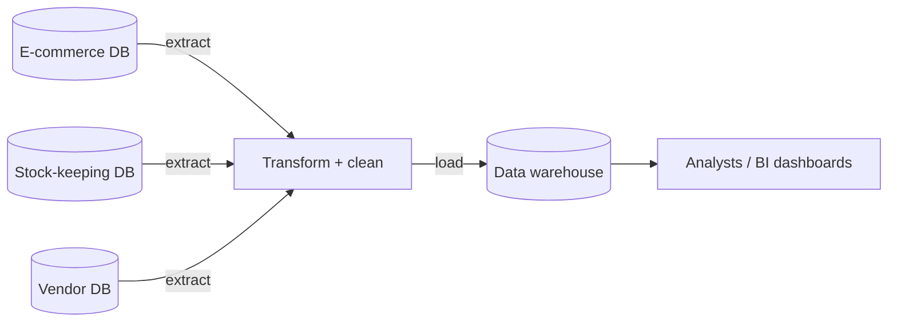
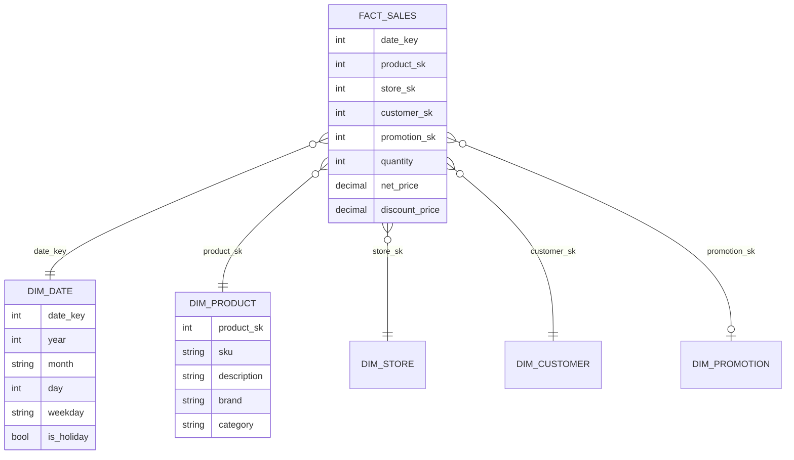

# OLTP vs OLAP, warehouses and column-oriented storage

> **Before this lesson:** you should know what an index, a disk seek, an LSM-tree and a B-tree are, from [Log-structured storage](#/lesson/databases/log-structured) and [B-trees](#/lesson/databases/btrees). Tables, rows, columns, joins and foreign keys come from [Relational vs document models](#/lesson/databases/relational-vs-document).

## In plain words

Databases are asked two very different kinds of question.

- "Show me order number 88213." One specific record, needed right now, by a customer who is waiting.
- "Which product category earned the most on weekends last year?" Millions of records, a handful of facts from each, added up for a manager's report.

An everyday picture: a supermarket. At the checkout, each sale is rung up in a couple of seconds, one customer at a time, all day long. In the back office, someone studies a year of receipts to decide what to stock next season. The checkout must never be held up by the person in the back office. And the back-office worker does not want receipts one by one; they want one column of the ledger, such as the amounts, added up from top to bottom.

The first kind of work is called **OLTP** and the second **OLAP**. They are different enough that companies run them on separate databases, and the databases for the second kind store data in a different layout: **by column** instead of by row.

Why this matters for a job: data engineers, analysts and machine-learning engineers spend most of their time on the analytic side, using tools such as BigQuery, Snowflake, Redshift and the Parquet file format. "Design the analytics for an app with billions of events" is a standard interview question. And knowing the difference prevents a classic production accident: a heavy report run against the database that customers are using.

## 1. Two access patterns

The first business databases recorded money changing hands: a sale, an order, a salary payment. Each of these was called a **transaction**. The word stayed in use as databases took on other work, such as comments on a blog or moves in a game. In this lesson, a transaction means a small group of reads and writes that belong together and are carried out while a user waits. (The lessons on transactions later give the word a stricter meaning.)

**OLTP** stands for **online transaction processing**. "Online" means interactive: someone is waiting for the answer. A typical operation finds a few rows using an index, and inserts or changes a few rows, in response to something a user did.

**OLAP** stands for **online analytic processing**. A typical query reads a very large number of rows, looks at only a few columns in each, and combines them into a summary such as a count, a total or an average. Such a summary calculation is called an **aggregate**. Examples: "Which region's subscriptions grew fastest last quarter?" or "Did the weekend discount lift umbrella sales above their usual level?"

| Property | OLTP | OLAP |
|---|---|---|
| Typical read | A few rows, found by key | A summary computed across very many rows |
| Typical write | Small writes as users act | Large loads at intervals, or a steady feed of events |
| Used by | Customers, through an app or website | Analysts and managers inside the company |
| What the data shows | How things stand right now | A history of what happened |
| Size | Gigabytes to terabytes | Terabytes to petabytes |
| What limits speed | Disk **seeks**: finding the right spot | Disk **bandwidth**: how many bytes can be read per second |

The last row explains the rest of this lesson. An OLTP query is quick if the database can jump to the right place, which is what indexes are for. An OLAP query has to read a huge amount of data whatever happens, so it is quick only if the database reads as few bytes as possible.

In the early days one database did both jobs. From the late 1980s companies began moving analytic work to a separate database built for it, called a **data warehouse**.

## 2. Data warehousing

A large company may run dozens of OLTP systems: the website, the tills in its shops, stock control, delivery tracking, payroll. Each is essential to daily business and has to stay fast and available. The people responsible for those databases are understandably unwilling to let an analyst run a query that reads every order ever placed, because it would slow down real customers.

A **data warehouse** solves this. It is a separate database holding a copy of the data from all the OLTP systems, which analysts can query as heavily as they like. Data reaches it through a process called **ETL**, for **Extract, Transform, Load**:

1. **Extract:** copy data out of each OLTP system, either as a periodic dump or as a continuous feed of changes.
2. **Transform:** convert it into a layout that suits analysis, and clean it up (fix inconsistent formats, remove duplicates).
3. **Load:** write it into the warehouse.



A further benefit of separating the two is that the warehouse can be organised internally for analytic queries. The index structures of the last two lessons are designed for finding individual records, and they do little for a query that must read a hundred million rows.

On the surface a warehouse usually looks like any relational database, because SQL is well suited to analysis and many reporting tools produce SQL. Underneath, warehouses and OLTP databases have grown apart, and most products specialise in one or the other. Well-known warehouse products include Teradata, Vertica, Amazon Redshift, Google BigQuery and Snowflake. There are also open-source query engines that run SQL over files in a large shared storage system, such as Apache Hive, Spark SQL and Presto. Many of these trace their design to a Google system called Dremel.

## 3. Stars and snowflakes

Warehouses lay out their tables in a conventional pattern called a **star schema** (the practice is also known as **dimensional modelling**).

- At the centre is a **fact table**. Each row records one **event**: one product bought by one customer in one shop at one time. Events are kept individually and not pre-summarised, so that any question can be asked later. Fact tables are the biggest tables a company has. At the largest retailers they reach tens of petabytes.
- Some columns of the fact table are measurements of the event, such as the price paid.
- The other columns are foreign keys pointing into **dimension tables**. A dimension table describes one aspect of the event: *who* (the customer), *what* (the product), *where* (the shop), *when* (the date). Think of the dimensions as the answers to who, what, where, when, how and why.
- Dates get a dimension table of their own. That may seem odd, but it lets the table hold facts about each date, such as whether it was a public holiday, so a query can compare holiday and ordinary sales.



The diagram shows one fact table in the middle with a line to each dimension table. Drawn that way, with the fact table at the centre and the dimensions around it, the layout looks like a star, which is where the name comes from. In the fact table, names ending in `_sk` are the foreign keys ("sk" is short for surrogate key, an ID with no meaning of its own).

A variation called a **snowflake schema** normalises the dimensions further. The product table, for instance, would refer to separate brand and category tables instead of holding those names itself. It stores less duplicate text, but analysts usually prefer the plain star because its queries need fewer joins.

Fact tables are typically **very wide**. More than a hundred columns is normal, and several hundred is not unusual. That width is the reason for the storage layout described next.

## 4. Column-oriented storage

Suppose a fact table has trillions of rows and more than a hundred columns. A typical analytic query uses four or five of those columns:

```sql
SELECT dim_date.weekday, dim_product.category,
       SUM(fact_sales.quantity) AS quantity_sold
FROM fact_sales
  JOIN dim_date    ON fact_sales.date_key   = dim_date.date_key
  JOIN dim_product ON fact_sales.product_sk = dim_product.product_sk
WHERE dim_date.year = 2013
  AND dim_product.category IN ('Fresh fruit', 'Candy')
GROUP BY dim_date.weekday, dim_product.category;
```

Reading the query: it joins the sales facts to the date and product dimensions, keeps sales from 2013 in two product categories, and for each combination of weekday and category adds up the quantity sold. `GROUP BY` forms the groups and `SUM` produces one total per group. Out of the whole fact table it needs only three columns: `date_key`, `product_sk` and `quantity`.

Most OLTP databases use **row-oriented** storage: all the values of one row are stored next to each other on disk, then all the values of the next row. To run the query above, such a database must load every row in full, more than a hundred values each, pick out the three it needs, and discard the others. Nearly all of the disk reading is wasted.

**Column-oriented storage** stores the data the other way round. All the values of one column are kept together, in a file for that column. A query opens only the files of the columns it mentions.

One rule holds it together: every column file lists its values **in the same row order**. The 23rd value in the `quantity` file and the 23rd value in the `product_sk` file belong to the same sale. To rebuild a complete row, take the value at the same position from every column file.

```python-run
rows = [
    {"date_key": 140102, "product_sk": 69, "store_sk": 4, "quantity": 1, "net_price": 13.99},
    {"date_key": 140102, "product_sk": 69, "store_sk": 5, "quantity": 3, "net_price": 14.99},
    {"date_key": 140102, "product_sk": 74, "store_sk": 3, "quantity": 1, "net_price": 0.99},
    {"date_key": 140103, "product_sk": 31, "store_sk": 2, "quantity": 2, "net_price": 2.49},
    {"date_key": 140103, "product_sk": 69, "store_sk": 3, "quantity": 1, "net_price": 13.99},
]
# column layout
cols = {c: [r[c] for r in rows] for c in rows[0]}
for c, v in cols.items():
    print(f"{c:<11}: {v}")

# SUM(quantity) WHERE product_sk = 69 touches only 2 of 5 columns
total = sum(q for p, q in zip(cols["product_sk"], cols["quantity"]) if p == 69)
print("SUM(quantity) for product 69 =", total)
# reconstruct row 3 from columns
print("row 3 =", {c: v[3] for c, v in cols.items()})
```

What each part does:

- `rows` is five sales in row layout: a list of dictionaries, one per sale.
- The line that builds `cols` turns it into column layout. It is a **dictionary comprehension**: for each column name `c`, it collects that field from every row into a list. The result maps each column name to a list of five values.
- The `total` line answers "total quantity for product 69". `zip` walks through two lists in step, giving pairs of (product, quantity) that come from the same row. The pairs whose product is 69 have their quantities added. Only two of the five column lists are touched.
- The last line rebuilds row 3 by taking element 3 from each column list.

```
date_key   : [140102, 140102, 140102, 140103, 140103]
product_sk : [69, 69, 74, 31, 69]
store_sk   : [4, 5, 3, 2, 3]
quantity   : [1, 3, 1, 2, 1]
net_price  : [13.99, 14.99, 0.99, 2.49, 13.99]
SUM(quantity) for product 69 = 5
row 3 = {'date_key': 140103, 'product_sk': 31, 'store_sk': 2, 'quantity': 2, 'net_price': 2.49}
```

Product 69 appears in rows 0, 1 and 4, with quantities 1, 3 and 1, giving 5. With five columns the saving is small. With three hundred columns and a query that reads three of them, the database reads about one hundredth of the data.

The same layout is used in **Parquet**, a file format that is the standard way to store large datasets for analysis and for machine-learning pipelines.

### 4.1 Column compression

Reading fewer columns is the first saving. The second is that a single column, stored by itself, tends to be highly repetitive. Look at `date_key` in the output above: the same value several times in a row. Repetitive data can be **compressed**, meaning stored in fewer bytes.

A technique that suits warehouses well is **bitmap encoding**. A column usually has far fewer *distinct* values than rows. A retailer might record billions of sales but sell only 100,000 different products. For each distinct value, the database builds a **bitmap**: a sequence of bits, one per row, with a 1 where that row has the value and a 0 where it does not.

- If the column has few distinct values (a `country` column has about 200), one bitmap per value is already compact.
- If it has many, each bitmap consists mostly of zeros. Such a bitmap is called **sparse**, and it can be shrunk further with **run-length encoding** (RLE). RLE stores how many times a value repeats instead of repeating it: "nine 0s, then two 1s, then six 0s" in place of seventeen digits.

Bitmaps are also quick to compute with, because processors can combine long runs of bits in single operations:

- `WHERE product_sk IN (30, 68, 69)` means "rows where the product is 30 or 68 or 69". Take the three bitmaps and combine them with **bitwise OR**: the result has a 1 wherever any of the three has a 1.
- `WHERE product_sk = 31 AND store_sk = 3` combines a bitmap from each column with **bitwise AND**: a 1 only where both have a 1. This works because both columns list the rows in the same order.

```python-run
product_sk = [69, 69, 69, 74, 31, 31, 31, 31, 29, 30, 30, 31, 31, 31, 68, 69, 69]
n = len(product_sk)

def bitmap(col, value):
    return [1 if x == value else 0 for x in col]

def rle(bits):
    """Run-length encode as alternating run lengths starting with zeros."""
    runs, cur, count = [], 0, 0
    for b in bits:
        if b == cur:
            count += 1
        else:
            runs.append(count); cur, count = b, 1
    runs.append(count)
    return runs

for v in sorted(set(product_sk)):
    bm = bitmap(product_sk, v)
    print(f"product_sk={v:<3} bitmap={''.join(map(str, bm))}  RLE={rle(bm)}")

or_mask = [a | b | c for a, b, c in zip(bitmap(product_sk, 30), bitmap(product_sk, 68), bitmap(product_sk, 69))]
print("IN (30,68,69) rows:", [i for i, b in enumerate(or_mask) if b])
```

What each part does:

- `product_sk` is one column of 17 values.
- `bitmap(col, value)` returns a list with 1 at each position where the column equals `value` and 0 elsewhere.
- `rle(bits)` counts runs. It assumes the bitmap starts with zeros, so the first number is the length of the first run of 0s, the second the following run of 1s, and so on, alternating. If the bitmap starts with a 1, the first count is 0.
- The loop prints the bitmap and its run-length encoding for each distinct product.
- `or_mask` combines three bitmaps position by position with `|`, Python's bitwise OR, and the last line lists the positions holding a 1.

```
product_sk=29  bitmap=00000000100000000  RLE=[8, 1, 8]
product_sk=30  bitmap=00000000011000000  RLE=[9, 2, 6]
product_sk=31  bitmap=00001111000111000  RLE=[4, 4, 3, 3, 3]
product_sk=68  bitmap=00000000000000100  RLE=[14, 1, 2]
product_sk=69  bitmap=11100000000000011  RLE=[0, 3, 12, 2]
product_sk=74  bitmap=00010000000000000  RLE=[3, 1, 13]
IN (30,68,69) rows: [0, 1, 2, 9, 10, 14, 15, 16]
```

Take product 30: its bitmap has 1s at positions 9 and 10, and the encoding `[9, 2, 6]` reads "nine 0s, two 1s, six 0s". Three small numbers stand for seventeen bits. With billions of rows the runs are far longer and the saving far greater. The final line is the answer to the `IN` query, found without looking at the original column.

**Vectorised processing.** Column storage also makes better use of the processor. A compressed chunk of one column is a compact block of similar values, small enough to fit in the processor's fastest internal memory, and it can be handled in a simple loop with no decision to make for each record. Modern processors have instructions that apply one operation to many values at once, known as **SIMD** (single instruction, multiple data). Working through whole batches of column values in this way is called vectorised processing.

> [!NOTE]
> **A column store is not the same as a column family.** Cassandra and HBase use the term *column family*, taken from Google's Bigtable. Inside a column family they still store all the columns of one row together, and they do not compress by column. Those databases are mostly row-oriented, whatever the name suggests.

### 4.2 Sort order in column storage

By default rows are stored in the order they arrived. The database can instead keep them sorted, as an SSTable is. There is one restriction. The columns cannot each be sorted separately, because then position 23 in one file would no longer match position 23 in another. The sort applies to whole rows, and every column file follows the same order.

- The administrator chooses the sort columns to suit the common queries. If most queries ask about a range of dates, sort by `date_key` first, so the database can go straight to the relevant stretch. A second sort column, say `product_sk`, places all sales of one product on one day next to each other.
- Sorting improves compression. The first sort column becomes long runs of identical values, which run-length encoding reduces to almost nothing: a column with few distinct values can shrink to a few kilobytes across billions of rows. The second and third sort columns benefit less.
- **Several sort orders at once.** Important data is kept on more than one machine anyway, for safety. A clever option is to sort each copy differently and send each query to the copy whose order suits it best. The research database C-Store introduced this and the commercial product Vertica adopted it. It resembles having several secondary indexes, except that each copy contains all the data and not pointers to it.

### 4.3 Writing to column-oriented storage

Everything above speeds up reading and makes writing harder. Inserting one row in the middle of sorted, compressed column files would mean rewriting every file from that point on. The in-place update of a B-tree is not possible.

The answer is the LSM-tree approach from two lessons ago. New rows go first into a sorted structure in memory. When enough have accumulated, they are merged into the column files on disk in one bulk operation. A query has to look at both the column files and the recent rows still in memory and combine them, and the database does this behind the scenes. Vertica works this way.

## 5. Aggregation: data cubes and materialized views

Analysts tend to ask for the same totals again and again. Recomputing them from raw data each time is wasteful, so warehouses often store the answers.

- A **view** in SQL is a saved query with a name. Using it reruns the query each time. A **materialized view** goes a step further: the query's result is stored on disk as a real table. Reading it is fast. The cost is that it must be refreshed when the underlying data changes, which makes writes more expensive. That is acceptable in a warehouse, where reads dominate, and rarely worth it in an OLTP database.
- A **data cube** (or OLAP cube) is a materialized view arranged as a grid of totals. Picture a spreadsheet with dates down the side and products across the top, where each cell holds the total sales of that product on that date. Add up a row for the total of one date across all products. Add up a column for the total of one product across all dates. Summing along one direction like this is called a **roll-up**. Real cubes have more than two dimensions (date, product, shop, customer, promotion), which is hard to draw but works the same way.

A cube makes certain queries very fast, because the answers were worked out ahead of time. The price is flexibility. A cube can only answer questions about the dimensions it was built with. If price is not a dimension, the cube cannot tell you what share of sales came from items costing more than 100, since that detail was summed away. For this reason warehouses keep the raw data and use cubes as an accelerator for particular queries.

```python-run
from collections import defaultdict
sales = [("2024-01-01", "apple", 3.0), ("2024-01-01", "candy", 1.5), ("2024-01-02", "apple", 2.0),
         ("2024-01-02", "apple", 4.0), ("2024-01-02", "candy", 2.5), ("2024-01-03", "bread", 5.0)]
cube = defaultdict(float)
for d, p, amt in sales:
    cube[(d, p)] += amt
dates = sorted({d for d, _, _ in sales}); prods = sorted({p for _, p, _ in sales})
print("date        " + "".join(f"{p:>8}" for p in prods) + "   total")
for d in dates:
    row = [cube[(d, p)] for p in prods]
    print(f"{d}  " + "".join(f"{x:8.1f}" for x in row) + f"{sum(row):8.1f}")
print("total       " + "".join(f"{sum(cube[(d, p)] for d in dates):8.1f}" for p in prods))
```

What each part does:

- `sales` is a list of (date, product, amount) records.
- `cube` is a `defaultdict(float)`: a dictionary in which a missing key starts at 0.0. The loop adds each sale's amount into the cell for its (date, product) pair. That fills the grid.
- `dates` and `prods` are the sorted lists of distinct dates and products, built with set comprehensions.
- The remaining lines print the grid, with a row total at the end of each line and a line of column totals at the bottom.

```
date           apple   bread   candy   total
2024-01-01       3.0     0.0     1.5     4.5
2024-01-02       6.0     0.0     2.5     8.5
2024-01-03       0.0     5.0     0.0     5.0
total            9.0     5.0     4.0
```

On 2 January there were two apple sales (2.0 and 4.0), and the cube holds only their sum, 6.0. That is both the strength and the limit of a cube. The total per date or per product can now be read off without visiting any sales records, but the fact that there were two separate sales is no longer recoverable from the cube.

> [!INTERVIEW]
> For "design analytics for an app with billions of events", begin by separating OLTP from OLAP. Send the events, in batches or as a continuous feed, into **column-oriented storage**: Parquet files in cheap bulk storage queried by BigQuery, Snowflake or Spark. Model the data as a **star schema**, sort and divide it by date, and precompute the most requested totals as materialized views. Then explain *why* columns win: queries read few columns, columns compress very well, and the processor can work through them in batches.

## 6. Pitfalls

- **Running analytics on the main OLTP database.** Long scans compete with customers for the disk and processor, and can delay the database's internal housekeeping. Use a separate copy or a warehouse.
- **`SELECT *` on a column store.** Asking for every column throws away the main advantage. Name the columns you need.
- **Updating a warehouse one row at a time.** Column engines are built for bulk loads. A trickle of single-row changes is expensive.
- **Leaning too heavily on cubes.** They cannot answer questions about anything that is not one of their dimensions.

## 7. Summary

- OLTP serves many small lookups by key and is limited by **seeks**. OLAP runs a few huge scans that compute aggregates and is limited by **bandwidth**.
- A **data warehouse** is a separate copy of the company's data, filled by **ETL** and laid out as a **star or snowflake schema** of fact and dimension tables.
- **Column-oriented storage** reads only the columns a query needs, compresses well with bitmaps and run-length encoding, and suits batch processing by the processor. Sorting the rows improves compression further.
- Writes pass through an in-memory buffer and are merged in bulk, as in an LSM-tree. **Materialized views** and **data cubes** store commonly requested aggregates in advance.

## Glossary

- **Transaction** (in this lesson) - a small group of reads and writes carried out together while a user waits.
- **OLTP (online transaction processing)** - many small, interactive reads and writes located by key.
- **OLAP (online analytic processing)** - large scans that summarise many records.
- **Aggregate** - a summary value such as a count, sum or average.
- **Bandwidth** (of a disk) - the number of bytes it can transfer per second.
- **Data warehouse** - a separate database holding a copy of company data for analysis.
- **ETL (Extract, Transform, Load)** - copying data out of source systems, reshaping and cleaning it, and writing it to the warehouse.
- **Star schema (dimensional modelling)** - a central fact table surrounded by dimension tables.
- **Fact table** - a table with one row per event.
- **Dimension table** - a table describing one aspect of events: who, what, where or when.
- **Snowflake schema** - a star schema whose dimensions are split into further tables.
- **Row-oriented storage** - storing all the values of a row together.
- **Column-oriented storage** - storing all the values of a column together.
- **Parquet** - a widely used column-oriented file format.
- **Compression** - encoding data so it takes fewer bytes.
- **Bitmap** - a sequence of bits, one per row, marking which rows have a given value.
- **Sparse** - consisting mostly of zeros.
- **Run-length encoding (RLE)** - storing how many times a value repeats instead of repeating it.
- **Bitwise OR / AND** - combining two bit sequences position by position: 1 if either / both are 1.
- **Vectorised processing / SIMD** - handling many values per step / processor instructions that do so.
- **View / materialized view** - a saved query / a saved query whose result is stored on disk.
- **Data cube (OLAP cube)** - a grid of precomputed aggregates along several dimensions.
- **Roll-up** - summing a cube along one dimension.

```quiz
[
  {"q": "What is usually the bottleneck for OLAP queries?",
   "options": ["Disk seek time", "Disk bandwidth: the number of bytes scanned", "Lock contention", "Network round trips"],
   "answer": 1,
   "explain": "Analytic queries scan millions of rows; reading fewer bytes (columnar, compression) is the main lever."},
  {"q": "In a star schema, the fact table typically contains...",
   "options": ["One row per product", "One row per event, with measures and foreign keys to dimension tables", "Only aggregates", "Denormalized customer profiles"],
   "answer": 1,
   "explain": "Facts are individual events; dimensions describe who/what/where/when/how/why."},
  {"q": "Why does a column store read less data for a typical warehouse query?",
   "options": ["It uses B-trees", "It only reads the files for the columns referenced by the query", "It caches everything", "It skips the WHERE clause"],
   "answer": 1,
   "explain": "Queries touch a handful of columns out of hundreds; row stores must load whole rows."},
  {"q": "How is 'WHERE product_sk IN (30, 68, 69)' evaluated with bitmap indexes?",
   "options": ["Bitwise AND of three bitmaps", "Bitwise OR of the three bitmaps for those values", "Sorting the column", "Hash join"],
   "answer": 1,
   "explain": "IN is a union of rows, so OR the per-value bitmaps; AND is used to combine predicates on different columns."},
  {"q": "Why can't each column in a column store be sorted independently?",
   "options": ["It would use too much memory", "You would lose the ability to know which values belong to the same row", "Compression would stop working", "SQL forbids it"],
   "answer": 1,
   "explain": "Rows are reconstructed by position; all columns must share one row order."},
  {"q": "How do column stores typically handle writes?",
   "options": ["Update compressed column files in place", "Buffer writes in an in-memory sorted store and merge them into column files in bulk (LSM-style)", "Reject writes", "Write to a B-tree only"],
   "answer": 1,
   "explain": "In-place updates on compressed sorted columns would require rewriting whole files."},
  {"q": "What is a downside of a data cube compared with querying raw data?",
   "options": ["It is slower", "It cannot answer queries filtering on attributes that are not cube dimensions", "It needs no storage", "It is not precomputed"],
   "answer": 1,
   "explain": "Cubes are fast precomputed aggregates but less flexible."}
]
```

> **Source:** DDIA ch. 3, "Transaction Processing or Analytics?" and "Column-Oriented Storage" (data warehousing, star and snowflake schemas, compression, sort order, materialized views and data cubes).
