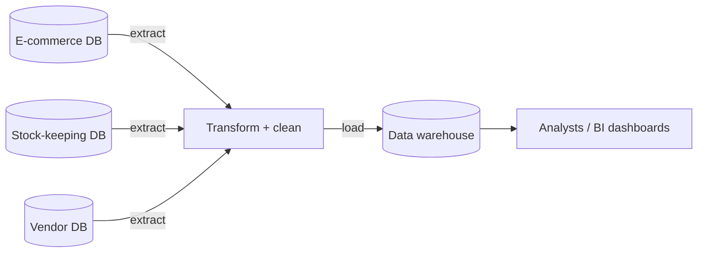
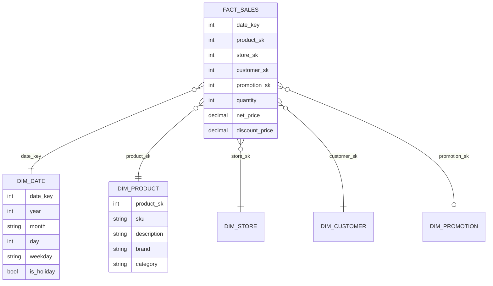

# OLTP vs OLAP, warehouses and column-oriented storage

Early business databases handled **commercial transactions**: making a sale, placing an order, paying a salary. The word *transaction* stuck even as databases took on blog comments, game moves and contacts. Here it does not necessarily mean ACID. Here it simply denotes a handful of reads and writes that belong together and are answered **interactively**, in contrast to work done by periodic batch jobs.

## 1. Two access patterns

**Online transaction processing (OLTP).** Driven by what a user does, the application fetches a few rows through an index and writes a few rows back. It is interactive.

**Online analytic processing (OLAP).** An analyst scans a huge number of records, reads only a few columns per record, and computes **aggregates** (count, sum, average). Example: "Which region's subscriptions grew fastest last quarter?" or "Did the weekend discount lift sales of umbrellas above their usual level?"

| Property | OLTP | OLAP |
|---|---|---|
| Main read pattern | A few rows per query, located by key | Summaries computed across very many rows |
| Main write pattern | Small interactive writes scattered across the data | Large periodic loads (ETL) or a feed of events |
| Primarily used by | End user/customer via web app | Internal analyst, decision support |
| What data represents | How things stand right now | A record of what happened, kept over time |
| Dataset size | Gigabytes to terabytes | Terabytes to petabytes |
| Bottleneck | Disk **seek** time / index lookups | Disk **bandwidth** (bytes scanned) |

At first the same databases served both. From the late 1980s, companies moved analytics to a separate **data warehouse**.

## 2. Data warehousing

A large enterprise may run dozens of OLTP systems: website, point of sale, inventory, logistics, HR. Each is complex and has its own team. They are business-critical and need high availability and low latency, so database administrators are reluctant to let analysts run expensive ad-hoc queries that could hurt concurrent transactions.

A **data warehouse** is a separate, read-only (for analysts) copy of data from all the OLTP systems. Data gets there through **Extract–Transform–Load (ETL)**: periodic dumps or a continuous stream of updates are extracted, transformed into an analysis-friendly schema, cleaned, and loaded.



The warehouse can be optimised for analytic access patterns. The indexing algorithms from the earlier lessons suit OLTP but answer analytic queries badly.

The warehouse's data model is usually relational, because SQL fits analytics well and there are many graphical query tools (drill-down, slicing and dicing). Internally, though, OLTP databases and warehouses have diverged. Vendors tend to specialise: Teradata, Vertica, SAP HANA and ParAccel (whose descendant is Amazon Redshift) on one side, and open-source **SQL-on-Hadoop** engines such as Apache Hive, Spark SQL, Cloudera Impala, Facebook Presto, Apache Tajo and Apache Drill on the other. Several were inspired by Google's **Dremel**. Today's cloud warehouses (BigQuery, Snowflake, Redshift, Databricks) follow the same principles.

## 3. Stars and snowflakes

Most warehouses use a **star schema**, also called **dimensional modelling**.

- At the centre is a **fact table**. Each row is an **event** at a particular time, such as one product purchased by one customer. Facts are captured individually for maximum flexibility later. Fact tables can be enormous: tens of petabytes at Apple, Walmart or eBay.
- Some columns are **attributes** such as price or cost. The remaining columns are **foreign keys** into **dimension tables** that describe the event's context: the customer, the product, the place, the date and so on.
- Even date and time get a dimension table (`dim_date`), which can encode extra information such as public holidays so queries can compare holiday and non-holiday sales.



A **snowflake schema** normalises the dimensions further into sub-dimensions, for example `dim_product` → `dim_brand` and `dim_category`. That is more normalised, but star schemas are often preferred because analysts find them simpler.

Fact tables are often **very wide**, with more than 100 columns, sometimes several hundred. Dimension tables can be wide too, carrying all the metadata relevant to analysis.

## 4. Column-oriented storage

Suppose a fact table has trillions of rows and petabytes of data, and a typical query touches only 4 or 5 of its 100+ columns:

```sql
SELECT dim_date.weekday, dim_product.category,
       SUM(fact_sales.quantity) AS quantity_sold
FROM fact_sales
  JOIN dim_date    ON fact_sales.date_key   = dim_date.date_key
  JOIN dim_product ON fact_sales.product_sk = dim_product.product_sk
WHERE dim_date.year = 2013
  AND dim_product.category IN ('Fresh fruit', 'Candy')
GROUP BY dim_date.weekday, dim_product.category;
```

In a **row-oriented** store, where all values of one row are stored next to each other, the engine must load *every row* from disk with all 100+ attributes, parse them, and filter. That is hugely wasteful.

**Column-oriented storage** flips this. Store all the values from each **column** together, one file or segment per column. A query reads and parses only the columns it uses. Each column file holds rows **in the same order**, so the 23rd entry of each column file belongs to row 23. Reassembling a row means taking the k-th entry from each column file.

```python-run
rows = [
    {"date_key": 140102, "product_sk": 69, "store_sk": 4, "quantity": 1, "net_price": 13.99},
    {"date_key": 140102, "product_sk": 69, "store_sk": 5, "quantity": 3, "net_price": 14.99},
    {"date_key": 140102, "product_sk": 74, "store_sk": 3, "quantity": 1, "net_price": 0.99},
    {"date_key": 140103, "product_sk": 31, "store_sk": 2, "quantity": 2, "net_price": 2.49},
    {"date_key": 140103, "product_sk": 69, "store_sk": 3, "quantity": 1, "net_price": 13.99},
]
# column layout
cols = {c: [r[c] for r in rows] for c in rows[0]}
for c, v in cols.items():
    print(f"{c:<11}: {v}")

# SUM(quantity) WHERE product_sk = 69 touches only 2 of 5 columns
total = sum(q for p, q in zip(cols["product_sk"], cols["quantity"]) if p == 69)
print("SUM(quantity) for product 69 =", total)
# reconstruct row 3 from columns
print("row 3 =", {c: v[3] for c, v in cols.items()})
```

Parquet, the columnar file format used across the Hadoop and Spark ecosystem and in ML feature pipelines, is based on Google's Dremel and applies the same layout to nested document data.

### 4.1 Column compression

Columns are often very repetitive, which makes them ideal for compression. A powerful technique for warehouses is **bitmap encoding**. A column usually has far fewer distinct values than rows: a retailer may have billions of sales but only about 100,000 products. For each distinct value, keep a bitmap with one bit per row, set to 1 where the row has that value.

- If the number of distinct values $n$ is small (a `country` column has about 200), store one bitmap per value.
- If $n$ is larger, most bitmaps are mostly zeros (**sparse**), and they can be **run-length encoded** (RLE) very compactly.

Bitmaps are also *fast to query*:

- `WHERE product_sk IN (30, 68, 69)` is a **bitwise OR** of three bitmaps.
- `WHERE product_sk = 31 AND store_sk = 3` is a **bitwise AND**, which works because both columns keep rows in the same order.

```python-run
product_sk = [69, 69, 69, 74, 31, 31, 31, 31, 29, 30, 30, 31, 31, 31, 68, 69, 69]
n = len(product_sk)

def bitmap(col, value):
    return [1 if x == value else 0 for x in col]

def rle(bits):
    """Run-length encode as alternating run lengths starting with zeros."""
    runs, cur, count = [], 0, 0
    for b in bits:
        if b == cur:
            count += 1
        else:
            runs.append(count); cur, count = b, 1
    runs.append(count)
    return runs

for v in sorted(set(product_sk)):
    bm = bitmap(product_sk, v)
    print(f"product_sk={v:<3} bitmap={''.join(map(str, bm))}  RLE={rle(bm)}")

or_mask = [a | b | c for a, b, c in zip(bitmap(product_sk, 30), bitmap(product_sk, 68), bitmap(product_sk, 69))]
print("IN (30,68,69) rows:", [i for i, b in enumerate(or_mask) if b])
```

**Vectorised processing.** Besides saving disk bandwidth, column storage uses CPU cycles well. A tight loop over a compressed column chunk fits in the L1 cache with no function calls per record, and the CPU can use **SIMD** instructions. Operators such as bitwise AND/OR run *directly on compressed chunks*.

> [!NOTE]
> **Column store ≠ column family.** Cassandra and HBase have *column families* (inherited from Bigtable), but within each family they store all columns of a row together with the row key, and they do not use column compression. The Bigtable model is still mostly *row*-oriented.

### 4.2 Sort order in column storage

Rows are stored in insertion order by default, but you can choose a **sort order**, as with SSTables. You cannot sort each column independently, because then you could no longer tell which items belong to the same row. The data is sorted a *row at a time*.

- The administrator picks sort keys based on common queries. If queries often filter on date ranges, `date_key` goes first. A second sort key such as `product_sk` groups sales of the same product within a day.
- Sorting helps **compression**. The first sort column ends up as long runs of repeated values, so a column with only a few distinct values might compress to a few kilobytes even across billions of rows. Compression is weaker on the second and third sort keys.
- **Several sort orders.** Since data is replicated anyway for durability, you can store each replica **sorted differently** and use whichever best fits each query. C-Store, and later Vertica, did this. It is similar to having several secondary indexes, except that each copy holds the full data instead of pointers.

### 4.3 Writing to column-oriented storage

Compression and sorting make reads fast but writes hard. An **update-in-place** approach like a B-tree's is impossible with compressed columns: a row that belongs in the middle of the sort order would force all column files to be rewritten.

The fix is the **LSM-tree** idea again. New rows are collected and kept sorted in memory; once enough have built up they are merged into the on-disk column files in one bulk operation. Vertica does essentially this. Queries must read both the on-disk column data and the recent writes in memory and combine the two, and the query optimiser hides that from the user.

## 5. Aggregation: data cubes and materialized views

Warehouse queries repeatedly compute the same aggregates, so it makes sense to cache them.

- A **materialized view** is like a virtual view (a saved query), except its results are actually *written to disk*. When the underlying data changes it must be updated, which makes writes more expensive. That is why they are common in read-heavy warehouses and rare in OLTP. PostgreSQL has `CREATE MATERIALIZED VIEW ... ; REFRESH MATERIALIZED VIEW`.
- A **data cube** (OLAP cube) is a grid of aggregates grouped by several dimensions. A 2-D cube over dates and products stores `SUM(net_price)` in each cell, and you can roll up along a row or column to get totals per date or per product. Real cubes have five or more dimensions.

Cubes make certain queries very fast because they are effectively **precomputed**, but they are less flexible than querying raw data. You cannot filter by an attribute that is not a dimension of the cube. Most warehouses keep the raw data and use cubes only as a performance boost for specific queries.

```python-run
from collections import defaultdict
sales = [("2024-01-01", "apple", 3.0), ("2024-01-01", "candy", 1.5), ("2024-01-02", "apple", 2.0),
         ("2024-01-02", "apple", 4.0), ("2024-01-02", "candy", 2.5), ("2024-01-03", "bread", 5.0)]
cube = defaultdict(float)
for d, p, amt in sales:
    cube[(d, p)] += amt
dates = sorted({d for d, _, _ in sales}); prods = sorted({p for _, p, _ in sales})
print("date        " + "".join(f"{p:>8}" for p in prods) + "   total")
for d in dates:
    row = [cube[(d, p)] for p in prods]
    print(f"{d}  " + "".join(f"{x:8.1f}" for x in row) + f"{sum(row):8.1f}")
print("total       " + "".join(f"{sum(cube[(d, p)] for d in dates):8.1f}" for p in prods))
```

> [!INTERVIEW]
> For questions like "design analytics for an app with billions of events", separate OLTP from OLAP. Stream or batch the events into a **columnar warehouse or lakehouse** (Parquet on object storage plus BigQuery/Snowflake/Spark). Model with a **star schema**, partition and sort by date, and precompute hot aggregates as materialized views. Explain *why* columnar wins: queries read few columns, compression is high, and vectorised execution is fast.

## 6. Pitfalls

- **Running analytics on the OLTP primary.** Long scans take shared resources and hold back cleanup (MVCC vacuum), which hurts user latency. Use a replica or a warehouse.
- **`SELECT *` on a column store.** It throws away the main advantage.
- **Single-row updates on a warehouse.** Columnar engines prefer bulk loads. Trickle updates are expensive.
- **Over-relying on cubes.** They cannot answer questions about dimensions they do not include.

## 7. Summary

- OLTP serves many small key-based queries and is limited by **seeks**. OLAP runs few huge scanning aggregates and is limited by **bandwidth**.
- Data warehouses are fed by **ETL** and modelled as **star/snowflake schemas** with fact and dimension tables.
- **Column storage** reads only the needed columns, compresses well (bitmaps, RLE) and enables vectorised execution. Sort order improves compression further.
- Writes go through an in-memory LSM-style buffer. **Materialized views and data cubes** precompute common aggregates.

```quiz
[
  {"q": "What is usually the bottleneck for OLAP queries?",
   "options": ["Disk seek time", "Disk bandwidth: the number of bytes scanned", "Lock contention", "Network round trips"],
   "answer": 1,
   "explain": "Analytic queries scan millions of rows; reading fewer bytes (columnar, compression) is the main lever."},
  {"q": "In a star schema, the fact table typically contains...",
   "options": ["One row per product", "One row per event, with measures and foreign keys to dimension tables", "Only aggregates", "Denormalized customer profiles"],
   "answer": 1,
   "explain": "Facts are individual events; dimensions describe who/what/where/when/how/why."},
  {"q": "Why does a column store read less data for a typical warehouse query?",
   "options": ["It uses B-trees", "It only reads the files for the columns referenced by the query", "It caches everything", "It skips the WHERE clause"],
   "answer": 1,
   "explain": "Queries touch a handful of columns out of hundreds; row stores must load whole rows."},
  {"q": "How is 'WHERE product_sk IN (30, 68, 69)' evaluated with bitmap indexes?",
   "options": ["Bitwise AND of three bitmaps", "Bitwise OR of the three bitmaps for those values", "Sorting the column", "Hash join"],
   "answer": 1,
   "explain": "IN is a union of rows, so OR the per-value bitmaps; AND is used to combine predicates on different columns."},
  {"q": "Why can't each column in a column store be sorted independently?",
   "options": ["It would use too much memory", "You would lose the ability to know which values belong to the same row", "Compression would stop working", "SQL forbids it"],
   "answer": 1,
   "explain": "Rows are reconstructed by position; all columns must share one row order."},
  {"q": "How do column stores typically handle writes?",
   "options": ["Update compressed column files in place", "Buffer writes in an in-memory sorted store and merge them into column files in bulk (LSM-style)", "Reject writes", "Write to a B-tree only"],
   "answer": 1,
   "explain": "In-place updates on compressed sorted columns would require rewriting whole files."},
  {"q": "What is a downside of a data cube compared with querying raw data?",
   "options": ["It is slower", "It cannot answer queries filtering on attributes that are not cube dimensions", "It needs no storage", "It is not precomputed"],
   "answer": 1,
   "explain": "Cubes are fast precomputed aggregates but less flexible."}
]
```

> **Source:** DDIA ch. 3, "Transaction Processing or Analytics?" and "Column-Oriented Storage" (data warehousing, star and snowflake schemas, compression, sort order, materialized views and data cubes).
