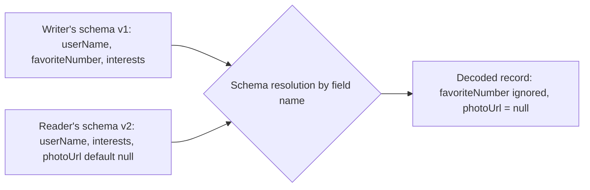

# Encoding formats and schema evolution

> **Before this lesson:** you should know what a schema, JSON, schema-on-read and schema-on-write are, from [Relational vs document models](#/lesson/databases/relational-vs-document), and what a rolling upgrade is, from [Reliability and maintainability](#/lesson/databases/reliability-maintainability). The code uses Python dictionaries, functions and `bytes`.

## In plain words

Programs constantly hand data to other programs: over a network, or by saving it to a file that some other program (or a later version of the same program) will read. Inside one running program, data lives as objects connected to each other in memory. None of that can be sent as it is. It has to be flattened into a plain sequence of bytes first, and rebuilt on the other side. Flattening is called **encoding**. Rebuilding is called **decoding**.

An everyday picture: sending furniture by post. A wardrobe cannot go through the letterbox as it stands. You take it apart, pack the pieces flat in a box, and include a sheet that says which piece is which. The person at the other end follows the sheet to put it back together. The flat pack is the encoded data. The sheet is the **schema**.

Now the complication that this lesson is really about. The factory changes the wardrobe design every few months, but customers still own old instruction sheets, and boxes packed last year are still sitting in warehouses. A person holding an old sheet must cope with a new box, and a person holding a new sheet must cope with an old box. In software this is called **schema evolution**, and getting it wrong breaks systems during upgrades.

Why this matters for a job: any time two services talk, or data is saved and read later, a format is in use. Engineers choose between JSON, Protocol Buffers and Avro routinely, and "how do you change a message format without breaking the programs that read it?" is a common interview question with a precise answer.

## 1. Why old and new must coexist

Applications change. A new feature needs a new field, so the data format changes. In any system of real size the code cannot all change at the same instant:

- On the **server side**, new versions are installed by a **rolling upgrade**: a few machines get the new version, they are watched for problems, and then the next few are done. For a while, some machines run old code and some run new.
- On the **client side** (apps on people's phones), an update happens whenever the user installs it, which may be months later or never.

So old code and new code run at the same time, and data written by each is read by the other. Two properties are needed:

- **Backward compatibility:** *newer* code can read data written by *older* code. This is the easier of the two, because the authors of the new code know what the old format looked like.
- **Forward compatibility:** *older* code can read data written by *newer* code. This is harder. The old code was written before the new format existed, so it must be built to ignore things it does not recognise.

A memory aid: the direction describes which way the *reader* looks. Backward compatible means a reader can look back at older data. Forward compatible means a reader can cope with data from its future.

## 2. Encoding = serialization

A program holds data in two forms:

1. **In memory**, as objects, lists, dictionaries and so on. These refer to one another through **pointers**, which are memory addresses. This form is designed for fast access by the processor.
2. **As a self-contained sequence of bytes**, for writing to a file or sending over a network. Pointers cannot appear here, since a memory address means nothing to another program.

Going from form 1 to form 2 is **encoding**, also called **serialization** or *marshalling*. Going back is **decoding**, also called *parsing* or **deserialization**.

> [!NOTE]
> The word "serialization" has a second, unrelated meaning in the lessons on transactions. To avoid confusion this track says "encoding", as DDIA does.

## 3. Language-specific formats

Many programming languages have encoding built in. Python has `pickle`, Java has `java.io.Serializable`, Ruby has `Marshal`. One function call turns any object into bytes. That convenience comes with four problems:

- **They are tied to one language.** Data pickled in Python is very hard to read from Java. Choosing such a format commits you to that language for as long as the data exists.
- **They are a security risk.** To rebuild arbitrary objects, the decoder must be able to create an instance of any class. An attacker who can get you to decode bytes of their choosing can often make your program run their code. Never unpickle data from a source you do not trust.
- **Versioning is neglected.** These formats were designed for quick convenience, and forward and backward compatibility were rarely thought through.
- **Efficiency is often poor.** Java's built-in serialization is known for being slow and producing bulky output.

The sensible rule is to use them only for short-lived, internal purposes.

## 4. JSON, XML and binary variants

The next option is a standard text format that every language can read. The three common ones are **JSON**, **XML** (a format with nested tags in angle brackets, like HTML) and **CSV** (comma-separated values: one record per line, fields separated by commas). They are readable by people and supported everywhere, and they are the usual choice when different organisations exchange data. They also have subtle weaknesses:

- **Numbers are ambiguous.** XML and CSV cannot tell a number from text made of digits unless a schema says which it is. JSON separates text from numbers, but it does not separate whole numbers from numbers with a fractional part, and it sets no limit on precision. This causes a real problem with large whole numbers. JavaScript stores every number in a 64-bit **floating-point** format (the standard is called IEEE 754), which can represent whole numbers exactly only up to $2^{53}$. Larger ones are silently rounded. Twitter's identifiers exceed that limit, which is why its API returns each tweet's ID twice: once as a JSON number and once as text.
- **No raw bytes.** JSON and XML can hold text but not arbitrary binary data such as an image. The usual workaround is **Base64**, which rewrites bytes using 64 printable characters. It works, and it makes the data one third larger.
- **Schemas are optional and complicated.** Schema languages exist for XML and JSON, but many programs do not use them. The rules for interpreting the data then live only in application code.
- **CSV has no schema at all.** It also has loosely defined rules for a value that itself contains a comma or a line break, and many programs handle those cases incorrectly.

```python-run
import json
big = 2**53 + 1
print("python int     :", big)
print("as float (JS)  :", int(float(big)), "<- silently rounded!")
print("json roundtrip :", json.loads(json.dumps(big)), "(Python keeps ints exact; JavaScript would not)")
blob = bytes(range(6))
import base64
print("base64 of 6 bytes:", base64.b64encode(blob).decode(), f"({len(base64.b64encode(blob))} chars for 6 bytes)")
```

What each part does:

- `big = 2**53 + 1` is the first whole number that a 64-bit float cannot hold exactly.
- `int(float(big))` converts it to a float and back, imitating what a JavaScript program would do to it.
- `json.dumps(big)` encodes the number as JSON text and `json.loads` decodes it again. Python's whole numbers have unlimited precision, so the round trip is exact here.
- `bytes(range(6))` makes six raw bytes with the values 0 to 5, and `base64.b64encode` converts them to Base64.

```
python int     : 9007199254740993
as float (JS)  : 9007199254740992 <- silently rounded!
json roundtrip : 9007199254740993 (Python keeps ints exact; JavaScript would not)
base64 of 6 bytes: AAECAwQF (8 chars for 6 bytes)
```

The number ending in 993 became 992 with no error message. If that were a customer ID, the request would now refer to a different customer. The last line shows the Base64 cost: 6 bytes became 8 characters.

**Binary variants of JSON.** Formats such as **MessagePack** and BSON keep JSON's data model but write it as compact bytes instead of text. The saving is modest, because without a schema they still have to write every **field name** into every record. Take this record, used as the running example in DDIA:

```json
{"userName": "Martin", "favoriteNumber": 1337, "interests": ["daydreaming", "hacking"]}
```

As compact JSON text it is 81 bytes. As MessagePack it is 66 bytes. An 18% saving is a small return for giving up human readability. The formats in the next sections do much better, by taking the field names out.

## 5. Thrift and Protocol Buffers

**Protocol Buffers** (shortened to **protobuf**), created at Google, and **Thrift**, created at Facebook, are binary formats that **require a schema**. You describe each kind of record in a small definition language. Such a language is called an **IDL** (interface definition language). In protobuf:

```protobuf
message Person {
  required string user_name       = 1;
  optional int64  favorite_number = 2;
  repeated string interests       = 3;
}
```

Each line declares one field: whether it must be present (`required`), may be absent (`optional`) or may appear many times (`repeated`), then its type, its name and a number. A tool called a **code generator** reads this definition and produces classes in the programming language of your choice, with methods to encode and decode.

The numbers after the equals signs are the central idea. They are **field tags**. In the encoded bytes, a field is identified by its tag number and not by its name. Each field is written as three things: the tag, a marker saying what kind of value follows, and the value. The names `user_name` and so on never appear in the data.

A second space-saving device is the **variable-length integer**, or **varint**. A small number is written in one byte and a large one in several. Each byte carries seven bits of the number, and its eighth bit says whether another byte follows.

With tags and varints, the example record takes **33 bytes** in protobuf, compared with 81 as JSON. The program below builds those bytes by hand.

```python-run
def varint(n):
    out = bytearray()
    while True:
        b = n & 0x7F
        n >>= 7
        if n:
            out.append(b | 0x80)
        else:
            out.append(b)
            return bytes(out)

def field(tag, wire_type, payload):
    return varint((tag << 3) | wire_type) + payload

def string_field(tag, s):
    data = s.encode()
    return field(tag, 2, varint(len(data)) + data)   # wire type 2 = length-delimited

msg = (string_field(1, "Martin") + field(2, 0, varint(1337)) +
       string_field(3, "daydreaming") + string_field(3, "hacking"))
print(len(msg), "bytes:", msg.hex(" "))
print("varint(1337) =", varint(1337).hex(" "), " varint(1) =", varint(1).hex())
```

What each part does:

- `varint(n)` produces the variable-length form of a number. `n & 0x7F` takes the lowest seven bits. `n >>= 7` shifts the number right by seven bits, discarding the ones already taken. If anything is left (`if n:`), the byte is written with its top bit switched on (`| 0x80`) to say "more follows". Otherwise the byte is written as it is and the function returns.
- `field(tag, wire_type, payload)` writes the header of a field. It packs the tag number and a 3-bit type marker into one number, `(tag << 3) | wire_type`, encodes that as a varint, and appends the value.
- `string_field` encodes text: type marker 2 means "a length, then that many bytes".
- `msg` joins four fields: the name, the number, and the two interests. Both interests use tag 3. That is how a `repeated` field is written: the same tag appears more than once.

```
33 bytes: 0a 06 4d 61 72 74 69 6e 10 b9 0a 1a 0b 64 61 79 64 72 65 61 6d 69 6e 67 1a 07 68 61 63 6b 69 6e 67
varint(1337) = b9 0a  varint(1) = 01
```

The output is written in **hexadecimal**, a compact way of showing bytes with two characters each. Read the beginning: `0a` is the header for tag 1 with type 2. `06` is the length. The next six bytes, `4d 61 72 74 69 6e`, are the letters of "Martin". Then `10` is the header for tag 2 with type 0, and `b9 0a` is 1337 as a two-byte varint. The total is 33 bytes, the same figure DDIA gives.

### 5.1 Field tags and schema evolution

Because the data contains tags and not names, the rules for changing a schema safely follow directly.

- **Adding a field.** Give it a tag number that has never been used. Old code that meets the new tag does not recognise it and **skips it**; the type marker tells it how many bytes to skip. That is forward compatibility. New code can read old data because every existing tag still means what it always meant. That is backward compatibility, on one condition: the new field must be optional or have a default value. If it were `required`, new code would reject every old record for not containing it.
- **Removing a field.** Only an optional field can be removed, for the mirror-image reason. And its tag number must **never be used again**, because old data carrying that tag still exists and would be misread. Protobuf lets you write `reserved 4;` to block a retired number.
- **Renaming a field** is harmless, since names are not in the data. **Changing a tag number** makes all existing data unreadable.
- **Changing a field's type** is sometimes possible and always risky. If a 32-bit integer field is widened to 64 bits, new code reads old data without trouble. But old code reading a new 64-bit value into a 32-bit variable will cut off part of the number.
- **Single to repeated.** Protobuf has no separate list type; a repeated field is one tag appearing several times. An optional field can therefore be changed to a repeated one. New code reading old data sees a list with zero or one items, and old code reading new data sees only the final item.

> [!NOTE]
> The current version of the language, proto3, removed `required` entirely. Every field is optional and has a default (zero, empty text and so on). Experience showed that a required field can never be safely added or removed later, so it was a trap.

## 6. Avro

**Apache Avro** is a third binary format, created in 2009 for the Hadoop data-processing system. It also uses a schema:

```
record Person {
  string               userName;
  union { null, long } favoriteNumber = null;
  array<string>        interests;
}
```

This declares the same three fields. `union { null, long }` means "either nothing or a 64-bit whole number", and `= null` sets its default value.

Avro's encoding goes one step further than protobuf's. It contains **no tag numbers and no type markers**. The bytes are the values and nothing else, one after another, in the order the schema lists the fields. The example record takes **32 bytes**, the smallest of all the formats here.

That raises a question. If the data does not say which field is which, how can it be read? The decoder walks through the schema: "first field is text, so read a length and that many bytes; second field is a union, so read which alternative and then its value". The consequence is strict. The bytes can be decoded correctly **only by a reader that knows the exact schema the writer used**.

### 6.1 Writer's schema and reader's schema

Avro deals with change by always working with two schemas:

- The **writer's schema** is the one the encoding program used.
- The **reader's schema** is the one the decoding program expects, the one its own code was written against.

The two need not be identical. They need to be **compatible**, and the Avro library converts between them by matching fields **by name**:

- The order of fields may differ, since matching is by name.
- A field that the writer has and the reader does not is **ignored**.
- A field that the reader expects and the writer lacks is filled in with the **default value** from the reader's schema.



In the diagram, data written with version 1 is read by a program expecting version 2. The field `favoriteNumber` is dropped because version 2 does not have it. The field `photoUrl` did not exist in version 1, so it receives its default.

The rules for safe changes follow from the matching rules. **A field may be added or removed only if it has a default value.** Adding a field without a default breaks backward compatibility: a new reader has nothing to put in that field for old data. Removing a field without a default breaks forward compatibility: an old reader expects it and has no default to fall back on. Avro also does not treat "empty" as an automatic default. To allow a field to be empty you must declare it as a union that includes `null`, as in the schema above. That is more to type, and it prevents a whole class of bugs.

```python-run
def resolve(record, writer_fields, reader_schema):
    """Avro-style resolution: match by name, ignore unknown, fill defaults."""
    out = {}
    for name, spec in reader_schema.items():
        if name in writer_fields:
            out[name] = record[name]
        elif "default" in spec:
            out[name] = spec["default"]
        else:
            raise ValueError(f"incompatible: reader needs '{name}' with no default")
    return out

writer_v1 = ["userName", "favoriteNumber", "interests"]
rec = {"userName": "Martin", "favoriteNumber": 1337, "interests": ["hacking"]}
reader_v2 = {"userName": {}, "interests": {}, "photoUrl": {"default": None}}
print(resolve(rec, writer_v1, reader_v2))
try:
    resolve(rec, writer_v1, {"userName": {}, "email": {}})
except ValueError as e:
    print("ERROR:", e)
```

What each part does:

- `resolve` imitates Avro's matching. For each field the reader wants, it takes the value from the record if the writer had that field, takes the reader's default if there is one, and otherwise raises an error.
- Fields the writer had but the reader does not ask for are never looked at, which is how they get ignored.
- The first call reads a version 1 record with a version 2 reader schema. The second uses a reader schema demanding an `email` field with no default.

```
{'userName': 'Martin', 'interests': ['hacking'], 'photoUrl': None}
ERROR: incompatible: reader needs 'email' with no default
```

In the first result `favoriteNumber` has disappeared and `photoUrl` has been filled with its default. The second shows the failure that the "must have a default" rule exists to prevent.

### 6.2 Where does the reader get the writer's schema from?

Attaching the full schema to every record would cancel the space saving. What is done depends on the situation:

- **A large file of many records.** The writer puts its schema once at the top of the file. Avro defines a file layout for this, called an object container file.
- **A database where records are written one at a time, possibly under different schema versions.** Each record starts with a small **schema version number**, and a separate list holds every version of the schema. The reader looks up the version and fetches the matching schema. A service that stores such a list is called a **schema registry**, and it is the standard way to use Avro with the message system Kafka.
- **A network connection between two programs.** The two sides agree on the schema when the connection is opened and use it for as long as the connection lasts.

### 6.3 Dynamically generated schemas

The absence of tag numbers gives Avro one clear advantage: its schemas are easy to produce automatically. Suppose you want to export a relational database to a file. A program can read the table definitions and write an Avro schema with one field per column. If a column is added later, the program generates a new schema, and because fields are matched by name, old and new exports remain compatible. With protobuf or Thrift, someone would have to assign tag numbers by hand and make sure no number was ever reused. Avro was designed with generated schemas in mind.

### 6.4 Code generation

Protobuf and Thrift depend on generated code. That suits **statically typed** languages such as Java, C++ and Go, where types are checked before the program runs: the generated classes are efficient and the compiler catches mistakes. In **dynamically typed** languages such as Python and JavaScript, a code-generation step is often more hindrance than help. Avro makes code generation optional. An Avro file carries its schema with it, so it is **self-describing**, and a script can open and explore it directly, much as it would a JSON file.

## 7. The merits of schemas

Binary formats with schemas are an old idea. A format called ASN.1, defined in 1984, uses tag numbers much as protobuf does and is still used inside the security certificates that protect web connections. Compared with schemaless text formats, schema-based formats have these advantages:

- **They are smaller**, because field names are left out of the data.
- **The schema is documentation that cannot go stale.** Decoding fails without the correct schema, so the schema has to match reality.
- **Compatibility can be checked ahead of time.** With all versions of a schema stored in one place, a tool can verify that a proposed change is forward and backward compatible *before* anything is deployed.
- **Generated code allows type checking** in statically typed languages.

Schema evolution, done with these rules, gives much of the flexibility of schema-on-read while keeping firmer guarantees about what the data contains.

> [!INTERVIEW]
> A typical question: "How do you change the format of events in a Kafka pipeline without breaking the programs that read them?" A strong answer: use Avro or protobuf with a **schema registry**, and configure the registry to enforce a compatibility mode (backward, forward, or both) so that an incompatible schema is rejected when someone tries to publish it. Add only fields that have defaults. Never reuse a tag number or remove a required field. Decide the order of deployment from the direction of compatibility: when readers must understand a new format, upgrade the readers first.

## 8. Pitfalls

- **Reusing a protobuf tag number** after deleting a field. Old data with that tag will be misread as the new field. Mark retired numbers `reserved`.
- **Old code rewriting data it does not fully understand.** Suppose old code reads a record that contains a new field, ignores the field, changes something else, and writes the record back. If the unknown field was not carried along, **it is now gone**. The protobuf library preserves unknown fields, but a layer of your own code that copies records into its own objects may not.
- **Adding an Avro field with no default.** New readers can no longer read old data.
- **Large whole numbers in JSON.** A JavaScript client will round them without warning. Send identifiers as text.

## 9. Summary

- Rolling upgrades and slow client updates mean old and new code run together. **Backward** compatibility (new reads old) and **forward** compatibility (old reads new) are both needed.
- Language-specific encodings are unsafe and lock you into one language. JSON, XML and CSV are universal but vague about number types and cannot hold raw bytes.
- **Protobuf and Thrift** identify fields by numeric **tags**. Evolve a schema by adding optional fields under new tags and never reusing a tag.
- **Avro** has no tags. The writer's and reader's schemas are matched **by field name**, with defaults filling the gaps. It is the most compact and the best fit for automatically generated schemas.

## Glossary

- **Encoding (serialization)** - turning in-memory data into a sequence of bytes.
- **Decoding (deserialization, parsing)** - turning bytes back into in-memory data.
- **Pointer** - a memory address held by one object to refer to another.
- **Backward compatibility** - newer code can read data written by older code.
- **Forward compatibility** - older code can read data written by newer code.
- **Schema evolution** - changing a data format over time while keeping old and new compatible.
- **XML / CSV** - a text format of nested tags / a text format of comma-separated fields.
- **Floating-point number** - a number format with limited precision that can hold fractions; exact for whole numbers only up to 2 to the power 53.
- **Base64** - a way of writing arbitrary bytes using 64 printable characters.
- **MessagePack / BSON** - binary encodings of JSON-style data that still include field names.
- **Protocol Buffers (protobuf) / Thrift** - binary formats that need a schema and identify fields by tag number.
- **IDL (interface definition language)** - a small language for declaring record types.
- **Code generator** - a tool that turns a schema into classes in a programming language.
- **Field tag** - the number that identifies a field in encoded protobuf or Thrift data.
- **Varint** - a whole number written in as few bytes as its size requires.
- **Hexadecimal** - a notation showing each byte as two characters from 0-9 and a-f.
- **Avro** - a binary format with no tags, decoded by walking the schema.
- **Writer's schema / reader's schema** - the schema used to encode / the schema the decoding program expects.
- **Default value** - the value used for a field that is missing from the data.
- **Union** - a type that allows one of several alternatives, such as null or a number.
- **Schema registry** - a service that stores every version of each schema and can check compatibility.
- **Self-describing** - carrying its own schema, so no outside information is needed to read it.
- **Statically / dynamically typed** - types checked before the program runs / while it runs.

```quiz
[
  {"q": "Forward compatibility means...",
   "options": ["New code can read data written by old code", "Old code can read data written by new code", "Data can be read by any language", "The schema never changes"],
   "answer": 1,
   "explain": "Forward = older readers tolerate newer writers, typically by ignoring unknown fields."},
  {"q": "Why can integers larger than 2^53 be corrupted when passed through JSON?",
   "options": ["JSON forbids large numbers", "Many parsers (e.g., JavaScript) decode numbers as IEEE-754 doubles, which cannot represent them exactly", "JSON uses base64", "Integers overflow to negative"],
   "answer": 1,
   "explain": "Twitter returns IDs both as a number and as a string to work around this."},
  {"q": "In Protocol Buffers, what identifies a field in the encoded bytes?",
   "options": ["Its name", "Its numeric field tag", "Its position in the schema", "A UUID"],
   "answer": 1,
   "explain": "Tags replace names; that is why renaming is safe but changing a tag is not."},
  {"q": "Which protobuf schema change is safe?",
   "options": ["Reusing the tag of a deleted field for a new field", "Adding a new optional field with a new tag number", "Adding a new required field", "Changing a field's tag number"],
   "answer": 1,
   "explain": "Old code skips the unknown tag; new code handles its absence via default."},
  {"q": "How does Avro decode data without field tags?",
   "options": ["It guesses types", "It walks the writer's schema in order and resolves it against the reader's schema by field name", "It uses JSON", "It cannot"],
   "answer": 1,
   "explain": "The writer's schema must be known (file header, version id in a registry, or negotiation)."},
  {"q": "In Avro, which change preserves both backward and forward compatibility?",
   "options": ["Adding a field without a default", "Adding or removing a field that has a default value", "Changing a field's type from string to int", "Removing a field without a default"],
   "answer": 1,
   "explain": "Defaults let either side fill in values that the other side's schema lacks."},
  {"q": "Why is Avro particularly suited to dynamically generated schemas (e.g., dumping a relational DB)?",
   "options": ["It is text based", "There are no tag numbers to assign manually; fields are matched by name", "It requires code generation", "It stores field names in every record"],
   "answer": 1,
   "explain": "A schema can be regenerated from table definitions whenever they change."},
  {"q": "What danger arises when old code reads a record with a new field, then writes it back?",
   "options": ["The record gets bigger", "The new field may be silently dropped if unknown fields are not preserved", "The tag numbers change", "Nothing"],
   "answer": 1,
   "explain": "Applications must take care to preserve unknown fields when re-encoding."}
]
```

> **Source:** DDIA ch. 4, "Encoding and Evolution" (Formats for Encoding Data: language-specific formats, JSON/XML, Thrift and Protocol Buffers, Avro, the merits of schemas).
