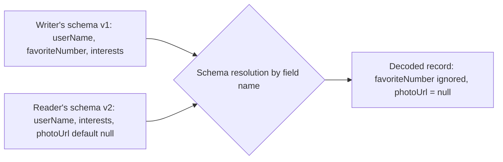

# Encoding formats and schema evolution

Applications change. New features need new fields, and new fields mean data formats and schemas must change. In a large application, code changes cannot happen everywhere at once:

- **Server-side** applications use **rolling upgrades**: deploy the new version to a few nodes at a time, check that it works, then continue. This avoids downtime and makes frequent small releases safe.
- **Client-side** applications depend on the user, who may not install the update for a long time.

So **old and new versions of code, and old and new data formats, coexist**. To keep working we need compatibility in **both directions**:

- **Backward compatibility.** *Newer* code can read data written by *older* code. This is usually easy, because you know the old format.
- **Forward compatibility.** *Older* code can read data written by *newer* code. This is trickier, because old code must ignore additions it does not understand.

## 1. Encoding = serialization

Programs keep data in two representations:

1. **In memory**: objects, structs, lists, hash tables, trees, with pointers, optimised for CPU access.
2. **As a self-contained byte sequence** for writing to a file or sending over the network. Pointers make no sense here.

Translating 1 → 2 is **encoding** (also called *serialization* or *marshalling*), and 2 → 1 is **decoding** (*parsing*, *deserialization*, *unmarshalling*).

> [!NOTE]
> "Serialization" also means something completely different in the context of transactions (Chapter 7). DDIA says "encoding" to avoid the clash.

## 2. Language-specific formats

Java has `java.io.Serializable`, Ruby has `Marshal`, and Python has `pickle`. They are convenient but have serious problems:

- They are **tied to one language**, which locks you in.
- **Security.** Decoding must be able to instantiate arbitrary classes, so an attacker who can make you decode their bytes can often execute arbitrary code. Never unpickle untrusted data.
- **Versioning** is often an afterthought, with poor forward and backward compatibility.
- **Efficiency** is often poor. Java serialization is notorious for bad performance and bloated output.

The advice is to use them only for very transient purposes.

## 3. JSON, XML and binary variants

Textual formats are widely supported and human-readable, and they are the de facto standard for data interchange between organisations. They have subtle problems:

- **Numbers are ambiguous.** XML and CSV cannot distinguish a number from a string of digits without a schema. JSON separates strings and numbers but not integers and floats, and specifies no precision. Integers greater than $2^{53}$ cannot be represented exactly by an IEEE-754 double, so they get silently rounded in JavaScript. Twitter's API returns tweet IDs **twice**, once as a JSON number and once as a decimal string, for exactly this reason.
- **No binary strings.** JSON and XML support Unicode text but not raw bytes. People Base64-encode binary data, which grows it by 33% and is hacky.
- **Optional, complex schemas.** XML Schema and JSON Schema are powerful but complicated, and many JSON tools ignore schemas, so the correct interpretation of the data is hardcoded in application code.
- **CSV has no schema at all**, and its escaping rules (commas or newlines inside values) are vague, so many parsers get them wrong.

```python-run
import json
big = 2**53 + 1
print("python int     :", big)
print("as float (JS)  :", int(float(big)), "<- silently rounded!")
print("json roundtrip :", json.loads(json.dumps(big)), "(Python keeps ints exact; JavaScript would not)")
blob = bytes(range(6))
import base64
print("base64 of 6 bytes:", base64.b64encode(blob).decode(), f"({len(base64.b64encode(blob))} chars for 6 bytes)")
```

Binary JSON variants such as **MessagePack**, BSON, BJSON, UBJSON and BISON are a bit more compact but still embed **field names** in every record because they have no schema. DDIA's example record:

```json
{"userName": "Martin", "favoriteNumber": 1337, "interests": ["daydreaming", "hacking"]}
```

is 81 bytes as compact JSON and 66 bytes as MessagePack. That is only an 18% reduction, and it costs human readability.

## 4. Thrift and Protocol Buffers

Apache **Thrift** (from Facebook) and Google **Protocol Buffers** (protobuf) are binary encodings that **require a schema**, described in an IDL:

```protobuf
message Person {
  required string user_name       = 1;
  optional int64  favorite_number = 2;
  repeated string interests       = 3;
}
```

A code generator produces classes in many languages. The key idea is that **field tags** (numbers 1, 2, 3) replace field names in the encoded data. Each field is encoded as *(tag, type, value)*. Integers use **variable-length encoding** (varint), so 1337 takes 2 bytes. The example record becomes **33 bytes** in protobuf. Thrift's CompactProtocol gives 34 bytes, and its BinaryProtocol 59.

```python-run
def varint(n):
    out = bytearray()
    while True:
        b = n & 0x7F
        n >>= 7
        if n:
            out.append(b | 0x80)
        else:
            out.append(b)
            return bytes(out)

def field(tag, wire_type, payload):
    return varint((tag << 3) | wire_type) + payload

def string_field(tag, s):
    data = s.encode()
    return field(tag, 2, varint(len(data)) + data)   # wire type 2 = length-delimited

msg = (string_field(1, "Martin") + field(2, 0, varint(1337)) +
       string_field(3, "daydreaming") + string_field(3, "hacking"))
print(len(msg), "bytes:", msg.hex(" "))
print("varint(1337) =", varint(1337).hex(" "), " varint(1) =", varint(1).hex())
```

Run it and you get exactly 33 bytes, matching DDIA's figure.

### 4.1 Field tags and schema evolution

- **Adding a field.** Give it a **new tag number**. Old code reading new data sees an unknown tag and **skips it**, using the type annotation to know how many bytes to skip. That gives forward compatibility. New code can always read old data because tag numbers keep their meaning, which gives backward compatibility, provided the new field is *optional* or has a default. A new `required` field would make new code fail on old data.
- **Removing a field.** You can only remove **optional** fields, and you must **never reuse the tag number**, because old data with that tag may still exist. Protobuf has `reserved 4;` for this.
- **Changing a field name** is fine, since names are not in the encoded data. **Changing a tag** breaks everything.
- **Changing a datatype** is possible in some cases but risky. Widening int32 to int64 works for new code reading old data, but old code reading a 64-bit value into a 32-bit variable truncates it.
- Protobuf has no list type. A `repeated` field is the same field tag appearing several times. That makes it fine to change an `optional` (single) field into a `repeated` one: old code reading new data sees only the last element. Thrift has a dedicated list type that supports nested lists but does not allow this change.

> [!NOTE]
> proto3 removed `required` altogether. Every field is optional with a zero-value default, because `required` turned out to be an evolution hazard. You cannot safely add or remove one.

## 5. Avro

Apache **Avro** started in 2009 as a Hadoop subproject because Thrift was not a good fit. It has two schema languages: Avro IDL for humans and JSON for machines.

```
record Person {
  string               userName;
  union { null, long } favoriteNumber = null;
  array<string>        interests;
}
```

The encoding contains **no field tags and no type annotations**, only the values concatenated. Strings are length-prefixed and integers use zig-zag varints. The example is just **32 bytes**, the most compact of all. To parse it, you walk through the fields in the order they appear in the schema. So the bytes can be decoded correctly **only if the reader uses the exact schema the data was written with**.

### 5.1 Writer's schema and reader's schema

- The **writer's schema** is the schema the encoding application used.
- The **reader's schema** is the schema the decoding application expects. Code is generated from it.

They do not have to be identical, only **compatible**. Avro's library resolves the differences by matching fields **by name**:

- Field order can differ, because matching is by name.
- A field in the writer's schema but not the reader's is **ignored**.
- A field the reader expects but the writer lacks is filled with the reader's **default value**.

The compatibility rules follow from this. You can only add or remove fields that **have a default value**. Adding a field with no default breaks backward compatibility, because new readers cannot fill it for old data. Removing a field with no default breaks forward compatibility. `null` is not an implicit default. To allow null you must declare a **union** type such as `union { null, long }`, which is more verbose than "everything nullable" but helps prevent bugs. Renaming a field works through **aliases** in the reader's schema, which is backward compatible but not forward compatible.



```python-run
def resolve(record, writer_fields, reader_schema):
    """Avro-style resolution: match by name, ignore unknown, fill defaults."""
    out = {}
    for name, spec in reader_schema.items():
        if name in writer_fields:
            out[name] = record[name]
        elif "default" in spec:
            out[name] = spec["default"]
        else:
            raise ValueError(f"incompatible: reader needs '{name}' with no default")
    return out

writer_v1 = ["userName", "favoriteNumber", "interests"]
rec = {"userName": "Martin", "favoriteNumber": 1337, "interests": ["hacking"]}
reader_v2 = {"userName": {}, "interests": {}, "photoUrl": {"default": None}}
print(resolve(rec, writer_v1, reader_v2))
try:
    resolve(rec, writer_v1, {"userName": {}, "email": {}})
except ValueError as e:
    print("ERROR:", e)
```

### 5.2 How does the reader know the writer's schema?

Including the whole schema in every record would defeat the compactness. It depends on context:

- **Large file with lots of records** (Hadoop): the writer includes its schema **once** at the start of the file. These are Avro **object container files**.
- **Database with individually written records**: include a **schema version number** at the start of each record and keep a list of schema versions. Kafka's Confluent **Schema Registry** does this, prefixing each message with a schema id.
- **Network connection**: the two sides negotiate the schema version at connection setup, as in the Avro RPC protocol.

### 5.3 Dynamically generated schemas

Because Avro has no tag numbers, it suits schemas **generated** from another source. Say you want to dump a relational database to a file. Generate an Avro schema from the table definitions, with one record schema per table and one field per column. When the database schema changes, generate a new Avro schema. Fields are matched by name, so the result stays compatible. With Thrift or protobuf an administrator would have to assign tag numbers by hand and never reuse them. Avro was designed with this use in mind, and Thrift and protobuf were not.

### 5.4 Code generation

Thrift and protobuf rely on code generation, which suits statically typed languages (Java, C++, Go) because you get efficient in-memory structures and type checking. In dynamic languages (Python, JavaScript) code generation is often an unnecessary obstacle. Avro supports it optionally, and an object container file is **self-describing**, so you can open it in Pig or Python and analyse it without generated code, much like a JSON file.

## 6. The merits of schemas

Schema-based binary formats are an old idea. ASN.1 (1984) is still used in SSL certificates (DER encoding) and resembles protobuf with tag numbers. Databases have long had proprietary binary wire protocols as well. Advantages of schemas:

- **Compactness**: field names are omitted.
- The schema is **documentation that is guaranteed to be up to date**, because decoding requires it.
- A **database of schemas** lets you check forward and backward compatibility *before* deploying.
- **Code generation** enables compile-time type checking.

Schema evolution gives the same flexibility as schema-on-read JSON while offering better guarantees and tooling.

> [!INTERVIEW]
> "How do you evolve the event schema in your Kafka pipeline without breaking consumers?" Use Avro or protobuf with a **schema registry**, enforce a compatibility mode (BACKWARD, FORWARD or FULL), add only fields with defaults, never reuse tag numbers or remove required fields, and deploy consumers before producers when the change requires it. Mention that the registry rejects incompatible schemas at publish time.

## 7. Pitfalls

- **Reusing a protobuf tag number** after deleting a field corrupts old data. Use `reserved`.
- **Old code rewriting data it does not understand.** If old code decodes a record with a new field, ignores the field, then re-encodes and writes it back, **the new field is lost**. Libraries such as protobuf preserve unknown fields, but your ORM-mapping layer may not.
- **Adding an Avro field with no default** breaks old data reads.
- **JSON big integers** silently rounded by JavaScript clients.

## 8. Summary

- Rolling upgrades mean old and new code coexist, so you need **backward** (new reads old) and **forward** (old reads new) compatibility.
- Language-specific serialization is insecure and not portable. JSON/XML/CSV are ubiquitous but vague about types and lack binary strings.
- **Protobuf/Thrift** use numeric **field tags**. Evolve by adding optional fields with new tags and never reusing tags.
- **Avro** has no tags. The writer's and reader's schemas are resolved **by field name**, with defaults. It is the most compact and suits generated schemas.

```quiz
[
  {"q": "Forward compatibility means...",
   "options": ["New code can read data written by old code", "Old code can read data written by new code", "Data can be read by any language", "The schema never changes"],
   "answer": 1,
   "explain": "Forward = older readers tolerate newer writers, typically by ignoring unknown fields."},
  {"q": "Why can integers larger than 2^53 be corrupted when passed through JSON?",
   "options": ["JSON forbids large numbers", "Many parsers (e.g., JavaScript) decode numbers as IEEE-754 doubles, which cannot represent them exactly", "JSON uses base64", "Integers overflow to negative"],
   "answer": 1,
   "explain": "Twitter returns IDs both as a number and as a string to work around this."},
  {"q": "In Protocol Buffers, what identifies a field in the encoded bytes?",
   "options": ["Its name", "Its numeric field tag", "Its position in the schema", "A UUID"],
   "answer": 1,
   "explain": "Tags replace names; that is why renaming is safe but changing a tag is not."},
  {"q": "Which protobuf schema change is safe?",
   "options": ["Reusing the tag of a deleted field for a new field", "Adding a new optional field with a new tag number", "Adding a new required field", "Changing a field's tag number"],
   "answer": 1,
   "explain": "Old code skips the unknown tag; new code handles its absence via default."},
  {"q": "How does Avro decode data without field tags?",
   "options": ["It guesses types", "It walks the writer's schema in order and resolves it against the reader's schema by field name", "It uses JSON", "It cannot"],
   "answer": 1,
   "explain": "The writer's schema must be known (file header, version id in a registry, or negotiation)."},
  {"q": "In Avro, which change preserves both backward and forward compatibility?",
   "options": ["Adding a field without a default", "Adding or removing a field that has a default value", "Changing a field's type from string to int", "Removing a field without a default"],
   "answer": 1,
   "explain": "Defaults let either side fill in values that the other side's schema lacks."},
  {"q": "Why is Avro particularly suited to dynamically generated schemas (e.g., dumping a relational DB)?",
   "options": ["It is text based", "There are no tag numbers to assign manually; fields are matched by name", "It requires code generation", "It stores field names in every record"],
   "answer": 1,
   "explain": "A schema can be regenerated from table definitions whenever they change."},
  {"q": "What danger arises when old code reads a record with a new field, then writes it back?",
   "options": ["The record gets bigger", "The new field may be silently dropped if unknown fields are not preserved", "The tag numbers change", "Nothing"],
   "answer": 1,
   "explain": "Applications must take care to preserve unknown fields when re-encoding."}
]
```

> **Source:** DDIA ch. 4, "Encoding and Evolution" (Formats for Encoding Data: language-specific formats, JSON/XML, Thrift and Protocol Buffers, Avro, the merits of schemas).
