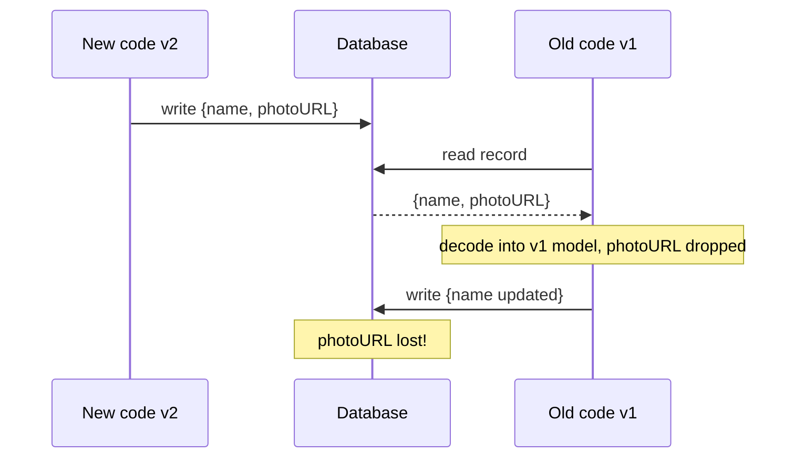
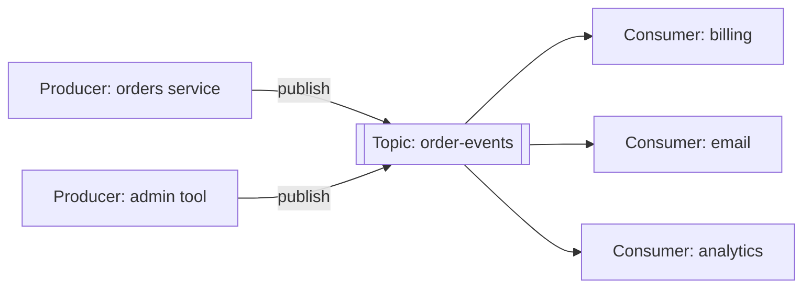

# Modes of data flow: databases, REST/RPC, message passing

Compatibility is a relationship between one process that **encodes** data and another that **decodes** it. To know which side needs which kind of compatibility, ask *how data flows between processes*. DDIA names three common modes:

1. Through **databases**
2. Through **service calls** (REST and RPC)
3. Through **asynchronous message passing**

## 1. Dataflow through databases

Whoever writes a record encodes it; whoever reads it later has to decode it. It can be the *same* process at a later time, in which case storing data is like **sending a message to your future self**.

- **Backward compatibility** is clearly needed, or your future self cannot read what you wrote.
- **Forward compatibility** is usually needed too. During a rolling upgrade, a value written by a *newer* instance may be read by an *older* one that has not been upgraded yet.

### 1.1 Preserving unknown fields

Suppose new code adds a field `photoURL` and writes a record. Old code reads it, decodes it into a model object that has no `photoURL` attribute, modifies some other field, and writes it back. The new field silently disappears. Encodings can handle this, but at the application level you have to be careful to keep unknown fields intact.



### 1.2 Data outlives code

> **Data outlives code.** Deploying a new application version replaces the code within minutes, but a database may hold five-year-old data in its original encoding unless you explicitly rewrote it.

Rewriting (**migrating**) a large dataset is expensive, so most databases avoid it where possible. Relational databases allow simple changes such as adding a column with a `NULL` default without rewriting existing data. Rows written before the column existed simply come back with `NULL` in it. Espresso, a document store built at LinkedIn, keeps its documents in Avro precisely to inherit those evolution rules. Schema evolution lets the whole database *appear* to be encoded with one schema even though the underlying storage holds records encoded with many historical versions.

### 1.3 Archival storage

When you take a **snapshot** for backup or for loading into a warehouse, the dump is typically encoded with the **latest schema**, even if the source held a mixture of versions, because you are copying everything anyway. Dumps are written once and are immutable, so formats such as Avro object container files fit well. This is a good moment to encode in an analytics-friendly **columnar** format such as Parquet.

## 2. Dataflow through services: REST and RPC

The most common arrangement on a network has two roles, **clients** and **servers**. Servers expose an **API**, which makes them a *service*. Web browsers are clients that make GET and POST requests. Native apps and client-side JavaScript applications (Ajax) also make requests, often receiving JSON.

A server can itself be a client of another service. Splitting one big application into several services, each owning one area of functionality, used to be called **service-oriented architecture (SOA)**; today's refinement of the idea goes by **microservices**. A key design goal is to make each service **independently deployable and evolvable**. Each service is owned by one team, which can release new versions frequently without coordinating with other teams. Mixed versions of clients and servers will therefore be talking to each other at any given moment, so the encoding used by the API has to stay compatible from one version to the next.

### 2.1 Web services: REST vs SOAP

When HTTP is the transport, the service is called a *web service*, although such services are used in many contexts beyond the web:

- a client app on a device making requests to a service over the internet,
- one service calling another inside the same organisation's datacenter (middleware),
- one service calling another owned by a different organisation, such as a credit-card processor or OAuth provider.

Two popular approaches:

- **REST** is not a protocol but a **design philosophy** built on HTTP's principles. It favours plain data formats, names each resource with a URL, and leans on what HTTP already provides: caching headers, authentication, content negotiation. APIs designed this way are *RESTful*. Definition formats such as **OpenAPI (Swagger)** describe them and produce documentation.
- **SOAP** is an XML-based protocol that aims to be independent of HTTP. It comes with a sprawl of related standards (WS-*) and is described with WSDL, which enables code generation. Because it is complex and not human-readable, it relies heavily on tool support and IDEs. It is now out of fashion outside large enterprises.

### 2.2 The problems with remote procedure calls

RPC (Remote Procedure Call), dating from the 1980s, tries to make a request to a remote service **look like calling a local function**. This is called *location transparency*. DDIA's verdict is that the abstraction is **broken at its root**: calling over a network differs from calling a local function in ways that cannot be hidden:

- A local call is **predictable**: it succeeds or fails depending on parameters you control. A network request can fail because the request or response was **lost**, or the remote machine is slow or unavailable. These problems are outside your control, and you must anticipate them, for example by retrying.
- A network request may **time out** and return *no result at all*. You do not know whether the request got through (Chapter 8).
- **Retrying** a failed request may mean the action is performed **several times** if the request got through but the response was lost. You need **idempotence** or a deduplication mechanism.
- **Latency** is wildly variable: a request might take under a millisecond or several seconds.
- Pointers to local objects can be passed to a local function. Parameters of a network call must be **encoded into bytes**, which gets problematic for large objects.
- Client and service may be written in **different languages**, so the RPC framework must translate datatypes. That is not always clean, as the JavaScript $2^{53}$ problem shows.

> [!WARNING]
> There is no point pretending a remote service is a local object. REST's appeal is partly that it does *not* hide the network: it treats state transfer over a network as its own thing.

### 2.3 Current directions for RPC

Despite the problems, RPC frameworks remain popular on top of the encodings from the previous lesson:

- **Thrift** and **Avro** come with RPC support.
- **gRPC** is RPC over **Protocol Buffers** and HTTP/2. It supports **streams**, so a call can be a series of requests and responses over time.
- Finagle (Thrift) and Rest.li (JSON over HTTP) use **futures/promises** to represent asynchronous actions that may fail, and they can combine parallel requests to several services.
- **Service discovery** lets a client find the IP address and port of a service.

Binary RPC protocols can perform better than JSON over REST. RESTful JSON is still the predominant style for **public APIs** because you can explore it with a browser or `curl`, every language and platform supports it, and there is a big ecosystem of tools: servers, caches, load balancers, proxies, firewalls and monitoring. RPC is mainly used **between services owned by the same organisation**, usually in the same datacenter.

### 2.4 Data encoding and evolution for RPC

For evolvability, RPC clients and servers must be changeable and deployable independently. DDIA makes a simplifying assumption: **all servers are updated first, then all clients**. Then you need **backward compatibility on requests** (new server, old client request) and **forward compatibility on responses** (old client, new server response).

- Thrift, gRPC (protobuf) and Avro RPC evolve according to their encoding's rules.
- In SOAP, requests and responses are XML schemas, which can evolve with some pitfalls.
- RESTful APIs commonly use JSON with no formally specified schema. New optional parameters on requests and extra fields on responses rarely break anyone.

Service compatibility is harder when the API crosses organisational boundaries, because you cannot force clients to upgrade. You may have to maintain several API versions side by side. There is no agreement on how to version: a version number in the **URL** (`/v2/users`), in the **`Accept` header**, or stored server-side per API key, as Stripe does.

> [!INTERVIEW]
> For "how would you make this payment API safe to retry?", use an **idempotency key**. The client generates a unique id per logical operation, and the server stores `(key → result)` and returns the stored result on duplicate requests. This turns at-least-once delivery into an effectively-once *effect*.

```python-run
import uuid

class PaymentService:
    def __init__(self):
        self.results = {}          # idempotency_key -> response
        self.balance = {"alice": 100, "bob": 0}

    def transfer(self, key, src, dst, amount):
        if key in self.results:                    # duplicate: replay stored response
            return self.results[key] + " (replayed)"
        self.balance[src] -= amount
        self.balance[dst] += amount
        resp = f"moved {amount} {src}->{dst}"
        self.results[key] = resp
        return resp

svc = PaymentService()
key = str(uuid.uuid4())
print(svc.transfer(key, "alice", "bob", 30))
# response lost on the network -> client retries with SAME key
print(svc.transfer(key, "alice", "bob", 30))
print("balances:", svc.balance)
# without an idempotency key the retry would have double-charged:
print(svc.transfer(str(uuid.uuid4()), "alice", "bob", 30), "<- new key = new transfer")
print("balances:", svc.balance)
```

## 3. Message-passing dataflow

**Asynchronous message-passing systems** sit between RPC and databases. They resemble RPC in that a client's request (a *message*) goes to another process with low latency. They resemble databases in that the message is not sent directly but goes through an intermediary called a **message broker** (message queue, message-oriented middleware), which stores it temporarily.

Advantages of a broker over direct RPC:

- When the receiver is down or swamped, the broker holds the messages as a **buffer**, so the system as a whole is more robust.
- It can **redeliver** messages to a process that crashed, so messages are not lost.
- The sender does not need to know the recipient's **IP address and port**, which is useful in cloud deployments where VMs come and go.
- One message can go to **several recipients**.
- It **decouples** sender and recipient: the sender just publishes and does not care who consumes.

The communication is usually **one-way**. The sender normally does not expect a reply. A process *can* send a response, but on a separate channel. This pattern is **asynchronous**: the sender fires and forgets.

### 3.1 Message brokers

In the past the market was dominated by commercial software from TIBCO, IBM WebSphere and webMethods. Open-source brokers include **RabbitMQ**, ActiveMQ, HornetQ, NATS and **Apache Kafka**, compared in detail in Chapter 11. The general pattern: the sender addresses a named **queue** or **topic**; the broker sees to it that the **consumers** (**subscribers**) of that name receive the message. A topic can have many producers and many consumers.

Brokers typically do not enforce a data model. To the broker a message is opaque bytes plus a little metadata, which leaves the choice of encoding to you. If the encoding is backward and forward compatible, publishers and consumers can be changed and deployed independently. A consumer that republishes messages to another topic must take care to **preserve unknown fields**, the same issue as with databases.



### 3.2 Distributed actor frameworks

The **actor model** is a way of structuring concurrent code inside one process. Logic lives in **actors**, each representing one client or entity, with its own local state that is not shared, communicating by sending and receiving asynchronous messages. Delivery is not guaranteed, and messages may be lost in some error scenarios. Each actor processes one message at a time, so it needs no threads or locks of its own.

In a **distributed actor framework**, the same model scales across nodes, and messages are transparently encoded and sent over the network if the recipient is elsewhere. Hiding location is *less* dangerous here than with RPC: actors are **written from the start to tolerate lost messages**, even when sender and receiver share a process. Examples include **Akka** (Java serialization by default, can be swapped for protobuf to support rolling upgrades), **Orleans** (custom encoding that by default does not support rolling upgrades), and **Erlang OTP** (record schema changes are hard).

## 4. Choosing among the three

| Mode | Coupling | Latency | Typical use | Compatibility concern |
|---|---|---|---|---|
| Database | Through shared data | Varies | System of record, sending to "future self" | Data outlives code; both directions |
| REST/RPC | Synchronous, caller waits | Low, but fails with network | Request/response between services | Backward on requests, forward on responses |
| Messaging | Async, decoupled via broker | Low, buffered | Events, work queues, fan-out | Producers and consumers deploy independently |

## 5. Pitfalls

- **Treating RPC like a local call.** Missing timeouts, retries without idempotency, and chatty APIs with N sequential calls.
- **Old consumers dropping new fields** when they re-encode and republish.
- **Breaking public APIs.** Removing a response field or making a request parameter required breaks clients you cannot upgrade.
- **Assuming the broker means exactly-once.** Most brokers give at-least-once delivery. Consumers must deduplicate.

## 6. Summary

- Through **databases**: the writer encodes and a (future) reader decodes. Data outlives code, so evolve schemas lazily and preserve unknown fields.
- Through **services**: REST (HTTP, JSON, public APIs) and RPC (gRPC/Thrift, internal). RPC's location transparency is leaky because of network failures, timeouts, retries and latency.
- Through **messages**: brokers buffer, redeliver and decouple. Actors extend message passing across nodes.
- In all modes, rolling upgrades require **backward and forward** compatibility.

```quiz
[
  {"q": "Why is forward compatibility usually required for data stored in a database?",
   "options": ["Databases never change", "During rolling upgrades, data written by newer code may be read by older code still running", "Because of backups", "Because SQL requires it"],
   "answer": 1,
   "explain": "Mixed-version deployments mean old readers may see new writers' data."},
  {"q": "What does 'data outlives code' mean?",
   "options": ["Data is more important than code", "A new deploy replaces code quickly, but old data in old encodings persists for years unless migrated", "Code should be stored in the database", "Backups last longer than releases"],
   "answer": 1,
   "explain": "Schema evolution lets the database appear to have a single schema even though records were written with many versions."},
  {"q": "Which is NOT a reason DDIA gives for RPC being a leaky abstraction?",
   "options": ["Requests can time out with no result", "Retries can execute an action twice", "Latency is highly variable", "Local function calls are always slower than network calls"],
   "answer": 3,
   "explain": "Local calls are fast and predictable; the network introduces loss, timeouts, duplication and variable latency."},
  {"q": "Assuming servers are upgraded before clients, an RPC API needs...",
   "options": ["Forward compatibility on requests and backward on responses", "Backward compatibility on requests and forward compatibility on responses", "No compatibility", "Only backward compatibility"],
   "answer": 1,
   "explain": "New servers handle old requests (backward); old clients handle new responses (forward)."},
  {"q": "Which is an advantage of using a message broker over direct RPC?",
   "options": ["Synchronous responses", "It buffers messages when consumers are unavailable and decouples sender from receiver", "It guarantees exactly-once processing automatically", "It removes the need for encoding"],
   "answer": 1,
   "explain": "Brokers improve reliability and decoupling; delivery is typically at-least-once."},
  {"q": "Why does location transparency work better in the actor model than in RPC?",
   "options": ["Actors use TCP", "The actor model already assumes messages may be lost, even locally", "Actors are synchronous", "Actors share memory"],
   "answer": 1,
   "explain": "There is less mismatch between local and remote semantics when the local model already tolerates loss."},
  {"q": "How does an idempotency key make retries safe?",
   "options": ["It encrypts the request", "The server records the result per key and returns it for duplicates instead of re-executing", "It speeds up the network", "It sorts requests"],
   "answer": 1,
   "explain": "Duplicate deliveries become harmless replays."}
]
```

> **Source:** DDIA ch. 4, "Modes of Data Flow" (through databases, through services: REST and RPC, message-passing data flow).
