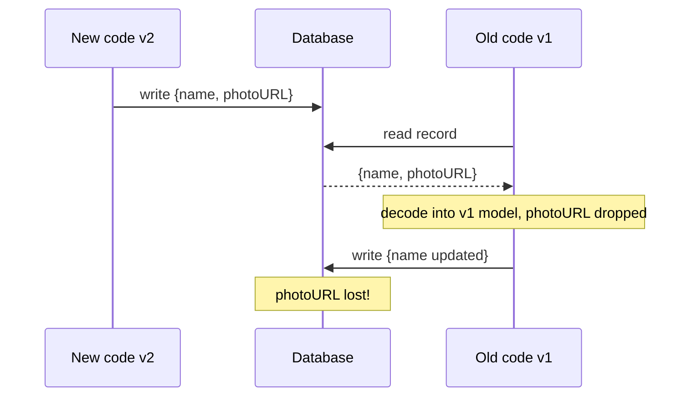
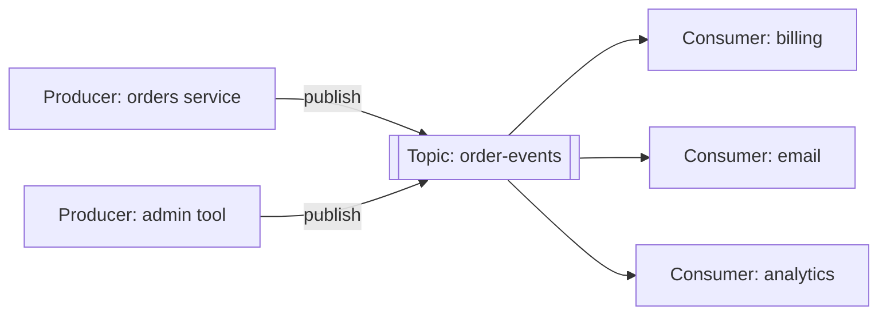

# Modes of data flow: databases, REST/RPC, message passing

> **Before this lesson:** read [Encoding formats and schema evolution](#/lesson/databases/encoding-formats). This lesson uses its terms throughout: encoding, decoding, backward and forward compatibility, rolling upgrade, JSON, Protocol Buffers and Avro. Client, server and API come from [Reliability and maintainability](#/lesson/databases/reliability-maintainability).

## In plain words

The previous lesson was about *how* data is packed into bytes. This one is about *who hands those bytes to whom*. A **process** is one running program. There are three common ways for one process to pass data to another, and each has an everyday counterpart.

1. **Through a database.** One process writes a record and another reads it later. This is leaving a note in a shared filing cabinet. The reader may come by years afterwards, and may even be the writer's own future self.
2. **Through a service call.** One process sends a request over the network and waits for the answer. This is a phone call: you ask, you wait on the line, you get a reply, and if the line goes dead you are left unsure what the other person heard.
3. **Through a message.** One process hands a message to an intermediary, which delivers it when the recipient is ready. This is posting a letter. You do not wait by the letterbox, and the post office holds the letter if nobody is home.

The route matters because it decides who has to understand whose data, and for how long. A phone call involves two parties at one moment. A note in a filing cabinet may be read by someone using rules that did not exist when it was written.

Why this matters for a job: every backend system is built from these three connections, and choosing between a direct call and a message queue is one of the first decisions in any system-design interview. This lesson also introduces the **idempotency key**, a small technique that prevents customers being charged twice and that interviewers ask about by name.

## 1. Dataflow through databases

The process that writes a record encodes it. The process that reads it later decodes it. They may be different programs, or the same program at a later time. In that second case, storing data amounts to **sending a message to your future self**.

Which kinds of compatibility are needed?

- **Backward compatibility** is plainly required. Without it, a newer version of the program could not read what an older version stored.
- **Forward compatibility** is usually required as well, and this surprises people. Picture a rolling upgrade in progress. Half the machines run the new code and half the old, and all of them share one database. A machine running new code writes a record. A moment later a machine still running old code reads that same record. Old code is now reading data written by new code.

### 1.1 Preserving unknown fields

Sharing a database between versions creates a trap. Follow these steps:

1. New code adds a field called `photoURL` to user records and writes one.
2. Old code reads that record. It decodes the bytes into its own kind of object, which was written before `photoURL` existed and has nowhere to put it.
3. The old code changes something unrelated, such as the user's name, and writes the record back.
4. The record in the database no longer has a `photoURL`.

Nobody deleted the field. It was lost in translation.



This is a **sequence diagram**: time runs from top to bottom, each vertical line is one participant, and each arrow is a message from one to another. Reading down, the new code writes both fields, the old code reads them, drops one while decoding, and writes back a record without it.

The encoding formats of the previous lesson are able to carry unknown fields along untouched. The danger is in the application code that sits on top of them. If a program copies a decoded record into its own objects and then encodes those objects, anything the objects have no place for is gone. Code that reads a record, changes it and writes it back must be written to keep what it does not understand.

### 1.2 Data outlives code

> **Data outlives code.** Installing a new version of an application replaces all of the old code within minutes. The data is another matter. A record written five years ago is still in the database in the encoding of five years ago, unless someone has deliberately rewritten it.

Rewriting all existing data into a new format is called **migrating** it. On a large dataset that is slow and costly, so databases avoid it when they can. A relational database, for example, lets you add a column whose default is `NULL` (the SQL marker for "no value") without touching any existing row. When an old row is read, the database fills in `NULL` for the missing column on the way out. LinkedIn's document database Espresso stores its documents in Avro so that it gets Avro's evolution rules for free.

The effect of schema evolution is that the database *appears* to hold data in a single, current format, while the bytes on disk were written under many different versions over the years.

### 1.3 Archival storage

From time to time a complete copy of a database is taken, for backup or to load into a data warehouse. Such a copy is called a **snapshot** or a dump. Since the whole dataset is being copied anyway, the copy is normally written in the *latest* schema throughout, even if the source contained a mixture of versions.

A dump is written once and never changed afterwards. That makes it a good fit for Avro's file format, where the schema is stored once at the top. It is also a natural moment to write the data in a column-oriented format such as Parquet, ready for analysis.

## 2. Dataflow through services: REST and RPC

When processes talk over a network, the usual arrangement has two roles. A **server** offers an API over the network, and a **client** sends requests to it. The API a server offers is called a **service**.

The web works this way. Your browser is a client. It sends requests using **HTTP** (Hypertext Transfer Protocol, the set of rules for web requests): a `GET` request to fetch a page, a `POST` request to submit a form. Apps on a phone and scripts running inside a web page make requests too, and usually receive JSON.

A server can also be a client of another server. A large application is commonly divided into many smaller services, each responsible for one area (payments, search, user accounts), which call each other. This style was once called service-oriented architecture and is now known as **microservices**.

The point of dividing an application this way is that each service can be **changed and released independently**. One team owns one service and ships new versions when it likes, without waiting for other teams. A direct consequence is that old and new versions of clients and servers will be talking to each other all the time. The data format of every API therefore has to stay compatible across versions.

### 2.1 Web services: REST vs SOAP

A service that communicates over HTTP is called a **web service**, even when no browser is involved. That covers an app on a phone calling a company's servers, one service calling another inside the same company, and one company's service calling another company's (for example, a shop's server calling a card-payment provider).

Two approaches to designing web services exist:

- **REST** (representational state transfer) is a design style, not a strict standard. It builds directly on how HTTP already works. Each thing the service manages, called a **resource**, has its own web address (URL). Data is sent in plain formats, usually JSON. Features that HTTP already has, such as caching and authentication, are used as they are. An API built this way is described as **RESTful**. A description format called **OpenAPI** (also known as Swagger) can document such an API in a form that tools understand.
- **SOAP** is an older standard based on XML. It tries to be independent of HTTP and comes with a large family of additional standards. A SOAP API is described in a language called WSDL, from which tools generate code. Its messages are too complicated to write by hand, so it depends heavily on tooling. It is still found in large enterprises and has fallen out of favour elsewhere.

### 2.2 The problems with remote procedure calls

A **function** (or procedure) is a named piece of code you can call. **RPC**, short for **remote procedure call**, is an idea from the 1980s: make a request to a service on another machine *look* exactly like calling an ordinary function in your own program. The goal of hiding where the code runs is called **location transparency**.

DDIA argues that this idea is flawed at its root, because a network request differs from a local function call in ways that no amount of disguise can remove:

- **A local call is predictable.** It succeeds or fails depending on the inputs you gave it. A network request can fail for reasons that have nothing to do with you: the request was lost on the way, the reply was lost on the way back, or the other machine is overloaded or switched off.
- **A network request can end with no answer at all.** After waiting a set time, the caller gives up. This is a **timeout**. The caller then does not know whether the request arrived and was acted on, or never arrived.
- **Retrying can repeat the action.** If the request did arrive and only the reply was lost, sending it again makes the action happen twice. Protecting against this needs **idempotence**, covered below.
- **Response time varies enormously.** The same local function takes about the same time on every call. A network request may take under a millisecond or several seconds.
- **Arguments must be encoded.** A local function can be handed a pointer to an object already in memory. A network request has to turn everything it sends into bytes, which becomes a problem with large objects.
- **The two sides may use different programming languages.** The RPC system must translate data types between them, and the translation is not always exact, as the large-number problem with JavaScript in the previous lesson showed.

> [!WARNING]
> Pretending that a remote service is a local object does not make it one. Part of REST's appeal is that it does *not* hide the network. A REST call is plainly a request sent to another machine, with everything that implies.

### 2.3 Current directions for RPC

RPC remains widely used all the same, in modern forms that are more honest about the network. They are built on the encodings from the previous lesson.

- **gRPC** is Google's RPC system. It uses Protocol Buffers for encoding. It supports **streams**, where one call consists of a series of messages over time and not a single request and reply.
- **Thrift** and **Avro** each include an RPC system of their own.
- Newer frameworks represent a call that has not finished yet as an object called a **future** or **promise**, which stands for "a result that will arrive later, or a failure". This makes it natural to send requests to several services at once and wait for all of them.
- **Service discovery** is how a client finds out at which network address a service can currently be reached, since machines come and go.

Binary RPC protocols can be faster than JSON over REST. REST with JSON remains the usual choice for **public APIs**, for practical reasons: it can be tried out from a web browser or with the command-line tool `curl`, every programming language supports it, and a whole ecosystem of existing tools (caches, load balancers, monitoring) understands it. RPC is mostly used **between services belonging to the same organisation**, typically within one datacenter.

### 2.4 Data encoding and evolution for RPC

Clients and servers need to be upgraded independently. To reason about it, DDIA makes a simplifying assumption: **servers are upgraded first, clients afterwards**. Two requirements follow:

- **Requests need backward compatibility.** A new server will receive requests from old clients and must understand them.
- **Responses need forward compatibility.** An old client will receive responses from new servers and must cope with whatever was added.

How this is achieved depends on the encoding. gRPC, Thrift and Avro RPC follow the evolution rules of their formats. RESTful APIs usually send JSON without a formal schema; adding an optional request parameter or an extra field in a response seldom breaks anything.

Compatibility is hardest when an API is used by other organisations, because you cannot make them upgrade. A provider may have to keep several versions of its API running side by side for years. There is no single agreed way to label versions. Common methods are putting the version in the address (`/v2/users`), putting it in a request header, or recording on the server which version each customer signed up with (the payment company Stripe does this).

### 2.5 Idempotence and the idempotency key

An operation is **idempotent** if performing it twice has the same effect as performing it once. "Set the light to off" is idempotent. "Flip the light switch" is not.

This property is what makes retrying safe. Consider "transfer 30 from Alice to Bob". The client sends the request, and the reply is lost on the network. Should the client try again? If the first attempt did not arrive, it must. If the first attempt did arrive, a retry moves the money twice.

The standard solution is an **idempotency key**. The client makes up a unique identifier for each operation it wants performed and sends it along with the request. The server records each identifier together with the result. If a request arrives with an identifier it has seen before, the server does not perform the operation again. It returns the stored result.

> [!INTERVIEW]
> For "how would you make this payment API safe to retry?", describe the idempotency key: the client generates one unique ID per intended operation, the server stores the pair (key, result), and a repeated key gets the stored result back. The network may deliver the request more than once, but the *effect* happens once.

```python-run
import uuid

class PaymentService:
    def __init__(self):
        self.results = {}          # idempotency_key -> response
        self.balance = {"alice": 100, "bob": 0}

    def transfer(self, key, src, dst, amount):
        if key in self.results:                    # duplicate: replay stored response
            return self.results[key] + " (replayed)"
        self.balance[src] -= amount
        self.balance[dst] += amount
        resp = f"moved {amount} {src}->{dst}"
        self.results[key] = resp
        return resp

svc = PaymentService()
key = str(uuid.uuid4())
print(svc.transfer(key, "alice", "bob", 30))
# response lost on the network -> client retries with SAME key
print(svc.transfer(key, "alice", "bob", 30))
print("balances:", svc.balance)
# without an idempotency key the retry would have double-charged:
print(svc.transfer(str(uuid.uuid4()), "alice", "bob", 30), "<- new key = new transfer")
print("balances:", svc.balance)
```

What each part does:

- `self.results` is a dictionary from idempotency key to the reply that was given. `self.balance` holds two account balances.
- `transfer` first checks whether the key has been seen. If so, it returns the saved reply (with "(replayed)" added so the demo shows what happened) and changes no balances.
- Otherwise it moves the money, builds the reply, saves the reply under the key, and returns it.
- `uuid.uuid4()` generates a random identifier that is, for practical purposes, unique.
- The script calls `transfer` twice with the *same* key, imitating a retry after a lost reply, then once with a *new* key.

```
moved 30 alice->bob
moved 30 alice->bob (replayed)
balances: {'alice': 70, 'bob': 30}
moved 30 alice->bob <- new key = new transfer
balances: {'alice': 40, 'bob': 60}
```

After the first two calls Alice has 70, not 40: the retry was recognised and nothing moved the second time. The third call carries a different key, so the server treats it as a new instruction and moves another 30. That is correct behaviour. The key identifies the *intention*, and it is the client's job to reuse the key for a retry and create a fresh one for a new operation.

## 3. Message-passing dataflow

The third route sits between the other two. In **asynchronous message passing**, a process sends a **message** to another process, but not directly. The message goes to an intermediary called a **message broker** (or message queue), which stores it briefly and passes it on. It is like RPC in that the message is usually delivered within moments. It is like a database in that something in the middle holds the data.

**Asynchronous** means the sender does not wait. It hands the message over and carries on with its work.

Compared with calling the recipient directly, a broker offers several advantages:

- **It acts as a buffer.** If the recipient is down or overloaded, the broker holds the messages until the recipient can take them. The whole system tolerates faults better.
- **It can redeliver.** If the recipient crashes part-way through handling a message, the broker gives the message out again, so the work is not lost.
- **The sender needs no address.** It does not have to know which machine the recipient is on. That is helpful in cloud systems where machines are created and destroyed constantly.
- **One message can reach many recipients.**
- **It decouples the two sides.** The sender publishes a message and has no need to know who will use it, or whether anyone will.

Communication through a broker is normally **one-way**. The sender does not expect a reply. If one is needed, the recipient sends it as a separate message on a separate channel.

### 3.1 Message brokers

Widely used open-source brokers include **RabbitMQ**, ActiveMQ, NATS and **Apache Kafka**. The lessons on stream processing compare them in depth. They share a general pattern:

- A sending process, the **producer**, sends each message to a named destination called a **queue** or a **topic**.
- The broker makes sure the message reaches the processes that have registered interest in that name. These are the **consumers** or **subscribers**.
- A topic can have many producers and many consumers.



In the diagram two different producers publish to one topic, and three unrelated consumers each receive the messages. The order service does not know that billing, email and analytics exist.

A broker generally does not care what is inside a message. To the broker it is a block of bytes with a little descriptive information attached. The choice of encoding belongs to you. If that encoding is backward and forward compatible, producers and consumers can be upgraded in any order. One warning carries over from databases: a consumer that reads a message and republishes it to another topic must **preserve fields it does not recognise**.

### 3.2 Distributed actor frameworks

The **actor model** is a way of organising a program that does many things at once. The program is made of **actors**. Each actor is a small unit with its own private data that nothing else can touch. Actors communicate only by sending one another asynchronous messages. An actor handles one message at a time, so the programmer does not have to manage several things changing the same data at the same moment. Delivery of a message is not guaranteed.

A **distributed actor framework** spreads actors across many machines. When an actor sends a message to an actor on another machine, the framework encodes it and sends it over the network without the program having to say so. This is location transparency again, the idea criticised for RPC. Here it does less harm, because the actor model *already* assumes a message may get lost, even between two actors on the same machine. Code written for actors is prepared for failure from the start, so the difference between local and remote is small.

Three well-known frameworks are **Akka**, **Orleans** and **Erlang OTP**. For rolling upgrades the same rule applies as everywhere else: old and new machines exchange messages, so the encoding must be compatible in both directions. Akka's default is Java's built-in serialization, which is not, and teams replace it with something like Protocol Buffers.

## 4. Choosing among the three

| Mode | Coupling | Latency | Typical use | Compatibility concern |
|---|---|---|---|---|
| Database | Through shared data | Varies | System of record, sending to "future self" | Data outlives code; both directions |
| REST/RPC | Synchronous, caller waits | Low, but fails with network | Request/response between services | Backward on requests, forward on responses |
| Messaging | Async, decoupled via broker | Low, buffered | Events, work queues, fan-out | Producers and consumers deploy independently |

In the table, **coupling** means how much one side depends on the other being present and behaving in a particular way. A direct call couples the caller to the callee tightly: if the callee is down, the caller fails. A broker loosens that.

A rough guide for design discussions:

- Use a **direct call** (REST or RPC) when the caller needs the answer to continue: "is this password correct?", "what is the price of this item?".
- Use a **message** when the work can happen a little later and the sender does not need the result: "send a confirmation email", "update the search index", "record this event for analytics".
- Remember that the **database** is itself a channel between versions of your code, and often the longest-lived one.

## 5. Pitfalls

- **Treating a remote call like a local one.** The signs are: no timeout set, retries without idempotency, and code that makes dozens of small calls in sequence where one larger call would do.
- **Old consumers dropping new fields** when they decode a message and publish it again.
- **Breaking a public API.** Removing a field from a response, or making a request parameter compulsory, breaks clients that you have no power to upgrade.
- **Assuming a broker delivers each message exactly once.** Most brokers promise that a message is delivered *at least* once, which means occasionally twice. Consumers must be able to recognise and ignore a repeat, for example with an idempotency key.

## 6. Summary

- Through **databases**: the writer encodes and a later reader decodes. Data outlives code, so schemas evolve gradually, and code that rewrites records must preserve fields it does not know.
- Through **services**: REST (HTTP and JSON, the norm for public APIs) and RPC (gRPC, Thrift; the norm inside one organisation). RPC cannot truly hide the network: requests fail, time out, get repeated and vary in speed.
- Through **messages**: a broker buffers, redelivers and decouples. Actor frameworks extend message passing across machines.
- In every mode, upgrading without stopping the system depends on **backward and forward compatibility**.

## Glossary

- **Process** - one running program.
- **Dataflow** - the route by which data passes from one process to another.
- **Sequence diagram** - a diagram with time running downward and arrows showing messages between participants.
- **Migration** - rewriting existing data into a new format.
- **Snapshot (dump)** - a complete copy of a database at one moment.
- **Service** - an API offered over a network by a server.
- **HTTP** - the rules for requests and responses on the web.
- **Microservices** - an application built as many small services that are released independently.
- **Web service** - a service that communicates over HTTP.
- **REST / RESTful** - a design style for web services built on HTTP's own features / an API following it.
- **Resource** - a thing a REST API manages, identified by its own URL.
- **SOAP** - an older XML-based standard for web services.
- **RPC (remote procedure call)** - making a network request look like a local function call.
- **Location transparency** - hiding whether code runs locally or on another machine.
- **Timeout** - giving up on a request after waiting a set time.
- **Idempotent** - having the same effect whether done once or several times.
- **Idempotency key** - a unique ID sent with a request so the server can recognise a retry.
- **gRPC** - an RPC system that uses Protocol Buffers.
- **Future (promise)** - an object standing for a result that will arrive later.
- **Service discovery** - finding the current network address of a service.
- **Asynchronous** - not waiting for the other side before continuing.
- **Message broker (message queue)** - an intermediary that stores messages briefly and delivers them.
- **Producer / consumer (subscriber)** - a process that sends messages / a process that receives them.
- **Queue / topic** - a named destination for messages.
- **Coupling** - how strongly one component depends on another.
- **Actor model** - organising a program as units with private data that communicate only by messages.
- **At-least-once delivery** - a guarantee that a message arrives one or more times.

```quiz
[
  {"q": "Why is forward compatibility usually required for data stored in a database?",
   "options": ["Databases never change", "During rolling upgrades, data written by newer code may be read by older code still running", "Because of backups", "Because SQL requires it"],
   "answer": 1,
   "explain": "Mixed-version deployments mean old readers may see new writers' data."},
  {"q": "What does 'data outlives code' mean?",
   "options": ["Data is more important than code", "A new deploy replaces code quickly, but old data in old encodings persists for years unless migrated", "Code should be stored in the database", "Backups last longer than releases"],
   "answer": 1,
   "explain": "Schema evolution lets the database appear to have a single schema even though records were written with many versions."},
  {"q": "Which is NOT a reason DDIA gives for RPC being a leaky abstraction?",
   "options": ["Requests can time out with no result", "Retries can execute an action twice", "Latency is highly variable", "Local function calls are always slower than network calls"],
   "answer": 3,
   "explain": "Local calls are fast and predictable; the network introduces loss, timeouts, duplication and variable latency."},
  {"q": "Assuming servers are upgraded before clients, an RPC API needs...",
   "options": ["Forward compatibility on requests and backward on responses", "Backward compatibility on requests and forward compatibility on responses", "No compatibility", "Only backward compatibility"],
   "answer": 1,
   "explain": "New servers handle old requests (backward); old clients handle new responses (forward)."},
  {"q": "Which is an advantage of using a message broker over direct RPC?",
   "options": ["Synchronous responses", "It buffers messages when consumers are unavailable and decouples sender from receiver", "It guarantees exactly-once processing automatically", "It removes the need for encoding"],
   "answer": 1,
   "explain": "Brokers improve reliability and decoupling; delivery is typically at-least-once."},
  {"q": "Why does location transparency work better in the actor model than in RPC?",
   "options": ["Actors use TCP", "The actor model already assumes messages may be lost, even locally", "Actors are synchronous", "Actors share memory"],
   "answer": 1,
   "explain": "There is less mismatch between local and remote semantics when the local model already tolerates loss."},
  {"q": "How does an idempotency key make retries safe?",
   "options": ["It encrypts the request", "The server records the result per key and returns it for duplicates instead of re-executing", "It speeds up the network", "It sorts requests"],
   "answer": 1,
   "explain": "Duplicate deliveries become harmless replays."}
]
```

> **Source:** DDIA ch. 4, "Modes of Data Flow" (through databases, through services: REST and RPC, message-passing data flow).
