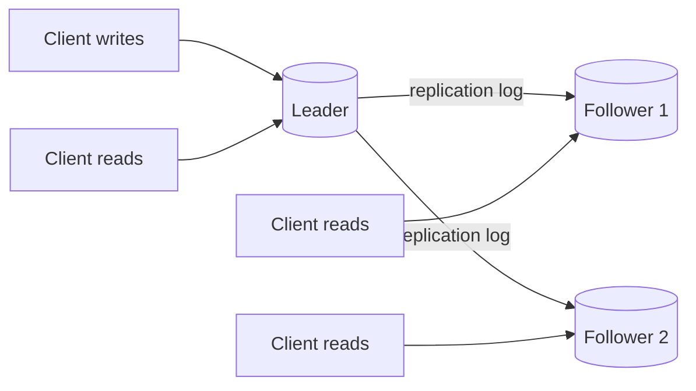
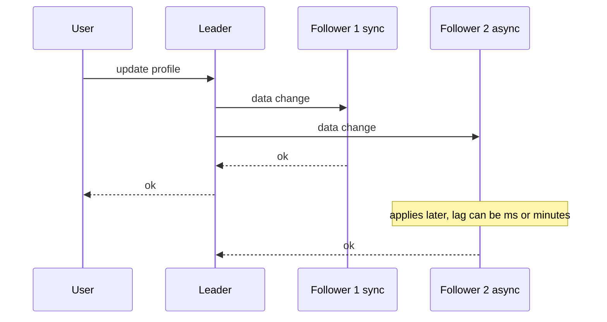

# Single-leader replication and replication lag

**Replication** means keeping a copy of the same data on several machines connected by a network. Reasons to do it:

- **Reduce latency** by keeping data geographically close to users.
- **Increase availability** so the system keeps working when some parts fail.
- **Scale read throughput** by adding machines that can serve reads.

This chapter assumes each machine can hold a full copy of the dataset. Partitioning, for when it cannot, comes in Chapter 6. If data never changed, replication would be trivial: copy it once. All the difficulty lies in **handling changes**. Three families of algorithms do this: **single-leader**, **multi-leader** and **leaderless**.

## 1. Leaders and followers

Each node that stores a copy is a **replica**. How do we ensure every write reaches every replica? The most common answer is **leader-based replication**, also called *active/passive* or *master–slave*:

1. One replica is designated the **leader** (primary, master). Clients must send **writes** to it, and it writes the new data to its local storage.
2. The other replicas are **followers** (read replicas, secondaries, hot standbys). When the leader writes, it also sends the change to all followers as a **replication log** or **change stream**. Each follower applies the writes **in the same order** as the leader.
3. Clients can **read** from the leader or from any follower. Writes are accepted only by the leader.



This is built into PostgreSQL (streaming replication), MySQL, Oracle Data Guard and SQL Server AlwaysOn, and also into MongoDB, RethinkDB and Espresso, and into brokers such as **Kafka** and RabbitMQ's highly available queues.

## 2. Synchronous vs asynchronous replication

- **Synchronous.** The leader waits until a follower confirms it received the write before reporting success to the user. The follower is then guaranteed to have an up-to-date copy. The downside: if that follower does not respond because it crashed, the network failed or it is slow, **the write cannot proceed**, and the leader blocks.
- **Asynchronous.** The leader sends the change and does not wait for confirmation.



Making *all* followers synchronous is impractical, because any one outage would halt the system. In practice "synchronous replication" usually means **semi-synchronous**: *one* follower is synchronous and the rest are async. If the synchronous follower becomes unavailable, an async one is promoted to synchronous. This guarantees an up-to-date copy on at least two nodes.

Fully **asynchronous** replication is common, especially with many followers or geo-distribution. The trade-off: if the leader fails unrecoverably, **writes not yet replicated are lost**, even though the client was told they succeeded. The advantage is that the leader keeps processing writes even if every follower has fallen behind.

> [!NOTE]
> **Chain replication** (used in Azure Storage) is a variant of synchronous replication that keeps good performance and availability. Replication is closely tied to **consensus** (Chapter 9).

## 3. Setting up new followers

You cannot just copy the data files, because clients keep writing and a naive copy is inconsistent. Locking the database would hurt availability. The procedure is:

1. Take a **consistent snapshot** of the leader at some point in time, without taking a lock. Most databases can do this for backups. Tools like `innobackupex` exist for MySQL, and for PostgreSQL you use `pg_basebackup`.
2. Copy the snapshot to the new follower.
3. The follower connects to the leader and requests every change **since the snapshot**. The snapshot must be associated with an exact position in the leader's replication log: PostgreSQL's **log sequence number (LSN)**, MySQL's **binlog coordinates** or GTID.
4. Once the follower has processed the backlog, it has **caught up** and continues streaming.

## 4. Handling node outages

### 4.1 Follower failure: catch-up recovery

Each follower keeps a log of the changes it received. After a crash or network interruption it knows the last transaction it processed, so it reconnects and requests everything after that point.

### 4.2 Leader failure: failover

**Failover** is trickier. One follower must be promoted, clients must send writes to it, and the other followers must follow it. Automatic failover has three steps:

1. **Determine that the leader has failed.** There is no foolproof way, so nearly all systems use a **timeout**: no response for, say, 30 seconds means the node is assumed dead.
2. **Choose a new leader** by election (a majority of replicas) or by appointing one through a previously elected **controller** node. The best candidate is the replica with the most up-to-date data. Getting nodes to agree is a **consensus** problem (Chapter 9).
3. **Reconfigure** clients to send writes to the new leader. If the old leader comes back it may still believe it is the leader, so the system must make it step down and become a follower.

Failover is full of things that can go wrong:

- **Lost writes with async replication.** The new leader may not have received all the old leader's writes. If the old leader rejoins, what should happen to the conflicting writes? The usual answer is to **discard** them, which violates clients' durability expectations.
- **Discarding writes is dangerous when other systems depend on them.** In a GitHub incident, an out-of-date MySQL follower was promoted. It reused auto-increment primary keys that had already been assigned by the old leader. Those keys were also used in a **Redis** store, so private data leaked between users.
- **Split brain.** Two nodes both believe they are the leader. If both accept writes with no conflict resolution, data is lost or corrupted. Some systems shut one node down when two leaders are detected, a mechanism called **STONITH** ("Shoot The Other Node In The Head"), but a badly designed version can shut down *both*.
- **Choosing the timeout.** Too long means a long recovery. Too short means unnecessary failovers: a temporary load spike or network glitch triggers a failover that makes an overloaded system worse.

Because of these problems, some operations teams prefer to fail over **manually**, even when the software supports automatic failover. These issues (node failures, unreliable networks, trade-offs between consistency, durability, availability and latency) are fundamental to distributed systems and recur throughout Chapters 8 and 9.

## 5. Implementation of replication logs

### 5.1 Statement-based replication

The leader logs every write **statement** (`INSERT`, `UPDATE`, `DELETE`) and sends it to followers, which execute it as if received from a client. It breaks in several ways:

- **Nondeterministic functions** such as `NOW()` or `RAND()` produce different values on each replica.
- Statements using an **auto-increment** column, or that depend on existing data (`UPDATE ... WHERE <condition>`), must execute in **exactly the same order** on every replica, which limits concurrency.
- **Side effects** from triggers, stored procedures and user-defined functions may differ.

Workarounds exist (the leader can substitute fixed values for nondeterministic calls), but MySQL before 5.1 used this method and now prefers row-based replication. VoltDB uses statement-based replication safely by **requiring deterministic transactions**.

### 5.2 Write-ahead log (WAL) shipping

The storage engine already writes an append-only log of every byte change (Chapter 3). Send that same log to followers. PostgreSQL and Oracle do this. The downside is that the log describes data at a **very low level**, such as which bytes changed in which disk blocks. Replication is tightly **coupled to the storage engine** and usually requires the **same software version** on leader and followers, which rules out **zero-downtime upgrades** that work by upgrading followers first and then failing over.

### 5.3 Logical (row-based) log replication

Use a different log format for replication than for storage, decoupling replication from the engine internals. A **logical log** is a sequence of records describing writes at **row granularity**:

- insert: the new values of all columns,
- delete: enough to identify the row (the primary key),
- update: the row identifier plus the new values of changed columns.

A transaction that touches several rows produces several records plus a commit record. MySQL's **binlog** in row-based mode works this way. Advantages: it is **backward compatible**, so leader and followers can run different versions or even different storage engines, and it is **easy for external applications to parse**. That last point enables **change data capture** into warehouses, caches and search indexes (Chapter 11). PostgreSQL's **logical decoding** offers the same.

### 5.4 Trigger-based replication

Moving replication up into the application layer is useful when you need flexibility, such as replicating only a subset of data or between different kinds of database. **Triggers** register custom code that runs on writes and logs changes to a separate table, which an external process reads (Databus for Oracle, Bucardo for Postgres). It has more overhead and is more bug-prone, but it is flexible.

## 6. Problems with replication lag

Leader-based replication with many async followers is attractive for **read-scaling** workloads that are mostly reads, as is common on the web. With async followers you can read stale data. If you stop writing and wait, followers eventually catch up. This is **eventual consistency**. "Eventually" is deliberately vague: lag is usually a fraction of a second, but under load or network problems it can be **seconds or minutes**. Three anomalies follow.

### 6.1 Reading your own writes

A user submits a comment and then views the page. If the read goes to a lagging follower, **their own comment seems to have vanished**.

**Read-after-write consistency** (read-your-writes) guarantees that a user always sees their own updates. It makes no promise about other users' updates. Techniques:

- Read data the user **may have modified** from the leader, and everything else from followers. Example: always read the user's own profile from the leader.
- If most things are editable, track **time since last update**. For one minute after a write, read from the leader. Or monitor follower lag and avoid followers that are more than a minute behind.
- The client remembers the **timestamp** (or log position) of its most recent write, and the system ensures the replica serving its reads is updated at least to that point. If it is not, it tries another replica or waits.
- Multi-datacenter: requests that must go to the leader are routed to the datacenter containing it.

**Cross-device** read-after-write is harder. A user writes on a laptop and reads on a phone. The "last write timestamp" must be **centralised**, and requests from different devices may be routed to different datacenters.

### 6.2 Monotonic reads

A user refreshes a page twice. The first read goes to a fresh follower and the second to a staler one, so a comment that appeared **disappears**. They have moved **backwards in time**.

**Monotonic reads** guarantees this does not happen. It is weaker than strong consistency but stronger than eventual consistency. One implementation: each user always reads from the **same replica**, chosen by a hash of the user id. If that replica fails, reads are rerouted.

### 6.3 Consistent prefix reads

DDIA's example is a conversation between Mr. Poons and Mrs. Cake:

> Poons: *How far into the future can you see, Mrs. Cake?*
> Cake: *About ten seconds usually, Mr. Poons.*

An observer reading through lagging partitions may see the answer *before* the question, which **violates causality**. **Consistent prefix reads** guarantees that if writes happen in some order, anyone reading them sees them in that order. It is mostly a problem in **partitioned** databases, where different partitions operate independently and there is no global ordering of writes. One solution is to make sure causally related writes go to the same partition. There are also algorithms that track causal dependencies (*happens-before*, covered later).

```python-run
import random
random.seed(5)

# leader applies writes at t=0,1,2,...; follower i lags by lag[i] seconds
writes = [(0.0, "comment#1"), (1.0, "comment#2"), (2.0, "comment#3")]
lags = {"f1": 0.2, "f2": 2.5, "f3": 1.1}

def visible(replica, t):
    return [w for (wt, w) in writes if wt + lags[replica] <= t]

print("=== monotonic reads violation (random replica per request) ===")
for t in [2.6, 2.7, 2.8]:
    r = random.choice(list(lags))
    print(f"t={t}: read from {r}: {visible(r, t)}")

print("=== fix: sticky replica by hash(user) ===")
user = "alice"
r = sorted(lags)[sum(map(ord, user)) % len(lags)]
for t in [2.6, 2.7, 2.8, 4.6]:
    print(f"t={t}: read from {r}: {visible(r, t)}")

print("=== read-your-writes: client remembers its last write position ===")
my_last_write_t = 2.0
def read_ryw(t):
    for rep in sorted(lags, key=lambda x: lags[x]):          # try replicas
        if my_last_write_t + lags[rep] <= t:
            return rep, visible(rep, t)
    return "leader", [w for (_, w) in writes]
print("t=2.1 ->", read_ryw(2.1))
print("t=3.2 ->", read_ryw(3.2))
```

### 6.4 Solutions for replication lag

When working with an eventually consistent system, ask what happens if replication lag grows to several minutes or hours. If the answer is "bad user experience", design for a stronger guarantee such as read-after-write. Pretending replication is synchronous when it is not is a recipe for problems. Application-level workarounds are complex and easy to get wrong. It would be better if developers could trust the database to "do the right thing", which is the reason **transactions** exist (Chapter 7). DDIA notes that many distributed systems abandoned transactions, claiming they are too expensive for performance and availability. That view is overly simplistic.

> [!INTERVIEW]
> For "a user updates their profile and refreshes, but the old data shows", name the anomaly (**read-your-writes** violation from async replica lag). Offer fixes: read own data from the leader, pin to the leader for N seconds after a write, or have the client pass its last-write LSN so replicas wait until caught up. PostgreSQL exposes `pg_last_wal_replay_lsn()` on replicas for this purpose. Mention **monotonic reads** through sticky routing.

## 7. Summary

- Single-leader: all writes go to one leader, which streams a replication log to followers. Reads can go to any replica.
- Synchronous replication gives durability but blocks on failures. Async is fast but can lose acknowledged writes on failover. Semi-sync is the common middle ground.
- Failover is risky: lost writes, split brain, timeout tuning.
- Log formats: statement-based (nondeterminism issues), WAL shipping (version-coupled), logical row-based (decoupled, enables CDC), trigger-based.
- Lag anomalies and their guarantees: **read-your-writes**, **monotonic reads**, **consistent prefix reads**.

```quiz
[
  {"q": "In 'semi-synchronous' replication...",
   "options": ["All followers are synchronous", "One follower is synchronous and the rest asynchronous", "No follower acknowledges writes", "The leader replicates every other write"],
   "answer": 1,
   "explain": "This guarantees at least two up-to-date copies without blocking on every follower."},
  {"q": "What is a key risk of asynchronous replication during failover?",
   "options": ["Reads become slower", "Writes acknowledged by the old leader but not yet replicated may be lost", "Followers cannot be promoted", "The WAL becomes corrupt"],
   "answer": 1,
   "explain": "The new leader may lack recent writes; they are typically discarded."},
  {"q": "Why can statement-based replication produce divergent replicas?",
   "options": ["Statements are too large", "Nondeterministic functions like NOW() or RAND() and order-dependent statements evaluate differently on each replica", "Followers cannot parse SQL", "It uses a binary format"],
   "answer": 1,
   "explain": "Each replica re-executes the statement, so nondeterminism causes divergence."},
  {"q": "Which replication log format best supports change data capture into other systems?",
   "options": ["WAL shipping", "Logical (row-based) log", "Statement-based", "Snapshot copying"],
   "answer": 1,
   "explain": "Logical logs describe row-level changes independently of storage internals, making them easy to parse externally."},
  {"q": "A user refreshes twice and a comment appears then disappears. Which guarantee is violated?",
   "options": ["Read-your-writes", "Monotonic reads", "Linearizability of writes", "Durability"],
   "answer": 1,
   "explain": "The second read hit a staler replica: time went backwards. Fix with sticky replica routing."},
  {"q": "A reader sees an answer before the question that prompted it. Which guarantee is missing?",
   "options": ["Monotonic reads", "Consistent prefix reads", "Read-your-writes", "Atomicity"],
   "answer": 1,
   "explain": "Causally ordered writes were observed out of order, typical in partitioned databases."},
  {"q": "What is 'split brain'?",
   "options": ["A follower lagging behind", "Two nodes both believing they are the leader and accepting writes", "A partition with no replicas", "A corrupted B-tree"],
   "answer": 1,
   "explain": "Without conflict resolution, both leaders' writes can conflict, causing data loss or corruption."},
  {"q": "What does a new follower need besides a snapshot of the leader?",
   "options": ["Nothing", "The snapshot's exact position in the replication log, so it can request all subsequent changes", "A copy of every client's cache", "A new primary key"],
   "answer": 1,
   "explain": "E.g., PostgreSQL LSN or MySQL binlog coordinates."}
]
```

> **Source:** DDIA ch. 5, "Replication" (Leaders and Followers; Problems with Replication Lag).
