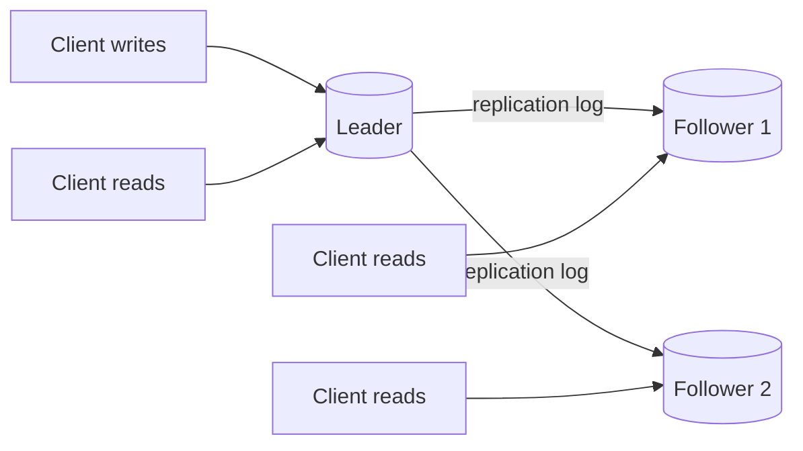
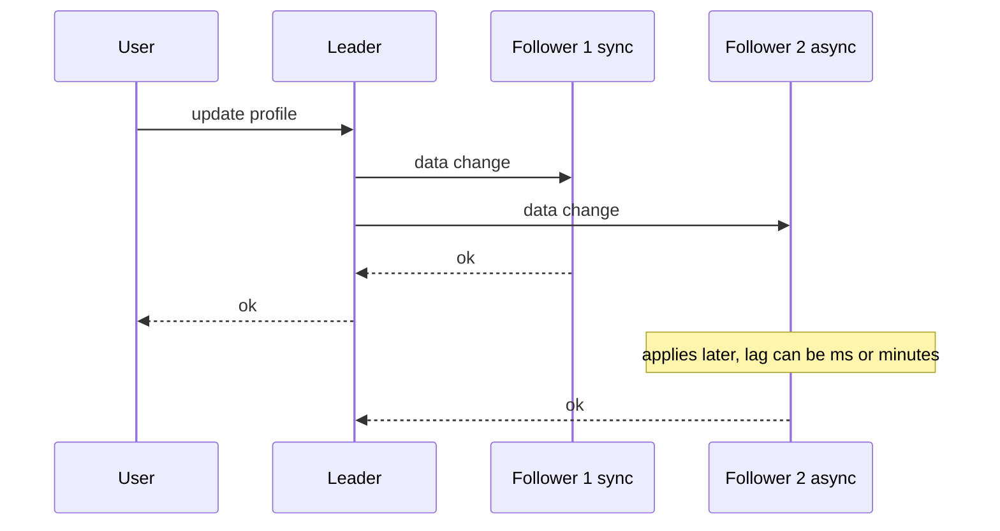

# Single-leader replication and replication lag

> **Before this lesson:** you should know the words fault, failure, node, cluster and scaling out from [Reliability and maintainability](#/lesson/databases/reliability-maintainability) and [Scalability](#/lesson/databases/scalability-percentiles), and what a write-ahead log is from [B-trees](#/lesson/databases/btrees). Timeouts and asynchronous communication were introduced in [Modes of data flow](#/lesson/databases/dataflow-modes).

## In plain words

**Replication** means keeping a copy of the same data on several machines that are connected by a network.

An everyday picture: a teacher writes on the whiteboard and thirty students copy it into their notebooks. Afterwards anyone can answer a question by looking at a notebook, without crowding around the board. If the teacher's board is wiped by accident, the lesson still exists in thirty places. But the notebooks are always a little behind the board, and a slow writer may be several lines behind. Ask a slow writer what the board says and you get an out-of-date answer.

That is the whole lesson in miniature. In **single-leader replication**, one machine (the teacher) accepts all changes, and the others (the students) copy from it. The delay between the leader and a copy is **replication lag**, and most of the difficulty comes from it.

There are three reasons to replicate:

- **To keep working when a machine dies.** This is **availability**.
- **To serve more reads.** Many machines can answer read requests in parallel.
- **To be near the users.** A copy in Europe answers European users faster than one in America.

Why this matters for a job: almost every production database runs with replicas, and a class of confusing bugs ("I saved my profile and the old one came back") is caused by replication lag. Interviewers expect you to name those bugs and their fixes, and to explain what can go wrong when a leader dies.

Throughout this lesson each machine holds a *complete* copy of the data. Splitting data that is too big for one machine is called partitioning and has its own lessons later. Note also that if data never changed, replication would be easy: copy it once. Everything hard about replication comes from **changes**. There are three families of methods for handling them: single-leader (this lesson), multi-leader and leaderless (next lesson).

## 1. Leaders and followers

A machine that holds a copy of the data is called a **replica**. The question is how to make sure every change reaches every replica. The most common answer is **leader-based replication**:

1. One replica is chosen as the **leader** (also called the primary). Every write must be sent to the leader. The leader applies the write to its own storage.
2. The other replicas are **followers** (also called read replicas or secondaries). Each time the leader applies a write, it also sends that change to every follower, as part of a continuous stream called the **replication log**. Each follower applies the changes **in exactly the order the leader did**.
3. A client that wants to **read** can ask the leader or any follower. Only the leader accepts **writes**.



In the diagram, writes enter at the leader only. The replication log flows from the leader to both followers. Reads can go anywhere.

The order rule in step 2 is essential. Suppose the leader sets a price to 10 and then to 12. A follower that applied those two changes in the opposite order would end up with 10, and the copies would disagree for ever.

This arrangement is built into PostgreSQL, MySQL, Oracle, SQL Server and MongoDB, and also into message brokers such as Kafka.

## 2. Synchronous vs asynchronous replication

When a client sends a write, at what point does the leader reply "done"? There are two choices, and the difference matters a great deal.

- **Synchronous replication:** the leader waits until the follower confirms it has received the write, and only then tells the client "done". The follower is guaranteed to have an up-to-date copy. The cost: if the follower is slow, has crashed, or cannot be reached, the leader cannot finish the write. It has to wait, and all writing stops.
- **Asynchronous replication:** the leader sends the change to the follower and tells the client "done" without waiting for confirmation.



Follow the sequence from the top. The user's update reaches the leader. The leader forwards it to both followers. Follower 1 is synchronous, so the leader waits for its "ok" before answering the user. Follower 2 is asynchronous: the leader does not wait for it, and its "ok" arrives some time later.

Making *every* follower synchronous is not practical, because then a single unreachable machine would stop all writes. In practice, when a database is described as using synchronous replication, it usually means **one** follower is synchronous and the rest are asynchronous. This is called **semi-synchronous**. If the synchronous follower becomes unavailable, one of the asynchronous ones takes its place. The guarantee is that at least two machines, the leader and one follower, hold every confirmed write.

Fully asynchronous replication is also very common, particularly when there are many followers or they are far apart. Its weakness needs stating precisely: if the leader dies and cannot be recovered, **any write that had not yet reached a follower is lost, even though the client was told it succeeded**. Its strength is that the leader carries on accepting writes no matter how far behind the followers are.

> [!NOTE]
> Losing confirmed writes is serious, and researchers have looked for methods that avoid it without the fragility of plain synchronous replication. Getting several machines to agree reliably on a sequence of writes is the problem of **consensus**, covered in the lessons on consistency and consensus.

## 3. Setting up new followers

New followers are needed regularly, to add capacity or replace a dead machine. Copying the leader's files across does not work, because clients keep writing during the copy, and the result would be a mixture of old and new that never existed at any single moment. Stopping all writes during the copy would work but defeats the purpose of high availability. The standard procedure avoids both problems:

1. Take a **consistent snapshot** of the leader: a copy of the whole database as it stood at one instant. Databases can produce this without blocking writes, since it is the same feature used for backups.
2. Copy the snapshot to the new machine.
3. The new follower connects to the leader and asks for every change made **since the snapshot**. For this to work, the snapshot must be tagged with an exact position in the leader's replication log. PostgreSQL calls that position the **log sequence number** (LSN); MySQL calls it the binlog coordinates.
4. The follower applies that backlog of changes. When it has finished, it has **caught up**, and from then on it processes changes as they arrive.

## 4. Handling node outages

Any machine can stop, whether from a fault or for planned maintenance. The aim is to keep the system as a whole running.

### 4.1 Follower failure: catch-up recovery

A follower keeps its own record of the changes it has applied, so after a crash or a network interruption it knows the position of the last change it handled. It reconnects to the leader and asks for everything after that position. This is the same mechanism as step 3 above.

### 4.2 Leader failure: failover

Losing the leader is harder. One of the followers has to be promoted to leader, clients have to be told to send their writes to it, and the remaining followers have to start copying from it. The whole procedure is called **failover**. When it is automatic it has three steps:

1. **Decide that the leader is dead.** There is no certain way to know. A machine that is not answering might have crashed, or might be slow, or the network between you might be broken. Nearly every system therefore uses a **timeout**: if the leader has not responded for some period, such as 30 seconds, it is declared dead.
2. **Choose a new leader.** The replicas can hold an **election**, where the candidate supported by a majority wins, or a separate coordinating node can appoint one. The best choice is the follower whose copy is most up to date. Getting all the nodes to agree on the choice is a consensus problem.
3. **Redirect everyone.** Clients must now send writes to the new leader. And if the old leader comes back to life, it may still believe it is in charge, so the system has to make it step down and become a follower.

Each step can go wrong:

- **Confirmed writes can be lost.** With asynchronous replication, the new leader may never have received the old leader's most recent writes. If the old leader then rejoins, those writes conflict with what has happened since. The usual resolution is to throw them away, which breaks the promise made to the clients who were told "done".
- **Throwing writes away can damage other systems.** In one incident at GitHub, a MySQL follower that was slightly behind was promoted to leader. MySQL was assigning row IDs from a counter, and the new leader's counter was behind, so it handed out IDs that the old leader had already used. Those same IDs were also stored in a separate Redis system. The mismatch caused some users to be shown private data belonging to others.
- **Two leaders at once.** If two nodes each believe they are the leader, both accept writes. This is called **split brain**. With nothing to reconcile their conflicting writes, data is lost or corrupted. Some systems respond by forcibly shutting one of the nodes down, and a poorly designed version of that safeguard can shut down both.
- **The timeout is a guess.** Set it long, and recovery after a real failure is slow. Set it short, and a brief slowdown is mistaken for a death, triggering a failover that was not needed. If the system was slow because it was overloaded, an unnecessary failover makes things worse.

Because of these dangers, some operations teams choose to perform failover by hand even when the software can do it automatically. The underlying difficulties (machines that fail, networks that cannot be trusted, and the tension between never losing data and always staying available) are not specific to replication. They are basic to all distributed systems and are examined in depth in later lessons.

## 5. Implementation of replication logs

What exactly does the leader send to its followers? Four designs are in use.

### 5.1 Statement-based replication

The leader records every write **statement** it runs, such as each `INSERT`, `UPDATE` or `DELETE` in SQL, and sends the text of the statement to the followers. Each follower runs it as if a client had sent it. This is compact, and it fails in three situations:

- **Statements that give a different result each time.** A statement that calls `NOW()` for the current time or `RAND()` for a random number will produce a different value on each replica. A function whose result is not fixed by its inputs is called **nondeterministic**.
- **Statements that depend on order.** If a statement uses an automatically increasing counter, or changes whichever rows currently match a condition, every replica must run all statements in precisely the same order, which restricts how much work can be done at once.
- **Statements with side effects.** Some databases let you attach extra code that runs automatically when data changes (a **trigger**). That code may behave differently on each replica.

There are ways round each of these, but there are so many special cases that most databases now prefer another method.

### 5.2 Write-ahead log (WAL) shipping

Earlier lessons showed that a storage engine already keeps an append-only log of every change it makes to disk, the write-ahead log. The leader can send that very log to the followers. PostgreSQL and Oracle offer this.

The drawback is that a WAL describes changes at a very low level: which bytes changed in which disk block. That ties replication tightly to the storage engine's internal layout. If a new version of the database changes that layout, leader and followers generally cannot run different versions. This blocks a valuable upgrade technique, in which the followers are upgraded first and then one of them is made leader, giving an upgrade with no downtime.

### 5.3 Logical (row-based) log replication

The alternative is to give replication a log format of its own, separate from the storage engine's. This is a **logical log**. It describes each write in terms of table rows:

- for an inserted row, the new values of all its columns,
- for a deleted row, enough to identify it, normally its primary key,
- for an updated row, its identifier and the new values of the columns that changed.

MySQL's replication log, the **binlog**, works this way when set to row-based mode. A logical log has two important advantages. Because it says nothing about disk layout, leader and followers can run different software versions. And because it is easy to interpret, *other* programs can read it too. An outside system can follow the stream of changes and keep a search index, a cache or a data warehouse up to date. That technique is called **change data capture**, and the stream-processing lessons return to it.

### 5.4 Trigger-based replication

The three methods above are carried out by the database itself. Sometimes more control is needed: replicating only some of the data, or copying between two different kinds of database. Then replication can be done by application-level code. A trigger records each change in a separate table, and an outside process reads that table and sends the changes wherever they are needed. This is slower and more prone to bugs than built-in replication, and far more flexible.

## 6. Problems with replication lag

A leader with many asynchronous followers is an appealing design for workloads that are mostly reads, which describes most websites. Reads are spread across the followers. The catch is that a follower may be behind the leader, so a read from it may return old data. Data that is out of date is called **stale**.

If writing stopped and you waited, every follower would catch up and all would match the leader. That property is called **eventual consistency**. The word "eventually" is deliberately vague. The delay, called the **replication lag**, is normally a fraction of a second. When the system is under strain or the network is misbehaving, it can stretch to seconds or minutes. Lag causes three specific kinds of surprising behaviour, each called an **anomaly**. Each has a named guarantee that prevents it.

### 6.1 Reading your own writes

A user posts a comment and the page reloads. The write went to the leader. The read that follows goes to a follower that has not received the comment yet. To the user, the comment they posted a second ago has vanished.

**Read-after-write consistency**, also called **read-your-writes**, is the guarantee that a user always sees the changes they made themselves. It promises nothing about changes made by others. Ways to provide it:

- **Read from the leader anything the user could have changed.** A user's own profile can only be edited by that user, so always fetch a user's own profile from the leader and other people's profiles from followers.
- **Read from the leader for a while after a write.** If users can edit many things, the first rule sends too much to the leader. Instead, track when each user last wrote, and send that user's reads to the leader for the following minute.
- **Remember the position of the last write.** The client keeps the log position (or timestamp) of its most recent write and sends it with each read. A replica that has not yet reached that position either waits or passes the request to another replica.

A harder version is **cross-device** read-after-write. The user makes a change on a laptop and then looks on a phone. The phone has no memory of what the laptop wrote, so the "last write" information has to be stored centrally, on the server side.

### 6.2 Monotonic reads

A user reloads a page twice. The first request happens to reach a follower that is nearly up to date, and a new comment is shown. The second request reaches a follower that is further behind, and the comment is gone. From the user's point of view time has run backwards.

**Monotonic reads** is the guarantee that this never happens: once a user has seen data as of some moment, they will not later be shown an older state. ("Monotonic" means moving in one direction only.) It is a weaker promise than always showing the latest data and a stronger one than eventual consistency. A straightforward way to provide it is to make each user always read from the **same** replica, chosen from the user's ID with a hash function. Different users can use different replicas. If a user's replica dies, they are moved to another.

### 6.3 Consistent prefix reads

The third anomaly is about order. Imagine watching two people in a group chat:

> Ravi: *What time does the film start?*
> Mei: *Half past seven.*

Mei's reply was written after Ravi's question. Suppose Ravi's message travels through a slow follower and Mei's through a fast one. An observer could be shown "Half past seven" and only afterwards the question it answers. An effect has appeared before its cause, which is called a violation of **causality**.

**Consistent prefix reads** is the guarantee that if a series of writes happened in a certain order, every reader sees them in that order. The problem arises mainly in **partitioned** databases, where the data is divided among groups of machines that each replicate independently, so no single ordering of all writes exists. One remedy is to make sure that writes which depend on each other are stored in the same partition. Another is to track explicitly which write depends on which, a subject taken up two lessons from now.

### 6.4 Try it: lag anomalies and their fixes

The program below models a leader and three followers with different lags, then shows a violation of monotonic reads and two fixes.

```python-run
import random
random.seed(5)

# leader applies writes at t=0,1,2,...; follower i lags by lag[i] seconds
writes = [(0.0, "comment#1"), (1.0, "comment#2"), (2.0, "comment#3")]
lags = {"f1": 0.2, "f2": 2.5, "f3": 1.1}

def visible(replica, t):
    return [w for (wt, w) in writes if wt + lags[replica] <= t]

print("=== monotonic reads violation (random replica per request) ===")
for t in [2.6, 2.7, 2.8]:
    r = random.choice(list(lags))
    print(f"t={t}: read from {r}: {visible(r, t)}")

print("=== fix: sticky replica by hash(user) ===")
user = "alice"
r = sorted(lags)[sum(map(ord, user)) % len(lags)]
for t in [2.6, 2.7, 2.8, 4.6]:
    print(f"t={t}: read from {r}: {visible(r, t)}")

print("=== read-your-writes: client remembers its last write position ===")
my_last_write_t = 2.0
def read_ryw(t):
    for rep in sorted(lags, key=lambda x: lags[x]):          # try replicas
        if my_last_write_t + lags[rep] <= t:
            return rep, visible(rep, t)
    return "leader", [w for (_, w) in writes]
print("t=2.1 ->", read_ryw(2.1))
print("t=3.2 ->", read_ryw(3.2))
```

What each part does:

- `writes` lists three comments with the time each was applied on the leader: at 0, 1 and 2 seconds.
- `lags` gives each follower's delay. Follower `f2` is 2.5 seconds behind.
- `visible(replica, t)` returns the comments that the given replica has received by time `t`. A write made at time `wt` reaches a replica at `wt + lag`.
- The first loop makes three reads close together in time, each from a randomly chosen follower.
- The second section chooses one follower for the user "alice" from her name. `sum(map(ord, user))` adds up the character codes of the name, and `% len(lags)` reduces that to an index. It is a very simple hash. All of her reads then go to that follower.
- `read_ryw(t)` implements "remember the position of the last write". The user's last write was at time 2.0. The function tries followers from least to most lagged and uses the first one that has already received that write. If none has, it reads from the leader.

```
=== monotonic reads violation (random replica per request) ===
t=2.6: read from f3: ['comment#1', 'comment#2']
t=2.7: read from f2: ['comment#1']
t=2.8: read from f3: ['comment#1', 'comment#2']
=== fix: sticky replica by hash(user) ===
t=2.6: read from f1: ['comment#1', 'comment#2', 'comment#3']
t=2.7: read from f1: ['comment#1', 'comment#2', 'comment#3']
t=2.8: read from f1: ['comment#1', 'comment#2', 'comment#3']
t=4.6: read from f1: ['comment#1', 'comment#2', 'comment#3']
=== read-your-writes: client remembers its last write position ===
t=2.1 -> ('leader', ['comment#1', 'comment#2', 'comment#3'])
t=3.2 -> ('f1', ['comment#1', 'comment#2', 'comment#3'])
```

In the first section the second read shows *fewer* comments than the first: comment 2 appeared, disappeared, and came back. That is the anomaly. In the second section every read goes to `f1`, so the list can only grow. In the third, a read at 2.1 seconds comes only a tenth of a second after the user's write, and no follower has it yet, so the leader answers. By 3.2 seconds follower `f1` has caught up and can answer safely.

### 6.5 Solutions for replication lag

When you design on top of an eventually consistent system, ask one question: what happens to the application if the lag grows to several minutes? If the answer is "users see something confusing or wrong", the application needs one of the stronger guarantees above. Do not write code that silently assumes replication is instant.

Handling these cases in application code is intricate and easy to get wrong. It would be far better if the database took care of it. That wish is the motivation for **transactions**, which are a way for the database to offer stronger guarantees so that applications can be less complicated. They are the subject of a later group of lessons.

> [!INTERVIEW]
> A classic question: "A user updates their profile, refreshes, and sees the old data. What is going on?" First name it: a **read-your-writes** violation caused by reading from an asynchronous follower that is behind. Then give the fixes: read a user's own data from the leader, send a user's reads to the leader for a short period after they write, or have the client pass the log position of its last write so that a replica waits until it has caught up to it. Add **monotonic reads** by always routing a given user to the same replica.

## 7. Pitfalls

- **Assuming a follower is current.** Any code that writes to the leader and immediately reads from a follower has a bug waiting for a slow day.
- **Counting on asynchronous replication for durability.** A write the client was told succeeded can vanish if the leader dies before forwarding it.
- **Automatic failover with a short timeout.** A brief slowdown triggers an unnecessary switch at the worst moment.
- **Forgetting the old leader.** A node that returns still believing it is the leader produces split brain unless something forces it to step down.
- **Statement-based replication of nondeterministic statements.** The replicas quietly drift apart.

## 8. Summary

- In single-leader replication every write goes to one leader, which sends a replication log to its followers. Reads can go to any replica.
- Synchronous replication never loses a confirmed write but stops when a follower is unreachable. Asynchronous replication is fast and can lose confirmed writes at failover. Semi-synchronous, with one synchronous follower, is the usual compromise.
- Failover is risky: lost writes, split brain and timeouts that are hard to choose.
- Replication logs come in four forms: statement-based (breaks on nondeterministic statements), WAL shipping (tied to one software version), logical row-based (independent of storage and readable by other systems) and trigger-based (flexible, slower).
- Lag produces three anomalies, each with a guarantee that prevents it: **read-your-writes**, **monotonic reads** and **consistent prefix reads**.

## Glossary

- **Replication** - keeping copies of the same data on several machines.
- **Replica** - a machine holding one copy.
- **Leader (primary)** - the one replica that accepts writes.
- **Follower (secondary, read replica)** - a replica that copies changes from the leader.
- **Replication log** - the ordered stream of changes sent from leader to followers.
- **Availability** - the system continuing to work when some machines have failed.
- **Synchronous / asynchronous replication** - the leader waits / does not wait for a follower's confirmation before reporting success.
- **Semi-synchronous** - one follower synchronous, the others asynchronous.
- **Consistent snapshot** - a copy of the whole database as of a single instant.
- **Log sequence number (LSN)** - an exact position in the replication log.
- **Failover** - promoting a follower to leader after the leader fails, and redirecting clients.
- **Election** - a vote among replicas to choose a new leader.
- **Split brain** - two nodes both believing they are the leader.
- **Statement-based replication** - sending the text of each write statement to followers.
- **Nondeterministic** - able to give a different result each time it runs.
- **Trigger** - code the database runs automatically when data changes.
- **WAL shipping** - sending the storage engine's own low-level log to followers.
- **Logical (row-based) log** - a replication log describing changes row by row, independent of disk layout.
- **Change data capture** - other systems following a database's stream of changes.
- **Replication lag** - how far a follower is behind the leader.
- **Stale** - out of date.
- **Eventual consistency** - if writes stop, all replicas end up the same, with no promise about how soon.
- **Anomaly** - a surprising result caused by the system's behaviour and not by a bug in the application.
- **Read-your-writes (read-after-write) consistency** - a user always sees their own changes.
- **Monotonic reads** - a user never sees data move backwards in time.
- **Consistent prefix reads** - writes are seen in the order they happened.
- **Causality** - the rule that a cause comes before its effect.

```quiz
[
  {"q": "In 'semi-synchronous' replication...",
   "options": ["All followers are synchronous", "One follower is synchronous and the rest asynchronous", "No follower acknowledges writes", "The leader replicates every other write"],
   "answer": 1,
   "explain": "This guarantees at least two up-to-date copies without blocking on every follower."},
  {"q": "What is a key risk of asynchronous replication during failover?",
   "options": ["Reads become slower", "Writes acknowledged by the old leader but not yet replicated may be lost", "Followers cannot be promoted", "The WAL becomes corrupt"],
   "answer": 1,
   "explain": "The new leader may lack recent writes; they are typically discarded."},
  {"q": "Why can statement-based replication produce divergent replicas?",
   "options": ["Statements are too large", "Nondeterministic functions like NOW() or RAND() and order-dependent statements evaluate differently on each replica", "Followers cannot parse SQL", "It uses a binary format"],
   "answer": 1,
   "explain": "Each replica re-executes the statement, so nondeterminism causes divergence."},
  {"q": "Which replication log format best supports change data capture into other systems?",
   "options": ["WAL shipping", "Logical (row-based) log", "Statement-based", "Snapshot copying"],
   "answer": 1,
   "explain": "Logical logs describe row-level changes independently of storage internals, making them easy to parse externally."},
  {"q": "A user refreshes twice and a comment appears then disappears. Which guarantee is violated?",
   "options": ["Read-your-writes", "Monotonic reads", "Linearizability of writes", "Durability"],
   "answer": 1,
   "explain": "The second read hit a staler replica: time went backwards. Fix with sticky replica routing."},
  {"q": "A reader sees an answer before the question that prompted it. Which guarantee is missing?",
   "options": ["Monotonic reads", "Consistent prefix reads", "Read-your-writes", "Atomicity"],
   "answer": 1,
   "explain": "Causally ordered writes were observed out of order, typical in partitioned databases."},
  {"q": "What is 'split brain'?",
   "options": ["A follower lagging behind", "Two nodes both believing they are the leader and accepting writes", "A partition with no replicas", "A corrupted B-tree"],
   "answer": 1,
   "explain": "Without conflict resolution, both leaders' writes can conflict, causing data loss or corruption."},
  {"q": "What does a new follower need besides a snapshot of the leader?",
   "options": ["Nothing", "The snapshot's exact position in the replication log, so it can request all subsequent changes", "A copy of every client's cache", "A new primary key"],
   "answer": 1,
   "explain": "E.g., PostgreSQL LSN or MySQL binlog coordinates."}
]
```

> **Source:** DDIA ch. 5, "Replication" (Leaders and Followers; Problems with Replication Lag).
