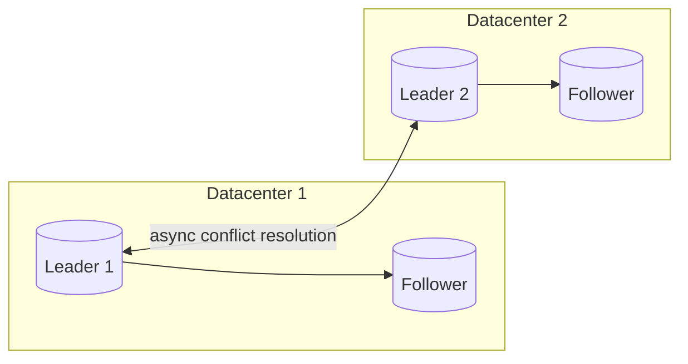
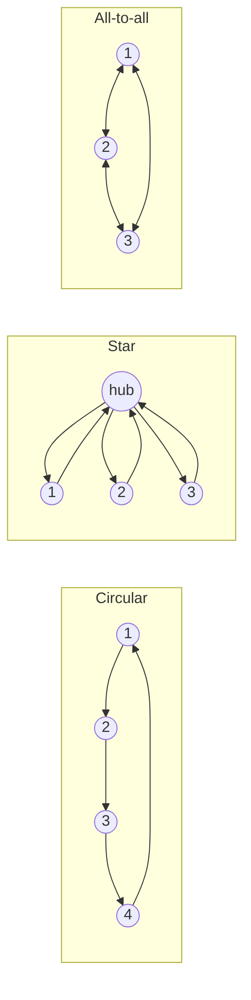
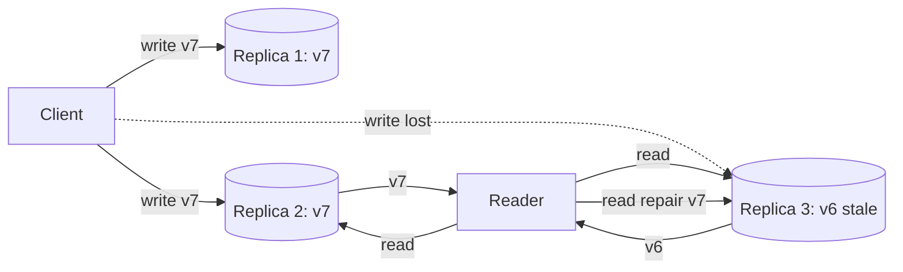

# Multi-leader and leaderless replication, quorums

> **Before this lesson:** read [Single-leader replication and replication lag](#/lesson/databases/leader-follower). You need its terms: replica, leader, follower, synchronous and asynchronous replication, failover, replication lag, eventual consistency, and the three guarantees (read-your-writes, monotonic reads, consistent prefix reads).

## In plain words

In the previous lesson one machine, the leader, accepted every write. That is easy to reason about and has one weakness: if you cannot reach the leader, you cannot write anything. This lesson covers the two designs that remove that weakness.

- **Multi-leader replication:** several machines accept writes, and they pass their changes to one another afterwards.
- **Leaderless replication:** every replica accepts writes. A write counts as successful when enough replicas have confirmed it, and a read asks several replicas and takes the newest answer.

An everyday picture for multi-leader: a shared shopping list that two people keep on their own phones. Each can add or cross off items at any time, even with no signal, and the phones swap changes when they next connect. It is convenient until both people edit the same line while apart. One changed "milk" to "oat milk", the other to "2 litres of milk". Which is right? That situation is a **write conflict**, and it is the central problem of this design.

An everyday picture for leaderless: you tell a piece of news to three friends, and later someone wanting the news asks any two of them. If you made sure at least two of the three heard it, then whichever two are asked, at least one knows. That overlap argument is called a **quorum**, and it is one of the most frequently used ideas in distributed systems.

Why this matters for a job: databases such as Cassandra and DynamoDB, and every app that works offline and synchronises later, are built on these designs. "Explain quorums" and "what do the consistency levels in Cassandra mean?" are standard interview questions, and the rule $w + r > n$ is expected knowledge.

## 1. Multi-leader replication

In a **multi-leader** arrangement (also called active/active), more than one node accepts writes. Each leader sends its changes to the other leaders, so each one is a leader for its own clients and at the same time a follower of the others.

### 1.1 Use cases

**Several datacenters.** A **datacenter** is a building full of servers. A company with users around the world often has several. With multi-leader replication there is a leader in *each* datacenter. Inside a datacenter, ordinary leader-follower replication is used. Between datacenters, each leader passes its changes to the leaders in the others.



| | One leader for everything | A leader in each datacenter |
|---|---|---|
| Speed of writes | Every write must travel across the internet to the datacenter that has the leader | A write is handled in the nearest datacenter and passed on afterwards, so users do not feel the long-distance delay |
| A whole datacenter goes down | A follower elsewhere must be promoted | The other datacenters carry on as before; the failed one catches up when it returns |
| The long-distance link is unreliable | Writes depend on that link, so problems are felt immediately | Changes are passed on asynchronously, so a brief interruption does no harm |

Those are real benefits. The cost is equally real: **the same piece of data can be changed in two datacenters at the same moment**, and the two changes then have to be reconciled. Multi-leader support has also often been added to databases as an afterthought, and it interacts badly with other features such as automatically numbered keys. For these reasons multi-leader replication across datacenters is widely regarded as risky and worth avoiding when there is an alternative.

**Devices that work offline.** Think of a calendar app on a phone, a laptop and a tablet. You must be able to read and add appointments with no internet connection. So each device holds its own copy of the data and accepts writes locally, which makes each device a leader. When a connection is available, the devices exchange changes. Seen this way, every device is a tiny "datacenter", and the link between them is extremely unreliable: the replication lag can be hours or days. The database CouchDB is designed for this kind of use.

**Collaborative editing.** Tools such as Google Docs let several people type in one document at once. Each person's changes are applied immediately to the copy in their own browser and then sent to the server and to the other editors. That is multi-leader replication with a very small unit of change, a single keystroke. One could prevent conflicts by letting only one person edit at a time, but that would not feel collaborative.

### 1.2 Handling write conflicts

Here is a conflict in its plainest form. A wiki page has the title "A". User 1 changes it to "B", and the write goes to leader 1. At the same moment user 2 changes it to "C", and the write goes to leader 2. Each leader accepts its write and tells its user "saved". Only later, when the leaders exchange changes, does each discover that the other changed the same title to something different. In single-leader replication this cannot occur, because the second write would have arrived at the same leader after the first.

There are several ways to deal with conflicts.

- **Detect them before confirming.** The leader could wait until the write has reached every other leader before telling the user it succeeded. That makes conflicts detectable at once, but it throws away the reason for having several leaders. If every write waits for all datacenters, a single leader would serve as well.
- **Avoid them.** The most commonly recommended approach is to arrange things so that conflicts do not arise. Make sure all writes to a given record go through the *same* leader. For example, give each user a "home" datacenter and always send that user's requests there. From the user's point of view this is a single-leader system. Conflicts can return if the home has to change, because a datacenter failed or the user moved.
- **Make every replica settle on the same value.** If conflicts do happen, the minimum requirement is that all replicas end up with the *same* final value once all changes have been exchanged. This is called **convergence**. Ways to achieve it:
  - Give each write a unique identifier, such as a timestamp, and let the write with the highest identifier win. With timestamps this is **last write wins**, shortened to **LWW**. It is widely used and it **loses data**: the losing write was confirmed to a user and then silently discarded.
  - Give each replica a number and let the write from the higher-numbered replica win. This also discards data.
  - **Merge** the values in some way, for example joining them in alphabetical order to give the title "B/C".
  - **Keep all the conflicting versions**, lose nothing, and leave it to the application to resolve them later, perhaps by asking the user.
- **Custom resolution code.** Most multi-leader tools let you supply your own code to resolve a conflict. It can run **on write**, as soon as the database notices the conflict. That code runs in the background and cannot ask a person. Or it can run **on read**: the database stores every conflicting version and hands all of them to the application the next time the record is read. The application (or its user) decides, and writes the resolved value back. CouchDB works this way.

Conflicts are not always as visible as two edits to one field. Consider a system for booking meeting rooms, which must never give one room to two groups for the same time. Two bookings made at the same moment on two different leaders create two *separate* records. No record was edited twice, yet together the two records break the rule. Conflicts of this subtler kind return in the lessons on transactions.

> [!NOTE]
> There is active work on resolving conflicts automatically in a sensible way. The best-known approach is **CRDTs** (conflict-free replicated datatypes): versions of familiar structures such as sets, counters and lists that are designed so two people can change them independently and the results can always be merged. The next lesson explains them. A second approach, **operational transformation**, is the technique behind Google Docs.

### 1.3 Multi-leader replication topologies

With more than two leaders there is a choice about which leader sends its changes to which. The pattern of those routes is the **replication topology**.



- In a **circular** topology each node receives changes from one neighbour and forwards them, together with its own, to the next. In a **star**, one central node forwards changes to all the others. In both, a change passes through several nodes on its way. To stop a change circulating for ever, each change carries a list of the nodes it has already visited, and a node ignores a change that already lists its own identifier. The weakness of both shapes is that **one failed node can cut the route** between others until someone reconfigures the system.
- In an **all-to-all** topology every leader sends its changes directly to every other. A single failure no longer blocks anything. A different problem appears: some network routes are faster than others, so changes can **overtake** one another. A replica might receive an *update* to a row before it has received the *insert* that created the row. This is the causality problem from the previous lesson. Attaching a timestamp to each write does not solve it, because the clocks on different machines do not agree exactly. The proper tool is a **version vector**, the subject of the next lesson.

Many systems that offer multi-leader replication detect conflicts poorly. If you use one, read its documentation closely and test its behaviour yourself.

## 2. Leaderless replication

The third family drops the idea of a leader altogether. **Any replica accepts writes directly from clients.** Amazon revived this old approach in an internal storage system called **Dynamo**, and the open-source databases Riak, Cassandra and Voldemort copied the design. They are known collectively as **Dynamo-style** databases. (The Amazon product named DynamoDB is, confusingly, a different system.)

In some of these databases the client itself sends each write to several replicas. In others the client talks to one node, called a **coordinator**, which sends the write to the replicas on the client's behalf. Unlike a leader, the coordinator does not decide the order of writes.

### 2.1 Writing when a node is down

Take three replicas and suppose one is switched off for maintenance. In a single-leader system, if that node were the leader, a failover would be needed. In a leaderless system there is no failover. The client sends its write to all three replicas at the same time. Two receive it and confirm. The third is down and misses it. The rule is that confirmation from **two of the three** is enough, so the client treats the write as successful and moves on.

When the third node comes back, it is missing whatever was written while it was away. A client that happened to read from that node alone would get stale data. To prevent that, **reads are also sent to several replicas at once**. The replies may differ. Each value is stored together with a **version number** that goes up with every write, and the client keeps the reply with the highest version.

How does the node that was down ever catch up? Two mechanisms do the work:

- **Read repair.** When a client reads from several replicas and notices that one returned an older version, it writes the newer value back to that replica. This keeps frequently read values fresh. A value that is rarely read may stay stale for a long time.
- **Anti-entropy.** A background process continually compares replicas with one another and copies across whatever is missing. Unlike a replication log, it does not copy writes in any particular order, and it may take a while to get round to a given item.

### 2.2 Quorums for reading and writing

In the example, two confirmations out of three were enough. Why two, and how does the rule generalise?

Use three letters:

- $n$ is the number of replicas that store each value.
- $w$ is the number of replicas that must confirm a write for it to count as successful.
- $r$ is the number of replicas that must answer a read.

The rule is:

$$w + r > n,$$

When it holds, the group of replicas that confirmed the latest write and the group that answers a read **must have at least one replica in common**. There are only $n$ replicas in total, and $w + r$ is more than $n$, so the two groups cannot be completely separate. That shared replica has the latest value, and its version number lets the reader recognise it.

Check it with $n = 3$, $w = 2$, $r = 2$. A write reached two of the three replicas. A read asks two of the three. Only one replica is missing the write, so two replicas cannot both be the one that missed it.

Reads and writes that follow such a rule are called **quorum** reads and writes. A quorum is the minimum number of members that must take part for a decision to count. The usual choice is an odd $n$, such as 3 or 5, with $w$ and $r$ each set to a majority: 2 of 3, or 3 of 5.

- $n = 3, w = 2, r = 2$ keeps working with **one** replica unavailable.
- $n = 5, w = 3, r = 3$ keeps working with **two** unavailable.
- A system that reads far more than it writes might choose $w = n$ and $r = 1$. Reads are then fast, since one replica is enough. But a single unavailable replica makes all writes fail.

If fewer than $w$ replicas can be reached for a write, or fewer than $r$ for a read, the operation returns an error.



The diagram shows a write of version 7 reaching replicas 1 and 2 while replica 3 misses it and stays at version 6. A reader then asks replicas 2 and 3, receives versions 7 and 6, keeps 7, and repairs replica 3 by writing version 7 to it.

The next program tests the rule by experiment. For each setting it picks, many times over, a random group of $w$ replicas that received a write and a random group of $r$ replicas to read from, and counts how often the two groups share no replica.

```python-run
import random, itertools
random.seed(11)

def simulate(n, w, r, trials=20000):
    stale = 0
    for t in range(trials):
        nodes = list(range(n))
        written = set(random.sample(nodes, w))        # nodes that got the latest write
        read = set(random.sample(nodes, r))
        if not (written & read):
            stale += 1
    return stale / trials

for n, w, r in [(3,2,2),(3,1,1),(3,1,2),(5,3,3),(5,2,2),(5,1,5),(5,2,3)]:
    tag = "quorum" if w + r > n else "NOT quorum"
    print(f"n={n} w={w} r={r}  w+r>n? {w+r>n!s:<5} ({tag:<10}) -> P(read misses latest) = {simulate(n,w,r):.3f}")
```

What each part does:

- Inside `simulate`, `random.sample(nodes, w)` chooses `w` different replicas at random. Turning the result into a `set` allows the `&` operator, which gives the members two sets have in common.
- `if not (written & read)` is true when the two groups share nothing. That is a read that misses the latest value.
- The function returns the fraction of the 20,000 trials in which that happened.
- The loop at the bottom runs seven combinations and labels each according to whether $w + r > n$.

```
n=3 w=2 r=2  w+r>n? True  (quorum    ) -> P(read misses latest) = 0.000
n=3 w=1 r=1  w+r>n? False (NOT quorum) -> P(read misses latest) = 0.667
n=3 w=1 r=2  w+r>n? False (NOT quorum) -> P(read misses latest) = 0.333
n=5 w=3 r=3  w+r>n? True  (quorum    ) -> P(read misses latest) = 0.000
n=5 w=2 r=2  w+r>n? False (NOT quorum) -> P(read misses latest) = 0.306
n=5 w=1 r=5  w+r>n? True  (quorum    ) -> P(read misses latest) = 0.000
n=5 w=2 r=3  w+r>n? False (NOT quorum) -> P(read misses latest) = 0.100
```

Every row where the rule holds shows a probability of exactly zero. Every row where it does not hold shows some chance of a stale read. The last row is the one to study: $w = 2$ and $r = 3$ add up to exactly 5, which is *equal* to $n$ and not greater. One read in ten still misses. The inequality has to be strict.

### 2.3 Limitations of quorum consistency

The argument above assumed a tidy world: one write at a time, fully finished before any read. Real systems are messier, and even with $w + r > n$ a read can return an old value in these cases:

- With a **sloppy quorum** (explained in the next section), the $w$ confirmations may come from different machines than the ones a read asks, so the overlap is not guaranteed.
- **Two writes happen at the same time**, and it is unclear which should count as later. If the system picks a winner by timestamp, a write can be lost because the machines' clocks disagree.
- **A write and a read happen at the same time.** At that instant the write has reached only some replicas, and the read may or may not see it.
- **A write reached fewer than $w$ replicas.** The client is told the write failed. But the replicas that did receive it are not told to undo it. Later reads may or may not return a value that officially was never written.
- **A replica holding the new value fails and is restored from a replica holding the old one.** The number of replicas with the new value drops below $w$, and the overlap argument no longer applies.

The conclusion is that $w$ and $r$ let you tune how *likely* a stale read is. They are not an absolute guarantee. Dynamo-style databases are built for applications that can live with eventual consistency. In general they do not offer read-your-writes, monotonic reads or consistent prefix reads. Stronger promises require transactions or consensus, both covered later.

**Measuring staleness** is also harder here. With a leader, lag is the difference between the leader's log position and a follower's, a single number that is easy to watch. Without a leader there is no single order of writes to measure against. If a system relies on read repair alone, with no anti-entropy process, a value that is never read can be arbitrarily old.

### 2.4 Sloppy quorums and hinted handoff

A large cluster has many more than $n$ nodes. Each value is stored on $n$ particular nodes, which we can call the value's "home" nodes. Now suppose a network fault cuts a client off from the home nodes of some value, while it can still reach plenty of other nodes in the cluster. The database designer has two options:

- Refuse the request, because a quorum of home nodes cannot be reached.
- Accept the write anyway and store it for the time being on reachable nodes that are *not* among the value's home nodes.

The second option is called a **sloppy quorum**. The write still needs $w$ confirmations, but they may come from stand-in nodes. It resembles finding yourself locked out of your home and sleeping on a neighbour's sofa for the night. When the network fault is repaired, each stand-in node passes the writes it was holding to the proper home nodes. That step is called **hinted handoff**.

A sloppy quorum makes the database more willing to accept writes: as long as any $w$ nodes can be reached, a write succeeds. The price is that the overlap argument fails. The latest value may be sitting on stand-in nodes that a read of the home nodes will not ask. So a sloppy quorum is not a quorum in the sense of section 2.2. What it promises is **durability**: the data is stored on $w$ machines somewhere. It does not promise that a read will find it until the handoff is complete. Riak switches sloppy quorums on by default; Cassandra and Voldemort leave them off unless asked.

### 2.5 Multi-datacenter leaderless operation

Leaderless replication also works across datacenters. In Cassandra, $n$ counts the replicas in all datacenters together, and you configure how many are kept in each. A write is sent to every replica everywhere, but the client normally waits only for a quorum of the replicas **in its own datacenter**, so a slow long-distance link does not delay it. The replicas elsewhere receive the write asynchronously.

> [!INTERVIEW]
> "Explain Cassandra's consistency levels." With three replicas of each value: `ONE` waits for a single replica, which is fast and may return stale data. `QUORUM` on both reads and writes satisfies $w + r > n$, so the read group and write group overlap. `LOCAL_QUORUM` requires a quorum only within the local datacenter, for speed. `ALL` waits for every replica; it is the strongest setting and stops working as soon as one replica is unavailable. Then add the caveat that marks a strong answer: a quorum alone does not make the system behave like a single up-to-date copy, because of simultaneous writes resolved by timestamp, writes that partly failed, and sloppy quorums.

## 3. Pitfalls

- **Using last write wins without realising what it discards.** Every conflict silently throws away a write that some user was told had succeeded.
- **Treating $w + r = n$ as a quorum.** The sum must be strictly greater than $n$.
- **Assuming a quorum read is always current.** Section 2.3 lists five ways it can be stale.
- **Forgetting that a "failed" write may still exist.** A write that reached fewer than $w$ replicas is reported as failed but is not undone on the replicas that took it.
- **Choosing multi-leader for convenience.** It brings write conflicts into every part of the application. Prefer a single leader, or route each record to one home leader, unless there is a clear need.

## 4. Summary

- **Multi-leader** replication allows writes in every datacenter, on offline devices and in collaborative editors. The cost is **write conflicts**. The preferred remedy is to avoid them by sending all writes for a record to one leader. Otherwise replicas must converge, by last write wins (which loses data), by merging, or by application code that runs on write or on read.
- Topologies: circular and star can be cut by one failed node. All-to-all tolerates failures but can deliver dependent writes out of order.
- **Leaderless** (Dynamo-style) replication writes to $w$ and reads from $r$ of $n$ replicas. If $w + r > n$, the two groups overlap. Stale replicas are brought up to date by **read repair** and **anti-entropy**.
- A quorum adjusts the likelihood of stale reads and is not an absolute guarantee. A **sloppy quorum with hinted handoff** keeps writes available and gives up the overlap.

## Glossary

- **Multi-leader replication (active/active)** - several nodes accept writes and pass their changes to one another.
- **Datacenter** - a building housing many servers.
- **Write conflict** - two writes to the same data, made on different nodes, that cannot both stand.
- **Conflict avoidance** - routing all writes for a record through one leader so conflicts cannot arise.
- **Convergence** - all replicas arriving at the same final value.
- **Last write wins (LWW)** - resolving a conflict by keeping the write with the latest timestamp and discarding the rest.
- **CRDT** - a data structure designed so that independent changes can always be merged automatically.
- **Replication topology** - the pattern of routes along which leaders send changes to one another.
- **Circular / star / all-to-all** - each node forwards to the next / one hub forwards to all / every node sends to every other.
- **Leaderless replication** - every replica accepts writes directly.
- **Dynamo-style** - leaderless databases modelled on Amazon's Dynamo, such as Cassandra and Riak.
- **Coordinator** - a node that forwards a client's request to the replicas without deciding write order.
- **Version number** - a counter stored with a value that rises on every write, used to tell newer from older.
- **Read repair** - writing a newer value back to a replica found to be stale during a read.
- **Anti-entropy** - a background process that compares replicas and copies missing data.
- **n, w, r** - replicas per value / confirmations needed for a write / replies needed for a read.
- **Quorum** - the minimum number of nodes that must take part; here, values of w and r with w + r > n.
- **Sloppy quorum** - counting confirmations from stand-in nodes that are not a value's home nodes.
- **Hinted handoff** - a stand-in node passing held writes to the proper nodes once they are reachable.
- **Durability** - the assurance that stored data will not be lost.

```quiz
[
  {"q": "With n = 5 replicas, which (w, r) satisfies the quorum condition?",
   "options": ["w=2, r=2", "w=3, r=3", "w=1, r=3", "w=2, r=3"],
   "answer": 1,
   "explain": "w + r must exceed n: 3 + 3 = 6 > 5. (2,3) gives exactly 5, which does not guarantee overlap."},
  {"q": "Why is quorum overlap useful?",
   "options": ["It doubles throughput", "At least one of the nodes read must have seen the most recent successful write", "It eliminates network partitions", "It removes the need for version numbers"],
   "answer": 1,
   "explain": "Overlap plus version numbers lets the reader pick the newest value."},
  {"q": "What is read repair?",
   "options": ["Rebuilding indexes on read", "When a reader sees a stale replica in its responses, it writes the newer value back to that replica", "A background Merkle-tree process", "Restoring from backup"],
   "answer": 1,
   "explain": "It fixes frequently read values; anti-entropy handles the rest."},
  {"q": "With a sloppy quorum, what does w + r > n still guarantee?",
   "options": ["Linearizable reads", "Nothing about reading the latest value; only that the write is durably stored on w nodes somewhere", "Read-your-writes", "Consistent prefix reads"],
   "answer": 1,
   "explain": "Writes may land on non-home nodes; reads from the home nodes may miss them until hinted handoff."},
  {"q": "What is the most commonly recommended way to deal with multi-leader write conflicts?",
   "options": ["Last write wins", "Avoid conflicts by routing all writes for a given record through the same leader", "Ask users to resolve every conflict", "Disable replication"],
   "answer": 1,
   "explain": "Conflict avoidance is simple; conflicts reappear only when a record's home leader changes."},
  {"q": "Why can all-to-all multi-leader topologies apply writes in the wrong order?",
   "options": ["Leaders are synchronous", "Some network links are faster, so a later write can overtake an earlier causally related write", "Timestamps are always correct", "Only one leader can write"],
   "answer": 1,
   "explain": "An update might arrive before the insert it depends on; version vectors help."},
  {"q": "Which is a real limitation of quorum consistency even when w + r > n?",
   "options": ["Reads always fail", "A write that failed overall (fewer than w acks) is not rolled back on replicas where it succeeded", "Quorums require a leader", "Nodes cannot use version numbers"],
   "answer": 1,
   "explain": "Subsequent reads may or may not return the 'failed' write."},
  {"q": "In Cassandra, what does LOCAL_QUORUM achieve?",
   "options": ["Quorum across all DCs", "A quorum within the client's local datacenter, avoiding cross-DC latency", "Exactly one replica", "Hinted handoff only"],
   "answer": 1,
   "explain": "Writes are still sent to all replicas, but the client waits only for local acknowledgements."}
]
```

> **Source:** DDIA ch. 5, "Multi-Leader Replication" and "Leaderless Replication" (quorums, limitations, sloppy quorums and hinted handoff).
