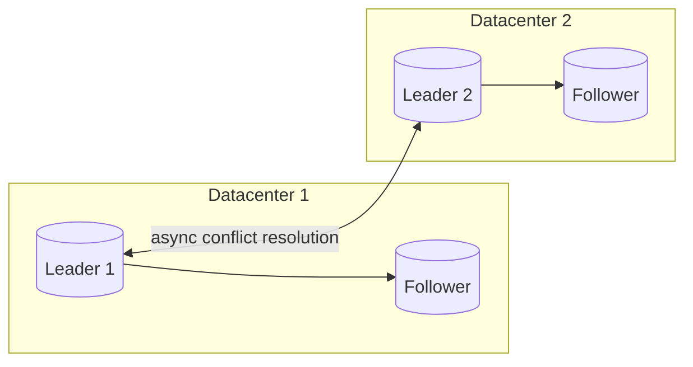
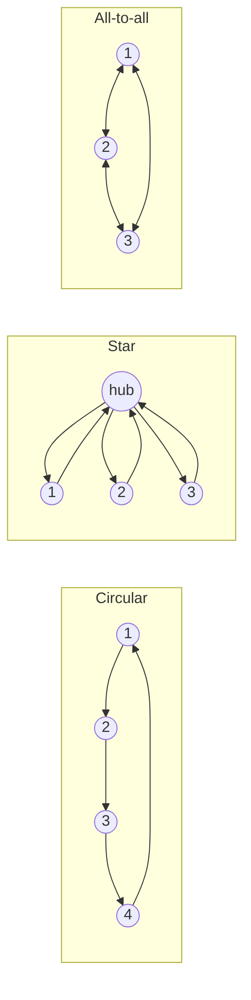

# Multi-leader and leaderless replication, quorums

Single-leader replication has one major downside: **all writes must go through the one leader**. If you cannot reach it, for example because of a network partition, you cannot write. Two alternatives relax this: **multi-leader** (several nodes accept writes) and **leaderless** (any replica accepts writes).

## 1. Multi-leader replication

In a **multi-leader** (master–master, active/active) setup, more than one node accepts writes. Each leader acts as a follower to the other leaders at the same time.

### 1.1 Use cases

**Multi-datacenter operation.** Put a leader in *each* datacenter. Within a datacenter, regular leader–follower replication is used. Between datacenters, each leader replicates its changes to the others.



| | Single-leader | Multi-leader across DCs |
|---|---|---|
| Performance | Every write crosses the internet to the leader's DC | Writes processed locally, replicated async. Inter-DC latency is hidden from users |
| Tolerance of DC outage | Failover promotes a follower in another DC | Each DC runs independently and catches up when the failed one returns |
| Tolerance of network problems | Sensitive to the inter-DC link because writes go over it synchronously | Async replication tolerates temporary network problems better |

The big downside is that **the same data may be modified concurrently in two DCs**, so write conflicts must be resolved. Multi-leader replication is also often retrofitted onto databases, and features such as auto-increment keys, triggers and integrity constraints interact with it badly. The book's verdict: it is often considered **dangerous territory** to be avoided if possible. Tools include Tungsten Replicator for MySQL, BDR for PostgreSQL and GoldenGate for Oracle.

**Clients with offline operation.** A calendar app on your phone, laptop and other devices must work offline. The database on every device accepts writes like a **leader**, and whenever a connection is available the devices reconcile with one another asynchronously, multi-leader style. The replication lag may be hours or days. In effect, each device is a "datacenter" with an extremely unreliable network. CouchDB is designed for this mode.

**Collaborative editing.** Google Docs-style real-time collaboration resembles offline editing: changes are applied to a local replica and then replicated. To avoid conflicts you could take a lock on the document, which is the same as single-leader with transactions. Fast collaboration wants a very small unit of change (a keystroke) and no locking, which brings all the multi-leader challenges, including conflict resolution. Operational transformation and CRDTs address this.

### 1.2 Handling write conflicts

Suppose two users edit a wiki page title at the same time. User 1 changes "A" to "B" on leader 1, and user 2 changes "A" to "C" on leader 2. Each write succeeds locally, and the conflict is detected only later during async replication.

- **Synchronous vs asynchronous conflict detection.** You *could* make conflict detection synchronous by waiting for the write to replicate everywhere before telling the user it succeeded, but that loses the main advantage of multi-leader. You might as well use a single leader.
- **Conflict avoidance.** The simplest strategy, and frequently recommended: ensure all writes for a given record go through the **same leader**. Route each user to their "home" datacenter. Conflicts come back if the home DC changes, after a failure or a user move.
- **Converging toward a consistent state.** With no defined ordering, the final value must be the same on all replicas. Ways to converge:
  - Give each write a unique id (a timestamp, UUID or hash) and pick the **highest id as the winner**. With timestamps this is **last write wins (LWW)**. It is popular and **prone to data loss**.
  - Give each replica an id and let writes from the **higher-numbered replica** win. This also loses data.
  - **Merge** the values, for example by ordering alphabetically and concatenating: "B/C".
  - **Record the conflict** by storing every conflicting version, losing nothing, and let the application sort it out afterwards - possibly by asking the user.
- **Custom conflict resolution logic:**
  - **On write**: when the replication log detects a conflict, call a handler. Bucardo lets you write a Perl snippet for this. It runs in a background process and cannot prompt the user.
  - **On read**: store all conflicting versions. The next read returns them all to the application, which resolves them and writes the result back. CouchDB works this way.

Conflicts can be subtle. A **meeting-room booking** system must prevent double booking. Two bookings on two different leaders can conflict even though they do not touch the same record.

> [!NOTE]
> **Automatic conflict resolution** research worth knowing: **CRDTs** (conflict-free replicated datatypes: sets, maps, ordered lists, counters, used in Riak 2.0), **mergeable persistent data structures** (three-way merge, like Git), and **operational transformation** (used in Etherpad and Google Docs for ordered lists such as the characters of a text).

### 1.3 Multi-leader replication topologies

A **replication topology** describes the paths along which writes propagate from one node to another.



- **Circular** (MySQL default) and **star** topologies pass writes through several nodes. To prevent infinite loops, each node tags writes with its identifier and ignores changes already tagged with its own id. The problem is that **one failed node can interrupt the flow** between others until the topology is reconfigured by hand.
- **All-to-all** is more fault tolerant, but some links may be faster than others, so messages can **overtake** each other. An *update* may arrive at a replica before the *insert* it depends on, a causality problem similar to consistent prefix reads. Timestamps are insufficient because clocks cannot be trusted (Chapter 8). **Version vectors** solve it. Many multi-leader systems implement conflict detection poorly, so test carefully.

## 2. Leaderless replication

Some data systems abandon the leader concept and let **any replica accept writes** directly from clients. Amazon's in-house **Dynamo** (2007) revived the idea. Riak, Cassandra and Voldemort followed and are called **Dynamo-style** databases. Amazon DynamoDB the product is a different system. In some leaderless implementations the client sends writes to several replicas directly. In others a **coordinator node** does it on the client's behalf, but unlike a leader it does not enforce write ordering.

### 2.1 Writing when a node is down

With 3 replicas, one of them unavailable, the client sends the write to all three in parallel. Two accept and one misses it. If **two out of three** acknowledgements is good enough, the write is considered successful.

When the failed node comes back, it is missing writes. To handle this, **reads are also sent to several nodes in parallel**. The client may get different responses, and **version numbers** decide which value is newer.

How does a stale replica catch up? Two mechanisms:

- **Read repair.** When a client reads from several nodes and detects a stale response, it writes the newer value back to that replica. This works well for frequently read values. Rarely read values may stay stale.
- **Anti-entropy process.** A background process constantly looks for differences between replicas and copies missing data. Unlike a replication log, it copies writes in **no particular order**, and there may be significant delay before data is copied. Merkle trees make the comparison efficient.

### 2.2 Quorums for reading and writing

Given $n$ replicas, a write counts as successful once $w$ of them acknowledge it, and a read has to consult no fewer than $r$ of them. As long as

$$w + r > n,$$

the sets of nodes written to and read from **must overlap in at least one node**, so at least one of the $r$ nodes read has the latest value. Reads and writes obeying these $r$ and $w$ values are **quorum** reads and writes. A common choice is $n$ odd (3 or 5) with $w = r = \lceil (n+1)/2 \rceil$.

- $n=3, w=2, r=2$ tolerates **one** unavailable node.
- $n=5, w=3, r=3$ tolerates **two**.
- Read-heavy workloads might use $w=n, r=1$: reads are fast, but a single failed node makes writes impossible.

If fewer than $w$ or $r$ nodes are available, the operation returns an error.

```mermaid
flowchart LR
  C[Client] -->|write v7| R1[(Replica 1: v7)]
  C -->|write v7| R2[(Replica 2: v7)]
  C -.x.-> R3[(Replica 3: v6 stale)]
  C2[Reader] -->|read| R2
  C2 -->|read| R3
  R2 -->|v7| C2
  R3 -->|v6| C2
  C2 -->|read repair v7| R3
```

```python-run
import random, itertools
random.seed(11)

def simulate(n, w, r, trials=20000):
    stale = 0
    for t in range(trials):
        nodes = list(range(n))
        written = set(random.sample(nodes, w))        # nodes that got the latest write
        read = set(random.sample(nodes, r))
        if not (written & read):
            stale += 1
    return stale / trials

for n, w, r in [(3,2,2),(3,1,1),(3,1,2),(5,3,3),(5,2,2),(5,1,5),(5,2,3)]:
    tag = "quorum" if w + r > n else "NOT quorum"
    print(f"n={n} w={w} r={r}  w+r>n? {w+r>n!s:<5} ({tag:<10}) -> P(read misses latest) = {simulate(n,w,r):.3f}")
```

### 2.3 Limitations of quorum consistency

Even with $w + r > n$ there are edge cases where stale values are returned:

- With a **sloppy quorum** (below), the $w$ writes may land on different nodes from the $r$ reads, so overlap is no longer guaranteed.
- Two writes happen **concurrently**, and it is unclear which came first. Merging with LWW can lose writes because of clock skew.
- A write happens **concurrently with a read**. At that moment only part of the replica set has the write, so the read can legitimately come back with either value.
- A write succeeded on fewer than $w$ replicas and failed on the rest. The client is told it failed, yet the replicas that did accept it **keep it**, and subsequent reads might see it or might not.
- A node carrying a new value **fails and is restored from a replica with an old value**. Fewer than $w$ replicas may then hold the new value, and the quorum arithmetic no longer protects you.
- Even if everything works, there are timing edge cases (see linearizability in Chapter 9).

So $w$ and $r$ adjust the *probability* of stale reads, but they are **not absolute guarantees**. Dynamo-style databases are optimised for use cases that tolerate **eventual consistency**. In particular they generally do not provide read-your-writes, monotonic reads or consistent prefix reads. Stronger guarantees need **transactions or consensus**.

**Monitoring staleness.** In leader-based systems, replication lag can be measured by subtracting a follower's log position from the leader's. In leaderless systems there is no fixed order of writes, which makes monitoring harder, especially if only read repair is used and there is no anti-entropy, because old values can be arbitrarily old.

### 2.4 Sloppy quorums and hinted handoff

When the cluster is much larger than $n$, a network fault can separate a client from the $n$ "home" nodes of a key while leaving plenty of other nodes reachable. Should it:

- return errors for every request that cannot reach a quorum of $w$ or $r$ home nodes, or
- accept writes anyway, writing them to **some reachable nodes that are not among the $n$ home nodes** for that value?

The second option is a **sloppy quorum**. The counts $w$ and $r$ still have to be reached, only now nodes that are not among the key's home nodes are allowed to count. The analogy is being locked out of your house and knocking on the neighbour's door to ask if you can stay on their couch. Once the network is fixed, the stand-in node forwards the writes to the proper home nodes. This is **hinted handoff**.

A sloppy quorum **keeps writes available**, at a price: **a read is no longer guaranteed to see the newest value** even when $w + r > n$, since that value may be parked on stand-in nodes. A sloppy quorum is not really a quorum. It is only an assurance of **durability**: the data is stored on $w$ nodes somewhere. Riak enables them by default, while Cassandra and Voldemort disable them by default.

### 2.5 Multi-datacenter leaderless operation

Cassandra and Voldemort implement multi-DC support within the leaderless model. $n$ includes nodes in all datacenters, and you configure how many replicas per DC. Each write is sent to all replicas regardless of DC, but the client usually waits only for a quorum **within its local DC** (`LOCAL_QUORUM` in Cassandra), so cross-DC links do not slow it down. Riak instead keeps all communication local to one DC and replicates between DCs asynchronously, much like multi-leader.

> [!INTERVIEW]
> "Explain Cassandra consistency levels." With replication factor $n=3$: `ONE` gives fast, possibly stale reads. `QUORUM` on both reads and writes satisfies $w + r > n$ for overlap. `LOCAL_QUORUM` gives a quorum within the local DC for low latency. `ALL` is strongest and least available. Then add the caveat: quorums alone do not give linearizability (concurrent writes with LWW, failed partial writes, and sloppy quorums all break it).

## 3. Summary

- **Multi-leader** gives writes in every DC, offline clients and collaborative editing, at the cost of **write conflicts**. Prefer conflict *avoidance* by routing a record's writes to one leader. Otherwise converge with LWW (lossy), merges, or app-level resolution on write or on read.
- Topologies: circular and star have single points of failure, while all-to-all can reorder causally dependent writes.
- **Leaderless** (Dynamo-style): write to $w$ and read from $r$ of $n$ replicas. If $w + r > n$ the sets overlap. Stale replicas are healed by **read repair** and **anti-entropy**.
- Quorums are probabilistic, not linearizable. **Sloppy quorums with hinted handoff** trade read guarantees for write availability.

```quiz
[
  {"q": "With n = 5 replicas, which (w, r) satisfies the quorum condition?",
   "options": ["w=2, r=2", "w=3, r=3", "w=1, r=3", "w=2, r=3"],
   "answer": 1,
   "explain": "w + r must exceed n: 3 + 3 = 6 > 5. (2,3) gives exactly 5, which does not guarantee overlap."},
  {"q": "Why is quorum overlap useful?",
   "options": ["It doubles throughput", "At least one of the nodes read must have seen the most recent successful write", "It eliminates network partitions", "It removes the need for version numbers"],
   "answer": 1,
   "explain": "Overlap plus version numbers lets the reader pick the newest value."},
  {"q": "What is read repair?",
   "options": ["Rebuilding indexes on read", "When a reader sees a stale replica in its responses, it writes the newer value back to that replica", "A background Merkle-tree process", "Restoring from backup"],
   "answer": 1,
   "explain": "It fixes frequently read values; anti-entropy handles the rest."},
  {"q": "With a sloppy quorum, what does w + r > n still guarantee?",
   "options": ["Linearizable reads", "Nothing about reading the latest value; only that the write is durably stored on w nodes somewhere", "Read-your-writes", "Consistent prefix reads"],
   "answer": 1,
   "explain": "Writes may land on non-home nodes; reads from the home nodes may miss them until hinted handoff."},
  {"q": "What is the most commonly recommended way to deal with multi-leader write conflicts?",
   "options": ["Last write wins", "Avoid conflicts by routing all writes for a given record through the same leader", "Ask users to resolve every conflict", "Disable replication"],
   "answer": 1,
   "explain": "Conflict avoidance is simple; conflicts reappear only when a record's home leader changes."},
  {"q": "Why can all-to-all multi-leader topologies apply writes in the wrong order?",
   "options": ["Leaders are synchronous", "Some network links are faster, so a later write can overtake an earlier causally related write", "Timestamps are always correct", "Only one leader can write"],
   "answer": 1,
   "explain": "An update might arrive before the insert it depends on; version vectors help."},
  {"q": "Which is a real limitation of quorum consistency even when w + r > n?",
   "options": ["Reads always fail", "A write that failed overall (fewer than w acks) is not rolled back on replicas where it succeeded", "Quorums require a leader", "Nodes cannot use version numbers"],
   "answer": 1,
   "explain": "Subsequent reads may or may not return the 'failed' write."},
  {"q": "In Cassandra, what does LOCAL_QUORUM achieve?",
   "options": ["Quorum across all DCs", "A quorum within the client's local datacenter, avoiding cross-DC latency", "Exactly one replica", "Hinted handoff only"],
   "answer": 1,
   "explain": "Writes are still sent to all replicas, but the client waits only for local acknowledgements."}
]
```

> **Source:** DDIA ch. 5, "Multi-Leader Replication" and "Leaderless Replication" (quorums, limitations, sloppy quorums and hinted handoff).
