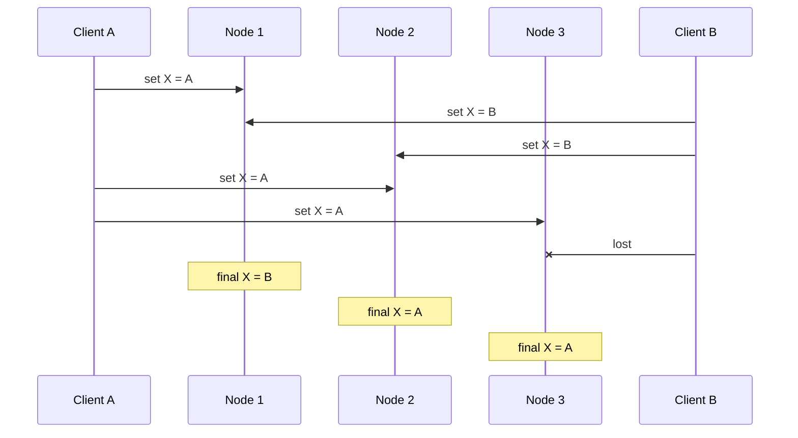

# Detecting concurrent writes: LWW, version vectors, CRDTs

> **Before this lesson:** read [Multi-leader and leaderless replication, quorums](#/lesson/databases/multi-leader-leaderless). You need its terms: write conflict, convergence, last write wins, leaderless replication, version number, quorum, read repair and hinted handoff. Tombstones were introduced in [Log-structured storage](#/lesson/databases/log-structured). The code uses Python classes, sets and dictionaries.

## In plain words

Two people change the same thing on two different machines, and neither knows about the other's change. The database has to decide what the value is now. This lesson is about how a database can tell that such a clash has happened, and what it can do about it.

An everyday picture: two flatmates each keep a copy of the shopping list. One evening, without speaking to each other, one writes "eggs" on their copy and the other writes "flour" on theirs. When they compare lists in the morning there are three possible policies:

1. Keep whichever list has the later time written at the top and bin the other. Quick, and somebody's item is lost. This is **last write wins**.
2. Notice that the lists were changed independently, keep both, and sit down together to combine them. This requires a way of *knowing* the changes were independent. That is the job of **version vectors**.
3. Use a kind of list that is designed so two copies can always be combined automatically, with no discussion. Such structures are called **CRDTs**.

Why this matters for a job: any system where two copies can be edited apart needs one of these policies. That covers leaderless databases such as Cassandra and Riak, apps that work offline, and collaborative editors. The first policy is the default in several popular databases, and engineers who do not know what it discards lose customer data without noticing. Interviewers also like to ask "how would you compare two vector clocks?", which this lesson answers with a six-line function.

## 1. The problem: writes arrive in different orders

In a leaderless database, several clients may write to the same key at the same moment. Network delays differ from message to message, and some messages are lost. So the same writes can reach different replicas **in different orders**.



Read the diagram from the top. Clients A and B both set the key X. Node 1 receives A's write and then B's. Node 2 receives B's and then A's. Node 3 receives A's write only, because B's was lost on the way. If each node kept whichever value arrived last, node 1 would end with B while nodes 2 and 3 end with A. No further messages are coming, so they would disagree permanently.

For the replicas to become consistent eventually, they must **converge**: all arrive at the same value. Databases differ greatly in how well they handle this, and the application developer needs to understand what their database does.

## 2. Last write wins (discarding concurrent writes)

One way to converge: each replica keeps only the "most recent" value and discards anything older. The difficulty is the word "recent". In the diagram, neither client knew about the other's write when it sent its own. There is no fact about which was first. Writes like these are called **concurrent**, and their order is undefined.

**Last write wins (LWW)** invents an order. Each write is stamped with a **timestamp**, the time on some machine's clock when the write was made. When two writes conflict, the one with the larger timestamp is kept and the other is thrown away. Every replica applies the same rule, so all converge. LWW is the only conflict-resolution method Cassandra offers.

The price is paid in durability. Suppose three clients write concurrently and each write is confirmed by enough replicas. All three clients are told "success". Only one write survives. The other two are **silently discarded**: no error, no warning, nothing in any log.

It gets worse when clocks disagree, which they always do to some extent (a later lesson is devoted to this). If one machine's clock runs slow, its writes carry timestamps that are too early. LWW can then discard a write that was in fact made *later* than the one it keeps.

```python-run
# LWW register: (timestamp, node_id) breaks ties deterministically
def lww_merge(a, b):
    """a, b are (value, timestamp, node_id). Return the winner."""
    return max(a, b, key=lambda v: (v[1], v[2]))

w1 = ("cart=[milk]",  1000, "n1")
w2 = ("cart=[eggs]",  1000, "n2")   # concurrent, same timestamp -> node_id tiebreak
w3 = ("cart=[ham]",    999, "n3")   # actually written LATER but n3's clock is behind!
state = w1
for w in (w2, w3):
    state = lww_merge(state, w)
print("converged value:", state[0])
print("silently lost  :", [w[0] for w in (w1, w2, w3) if w is not state])
```

What each part does:

- Each write is a tuple of three things: the value, a timestamp and the name of the node that stamped it.
- `lww_merge(a, b)` returns whichever of the two has the larger `(timestamp, node name)` pair. `max(..., key=...)` picks the item for which the key function returns the largest result. Comparing pairs means the timestamp decides, and the node name is used only when timestamps are equal. Without that tie-break, two replicas could pick different winners.
- `w1` and `w2` carry the same timestamp. `w3` was written last in real time, but the clock on node `n3` is behind, so its timestamp is 999.
- The loop merges the three writes one after another, and the last line lists the writes that did not survive.

```
converged value: cart=[eggs]
silently lost  : ['cart=[milk]', 'cart=[ham]']
```

The eggs write won the tie because "n2" sorts after "n1". The ham write, which a user made after the other two, lost because of a slow clock. Two customers were told their change was saved, and it was not.

When is LWW acceptable? When losing a write does no harm, as with a cache. Otherwise there is one safe pattern: make sure each key is **written once and never changed**. If every write goes to a brand-new key, for example a randomly generated unique identifier (a UUID), then no two writes ever target the same key and there is nothing to discard.

## 3. The "happens-before" relationship and concurrency

To do better than LWW, the database needs to distinguish two situations that look alike from the outside. Two examples:

- Client A stores a value. Client B reads it and adds one to it. B's write was made *with knowledge of* A's. We say A **happened before** B, and that B is **causally dependent** on A. B's value should replace A's.
- Clients A and B each store a value for the same key, and neither has seen the other's. Neither depends on the other. They are **concurrent**, and neither should quietly replace the other.

The definition: operation A happened before operation B if B knew about A, depended on A, or built on A in some way. If neither happened before the other, they are concurrent. For any two operations exactly one of three things is true: A happened before B, B happened before A, or they are concurrent.

> [!NOTE]
> **Concurrent does not mean "at the same clock time".** Two writes made ten seconds apart are concurrent if the network was slow and neither writer had heard of the other's write. Two writes a microsecond apart are not concurrent if the second writer had already seen the first. What matters is knowledge, not the clock.

Once the database can tell which case it is in, the policy is clear. If one write happened before the other, the later one replaces the earlier. If they are concurrent, there is a conflict to resolve.

## 4. Capturing happens-before with version numbers

How can a server tell whether a write knew about an earlier one? The client tells it, by sending back a version number. This section works through the method with one server and two clients sharing a shopping cart. Follow the steps slowly, because the whole method is in them.

1. Client 1 adds `milk`. The server has nothing stored, so it saves `[milk]` as **version 1** and replies with `[milk]` and the number 1.
2. Client 2 adds `eggs`. Client 2 has not seen any earlier state, so it sends no version number. The server saves `[eggs]` as **version 2**. Since this write did not know about version 1, the server does not overwrite `[milk]`. It now holds two separate values side by side. Values kept like this are called **siblings**. It replies to client 2 with both siblings and the number 2.
3. Client 1 adds `flour`. It still thinks the cart is `[milk]`, so it sends `[milk, flour]` along with version number 1, the last number it was given. The server reasons: "this write has seen version 1, so it replaces `[milk]`. It has not seen version 2, so `[eggs]` stays." It saves `[milk, flour]` as **version 3** and replies with both siblings.
4. Client 2 adds `ham`. Back in step 2 it received `[milk]` and `[eggs]`. It combines them, adds ham, and sends `[eggs, milk, ham]` with version number 2. The server replaces `[eggs]` (version 2) and keeps `[milk, flour]` (version 3, which client 2 has not seen). This is **version 4**.
5. Client 1 adds `bacon`. In step 3 it received `[eggs]` and `[milk, flour]`. It combines them, adds bacon, and sends `[milk, flour, eggs, bacon]` with version number 3. The server replaces `[milk, flour]` and keeps `[eggs, milk, ham]`. **Version 5**.

The rules behind those steps:

- The server keeps one **version number per key** and raises it by one on every write. Each stored value remembers the version at which it was written.
- When a client **reads**, the server returns every value that has not been overwritten, together with the current version number. **A client must read a key before writing it.**
- When a client **writes**, it sends the version number from its last read, and a value that already combines everything it received in that read.
- When the server receives a write with version number $v$, it deletes all values with version $v$ or lower, because the client has already folded them into its new value. It **keeps all values with a higher version**, because those were written without the client seeing them. They are concurrent with the incoming write.

A write that arrives with no version number has seen nothing. It overwrites nothing and becomes one more sibling.

```python-run
class SiblingStore:
    """Single-replica version-number algorithm from DDIA Fig 5-13."""
    def __init__(self):
        self.version = 0
        self.values = []                     # list of (version, value)

    def read(self):
        return self.version, [v for _, v in self.values]

    def write(self, value, seen_version=0):
        self.version += 1
        # keep only values written AFTER what the client had seen (concurrent ones)
        self.values = [(ver, v) for ver, v in self.values if ver > seen_version]
        self.values.append((self.version, value))
        return self.read()

s = SiblingStore()
print("c1:", s.write(["milk"], 0))
print("c2:", s.write(["eggs"], 0))
print("c1:", s.write(["milk", "flour"], 1))
print("c2:", s.write(["eggs", "milk", "ham"], 2))
print("c1:", s.write(["milk", "flour", "eggs", "bacon"], 3))
v, sibs = s.read()
merged = sorted(set().union(*map(set, sibs)))
print("client merges siblings by union ->", merged)
```

What each part does:

- `self.version` is the key's version counter. `self.values` is a list of `(version, value)` pairs, the siblings.
- `read` returns the current version and the sibling values.
- `write` raises the counter, then rebuilds the list keeping only siblings whose version is greater than `seen_version` (the ones the client had not seen), and appends the new value under the new version.
- The five `print` lines replay the five steps above. The last three lines act as a client: read the siblings and combine them with a set **union**, which is all items that appear in any of them.

```
c1: (1, [['milk']])
c2: (2, [['milk'], ['eggs']])
c1: (3, [['eggs'], ['milk', 'flour']])
c2: (4, [['milk', 'flour'], ['eggs', 'milk', 'ham']])
c1: (5, [['eggs', 'milk', 'ham'], ['milk', 'flour', 'eggs', 'bacon']])
client merges siblings by union -> ['bacon', 'eggs', 'flour', 'ham', 'milk']
```

Each line shows the version and the siblings after one step, and they match the walkthrough. The final line contains all five items. No write was lost, even though the two clients never saw each other's latest state at the time they wrote.

## 5. Merging concurrently written values

The method above never throws data away without being told to. The cost is that the application has to do extra work: when a read returns siblings, something must **merge** them into one value.

For a shopping cart, taking the union looks reasonable. It has a flaw. Suppose one sibling is a cart from which the user *removed* milk, and the other sibling still contains milk. The union contains milk again. The deleted item has come back from the dead, which is a real bug that Amazon's shopping cart was once known for.

The fix is the tombstone idea from the storage lessons. Removing an item must not merely delete it. It must leave a marker saying "milk was removed at this version", so that the merge can tell "removed on purpose" apart from "never added on this copy".

Writing merge code by hand is error-prone. That is the motivation for a family of data structures designed to merge automatically.

### 5.1 CRDT intro

A **CRDT** (conflict-free replicated data type) is a data structure for which any two copies can always be merged into one, and the result is the same on every replica no matter in what order the merging is done. The common kind, called **state-based**, comes with a `merge` function that has three mathematical properties. Each one corresponds to something that goes wrong in a real network:

- **Commutative:** $merge(a, b) = merge(b, a)$. The order of the two inputs does not matter. Networks deliver things in unpredictable order.
- **Associative:** $merge(a, merge(b, c)) = merge(merge(a, b), c)$. The grouping does not matter. Replicas exchange state in whatever pairs happen to be connected.
- **Idempotent:** $merge(a, a) = a$. Merging the same thing twice changes nothing. Networks sometimes deliver a message twice.

With all three, replicas can send their state to one another in any order, any number of times, and they will end up identical. Ordinary addition has the first two properties but not the third (adding a number to itself doubles it), which is why a naive counter cannot be merged by adding. The trick in most CRDTs is to find a representation where `merge` can be a maximum or a union, both of which are idempotent.

The classic CRDTs:

| CRDT | State | Merge |
|---|---|---|
| **G-Counter** (grow-only) | one count per replica | element-wise max; value = sum |
| **PN-Counter** | two G-Counters (P for increments, N for decrements) | merge each; value = P − N |
| **G-Set** | set | union |
| **2P-Set** | add-set + remove-set (tombstones) | union both; removed forever |
| **OR-Set** (observed-remove) | elements tagged with unique ids; removes delete observed tags | union of adds minus observed removes; "add wins" over concurrent remove |
| **LWW-Register** | (value, timestamp) | max timestamp |

Three of them explained:

- A **G-Counter** ("grow-only counter") gives each replica its own slot. A replica increases only its own slot. The counter's value is the sum of all slots. To merge two copies, take the larger number in each slot. Taking a maximum is idempotent, so merging twice does not count anything twice.
- A **PN-Counter** allows decreases too, by keeping two G-Counters: one for increases and one for decreases. The value is the first minus the second.
- An **OR-Set** ("observed-remove set") solves the milk problem. Every addition gets a unique tag. A removal deletes only the tags that the remover has *seen*. If another replica adds the same item at the same time, that addition carries a new tag which the remover never saw, so it survives the merge. The rule is summarised as "add wins".

```python-run
class GCounter:
    def __init__(self, node, nodes):
        self.node = node
        self.c = {n: 0 for n in nodes}
    def inc(self, k=1):
        self.c[self.node] += k
    def merge(self, other):
        for n in self.c:
            self.c[n] = max(self.c[n], other.c[n])
    def value(self):
        return sum(self.c.values())

nodes = ["a", "b", "c"]
A, B, C = (GCounter(n, nodes) for n in nodes)
A.inc(3); B.inc(2); C.inc(5); A.inc(1)
# gossip in arbitrary order, with duplicates
B.merge(A); C.merge(B); A.merge(C); A.merge(C); B.merge(C)
print("values:", A.value(), B.value(), C.value(), "(all converge to 11)")

class ORSet:
    def __init__(self): self.adds, self.removes, self.n = set(), set(), 0
    def add(self, x, replica):
        self.n += 1; self.adds.add((x, f"{replica}:{self.n}"))
    def remove(self, x):
        self.removes |= {t for t in self.adds if t[0] == x}   # remove only OBSERVED tags
    def merge(self, o):
        self.adds |= o.adds; self.removes |= o.removes
    def value(self): return sorted({x for (x, tag) in self.adds - self.removes})

r1, r2 = ORSet(), ORSet()
r1.add("milk", "r1"); r2.merge(r1)
r1.remove("milk")            # r1 removes milk...
r2.add("milk", "r2")         # ...while r2 concurrently re-adds it
r1.merge(r2); r2.merge(r1)
print("OR-Set after concurrent remove/add:", r1.value(), r2.value(), "(add wins)")
```

What each part does:

- `GCounter.__init__` creates one slot per node, all zero. `inc` raises this node's own slot. `merge` goes through the slots and keeps the larger of the two numbers in each. `value` adds the slots up.
- Three counters receive increments of 3, 2, 5 and 1, for a total of 11. Then they merge with one another in a haphazard order, including the same merge twice (`A.merge(C); A.merge(C)`).
- `ORSet` holds a set of `(item, tag)` pairs for additions and a set of removed pairs. `add` creates a fresh tag from the replica name and a counter. `remove` copies into `removes` every tagged pair for that item that this replica currently knows about. `merge` takes the union of both sets. `value` is the items whose tags have been added and not removed.
- In the scenario, replica `r1` adds milk and shares it with `r2`. Then, without communicating, `r1` removes milk while `r2` adds milk again. Finally they merge in both directions.

```
values: 11 11 11 (all converge to 11)
OR-Set after concurrent remove/add: ['milk'] ['milk'] (add wins)
```

All three counters report 11 despite the disorderly merging and the duplicate. In the set, the removal on `r1` deleted the tag `r1:1`. The new addition on `r2` carries the tag `r2:1`, which `r1` had never seen, so it is still present after the merge. Both replicas agree that milk is in the set.

## 6. Version vectors

Section 4 used one version number, which works because there was one server. With several replicas and no leader, each accepting writes independently, a single number is not enough: two replicas might both call their next write "version 6".

The solution is to keep one version number **per replica** for each key. Each replica raises its own number when it handles a write, and it also records the latest numbers it has seen from each of the other replicas. The whole collection, one number for each replica, is a **version vector**. For example `{a: 2, b: 1}` means "this value includes the first two writes handled by replica a and the first write handled by replica b".

Comparing two version vectors $V$ and $W$ tells you how the values are related:

- If every number in $V$ is less than or equal to the matching number in $W$, and they are not identical, then **V happened before W**. Everything $V$ had seen, $W$ has seen too, and more. $W$ can replace $V$.
- The mirror image: if every number in $W$ is less than or equal to its match in $V$, and they differ, **W happened before V**.
- If all numbers match, they are **equal**: the same version.
- Otherwise each has seen something the other has not. They are **concurrent**, and both must be kept as siblings.

```python-run
def compare(v, w):
    keys = set(v) | set(w)
    le = all(v.get(k, 0) <= w.get(k, 0) for k in keys)
    ge = all(v.get(k, 0) >= w.get(k, 0) for k in keys)
    if le and ge: return "equal"
    if le: return "before"
    if ge: return "after"
    return "concurrent"

print(compare({"a": 1}, {"a": 2}))                    # before
print(compare({"a": 2, "b": 1}, {"a": 1, "b": 1}))    # after
print(compare({"a": 2, "b": 0}, {"a": 1, "b": 3}))    # concurrent -> siblings
print(compare({"a": 1, "b": 2}, {"b": 2, "a": 1}))    # equal
```

What each part does:

- A vector is a dictionary from replica name to number. `set(v) | set(w)` collects every replica name that appears in either.
- `v.get(k, 0)` reads a replica's number, treating a missing entry as 0.
- `le` is true if `v` is less than or equal to `w` in every position. `ge` is the same test the other way round. `all(...)` is true only if the condition holds for every key.
- The four possible combinations of `le` and `ge` give the four answers.

```
before
after
concurrent
equal
```

The third case is the interesting one. `{a: 2, b: 0}` has seen more of replica a's writes, and `{a: 1, b: 3}` has seen more of replica b's. Neither includes the other, so they are concurrent.

> [!NOTE]
> **Version vectors and vector clocks.** The two look identical, and many people use the names interchangeably. Strictly, a *version vector* is attached to stored data and is used to compare the states of replicas, while a *vector clock* is attached to events in running processes to track which event could have influenced which. The comparison rule is the same.

> [!INTERVIEW]
> "How does a Dynamo-style database detect conflicting writes?" Each stored value carries a **version vector**. A client reads before writing and sends back the vector it was given. The replicas compare vectors: if one is before the other, the newer replaces the older; if they are **concurrent**, both are kept as **siblings**, and the application or a CRDT merges them. Contrast that with **last write wins** as used in Cassandra: less machinery, but concurrent writes are dropped without warning and correctness depends on clocks agreeing. The shopping-cart story about deleted items reappearing makes a good closing example.

## 7. Pitfalls

- **LWW with clocks that disagree.** A write that was truly later can be discarded.
- **Merging by union without tombstones.** Deleted items come back.
- **Writing without reading first** in a store that keeps siblings. Each such write overwrites nothing and adds another sibling, and the list of siblings grows without limit.
- **Version vectors that grow too large.** If every short-lived client is treated as a "replica" with its own entry, vectors grow for ever. Real systems keep one entry per server, not per client.
- **Confusing concurrent with simultaneous.** Two writes are concurrent when neither knew of the other, whatever the clock said.

## 8. Summary

- Concurrent writes produce conflicts, and the replicas must **converge** on one value.
- **Last write wins** converges by discarding all but one write. It is acceptable for caches and for keys that are written once, and dangerous elsewhere.
- **Happens-before** and **concurrent** are defined by what each writer *knew*, not by clock time.
- A **version number** (one server) or a **version vector** (many replicas) lets the database tell the two cases apart. Concurrent values are kept as **siblings** and merged.
- **CRDTs** such as the G-Counter, PN-Counter and OR-Set merge automatically, because their merge is commutative, associative and idempotent.

## Glossary

- **Concurrent operations** - two operations where neither knew about the other.
- **Happens-before** - A happened before B if B knew about, depended on or built on A.
- **Causally dependent** - B is causally dependent on A when A happened before B.
- **Converge** - all replicas reaching the same value.
- **Timestamp** - the clock time attached to a write.
- **Last write wins (LWW)** - keeping the write with the largest timestamp and discarding the others.
- **Version number** - a per-key counter the server raises on every write.
- **Sibling** - one of several concurrent values kept side by side for the same key.
- **Merge** - combining siblings into a single value.
- **Union** - the set of all items that appear in any of the sets being combined.
- **Tombstone** - a marker recording that an item was deliberately removed.
- **CRDT (conflict-free replicated data type)** - a data structure whose copies can always be merged automatically to the same result.
- **Commutative / associative / idempotent** - order of inputs does not matter / grouping does not matter / repeating has no further effect.
- **G-Counter** - a counter that only grows, with one slot per replica, merged by taking the maximum per slot.
- **PN-Counter** - two G-Counters, one for increases and one for decreases.
- **OR-Set (observed-remove set)** - a set where a removal affects only the additions it has seen, so a concurrent add wins.
- **Version vector** - one version number per replica, used to decide whether two values are ordered or concurrent.
- **Vector clock** - the same structure applied to events in processes.

```quiz
[
  {"q": "Two operations are concurrent if...",
   "options": ["They occur at exactly the same wall-clock time", "Neither happens before the other, i.e., neither knew about the other", "They are on the same node", "They write different keys"],
   "answer": 1,
   "explain": "Concurrency is defined by causal knowledge, not by physical time overlap."},
  {"q": "What is the main cost of last-write-wins conflict resolution?",
   "options": ["Slow reads", "Durability: concurrent writes reported as successful are silently discarded", "It never converges", "It needs version vectors"],
   "answer": 1,
   "explain": "LWW converges by throwing away all but one write, and clock skew can even drop non-concurrent writes."},
  {"q": "When is LWW safe to use?",
   "options": ["For bank balances", "When each key is written once and then treated as immutable (e.g., UUID keys) or data loss is acceptable", "For shopping carts", "Never"],
   "answer": 1,
   "explain": "With write-once keys there are no concurrent updates to lose."},
  {"q": "Compare version vectors V = {a:2, b:0} and W = {a:1, b:3}.",
   "options": ["V happened before W", "W happened before V", "Concurrent", "Equal"],
   "answer": 2,
   "explain": "V is greater in a, W is greater in b: neither dominates."},
  {"q": "In the version-number algorithm, when the server receives a write carrying version v, it...",
   "options": ["Overwrites all values", "Overwrites values with version <= v and keeps values with higher versions as siblings", "Rejects the write", "Keeps only values with version < v"],
   "answer": 1,
   "explain": "Higher-versioned values were written concurrently and must be preserved."},
  {"q": "Why does merging shopping-cart siblings by set union need tombstones?",
   "options": ["To save space", "Otherwise items removed in one sibling reappear because another sibling still contains them", "Union is not commutative", "To order items"],
   "answer": 1,
   "explain": "A removal must be recorded so that the merge knows the absence is deliberate."},
  {"q": "Which property is NOT required of a state-based CRDT merge?",
   "options": ["Commutative", "Associative", "Idempotent", "Requires a central coordinator"],
   "answer": 3,
   "explain": "CRDTs merge without coordination; the three algebraic properties guarantee convergence."},
  {"q": "In a G-Counter, how are two replica states merged?",
   "options": ["Sum each component", "Element-wise maximum of per-replica counts", "Take the larger total", "Last write wins"],
   "answer": 1,
   "explain": "Max is idempotent, so repeated or reordered merges do not double count."}
]
```

> **Source:** DDIA ch. 5, "Detecting Concurrent Writes" (last write wins, happens-before, capturing causality, merging siblings, version vectors).
