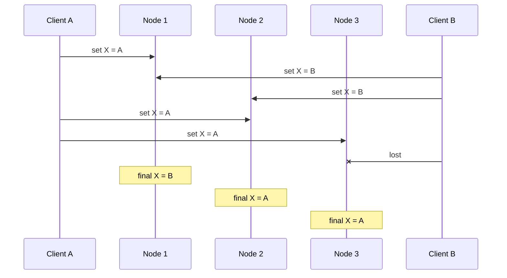

# Detecting concurrent writes: LWW, version vectors, CRDTs

Dynamo-style databases let several clients write the same key concurrently, which produces conflicts even with strict quorums. Conflicts also arise during read repair and hinted handoff. Events may arrive in **different orders at different nodes** because of variable network delays and partial failures. If each node simply overwrote the value whenever it received a write, the nodes would become **permanently inconsistent**.



To become **eventually consistent**, replicas must **converge** toward the same value. Databases tend to be weak at this, so you need to understand conflict handling yourself.

## 1. Last write wins (discarding concurrent writes)

One approach: each replica stores only the "most recent" value and lets older values be overwritten. Neither client knew about the other's write when sending its own, so "recent" is ill-defined. The writes are **concurrent** and their order is undefined.

**Last write wins (LWW)** forces an arbitrary order. Attach a **timestamp** to each write, pick the biggest as most recent, and discard the rest. It is the **only** conflict resolution method supported in **Cassandra**, and an optional feature in Riak.

LWW achieves eventual convergence **at the cost of durability**. If several writes are concurrent, all of them are reported as successful to their clients (each was written to $w$ replicas), but only one survives and the others are **silently discarded**. LWW may even drop writes that are *not* concurrent, because of **clock skew** (Chapter 8).

When is LWW acceptable? When losing data is acceptable, as in caching. When it is not, the only safe way to use LWW is to ensure a key is **written only once** and treated as immutable afterwards. The recommended Cassandra pattern is to use a **UUID as the key**, so every write gets a unique key.

```python-run
# LWW register: (timestamp, node_id) breaks ties deterministically
def lww_merge(a, b):
    """a, b are (value, timestamp, node_id). Return the winner."""
    return max(a, b, key=lambda v: (v[1], v[2]))

w1 = ("cart=[milk]",  1000, "n1")
w2 = ("cart=[eggs]",  1000, "n2")   # concurrent, same timestamp -> node_id tiebreak
w3 = ("cart=[ham]",    999, "n3")   # actually written LATER but n3's clock is behind!
state = w1
for w in (w2, w3):
    state = lww_merge(state, w)
print("converged value:", state[0])
print("silently lost  :", [w[0] for w in (w1, w2, w3) if w is not state])
```

## 2. The "happens-before" relationship and concurrency

How do we decide whether two operations are concurrent?

- Client A inserts a value, and client B **increments** it. B's operation **builds upon** A's, so B is **causally dependent** on A, and A **happened before** B.
- Two clients each set a key without knowing about the other. Neither knows about the other, so they are **concurrent**.

Formally: operation A happens before B if B knows about A, depends on A, or builds upon A in some way. Two operations are **concurrent if neither happens before the other**, that is, neither knows about the other. For any two operations A and B there are exactly three possibilities: A happened before B, B happened before A, or they are concurrent.

> [!NOTE]
> **Concurrency is not about wall-clock time overlap.** Because of network delays, two operations can be "concurrent" even if they occurred seconds apart on the clock, as long as neither was aware of the other. This mirrors relativity: information cannot travel faster than light, so two events that cannot affect each other are concurrent.

If one operation happened before the other, the later one should overwrite the earlier. If they are concurrent, **we have a conflict to resolve**.

## 3. Capturing happens-before with version numbers

DDIA works through a single-replica shopping cart with two clients:

1. Client 1 adds `milk`. The server stores it as **version 1** and returns `[milk]` with version 1.
2. Client 2 adds `eggs` *without knowing* about client 1's milk. The server assigns **version 2**, keeps `[milk]` and `[eggs]` as separate values (**siblings**), and returns both with version 2.
3. Client 1, unaware of client 2, wants `[milk, flour]`. It sends that with **version 1** (the last version it saw). The server sees that this write supersedes version 1 (`[milk]`) but is concurrent with `[eggs]`. It assigns version 3, overwrites `[milk]`, keeps `[eggs]`, and returns both.
4. Client 2 wants `[eggs, milk, ham]`, merging the siblings it saw, and sends it with version 2. The server overwrites `[eggs]` (version 2) and keeps `[milk, flour]` (version 3). Version 4.
5. Client 1 wants `[milk, flour, eggs, bacon]` with version 3. The server overwrites `[milk, flour]` and keeps `[eggs, milk, ham]`. Version 5.

The algorithm:

- The server maintains a **version number per key**, incremented on every write, and stores it with the value.
- On **read**, the server returns all un-overwritten values plus the latest version. **A client must read a key before writing.**
- On **write**, the client includes the version from its prior read and **merges** all values it received.
- When the server receives a write with version $v$, it overwrites all values with version $\le v$ (which the client has merged in) and **keeps values with higher versions** (which are concurrent with this write).

A write with no version number is concurrent with everything, so it overwrites nothing and is returned as a sibling on later reads.

```python-run
class SiblingStore:
    """Single-replica version-number algorithm from DDIA Fig 5-13."""
    def __init__(self):
        self.version = 0
        self.values = []                     # list of (version, value)

    def read(self):
        return self.version, [v for _, v in self.values]

    def write(self, value, seen_version=0):
        self.version += 1
        # keep only values written AFTER what the client had seen (concurrent ones)
        self.values = [(ver, v) for ver, v in self.values if ver > seen_version]
        self.values.append((self.version, value))
        return self.read()

s = SiblingStore()
print("c1:", s.write(["milk"], 0))
print("c2:", s.write(["eggs"], 0))
print("c1:", s.write(["milk", "flour"], 1))
print("c2:", s.write(["eggs", "milk", "ham"], 2))
print("c1:", s.write(["milk", "flour", "eggs", "bacon"], 3))
v, sibs = s.read()
merged = sorted(set().union(*map(set, sibs)))
print("client merges siblings by union ->", merged)
```

## 4. Merging concurrently written values

Siblings push work onto the application, which must **merge** them. A simple approach is to pick one by version number or timestamp, which loses data. A shopping cart might take the **union** instead.

Union fails for **removals**. If one sibling removed `milk` and another still has it, the union brings milk back. So a removal must leave a marker, a **tombstone** with an appropriate version, so the merge knows the item was removed.

Merging siblings in application code is complex and error-prone. **CRDTs** (Conflict-free Replicated Data Types) are data structures that can be merged automatically in sensible ways, including handling deletions. Riak's datatypes support this.

### 4.1 CRDT intro

A **state-based CRDT** has a merge function that is:

- **commutative**: $merge(a, b) = merge(b, a)$,
- **associative**: $merge(a, merge(b, c)) = merge(merge(a, b), c)$,
- **idempotent**: $merge(a, a) = a$.

Mathematically, states form a **join-semilattice**. With these properties replicas can exchange state in any order, any number of times, and still converge.

Classic CRDTs:

| CRDT | State | Merge |
|---|---|---|
| **G-Counter** (grow-only) | one count per replica | element-wise max; value = sum |
| **PN-Counter** | two G-Counters (P for increments, N for decrements) | merge each; value = P − N |
| **G-Set** | set | union |
| **2P-Set** | add-set + remove-set (tombstones) | union both; removed forever |
| **OR-Set** (observed-remove) | elements tagged with unique ids; removes delete observed tags | union of adds minus observed removes; "add wins" over concurrent remove |
| **LWW-Register** | (value, timestamp) | max timestamp |

```python-run
class GCounter:
    def __init__(self, node, nodes):
        self.node = node
        self.c = {n: 0 for n in nodes}
    def inc(self, k=1):
        self.c[self.node] += k
    def merge(self, other):
        for n in self.c:
            self.c[n] = max(self.c[n], other.c[n])
    def value(self):
        return sum(self.c.values())

nodes = ["a", "b", "c"]
A, B, C = (GCounter(n, nodes) for n in nodes)
A.inc(3); B.inc(2); C.inc(5); A.inc(1)
# gossip in arbitrary order, with duplicates
B.merge(A); C.merge(B); A.merge(C); A.merge(C); B.merge(C)
print("values:", A.value(), B.value(), C.value(), "(all converge to 11)")

class ORSet:
    def __init__(self): self.adds, self.removes, self.n = set(), set(), 0
    def add(self, x, replica):
        self.n += 1; self.adds.add((x, f"{replica}:{self.n}"))
    def remove(self, x):
        self.removes |= {t for t in self.adds if t[0] == x}   # remove only OBSERVED tags
    def merge(self, o):
        self.adds |= o.adds; self.removes |= o.removes
    def value(self): return sorted({x for (x, tag) in self.adds - self.removes})

r1, r2 = ORSet(), ORSet()
r1.add("milk", "r1"); r2.merge(r1)
r1.remove("milk")            # r1 removes milk...
r2.add("milk", "r2")         # ...while r2 concurrently re-adds it
r1.merge(r2); r2.merge(r1)
print("OR-Set after concurrent remove/add:", r1.value(), r2.value(), "(add wins)")
```

## 5. Version vectors

With **multiple replicas** and no leader, one version number is not enough. We need a version number **per replica per key**. Each replica increments its own number when processing a write and also tracks the numbers it has seen from each other replica. The collection of version numbers from all replicas is a **version vector**. Riak 2.0 uses *dotted version vectors*, sends them to clients with values on read (as a "causal context"), and expects them back on write.

Comparing two version vectors $V$ and $W$:

- $V \le W$ if $V[i] \le W[i]$ for every replica $i$.
- **V happened before W** if $V \le W$ and $V \ne W$.
- **W happened before V** if $W \le V$ and $W \ne V$.
- **Equal** if every component matches.
- **Concurrent** otherwise: each has some component greater than the other's.

```python-run
def compare(v, w):
    keys = set(v) | set(w)
    le = all(v.get(k, 0) <= w.get(k, 0) for k in keys)
    ge = all(v.get(k, 0) >= w.get(k, 0) for k in keys)
    if le and ge: return "equal"
    if le: return "before"
    if ge: return "after"
    return "concurrent"

print(compare({"a": 1}, {"a": 2}))                    # before
print(compare({"a": 2, "b": 1}, {"a": 1, "b": 1}))    # after
print(compare({"a": 2, "b": 0}, {"a": 1, "b": 3}))    # concurrent -> siblings
print(compare({"a": 1, "b": 2}, {"b": 2, "a": 1}))    # equal
```

> [!NOTE]
> **Version vectors vs vector clocks.** They look the same. Strictly, a *version vector* tracks the version history of a *replica's data* and is used to compare replica states, while a *vector clock* tracks causality between *events in processes* (next chapters). Many systems use the terms interchangeably.

> [!INTERVIEW]
> "How does Dynamo/Riak detect conflicting writes?" Each value carries a **version vector**. On write, the client sends back the context it read, and replicas keep values whose vectors are **concurrent** as **siblings**. The application or a CRDT merges them. Contrast this with **Cassandra's LWW**: simpler, but it silently drops concurrent writes and depends on synchronised clocks. Shopping-cart example: Amazon's cart used union-merge, which sometimes resurrected deleted items.

## 6. Pitfalls

- **LWW with unsynchronised clocks** drops writes that were actually later.
- **Union merges without tombstones** resurrect deleted items.
- **Writing without reading first** in a sibling-based store creates ever-growing sibling lists ("sibling explosion").
- **Unbounded version vectors** when many short-lived clients act as replicas. Use per-server vectors (dotted version vectors).

## 7. Summary

- Concurrent writes produce conflicts, and replicas must **converge**.
- **LWW** converges by discarding writes. It is fine for caches and immutable keys, dangerous otherwise.
- **Happens-before** vs **concurrent** is about *knowledge*, not clock time.
- Version numbers (one replica) and **version vectors** (many replicas) detect concurrency. Concurrent values are kept as **siblings** and merged.
- **CRDTs** (G-Counter, PN-Counter, OR-Set…) merge automatically because merge is commutative, associative and idempotent.

```quiz
[
  {"q": "Two operations are concurrent if...",
   "options": ["They occur at exactly the same wall-clock time", "Neither happens before the other, i.e., neither knew about the other", "They are on the same node", "They write different keys"],
   "answer": 1,
   "explain": "Concurrency is defined by causal knowledge, not by physical time overlap."},
  {"q": "What is the main cost of last-write-wins conflict resolution?",
   "options": ["Slow reads", "Durability: concurrent writes reported as successful are silently discarded", "It never converges", "It needs version vectors"],
   "answer": 1,
   "explain": "LWW converges by throwing away all but one write, and clock skew can even drop non-concurrent writes."},
  {"q": "When is LWW safe to use?",
   "options": ["For bank balances", "When each key is written once and then treated as immutable (e.g., UUID keys) or data loss is acceptable", "For shopping carts", "Never"],
   "answer": 1,
   "explain": "With write-once keys there are no concurrent updates to lose."},
  {"q": "Compare version vectors V = {a:2, b:0} and W = {a:1, b:3}.",
   "options": ["V happened before W", "W happened before V", "Concurrent", "Equal"],
   "answer": 2,
   "explain": "V is greater in a, W is greater in b: neither dominates."},
  {"q": "In the version-number algorithm, when the server receives a write carrying version v, it...",
   "options": ["Overwrites all values", "Overwrites values with version <= v and keeps values with higher versions as siblings", "Rejects the write", "Keeps only values with version < v"],
   "answer": 1,
   "explain": "Higher-versioned values were written concurrently and must be preserved."},
  {"q": "Why does merging shopping-cart siblings by set union need tombstones?",
   "options": ["To save space", "Otherwise items removed in one sibling reappear because another sibling still contains them", "Union is not commutative", "To order items"],
   "answer": 1,
   "explain": "A removal must be recorded so that the merge knows the absence is deliberate."},
  {"q": "Which property is NOT required of a state-based CRDT merge?",
   "options": ["Commutative", "Associative", "Idempotent", "Requires a central coordinator"],
   "answer": 3,
   "explain": "CRDTs merge without coordination; the three algebraic properties guarantee convergence."},
  {"q": "In a G-Counter, how are two replica states merged?",
   "options": ["Sum each component", "Element-wise maximum of per-replica counts", "Take the larger total", "Last write wins"],
   "answer": 1,
   "explain": "Max is idempotent, so repeated or reordered merges do not double count."}
]
```

> **Source:** DDIA ch. 5, "Detecting Concurrent Writes" (last write wins, happens-before, capturing causality, merging siblings, version vectors).
